<!-- Generated by scripts/sync-knowledge.js from notes/ and README.md — do not edit here. -->
<!-- sections (line ranges in this file): Table of Contents 19-43 · ELI5 44-58 · Core Concept 59-413 · System Design Angle 414-443 · Framework Comparison 444-457 · Real-World Examples 458-720 · Key Points Summary 721-742 · Test Your Understanding 743-817 · Cheat Sheet 818-871 · References & Further Reading 872-910 -->

# Offline-First Architecture

> **Date:** 2026-11-06 · **Last updated:** 2026-11-06
> **Category:** Frontend System Design
> **Sub-Topic:** State & Data / Data Fetching
> **Level:** Advanced · **Reading time:** ~35 min
> **Informs:** online-only vs offline-capable vs offline-first scope, local database choice (IndexedDB, OPFS + SQLite), mutation outbox and idempotency, delta sync and tombstones, conflict resolution, storage quotas and eviction, PWA app shell, sync engine build vs buy

> **Pre-requisite:** [Service Workers & Web Workers](./service-workers-and-web-workers.md) (app shell caching, Background Sync caveats) and [Browser Storage Mechanisms](./browser-storage-mechanisms.md) (IndexedDB, quotas, eviction). [Real-Time Data Sync](./real-time-data-sync.md) covers ordering and conflicts in the always-online case.
> This note covers apps that **read and write locally first** and treat the network as a way to sync, not a requirement to work.

**Previous:** [Real-Time Data Sync](./real-time-data-sync.md) · **Next:** [Core Web Vitals (LCP, INP, CLS)](./core-web-vitals-lcp-inp-cls.md)

---

## Table of Contents

1. [ELI5 — Simple Explanation](#eli5--simple-explanation)
2. [Section 1: Online-Only, Offline-Capable, Offline-First](#section-1-online-only-offline-capable-offline-first)
3. [Section 2: The Five Layers of an Offline-First App](#section-2-the-five-layers-of-an-offline-first-app)
4. [Section 3: Layer 1 — The App Shell](#section-3-layer-1--the-app-shell)
5. [Section 4: Layer 2 — The Local Database](#section-4-layer-2--the-local-database)
6. [Section 5: Storage Quotas, Eviction and Persistence](#section-5-storage-quotas-eviction-and-persistence)
7. [Section 6: Reads — Local First, Then Revalidate](#section-6-reads--local-first-then-revalidate)
8. [Section 7: Writes — The Outbox Pattern](#section-7-writes--the-outbox-pattern)
9. [Section 8: Pulling Changes — Delta Sync](#section-8-pulling-changes--delta-sync)
10. [Section 9: Conflicts](#section-9-conflicts)
11. [Section 10: When to Sync — Triggers and Connectivity](#section-10-when-to-sync--triggers-and-connectivity)
12. [Section 11: Offline UX](#section-11-offline-ux)
13. [Section 12: Security, Auth and Multi-User Devices](#section-12-security-auth-and-multi-user-devices)
14. [System Design Angle — Build vs Buy a Sync Engine](#system-design-angle--build-vs-buy-a-sync-engine)
15. [Framework Comparison](#framework-comparison)
16. [Real-World Examples](#real-world-examples)
17. [Key Points Summary](#key-points-summary)
18. [Test Your Understanding (with answers)](#test-your-understanding)
19. [Cheat Sheet](#cheat-sheet)
20. [References & Further Reading](#references--further-reading)

---

## ELI5 — Simple Explanation

Think of a **field researcher with a notebook**, working in a forest with no phone signal:

- She **writes everything in her notebook first** (the local database). She never waits for headquarters to say "OK" before writing.
- Every change also goes on a **"to send" list** at the back of the notebook (the **outbox**).
- When she reaches a village with signal, she **mails the list** to headquarters and **receives the pages others wrote** since her last visit (sync).
- If she and a colleague both changed the same plant record, headquarters has a **rule** for who wins — or asks a human (conflict resolution).
- Her notebook has **limited pages** and could be lost (storage quota, eviction), so important pages must eventually reach headquarters.
- The notebook's **cover and table of contents** are printed in advance (the app shell), so she can open it anywhere.

> **Offline-first means the UI only ever talks to local data; a separate sync process moves changes between that local data and the server whenever it can.**

---

## Core Concept — Step by Step

### Section 1: Online-Only, Offline-Capable, Offline-First

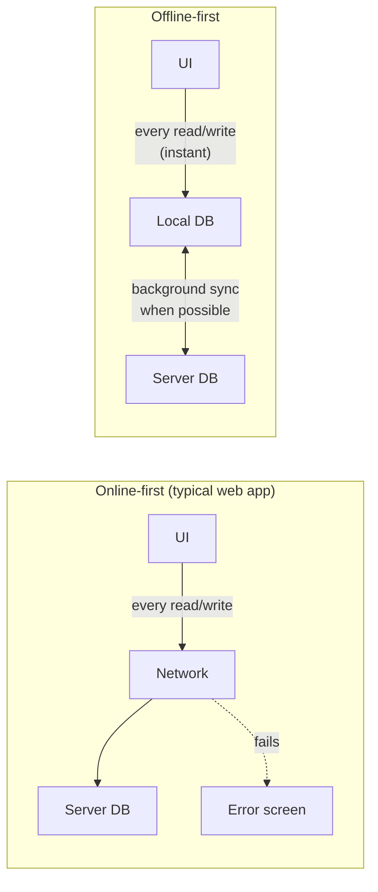

| Level | What works offline | Effort | Example products |
|---|---|---|---|
| **Online-only** | Nothing (maybe a custom offline page) | Lowest | Banking transfers, checkout, live auctions |
| **Offline-tolerant** | Shell loads; recently viewed data readable (cached); writes blocked with a clear message | Low | News, docs sites, dashboards |
| **Offline-capable** | Reads from cache, **some writes queued** and replayed | Medium | Social posting, forms, field data capture |
| **Offline-first** | Everything works locally; sync is background | High | Notes, task managers, email clients, POS, field-service apps |
| **Local-first** | Offline-first + the user owns the data; collaboration via CRDTs; server optional | Highest | Collaborative editors, personal knowledge tools |

> **Don't make everything offline-first.** Decide per feature: "create a note" can be queued; "pay an invoice" or "book the last seat" needs the server's answer *now* and should say so when offline.

---

### Section 2: The Five Layers of an Offline-First App

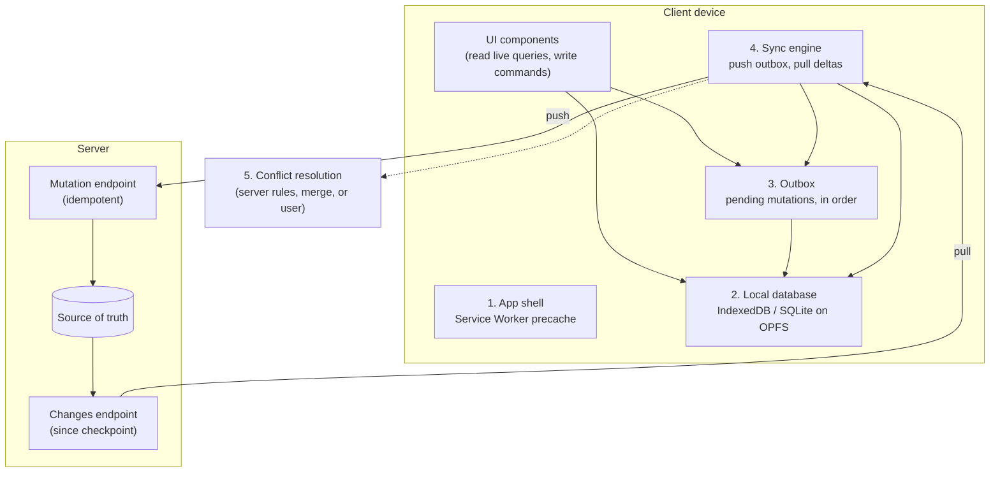

| Layer | Responsibility | Typical tools |
|---|---|---|
| **1. App shell** | HTML/JS/CSS/fonts available without a network | Service Worker + Workbox / framework PWA plugin |
| **2. Local DB** | Durable, queryable copy of the user's data | IndexedDB (Dexie, idb), SQLite WASM on OPFS, PGlite, RxDB |
| **3. Outbox** | Ordered list of writes not yet confirmed by the server | A table in the local DB |
| **4. Sync engine** | Push outbox, pull server changes, track checkpoints, retry | Custom, or PowerSync / ElectricSQL / Replicache-Zero / Firestore |
| **5. Conflicts** | Decide the result when local and remote changes collide | LWW, field merge, server rebase, CRDT |

The key rule: **the UI never awaits the network.** It writes to the local DB + outbox in one transaction and re-renders from a live query.

---

### Section 3: Layer 1 — The App Shell

Without the code, there is no app to be offline in. The Service Worker **precaches** the build output at install time and serves navigations from cache when the network fails. Details are in [Service Workers & Web Workers](./service-workers-and-web-workers.md#section-12-caching-strategies).

| Request | Strategy for offline-first |
|---|---|
| Navigations (HTML) | Precached shell, or network-first with a short timeout and cached fallback |
| Hashed JS/CSS/fonts | Precache (revisioned) — cache-first |
| Images / media | Runtime cache-first with expiration (`maxEntries`, `maxAgeSeconds`) |
| API reads | Usually **not** the SW's job in offline-first — data comes from the local DB |
| API writes | Outbox in the page or SW (Section 7) |

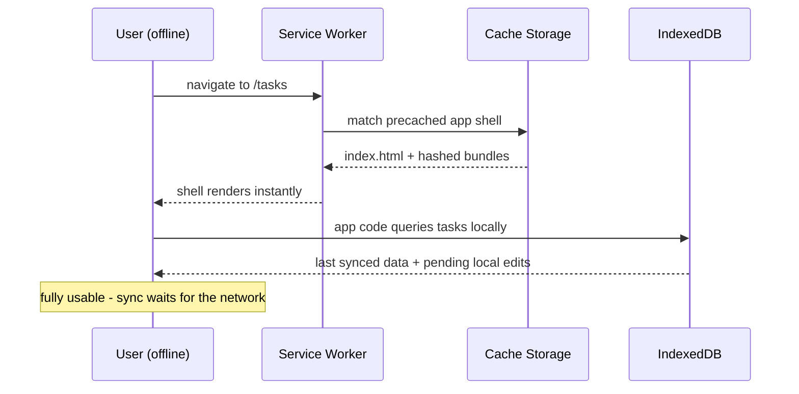

**Updates still matter offline-first:** a user may run a cached build for weeks. Version your **local DB schema** and your **outbox payloads** so a newer server can still accept mutations from an older client, and prompt users to reload when a new SW is waiting.

---

### Section 4: Layer 2 — The Local Database

| Option | Model | Strengths | Watch out for |
|---|---|---|---|
| **IndexedDB** (raw) | Object stores + indexes, transactional, async | Everywhere, large quota, works in workers and SW | Verbose API; schema changes via `onupgradeneeded` versions |
| **Dexie.js** | IndexedDB wrapper | Simple queries, `liveQuery` reactivity, migrations | Still IndexedDB limits (no joins/SQL) |
| **idb** | Tiny promise wrapper | Minimal, close to the spec | You build the rest |
| **SQLite (official WASM build) on OPFS** | Real SQL | Joins, transactions, mature engine | Runs in a **Worker** for the fast OPFS sync-access path; WASM download size |
| **PGlite** | Postgres compiled to WASM | Postgres semantics on the client | Larger payload; newer |
| **RxDB / WatermelonDB** | Reactive document DBs with sync plugins | Batteries included (WatermelonDB targets React Native) | Learning curve, lock-in |
| **localStorage** | Synchronous strings | — | ❌ Blocks the main thread, ~5 MB, no transactions — not a database |

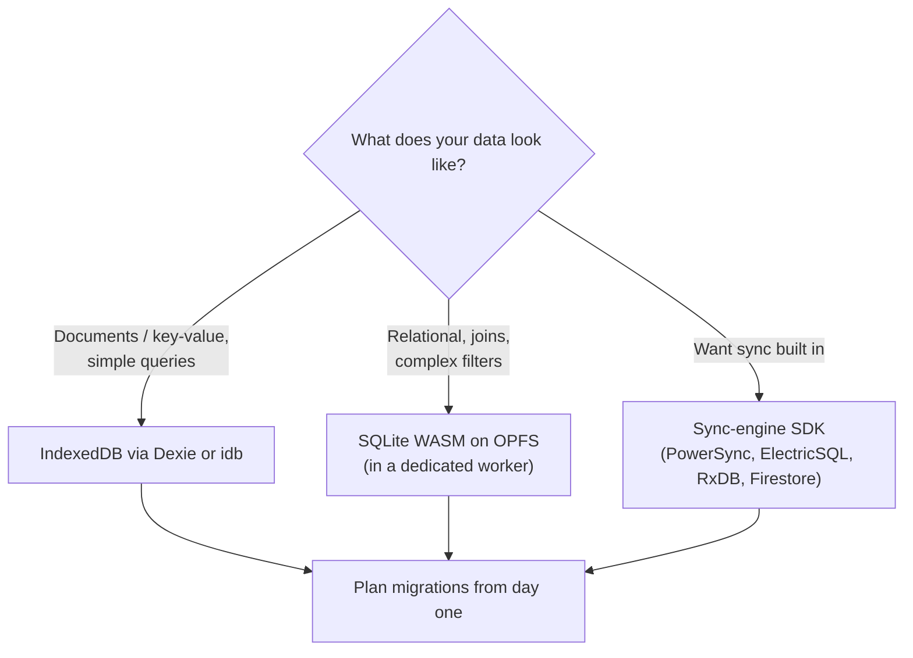

**Design rules for the local schema:**
- **Client-generated IDs** (`crypto.randomUUID()`, or UUIDv7/ULID if you want time-sortable ids) so records created offline have their final id immediately — no temp-id remapping.
- Store **sync metadata** per record: `serverVersion`, `updatedAt` (server time), `dirty`/`pending` flags, `deleted` (tombstone).
- Store a **checkpoint** (last server change cursor) per collection or per sync scope.
- **Sync only what the user needs** (partial replication): their workspace, the last N months — not the whole server DB.

---

### Section 5: Storage Quotas, Eviction and Persistence

Local data can disappear. Offline-first apps must plan for it rather than hope.

| Risk | What happens | Mitigation |
|---|---|---|
| **Quota** | Writes fail with `QuotaExceededError` once the origin's share is used; limits differ by browser and device | `navigator.storage.estimate()`, prune old data, catch and surface the error |
| **Best-effort eviction** | Under storage pressure the browser can delete an origin's data (whole origin at once) | `navigator.storage.persist()` asks for persistent storage; browsers grant it by their own heuristics (e.g. installed, bookmarked, engagement) or by prompting |
| **Safari's 7-day rule** | Script-writable storage (IndexedDB, Cache API, SW registration, localStorage) can be deleted after 7 days of Safari use without interaction with the site; Home Screen web apps are exempt | Encourage installing; sync outbox promptly; treat local data as a cache of the server **plus** an outbox you flush ASAP |
| **User clears data / private mode** | Everything gone | The server must remain the durable source; warn before clearing if unsynced work exists |
| **Schema/bug corruption** | App can't open the DB | Versioned migrations, a "reset local data and resync" escape hatch |

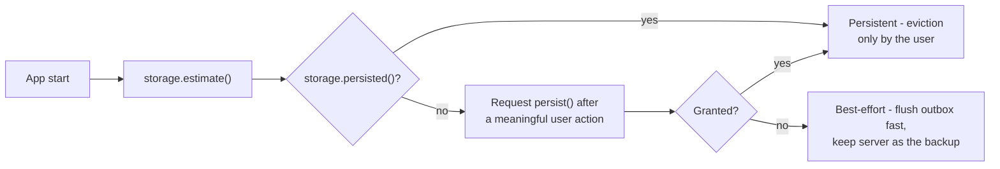

> **The outbox is the only data that exists nowhere else.** Everything else can be re-downloaded. Optimise for getting pending writes to the server quickly.

---

### Section 6: Reads — Local First, Then Revalidate

The UI subscribes to **live queries** on the local DB. Sync writes into the same DB, so the UI updates automatically whether a change came from the user or the server.

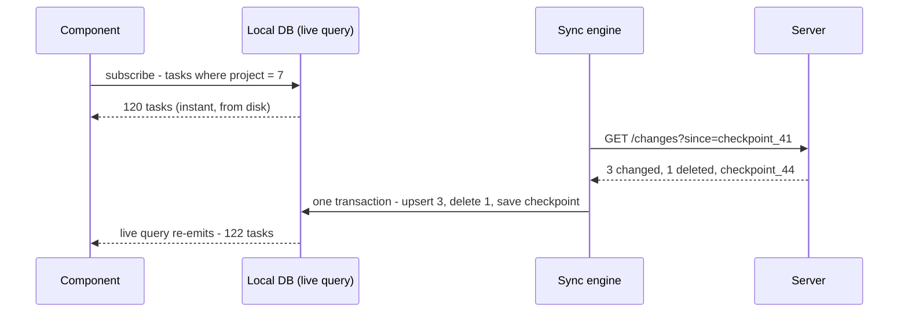

If your app is mostly online with **offline reading** as a bonus, you don't need a hand-built local DB: **persist the server-state cache** instead.

| Approach | When |
|---|---|
| **Live queries on a local DB** (Dexie `liveQuery`, SQLite + reactive layer, RxDB, sync-engine SDK) | True offline-first with offline writes |
| **Persisted query cache** (TanStack Query `PersistQueryClientProvider` + an IndexedDB persister; Apollo `apollo3-cache-persist`; RTK Query + redux-persist) | Online-first app that should show last-known data offline |
| **Service Worker runtime cache for API GETs** (`StaleWhileRevalidate`) | Simple read-only offline for public data — not per-user data on shared devices |

TanStack Query also has **`networkMode`**: `'online'` (default — queries and mutations pause while offline), `'offlineFirst'` (run once so a SW cache can answer, then pause retries), and `'always'` (ignore network status). Paused mutations survive a reload only if they are persisted and have a `mutationFn` registered via `setMutationDefaults`.

---

### Section 7: Writes — The Outbox Pattern

Every user action becomes a **command** stored in the outbox in the **same local transaction** as the optimistic change to local data.

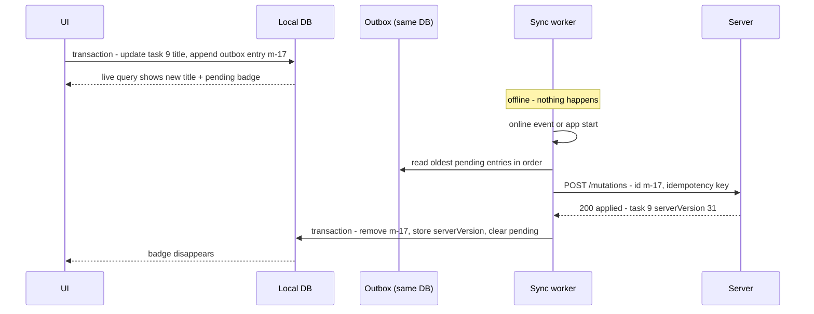

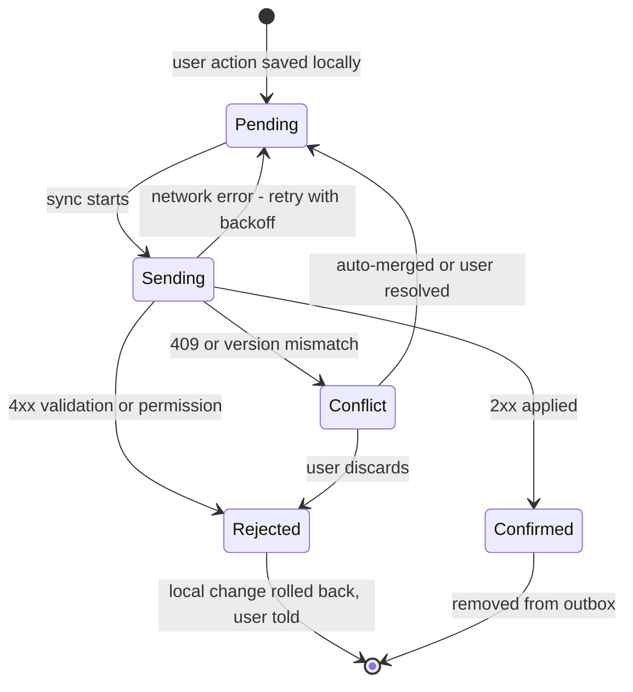

**Outbox rules:**

| Rule | Why |
|---|---|
| **Write data + outbox entry in one transaction** | A crash can't leave a local change with no pending mutation (or vice versa) |
| **Send in order** (per entity at least) | "Create task" must reach the server before "rename task" |
| **Idempotency key per mutation** (`mutationId`) | A retry after a lost response must not apply twice; the server remembers processed ids |
| **Client-generated entity ids** | Later mutations can reference records created offline |
| **Store intent, not just final values** where it matters | "Add 2 to quantity" vs "set quantity to 5" merge differently on the server |
| **Distinguish retryable vs permanent failures** | 5xx/network → retry with backoff; 4xx → stop, roll back, tell the user |
| **Never block the queue forever** | A poison message (always 400) must be moved aside, or nothing behind it ever syncs |
| **One sync worker per browser** | Two tabs flushing the same outbox duplicate requests — use the Web Locks API (see [Real-Time Data Sync](./real-time-data-sync.md#section-10-multi-tab-sync)) |
| **Coalesce when safe** | Ten edits to the same draft title can become one mutation |

---

### Section 8: Pulling Changes — Delta Sync

Re-downloading everything on each sync wastes bandwidth and battery. Pull **only what changed since a checkpoint**:

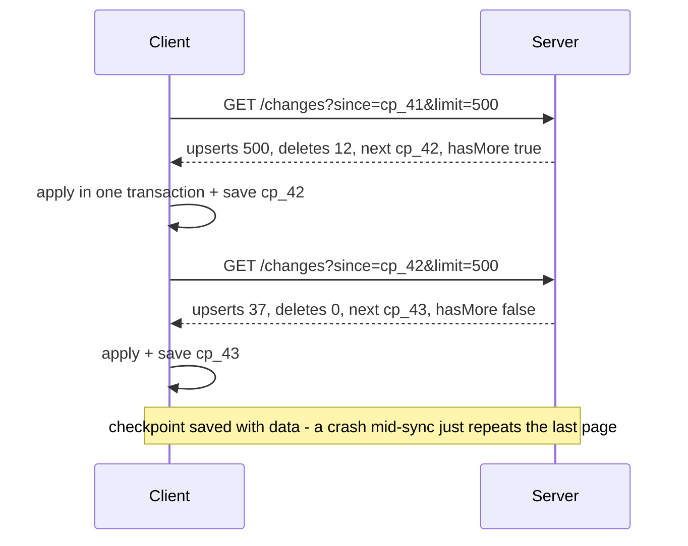

| Concern | Solution |
|---|---|
| **Deletes** | The server keeps **tombstones** (`{ id, deleted: true, version }`) so clients learn about deletions; purge tombstones after a retention window |
| **Client too far behind** | If `since` is older than the tombstone retention, the server answers "full resync required" |
| **Checkpoint** | A server-issued opaque cursor (change-log position, logical clock) — **not** the client's clock |
| **Own changes echoed back** | Compare `serverVersion`, or skip changes caused by your own `mutationId`s already applied |
| **Pending local edits** | Don't let pulled data overwrite a record with pending outbox entries — rebase instead (Section 9) |
| **Permissions change** | Server must send "removed from scope" events so revoked data is deleted locally |
| **Large first sync** | Paginate, show progress, sync the most important collections first |

---

### Section 9: Conflicts

Offline makes conflicts **normal**, not exceptional: two devices can each make many changes over hours before syncing.

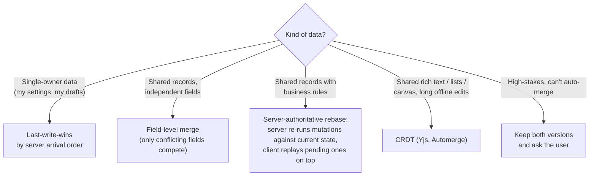

| Strategy | Offline behaviour | Example |
|---|---|---|
| **Last-write-wins (server order)** | The device that syncs last wins — even if its edit is older | Personal preferences |
| **LWW by client timestamp** | ⚠️ Device clocks are wrong surprisingly often | Avoid, or use hybrid logical clocks |
| **Field-level merge** | Different fields both survive | Title edited on phone, due date on laptop |
| **Server rebase (mutations as functions)** | Server validates each mutation against current state (e.g. "stock ≥ 1") | Inventory, task assignment |
| **CRDT** | Always merges, deterministic everywhere | Notes, docs, whiteboards |
| **Manual resolution** | User picks or edits | Contracts, medical records |

> Conflict handling is a **product decision** as much as an engineering one: what should happen when two nurses update the same chart offline? Agree on it with the domain experts before choosing a technique. [Real-Time Data Sync](./real-time-data-sync.md#section-8-concurrent-edits-and-conflict-resolution) compares OT and CRDTs.

---

### Section 10: When to Sync — Triggers and Connectivity

`navigator.onLine === true` only means "connected to *some* network" — not that your server is reachable (captive portals, "lie-fi", VPNs). Treat it as a hint; **a successful request is the only proof**.

| Trigger | Availability | Notes |
|---|---|---|
| App start / page load | Everywhere | Always flush the outbox and pull |
| `online` event | Everywhere | Start sync; may still fail — keep backoff |
| `visibilitychange` → visible, `pageshow` (bfcache restore) | Everywhere | Users returning to the tab expect fresh data |
| Timer while open | Everywhere | Adaptive interval; pause when hidden |
| After every local write | Everywhere | Debounce slightly to batch |
| **Background Sync API** (`sync` event in the SW) | Chromium only | Runs even after the tab closes; treat as an enhancement |
| **Periodic Background Sync** | Chromium, installed PWAs, engagement-gated | Pre-fetch content; never rely on it |
| Native mobile background tasks | Android WorkManager, iOS BGTaskScheduler | OS decides when; budgets are limited |

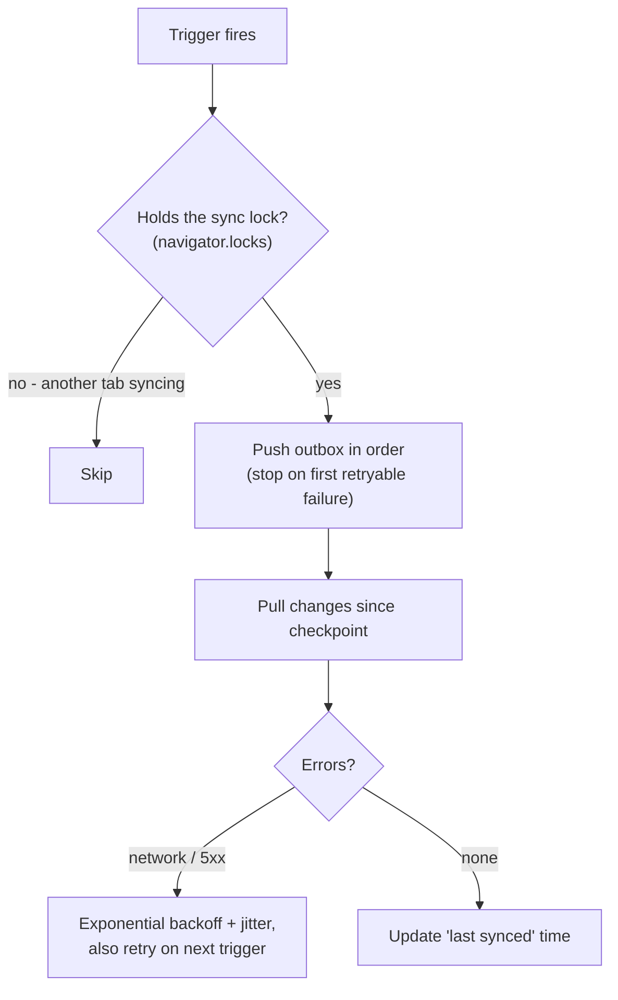

Use `AbortSignal.timeout(ms)` on sync requests so a hanging connection doesn't stall the whole queue.

---

### Section 11: Offline UX

Users should always know **what state their data is in** — without being nagged.

| Element | Guidance |
|---|---|
| **Connectivity indicator** | Subtle banner or icon ("Offline — changes will sync"); not a blocking modal |
| **Per-item sync state** | "Saving…", "Not synced yet", "Failed — retry" next to the affected item |
| **Last synced time** | "Updated 3 min ago" on data screens |
| **Online-only actions** | Disable with an explanation ("Payments need a connection"), don't let them fail silently |
| **Conflict / rejection messages** | Explain what happened and what was kept; offer to restore the discarded text |
| **Unsynced work warning** | Warn before logout, "clear data", or uninstall flows if the outbox isn't empty |
| **First load offline** | A friendly offline page if the shell has never been cached |
| **Accessibility** | Announce connectivity changes in a polite live region once, not on every flicker; debounce online/offline toggles |

---

### Section 12: Security, Auth and Multi-User Devices

| Concern | Guidance |
|---|---|
| **Data at rest** | IndexedDB/OPFS are not encrypted by the browser beyond OS disk encryption; anyone with the unlocked device profile can read them. Store only what offline use needs |
| **Shared devices** | On logout: flush or warn about the outbox, then delete the local DB, Cache Storage and SW caches (`Clear-Site-Data` helps where supported) |
| **Expired tokens offline** | Queue continues locally; on reconnect refresh the token first, then flush. Never attach a different user's token to a queued mutation — tag outbox entries with the user id |
| **Offline authorization** | The client can't enforce permissions; the server must re-validate every queued mutation as if it were new |
| **Revoked access** | Sync must delete data the user lost access to (Section 8) |
| **Client-side encryption** | Possible with WebCrypto, but key storage (where does the key live offline?) is the hard part — usually only for end-to-end-encrypted products |

---

## System Design Angle — Build vs Buy a Sync Engine

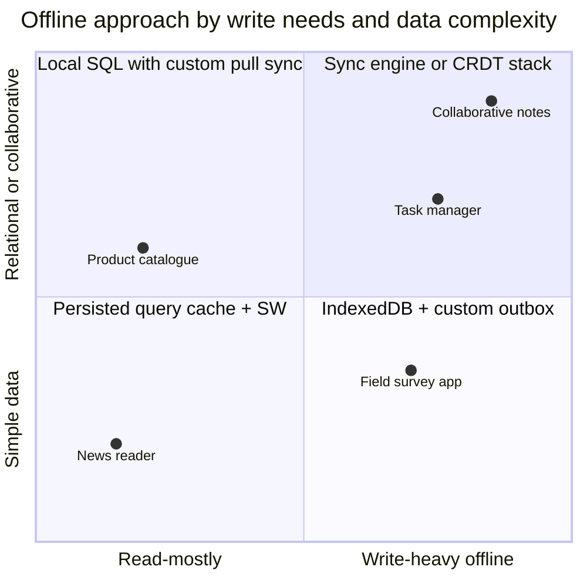

| Option | Examples (not endorsements) | You still own |
|---|---|---|
| **Custom** | Dexie/SQLite + your `/mutations` and `/changes` endpoints | Everything: ordering, idempotency, tombstones, migrations, conflicts |
| **Backend SDK with offline cache** | Firebase/Firestore offline persistence, AWS Amplify DataStore-style SDKs, Couchbase Lite, PouchDB ↔ CouchDB | Data modelling within the vendor's rules |
| **Postgres sync engines** | PowerSync, ElectricSQL, Zero (Rocicorp) | Sync rules/shapes, write path and auth |
| **CRDT stacks** | Yjs (+ y-indexeddb), Automerge | Server relay, persistence, compaction, auth |
| **Reactive local DBs with replication** | RxDB, WatermelonDB | Backend replication endpoints |

**Interview checklist:** which features must work offline; how long users stay offline (minutes vs weeks); data volume per user; who else can edit the same records; conflict policy agreed with product; how the outbox survives reloads, crashes and logouts; migration story for old clients; storage limits on low-end phones; how you test it (DevTools offline mode, throttling, killing the tab mid-sync).

---

## Framework Comparison

| Stack | App shell / SW | Local data & reactivity | Notes |
|---|---|---|---|
| **React (Vite)** | `vite-plugin-pwa` (Workbox) | Dexie + `useLiveQuery` (`dexie-react-hooks`), TanStack Query persister, RxDB | TanStack Query `networkMode`, paused mutations + `resumePausedMutations()` |
| **Next.js** | No built-in SW; Serwist (Workbox-based) | Same as React, client components only | Server Components need the network — offline screens must be client-rendered from local data |
| **Vue / Nuxt** | `vite-plugin-pwa` / `@vite-pwa/nuxt` | Dexie `liveQuery` wrapped in a composable (`useObservable` from VueUse/RxJS), TanStack Vue Query persister | |
| **Angular** | `@angular/service-worker` (`ngsw-config.json` with asset groups and data groups) | Dexie `liveQuery` → RxJS → signals (`toSignal`) | `SwUpdate` service for version prompts |
| **SvelteKit** | Built-in `src/service-worker` with the `$service-worker` module (build/file lists, version) | Dexie `liveQuery` works as a Svelte store (it implements the observable contract) | |
| **React Native** | Bundled app — no shell problem | WatermelonDB, op-sqlite / expo-sqlite, PowerSync, Realm-style DBs | NetInfo for connectivity; background tasks are OS-limited |
| **iOS / Android native** | Bundled app | SwiftData / Core Data (+ CloudKit), Room + WorkManager for deferred sync | Native apps are "offline-first by default" for code; data still needs this design |

---

## Real-World Examples

**Example 1 — Local schema with outbox (Dexie, TypeScript):**
```typescript
import Dexie, { type Table } from 'dexie';

export type Task = {
  id: string;                 // client-generated: crypto.randomUUID()
  projectId: string;
  title: string;
  done: boolean;
  serverVersion: number;      // 0 = never confirmed by the server
  pending: 0 | 1;             // 1 = has unsynced outbox entries (indexable)
  deleted: 0 | 1;             // local tombstone until the delete is confirmed
};

export type Mutation = {
  seq?: number;               // auto-increment = send order
  mutationId: string;         // idempotency key
  userId: string;             // never replay under another user's session
  name: 'task.create' | 'task.update' | 'task.delete';
  args: Record<string, unknown>;
  attempts: number;
  createdAt: number;
};

class AppDB extends Dexie {
  tasks!: Table<Task, string>;
  outbox!: Table<Mutation, number>;
  meta!: Table<{ key: string; value: string }, string>;

  constructor() {
    super('app');
    this.version(1).stores({
      tasks: 'id, projectId, pending, deleted',
      outbox: '++seq, mutationId',
      meta: 'key',                                  // checkpoints, schema info
    });
    // Future schema changes: this.version(2).stores({...}).upgrade(tx => ...)
  }
}
export const db = new AppDB();

// A user action: local change + outbox entry in ONE transaction
export async function renameTask(userId: string, id: string, title: string) {
  await db.transaction('rw', db.tasks, db.outbox, async () => {
    await db.tasks.update(id, { title, pending: 1 });
    await db.outbox.add({
      mutationId: crypto.randomUUID(), userId,
      name: 'task.update', args: { id, title },
      attempts: 0, createdAt: Date.now(),
    });
  });
  requestSync(); // debounced trigger (Example 2)
}
```

**Example 2 — Sync loop: push outbox, pull deltas, one tab at a time:**
```typescript
import { db, type Task } from './db';

let syncTimer: ReturnType<typeof setTimeout> | undefined;
export function requestSync() {
  clearTimeout(syncTimer);
  syncTimer = setTimeout(sync, 300);                     // batch rapid edits
}

export async function sync() {
  // Only one tab syncs; others skip instead of queueing behind it
  await navigator.locks.request('sync', { ifAvailable: true }, async (lock) => {
    if (!lock) return;
    await pushOutbox();
    await pullChanges();
    await db.meta.put({ key: 'lastSyncedAt', value: new Date().toISOString() });
  });
}

async function pushOutbox() {
  const entries = await db.outbox.orderBy('seq').toArray();
  for (const m of entries) {
    let res: Response;
    try {
      res = await fetch('/api/mutations', {
        method: 'POST',
        headers: { 'Content-Type': 'application/json', 'Idempotency-Key': m.mutationId },
        body: JSON.stringify(m),
        signal: AbortSignal.timeout(10_000),
      });
    } catch {
      return;                                            // offline / timeout: stop, keep order, retry later
    }
    if (res.ok) {
      const { entityId, serverVersion } = await res.json();
      await db.transaction('rw', db.tasks, db.outbox, async () => {
        await db.outbox.delete(m.seq!);
        const stillPending = await db.outbox.filter((o) => o.args.id === entityId).count();
        await db.tasks.update(entityId, { serverVersion, pending: stillPending ? 1 : 0 });
      });
    } else if (res.status >= 500 || res.status === 429) {
      await db.outbox.update(m.seq!, { attempts: m.attempts + 1 });
      return;                                            // retryable: back off (caller schedules)
    } else {
      // 4xx: permanent. Move aside, roll back locally, tell the user - never block the queue
      await db.outbox.delete(m.seq!);
      await markRejected(m, await res.text());
    }
  }
}

async function pullChanges() {
  let since = (await db.meta.get('checkpoint'))?.value ?? '';
  for (;;) {
    const res = await fetch(`/api/changes?since=${encodeURIComponent(since)}&limit=500`, {
      signal: AbortSignal.timeout(15_000),
    });
    if (res.status === 410) return fullResync();          // checkpoint older than tombstone retention
    if (!res.ok) return;
    const page: { upserts: Task[]; deletes: string[]; checkpoint: string; hasMore: boolean } = await res.json();

    await db.transaction('rw', db.tasks, db.meta, async () => {
      for (const t of page.upserts) {
        const local = await db.tasks.get(t.id);
        if (local?.pending) continue;                    // has unsynced edits: server will see them; don't clobber
        if (!local || t.serverVersion > local.serverVersion) await db.tasks.put({ ...t, pending: 0, deleted: 0 });
      }
      await db.tasks.bulkDelete(page.deletes);
      await db.meta.put({ key: 'checkpoint', value: page.checkpoint }); // saved atomically with the data
    });
    since = page.checkpoint;
    if (!page.hasMore) break;
  }
}

// Triggers available in every browser
addEventListener('online', requestSync);
document.addEventListener('visibilitychange', () => { if (document.visibilityState === 'visible') requestSync(); });
requestSync();
```

> Simplified on purpose: production code adds exponential backoff with jitter, coalescing of mutations, and a re-fetch of records skipped because they were pending (once their mutations are confirmed). A server-side `/changes` endpoint keeps a change log with tombstones and returns `410 Gone` (or a flag) when `since` is too old.

**Example 3 — Reactive reads from the local DB (React, with Vue/Angular/Svelte notes):**
```tsx
import { useLiveQuery } from 'dexie-react-hooks';
import { db } from './db';

export function TaskList({ projectId }: { projectId: string }) {
  const tasks = useLiveQuery(
    () => db.tasks.where({ projectId }).filter((t) => !t.deleted).toArray(),
    [projectId],
  );
  if (!tasks) return <ListSkeleton />;              // first read from disk, usually a few ms
  return (
    <ul>
      {tasks.map((t) => (
        <li key={t.id}>
          {t.title} {t.pending ? <span className="badge">Not synced</span> : null}
        </li>
      ))}
    </ul>
  );
}
// Vue: wrap Dexie's liveQuery() in a composable (e.g. VueUse useObservable)
// Angular: liveQuery() is an Observable → toSignal(from(liveQuery(...)))
// Svelte: liveQuery() can be used directly as a store ($tasks)
```

**Example 4 — Online-first app with offline reads and paused writes (TanStack Query):**
```tsx
import { QueryClient } from '@tanstack/react-query';
import { PersistQueryClientProvider } from '@tanstack/react-query-persist-client';
import { createAsyncStoragePersister } from '@tanstack/query-async-storage-persister';
import { get, set, del } from 'idb-keyval';           // tiny IndexedDB key-value store

declare const BUILD_ID: string;                     // injected at build time; a new value discards old persisted caches

const queryClient = new QueryClient({
  defaultOptions: {
    queries: { gcTime: 1000 * 60 * 60 * 24, staleTime: 60_000 }, // keep data long enough to persist
  },
});

// Paused mutations can only resume after a reload if their function is registered by key
queryClient.setMutationDefaults(['addComment'], {
  mutationFn: (vars: { postId: string; body: string; clientId: string }) =>
    fetch('/api/comments', { method: 'POST', body: JSON.stringify(vars) }).then((r) => r.json()),
});

const persister = createAsyncStoragePersister({
  storage: { getItem: get, setItem: set, removeItem: del },
});

export function App() {
  return (
    <PersistQueryClientProvider
      client={queryClient}
      persistOptions={{ persister, maxAge: 1000 * 60 * 60 * 24, buster: BUILD_ID }}
      onSuccess={() => queryClient.resumePausedMutations()} // replay writes queued while offline
    >
      <Routes />
    </PersistQueryClientProvider>
  );
}
```

> This is **offline-capable**, not offline-first: queries still treat the server as the source of truth, and conflicts aren't handled. It's the right amount of offline for many apps.

**Example 5 — App shell + replayed writes with Workbox (service worker):**
```typescript
/// <reference lib="webworker" />
import { precacheAndRoute, createHandlerBoundToURL } from 'workbox-precaching';
import { registerRoute, NavigationRoute } from 'workbox-routing';
import { CacheFirst, NetworkOnly } from 'workbox-strategies';
import { ExpirationPlugin } from 'workbox-expiration';
import { BackgroundSyncPlugin } from 'workbox-background-sync';

declare const self: ServiceWorkerGlobalScope;

precacheAndRoute(self.__WB_MANIFEST);                                    // hashed build output
registerRoute(new NavigationRoute(createHandlerBoundToURL('/index.html'))); // SPA shell offline

registerRoute(
  ({ request }) => request.destination === 'image',
  new CacheFirst({ cacheName: 'images', plugins: [new ExpirationPlugin({ maxEntries: 200 })] }),
);

// Simple "offline-capable" writes: failed POSTs are queued in IndexedDB and replayed
// via the sync event (Chromium) or when the SW next starts (other browsers)
registerRoute(
  ({ url, request }) => url.pathname === '/api/feedback' && request.method === 'POST',
  new NetworkOnly({ plugins: [new BackgroundSyncPlugin('feedback-queue', { maxRetentionTime: 24 * 60 })] }),
  'POST',
);
```

> `BackgroundSyncPlugin` replays raw requests — fine for fire-and-forget writes. For data that the UI must show as pending, conflicts or ordering, use an app-level outbox (Examples 1–2) instead.

**Example 6 — Connectivity and storage checks (BAD → GOOD):**
```typescript
// ❌ BAD: trusts navigator.onLine and blocks the UI on the network
async function save(task: Task) {
  if (!navigator.onLine) return alert('You are offline');
  await fetch('/api/tasks', { method: 'POST', body: JSON.stringify(task) }); // spinner until it resolves
}

// ✅ GOOD: always save locally; network status only affects the sync indicator
async function save(task: Task) {
  await createTaskLocally(task);        // local DB + outbox in one transaction
  requestSync();                        // tries now; retries on online/visible/app start
}

// Ask for durable storage after a meaningful action (e.g. first saved item), and monitor usage
async function protectStorage() {
  if (!navigator.storage?.persist) return;
  const already = await navigator.storage.persisted();
  const granted = already || (await navigator.storage.persist());
  const { usage = 0, quota = 0 } = await navigator.storage.estimate();
  reportStorage({ granted, usageMB: usage / 1e6, quotaMB: quota / 1e6 });
}
```

---

## Key Points Summary

| Concept | One-Line Explanation |
|---|---|
| **Offline-first** | UI reads and writes local data; sync runs in the background |
| **Offline-capable** | Online-first app that can show cached data and queue some writes |
| **App shell** | Precached HTML/JS/CSS so the app opens without a network |
| **Local DB** | IndexedDB (Dexie/idb) or SQLite WASM on OPFS — never localStorage |
| **Client-generated ids** | Records created offline have final ids; later mutations can reference them |
| **Outbox** | Ordered, persisted list of pending mutations, written with the local change |
| **Idempotency key** | Lets the server ignore a replayed mutation |
| **Delta sync** | Pull changes since a server-issued checkpoint, including tombstones |
| **Tombstone** | A record of a deletion so other devices learn about it |
| **Conflict policy** | LWW, field merge, server rebase, CRDT, or ask the user — a product decision |
| **`navigator.onLine`** | A hint only; a successful request is the real signal |
| **Background Sync** | Chromium-only enhancement; always also sync on start/online/visible |
| **Persistent storage** | `storage.persist()` reduces eviction risk; Safari may still clear non-installed sites' data |
| **Sync lock** | Web Locks ensure one tab flushes the outbox |
| **Offline UX** | Show per-item sync state and last-synced time; disable online-only actions with a reason |

---

## Test Your Understanding

**Q1 (Basic):**
What's the difference between an offline-capable app and an offline-first app? Give one example where each is the right choice.

<details>
<summary>Answer</summary>

An **offline-capable** app is still online-first: it talks to the server normally and falls back to cached data (and maybe a queue of simple writes) when the network fails. An **offline-first** app always reads and writes a local database; the server is reached only by a background sync process, so the UI behaves the same online or offline.

Offline-capable fits a news reader or a dashboard (read cached content, block or queue rare writes). Offline-first fits a field inspection app or a notes/tasks app, where users must create and edit data for hours without a connection and expect instant saves.
</details>

**Q2 (Application):**
A user creates a task offline, then renames it, then goes online. The server returns 404 for the rename. What went wrong in the outbox design?

<details>
<summary>Answer</summary>

The rename was sent **before** (or without) the create — the outbox isn't processed **in order**, or the create failed/was dropped while the rename went ahead. It can also happen if the app used **temporary ids** and the rename referenced an id the server never saw.

Fix: process the outbox strictly in sequence (at least per entity) and stop at the first retryable failure; use **client-generated UUIDs** so both mutations reference the same final id; make each mutation idempotent with a `mutationId` so retrying the create after a lost response is safe.
</details>

**Q3 (Tricky):**
Your sync stores the "last synced" checkpoint in `localStorage` and the data in IndexedDB. After a crash mid-sync, some records are missing forever. Why?

<details>
<summary>Answer</summary>

The checkpoint and the data are written in **different storage systems, so not atomically**. If the checkpoint was advanced to `cp_42` but the crash happened before all the page's records were committed to IndexedDB, the next sync asks for "changes since `cp_42`" and never re-receives the lost records.

Fix: store the checkpoint **in the same IndexedDB transaction** as the data it covers (Example 2). Then a crash rolls back both, and the next sync simply repeats the last page — which is safe because applying upserts is idempotent.
</details>

**Q4 (Tricky):**
An iPhone user who uses your offline-first web app in Safari (not installed) reports that after a two-week holiday, all their unsynced notes are gone. What happened, and how do you design against it?

<details>
<summary>Answer</summary>

Safari may delete **all script-writable storage** for a site — IndexedDB, Cache Storage, Service Worker registrations — after 7 days of Safari use without the user interacting with that site. Web apps added to the **Home Screen** are exempt. If notes were still in the outbox, they existed nowhere else.

Design against it: flush the outbox **as soon as possible** (sync on every write, on visibility, on start); show a clear "not synced" state so users know; encourage installing to the Home Screen for heavy offline use; request persistent storage where supported; and treat local data as **a cache of the server plus a short-lived outbox**, never the only copy.
</details>

**Q5 (System design):**
Design offline support for a field-service app: technicians download their day's jobs in the morning, work in basements with no signal, fill forms with photos, and sync later. Two dispatchers may edit job details during the day.

<details>
<summary>Answer</summary>

- **Shell:** PWA (or native) with precached app; prompt updates only between jobs.
- **Local DB:** SQLite on OPFS or IndexedDB (Dexie). **Partial replication**: only the technician's jobs for today ± a few days, plus reference data (parts catalogue). Request persistent storage and check quota before downloading.
- **Writes:** outbox with client UUIDs and idempotency keys; form submissions are commands (`job.complete`, `part.used`). **Photos** are stored as Blobs in IndexedDB/OPFS and uploaded separately with resumable/chunked uploads, referenced by id from the form mutation.
- **Pull:** delta sync with checkpoints and tombstones (job reassigned → removed from this device).
- **Conflicts:** field-level merge — dispatchers own scheduling fields, technicians own work-report fields; server validates business rules (e.g. a job cancelled by dispatch rejects "complete" with a clear message). Notes fields could use a CRDT if both sides edit them.
- **Sync triggers:** app start, `online`, visibility, after each write; Background Sync where available. One sync worker via Web Locks.
- **UX:** per-job sync state, "last synced", photo upload progress, warning before logout with unsynced data.
- **Security:** wipe local data on logout, server re-authorizes every mutation, tokens refreshed before flushing.
</details>

**Q6 (Application):**
The PM asks to "just make the whole app work offline" for a banking app with balances, transfers and statements. What do you propose?

<details>
<summary>Answer</summary>

Split by feature. **Read-only** data (recent statements, account list) can be **offline-tolerant**: cached and clearly labelled "as of 09:12", stored with care (or not at all on shared devices). **Balances** shown offline must carry a timestamp and must never be used to authorise anything. **Transfers and payments stay online-only**: the server must check balance, limits and fraud rules at execution time, so queuing them silently would be dangerous and confusing. Show "Transfers need a connection" instead.

Also consider data-at-rest risk (`no-store` for sensitive responses, wiping data on logout) and regulatory requirements. Offline-first is a per-feature decision, not an app-wide switch.
</details>

---

## Cheat Sheet

**Key Definitions:**
- **Offline-first:** Local data is the UI's source; network sync is background
- **Local-first:** Offline-first where the user's device holds the primary copy and collaboration merges replicas (often CRDTs)
- **App shell:** Precached code and markup needed to start the app
- **Outbox:** Persisted, ordered queue of local mutations not yet confirmed
- **Idempotency key:** Unique mutation id so retries don't double-apply
- **Checkpoint:** Server-issued cursor marking how far a client has pulled
- **Tombstone:** Marker that a record was deleted, kept so other replicas can delete it too
- **Partial replication:** Syncing only the subset of data a user needs
- **Persistent storage:** Origin storage the browser won't evict under pressure

**Quick Reference:**
```text
Scope per feature      online-only | offline-tolerant | offline-capable | offline-first | local-first
Shell                  SW precache (Workbox / vite-plugin-pwa / @angular/service-worker / SvelteKit SW)
Local DB               IndexedDB (Dexie, idb)  |  SQLite WASM on OPFS (in a worker)  |  sync-engine SDK
IDs                    crypto.randomUUID() (or UUIDv7/ULID) created on the client
Write                  tx { update local row (pending=1) + outbox.add({mutationId, userId, name, args}) }
Push                   in order · Idempotency-Key · stop on retryable error · 4xx → move aside + roll back
Pull                   GET /changes?since=cp → { upserts, deletes, checkpoint, hasMore }; save cp in same tx
Too far behind         server says 410 / resync → full re-download of the sync scope
Conflicts              single owner → LWW · shared fields → field merge · rules → server rebase · text → CRDT
Triggers               app start · online · visible · after write (debounced) · timer · Background Sync (Chromium)
One syncer             navigator.locks.request('sync', { ifAvailable: true }, …)
Storage                storage.estimate() · storage.persist() · handle QuotaExceededError · Safari 7-day rule
Connectivity           navigator.onLine = hint · real request + AbortSignal.timeout() = truth
UX                     per-item "Not synced", last-synced time, disable online-only actions with a reason
Logout                 warn if outbox not empty → delete local DB + caches → Clear-Site-Data
```

**Common Mistakes to Avoid:**

| Mistake | Why Wrong | Fix |
|---|---|---|
| Awaiting the network in UI handlers | App freezes or fails offline | Write locally + outbox; sync in background |
| localStorage as the database | Sync API blocks the main thread, tiny, no transactions | IndexedDB or SQLite on OPFS |
| Server-assigned ids only | Offline-created records can't be referenced; temp-id remapping bugs | Client-generated UUIDs |
| Local write and outbox entry in separate transactions | Crash leaves data and queue inconsistent | One transaction |
| No idempotency key | Retries after lost responses duplicate records | `mutationId` checked server-side |
| Unordered outbox processing | Updates arrive before creates | Sequential processing per entity |
| A permanently failing mutation blocks the queue | Nothing behind it ever syncs | Move 4xx entries aside, roll back, notify |
| Checkpoint stored outside the data transaction | Crash loses records permanently | Save checkpoint atomically with data |
| No tombstones | Deleted records reappear on other devices | Server change log with deletes + retention |
| Trusting `navigator.onLine` | "Online" behind captive portals and lie-fi | Treat requests as the truth; use timeouts |
| Relying on Background Sync | Not available in Firefox or Safari | Also sync on start/online/visible |
| Treating local data as durable | Eviction, Safari's 7-day rule, user clearing data | Flush outbox fast; server is the backup |
| Every tab syncing | Duplicate requests and races | Web Locks single syncer |
| Making payments "offline-first" | Server-side checks must happen at execution time | Online-only with a clear message |
| Leaving data on shared devices after logout | Next user sees private data | Warn, then wipe local DB and caches |

---

## References & Further Reading

**Core docs**
- MDN: [Offline and background operation (PWAs)](https://developer.mozilla.org/en-US/docs/Web/Progressive_web_apps/Guides/Offline_and_background_operation)
- MDN: [Using IndexedDB](https://developer.mozilla.org/en-US/docs/Web/API/IndexedDB_API/Using_IndexedDB)
- MDN: [Origin private file system](https://developer.mozilla.org/en-US/docs/Web/API/File_System_API/Origin_private_file_system)
- MDN: [Storage quotas and eviction criteria](https://developer.mozilla.org/en-US/docs/Web/API/Storage_API/Storage_quotas_and_eviction_criteria) · [`StorageManager.persist()`](https://developer.mozilla.org/en-US/docs/Web/API/StorageManager/persist)
- MDN: [`Navigator.onLine`](https://developer.mozilla.org/en-US/docs/Web/API/Navigator/onLine) · [Web Locks API](https://developer.mozilla.org/en-US/docs/Web/API/Web_Locks_API) · [Background Synchronization API](https://developer.mozilla.org/en-US/docs/Web/API/Background_Synchronization_API)
- web.dev: [Storage for the web](https://web.dev/articles/storage-for-the-web) · [Persistent storage](https://web.dev/articles/persistent-storage)
- web.dev: [Learn PWA — Offline data](https://web.dev/learn/pwa/offline-data)

**Browser policies**
- WebKit: [Full Third-Party Cookie Blocking and More (7-day script-writable storage cap)](https://webkit.org/blog/10218/full-third-party-cookie-blocking-and-more/)
- WebKit: [Updates to Storage Policy](https://webkit.org/blog/14403/updates-to-storage-policy/)

**Libraries & tools**
- Chrome for Developers: [Workbox](https://developer.chrome.com/docs/workbox) · [workbox-background-sync](https://developer.chrome.com/docs/workbox/modules/workbox-background-sync)
- Dexie.js: [Documentation](https://dexie.org/docs/) · [`liveQuery()`](https://dexie.org/docs/liveQuery())
- SQLite: [SQLite Wasm (persistence with OPFS)](https://sqlite.org/wasm/doc/trunk/persistence.md)
- TanStack Query: [Network mode](https://tanstack.com/query/latest/docs/framework/react/guides/network-mode) · [`persistQueryClient`](https://tanstack.com/query/latest/docs/framework/react/plugins/persistQueryClient)
- Angular: [Service worker overview](https://angular.dev/ecosystem/service-workers)
- SvelteKit: [Service workers](https://svelte.dev/docs/kit/service-workers)
- Vite PWA: [vite-plugin-pwa guide](https://vite-pwa-org.netlify.app/guide/)
- Android Developers: [Build an offline-first app](https://developer.android.com/topic/architecture/data-layer/offline-first)

**Deep dives**
- Ink & Switch: [Local-first software: you own your data, in spite of the cloud](https://www.inkandswitch.com/local-first/)
- Rocicorp: [Replicache — how it works](https://doc.replicache.dev/concepts/how-it-works)
- Automerge: [Documentation](https://automerge.org/docs/hello/) · Yjs: [Documentation](https://docs.yjs.dev/)

---

> **Previous Topic:** [Real-Time Data Sync](./real-time-data-sync.md)
> — Keeping client data in sync with the server as it changes

> **Next Topic:** [Core Web Vitals (LCP, INP, CLS)](./core-web-vitals-lcp-inp-cls.md)
> — Phase 4 begins: measuring loading, interactivity and visual stability

*Saved on: 2026-11-06 | Repo: Frontend System Design Learning Notes*
