<!-- Generated by scripts/sync-knowledge.js from notes/ and README.md — do not edit here. -->
<!-- sections (line ranges in this file): Table of Contents 19-40 · ELI5 41-53 · Core Concept 54-345 · Decision Matrix 346-372 · Real-World Examples 373-642 · Key Points Summary 643-663 · Test Your Understanding 664-738 · Cheat Sheet 739-785 · References & Further Reading 786-816 -->

# Optimistic UI Updates

> **Date:** 2026-11-06 · **Last updated:** 2026-11-06
> **Category:** Frontend System Design
> **Sub-Topic:** State & Data / Mutations
> **Level:** Intermediate · **Reading time:** ~30 min
> **Informs:** when to update optimistically vs wait for the server, rollback and reconciliation strategy, temporary IDs and idempotency keys, mutation ordering and race handling, pending/error UX and accessibility, offline mutation queues, library choice (React useOptimistic, TanStack Query, SWR, Apollo, urql, RTK Query)

> **Pre-requisite:** [Data Normalization & Caching](./data-normalization-and-caching.md) (cache shape, invalidation, races) and [React Query / TanStack Query](./react-query-tanstack-query.md).
> This note covers **showing the result of a user action before the server confirms it** — and getting back to the truth safely when the server disagrees.

**Previous:** [Data Normalization & Caching](./data-normalization-and-caching.md) · **Next:** [Pagination & Infinite Scroll](./pagination-and-infinite-scroll.md)

---

## Table of Contents

1. [ELI5 — Simple Explanation](#eli5--simple-explanation)
2. [Section 1: Pessimistic vs Optimistic](#section-1-pessimistic-vs-optimistic)
3. [Section 2: When to Be Optimistic (and When Not)](#section-2-when-to-be-optimistic-and-when-not)
4. [Section 3: The Optimistic Mutation Lifecycle](#section-3-the-optimistic-mutation-lifecycle)
5. [Section 4: Two Implementation Styles — Via the UI or Via the Cache](#section-4-two-implementation-styles--via-the-ui-or-via-the-cache)
6. [Section 5: Rollback Strategies](#section-5-rollback-strategies)
7. [Section 6: Races, Ordering and Concurrent Mutations](#section-6-races-ordering-and-concurrent-mutations)
8. [Section 7: Creating Items — Temporary IDs and Idempotency](#section-7-creating-items--temporary-ids-and-idempotency)
9. [Section 8: Failure UX and Accessibility](#section-8-failure-ux-and-accessibility)
10. [Section 9: Optimistic + Offline — Mutation Queues](#section-9-optimistic--offline--mutation-queues)
11. [Section 10: The APIs Across Libraries and Frameworks](#section-10-the-apis-across-libraries-and-frameworks)
12. [Decision Matrix](#decision-matrix)
13. [Real-World Examples](#real-world-examples)
14. [Key Points Summary](#key-points-summary)
15. [Test Your Understanding (with answers)](#test-your-understanding)
16. [Cheat Sheet](#cheat-sheet)
17. [References & Further Reading](#references--further-reading)

---

## ELI5 — Simple Explanation

You order a coffee at a busy café.

- **Pessimistic barista:** takes your order, walks to the back, checks there's milk, checks the card machine, comes back, and only **then** writes your name on the board. You stare at nothing for 30 seconds wondering if they heard you.
- **Optimistic barista:** writes your name on the board **immediately** (in pencil), then goes to check. 99 times out of 100 everything's fine and the pencil becomes ink. If there's no milk, they **erase your name and tell you** — politely, right away.

The pencil is the **optimistic update**. Erasing is the **rollback**. Turning pencil into ink is **reconciliation** with the server.

> **Optimistic UI = predict the server's answer, show it instantly, and keep a reliable way to correct it. Use it when success is very likely and a brief wrong state is harmless.**

---

## Core Concept — Step by Step

### Section 1: Pessimistic vs Optimistic

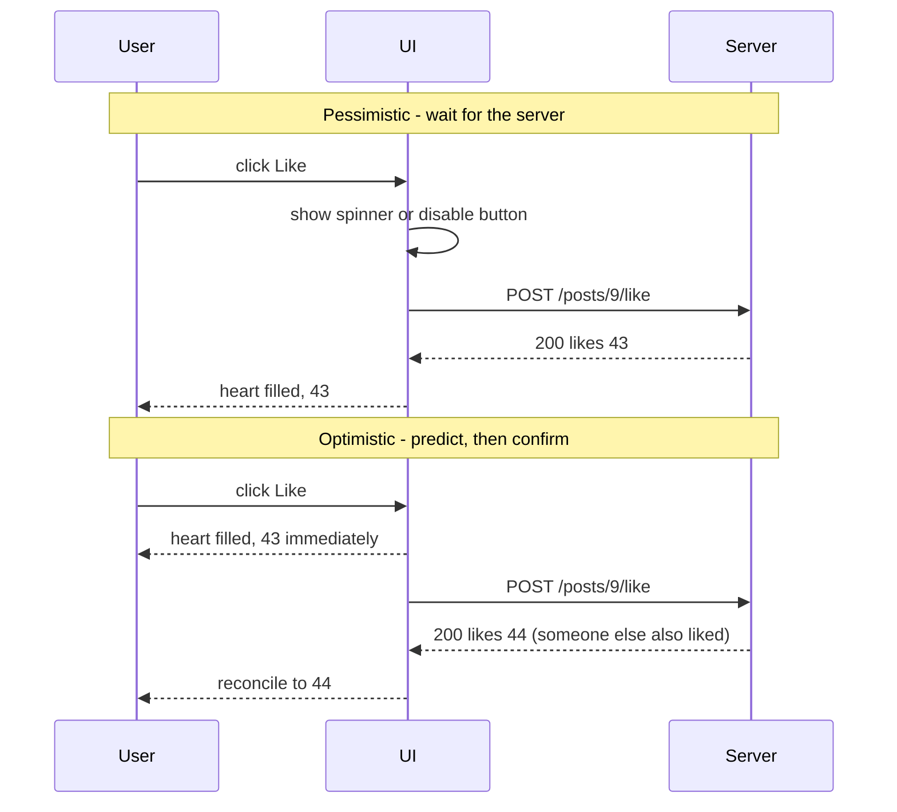

```mermaid
gantt
    title Perceived latency of one click (illustrative, 400 ms round trip)
    dateFormat x
    axisFormat %L
    section Pessimistic
    Waiting, spinner shown        :p1, 0, 400
    Result visible                :p2, after p1, 100
    section Optimistic
    Result visible at once        :o1, 0, 500
    Request in flight, background :o2, 0, 400
```

| | Pessimistic | Optimistic |
|---|---|---|
| Feedback | After the round trip | Immediately (next frame) |
| Complexity | Low | Snapshot, rollback, reconciliation, race handling |
| Wrong state possible? | No | Briefly, on failure |
| Best for | Payments, irreversible or rarely-successful actions | Likes, toggles, reordering, renames, chat messages |
| Effect on [INP](./core-web-vitals-lcp-inp-cls.md) | Neutral if the click handler only shows a spinner | Neutral — INP measures the next paint, not the network; optimistic UI improves **perceived** responsiveness |

> Optimistic UI doesn't make the network faster — it hides latency from the user. On flaky mobile networks the difference is dramatic; on a fast LAN it's barely visible.

---

### Section 2: When to Be Optimistic (and When Not)

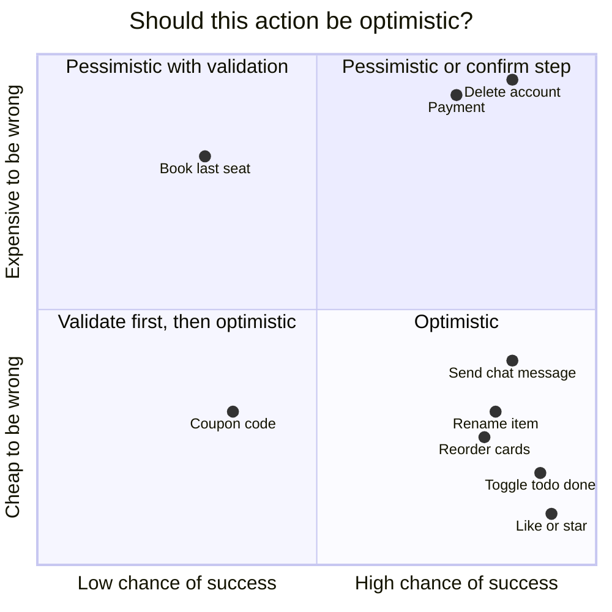

> Quadrant positions are qualitative judgements for typical products — your domain may differ.

| Use optimistic UI when… | Avoid it when… |
|---|---|
| The server almost always accepts the action | Success depends on server-only checks (stock, availability, fraud, permissions) |
| You can **predict the result** on the client | The result is computed by the server (prices with tax, ranking, generated content) |
| A brief wrong state is harmless and reversible | The action is **irreversible** or has real-world consequences (payments, sending email, deleting data) |
| The action is frequent and latency is noticeable | The user needs a confirmed receipt (orders, bookings) |

**Middle ground:** validate on the client first (format, limits), apply optimistically, and let rare server rejections roll back. For destructive actions, use **undo** instead: hide the item immediately but **delay the real request** a few seconds (the Gmail "Undo send" pattern) — no rollback needed because nothing has been committed.

---

### Section 3: The Optimistic Mutation Lifecycle

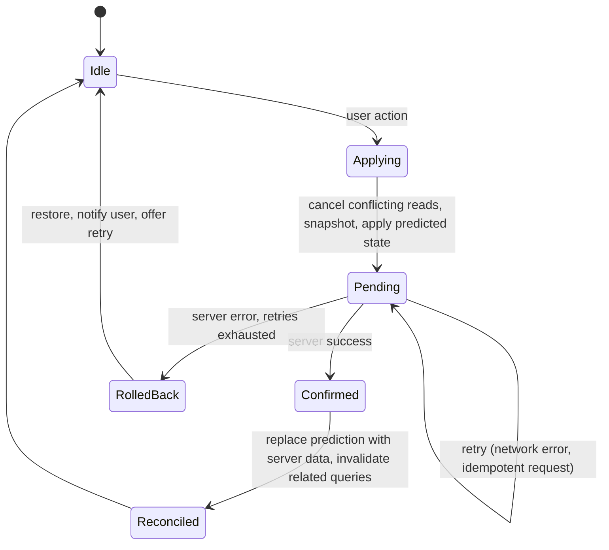

Every optimistic mutation needs answers to five questions:

| Step | Question | Typical answer |
|---|---|---|
| 1. **Cancel** | Can an in-flight read overwrite my prediction? | Cancel queries for the affected keys first |
| 2. **Snapshot** | How will I undo this? | Save the previous value (or rely on a layered/derived optimistic state) |
| 3. **Apply** | What exactly will the server return? | Predict it — same shape, temporary ID for new items |
| 4. **Settle** | What's the truth after success? | Write the server response; invalidate anything it might affect |
| 5. **Recover** | What does the user see on failure? | Roll back + clear, actionable message + retry |

---

### Section 4: Two Implementation Styles — Via the UI or Via the Cache

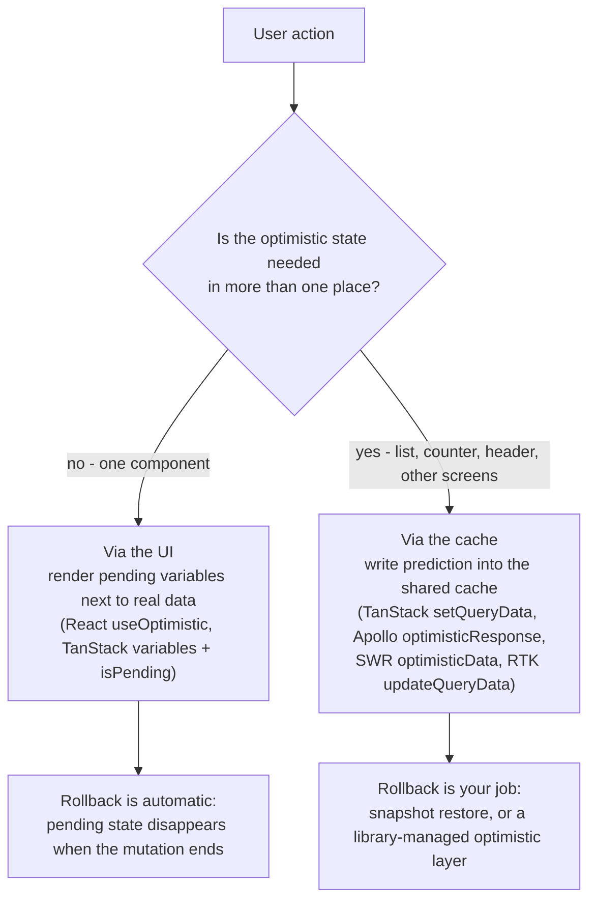

| | **Via the UI** | **Via the cache** |
|---|---|---|
| Where the prediction lives | Component state derived from the pending mutation | The shared data cache |
| Visible elsewhere? | Only where you render it (`useMutationState` can share it in TanStack) | Everywhere the data is read |
| Rollback | Automatic (pending state ends) | Manual snapshot restore, or automatic with layered caches (Apollo, Graphcache) |
| Risk | Duplicate item if the refetch lands before the pending state clears — keep the mutation pending until invalidation finishes | Stale snapshot clobbering other updates (Section 6) |
| Best for | Adding to a single list, form submissions | Toggles and counts shown in many places |

**React 19 `useOptimistic`** is a "via the UI" primitive built into React: it returns an optimistic copy of some state that is shown **while an Action (transition) is pending** and automatically falls back to the real state when the Action finishes. If the real state wasn't updated (error), the optimistic change simply disappears.

---

### Section 5: Rollback Strategies

| Strategy | How | Pros | Cons |
|---|---|---|---|
| **Snapshot restore** | Save previous value before the write; restore on error | Simple, generic | Restoring a stale snapshot can erase **other** changes made meanwhile |
| **Inverse operation** | Apply the opposite change (`likes - 1`, remove the temp item) | Doesn't clobber concurrent updates | Must write an inverse per mutation type |
| **Layered optimistic state** | Keep predictions as a separate layer on top of confirmed data; drop the layer on settle | Concurrent mutations compose; no manual rollback | Needs library support (Apollo optimistic layers, Graphcache, `useOptimistic` rebasing on new base state) |
| **Refetch (invalidate)** | On error (and on success), refetch from the server | Always ends at the truth | A moment of wrong UI; extra request |

**Best practice:** combine them — apply optimistically, roll back **precisely** on error (inverse or layered), and **always invalidate on settle** so the cache ends at the server's truth regardless of what the prediction got wrong.

---

### Section 6: Races, Ordering and Concurrent Mutations

**Race 1 — a background refetch overwrites the prediction:**

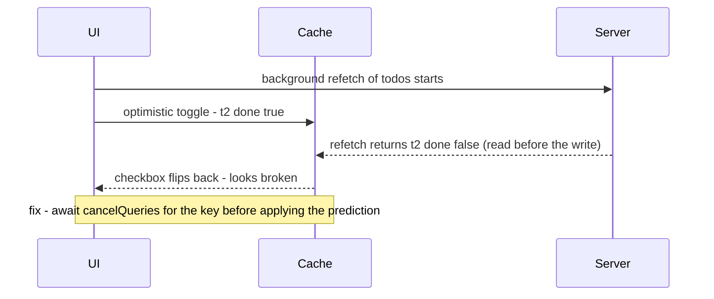

**Race 2 — two quick mutations, snapshot rollback clobbers the first:**

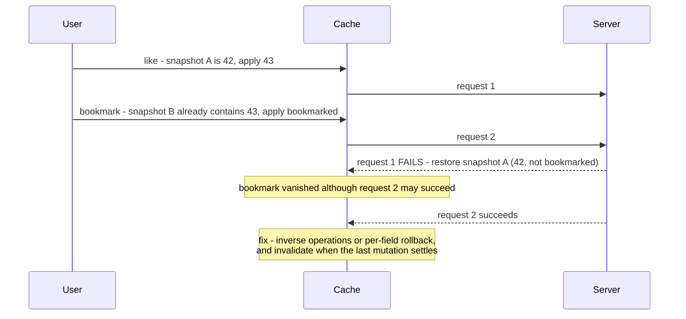

| Problem | Fix |
|---|---|
| In-flight reads overwrite predictions | `await queryClient.cancelQueries({ queryKey })` before `setQueryData` (TanStack); Apollo/Graphcache layer predictions above fetched data |
| Snapshot rollback erases concurrent changes | Roll back only the fields this mutation changed, use inverse operations, or use layered optimistic state |
| Invalidation after each mutation causes flicker mid-sequence | Invalidate only when **no other mutation on that key is pending** (`queryClient.isMutating({ mutationKey }) === 1` inside `onSettled`) |
| Mutations on the same item must apply in order (rename, then rename again) | Serialize them — TanStack Query v5's `scope: { id }` runs mutations with the same scope id one after another; or queue them yourself |
| Rapid toggles (like/unlike/like) | Send only the **final intended state** (`PUT liked=true`, not "toggle"), debounce, or cancel superseded requests |

> **Prefer idempotent, state-setting requests** (`PUT /posts/9/like { liked: true }`) over relative ones (`POST /toggle-like`). Retrying or reordering a "set" is harmless; retrying a "toggle" flips the state twice.

---

### Section 7: Creating Items — Temporary IDs and Idempotency

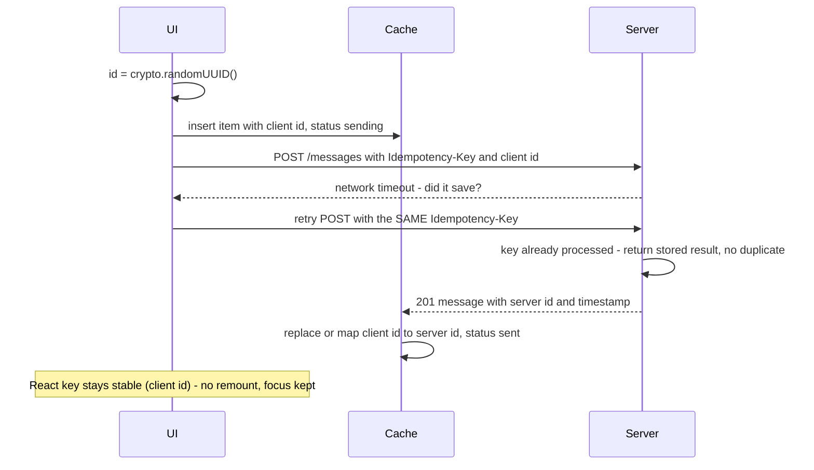

| Technique | Why |
|---|---|
| **Client-generated ID** (`crypto.randomUUID()`) | Lets you reference the new item immediately (edit/delete it before the server answers) |
| **Server accepts the client ID** (or returns a mapping) | No swap needed if the server stores your UUID as the ID; otherwise replace temp → real in the cache |
| **Stable React `key`** | Keep the client ID as the list key (e.g. a separate `clientId` field) so the row doesn't remount when the server ID arrives |
| **Idempotency key** | A retry after a timeout must not create a second item. Send a unique key per logical action (header `Idempotency-Key`, an IETF draft widely used by payment APIs, or the client ID itself); the server deduplicates |
| **Pending markers** | `status: 'sending' / 'failed'` on the item drives subtle UI (dimmed, retry button) |
| **Server-only fields** | Fill sensible placeholders (`createdAt: now`, `author: currentUser`) and let the response overwrite them |

---

### Section 8: Failure UX and Accessibility

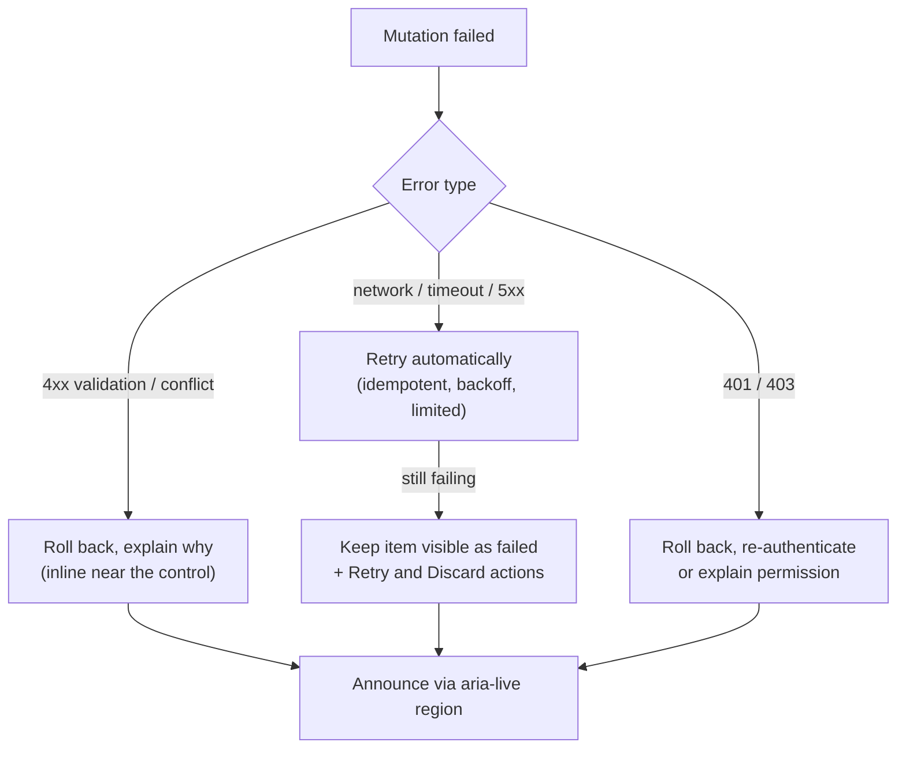

**UX rules:**
- **Say what happened and what to do:** "Couldn't save 'Buy milk' — Retry" beats "Something went wrong".
- **Keep the user's input.** For a failed new message/comment, keep the text (failed state with Retry), don't silently delete it.
- **Show pending subtly** (reduced opacity, small clock icon) — not a spinner that defeats the purpose.
- **Rollback without layout jumps:** an item vanishing from a list moves everything below it; prefer a "failed" state in place for creations.
- **Warn on leaving with pending mutations** (`beforeunload` only while something is pending) if losing them would hurt.

**Accessibility:**
- Announce failures (and important confirmations) through a polite **`aria-live`** region or a status toast with `role="status"`; use `role="alert"` only for urgent errors.
- **Don't move focus** on optimistic success; on rollback, if the focused element disappears, move focus to a sensible place (the list, or the Retry button).
- Keep toggles' state in ARIA in sync (`aria-pressed`, `aria-checked`) — including after rollback.
- See [Accessible Forms & Error Handling](./accessible-forms-and-error-handling.md).

---

### Section 9: Optimistic + Offline — Mutation Queues

Optimistic UI naturally extends to offline: apply the change locally, **queue** the request, replay when online.

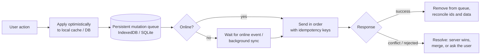

- **TanStack Query** pauses mutations while offline (`networkMode: 'online'` default) and can persist and resume them (`resumePausedMutations`, with `setMutationDefaults` so restored mutations have a `mutationFn`).
- **Apollo** and **urql Graphcache** (`offlineExchange`) can keep optimistic results and replay mutations.
- **Background Sync API** lets a Service Worker retry later — Chromium-only; check MDN before relying on it.
- **Native mobile:** local database as source of truth + a work queue (Android WorkManager, iOS background tasks).
- **Conflicts** (another user changed the item) need a policy: last-write-wins, field-level merge, or CRDTs for collaborative data. Deep dive: [Offline-First Architecture](./offline-first-architecture.md) and [Real-Time Data Sync](./real-time-data-sync.md).

---

### Section 10: The APIs Across Libraries and Frameworks

| Library / framework | Optimistic API | Rollback |
|---|---|---|
| **React 19** | `useOptimistic(state, updateFn)` inside an Action / `startTransition` | Automatic when the Action ends (falls back to real state) |
| **TanStack Query** (React, Vue, Solid, Svelte, Angular adapters) | UI: `variables` + `isPending`, `useMutationState`. Cache: `onMutate` → `cancelQueries`, `getQueryData`, `setQueryData` | Return snapshot from `onMutate`; restore in `onError`; invalidate in `onSettled` |
| **SWR** | `mutate(promise, { optimisticData, rollbackOnError, populateCache, revalidate })`; `useSWRMutation` accepts `optimisticData` too | `rollbackOnError: true` |
| **Apollo Client** | `optimisticResponse` on `useMutation` / `mutate` (with `update` for lists) | Automatic — the optimistic layer is discarded when the result or error arrives |
| **urql Graphcache** | `optimistic: { mutationField(args, cache, info) }` | Automatic — discarded when the real result arrives |
| **RTK Query** | `onQueryStarted` + `api.util.updateQueryData` | `patchResult.undo()` in a `catch` around `queryFulfilled` |
| **Vue** | TanStack Vue Query / Pinia actions (mutate state, restore on catch) / Vue Apollo | As per library |
| **Angular** | Signals: `signal.update()` then restore on error; NgRx: optimistic reducer + failure action; TanStack Angular adapter | Manual or action-based |
| **Svelte / SvelteKit** | Runes (`$state`) updated before `fetch`; `use:enhance` for forms (custom callback applies optimistic state) | Manual |
| **Next.js / Remix-style form actions** | `useOptimistic` with Server Actions; `useFetcher().formData` (React Router/Remix) to render pending submissions | Automatic when the submission settles |
| **Native mobile** | Write to local DB/state first, observe it in the UI, sync in the background | Restore or mark failed |

---

## Decision Matrix

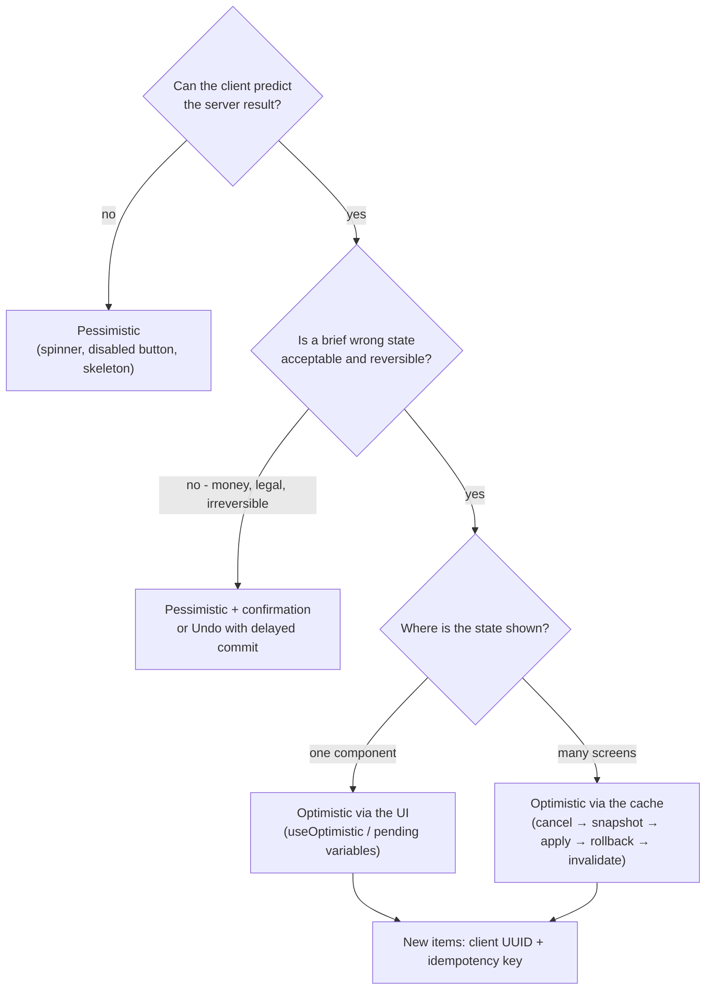

| Action | Recommendation |
|---|---|
| Like, star, follow, toggle done | Optimistic (cache), idempotent `PUT` with the final state |
| Rename, edit text field | Optimistic; serialize edits per item; invalidate on settle |
| Send chat message / comment | Optimistic with client ID, `sending`/`failed` states, retry |
| Drag-and-drop reorder | Optimistic; send the final order (or fractional index); roll back on conflict |
| Delete | Undo with delayed commit (or optimistic + restore) |
| Add to cart | Optimistic count; pessimistic for stock-limited items and totals |
| Checkout / payment / booking | Pessimistic, idempotency key, clear progress states |

---

## Real-World Examples

**Example 1 — React 19 `useOptimistic` with a form action:**
```tsx
import { useOptimistic, useState } from 'react';

type Message = { id: string; text: string; status?: 'sending' };

export function Thread({ initial, send }: { initial: Message[]; send: (m: Message) => Promise<Message> }) {
  const [messages, setMessages] = useState(initial);
  const [error, setError] = useState<string | null>(null);
  const [optimisticMessages, addOptimistic] = useOptimistic(
    messages,
    (current, pending: Message) => [...current, { ...pending, status: 'sending' as const }],
  );

  async function action(formData: FormData) {
    const text = String(formData.get('text') ?? '').trim();
    if (!text) return;
    const draft = { id: crypto.randomUUID(), text };   // client id doubles as idempotency key
    setError(null);
    addOptimistic(draft);                               // shown until this action finishes
    try {
      const saved = await send(draft);
      setMessages((prev) => [...prev, saved]);          // real state now contains it
    } catch {
      setError(`Couldn't send "${text}". Try again.`);  // optimistic item disappears automatically
    }
  }

  return (
    <>
      <ul>
        {optimisticMessages.map((m) => (
          <li key={m.id} style={{ opacity: m.status === 'sending' ? 0.6 : 1 }}>{m.text}</li>
        ))}
      </ul>
      <p role="status" aria-live="polite">{error}</p>
      <form action={action}>
        <input name="text" aria-label="Message" />
        <button type="submit">Send</button>
      </form>
    </>
  );
}
```

**Example 2 — TanStack Query: optimistic toggle via the cache (BAD → GOOD):**
```tsx
import { useMutation, useQueryClient } from '@tanstack/react-query';

type Todo = { id: string; text: string; done: boolean };
const todosKey = ['todos', 'list'] as const;

// ❌ BAD: no cancel (refetch can overwrite), no rollback, relative "toggle" request
function useToggleBad() {
  const qc = useQueryClient();
  return useMutation({
    mutationFn: (id: string) => fetch(`/api/todos/${id}/toggle`, { method: 'POST' }),
    onMutate: (id) =>
      qc.setQueryData<Todo[]>(todosKey, (old) => old?.map((t) => (t.id === id ? { ...t, done: !t.done } : t))),
  });
}

// ✅ GOOD: cancel → snapshot → apply → rollback → invalidate; idempotent PUT with the final state
export function useSetDone() {
  const qc = useQueryClient();
  return useMutation({
    mutationKey: ['todos', 'setDone'],
    mutationFn: async ({ id, done }: { id: string; done: boolean }) => {
      const res = await fetch(`/api/todos/${id}`, {
        method: 'PATCH',
        headers: { 'Content-Type': 'application/json' },
        body: JSON.stringify({ done }),
      });
      if (!res.ok) throw new Error(`HTTP ${res.status}`);
      return (await res.json()) as Todo;
    },
    onMutate: async ({ id, done }) => {
      await qc.cancelQueries({ queryKey: todosKey });
      const previous = qc.getQueryData<Todo[]>(todosKey)?.find((t) => t.id === id)?.done;
      qc.setQueryData<Todo[]>(todosKey, (old) => old?.map((t) => (t.id === id ? { ...t, done } : t)));
      return { id, previous };
    },
    onError: (_err, _vars, snapshot) => {
      if (!snapshot || snapshot.previous === undefined) return;
      // per-field rollback: only undo THIS mutation's change
      qc.setQueryData<Todo[]>(todosKey, (old) =>
        old?.map((t) => (t.id === snapshot.id ? { ...t, done: snapshot.previous! } : t)),
      );
      toast.error('Could not update the task. Please try again.');
    },
    onSettled: () => {
      // avoid flicker: only refetch when this is the last pending setDone mutation
      if (qc.isMutating({ mutationKey: ['todos', 'setDone'] }) === 1) {
        return qc.invalidateQueries({ queryKey: todosKey });
      }
    },
  });
}
```

**Example 3 — TanStack Query: optimistic create via the UI (pending variables):**
```tsx
import { useMutation, useMutationState, useQuery, useQueryClient } from '@tanstack/react-query';

export function useAddTodo() {
  const qc = useQueryClient();
  return useMutation({
    mutationKey: ['addTodo'],
    mutationFn: (draft: { clientId: string; text: string }) => api.createTodo(draft),
    onSettled: () => qc.invalidateQueries({ queryKey: ['todos', 'list'] }), // returned promise keeps it pending until refetched
  });
}

export function TodoList() {
  const { data: todos = [] } = useQuery({ queryKey: ['todos', 'list'], queryFn: api.getTodos });
  const pending = useMutationState({
    filters: { mutationKey: ['addTodo'], status: 'pending' },
    select: (m) => m.state.variables as { clientId: string; text: string },
  });
  return (
    <ul>
      {todos.map((t) => <li key={t.clientId ?? t.id}>{t.text}</li>)}
      {pending.map((d) => <li key={d.clientId} style={{ opacity: 0.5 }}>{d.text}</li>)}
    </ul>
  );
}
```

**Example 4 — Apollo Client `optimisticResponse` (and list update):**
```tsx
import { gql } from '@apollo/client';
import { useMutation } from '@apollo/client/react';

const ADD_COMMENT = gql`
  mutation AddComment($postId: ID!, $clientId: ID!, $text: String!) {
    addComment(postId: $postId, clientId: $clientId, text: $text) { id text createdAt author { id name } }
  }
`;

export function useAddComment(postId: string, me: { id: string; name: string }) {
  const [mutate] = useMutation(ADD_COMMENT, {
    update(cache, { data }) {
      // runs twice: once with the optimistic result, once with the real one
      cache.modify({
        id: cache.identify({ __typename: 'Post', id: postId }),
        fields: {
          comments(existing = [], { toReference }) {
            const ref = toReference(data!.addComment);
            return existing.some((r: { __ref: string }) => r.__ref === ref?.__ref) ? existing : [...existing, ref];
          },
        },
      });
    },
  });

  return (text: string) => {
    const clientId = crypto.randomUUID();
    return mutate({
      variables: { postId, clientId, text },
      optimisticResponse: {
        addComment: {
          __typename: 'Comment',
          id: clientId,                       // server stores the client id → no swap needed
          text,
          createdAt: new Date().toISOString(),
          author: { __typename: 'User', id: me.id, name: me.name },
        },
      },
    }); // on error Apollo discards the optimistic layer automatically
  };
}
```

**Example 5 — SWR and RTK Query:**
```tsx
// SWR: optimistic data + automatic rollback
import useSWR from 'swr';

export function LikeButton({ postId }: { postId: string }) {
  const { data, mutate } = useSWR<{ liked: boolean; likes: number }>(`/api/posts/${postId}/like`);
  const toggle = () => {
    if (!data) return;
    const next = { liked: !data.liked, likes: data.likes + (data.liked ? -1 : 1) };
    return mutate(api.setLike(postId, next.liked), {     // promise resolves to the server's { liked, likes }
      optimisticData: next,
      rollbackOnError: true,
      populateCache: true,
      revalidate: false,
    });
  };
  return <button aria-pressed={data?.liked ?? false} onClick={toggle}>♥ {data?.likes}</button>;
}

// RTK Query: patch the cached query, undo on failure
// updatePost: build.mutation({
//   query: ({ id, ...patch }) => ({ url: `posts/${id}`, method: 'PATCH', body: patch }),
//   async onQueryStarted({ id, ...patch }, { dispatch, queryFulfilled }) {
//     const patchResult = dispatch(api.util.updateQueryData('getPost', id, (draft) => { Object.assign(draft, patch); }));
//     try { await queryFulfilled; } catch { patchResult.undo(); }
//   },
// }),
```

**Example 6 — Vue 3 and Angular (signals) without a data library:**
```typescript
// Vue 3 composable
import { ref } from 'vue';

export function useLike(initial: { liked: boolean; likes: number }, postId: string) {
  const state = ref({ ...initial });
  async function setLiked(liked: boolean) {
    const previous = { ...state.value };
    state.value = { liked, likes: state.value.likes + (liked ? 1 : -1) }; // optimistic
    try {
      state.value = await api.setLike(postId, liked);                    // reconcile with server truth
    } catch {
      state.value = previous;                                            // rollback
    }
  }
  return { state, setLiked };
}

// Angular (standalone component, signals)
import { Component, input, signal } from '@angular/core';

@Component({
  selector: 'app-like',
  template: `<button [attr.aria-pressed]="liked()" (click)="toggle()">♥ {{ likes() }}</button>`,
})
export class LikeComponent {
  postId = input.required<string>();
  liked = signal(false);
  likes = signal(0);

  async toggle() {
    const prev = { liked: this.liked(), likes: this.likes() };
    const next = !prev.liked;
    this.liked.set(next);
    this.likes.update((n) => n + (next ? 1 : -1));
    try {
      const res = await api.setLike(this.postId(), next);
      this.liked.set(res.liked);
      this.likes.set(res.likes);
    } catch {
      this.liked.set(prev.liked);
      this.likes.set(prev.likes);
    }
  }
}
```

**Example 7 — Server side: honoring an idempotency key (Node/Express sketch):**
```typescript
app.post('/api/messages', async (req, res) => {
  const key = req.get('Idempotency-Key');
  if (!key) return res.status(400).json({ error: 'Idempotency-Key required' });

  const previous = await idempotencyStore.get(key);          // e.g. Redis with a TTL
  if (previous) return res.status(previous.status).json(previous.body); // replay, no duplicate

  const message = await db.messages.create({ id: req.body.clientId, text: req.body.text, userId: req.user.id });
  await idempotencyStore.set(key, { status: 201, body: message }, { ttlSeconds: 24 * 3600 });
  res.status(201).json(message);
});
```

---

## Key Points Summary

| Concept | One-Line Explanation |
|---|---|
| **Optimistic update** | Show the predicted result immediately, confirm with the server later |
| **Pessimistic update** | Wait for the server before changing the UI |
| **When to use** | High success rate, predictable result, cheap and reversible if wrong |
| **Lifecycle** | Cancel → snapshot → apply → settle (reconcile) → recover |
| **Via the UI** | Render pending variables; rollback is automatic |
| **Via the cache** | Write the prediction into shared data; rollback is explicit or layered |
| **Rollback** | Snapshot, inverse operation, layered state, or refetch — always invalidate on settle |
| **Race: refetch** | Cancel in-flight reads before applying the prediction |
| **Race: concurrent mutations** | Per-field/inverse rollback, invalidate after the last one, serialize per item |
| **Idempotent requests** | Send final state (`PUT liked=true`), not toggles |
| **Temporary IDs** | Client UUIDs, stable React keys, swap or reuse as server ID |
| **Idempotency key** | Lets retries after timeouts run safely without duplicates |
| **Failure UX** | Clear message, keep input, retry, announce via `aria-live` |
| **Offline** | Persistent mutation queue + replay + conflict policy |

---

## Test Your Understanding

**Q1 (Basic):**
What is an optimistic UI update, and what are its main risks?

<details>
<summary>Answer</summary>

Updating the UI to the **expected result of a mutation before the server responds**, then reconciling with the real response. It removes perceived latency for common, likely-to-succeed actions. Risks: showing a **wrong state** if the server rejects it (needs rollback + messaging), **races** with in-flight reads or other mutations that overwrite or clobber state, **duplicates** when creates are retried without idempotency, and **wrong predictions** for server-computed fields. Each needs an explicit mechanism: cancel reads, rollback strategy, idempotency keys, and invalidation on settle.
</details>

**Q2 (Application):**
Which of these should be optimistic: (a) starring a repo, (b) placing an order, (c) renaming a file, (d) applying a discount code, (e) deleting a comment? Justify.

<details>
<summary>Answer</summary>

- **(a) Star:** optimistic — almost always succeeds, trivially reversible, result is predictable.
- **(b) Order:** pessimistic — money and inventory are involved, the result (order number, totals, stock) comes from the server, and a false "success" is harmful. Use an idempotency key and clear progress states.
- **(c) Rename:** optimistic — predictable; validate name rules on the client first; roll back on a conflict ("name already exists").
- **(d) Discount code:** pessimistic (or validate first) — the server decides validity and the resulting price.
- **(e) Delete comment:** "undo" pattern — hide immediately and delay the real `DELETE` a few seconds, or optimistic + restore on failure. Irreversible actions benefit from undo more than from rollback.
</details>

**Q3 (Application):**
In TanStack Query, why do you `await queryClient.cancelQueries(...)` in `onMutate`, and why invalidate in `onSettled` instead of only `onSuccess`?

<details>
<summary>Answer</summary>

**Cancel:** a refetch that started before the mutation would return the **old** server state and overwrite the optimistic prediction, making the UI flicker back. Cancelling ensures the prediction isn't clobbered by an outdated read.

**`onSettled`:** it runs after **success and error**. After success, the server's state may differ from the prediction (other fields changed, other users' edits, ordering), so refetch to converge. After an error, the rollback restored a snapshot that may itself be stale, so refetching guarantees you end at the truth either way. Returning the invalidation promise also keeps the mutation pending until fresh data is in, avoiding a flash of the old list.
</details>

**Q4 (Tricky):**
A user clicks Like, then Bookmark on the same post within 200 ms. The Like request fails, and after rollback the bookmark has disappeared too, even though the bookmark request succeeded. Explain and fix.

<details>
<summary>Answer</summary>

The Like mutation's rollback restored a **whole-object snapshot** taken before both changes. Restoring it also reverted the bookmark change, which happened after the snapshot. Fixes:
- **Per-field / inverse rollback**: undo only `liked` and `likes`, not the whole post.
- Or use **layered optimistic state** (Apollo, Graphcache, `useOptimistic`), where each mutation's prediction is a separate layer that's dropped independently.
- **Invalidate after the last pending mutation settles** (`isMutating` check) so the final UI reflects the server's state, which includes the successful bookmark.
</details>

**Q5 (Tricky):**
A chat app sends messages optimistically. On a flaky network, users sometimes see their message **twice** after a reconnect. Why, and how do you design it properly?

<details>
<summary>Answer</summary>

The first `POST` reached the server and was saved, but the response was lost (timeout). The client retried and the server created a **second** message. The optimistic item plus the server's two copies (pushed via WebSocket) can also show as duplicates if the client can't match them.

Design: generate a **client ID** (`crypto.randomUUID()`) per message, send it as the **idempotency key** (and ideally store it as the message ID). The server returns the existing message for a repeated key instead of creating a new one. The client **deduplicates by ID** when merging pushed messages and fetch results, and replaces the `sending` placeholder in place (same React key). Show `sending`/`failed` states with Retry, which reuses the same key.
</details>

**Q6 (System design):**
Design the optimistic-update strategy for a Trello-like board: moving cards between columns, editing titles, and several users editing the same board.

<details>
<summary>Answer</summary>

- **Moves:** apply instantly in the board cache (remove from source column, insert at target). Send the **final position** as a state-setting request (`PATCH /cards/42 { columnId, position }`), using fractional indexing (or the server's ordering scheme) so a move doesn't rewrite every card. Serialize mutations per card (TanStack `scope`, or a queue) so quick consecutive moves apply in order.
- **Title edits:** optimistic; debounce while typing; send the final value; per-field rollback on failure.
- **Concurrency with other users:** subscribe to board events (WebSocket/SSE). Apply remote changes to the normalized `Card` entities; skip echoes of your own mutations (match by mutation/client ID). Use a server `version` per card to drop out-of-order events; on conflict (`409`) refetch the card and show a gentle notice.
- **Rollback:** move the card back (inverse op), announce "Couldn't move card — it was restored to *To Do*" via `aria-live`, keep focus on the card.
- **Offline / flaky:** persist a mutation queue with idempotency keys, replay on reconnect, then refetch the board to converge.
- **Accessibility:** keyboard alternatives for drag-and-drop, live-region announcements for moves and failures.
See [Design a Drag-and-Drop Board (Trello)](./design-a-drag-and-drop-board-trello.md).
</details>

---

## Cheat Sheet

**Key Definitions:**
- **Optimistic update:** Apply the predicted result before server confirmation
- **Rollback:** Return to the previous/true state after a failure
- **Reconciliation:** Replace the prediction with the server's response
- **Snapshot:** Copy of the previous state saved for rollback
- **Optimistic layer:** Prediction kept separately above confirmed data and dropped on settle
- **Temporary (client) ID:** ID generated on the client for a not-yet-saved item
- **Idempotency key:** Unique key per logical action so retries don't duplicate effects
- **Undo pattern:** Delay the real request so the user can cancel before it's committed

**Quick Reference:**
```text
Recipe (cache):  await cancelQueries(key) → prev = getQueryData(key) → setQueryData(key, predicted)
                 → onError: restore prev (per-field) + message → onSettled: invalidateQueries(key)
Recipe (UI):     render pending variables (useOptimistic / isPending + variables / useMutationState)
Requests:        PUT/PATCH final state (idempotent) · not "toggle"
Creates:         clientId = crypto.randomUUID() · Idempotency-Key header · stable React key
Concurrency:     per-field rollback · invalidate when isMutating(key) === 1 · scope: { id } to serialize
React 19:        const [optimistic, add] = useOptimistic(state, (cur, v) => next)  — call add inside an Action
SWR:             mutate(promise, { optimisticData, rollbackOnError: true, populateCache: true, revalidate: false })
Apollo:          mutate({ optimisticResponse: { field: { __typename, id, ... } }, update })
Graphcache:      cacheExchange({ optimistic: { field: (args, cache, info) => ({ __typename, id, ... }) } })
RTK Query:       onQueryStarted → const p = dispatch(updateQueryData(...)) → catch → p.undo()
Not optimistic:  payments, bookings, irreversible actions, server-computed results
Failure UX:      keep input · clear message · Retry · aria-live announcement · no layout jump
```

**Common Mistakes to Avoid:**

| Mistake | Why Wrong | Fix |
|---|---|---|
| Not cancelling in-flight queries | Old refetch overwrites the prediction → flicker | `await cancelQueries` before writing |
| No rollback | UI shows a state the server rejected | Snapshot/inverse rollback in `onError` |
| Whole-object snapshot rollback | Clobbers concurrent successful changes | Per-field / inverse rollback or layered state |
| Never refetching after settle | Prediction drifts from server truth | Invalidate in `onSettled` |
| "Toggle" endpoints | Retries and reorders flip state unpredictably | Send the final state (idempotent) |
| Retrying creates without idempotency | Duplicate items after timeouts | Idempotency key / client ID |
| Swapping temp ID changes the React key | Row remounts, loses focus/animation | Keep a stable client key |
| Optimistic payments or bookings | False success with real consequences | Pessimistic + idempotency + clear progress |
| Silent rollback | User doesn't know their action failed | Message + Retry + `aria-live` |
| Deleting the user's failed input | Lost work | Keep it in a failed state with Retry |
| Predicting server-computed fields | Wrong totals or ordering shown | Show placeholders or wait for the server |

---

## References & Further Reading

**Core docs**
- React: [`useOptimistic`](https://react.dev/reference/react/useOptimistic) · [`useTransition` and Actions](https://react.dev/reference/react/useTransition)
- TanStack Query: [Optimistic Updates](https://tanstack.com/query/latest/docs/framework/react/guides/optimistic-updates) · [Mutations (including `scope`)](https://tanstack.com/query/latest/docs/framework/react/guides/mutations) · [`useMutationState`](https://tanstack.com/query/latest/docs/framework/react/reference/useMutationState)
- SWR: [Mutation & Revalidation (optimistic updates)](https://swr.vercel.app/docs/mutation)
- Apollo Docs: [Optimistic mutation results](https://www.apollographql.com/docs/react/performance/optimistic-ui)
- urql Docs: [Graphcache cache updates (optimistic updates)](https://urql.dev/docs/graphcache/cache-updates/)
- Redux Toolkit: [RTK Query — Manual cache updates (optimistic updates)](https://redux-toolkit.js.org/rtk-query/usage/manual-cache-updates)
- SvelteKit: [Form actions — progressive enhancement (`use:enhance`)](https://svelte.dev/docs/kit/form-actions)
- Angular: [Signals](https://angular.dev/guide/signals)

**Web platform & specs**
- MDN: [`Crypto.randomUUID()`](https://developer.mozilla.org/en-US/docs/Web/API/Crypto/randomUUID)
- MDN: [ARIA live regions](https://developer.mozilla.org/en-US/docs/Web/Accessibility/ARIA/Guides/Live_regions)
- MDN: [Background Synchronization API](https://developer.mozilla.org/en-US/docs/Web/API/Background_Synchronization_API)
- IETF draft: [The Idempotency-Key HTTP Header Field](https://datatracker.ietf.org/doc/draft-ietf-httpapi-idempotency-key-header/)

**Deep dives**
- Dominik Dorfmeister: [Concurrent Optimistic Updates in React Query](https://tkdodo.eu/blog/concurrent-optimistic-updates-in-react-query)
- Stripe Docs: [Idempotent requests](https://docs.stripe.com/api/idempotent_requests)

---

> **Previous Topic:** [Data Normalization & Caching](./data-normalization-and-caching.md)
> — Storing entities once, keeping every screen consistent, and deciding when cached data expires

> **Next Topic:** [Pagination & Infinite Scroll](./pagination-and-infinite-scroll.md)
> — Offset vs cursor pagination, infinite lists, and keeping long feeds fast

*Saved on: 2026-11-06 | Repo: Frontend System Design Learning Notes*
