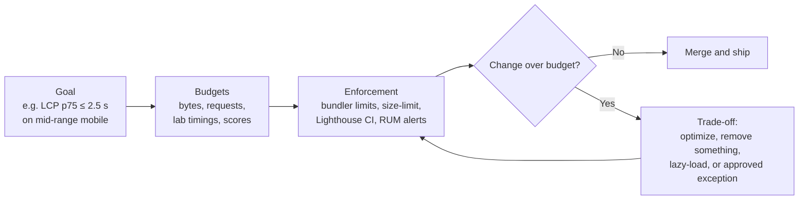
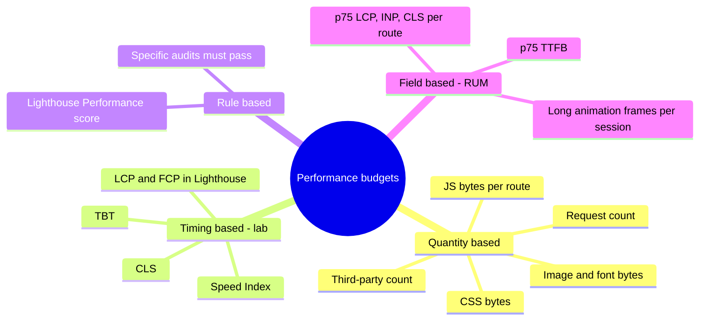
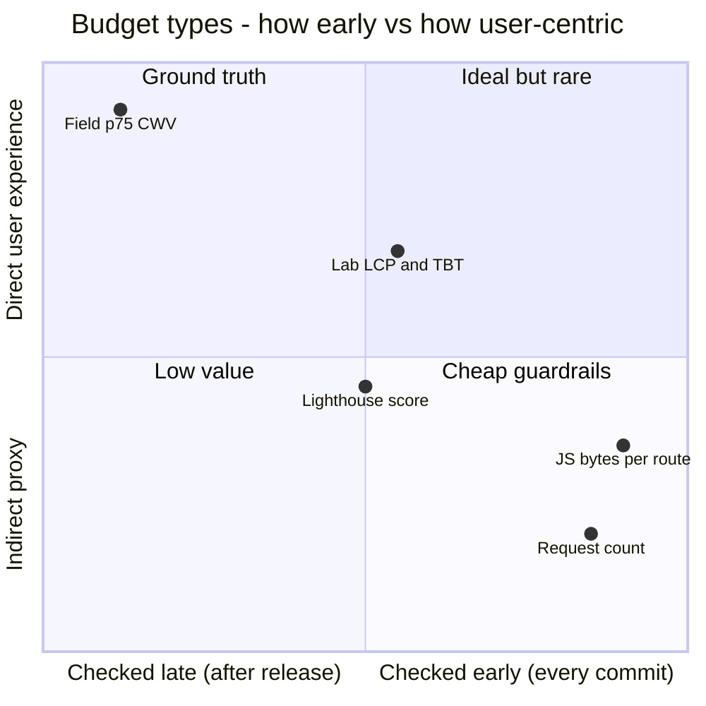
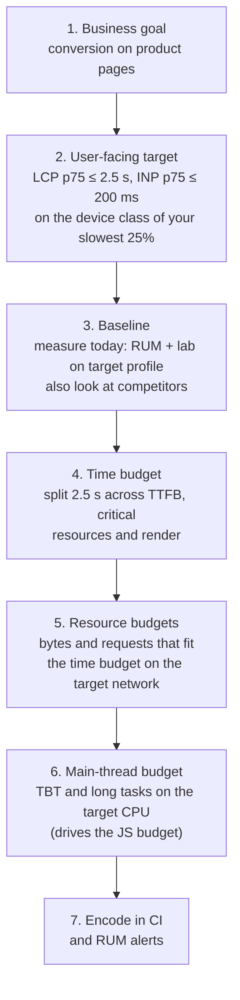
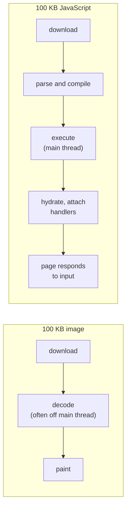
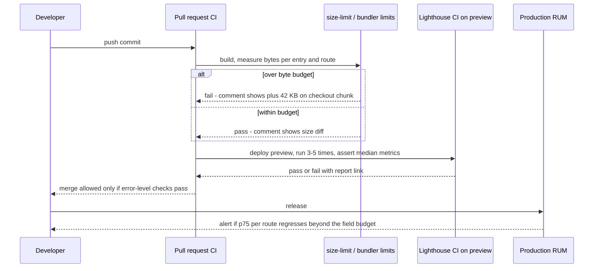
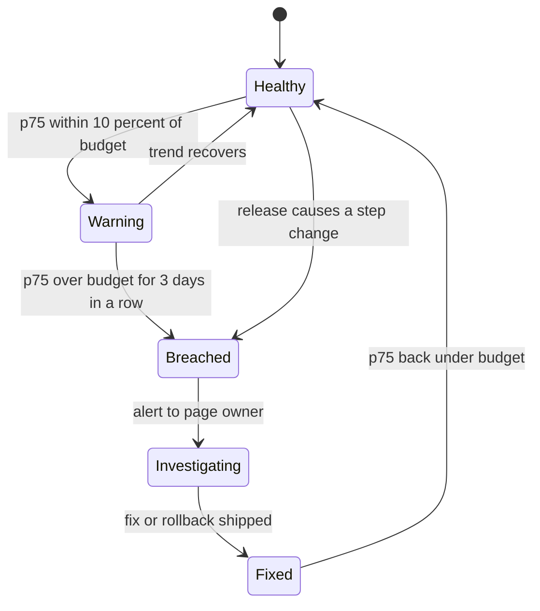
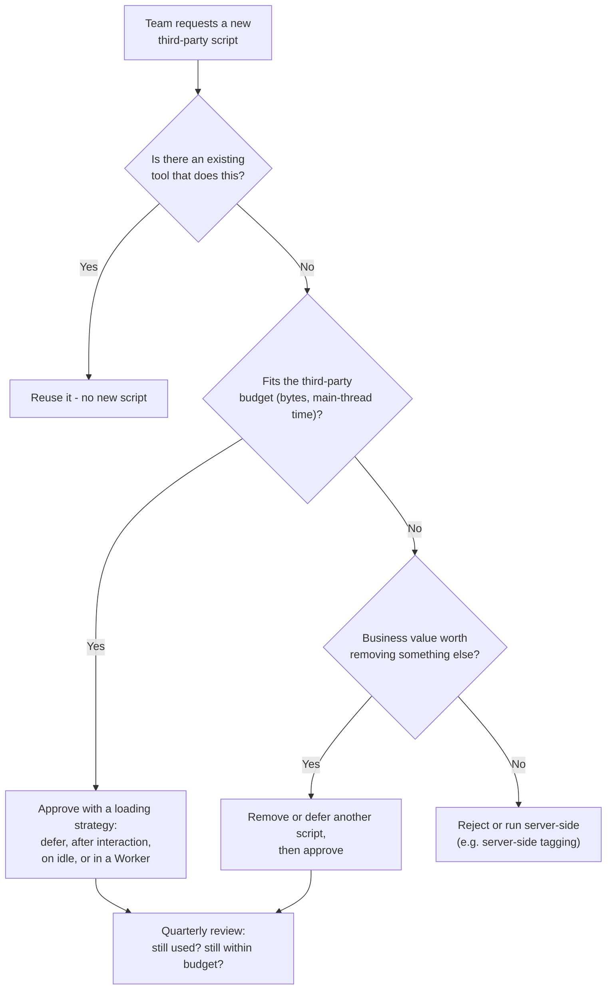
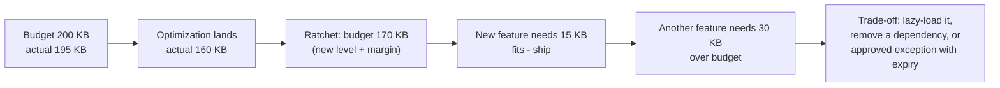

<!-- Generated by scripts/sync-knowledge.js from notes/ and README.md — do not edit here. -->
<!-- sections (line ranges in this file): Table of Contents 19-40 · ELI5 41-54 · Core Concept 55-361 · System Design Angle 362-388 · Framework Comparison 389-402 · Real-World Examples 403-538 · Key Points Summary 539-558 · Test Your Understanding 559-636 · Cheat Sheet 637-682 · References & Further Reading 683-708 -->

# Performance Budgets

> **Date:** 2026-11-06 · **Last updated:** 2026-11-06
> **Category:** Frontend System Design
> **Sub-Topic:** Performance Engineering / Performance Metrics
> **Level:** Intermediate · **Reading time:** ~25 min
> **Informs:** per-route JS/CSS/image byte limits, CI merge gates (size-limit, Lighthouse CI, bundler limits), third-party script governance, dependency selection, metric SLOs and RUM alerting, trade-off discussions between features and speed

> **Pre-requisite:** [Core Web Vitals (LCP, INP, CLS)](./core-web-vitals-lcp-inp-cls.md) (the user-facing targets) and [Lighthouse & Performance Auditing](./lighthouse-and-performance-auditing.md) (how to measure them in the lab and CI).
> This note turns those measurements into **limits the team agrees to and the pipeline enforces**.

**Previous:** [Lighthouse & Performance Auditing](./lighthouse-and-performance-auditing.md) · **Next:** [Code Splitting & Lazy Loading](./code-splitting-and-lazy-loading.md)

---

## Table of Contents

1. [ELI5 — Simple Explanation](#eli5--simple-explanation)
2. [Section 1: What a Performance Budget Is](#section-1-what-a-performance-budget-is)
3. [Section 2: Types of Budgets](#section-2-types-of-budgets)
4. [Section 3: Deriving Budgets from User-Facing Goals](#section-3-deriving-budgets-from-user-facing-goals)
5. [Section 4: Why JavaScript Gets Its Own Budget](#section-4-why-javascript-gets-its-own-budget)
6. [Section 5: What Exactly to Measure](#section-5-what-exactly-to-measure)
7. [Section 6: Enforcing Budgets in the Pipeline](#section-6-enforcing-budgets-in-the-pipeline)
8. [Section 7: Field Budgets and Alerting](#section-7-field-budgets-and-alerting)
9. [Section 8: Third-Party Budgets](#section-8-third-party-budgets)
10. [Section 9: Governance — Owners, Exceptions and the Ratchet](#section-9-governance--owners-exceptions-and-the-ratchet)
11. [System Design Angle](#system-design-angle)
12. [Framework Comparison](#framework-comparison)
13. [Real-World Examples](#real-world-examples)
14. [Key Points Summary](#key-points-summary)
15. [Test Your Understanding](#test-your-understanding)
16. [Cheat Sheet](#cheat-sheet)
17. [References & Further Reading](#references--further-reading)

---

## ELI5 — Simple Explanation

Think of a **backpack weight limit for a hike**:

- The group agrees: *"Nobody carries more than 10 kg, or we won't reach the summit before dark."* That limit is the **budget**; reaching the summit before dark is the **goal** (fast LCP, responsive INP).
- Everyone can choose what to pack, but **if you add a tent you must remove something else**. That's the trade-off conversation a budget forces: "this feature adds 80 KB of JavaScript; what do we drop or lazy-load?"
- A **scale at the trailhead** checks every backpack before anyone leaves. That's CI: the build fails if a bundle is over its limit.
- Partway up, the guide checks the **pace of real hikers**. That's field monitoring: RUM alerts when real-user p75 drifts.
- Each season, if everyone managed with 9 kg, the limit becomes 9 kg. That's the **ratchet**.

> **A performance budget is an agreed limit (bytes, time or score) that protects a user-facing goal; it only works if it is derived from that goal, checked automatically on every change, and owned by someone who can say no.**

---

## Core Concept — Step by Step

### Section 1: What a Performance Budget Is

A performance budget is a **set of limits on metrics that affect user experience**, agreed by the team, that a change must not exceed. It turns "keep the site fast" into a yes/no check.



Why teams need it:

| Without a budget | With a budget |
|---|---|
| Performance decays one "small" dependency at a time | Every addition is visible in the PR and must fit |
| Regressions are noticed weeks later in field data | Most regressions fail CI before merge |
| "Make it fast" is a vague goal nobody owns | A number, a dashboard and an owner |
| Arguments about taste | Arguments about trade-offs with data |

> A budget is **not** an optimization technique. It is a **guardrail**: it keeps the gains you made with code splitting, image optimization and so on from slowly disappearing.

---

### Section 2: Types of Budgets



| Type | Example | Pros | Cons |
|---|---|---|---|
| **Quantity (bytes, requests)** | "Initial JS for `/product` ≤ 170 KB compressed" | Deterministic, cheap to check on every commit, easy to understand in PR review | Indirect: bytes are not user experience |
| **Lab timing** | "Lighthouse mobile median LCP ≤ 2.5 s, TBT ≤ 200 ms" | Closer to user experience, catches render-blocking and main-thread issues | Noisy, slower to run, needs a deployed preview |
| **Rule / score** | "Performance score ≥ 85" | One number for dashboards | Weighted, non-linear, hides which metric regressed |
| **Field (RUM)** | "p75 INP ≤ 200 ms per route, alert on regressions" | The real experience; the ultimate goal | Lagging, only after release, needs traffic |

Comparing them on two axes (a qualitative picture, not measured data):



> **Use them together:** quantity budgets on every commit (fast, deterministic), lab timing budgets on PR previews or nightly, field budgets as the final judge with alerts.

---

### Section 3: Deriving Budgets from User-Facing Goals

Pulling numbers out of thin air ("JS must be under 200 KB") is the most common mistake. Start from the goal and work backwards.



#### 3.1 A worked example (all inputs are stated assumptions)

**Assumptions:** product page, server-rendered, target LCP ≤ 2.5 s on Lighthouse's mobile profile (about 1.6 Mbps, 150 ms RTT), the LCP element is the product image.

```mermaid
gantt
    title Time budget for LCP 2.5 s on the target profile (assumed split)
    dateFormat x
    axisFormat %L ms
    section Critical path
    TTFB incl. connection setup         :t1, 0, 800
    HTML parse and CSS download         :t2, after t1, 500
    LCP image download                  :t3, after t2, 900
    Render and slack                    :t4, after t3, 300
```



```text
Network: 1.6 Mbps ≈ 200 KB per second of transfer (before latency and contention)

CSS on the critical path:   500 ms window  → part of it is round trips
                            → budget ≈ 50 KB compressed CSS for the first render
LCP image:                  900 ms window  → ≈ 180 KB at best
                            → budget ≈ 120 KB for the hero (AVIF/WebP, right size), leaving slack
HTML:                       part of TTFB   → keep the document small; stream it
Fonts on the critical path: ideally 1 preloaded WOFF2, or use font-display: optional

These numbers come from the arithmetic above, not from a benchmark. Recalculate for your own
target profile, and validate with a lab run and RUM.
```

Notice what is **not** in the LCP time budget: most of the JavaScript. With SSR the hero can render before hydration. JavaScript is limited by a **different** goal: main-thread time (TBT in the lab, INP in the field). That is the next section.

#### 3.2 Competitor and baseline anchoring

- **Baseline:** never set a budget your current site can't meet without a plan. Start at "no worse than today", then tighten.
- **Competitors:** web.dev's *Performance budgets 101* suggests measuring competitors and aiming to be noticeably faster (it cites roughly 20% as a noticeable difference). Use CrUX or a lab run on their pages.

---

### Section 4: Why JavaScript Gets Its Own Budget

A kilobyte of JavaScript costs more than a kilobyte of image: after downloading, the browser must **parse, compile and execute** it on the main thread, and frameworks then **hydrate** and attach handlers. On slower phones that CPU time is many times longer than on a developer laptop.



| Budget | Protects | Typical form |
|---|---|---|
| **Initial JS per route** (compressed) | TBT, INP during load, LCP when client-rendered | "≤ N KB" per entry/route, checked by size-limit or bundler |
| **Lazy chunk size** | INP when a feature opens (modal, editor) | "Each lazy chunk ≤ N KB" |
| **Main-thread time (lab)** | INP, TBT | "TBT ≤ 200 ms (Lighthouse mobile median)", "no task > 50 ms in this flow" |
| **Hydration cost** | INP right after load | Measured in traces; reduced with islands, Server Components, partial hydration |

> **Choose the number from measurement on your target device**, not from a blog post: build the page, run Lighthouse on the mobile profile, see how much JS fits within TBT ≤ 200 ms, then set the byte budget slightly below that. Bytes are the cheap, deterministic proxy for main-thread time.

---

### Section 5: What Exactly to Measure

Budgets fail in confusing ways when people measure different things.

| Question | Recommendation | Why |
|---|---|---|
| **Compressed or uncompressed?** | Transfer (compressed) size for network budgets; also track uncompressed JS for parse/execute cost | Brotli/gzip change transfer bytes, not CPU work |
| **Which tool measures what?** | Lighthouse CI `resource-summary:*:size` = transfer size; size-limit = brotli by default; webpack/Vite/Angular limits = emitted file size | Mixing them makes numbers disagree |
| **Initial vs total?** | Budget the **initial** load per route separately from lazy chunks | Lazy code doesn't block first load but affects later interactions |
| **Per route or whole app?** | Per route / page template | A heavy admin route shouldn't consume the landing page's budget |
| **First-party vs third-party?** | Separate budgets | Different owners and different fixes |
| **Images?** | Per-template image budget + LCP image budget | Images dominate bytes but cost less CPU |

```text
Same bundle, four different numbers:
  emitted file on disk (minified) ........ 420 KB   ← webpack/Vite/Angular warnings
  brotli-compressed ....................... 118 KB   ← size-limit default
  transfer size in Lighthouse ............. 121 KB   ← includes headers, actual server compression
  uncompressed JS the CPU must parse ...... 420 KB   ← what drives parse/compile time
(illustrative numbers for one hypothetical bundle)
```

---

### Section 6: Enforcing Budgets in the Pipeline



| Layer | Tool | Speed | What it catches |
|---|---|---|---|
| **Bundler** | webpack `performance` hints, Angular CLI `budgets`, Vite `build.chunkSizeWarningLimit` | Every build, instant | Oversized assets/chunks (emitted size) |
| **Package-level** | **size-limit** (+ its GitHub Action for PR comments), bundle analyzers | Every commit, seconds | New heavy dependency, tree-shaking breakage, per-entry growth |
| **Lab** | **Lighthouse CI** assertions or `budgetsFile`, WebPageTest | Per PR or nightly, minutes | Render-blocking, LCP discovery, TBT, CLS, resource counts |
| **Field** | RUM (`web-vitals`), CrUX | After release, hours to weeks | Real-device and real-network regressions, interactions |

**Bundler limits differ in strength:**

| Tool | Setting | Fails the build? |
|---|---|---|
| webpack 5 | `performance.hints: 'error'`, `maxAssetSize`, `maxEntrypointSize` (bytes; default 250,000) | Yes with `'error'` (default in production mode is `'warning'`) |
| Angular CLI | `budgets` in `angular.json` with `maximumWarning` / `maximumError` per type (`initial`, `anyComponentStyle`, `bundle`, `any`, `anyScript`, `all`, `allScript`) | Yes when `maximumError` is exceeded |
| Vite / Rollup | `build.chunkSizeWarningLimit` (kB, default 500) | **No**, warning only — pair with size-limit for a real gate |
| Next.js | No built-in budget setting | Use size-limit on the build output, bundle analyzer, and LHCI |

**Lighthouse CI budgets file:** LHCI accepts a `budget.json` (`assert.budgetsFile`) and converts it into assertions. Sizes there are in **KB of transfer size**. You can't combine `budgetsFile` with `assertions` or a `preset` in the same config, so most teams write `resource-summary:<type>:size` assertions directly instead (Example 3).

---

### Section 7: Field Budgets and Alerting

Lab budgets catch most regressions; field budgets catch the rest (real devices, real data sizes, interactions, third parties that behave differently in production).



Design rules for field budgets:

- **Per route and device class**, at **p75**, with enough samples to be stable (alert only when sample counts are adequate).
- **Compare release vs previous release** (tag every RUM beacon with the build ID) so you can attribute a regression to a deploy.
- **Alert on sustained breaches** (e.g. several days) rather than single noisy days; use the thresholds above as an example to tune, not as a rule.
- Keep **attribution** (LCP element, INP target and script, CLS source) in the beacon so the alert says *what* to fix.
- The 28-day CrUX window is too slow for alerting; use your own RUM for days, and CrUX to confirm the trend.

---

### Section 8: Third-Party Budgets

Third parties (tag managers, analytics, A/B testing, chat, ads, social embeds) are often the biggest budget consumers and the hardest to control because other teams or vendors own them.



Practical controls:

| Control | How |
|---|---|
| **Inventory** | List every third-party origin with owner and purpose; Lighthouse's `third-parties-insight` shows main-thread time and bytes per third party |
| **Budget** | Separate byte and request budget for `third-party` (LHCI resource type), plus a main-thread time budget measured in traces |
| **Loading strategy** | `async`/`defer`, load after user interaction (chat widget on click), facades for video embeds, Next.js `next/script` strategies (`afterInteractive`, `lazyOnload`), Nuxt Scripts |
| **Isolation** | Web Worker approaches (e.g. Partytown) for some scripts, server-side tagging for analytics |
| **Security and governance** | CSP allowlists make adding a new origin a deliberate change (see later notes on CSP and SRI) |

---

### Section 9: Governance — Owners, Exceptions and the Ratchet

Budgets fail socially more often than technically: someone disables the check "just this once".

| Practice | Description |
|---|---|
| **Owner per budget** | Each page template (or route group) has an owner who approves exceptions |
| **Budgets in the repo** | Config files (`.size-limit.json`, `lighthouserc.json`, `angular.json`) reviewed like code, with CODEOWNERS on them |
| **Visible diffs** | PR comments that show the size diff for every change, even when within budget |
| **Exception process** | Raising a budget needs a written reason, an owner's approval, and an expiry date or follow-up ticket |
| **The ratchet** | After an optimization lands, lower the budget to the new level plus a small margin, so the gain can't silently be spent |
| **Regular review** | Re-derive budgets when the target device, network or goals change |



---

## System Design Angle

**Where budgets appear in a design discussion:**

1. **Requirements:** state the target ("p75 LCP ≤ 2.5 s and INP ≤ 200 ms on mid-range Android, 4G") before choosing architecture.
2. **Architecture choices are budget decisions:**

| Decision | Budget impact |
|---|---|
| CSR vs SSR/SSG/streaming | CSR spends JS and render-delay budget before LCP; SSR spends server time (TTFB) |
| Hydration model (full, islands, Server Components) | Determines how much JS executes before the page is interactive |
| Component library choice | Base cost added to every route |
| Charting, editor, map, date libraries | Large single dependencies; usually lazy-loaded and budgeted per chunk |
| Micro-frontends | Risk of duplicated frameworks; needs shared dependencies and a per-app budget |
| Third-party tags | Separate budget and approval process |

3. **Interface:** budgets per route in config; a dashboard per template.
4. **Operations:** CI gates, RUM alerts, owners, exception process.

**Questions to ask:**
- What device and network does the slowest quarter of users have?
- Which routes are business-critical, and what is each one's LCP element?
- Which large dependencies are on the critical path, and can they be lazy-loaded?
- Who can approve going over budget?

---

## Framework Comparison

| Stack | Built-in budget support | Recommended setup |
|---|---|---|
| **React + Vite** | `build.chunkSizeWarningLimit` (warning only) | size-limit per entry/route chunk + LHCI on preview; `rollup-plugin-visualizer` for analysis |
| **Next.js** | None as a hard gate | size-limit against `.next` output chunks or LHCI `resource-summary` assertions per route; `@next/bundle-analyzer`; `next/script` strategies for third parties |
| **Vue / Nuxt** | Vite warning | size-limit + LHCI; `nuxi analyze`; Nuxt Scripts for third parties |
| **Angular** | **Yes:** `budgets` in `angular.json` fail `ng build` on `maximumError` | Budgets for `initial`, `anyComponentStyle` and named lazy `bundle`s; LHCI for timings |
| **Svelte / SvelteKit** | Vite warning | size-limit + LHCI; small runtime helps but app code still counts |
| **webpack apps** | `performance` hints (`'error'` to fail) | Plus size-limit for compressed sizes |
| **Native mobile** | Store tooling, not web budgets | Budget **app download size** and **startup time**: Android App Bundle size reports, Macrobenchmark startup tests in CI; Xcode app size reports and launch-time metrics. For React Native, also budget the JS bundle size |

---

## Real-World Examples

**Example 1 — size-limit per route (works with any bundler):**
```json
[
  { "name": "Landing: initial JS", "path": "dist/assets/index-*.js", "limit": "120 kB" },
  { "name": "Product route chunk", "path": "dist/assets/product-*.js", "limit": "45 kB" },
  { "name": "Checkout route chunk", "path": "dist/assets/checkout-*.js", "limit": "60 kB" },
  { "name": "All CSS", "path": "dist/assets/*.css", "limit": "40 kB" }
]
```
```bash
npm i -D size-limit @size-limit/file
npx size-limit          # exits non-zero if any entry is over its limit (brotli size by default)
npx size-limit --why    # explain what's inside (needs a bundler-based plugin, see the size-limit docs)
```

**Example 2 — webpack hints that fail the build:**
```javascript
// webpack.config.js
module.exports = {
  mode: 'production',
  performance: {
    hints: 'error',               // default in production is 'warning'
    maxEntrypointSize: 250_000,   // bytes, emitted (not compressed) size
    maxAssetSize: 200_000,
    assetFilter: (file) => /\.(js|css)$/.test(file), // ignore images and source maps
  },
};
```

**Example 3 — Lighthouse CI assertions as budgets (transfer bytes and lab timings):**
```json
{
  "ci": {
    "collect": {
      "url": ["http://localhost:3000/", "http://localhost:3000/product/42"],
      "startServerCommand": "npm run start",
      "numberOfRuns": 5
    },
    "assert": {
      "assertions": {
        "largest-contentful-paint": ["error", { "maxNumericValue": 2500, "aggregationMethod": "median" }],
        "total-blocking-time": ["error", { "maxNumericValue": 200, "aggregationMethod": "median" }],
        "cumulative-layout-shift": ["error", { "maxNumericValue": 0.1, "aggregationMethod": "median" }],
        "resource-summary:script:size": ["error", { "maxNumericValue": 180000 }],
        "resource-summary:image:size": ["warn", { "maxNumericValue": 300000 }],
        "resource-summary:third-party:count": ["warn", { "maxNumericValue": 8 }]
      }
    }
  }
}
```

Roughly the same limits in the budgets-file format (`assert.budgetsFile`, sizes in KB, cannot be mixed with `assertions`):
```json
[
  {
    "path": "/product/*",
    "timings": [
      { "metric": "largest-contentful-paint", "budget": 2500 },
      { "metric": "total-blocking-time", "budget": 200 }
    ],
    "resourceSizes": [
      { "resourceType": "script", "budget": 175 },
      { "resourceType": "total", "budget": 600 }
    ],
    "resourceCounts": [
      { "resourceType": "third-party", "budget": 8 }
    ]
  }
]
```

**Example 4 — Angular CLI budgets:**
```json
{
  "projects": {
    "shop": {
      "architect": {
        "build": {
          "configurations": {
            "production": {
              "budgets": [
                { "type": "initial", "maximumWarning": "400kB", "maximumError": "500kB" },
                { "type": "anyComponentStyle", "maximumWarning": "4kB", "maximumError": "8kB" },
                { "type": "bundle", "name": "checkout", "maximumWarning": "120kB", "maximumError": "150kB" }
              ]
            }
          }
        }
      }
    }
  }
}
```

**Example 5 — BAD vs GOOD: adding a dependency:**
```typescript
// ❌ BAD: a whole utility library and a date library imported eagerly for one helper each
import _ from 'lodash';
import moment from 'moment';            // moment is in maintenance mode and large
export const label = (d: Date) => moment(d).format('MMM D') + _.capitalize(' sale');

// ✅ GOOD: platform APIs first, small imports otherwise; the PR shows the size diff
const fmt = new Intl.DateTimeFormat('en', { month: 'short', day: 'numeric' });
export const label = (d: Date) => `${fmt.format(d)} Sale`;
```

**Example 6 — Field budget check on RUM data (sketch):**
```typescript
type Beacon = { route: string; device: 'mobile' | 'desktop'; name: 'LCP' | 'INP' | 'CLS'; value: number };

const BUDGETS = { LCP: 2500, INP: 200, CLS: 0.1 } as const;
const MIN_SAMPLES = 500; // don't alert on tiny samples; tune for your traffic

function p75(values: number[]) {
  const s = [...values].sort((a, b) => a - b);
  return s[Math.floor(0.75 * (s.length - 1))];
}

export function findBreaches(beacons: Beacon[]) {
  const groups = new Map<string, number[]>();
  for (const b of beacons) {
    const key = `${b.route}|${b.device}|${b.name}`;
    groups.set(key, [...(groups.get(key) ?? []), b.value]);
  }
  return [...groups]
    .filter(([, v]) => v.length >= MIN_SAMPLES)
    .map(([key, v]) => ({ key, p75: p75(v), budget: BUDGETS[key.split('|')[2] as keyof typeof BUDGETS] }))
    .filter((g) => g.p75 > g.budget);
}
```

---

## Key Points Summary

| Concept | One-Line Explanation |
|---|---|
| **Performance budget** | An agreed limit on bytes, time or score that protects a user-facing goal |
| **Quantity budget** | Bytes/requests per route; deterministic, checked on every commit |
| **Lab timing budget** | LCP, TBT, CLS in Lighthouse (median of runs) on previews or nightly |
| **Field budget** | p75 CWV per route and device in RUM, with alerts |
| **Derivation** | Goal → time budget → resource budgets on the target device and network |
| **JS budget** | Separate, because JS costs parse/compile/execute/hydrate time on the main thread |
| **Measure consistently** | Compressed vs emitted vs transfer size differ — know which your tool reports |
| **Bundler gates** | webpack `hints: 'error'`, Angular `maximumError`; Vite only warns |
| **size-limit** | Per-entry compressed size gate with PR comments |
| **Lighthouse CI** | `resource-summary:*` and metric assertions, or a `budgetsFile` |
| **Third-party budget** | Separate budget + approval process + loading strategy |
| **Ratchet** | Lower the budget after each improvement so gains stay |
| **Exceptions** | Written reason, owner approval, expiry date |

---

## Test Your Understanding

**Q1 (Basic):**
Name the main types of performance budgets and one advantage and one weakness of each.

<details>
<summary>Answer</summary>

- **Quantity (bytes, requests):** deterministic and cheap to check on every commit; but only a proxy for user experience.
- **Lab timing (LCP, TBT, CLS in Lighthouse):** closer to user experience and catches render-blocking/main-thread issues; but noisy and needs a running preview.
- **Rule/score (Lighthouse score ≥ N):** one simple number; but weighted and non-linear, hides which metric regressed.
- **Field (RUM p75 per route):** the real experience; but it only shows problems after release and needs traffic.

Use quantity budgets as the fast gate, lab timings on PRs or nightly, and field budgets as the final judge.
</details>

**Q2 (Application):**
Your team wants "a JS budget". How do you choose the number instead of copying one from a blog?

<details>
<summary>Answer</summary>

Work backwards from the goal on your **target profile**:
1. Pick the user-facing targets (e.g. INP ≤ 200 ms p75; in the lab TBT ≤ 200 ms on Lighthouse mobile) and the device class of your slowest quarter of users from RUM.
2. Measure the current page: JS size per route (compressed and uncompressed) and TBT/long tasks on that profile.
3. Find how much JS fits within the main-thread target, for example by testing builds with and without features, and note how hydration scales.
4. Set the byte budget at or slightly below that level (or at today's size if you already meet the target), per route, with lazy chunks budgeted separately.
5. Encode it (size-limit/LHCI) and **ratchet** it down as optimizations land. Re-check the derivation when targets or devices change.
</details>

**Q3 (Tricky):**
CI reports the main bundle as 410 KB (webpack warning), size-limit says 115 KB, and Lighthouse CI says 118 KB of script. Which one is wrong?

<details>
<summary>Answer</summary>

None of them. They measure different things:
- **webpack** reports the **emitted (minified, uncompressed)** file size.
- **size-limit** reports **brotli-compressed** size by default.
- **Lighthouse CI** `resource-summary:script:size` is **transfer size** as served (actual server compression plus headers).

Budget network cost with compressed/transfer size, and watch uncompressed size too, because parse/compile/execute work scales with the uncompressed code. Write in the config which measure each budget uses.
</details>

**Q4 (Tricky):**
The team's Vite project has `chunkSizeWarningLimit: 300`, yet bundles keep growing past it. Why, and what do you change?

<details>
<summary>Answer</summary>

`build.chunkSizeWarningLimit` only prints a **warning**; it never fails the build, and warnings in CI logs get ignored. Add a real gate: **size-limit** (per entry/route, exits non-zero, posts PR comments) and/or Lighthouse CI `resource-summary:script:size` assertions at `error` level. Make the size diff visible on every PR and give the budget files an owner (CODEOWNERS).
</details>

**Q5 (Application):**
Marketing wants to add a new A/B testing script that hides the page until experiments load. What do you say, in budget terms?

<details>
<summary>Answer</summary>

It hits several budgets at once. The "anti-flicker" hiding adds directly to **LCP render delay**, the script adds third-party bytes and **main-thread time** (TBT/INP), and it may add a new origin (connection setup). Go through the third-party process: check whether the existing tool can do it, measure its cost in a lab trace, and compare with the third-party budget. Options: server-side or edge experiments (no client hiding), limiting the hiding timeout, loading only on the pages under test, or removing another script to make room. If it still doesn't fit, it needs an owner-approved exception with an expiry and a RUM check after launch.
</details>

**Q6 (System design):**
Design the budget system for a large SPA with 12 teams owning different routes. Include what is measured, where it is enforced, and how exceptions work.

<details>
<summary>Answer</summary>

- **Goals:** p75 LCP ≤ 2.5 s, INP ≤ 200 ms, CLS ≤ 0.1 per route on mid-range mobile, from RUM.
- **Per-route budgets** owned by each team: initial JS (compressed) for the route's entry, lazy chunk limits, CSS, images, third-party count. A **shared budget** for the app shell and design system, owned by the platform team, so teams don't silently grow common code.
- **Enforcement:** size-limit on every PR with diff comments (fast, deterministic); Lighthouse CI on preview deployments for each team's key URL (median of 3–5 runs, `error` on LCP/TBT/CLS); bundler-level gates where available (Angular budgets / webpack hints).
- **Field:** RUM tagged with route, team and build ID; dashboards per team; alerts on sustained p75 breaches go to the owning team.
- **Governance:** budget files under CODEOWNERS; raising a budget needs a reason, owner approval and an expiry/follow-up ticket; ratchet after improvements; quarterly review of third parties and of the budgets themselves.
- **Architecture support:** route-level code splitting, shared dependency deduplication (one framework copy), lazy-loading heavy libraries, so teams can actually fit their budgets.
</details>

---

## Cheat Sheet

**Key Definitions:**
- **Performance budget:** Agreed limit on a metric that a change must not exceed.
- **Quantity budget:** Limit on bytes or request counts.
- **Timing budget:** Limit on a lab metric (LCP, TBT, CLS).
- **Field budget:** Limit on real-user p75 metrics, enforced through alerts.
- **Ratchet:** Lowering the budget after an improvement so the gain isn't lost.
- **Transfer size:** Bytes over the network (compressed, with headers).
- **Emitted size:** File size the bundler writes (minified, uncompressed).

**Quick Reference:**
```text
Derive:   goal (p75 LCP/INP/CLS on target device) → time budget (TTFB, critical CSS, LCP resource, render)
          → byte budgets on target network → JS budget from main-thread time (TBT/INP)
Layers:   bundler (instant) → size-limit (every commit) → LHCI on preview (per PR) → RUM alerts (prod)

webpack:  performance: { hints: 'error', maxEntrypointSize, maxAssetSize }   (bytes, emitted; default 250000)
Angular:  budgets: [{ type: 'initial' | 'bundle' | 'anyComponentStyle' | ..., maximumWarning, maximumError }]
Vite:     build.chunkSizeWarningLimit (kB, warning only, default 500) → add size-limit
size-limit: [{ path, limit: '120 kB' }]   brotli by default; time limits possible with a preset
LHCI:     "resource-summary:script:size": ["error", { "maxNumericValue": 180000 }]   (transfer bytes)
          "largest-contentful-paint": ["error", { "maxNumericValue": 2500, "aggregationMethod": "median" }]
          budgetsFile (KB) OR assertions/preset — not both

Govern:   owner per budget · CODEOWNERS on configs · visible PR diffs · exceptions with expiry · ratchet
```

**Common Mistakes to Avoid:**

| Mistake | Why Wrong | Fix |
|---|---|---|
| Copying a budget number from a blog | Not tied to your users, devices or goals | Derive from target metrics on your target profile |
| Only a Lighthouse score budget | Hides which metric regressed; non-linear | Budget specific metrics and bytes |
| Whole-app byte budget | Heavy routes hide in the average; light routes bloat | Per-route/per-template budgets |
| Mixing compressed and uncompressed numbers | Budgets "disagree" and get ignored | State the measure for each budget |
| Warnings instead of errors | Warnings are ignored in CI | `error` level gates for key budgets |
| Budgets nobody owns | Raised or disabled under deadline pressure | Owner + CODEOWNERS + exception process |
| Never tightening | Improvements get spent by the next features | Ratchet after each improvement |
| Ignoring third parties | Often the biggest main-thread cost | Separate third-party budget and approvals |
| Single-run lab budgets | Flaky failures → people disable the gate | Median of 3–5 runs |
| Budgeting bytes only | Bytes don't capture CPU cost differences | Add TBT/INP time budgets and field budgets |
| Setting budgets the current site can't meet with no plan | The gate is immediately red and gets bypassed | Start at the current level, tighten in steps |

---

## References & Further Reading

**Guides**
- web.dev: [Performance budgets 101](https://web.dev/articles/performance-budgets-101)
- web.dev: [Incorporate performance budgets into your build process](https://web.dev/articles/incorporate-performance-budgets-into-your-build-tools)
- MDN: [Performance budgets](https://developer.mozilla.org/en-US/docs/Web/Performance/Performance_budgets)
- V8 blog: [The cost of JavaScript in 2019](https://v8.dev/blog/cost-of-javascript-2019)
- web.dev: [Efficiently load third-party JavaScript](https://web.dev/articles/efficiently-load-third-party-javascript)

**Tool docs**
- Lighthouse CI: [Configuration — assertions and `budgetsFile`](https://github.com/GoogleChrome/lighthouse-ci/blob/main/docs/configuration.md)
- GitHub: [ai/size-limit](https://github.com/ai/size-limit) · [size-limit GitHub Action](https://github.com/andresz1/size-limit-action)
- webpack: [Performance configuration](https://webpack.js.org/configuration/performance/)
- Angular: [Configuring size budgets](https://angular.dev/tools/cli/build#configuring-size-budgets)
- Vite: [`build.chunkSizeWarningLimit`](https://vite.dev/config/build-options#build-chunksizewarninglimit)
- Next.js: [`next/script` loading strategies](https://nextjs.org/docs/app/api-reference/components/script)

---

> **Previous Topic:** [Lighthouse & Performance Auditing](./lighthouse-and-performance-auditing.md)
> — Lab tooling to diagnose performance and gate regressions in CI

> **Next Topic:** [Code Splitting & Lazy Loading](./code-splitting-and-lazy-loading.md)
> — The main technique for fitting JavaScript into a per-route budget

*Saved on: 2026-11-06 | Repo: Frontend System Design Learning Notes*
