<!-- Generated by scripts/sync-knowledge.js from notes/ and README.md — do not edit here. -->
<!-- sections (line ranges in this file): Table of Contents 19-45 · ELI5 46-61 · Core Concept 62-655 · Migration Notes 656-675 · System Design Angle 676-716 · Real-World Examples 717-894 · Key Points Summary 895-915 · Test Your Understanding 916-986 · Cheat Sheet 987-1037 · References & Further Reading 1038-1071 -->

# React Query / TanStack Query

> **Date:** 2026-11-06 · **Last updated:** 2026-11-06
> **Category:** Frontend System Design
> **Sub-Topic:** State & Data / Data Fetching
> **Level:** Intermediate · **Reading time:** ~32 min
> **Informs:** server-state caching per resource (staleTime, gcTime), query-key design and invalidation strategy, mutation and optimistic-update flow, infinite lists and pagination, SSR/RSC prefetch and hydration, offline persistence, loading/error UX states

> **Pre-requisite:** [Server State vs Client State](./server-state-vs-client-state.md) (why server data is a cache) and [Browser Caching Strategies](./browser-caching-strategies.md) (freshness and `stale-while-revalidate`).
> This note covers **TanStack Query v5** — the library formerly called React Query — with React as the default and adapters for Vue, Svelte, Solid and Angular.

**Previous:** [Server State vs Client State](./server-state-vs-client-state.md) · **Next:** [SWR & Stale-While-Revalidate](./swr-and-stale-while-revalidate.md)

---

## Table of Contents

1. [ELI5 — Simple Explanation](#eli5--simple-explanation)
2. [Section 1: What It Is and How It's Built](#section-1-what-it-is-and-how-its-built)
3. [Section 2: Your First Query and Query Keys](#section-2-your-first-query-and-query-keys)
4. [Section 3: Query Status — status vs fetchStatus](#section-3-query-status--status-vs-fetchstatus)
5. [Section 4: staleTime vs gcTime and the Important Defaults](#section-4-staletime-vs-gctime-and-the-important-defaults)
6. [Section 5: What Triggers a Refetch](#section-5-what-triggers-a-refetch)
7. [Section 6: Dependent, Parallel and Conditional Queries](#section-6-dependent-parallel-and-conditional-queries)
8. [Section 7: Mutations and Invalidation](#section-7-mutations-and-invalidation)
9. [Section 8: Optimistic Updates](#section-8-optimistic-updates)
10. [Section 9: Pagination and Infinite Queries](#section-9-pagination-and-infinite-queries)
11. [Section 10: Render Performance — select, Structural Sharing, Tracked Props](#section-10-render-performance--select-structural-sharing-tracked-props)
12. [Section 11: Suspense and Error Boundaries](#section-11-suspense-and-error-boundaries)
13. [Section 12: SSR, Streaming and Server Components](#section-12-ssr-streaming-and-server-components)
14. [Section 13: Offline, Network Mode and Persistence](#section-13-offline-network-mode-and-persistence)
15. [Section 14: Other Frameworks and React Native](#section-14-other-frameworks-and-react-native)
16. [Migration Notes — v4 to v5](#migration-notes--v4-to-v5)
17. [System Design Angle](#system-design-angle)
18. [Real-World Examples](#real-world-examples)
19. [Key Points Summary](#key-points-summary)
20. [Test Your Understanding (with answers)](#test-your-understanding)
21. [Cheat Sheet](#cheat-sheet)
22. [References & Further Reading](#references--further-reading)

---

## ELI5 — Simple Explanation

Imagine a **personal assistant with a notebook**:

- You ask, *"What's the weather?"* The assistant phones the weather service, writes the answer in the notebook **with the time**, and tells you.
- Five people in your office ask the same question at once. The assistant makes **one call** and tells all five.
- You ask again a minute later. The answer is still **fresh** (you said weather answers are good for 5 minutes), so the assistant reads it from the notebook — **no call**.
- After 5 minutes the answer is **stale**. Next time you ask, the assistant **reads you the old answer immediately** *and* phones for an update in the background, then corrects you if it changed.
- When you come back from lunch (window focus) or the Wi-Fi returns (reconnect), the assistant re-checks stale answers on their own.
- If nobody has asked about something for a while, the assistant **tears that page out** of the notebook (garbage collection).
- When you tell the assistant *"I changed the meeting room"* (a mutation), it crosses out every notebook page about meetings (invalidation) so they get re-checked.

> **TanStack Query is an async state cache: give it a key and a function that returns a promise, and it handles caching, dedupe, background refetching, retries, invalidation and garbage collection for you.**

---

## Core Concept — Step by Step

### Section 1: What It Is and How It's Built

TanStack Query is **not a data-fetching library** — it never makes HTTP calls itself. You give it a `queryFn` that returns a promise (via `fetch`, axios, a GraphQL client, IndexedDB, anything). It manages the **state of that promise's result** over time.

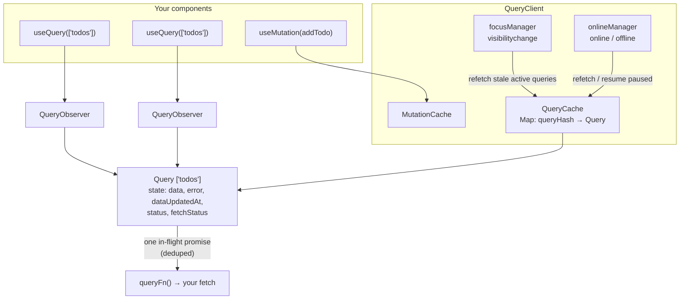

| Piece | Role |
|---|---|
| **`QueryClient`** | The cache container + imperative API (`invalidateQueries`, `setQueryData`, `prefetchQuery`…). Usually one per app (one **per request** on the server) |
| **`QueryCache`** | Holds `Query` objects by hashed key |
| **`Query`** | State for one key: data, error, timestamps, the in-flight promise, retry state |
| **`QueryObserver`** | Created per `useQuery`; subscribes a component to a query and applies per-observer options (`select`, `enabled`, `staleTime`) |
| **`MutationCache`** | Holds mutations (for `useMutationState`, `useIsMutating`, offline resume) |
| **`focusManager` / `onlineManager`** | Platform hooks that trigger refetches; swappable (React Native, Electron) |

The core (`@tanstack/query-core`) is framework-agnostic; `@tanstack/react-query`, `vue-query`, `svelte-query`, `solid-query` and `angular-query-experimental` are thin adapters.

---

### Section 2: Your First Query and Query Keys

```tsx
// main.tsx
import { QueryClient, QueryClientProvider } from '@tanstack/react-query';
import { ReactQueryDevtools } from '@tanstack/react-query-devtools';

const queryClient = new QueryClient();

createRoot(document.getElementById('root')!).render(
  <QueryClientProvider client={queryClient}>
    <App />
    <ReactQueryDevtools initialIsOpen={false} />
  </QueryClientProvider>,
);

// Todos.tsx
import { useQuery } from '@tanstack/react-query';

function Todos() {
  const { data, isPending, isError, error } = useQuery({
    queryKey: ['todos'],
    queryFn: async ({ signal }) => {
      const res = await fetch('/api/todos', { signal });
      if (!res.ok) throw new Error(`HTTP ${res.status}`); // fetch doesn't reject on 4xx/5xx
      return (await res.json()) as Todo[];
    },
  });

  if (isPending) return <Spinner />;
  if (isError) return <ErrorMessage error={error} />;
  return <ul>{data.map((t) => <li key={t.id}>{t.title}</li>)}</ul>;
}
```

**Query keys** are the cache's identity:

```text
['todos']                                   all todos
['todos', 5]                                todo 5
['todos', { status: 'done', page: 2 }]      a filtered page
```

| Rule | Why |
|---|---|
| Key = **array**, must be JSON-serializable | It's hashed deterministically into `queryHash` |
| **Object key order doesn't matter**; array order does | `{a, b}` and `{b, a}` hash the same; `['todos', 1]` ≠ `[1, 'todos']` |
| Put **every variable the `queryFn` uses** in the key | Different inputs must be different cache entries — otherwise you get wrong data. The official ESLint plugin (`@tanstack/eslint-plugin-query`) flags missing dependencies |
| Go **general → specific** | Enables prefix matching: invalidating `['todos']` also hits `['todos', 5]` and `['todos', {…}]` |
| Centralize in **key factories / `queryOptions`** | One place to change; type-safe reuse for `useQuery`, `prefetchQuery`, `getQueryData` |

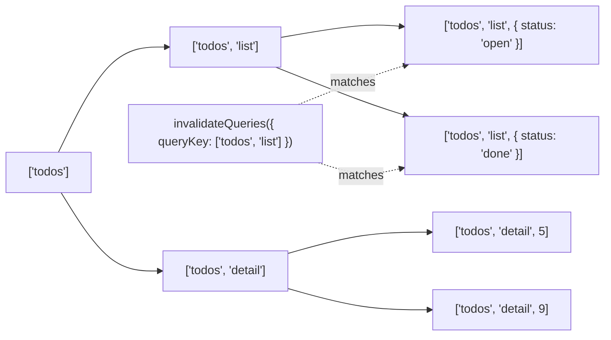

The `queryFn` receives a context with `queryKey`, `signal` (an `AbortSignal` — pass it to `fetch` so obsolete requests are cancelled) and, for infinite queries, `pageParam`.

---

### Section 3: Query Status — status vs fetchStatus

v5 separates **"do we have data?"** (`status`) from **"is a request running?"** (`fetchStatus`):

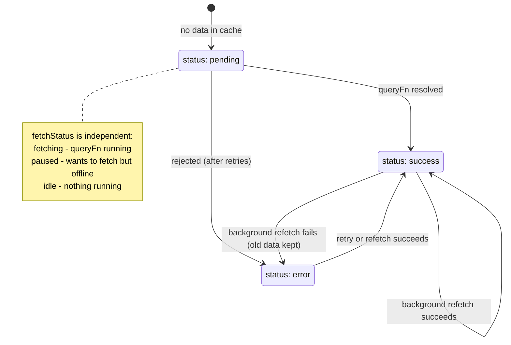

| Flag | Meaning | Typical UI |
|---|---|---|
| `isPending` | No cached data yet (`status === 'pending'`) | Skeleton / full loader |
| `isLoading` | `isPending && isFetching` — the **first** load is in flight | Same; false when the query is disabled |
| `isFetching` | Any request in flight, including background refetches | Subtle spinner, progress bar |
| `isRefetching` | `isFetching && !isPending` — background refresh | Small "updating" indicator |
| `isSuccess` / `isError` | `status` is success / error | Content / error state |
| `isPaused` | `fetchStatus === 'paused'` (offline) | "Waiting for connection" |
| `isPlaceholderData` | Showing `placeholderData`, not real data for this key | Dim the list |
| `isStale` | Data exists but is older than `staleTime` | Rarely needed in UI |

> **Common bug:** showing a full-page spinner on `isFetching`. Every focus refetch then blanks the screen. Use `isPending` for "no data" and `isFetching` only for a subtle indicator.

**Error with data:** if a background refetch fails, `status` becomes `'error'` but **`data` keeps the last good value**. Render data when you have it and show the error as a banner, rather than replacing the content with an error page.

---

### Section 4: staleTime vs gcTime and the Important Defaults

These two timers are the most misunderstood options:

| Option | Default | Question it answers |
|---|---|---|
| **`staleTime`** | `0` | *How long is cached data trusted without refetching?* Fresh data is returned from the cache and **no** refetch triggers fire. `Infinity` = never stale unless invalidated; `'static'` = never stale even when invalidated |
| **`gcTime`** (was `cacheTime` in v4) | 5 minutes on the client, `Infinity` on the server | *How long is **unused** data kept in memory?* The timer starts when the **last observer unmounts**; after it, the entry is removed |

```mermaid
gantt
    title One query - staleTime 30 s, gcTime 5 min
    dateFormat X
    axisFormat %M:%S
    section Data freshness
    Fresh - served from cache, no refetch      :f1, 0, 30
    Stale - served AND refetched on triggers   :f2, after f1, 90
    section Observers
    Component mounted (active query)           :o1, 0, 120
    Inactive - gcTime countdown                :o2, after o1, 300
    section Cache entry
    Exists in QueryCache                       :c1, 0, 420
```

```text
staleTime  → controls REFETCHING   ("is this answer still good?")
gcTime     → controls MEMORY        ("is anyone still interested in this page of the notebook?")
A query can be stale but still cached (instant render + background refetch) — that's the normal state.
```

**Important defaults** (verify against the "Important Defaults" page when upgrading):

| Behaviour | Default |
|---|---|
| `staleTime` | `0` → data is stale immediately |
| Refetch stale queries on **mount**, **window focus**, **reconnect** | `true` (`refetchOnMount`, `refetchOnWindowFocus`, `refetchOnReconnect`) |
| `refetchInterval` | off |
| Query `retry` | **3** on the client (0 on the server), exponential backoff `min(1000 * 2^attempt, 30 000)` ms |
| Mutation `retry` | **0** |
| `gcTime` | 5 min (client) |
| `structuralSharing` | `true` |
| `networkMode` | `'online'` |
| `throwOnError` | `false` |

> **Choosing `staleTime`** is a product decision per resource: stock prices `0`–`5 s`, a feed `30 s`, user profile `5 min`, a country list `Infinity`. Many teams set a global default of 20–60 s and override per query. For SSR, a non-zero `staleTime` prevents an immediate client refetch after hydration.

---

### Section 5: What Triggers a Refetch

A query fetches when it has **no data**, or when its data is **stale** *and* one of these happens:

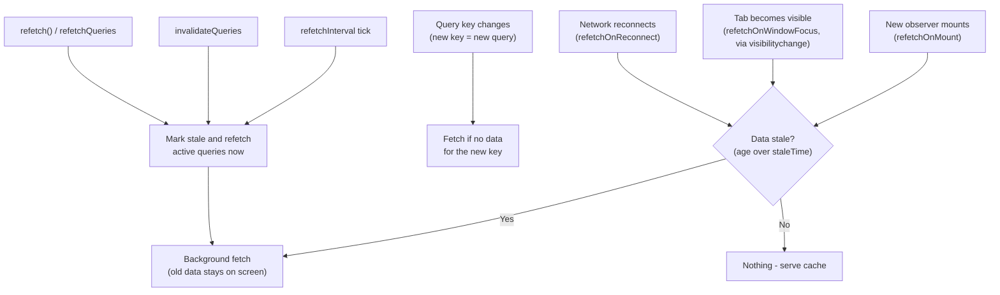

Notes:
- Each trigger option also accepts `'always'` (refetch even when fresh) or a function.
- Focus detection uses `visibilitychange` (v5 dropped the `focus` event to avoid double refetches); customize with `focusManager.setEventListener` for React Native / Electron.
- **Dedupe:** if a fetch for a key is already in flight, new triggers join the same promise.
- `refetchIntervalInBackground: true` keeps polling in hidden tabs (default: pause).

---

### Section 6: Dependent, Parallel and Conditional Queries

```tsx
// Parallel: just call useQuery twice — both start immediately
const user = useQuery({ queryKey: ['user', id], queryFn: () => getUser(id) });
const prefs = useQuery({ queryKey: ['prefs', id], queryFn: () => getPrefs(id) });

// Dependent: wait for user.data before fetching projects
const projects = useQuery({
  queryKey: ['projects', user.data?.orgId],
  queryFn: () => getProjects(user.data!.orgId),
  enabled: !!user.data?.orgId,          // disabled queries don't fetch automatically
});

// Type-safe alternative to enabled: skipToken
import { skipToken } from '@tanstack/react-query';
const search = useQuery({
  queryKey: ['search', term],
  queryFn: term ? () => searchApi(term) : skipToken,
});

// Dynamic number of queries + combine into one value
const results = useQueries({
  queries: ids.map((id) => ({ queryKey: ['todo', id], queryFn: () => getTodo(id) })),
  combine: (rs) => ({ todos: rs.map((r) => r.data).filter(Boolean), pending: rs.some((r) => r.isPending) }),
});
```

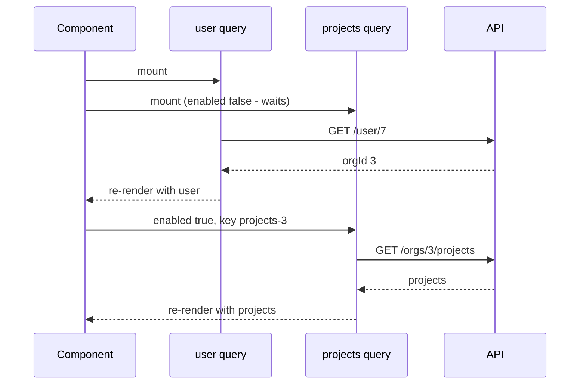

> **Waterfalls:** dependent queries are sequential by nature. If both values are known up front (e.g. from the URL), fetch in parallel instead; if the server can, return both in one response, or prefetch in a route loader.

---

### Section 7: Mutations and Invalidation

`useMutation` wraps **writes**. It doesn't cache by key; it tracks the state of one write and gives you lifecycle hooks.

```tsx
const qc = useQueryClient();

const addTodo = useMutation({
  mutationFn: (newTodo: NewTodo) => api.post<Todo>('/todos', newTodo),
  onSuccess: (created) => {
    // Option A: put the server's response straight into a detail cache entry
    qc.setQueryData(['todos', 'detail', created.id], created);
  },
  onSettled: () => {
    // Option B (most robust): mark lists stale and refetch the active ones
    return qc.invalidateQueries({ queryKey: ['todos', 'list'] }); // returning the promise keeps isPending true until refetched
  },
});

addTodo.mutate({ title: 'Write notes' });           // fire and forget, errors go to state/callbacks
await addTodo.mutateAsync({ title: 'Ship it' });     // returns a promise — you must catch errors
```

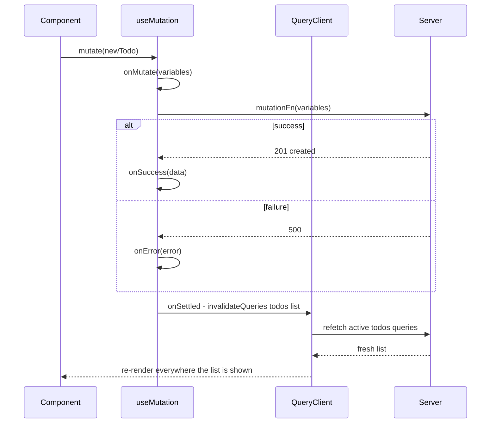

| `invalidateQueries` option | Effect |
|---|---|
| `{ queryKey: ['todos'] }` | Prefix match — every key starting with `'todos'` |
| `exact: true` | Only that exact key |
| `refetchType: 'active'` (default) | Refetch only queries with mounted observers; inactive ones are marked stale and refetch when used |
| `refetchType: 'all'` / `'none'` | Refetch inactive too / only mark stale |
| `predicate: (q) => …` | Custom matching |

Other details:
- Hook-level callbacks (`useMutation({ onSuccess })`) run before call-level ones (`mutate(vars, { onSuccess })`); call-level callbacks may **not** run if the component unmounted — put cache logic in the hook-level ones.
- **`scope: { id: 'todo-42' }`** makes mutations with the same scope id run **serially**, e.g. rapid edits to one document.
- `useMutationState({ filters: { mutationKey: ['addTodo'], status: 'pending' } })` reads pending mutations from **any** component (useful for optimistic list items rendered far from the form).
- Global side effects (toasts, logging) belong in `new QueryClient({ mutationCache: new MutationCache({ onError }) })` / `queryCache: new QueryCache({ onError })`.

---

### Section 8: Optimistic Updates

Two documented approaches:

| | **Via the UI (`variables`)** | **Via the cache (`onMutate`)** |
|---|---|---|
| How | Render the pending `variables` as an extra item where needed | Write the expected result into the cache, roll back on error |
| Rollback | Automatic — the pending item just disappears on error | Manual — restore a snapshot |
| Best for | One place shows the optimistic value | Many screens show the same data |

```tsx
// Approach 1 — render pending variables (simplest)
const { mutate, isPending, variables, isError } = useMutation({
  mutationFn: addTodo,
  onSettled: () => qc.invalidateQueries({ queryKey: ['todos'] }),
});
// in JSX:
{isPending && <li style={{ opacity: 0.5 }}>{variables.title}</li>}
{isError && <li>Failed: {variables.title} <button onClick={() => mutate(variables)}>Retry</button></li>}
```

```tsx
// Approach 2 — optimistic cache write with rollback
useMutation({
  mutationFn: toggleTodo,
  onMutate: async (id: string) => {
    await qc.cancelQueries({ queryKey: ['todos', 'list'] });         // stop in-flight refetches overwriting us
    const previous = qc.getQueryData<Todo[]>(['todos', 'list']);     // snapshot
    qc.setQueryData<Todo[]>(['todos', 'list'], (old = []) =>
      old.map((t) => (t.id === id ? { ...t, done: !t.done } : t)),   // immutable update
    );
    return { previous };                                             // passed to onError / onSettled
  },
  onError: (_err, _id, onMutateResult) => {
    qc.setQueryData(['todos', 'list'], onMutateResult?.previous);    // roll back
    toast.error('Could not update the todo');
  },
  onSettled: () => qc.invalidateQueries({ queryKey: ['todos', 'list'] }), // re-sync with the server
});
```

Cross-cutting patterns (conflicts, ordering, undo) are covered in [Optimistic UI Updates](./optimistic-ui-updates.md).

---

### Section 9: Pagination and Infinite Queries

**Paginated (page numbers):** each page is its own key. Use `placeholderData: keepPreviousData` so the old page stays visible while the next loads:

```tsx
import { keepPreviousData, useQuery } from '@tanstack/react-query';

const { data, isPlaceholderData } = useQuery({
  queryKey: ['projects', { page }],
  queryFn: () => fetchProjects(page),
  placeholderData: keepPreviousData,
});
```

**Infinite (cursor-based "load more" / infinite scroll):** one key holds **all pages**:

```tsx
const feed = useInfiniteQuery({
  queryKey: ['feed'],
  queryFn: ({ pageParam, signal }) => api.feed({ cursor: pageParam, signal }),
  initialPageParam: null as string | null,                      // required in v5
  getNextPageParam: (lastPage) => lastPage.nextCursor ?? undefined, // undefined → hasNextPage false
  maxPages: 10,                                                  // optional: cap memory for very long feeds
});

const items = feed.data?.pages.flatMap((p) => p.items) ?? [];
// feed.fetchNextPage(), feed.hasNextPage, feed.isFetchingNextPage
```

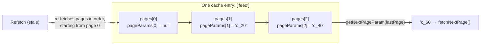

> When an infinite query refetches, it refetches **every loaded page sequentially** from the first, so pages stay consistent. With many pages loaded that's many requests — `maxPages` limits it (and requires `getPreviousPageParam` if users scroll back). See [Pagination & Infinite Scroll](./pagination-and-infinite-scroll.md) and [Virtual Scrolling & Windowing](./virtual-scrolling-and-windowing.md).

---

### Section 10: Render Performance — select, Structural Sharing, Tracked Props

Three built-in mechanisms keep re-renders low:

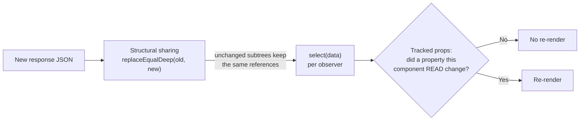

| Mechanism | What it does | Gotcha |
|---|---|---|
| **Structural sharing** (default on) | Deep-compares new JSON with old and reuses unchanged objects, so `memo`/`useMemo` dependencies stay stable | Only for JSON-compatible data; disable or customize for huge payloads |
| **`select`** | Transform/subscribe to a slice: `select: (todos) => todos.length` — the component only re-renders when the count changes | Define it outside the component or wrap in `useCallback` so it isn't re-run every render |
| **Tracked properties** (default) | The result object tracks which fields you **read**; reading only `data` means `isFetching` changes don't re-render you | Spreading the result (`{...query}`) reads everything and disables the optimization |

---

### Section 11: Suspense and Error Boundaries

```tsx
import { useSuspenseQuery, QueryErrorResetBoundary } from '@tanstack/react-query';
import { ErrorBoundary } from 'react-error-boundary';

function Project({ id }: { id: string }) {
  const { data } = useSuspenseQuery({ queryKey: ['project', id], queryFn: () => getProject(id) });
  return <h1>{data.name}</h1>; // data is always defined here
}

function ProjectPage({ id }: { id: string }) {
  return (
    <QueryErrorResetBoundary>
      {({ reset }) => (
        <ErrorBoundary onReset={reset} fallbackRender={({ resetErrorBoundary }) => (
          <button onClick={resetErrorBoundary}>Try again</button>
        )}>
          <Suspense fallback={<Skeleton />}>
            <Project id={id} />
          </Suspense>
        </ErrorBoundary>
      )}
    </QueryErrorResetBoundary>
  );
}
```

- `useSuspenseQuery`, `useSuspenseInfiniteQuery`, `useSuspenseQueries` suspend while pending and **throw errors** to the nearest error boundary (when there's no data to show). They don't accept `enabled` or `placeholderData`.
- **Suspense waterfalls:** two `useSuspenseQuery` calls in the **same component** run one after the other (the first suspends before the second starts). Use `useSuspenseQueries`, or prefetch both earlier (route loader, `usePrefetchQuery`, `queryClient.prefetchQuery` on hover).
- With plain `useQuery`, `throwOnError: true` (or a function such as `(err) => err.status >= 500`) sends errors to the boundary instead of `isError`.

See [Error Boundaries & Global Error Handling](./error-boundaries-and-global-error-handling.md).

---

### Section 12: SSR, Streaming and Server Components

The pattern is **prefetch on the server → dehydrate → send → hydrate on the client**:

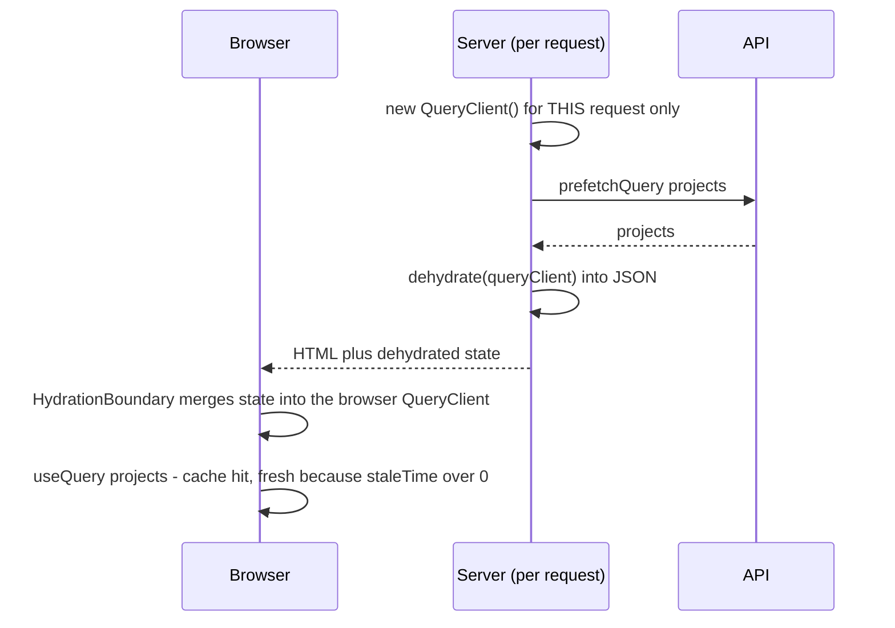

**Rules:**
- **One `QueryClient` per request on the server** — a module-level client would share one user's data with another user.
- On the client, create the client **once** (e.g. `useState(() => new QueryClient())` or a module singleton in the browser), not on every render.
- Set `staleTime` above `0` so hydrated data isn't refetched immediately.
- `prefetchQuery` never throws and doesn't return data — use `fetchQuery`/`ensureQueryData` when you need the value (e.g. in a route loader).
- The same `queryOptions` object should feed both server prefetch and client `useQuery` so keys match exactly.

**Next.js App Router / React Server Components:** a Server Component prefetches into a request-scoped `QueryClient` and renders `<HydrationBoundary state={dehydrate(qc)}>` around Client Components that call `useQuery`. With streaming, you can dehydrate **pending** queries too (configure `shouldDehydrateQuery` to include `status === 'pending'`) so data streams in as it resolves. If a Server Component only needs data to render HTML and nothing on the client refetches it, you may not need TanStack Query for that data at all. See the official "Advanced Server Rendering" guide and [Streaming SSR & React Server Components](./streaming-ssr-and-react-server-components.md).

Other routers: TanStack Router and React Router loaders can call `queryClient.ensureQueryData(options)` so data is ready before render.

---

### Section 13: Offline, Network Mode and Persistence

| `networkMode` | Behaviour |
|---|---|
| `'online'` (default) | No network → don't fetch; the query goes to `fetchStatus: 'paused'` and resumes on reconnect. Mutations pause too |
| `'always'` | Ignore online status (e.g. `queryFn` reads IndexedDB, or local-only APIs) |
| `'offlineFirst'` | Run the `queryFn` once (lets a Service Worker / HTTP cache answer), pause retries if offline |

**Persisting the cache** (survive reloads, offline start):

```tsx
import { PersistQueryClientProvider } from '@tanstack/react-query-persist-client';
import { createAsyncStoragePersister } from '@tanstack/query-async-storage-persister';

const queryClient = new QueryClient({
  defaultOptions: { queries: { gcTime: 1000 * 60 * 60 * 24 } }, // ≥ maxAge, or entries are GC'd before saving
});
const persister = createAsyncStoragePersister({ storage: window.localStorage }); // or an IndexedDB adapter

<PersistQueryClientProvider
  client={queryClient}
  persistOptions={{ persister, maxAge: 1000 * 60 * 60 * 24, buster: APP_VERSION }}
  onSuccess={() => queryClient.resumePausedMutations()}
>
  <App />
</PersistQueryClientProvider>;
```

- Paused mutations can be persisted and **resumed** after reload, but their `mutationFn` can't be serialized — register it with `queryClient.setMutationDefaults(['addTodo'], { mutationFn })` and give those mutations a `mutationKey`.
- Don't persist sensitive data to `localStorage` on shared devices; use `dehydrateOptions.shouldDehydrateQuery` to choose which queries are persisted. See [Browser Storage Mechanisms](./browser-storage-mechanisms.md) and [Offline-First Architecture](./offline-first-architecture.md).

---

### Section 14: Other Frameworks and React Native

The core concepts (keys, `staleTime`, `gcTime`, invalidation) are identical everywhere; the adapters differ in how options become reactive.

| Framework | Package | Query API | Reactivity note |
|---|---|---|---|
| **React** | `@tanstack/react-query` | `useQuery({...})` | Re-renders on tracked changes |
| **Vue 3 / Nuxt** | `@tanstack/vue-query` | `useQuery({ queryKey: ['todo', id], queryFn })` | Pass refs/getters inside the key — changes refetch automatically; results are refs |
| **Svelte 5** | `@tanstack/svelte-query` (v6 targets Svelte 5) | `createQuery(() => ({...}))` | Options passed as a function so runes stay reactive |
| **Solid** | `@tanstack/solid-query` | `useQuery(() => ({...}))` (`createQuery` alias) | Options are a function; results are fine-grained |
| **Angular** | `@tanstack/angular-query-experimental` | `injectQuery(() => ({...}))`, `provideTanStackQuery(new QueryClient())` | Signal-based; still published as **experimental** — check stability before adopting |

```typescript
// Vue — key contains a ref; changing todoId refetches
const todoId = ref(1);
const { data, isPending } = useQuery({
  queryKey: ['todo', todoId],
  queryFn: () => fetchTodo(todoId.value),
});

// Angular — signal input drives the key
export class PostComponent {
  postId = input.required<number>();
  post = injectQuery(() => ({
    queryKey: ['post', this.postId()],
    queryFn: () => lastValueFrom(this.http.get<Post>(`/api/posts/${this.postId()}`)),
  }));
}
```

**React Native:** there's no `visibilitychange` or browser `online` event, so wire the managers yourself:

```typescript
import { AppState } from 'react-native';
import NetInfo from '@react-native-community/netinfo';
import { focusManager, onlineManager } from '@tanstack/react-query';

onlineManager.setEventListener((setOnline) =>
  NetInfo.addEventListener((state) => setOnline(!!state.isConnected)),
);

AppState.addEventListener('change', (status) => focusManager.setFocused(status === 'active'));
```

Native iOS/Android apps typically implement the same idea with a repository + local database (see [Server State vs Client State](./server-state-vs-client-state.md#section-10-the-landscape-across-frameworks)).

---

## Migration Notes — v4 to v5

| v4 | v5 |
|---|---|
| `useQuery(key, fn, options)` overloads | **Single object**: `useQuery({ queryKey, queryFn, ...options })` |
| `cacheTime` | **`gcTime`** |
| `status: 'loading'`, `isLoading` | `status: 'pending'`, **`isPending`**; `isLoading` now means `isPending && isFetching` |
| `keepPreviousData: true` | `placeholderData: keepPreviousData` (+ `isPlaceholderData`) |
| `useErrorBoundary` | **`throwOnError`** |
| `onSuccess` / `onError` / `onSettled` on **`useQuery`** | **Removed** (still on `useMutation` and on `QueryCache`). Derive state in render or use effects |
| `<Hydrate>` | **`<HydrationBoundary>`** |
| Infinite queries: optional `pageParam` default | **`initialPageParam` required**; `maxPages` added |
| `suspense: true` option | Dedicated `useSuspenseQuery` / `useSuspenseInfiniteQuery` / `useSuspenseQueries` |
| Focus refetch listened to `focus` + `visibilitychange` | `visibilitychange` only |
| React 16.8+ | **React 18+** (uses `useSyncExternalStore`) |

The official codemod handles much of the mechanical change; read the migration guide for the rest.

---

## System Design Angle

How TanStack Query fits a production architecture:

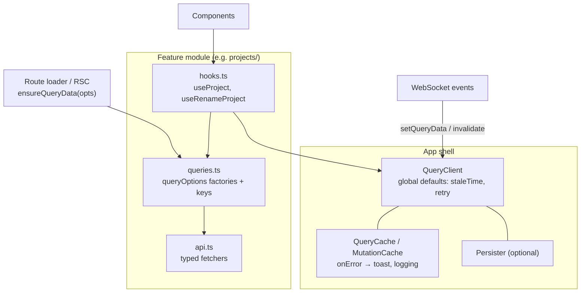

**Decisions to make explicitly:**

| Decision | Options | Guidance |
|---|---|---|
| Global `staleTime` | `0` (default) vs 20–60 s | A small non-zero default cuts request volume a lot; override per query |
| Key structure | Flat vs hierarchical factories | Hierarchical (`['projects', 'list', filters]`) makes invalidation by prefix easy |
| After mutations | Invalidate vs write response vs optimistic | Invalidate by default; optimistic for high-frequency toggles |
| Normalization | None (document cache) vs manual cross-key updates | TanStack Query doesn't normalize. If the same entity appears in many lists and must update everywhere instantly, update several keys or consider a normalized client — see [Data Normalization & Caching](./data-normalization-and-caching.md) |
| Real-time | Polling (`refetchInterval`) vs push + `setQueryData` | Push for chat/collab; polling for dashboards with modest freshness needs — see [Real-Time Data Sync](./real-time-data-sync.md) |
| Errors | Inline `isError` vs `throwOnError` + boundaries | Boundaries for page-level failures; inline for widgets |
| HTTP cache interplay | Long `max-age` vs `private, no-cache` + ETag | Don't stack long TTLs in both layers (see [Browser Caching Strategies](./browser-caching-strategies.md#section-9-caching-api-responses)) |

**When not to use it:** purely static content rendered by Server Components or SSG; GraphQL apps needing a normalized cache (Apollo/urql/Relay may fit better); apps already standardised on RTK Query.

---

## Real-World Examples

**Example 1 — QueryClient with sane defaults and global error handling:**
```tsx
import { MutationCache, QueryCache, QueryClient } from '@tanstack/react-query';

export const queryClient = new QueryClient({
  defaultOptions: {
    queries: {
      staleTime: 30_000,
      retry: (failureCount, error) => {
        if (error instanceof HttpError && error.status >= 400 && error.status < 500) return false; // don't retry 4xx
        return failureCount < 3;
      },
    },
  },
  queryCache: new QueryCache({
    onError: (error, query) => {
      // Only toast for background refetch failures — the UI already shows initial-load errors
      if (query.state.data !== undefined) toast.error(`Could not refresh: ${error.message}`);
    },
  }),
  mutationCache: new MutationCache({
    onError: (error) => toast.error(error.message),
  }),
});
```

**Example 2 — Key factory with `queryOptions` (type-safe reuse):**
```typescript
import { queryOptions } from '@tanstack/react-query';

export const projectQueries = {
  all: () => ['projects'] as const,
  lists: () => [...projectQueries.all(), 'list'] as const,
  list: (filters: { status: string; page: number }) =>
    queryOptions({
      queryKey: [...projectQueries.lists(), filters],
      queryFn: ({ signal }) => api.projects(filters, { signal }),
      staleTime: 30_000,
    }),
  detail: (id: string) =>
    queryOptions({
      queryKey: [...projectQueries.all(), 'detail', id],
      queryFn: ({ signal }) => api.project(id, { signal }),
    }),
};

// Usage — same object everywhere, so keys and types always match
useQuery(projectQueries.detail(id));
await queryClient.prefetchQuery(projectQueries.detail(id));
const cached = queryClient.getQueryData(projectQueries.detail(id).queryKey); // typed as Project | undefined
queryClient.invalidateQueries({ queryKey: projectQueries.lists() });
```

**Example 3 — Prefetch on hover/focus for instant navigation:**
```tsx
function ProjectLink({ id, name }: { id: string; name: string }) {
  const qc = useQueryClient();
  const prefetch = () => qc.prefetchQuery({ ...projectQueries.detail(id), staleTime: 60_000 });
  return (
    <Link to={`/projects/${id}`} onMouseEnter={prefetch} onFocus={prefetch}>
      {name}
    </Link>
  );
}
```

**Example 4 — Infinite feed with IntersectionObserver:**
```tsx
function Feed() {
  const { data, fetchNextPage, hasNextPage, isFetchingNextPage, status } = useInfiniteQuery({
    queryKey: ['feed'],
    queryFn: ({ pageParam, signal }) => api.feed({ cursor: pageParam, signal }),
    initialPageParam: null as string | null,
    getNextPageParam: (last) => last.nextCursor ?? undefined,
  });

  const sentinel = useRef<HTMLDivElement>(null);
  useEffect(() => {
    const el = sentinel.current;
    if (!el || !hasNextPage) return;
    const io = new IntersectionObserver(([entry]) => {
      if (entry.isIntersecting && !isFetchingNextPage) fetchNextPage();
    }, { rootMargin: '600px' }); // start loading before the user reaches the end
    io.observe(el);
    return () => io.disconnect();
  }, [hasNextPage, isFetchingNextPage, fetchNextPage]);

  if (status === 'pending') return <FeedSkeleton />;
  return (
    <>
      {data?.pages.flatMap((p) => p.items).map((post) => <Post key={post.id} post={post} />)}
      <div ref={sentinel} aria-hidden="true" />
      {isFetchingNextPage && <Spinner label="Loading more posts" />}
    </>
  );
}
```
See [Web APIs (Intersection Observer, ResizeObserver)](./web-apis-intersection-observer-resizeobserver.md).

**Example 5 — Next.js App Router: provider + Server Component prefetch:**
```tsx
// app/providers.tsx
'use client';
import { QueryClient, QueryClientProvider } from '@tanstack/react-query';
import { useState } from 'react';

function makeQueryClient() {
  return new QueryClient({ defaultOptions: { queries: { staleTime: 60_000 } } });
}
let browserClient: QueryClient | undefined;
function getQueryClient() {
  if (typeof window === 'undefined') return makeQueryClient(); // new client per server request
  return (browserClient ??= makeQueryClient());    // one client in the browser
}

export function Providers({ children }: { children: React.ReactNode }) {
  const [client] = useState(getQueryClient);
  return <QueryClientProvider client={client}>{children}</QueryClientProvider>;
}

// app/projects/page.tsx (Server Component)
import { dehydrate, HydrationBoundary, QueryClient } from '@tanstack/react-query';
import { projectQueries } from '@/features/projects/queries';
import { ProjectList } from './project-list'; // 'use client' component calling useQuery(projectQueries.list(...))

export default async function ProjectsPage() {
  const qc = new QueryClient();
  await qc.prefetchQuery(projectQueries.list({ status: 'open', page: 1 }));
  return (
    <HydrationBoundary state={dehydrate(qc)}>
      <ProjectList />
    </HydrationBoundary>
  );
}
```

**Example 6 — Real-time: WebSocket events patch the cache:**
```typescript
function useBoardEvents(boardId: string) {
  const qc = useQueryClient();
  useEffect(() => {
    const ws = new WebSocket(`wss://api.example.com/boards/${boardId}`);
    ws.onmessage = (msg) => {
      const event = JSON.parse(msg.data);
      if (event.type === 'card.updated') {
        qc.setQueryData<Card>(['card', event.card.id], event.card);           // patch the detail
        qc.invalidateQueries({ queryKey: ['board', boardId, 'cards'] });      // re-sync lists
      }
    };
    return () => ws.close();
  }, [boardId, qc]);
}
```

**Example 7 — Testing a component that uses queries:**
```tsx
import { render, screen } from '@testing-library/react';
import { QueryClient, QueryClientProvider } from '@tanstack/react-query';

function renderWithClient(ui: React.ReactElement) {
  const client = new QueryClient({
    defaultOptions: { queries: { retry: false } }, // fail fast in tests instead of retrying 3 times
  });
  return render(<QueryClientProvider client={client}>{ui}</QueryClientProvider>);
}

test('shows todos', async () => {
  server.use(http.get('/api/todos', () => HttpResponse.json([{ id: '1', title: 'Write notes' }]))); // MSW
  renderWithClient(<Todos />);
  expect(await screen.findByText('Write notes')).toBeInTheDocument();
});
```
A **new `QueryClient` per test** prevents cached data leaking between tests.

---

## Key Points Summary

| Concept | One-Line Explanation |
|---|---|
| **Query** | Cached state of an async function's result, identified by a key |
| **Query key** | Serializable array; include every input; hierarchical for prefix invalidation |
| **`staleTime`** | How long data is trusted without refetching (default 0) |
| **`gcTime`** | How long unused data stays in memory (default 5 min) |
| **status vs fetchStatus** | "Do we have data?" vs "is a request running?" |
| **`isPending` vs `isFetching`** | First load vs any request — don't blank the UI on `isFetching` |
| **Refetch triggers** | Mount, focus (visibilitychange), reconnect, interval, invalidation — only when stale |
| **`useMutation`** | Tracks one write; use `onSettled` → `invalidateQueries` to re-sync |
| **Optimistic update** | Render `variables`, or write to cache in `onMutate` and roll back on error |
| **`useInfiniteQuery`** | All pages under one key; `initialPageParam` + `getNextPageParam` |
| **`select` / structural sharing / tracked props** | Built-in re-render minimization |
| **`useSuspenseQuery`** | Data always defined; loading via Suspense, errors via boundaries |
| **SSR** | Per-request client → prefetch → dehydrate → `HydrationBoundary`; `staleTime` > 0 |
| **Persistence** | `PersistQueryClientProvider` + persister; `gcTime` ≥ `maxAge` |

---

## Test Your Understanding

**Q1 (Basic):**
What's the difference between `staleTime` and `gcTime`? A query has `staleTime: 60_000` and `gcTime: 300_000`. The user leaves the page after 10 s and returns after 2 minutes. What happens?

<details>
<summary>Answer</summary>

`staleTime` controls **refetching** (how long data is trusted); `gcTime` controls **memory** (how long *unused* data is kept after the last observer unmounts).

Timeline: data fetched at 0 s; the user leaves at 10 s → the query becomes inactive and the 5-minute GC countdown starts. They return at ~130 s: the entry still exists (130 − 10 = 120 s < 300 s), so the component **renders the cached data instantly**. The data is 130 s old > 60 s `staleTime`, so it's stale and the mount triggers a **background refetch**; the UI updates when it resolves. Had they returned after more than 5 minutes of inactivity, the entry would be gone and they'd see a loading state.
</details>

**Q2 (Application):**
A list page shows a full-screen spinner every time the user switches back to the browser tab. Why, and what's the fix?

<details>
<summary>Answer</summary>

With the default `staleTime: 0`, data is always stale, so `refetchOnWindowFocus` (via `visibilitychange`) refetches when the tab becomes visible. The component renders the spinner on **`isFetching`** (true for background refetches) instead of **`isPending`** (true only when there's no data).

Fix: render the full loader only for `isPending`; show a subtle indicator for `isFetching`. Optionally raise `staleTime` for this resource so focus doesn't refetch data that's only seconds old. Disabling `refetchOnWindowFocus` globally is usually the wrong fix — it hides staleness instead of handling it.
</details>

**Q3 (Tricky):**
Two components render `useQuery({ queryKey: ['user'], queryFn: getUser })` and `useQuery({ queryKey: ['user'], queryFn: getUserWithPermissions })`. Sometimes the permissions UI crashes because `data.permissions` is undefined. Why?

<details>
<summary>Answer</summary>

They share **one cache entry** because the key is identical. Whichever `queryFn` ran last wrote its result into `['user']`, so the permissions component may receive the plain `getUser` shape. Keys identify **data**, not components — two different responses must have two different keys (`['user']` and `['user', 'withPermissions']`), or one `queryFn` returning the full shape with `select` deriving slices. Centralizing keys and fetchers in `queryOptions` factories prevents this class of bug.
</details>

**Q4 (Tricky):**
In an optimistic toggle, you `setQueryData` in `onMutate` but sometimes the checkbox flips back to the old value for a moment before settling correctly. What's missing?

<details>
<summary>Answer</summary>

A **refetch was already in flight** (e.g. from focus or an earlier invalidation). It started before the mutation, so it returns the **old server value** and overwrites your optimistic cache write; then `onSettled`'s invalidation fetches the new value and it flips again.

Fix: `await queryClient.cancelQueries({ queryKey })` at the start of `onMutate`, before snapshotting and writing. For rapid repeated toggles, also consider `scope` to serialize mutations and only invalidating when no other related mutations are pending (`queryClient.isMutating({ mutationKey })`).
</details>

**Q5 (Application):**
You add SSR with a module-level `const queryClient = new QueryClient()` imported by the server. In production, a user briefly sees another user's name. Explain and fix.

<details>
<summary>Answer</summary>

On the server, a module-level client is **shared by every request** handled by that process. User A's request prefetches `['me']` into it; user B's request then dehydrates the same cache and receives A's data. On the server, `gcTime` defaults to `Infinity`, so nothing is evicted.

Fix: create a **new `QueryClient` per request** on the server (inside the request handler, `getServerSideProps`, loader, or Server Component), and a single long-lived client only in the browser (e.g. the `typeof window` check in Example 5; recent v5 releases also expose `environmentManager.isServer()` and deprecate the older `isServer` export). Also never mark per-user responses as publicly cacheable at the CDN.
</details>

**Q6 (System design):**
Design data fetching for an analytics dashboard with 12 widgets, a date-range picker in the URL, data that updates every minute, and a requirement to keep working on flaky connections. Which TanStack Query features do you use?

<details>
<summary>Answer</summary>

- **Keys from the URL:** each widget uses `['metrics', widgetId, { from, to }]` with `from/to` read from search params, so changing the range creates new cache entries and Back/Forward instantly reuses old ones.
- **Freshness:** `staleTime: 60_000` + `refetchInterval: 60_000` (polling pauses in hidden tabs by default, saving load). If the backend can push, use SSE and `setQueryData` instead.
- **Range changes:** `placeholderData: keepPreviousData` so widgets show the old range dimmed instead of 12 skeletons.
- **Parallelism and loading:** widgets fetch in parallel; prefetch all of them in the route loader (`ensureQueryData`) to avoid waterfalls. Each widget has its own error state (inline `isError`) so one failure doesn't break the page.
- **Flaky network:** default `retry: 3` with backoff, `networkMode: 'online'` so queries pause instead of erroring offline, `refetchOnReconnect` to catch up; optionally persist the cache (`PersistQueryClientProvider`) for instant reload with last-known data and an "as of" timestamp from `dataUpdatedAt`.
- **Performance:** `select` to give each chart only the series it needs; memoize charts; consider a single batched endpoint if 12 requests per minute per user is too much load.
</details>

---

## Cheat Sheet

**Key Definitions:**
- **QueryClient:** Cache container and imperative API; one per app (one per request on the server)
- **Query key:** Serializable array identifying cached data; prefix-matchable
- **staleTime:** Time data is considered fresh (no refetch triggers); default 0
- **gcTime:** Time inactive data is kept before garbage collection; default 5 min (client)
- **Observer:** A mounted `useQuery`; queries with observers are "active"
- **Invalidation:** Marking queries stale and refetching the active ones
- **Dehydrate / hydrate:** Serialize the cache on the server / merge it on the client
- **Structural sharing:** Reusing unchanged object references between fetches

**Quick Reference:**
```text
Read                useQuery({ queryKey, queryFn, staleTime, select, enabled, placeholderData })
Suspense            useSuspenseQuery / useSuspenseQueries / useSuspenseInfiniteQuery
Many                useQueries({ queries: [...], combine })
Infinite            useInfiniteQuery({ queryKey, queryFn, initialPageParam, getNextPageParam, maxPages })
Write               useMutation({ mutationFn, onMutate, onError, onSuccess, onSettled, scope })
Cache ops           qc.invalidateQueries({ queryKey })  qc.setQueryData(key, updater)  qc.getQueryData(key)
                    qc.cancelQueries({ queryKey })     qc.prefetchQuery(opts)        qc.ensureQueryData(opts)
Reuse options       queryOptions({...}) / infiniteQueryOptions({...}) / mutationOptions({...})
Skip a query        enabled: false   or   queryFn: cond ? fn : skipToken
Keep old page       placeholderData: keepPreviousData
SSR                 per-request QueryClient → prefetchQuery → dehydrate → <HydrationBoundary state>
Defaults            staleTime 0 · gcTime 5 min · retry 3 (queries) / 0 (mutations) · refetch on mount/focus/reconnect
Flags               isPending (no data) · isFetching (any request) · isPlaceholderData · isPaused
Global errors       new QueryCache({ onError }) / new MutationCache({ onError })
Tests               new QueryClient({ defaultOptions: { queries: { retry: false } } }) per test
```

**Common Mistakes to Avoid:**

| Mistake | Why Wrong | Fix |
|---|---|---|
| Spinner on `isFetching` | Background refetches blank the page | `isPending` for loaders; subtle indicator for `isFetching` |
| Missing variables in `queryKey` | Different inputs share one cache entry → wrong data | Include every input; use the ESLint plugin |
| Same key for different shapes | Components overwrite each other's data | Distinct keys or one shape + `select` |
| Module-level `QueryClient` on the server | Leaks data between users | New client per request |
| `new QueryClient()` inside a component body | New empty cache every render | `useState(() => new QueryClient())` or a browser singleton |
| `staleTime: 0` with SSR hydration | Immediate refetch after hydrate | `staleTime` > 0 |
| Copying query data into `useState`/a store | Second source of truth, goes stale | Read from the query; derive with `select` |
| Optimistic update without `cancelQueries` | In-flight refetch overwrites optimistic value | `await cancelQueries` in `onMutate` |
| Not throwing on HTTP errors in `queryFn` | `fetch` resolves on 4xx/5xx → errors cached as data | `if (!res.ok) throw …` |
| Retrying 4xx errors | Wastes time on requests that can't succeed | `retry` function that skips 4xx |
| Using `onSuccess` on `useQuery` (v4 habit) | Removed in v5 | Derive in render; global `QueryCache` callbacks |
| `gcTime` shorter than persister `maxAge` | Entries are GC'd before they're persisted | `gcTime` ≥ `maxAge` |
| Spreading the query result | Disables tracked-props optimization | Destructure only what you use |

---

## References & Further Reading

**Core docs (TanStack Query v5)**
- [Overview](https://tanstack.com/query/latest/docs/framework/react/overview)
- [Important Defaults](https://tanstack.com/query/latest/docs/framework/react/guides/important-defaults)
- [Query Keys](https://tanstack.com/query/latest/docs/framework/react/guides/query-keys) · [Query Options](https://tanstack.com/query/latest/docs/framework/react/guides/query-options)
- [Mutations](https://tanstack.com/query/latest/docs/framework/react/guides/mutations) · [Query Invalidation](https://tanstack.com/query/latest/docs/framework/react/guides/query-invalidation) · [Optimistic Updates](https://tanstack.com/query/latest/docs/framework/react/guides/optimistic-updates)
- [Infinite Queries](https://tanstack.com/query/latest/docs/framework/react/guides/infinite-queries) · [Paginated Queries](https://tanstack.com/query/latest/docs/framework/react/guides/paginated-queries)
- [Suspense](https://tanstack.com/query/latest/docs/framework/react/guides/suspense)
- [Server Rendering & Hydration](https://tanstack.com/query/latest/docs/framework/react/guides/ssr) · [Advanced Server Rendering](https://tanstack.com/query/latest/docs/framework/react/guides/advanced-ssr)
- [Network Mode](https://tanstack.com/query/latest/docs/framework/react/guides/network-mode) · [persistQueryClient](https://tanstack.com/query/latest/docs/framework/react/plugins/persistQueryClient)
- [Render Optimizations](https://tanstack.com/query/latest/docs/framework/react/guides/render-optimizations)
- [Migrating to TanStack Query v5](https://tanstack.com/query/latest/docs/framework/react/guides/migrating-to-v5)
- [React Native](https://tanstack.com/query/latest/docs/framework/react/react-native) · [Testing](https://tanstack.com/query/latest/docs/framework/react/guides/testing)

**Other adapters**
- [Vue Query](https://tanstack.com/query/latest/docs/framework/vue/overview) · [Svelte Query](https://tanstack.com/query/latest/docs/framework/svelte/overview) · [Solid Query](https://tanstack.com/query/latest/docs/framework/solid/overview) · [Angular Query](https://tanstack.com/query/latest/docs/framework/angular/overview)

**Web platform**
- MDN: [`AbortController`](https://developer.mozilla.org/en-US/docs/Web/API/AbortController) · [`visibilitychange`](https://developer.mozilla.org/en-US/docs/Web/API/Document/visibilitychange_event) · [`Window: online` event](https://developer.mozilla.org/en-US/docs/Web/API/Window/online_event)

**Deep dives**
- TkDodo (maintainer): [Practical React Query](https://tkdodo.eu/blog/practical-react-query) · [Effective React Query Keys](https://tkdodo.eu/blog/effective-react-query-keys) · [Status Checks in React Query](https://tkdodo.eu/blog/status-checks-in-react-query) · [Mastering Mutations in React Query](https://tkdodo.eu/blog/mastering-mutations-in-react-query) · [React Query and Forms](https://tkdodo.eu/blog/react-query-and-forms)
- Source: [TanStack/query on GitHub](https://github.com/TanStack/query)

---

> **Previous Topic:** [Server State vs Client State](./server-state-vs-client-state.md)
> — Why remote data is a cache with an owner, not your state

> **Next Topic:** [SWR & Stale-While-Revalidate](./swr-and-stale-while-revalidate.md)
> — The HTTP caching idea behind it all, and Vercel's minimal hook library named after it

*Saved on: 2026-11-06 | Repo: Frontend System Design Learning Notes*
