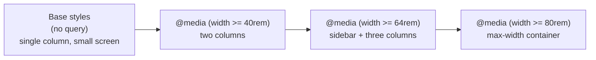
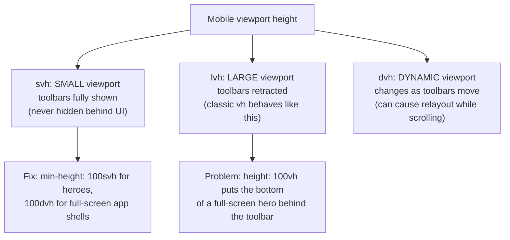
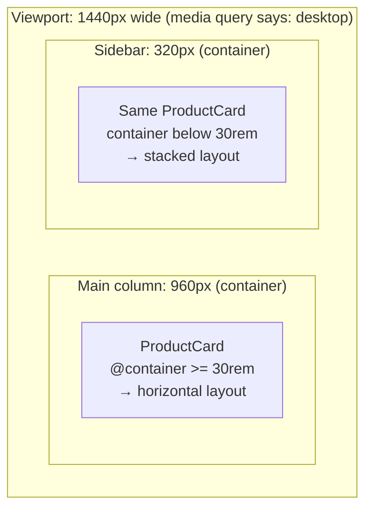
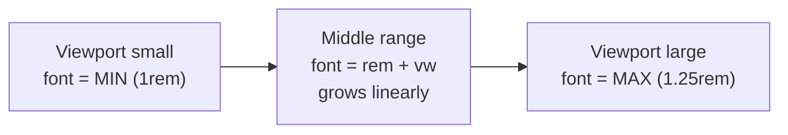
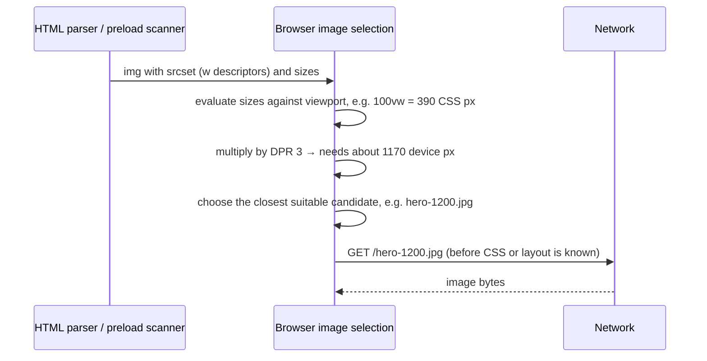
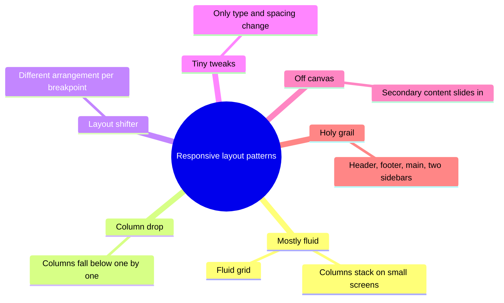
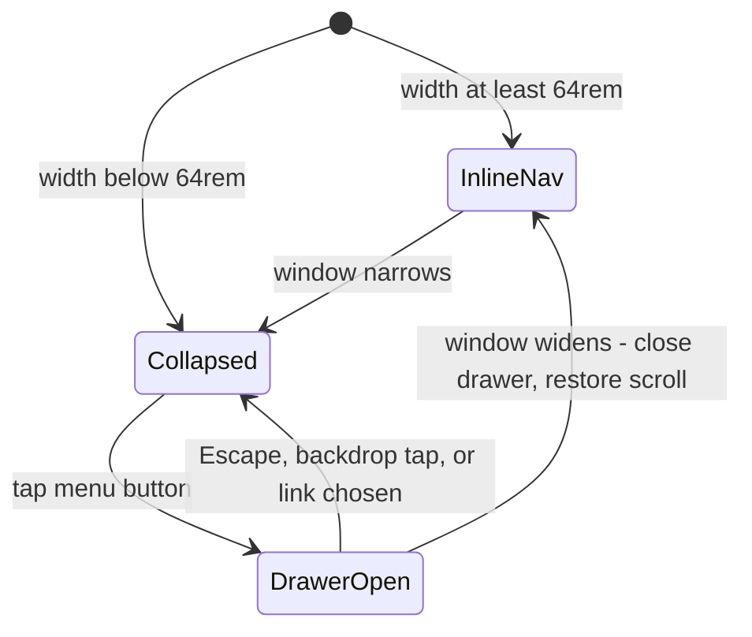
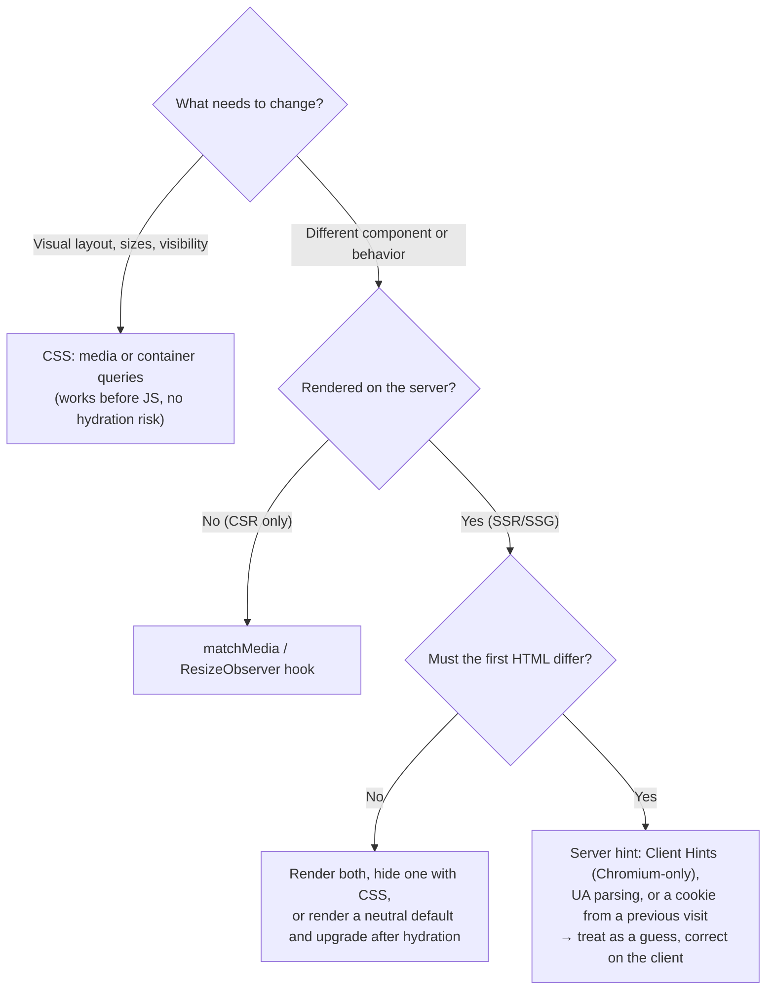
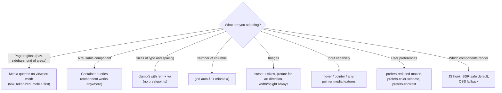

<!-- Generated by scripts/sync-knowledge.js from notes/ and README.md — do not edit here. -->
<!-- sections (line ranges in this file): Table of Contents 19-43 · ELI5 44-57 · Core Concept 58-455 · Decision Guide 456-472 · Real-World Examples 473-617 · Key Points Summary 618-636 · Test Your Understanding 637-719 · Cheat Sheet 720-766 · References & Further Reading 767-806 -->

# Responsive Design Patterns

> **Date:** 2026-11-06 · **Last updated:** 2026-11-06
> **Category:** Frontend System Design
> **Sub-Topic:** Design Systems & Components / Responsive Layout
> **Level:** Intermediate · **Reading time:** ~30 min
> **Informs:** breakpoint strategy and tokens, media vs container queries per component, fluid typography and spacing, responsive images and LCP, navigation and table patterns on small screens, SSR-safe viewport logic, touch target sizing, mobile viewport units and safe areas, WCAG reflow compliance

> **Pre-requisite:** [CSS Architecture (CSS-in-JS, Tailwind, CSS Modules)](./css-architecture-css-in-js-tailwind-css-modules.md) and [Web APIs (Intersection Observer, ResizeObserver)](./web-apis-intersection-observer-resizeobserver.md).
> This note covers how one codebase adapts to **every screen size, input type and user setting** — from the viewport meta tag to container queries, responsive images, layout patterns and the SSR traps of doing it in JavaScript.

**Previous:** [CSS Architecture (CSS-in-JS, Tailwind, CSS Modules)](./css-architecture-css-in-js-tailwind-css-modules.md) · **Next:** [Theming & Dark Mode](./theming-and-dark-mode.md)

---

## Table of Contents

1. [ELI5 — Simple Explanation](#eli5--simple-explanation)
2. [Section 1: Responsive vs Adaptive vs Mobile-First](#section-1-responsive-vs-adaptive-vs-mobile-first)
3. [Section 2: The Viewport — Meta Tag, CSS Pixels and Viewport Units](#section-2-the-viewport--meta-tag-css-pixels-and-viewport-units)
4. [Section 3: Intrinsic and Fluid Layout](#section-3-intrinsic-and-fluid-layout)
5. [Section 4: Media Queries and Breakpoints](#section-4-media-queries-and-breakpoints)
6. [Section 5: Container Queries — Component-Level Responsiveness](#section-5-container-queries--component-level-responsiveness)
7. [Section 6: Fluid Typography and Spacing](#section-6-fluid-typography-and-spacing)
8. [Section 7: Responsive Images and Media](#section-7-responsive-images-and-media)
9. [Section 8: Layout Patterns](#section-8-layout-patterns)
10. [Section 9: Component Patterns — Navigation, Tables, Forms, Dialogs](#section-9-component-patterns--navigation-tables-forms-dialogs)
11. [Section 10: Input, Devices and Safe Areas](#section-10-input-devices-and-safe-areas)
12. [Section 11: Responsive Logic in JavaScript and SSR](#section-11-responsive-logic-in-javascript-and-ssr)
13. [Section 12: Accessibility Requirements](#section-12-accessibility-requirements)
14. [Section 13: Frameworks and Native Platforms](#section-13-frameworks-and-native-platforms)
15. [Decision Guide — Which Tool for Which Job](#decision-guide--which-tool-for-which-job)
16. [Real-World Examples](#real-world-examples)
17. [Key Points Summary](#key-points-summary)
18. [Test Your Understanding](#test-your-understanding)
19. [Cheat Sheet](#cheat-sheet)
20. [References & Further Reading](#references--further-reading)

---

## ELI5 — Simple Explanation

Think of **water**. Pour it into a glass, a bowl or a bottle and it takes the shape of whatever holds it — no one has to make "glass water" and "bowl water".

A responsive page tries to be like water:
- **Fluid layout** = the water itself: boxes stretch and shrink with the space they have.
- **Breakpoints (media queries)** = a few moments where you **rearrange the furniture** because the room got too small: "below this width, stack the sidebar under the content".
- **Container queries** = each piece of furniture decides for itself based on **the corner it's placed in**, not the size of the whole house.
- **Responsive images** = handing a small photo to a phone and a big one to a 4K monitor, instead of mailing everyone the poster-sized one.

> **Design for the content and the container first; use viewport breakpoints only where the whole page layout genuinely needs to change.**

---

## Core Concept — Step by Step

### Section 1: Responsive vs Adaptive vs Mobile-First

| Term | Meaning | Where decided |
|---|---|---|
| **Responsive** | One HTML document, fluid layout that reflows continuously with available space | Client (CSS) |
| **Adaptive** | Several fixed layouts (or templates) chosen per device class | Client (CSS breakpoints) or server (device detection) |
| **Separate mobile site** (`m.example.com`) | A different site for phones | Server / DNS — a legacy pattern, now discouraged for SEO and maintenance |
| **Mobile-first** | Write base styles for the smallest screen, then **add** complexity with `min-width` queries | Authoring strategy |
| **Content-first / intrinsic** | Let content size itself (grid `minmax`, `clamp()`), add breakpoints only where it breaks | Authoring strategy |



**Why mobile-first:** the smallest screen gets the **least CSS to override**, constraints force content prioritization, and progressive enhancement is natural (add layout as space appears). Desktop-first with `max-width` queries tends to accumulate undo rules.

---

### Section 2: The Viewport — Meta Tag, CSS Pixels and Viewport Units

Without a viewport meta tag, mobile browsers lay the page out on a **virtual desktop-width viewport** (often around 980 CSS px) and zoom it out. Every responsive site needs:

```html
<meta name="viewport" content="width=device-width, initial-scale=1" />
```

| Setting | Use it? | Why |
|---|---|---|
| `width=device-width, initial-scale=1` | ✅ Always | Layout viewport = device width in CSS px |
| `user-scalable=no`, `maximum-scale=1` | ❌ Never | Blocks pinch-zoom — an accessibility failure. iOS Safari ignores it anyway, but other browsers may honor it |
| `viewport-fit=cover` | When drawing edge-to-edge | Lets content extend under notches; then pad with `env(safe-area-inset-*)` |
| `interactive-widget=resizes-content` | Chrome on Android only (per MDN) | Controls whether the on-screen keyboard resizes the layout viewport |

**CSS pixels vs device pixels:** a CSS pixel is a logical unit. `window.devicePixelRatio` (DPR) tells how many device pixels make one CSS pixel (2 or 3 on most phones). Layout is done in CSS px; images and canvases need DPR-aware resolution.

**Viewport units on mobile** — browser toolbars expand and collapse, so there are several "heights":



The `sv*`, `lv*` and `dv*` units (with `vw`/`vi`/`vb` variants) are supported in all major browsers since 2022–2023. Keep a `vh` fallback only if you support older browsers.

---

### Section 3: Intrinsic and Fluid Layout

Most "responsiveness" should come from layout primitives that adapt **without any breakpoint**:

```css
/* Auto-fitting card grid: as many 16rem+ columns as fit; never overflows on tiny screens */
.cards {
  display: grid;
  grid-template-columns: repeat(auto-fit, minmax(min(16rem, 100%), 1fr));
  gap: clamp(1rem, 2vw, 2rem);
}

/* Sidebar that wraps below the content when there's no room — no media query */
.with-sidebar { display: flex; flex-wrap: wrap; gap: 1rem; }
.with-sidebar > .sidebar { flex-basis: 18rem; flex-grow: 1; }
.with-sidebar > .content { flex-basis: 0; flex-grow: 999; min-inline-size: 60%; }

/* Readable measure and centered page */
.page { inline-size: min(100% - 2rem, 72rem); margin-inline: auto; }
.prose { max-inline-size: 65ch; }
```

| Tool | Responsive superpower |
|---|---|
| `flex-wrap` + `flex-basis` | Items wrap when they no longer fit |
| `grid` + `auto-fit`/`auto-fill` + `minmax()` | Column count adapts to width |
| `min()`, `max()`, `clamp()` | Fluid values with limits, no breakpoints |
| `ch`, `rem`, `%` | Sizes tied to content and user font settings |
| `aspect-ratio` | Media and cards keep shape while resizing (prevents CLS) |
| Logical properties (`margin-inline`, `inline-size`) | Same CSS works for RTL and vertical writing modes — see [RTL Layout Support](./rtl-layout-support.md) |

> `auto-fit` collapses empty tracks so items stretch to fill the row; `auto-fill` keeps empty tracks. For a card grid you usually want `auto-fit`.

---

### Section 4: Media Queries and Breakpoints

```css
/* Modern range syntax (all major browsers since 2023) */
@media (width >= 48rem) { .layout { grid-template-columns: 16rem 1fr; } }
@media (40rem <= width < 64rem) { .ad-slot { display: none; } }

/* Equivalent legacy syntax */
@media (min-width: 48rem) { /* ... */ }
```

**Media features worth knowing beyond width:**

| Feature | Use |
|---|---|
| `(hover: hover)` / `(pointer: fine)` | Only add hover effects or dense controls when the **primary** input can hover / is precise |
| `(any-pointer: coarse)` | At least one coarse input exists (e.g. a touch laptop) — enlarge targets |
| `(prefers-reduced-motion: reduce)` | Remove non-essential animation |
| `(prefers-color-scheme: dark)` | Theme default — see [Theming & Dark Mode](./theming-and-dark-mode.md) |
| `(orientation: landscape)` | Rarely useful alone; width usually matters more |
| `(resolution >= 2dppx)` | High-DPI artwork in CSS (prefer `image-set()` or `srcset`) |
| `(display-mode: standalone)` | Installed PWA — adjust chrome |
| `print` | Print stylesheet |

**Choosing breakpoints:**
- Let **content** decide: resize the window until something looks broken, add a breakpoint there. Device-model lists go stale.
- Keep **few, named, tokenized** breakpoints shared between design and code (e.g. `sm 40rem`, `md 48rem`, `lg 64rem`, `xl 80rem` — Tailwind's defaults) — see [Design Tokens](./design-tokens.md).
- Prefer **`rem`/`em`** in media queries: they're relative to the browser's **initial** font size (not your `html { font-size }`), so layouts adapt when users enlarge their default text size.
- Avoid overlapping ranges (`max-width: 768px` and `min-width: 768px` both match at 768px); range syntax with `<` fixes this.
- CSS custom properties **can't** be used inside media query conditions; `@custom-media` isn't shipped in browsers yet (per MDN), so share breakpoints via a preprocessor, PostCSS, or your framework's config.

---

### Section 5: Container Queries — Component-Level Responsiveness

A media query asks about the **viewport**. A component placed in a narrow sidebar on a wide screen still sees a wide viewport. **Container queries** let a component respond to **its container's** size.



```css
.card-slot { container-type: inline-size; container-name: card; }

.product-card { display: grid; gap: 0.75rem; }

@container card (inline-size >= 30rem) {
  .product-card { grid-template-columns: 10rem 1fr; }
  .product-card h3 { font-size: clamp(1rem, 4cqi, 1.5rem); } /* cqi = 1% of container inline size */
}
```

| Concept | Detail |
|---|---|
| `container-type: inline-size` | Establishes a query container on the **inline axis** (the common case); applies size containment |
| `container-type: size` | Both axes — the container then needs an explicit height, or it collapses |
| A container can't query itself | Put `container-type` on a wrapper; style the children |
| Container units | `cqi`, `cqb`, `cqw`, `cqh`, `cqmin`, `cqmax` — percentages of the container |
| Support | Size queries and units: all major browsers since 2023 |
| **Style queries** | `@container style(--variant: compact)` for custom properties — Chromium and Safari first; MDN compat data lists Firefox support only from version 151, so check before relying on it |

**Rule of thumb:** page-level layout (grid of regions, nav vs drawer) → **media queries**. Reusable components (cards, list items, widgets) → **container queries**. This is what makes a design-system component truly portable.

---

### Section 6: Fluid Typography and Spacing

Instead of jumping font sizes at breakpoints, interpolate between a minimum and maximum:

```css
:root {
  /* 1rem at small viewports → 1.25rem at large; the rem part keeps user zoom working */
  --step-0: clamp(1rem, 0.9rem + 0.4vw, 1.25rem);
  --step-3: clamp(1.75rem, 1.2rem + 2.2vw, 3rem);
  --space-m: clamp(1rem, 0.8rem + 1vw, 1.5rem);
}
h1 { font-size: var(--step-3); text-wrap: balance; }
body { font-size: var(--step-0); }
```



**Accessibility trap:** `font-size: 4vw` alone **ignores browser zoom and text-size settings** — zooming changes the viewport width in CSS px, but a pure `vw` value may not grow as WCAG 1.4.4 (Resize Text, 200%) expects. Always combine a `rem` term with `vw` inside `clamp()`, and keep the max-to-min ratio modest. Test at 200% zoom.

---

### Section 7: Responsive Images and Media

Images are usually the largest bytes on a page and often the [LCP](./core-web-vitals-lcp-inp-cls.md) element. Two separate problems:

| Problem | Tool |
|---|---|
| **Resolution switching** — same image, different sizes/DPR | `` |
| **Art direction** — different crop or composition per layout | `<picture>` + `<source media>` |
| **Format negotiation** — AVIF/WebP with fallback | `<picture>` + `<source type>` |

```html
<!-- Resolution switching: the browser picks the best candidate -->
= 64rem) 50vw, 100vw"
  width="1600" height="900"
  alt="Team working around a table"
  fetchpriority="high"
/>

<!-- Art direction + format -->
<picture>
  <source media="(width < 40rem)" srcset="/banner-square.avif" type="image/avif" />
  <source media="(width < 40rem)" srcset="/banner-square.jpg" />
  <source srcset="/banner-wide.avif" type="image/avif" />
  
</picture>
```



Key rules:
- **`sizes` must describe the rendered width**, because the browser chooses before layout. Omitting it means `100vw` — a thumbnail in a 3-column grid would download a full-width image.
- **`sizes="auto"`** (for `loading="lazy"` images only) lets the browser use the actual layout width. MDN lists it in Chromium and recent Firefox, with partial Safari support — always put a fallback after it: `sizes="auto, (width >= 64rem) 33vw, 100vw"`.
- Always set **`width` and `height`** (or CSS `aspect-ratio`) so space is reserved → no CLS.
- **Don't lazy-load the LCP image**; give it `fetchpriority="high"` instead.
- For CSS backgrounds use `image-set()`; for video use multiple `<source>` elements and `preload="none"` or `metadata` below the fold.
- Image CDNs and framework components (`next/image`, Nuxt Image, Angular `NgOptimizedImage`) generate `srcset`/`sizes` for you — see [Image Optimization](./image-optimization.md).

---

### Section 8: Layout Patterns

The classic multi-device layout patterns (popularized by Luke Wroblewski) are still the vocabulary designers use:



```text
Column drop:   [ A | B | C ]  →  [ A | B ]   →  [ A ]
                                 [   C   ]      [ B ]
                                                [ C ]

Off canvas:    [ Nav | Content ]  →  [ ☰  Content ]   (nav slides in as a drawer)
```

```css
/* Holy-grail layout with named grid areas — one breakpoint */
.app {
  display: grid;
  min-height: 100svh;
  grid-template: "header" auto "main" 1fr "aside" auto "footer" auto / 1fr;
}
@media (width >= 64rem) {
  .app { grid-template: "header header" auto "nav main" 1fr "footer footer" auto / 16rem 1fr; }
}
.app > header { grid-area: header; }
```

> **Source order = reading and focus order.** Rearranging with `order`, `grid-area` or `flex-direction: row-reverse` changes only the visual order, so keyboard and screen-reader users experience a different sequence. Keep the DOM order meaningful (WCAG 1.3.2, 2.4.3).

---

### Section 9: Component Patterns — Navigation, Tables, Forms, Dialogs



| Component | Small-screen pattern | Notes |
|---|---|---|
| **Primary navigation** | Bottom tab bar (3–5 destinations), hamburger/drawer, or **priority+** (show what fits, rest in "More") | Hidden menus reduce discoverability; keep the top tasks visible. A drawer needs focus management and a real `<button>` with `aria-expanded` |
| **Data tables** | Horizontal scroll container, pinned first column, or reflow into stacked cards | A scroll container needs `tabindex="0"`, a label and visible overflow cues. Reflowed cards must keep header/value association |
| **Forms** | Single column, full-width inputs, correct `type`/`inputmode`/`autocomplete` | Correct input types bring up the right on-screen keyboard |
| **Dialogs** | Full-screen sheet on small screens, centered modal on large | Native `<dialog>` with `showModal()` handles focus trapping and the top layer |
| **Master-detail** | List → detail as separate views; side by side on wide screens | Reflect the selected item in the URL so Back works |
| **Hover content** | Must also work on tap/focus | Tooltips and menus triggered only by hover are unreachable on touch |

---

### Section 10: Input, Devices and Safe Areas

| Concern | Guidance |
|---|---|
| **Touch target size** | WCAG 2.2 **2.5.8 (AA)**: at least 24×24 CSS px (or enough spacing). **2.5.5 (AAA)**: 44×44. Platform guidelines: Apple 44×44 pt, Material 48×48 dp |
| **No hover on touch** | Gate hover styles with `@media (hover: hover)` so taps don't leave "stuck" hover states |
| **Mixed input** | Touch laptops and tablets with keyboards exist — don't assume "small screen = touch" or "large = mouse" |
| **Safe areas** | With `viewport-fit=cover`, pad fixed bars with `env(safe-area-inset-bottom)` |
| **On-screen keyboard** | It shrinks the visual viewport; `dvh` and the `visualViewport` API help keep inputs visible. The VirtualKeyboard API is Chromium-only |
| **Orientation** | Don't lock orientation unless essential (WCAG 1.3.4) |
| **Foldables / large screens** | Treat as a width change; the Viewport Segments API for dual screens is experimental and Chromium-only |

```css
.bottom-bar {
  position: fixed;
  inset-inline: 0;
  inset-block-end: 0;
  padding-block-end: max(0.75rem, env(safe-area-inset-bottom));
}

@media (hover: hover) and (pointer: fine) {
  .row:hover { background: var(--color-surface-hover); }
}
@media (any-pointer: coarse) {
  .icon-button { min-inline-size: 44px; min-block-size: 44px; }
}
```

---

### Section 11: Responsive Logic in JavaScript and SSR

**Prefer CSS.** Use JS only when the **component tree** must differ (e.g. render a `<Drawer>` vs an inline `<Sidebar>`, or skip loading a heavy chart on mobile).



**The SSR trap:** the server has no viewport. If a component renders `isMobile ? <A/> : <B/>` using `window.matchMedia` during render, the server and client output differ → **hydration mismatch** and layout shift (see [Server-Side Rendering](./server-side-rendering-ssr.md)).

**Server-side signals and their limits:**

| Signal | Reliability |
|---|---|
| `User-Agent` parsing | A guess; tablets, desktop-mode requests and UA reduction make it fuzzy |
| `Sec-CH-UA-Mobile` (low-entropy Client Hint) | Sent by default by **Chromium-based browsers only**; Firefox and Safari don't support UA Client Hints |
| `Sec-CH-Viewport-Width` | Requires opting in via `Accept-CH`; Chromium-only; not available on the very first request |
| Cookie saved from a previous visit | Accurate for returning users; nothing on the first visit |

> Viewport width can change after load (rotation, split-screen, window resize). Any server-side decision is a **starting guess** — CSS or a client hook must still adapt.

---

### Section 12: Accessibility Requirements

| WCAG 2.2 criterion | What it requires | Responsive implication |
|---|---|---|
| **1.4.10 Reflow (AA)** | Content usable at **320 CSS px wide** without two-dimensional scrolling (except things like maps, data tables) | Equivalent to 1280px at 400% zoom — your small-screen layout **is** your zoomed desktop layout |
| **1.4.4 Resize Text (AA)** | Text can scale to 200% without loss of content or function | Use `rem`; fluid type must include a `rem` term |
| **1.4.12 Text Spacing (AA)** | No loss when users increase line, letter, word spacing | Avoid fixed heights on text containers |
| **1.3.4 Orientation (AA)** | Don't restrict to portrait or landscape unless essential | No orientation lock |
| **2.5.8 Target Size (Minimum) (AA)** | 24×24 CSS px targets or adequate spacing | Especially for icon buttons on mobile |
| **1.3.2 / 2.4.3 Meaningful sequence / Focus order** | Reading and focus order make sense | Don't reorder visually against DOM order |

---

### Section 13: Frameworks and Native Platforms

| Stack | Responsive tooling |
|---|---|
| **Tailwind** | Mobile-first prefixes `sm: md: lg: xl: 2xl:` (min-width), `max-md:` for ranges, `@container` + `@md:` for container queries |
| **React** | CSS first; for tree changes a `useMediaQuery` built on `useSyncExternalStore` (Example 3) |
| **Vue** | VueUse `useMediaQuery` / `useBreakpoints`; Nuxt Image for `srcset` |
| **Angular** | CDK Layout `BreakpointObserver`; `NgOptimizedImage` generates `srcset` |
| **Svelte** | `MediaQuery` class from `svelte/reactivity` (Svelte 5), or `matchMedia` in an effect |
| **React Native** | Flexbox (default `flexDirection: 'column'`), `useWindowDimensions()`; no media queries |
| **iOS (SwiftUI)** | Size classes (`horizontalSizeClass` compact/regular), `ViewThatFits`, adaptive stacks |
| **Android (Compose)** | Window size classes (compact / medium / expanded) from Material 3 adaptive libraries |

---

## Decision Guide — Which Tool for Which Job



---

## Real-World Examples

**Example 1 — Desktop-first overrides vs mobile-first (BAD → GOOD):**
```css
/* ❌ BAD: desktop-first — the phone downloads and then undoes the desktop layout */
.grid { display: grid; grid-template-columns: repeat(4, 1fr); gap: 32px; }
@media (max-width: 1024px) { .grid { grid-template-columns: repeat(2, 1fr); gap: 24px; } }
@media (max-width: 600px)  { .grid { grid-template-columns: 1fr; gap: 16px; } }

/* ✅ GOOD: intrinsic — no breakpoints needed at all */
.grid {
  display: grid;
  grid-template-columns: repeat(auto-fit, minmax(min(15rem, 100%), 1fr));
  gap: clamp(1rem, 2.5vw, 2rem);
}
```

**Example 2 — Portable card with container queries (React + CSS Modules):**
```tsx
// ProductCard.module.css
// .slot { container-type: inline-size; }
// .card { display: grid; gap: .75rem; }
// .media { aspect-ratio: 4 / 3; inline-size: 100%; object-fit: cover; }
// @container (inline-size >= 30rem) { .card { grid-template-columns: 12rem 1fr; } }

import styles from './ProductCard.module.css';

type Props = { title: string; price: string; image: { src: string; srcSet: string } };

export function ProductCard({ title, price, image }: Props) {
  return (
    <div className={styles.slot}>
      <article className={styles.card}>
        = 64rem) 25vw, 100vw"
          loading="lazy"
          width={800}
          height={600}
          alt=""
        />
        <div>
          <h3>{title}</h3>
          <p>{price}</p>
        </div>
      </article>
    </div>
  );
}
```

**Example 3 — SSR-safe `useMediaQuery` (BAD → GOOD):**
```tsx
import { useSyncExternalStore } from 'react';

// ❌ BAD: reads window during render → crashes on the server or causes a hydration mismatch
function useIsMobileBad() {
  return window.matchMedia('(width < 48rem)').matches;
}

// ✅ GOOD: subscribes to changes; the server snapshot is an explicit default
export function useMediaQuery(query: string, serverDefault = false): boolean {
  return useSyncExternalStore(
    (onChange) => {
      const mql = window.matchMedia(query);
      mql.addEventListener('change', onChange);
      return () => mql.removeEventListener('change', onChange);
    },
    () => window.matchMedia(query).matches,
    () => serverDefault,
  );
}

// Usage: render a different tree only when it truly differs; keep layout in CSS
function Navigation() {
  const isDesktop = useMediaQuery('(width >= 64rem)');
  return isDesktop ? <InlineNav /> : <DrawerNav />;
}
```
> React re-renders after hydration if the client value differs from `serverDefault`. Choose the default that matches most of your traffic, and keep layout-critical differences in CSS to avoid visible layout shift.

**Example 4 — Responsive table: scroll container with accessible overflow:**
```html
<div class="table-scroll" role="region" aria-labelledby="orders-caption" tabindex="0">
  <table>
    <caption id="orders-caption">Recent orders</caption>
    <thead><tr><th scope="col">Order</th><th scope="col">Date</th><th scope="col">Total</th><th scope="col">Status</th></tr></thead>
    <tbody><tr><th scope="row">#1042</th><td>2026-11-02</td><td>$84.00</td><td>Shipped</td></tr></tbody>
  </table>
</div>
<style>
  .table-scroll { overflow-x: auto; max-inline-size: 100%; }
  .table-scroll:focus-visible { outline: 2px solid var(--color-focus); }
  .table-scroll th[scope="row"] { position: sticky; inset-inline-start: 0; background: var(--color-surface); }
</style>
```

**Example 5 — Full-height app shell on mobile (BAD → GOOD):**
```css
/* ❌ BAD: 100vh = large viewport → bottom toolbar covers the composer in a chat app */
.shell { height: 100vh; }

/* ✅ GOOD: dynamic viewport for app shells, plus safe-area padding */
.shell {
  height: 100dvh;
  display: grid;
  grid-template-rows: auto 1fr auto;
}
.composer { padding-block-end: max(0.5rem, env(safe-area-inset-bottom)); }
```

**Example 6 — Tailwind, Vue and Angular equivalents:**
```html
<!-- Tailwind: mobile-first prefixes and container queries -->
<ul class="grid grid-cols-1 gap-4 md:grid-cols-2 lg:grid-cols-3">
  <li class="@container">
    <article class="flex flex-col gap-3 @md:flex-row">…</article>
  </li>
</ul>
```
```typescript
// Vue (VueUse)
import { useBreakpoints } from '@vueuse/core';
const bp = useBreakpoints({ md: 768, lg: 1024 });
const isDesktop = bp.greaterOrEqual('lg'); // reactive ref

// Angular CDK
import { BreakpointObserver } from '@angular/cdk/layout';
import { inject } from '@angular/core';
import { toSignal } from '@angular/core/rxjs-interop';
import { map } from 'rxjs';

export class ShellComponent {
  private readonly bo = inject(BreakpointObserver);
  readonly isDesktop = toSignal(
    this.bo.observe('(min-width: 64rem)').pipe(map((r) => r.matches)),
    { initialValue: false },
  );
}
```

---

## Key Points Summary

| Concept | One-Line Explanation |
|---|---|
| **Viewport meta** | `width=device-width, initial-scale=1`; never disable zoom |
| **Mobile-first** | Base styles for small screens, add layout with `min-width` queries |
| **Intrinsic layout** | `auto-fit` + `minmax()`, `flex-wrap`, `clamp()` adapt without breakpoints |
| **Media queries** | Viewport-level decisions; few, content-driven, tokenized, in `rem` |
| **Container queries** | Components respond to their container — portable design-system parts |
| **svh / lvh / dvh** | Mobile viewport heights with toolbars shown / hidden / live |
| **Fluid type** | `clamp(min, rem + vw, max)` — keep a `rem` term for zoom |
| **srcset + sizes** | Browser picks the right image file before layout; `sizes` must be accurate |
| **picture** | Art direction and format fallback |
| **hover / pointer** | Adapt to input capability, not screen size |
| **SSR + viewport** | Server can't know the viewport; prefer CSS, treat hints as guesses |
| **Reflow (WCAG 1.4.10)** | Must work at 320 CSS px — same as 400% zoom on desktop |

---

## Test Your Understanding

**Q1 (Basic):**
Why does a page without `<meta name="viewport" content="width=device-width, initial-scale=1">` look tiny on a phone even if it has media queries?

<details>
<summary>Answer</summary>

Without the tag, mobile browsers lay the page out on a **virtual desktop-width layout viewport** (often around 980 CSS px) and then scale it down to fit the screen. Your `min-width: 48rem` queries see that wide virtual viewport, so the desktop layout is applied and then shrunk. With `width=device-width`, the layout viewport equals the device's width in CSS pixels (e.g. 390px), so mobile styles apply and text renders at a readable size.
</details>

**Q2 (Application):**
A `ProductCard` should show image-left/text-right when it has room, and stack otherwise. It's used in a 3-column grid on desktop, a full-width list on mobile, and a 320px sidebar on desktop. Media queries or container queries? Sketch the CSS.

<details>
<summary>Answer</summary>

**Container queries.** The card's available width doesn't follow the viewport: on desktop it's narrow in the sidebar and in a 3-column grid, but wide in a single-column list. A viewport media query would give the sidebar card the desktop layout and break it.

```css
.card-slot { container-type: inline-size; }
.card { display: grid; gap: .75rem; }
@container (inline-size >= 30rem) {
  .card { grid-template-columns: 10rem 1fr; }
}
```
The wrapper is the container because a container can't query its own size. Now the component behaves correctly wherever it's placed.
</details>

**Q3 (Tricky):**
A full-screen hero uses `height: 100vh`. On iPhone and Android, the call-to-action button at the bottom is hidden behind the browser toolbar until the user scrolls. Why, and what's the fix?

<details>
<summary>Answer</summary>

On mobile browsers, `vh` corresponds to the **large viewport** — the height when the browser toolbars are retracted. When the page first loads, the toolbars are visible, so `100vh` is taller than the visible area and the bottom of the hero sits behind the toolbar.

Fix: `min-height: 100svh` (small viewport — always fits with toolbars shown) for a hero, or `100dvh` for an app shell that should track the toolbar as it moves (aware that `dvh` can cause relayout during scroll). Keep `100vh` as a fallback declaration before it only if you support browsers without the new units.
</details>

**Q4 (Tricky):**
Your image grid shows 4 thumbnails per row on desktop (each about 300px wide), but Lighthouse reports that mobile and desktop both download 1600px images. The markup has `srcset` with 400w, 800w, 1600w candidates. What's wrong?

<details>
<summary>Answer</summary>

**`sizes` is missing (or wrong).** Without it, the browser assumes the image is `100vw` wide. On a 1440px desktop, it picks a candidate for ~1440 CSS px (×DPR) → 1600w. On a phone at DPR 3, 390 × 3 ≈ 1170 device px → also 1600w. The browser must choose **before layout**, so it relies entirely on `sizes`.

Fix: describe the rendered width, e.g. `sizes="(width >= 64rem) 300px, (width >= 40rem) 50vw, 100vw"`. For lazy-loaded images, `sizes="auto, …"` lets supporting browsers use the real layout width, with the explicit list as a fallback. Image CDNs and framework image components can generate these attributes.
</details>

**Q5 (System design):**
An SSR e-commerce site renders a mega-menu on desktop and a drawer on mobile. The team uses `window.innerWidth` in render, and users see a flash plus hydration warnings. Redesign it.

<details>
<summary>Answer</summary>

The server has no viewport, so it renders one variant (or crashes on `window`), and the client renders the other → hydration mismatch, then a re-render with layout shift.

Redesign:
1. **Render both navigation structures in the HTML**, and show one with CSS media queries (`display: none` on the other). The correct one appears on first paint with no JS. Make sure the hidden one is truly hidden (`display: none` removes it from the accessibility tree), and lazy-load heavy parts of the mega-menu.
2. If one variant is too heavy to ship to everyone, render a **lightweight default** on the server (e.g. the drawer button, which also works on desktop) and upgrade after hydration with an SSR-safe `useMediaQuery` (`useSyncExternalStore` with a server snapshot).
3. Optionally use **hints** (Chromium's `Sec-CH-UA-Mobile`, UA parsing, or a cookie set on a previous visit) to choose the server default — only as a guess, since Safari and Firefox don't send UA Client Hints and windows can be resized.
</details>

**Q6 (System design):**
You own a design system used by 12 product teams. List the responsive primitives and rules you'd put in it so teams don't each invent their own.

<details>
<summary>Answer</summary>

- **Breakpoint tokens** (`sm/md/lg/xl` in `rem`) published for CSS (via PostCSS/preprocessor or Tailwind theme), JS (for `useMediaQuery`), and design tools, with a mobile-first rule.
- **Layout primitives** with intrinsic behavior: `Stack`, `Cluster` (flex-wrap), `Grid` (auto-fit/minmax), `Sidebar` (wrapping), `Container` (max width + gutters), all using logical properties.
- **Container queries inside components** (cards, list items, media objects) so they work in any slot.
- **Fluid type and spacing scales** via `clamp()` tokens with `rem` terms.
- A **responsive `Image` component** that requires `width`/`height` and `alt`, generates `srcset`, and makes `sizes` a required prop.
- **Navigation, table, dialog patterns** with built-in accessibility (drawer focus management, scrollable table regions, sheet-style dialogs on small screens).
- An **SSR-safe `useMediaQuery`** and guidance to prefer CSS.
- **Guardrails:** minimum target size, `hover:hover` gating, Storybook viewports + visual regression at each breakpoint and at 320px / 200% zoom.
</details>

---

## Cheat Sheet

**Key Definitions:**
- **Layout viewport:** The area CSS lays out against; set by the viewport meta tag
- **Visual viewport:** The part currently visible (shrinks with pinch-zoom and on-screen keyboards)
- **DPR:** Device pixels per CSS pixel
- **Breakpoint:** A width at which layout rules change
- **Container query:** A condition on an ancestor container's size (or custom-property style)
- **svh / lvh / dvh:** Small / large / dynamic viewport height units
- **Art direction:** Serving a differently cropped image per layout with `<picture>`
- **Reflow:** WCAG requirement to work at 320 CSS px without 2D scrolling

**Quick Reference:**
```text
<meta name="viewport" content="width=device-width, initial-scale=1">   (never user-scalable=no)
Grid without breakpoints:  repeat(auto-fit, minmax(min(16rem, 100%), 1fr))
Readable text width:       max-inline-size: 65ch
Fluid type:                clamp(1rem, 0.9rem + 0.4vw, 1.25rem)
Range media query:         @media (width >= 48rem) { … }      breakpoints in rem
Container query:           .slot { container-type: inline-size }  @container (inline-size >= 30rem) { … }
Hero height:               min-height: 100svh     App shell: height: 100dvh
Safe area:                 viewport-fit=cover + padding: env(safe-area-inset-bottom)
Hover only where possible: @media (hover: hover) and (pointer: fine)
Images:                    srcset (w) + accurate sizes + width/height; picture for art direction/format
LCP image:                 no loading=lazy; fetchpriority="high"
SSR:                       CSS first; useSyncExternalStore with a server snapshot; hints are guesses
Targets:                   ≥ 24×24 CSS px (WCAG 2.5.8 AA), 44×44 recommended for touch
```

**Common Mistakes to Avoid:**

| Mistake | Why Wrong | Fix |
|---|---|---|
| Disabling zoom (`user-scalable=no`) | Accessibility failure for low-vision users | Leave zoom enabled |
| Breakpoints copied from device lists | Devices change; content breaks elsewhere | Content-driven breakpoints, tokenized |
| Viewport media queries inside reusable components | Component breaks in sidebars and grids | Container queries |
| `height: 100vh` on mobile full-screen sections | Content hidden behind toolbars | `100svh` / `100dvh` |
| Pure `vw` font sizes | Don't respond properly to zoom/text settings | `clamp()` with a `rem` term |
| `srcset` without `sizes` | Browser assumes `100vw` → oversized downloads | Accurate `sizes`, or `sizes="auto, …"` for lazy images |
| Missing `width`/`height` on images | Layout shift (CLS) | Always set dimensions or `aspect-ratio` |
| `window.matchMedia` during SSR render | Crash or hydration mismatch | CSS, or `useSyncExternalStore` with a server snapshot |
| Hover-only menus and tooltips | Unreachable on touch | Tap/focus triggers; `hover: hover` gating |
| Reordering visually with `order` / `grid-area` | Focus and reading order no longer match | Keep DOM order meaningful |
| Assuming small screen = touch | Touch laptops, tablets with keyboards | Use `pointer`/`hover` features |

---

## References & Further Reading

**Core docs**
- MDN: [Responsive web design](https://developer.mozilla.org/en-US/docs/Learn_web_development/Core/CSS_layout/Responsive_Design)
- MDN: [Viewport meta tag](https://developer.mozilla.org/en-US/docs/Web/HTML/Reference/Elements/meta/name/viewport)
- MDN: [Using media queries](https://developer.mozilla.org/en-US/docs/Web/CSS/CSS_media_queries/Using_media_queries)
- MDN: [CSS container queries](https://developer.mozilla.org/en-US/docs/Web/CSS/CSS_containment/Container_queries)
- MDN: [Responsive images](https://developer.mozilla.org/en-US/docs/Web/HTML/Guides/Responsive_images)
- MDN: [CSS length units — viewport units](https://developer.mozilla.org/en-US/docs/Web/CSS/length#relative_length_units_based_on_viewport)
- MDN: [`env()`](https://developer.mozilla.org/en-US/docs/Web/CSS/env)
- web.dev: [Learn Responsive Design](https://web.dev/learn/design)
- web.dev: [The large, small, and dynamic viewport units](https://web.dev/blog/viewport-units)

**Specs & guidelines**
- W3C: [Media Queries Level 4](https://www.w3.org/TR/mediaqueries-4/)
- W3C: [CSS Conditional Rules Level 5 (container queries)](https://www.w3.org/TR/css-conditional-5/)
- W3C WAI: [Understanding SC 1.4.10 Reflow](https://www.w3.org/WAI/WCAG22/Understanding/reflow.html) · [SC 2.5.8 Target Size (Minimum)](https://www.w3.org/WAI/WCAG22/Understanding/target-size-minimum.html)

**Frameworks and platforms**
- React: [`useSyncExternalStore`](https://react.dev/reference/react/useSyncExternalStore)
- Tailwind CSS: [Responsive design](https://tailwindcss.com/docs/responsive-design)
- VueUse: [`useBreakpoints`](https://vueuse.org/core/useBreakpoints/) · Angular CDK: [Layout](https://material.angular.dev/cdk/layout/overview)
- Svelte: [`svelte/reactivity`](https://svelte.dev/docs/svelte/svelte-reactivity)
- Android: [Use window size classes](https://developer.android.com/develop/ui/compose/layouts/adaptive/use-window-size-classes)
- Apple: [`UserInterfaceSizeClass`](https://developer.apple.com/documentation/swiftui/userinterfacesizeclass)

**Deep dives**
- Luke Wroblewski: [Multi-Device Layout Patterns](https://www.lukew.com/ff/entry.asp?1514)
- Every Layout: [Layout primitives](https://every-layout.dev/layouts/)
- Utopia: [Fluid type and space calculator](https://utopia.fyi/)

---

> **Previous Topic:** [CSS Architecture (CSS-in-JS, Tailwind, CSS Modules)](./css-architecture-css-in-js-tailwind-css-modules.md)
> — Scoping, cascade layers and how styles are produced and shipped

> **Next Topic:** [Theming & Dark Mode](./theming-and-dark-mode.md)
> — CSS variables, color-scheme, light-dark() and flash-free theme switching

*Saved on: 2026-11-06 | Repo: Frontend System Design Learning Notes*
