<!-- Generated by scripts/sync-knowledge.js from notes/ and README.md — do not edit here. -->
<!-- sections (line ranges in this file): Table of Contents 19-40 · ELI5 41-54 · Core Concept 55-658 · System Design Angle 659-692 · Decision Matrix 693-723 · Real-World Examples 724-847 · Key Points Summary 848-869 · Test Your Understanding 870-955 · Cheat Sheet 956-1009 · References & Further Reading 1010-1055 -->

# REST vs GraphQL vs gRPC-Web

> **Date:** 2026-11-06 · **Last updated:** 2026-11-06
> **Category:** Frontend System Design
> **Sub-Topic:** Networking / API Design
> **Level:** Intermediate · **Reading time:** ~35 min
> **Informs:** API contract choice, BFF, client caching, over-fetching, type generation

> **Pre-requisite:** [TCP/TLS Handshake](./tcp-tls-handshake.md) (connections, HTTP/1.1 vs HTTP/2 vs HTTP/3).
> This note is about the **shape of the conversation** on top of HTTP — how the frontend asks for data, how the answer is cached, and how both sides agree on types.

**Previous:** [TCP/TLS Handshake](./tcp-tls-handshake.md) · **Next:** [WebSockets & SSE & Long Polling](./websockets-sse-long-polling.md)

---

## Table of Contents

1. [ELI5 — Simple Explanation](#eli5--simple-explanation)
2. [Section 1: Three Ways to Talk to a Server](#section-1-three-ways-to-talk-to-a-server)
3. [Section 2: REST — Resources, Verbs and Status Codes](#section-2-rest--resources-verbs-and-status-codes)
4. [Section 3: REST Caching — Cache-Control and ETags](#section-3-rest-caching--cache-control-and-etags)
5. [Section 4: Over-fetching, Under-fetching and Pagination](#section-4-over-fetching-under-fetching-and-pagination)
6. [Section 5: GraphQL — Schema, Operations and Execution](#section-5-graphql--schema-operations-and-execution)
7. [Section 6: GraphQL in Production — N+1, Caching, Persisted Queries, Limits](#section-6-graphql-in-production--n1-caching-persisted-queries-limits)
8. [Section 7: gRPC-Web — Protobuf in the Browser](#section-7-grpc-web--protobuf-in-the-browser)
9. [Section 8: tRPC and RPC-Style APIs](#section-8-trpc-and-rpc-style-apis)
10. [Section 9: Error Handling & Type Generation](#section-9-error-handling--type-generation)
11. [System Design Angle — BFF and API Gateways](#system-design-angle--bff-and-api-gateways)
12. [Decision Matrix](#decision-matrix)
13. [Real-World Examples](#real-world-examples)
14. [Key Points Summary](#key-points-summary)
15. [Test Your Understanding (with answers)](#test-your-understanding)
16. [Cheat Sheet](#cheat-sheet)
17. [References & Further Reading](#references--further-reading)

---

## ELI5 — Simple Explanation

Imagine three ways of ordering food:

- **REST = a restaurant with a fixed menu.** Each dish (resource) has its own number: "`GET` dish #12". You get the whole plate as the kitchen designed it — sometimes with sides you didn't want (**over-fetching**), sometimes you need to order three dishes to get one meal (**under-fetching**). But the menu never changes, so the waiter can keep popular plates **warm and ready** (HTTP caching, CDNs).
- **GraphQL = a build-your-own-bowl counter.** One counter (one endpoint), and you write exactly what you want on a slip: "rice, chicken, no beans". You get **exactly that, in one trip** — but because every slip is different, the kitchen can't pre-make bowls, and someone has to stop a customer who orders 10 000 toppings (**query cost limits**).
- **gRPC-Web = ordering via a strict printed form in a compact code** (Protocol Buffers). Fast and unambiguous for machines, hard for humans to read — and because browsers can't speak the kitchen's native dialect (raw HTTP/2 gRPC), you need an **interpreter at the door** (a proxy such as Envoy, or a server that speaks the web dialect natively).

And a **BFF (Backend for Frontend)** is a personal assistant who goes to all the kitchens for you and brings back one tray shaped exactly for your table.

> **One-line takeaway: The choice is not "which is best" but "who controls the shape of the response, where does caching happen, and how are types shared". REST optimises for HTTP caching and simplicity, GraphQL for client-driven shape and fewer round trips, gRPC-Web/Connect for strict schemas and performance between typed services.**

---

## Core Concept — Step by Step

### Section 1: Three Ways to Talk to a Server

All three run **on top of HTTP**. What differs is the **contract** (who defines the shape), the **URL model** (many resources vs one endpoint vs service methods) and the **encoding** (JSON vs protobuf).

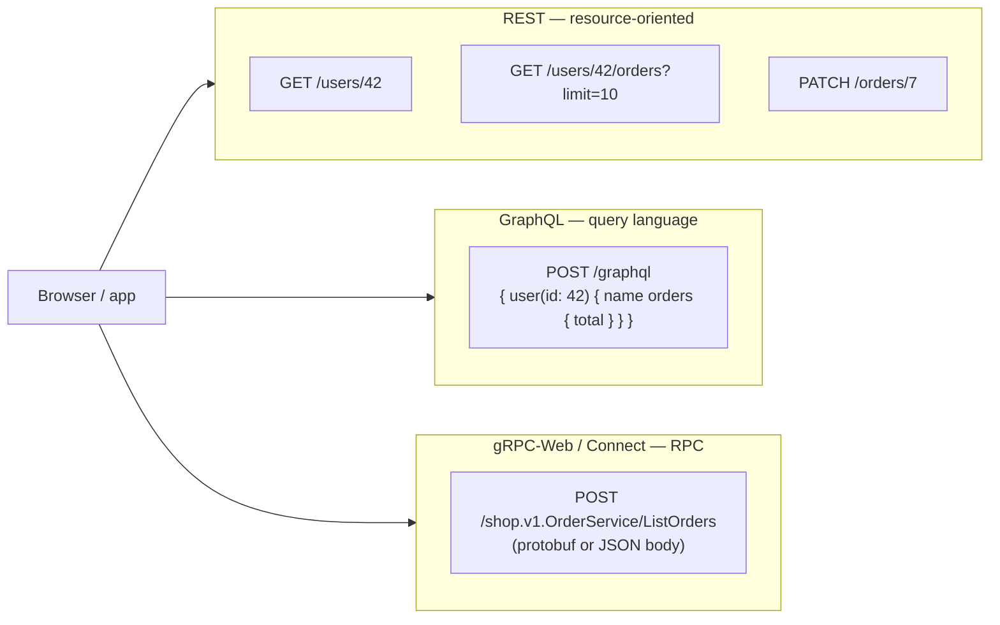

| Dimension | REST | GraphQL | gRPC-Web (and Connect) |
|---|---|---|---|
| **Mental model** | Resources (nouns) + HTTP verbs | Typed graph; client selects fields | Service methods (verbs) |
| **Contract** | Optional — OpenAPI document | **Required** — GraphQL schema (SDL) | **Required** — `.proto` files |
| **Endpoints** | Many URLs | Usually one (`/graphql`) | One path per method |
| **Encoding** | Usually JSON | JSON | Protobuf binary (Connect also allows JSON) |
| **Who shapes the response** | Server | **Client** | Server (message type) |
| **HTTP caching** | Native (GET + URL + ETag) | Hard by default (POST, one URL) | Hard for gRPC-Web; Connect can use GET for side-effect-free methods |
| **Streaming** | Via SSE / WebSockets (separate) | Subscriptions (transport not in spec) | Server streaming (no client/bidi streaming in browsers) |
| **Browser DevTools readability** | Excellent | Good (JSON, but one URL for everything) | Poor for binary protobuf |

---

### Section 2: REST — Resources, Verbs and Status Codes

**REST** (Representational State Transfer, Roy Fielding's 2000 dissertation) is an architectural style. In practice "REST API" means: **resources identified by URLs**, manipulated with **standard HTTP methods**, returning **representations** (usually JSON), with **status codes** describing the outcome and **headers** controlling caching.

#### 2.1 Resources (nouns, not verbs)

```text
GOOD (resource-oriented)                 BAD (RPC disguised as REST)
GET    /users/42                          GET  /getUser?id=42
GET    /users/42/orders                   POST /getOrdersForUser
POST   /orders              (create)      POST /createOrder
PATCH  /orders/7            (partial)     POST /updateOrderStatus
DELETE /orders/7                          GET  /deleteOrder?id=7   ← a crawler/prefetch can delete data!
POST   /orders/7/cancel     (action that isn't CRUD — acceptable "custom method")
```

#### 2.2 HTTP methods: safe and idempotent

Defined by [RFC 9110 (HTTP Semantics)](https://www.rfc-editor.org/rfc/rfc9110#name-method-definitions):

- **Safe** = the client does not request any state change (read-only semantics). Browsers, crawlers and prefetchers assume safe methods can be sent freely.
- **Idempotent** = sending the same request **N times has the same effect on the server as sending it once**. The *response* may differ (a second `DELETE` may return `404`) — the *state* doesn't.

| Method | Typical use | Safe | Idempotent | Cached by browsers/CDNs in practice |
|---|---|---|---|---|
| `GET` | Read a resource / collection | ✅ | ✅ | ✅ |
| `HEAD` | Same as GET, headers only | ✅ | ✅ | ✅ |
| `OPTIONS` | Capabilities; CORS preflight | ✅ | ✅ | ❌ (preflight has its own cache) |
| `POST` | Create, or "process this" | ❌ | ❌ | ❌ |
| `PUT` | Replace the whole resource at a known URL | ❌ | ✅ | ❌ |
| `PATCH` | Partial update ([RFC 5789](https://www.rfc-editor.org/rfc/rfc5789)) | ❌ | ❌ not guaranteed | ❌ |
| `DELETE` | Remove | ❌ | ✅ | ❌ |

**Why idempotency matters to the frontend:** networks fail *after* the server did the work. If the request was idempotent you can **retry safely**. For non-idempotent operations (payments, "place order") send an **`Idempotency-Key`** header with a client-generated UUID so the server can deduplicate retries — popularised by Stripe and being standardised as an [IETF draft](https://datatracker.ietf.org/doc/draft-ietf-httpapi-idempotency-key-header/).

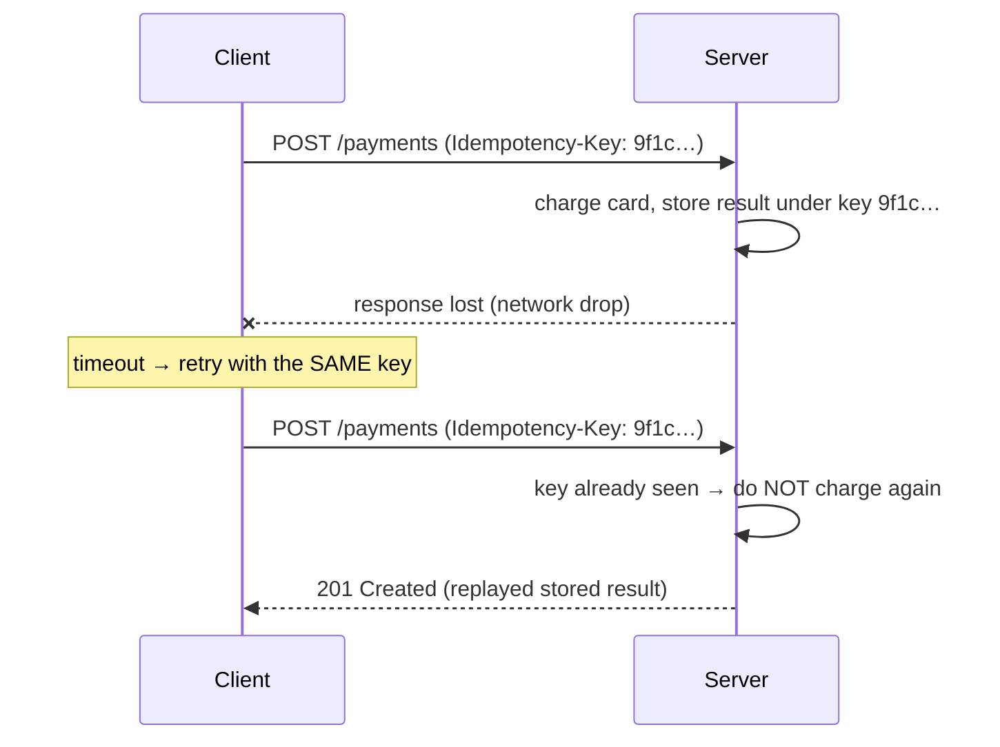

#### 2.3 Status codes the frontend must handle

| Code | Meaning | Frontend reaction |
|---|---|---|
| `200 OK` | Success with body | Render |
| `201 Created` | Resource created (`Location` header points to it) | Navigate / update cache |
| `202 Accepted` | Accepted for async processing | Poll a status URL or wait for a push event |
| `204 No Content` | Success, no body | Don't call `res.json()` (it would throw) |
| `304 Not Modified` | Your cached copy is still valid | Browser handles it transparently for `fetch` |
| `400 Bad Request` | Malformed request | Bug — log it |
| `401 Unauthorized` | **Not authenticated** (missing/expired credentials) | Refresh token or redirect to login |
| `403 Forbidden` | Authenticated but **not allowed** | Show "no access"; don't retry |
| `404 Not Found` | No such resource | Empty / not-found state |
| `409 Conflict` | State conflict (duplicate, version clash) | Show conflict resolution |
| `412 Precondition Failed` | `If-Match` ETag didn't match — someone else edited | Reload and merge |
| `422 Unprocessable Content` | Validation failed | Show field errors |
| `429 Too Many Requests` | Rate limited (may include `Retry-After`) | Back off, respect `Retry-After` |
| `500` / `502` / `503` / `504` | Server / gateway problems | Retry **idempotent** requests with backoff |

> `fetch()` **only rejects on network failure** (DNS, offline, CORS block, abort). A `404` or `500` **resolves** normally — you must check `res.ok` (status 200–299) yourself.

#### 2.4 Representations and conventions

- **Content negotiation:** `Accept: application/json`; the server answers with `Content-Type` and should send `Vary: Accept` if the representation depends on it.
- **Error bodies:** use **Problem Details** ([RFC 9457](https://www.rfc-editor.org/rfc/rfc9457), media type `application/problem+json`) so every error has the same shape: `type`, `title`, `status`, `detail`, `instance`, plus extension fields such as `errors`.
- **Hypermedia (HATEOAS)** — links in responses that tell the client what it can do next — is part of Fielding's REST, but most "REST" APIs in practice are **resource-oriented JSON over HTTP** without it. Know the term; don't over-invest.

---

### Section 3: REST Caching — Cache-Control and ETags

REST's biggest structural advantage: **each resource has a URL**, and `GET` is cacheable, so **the browser cache, a CDN and any shared proxy can serve responses without your server** ([RFC 9111](https://www.rfc-editor.org/rfc/rfc9111)).

#### 3.1 Freshness: `Cache-Control`

| Directive | Meaning |
|---|---|
| `max-age=60` | Fresh for 60 s — served from cache with **no request at all** |
| `s-maxage=300` | Same, but only for **shared** caches (CDN) |
| `no-cache` | May store, but **must revalidate** with the server before every use |
| `no-store` | Never store (sensitive data) |
| `private` | Only the user's browser may store it (per-user data — never on a CDN) |
| `public` | Shared caches may store it (even if the request had `Authorization`) |
| `stale-while-revalidate=30` | Serve stale for up to 30 s **while refreshing in the background** ([RFC 5861](https://www.rfc-editor.org/rfc/rfc5861)) |
| `immutable` | Never revalidate while fresh (fingerprinted assets) |

#### 3.2 Validation: `ETag` + `If-None-Match` → `304`

When a cached response is stale, the browser asks "has it changed?" instead of downloading again.

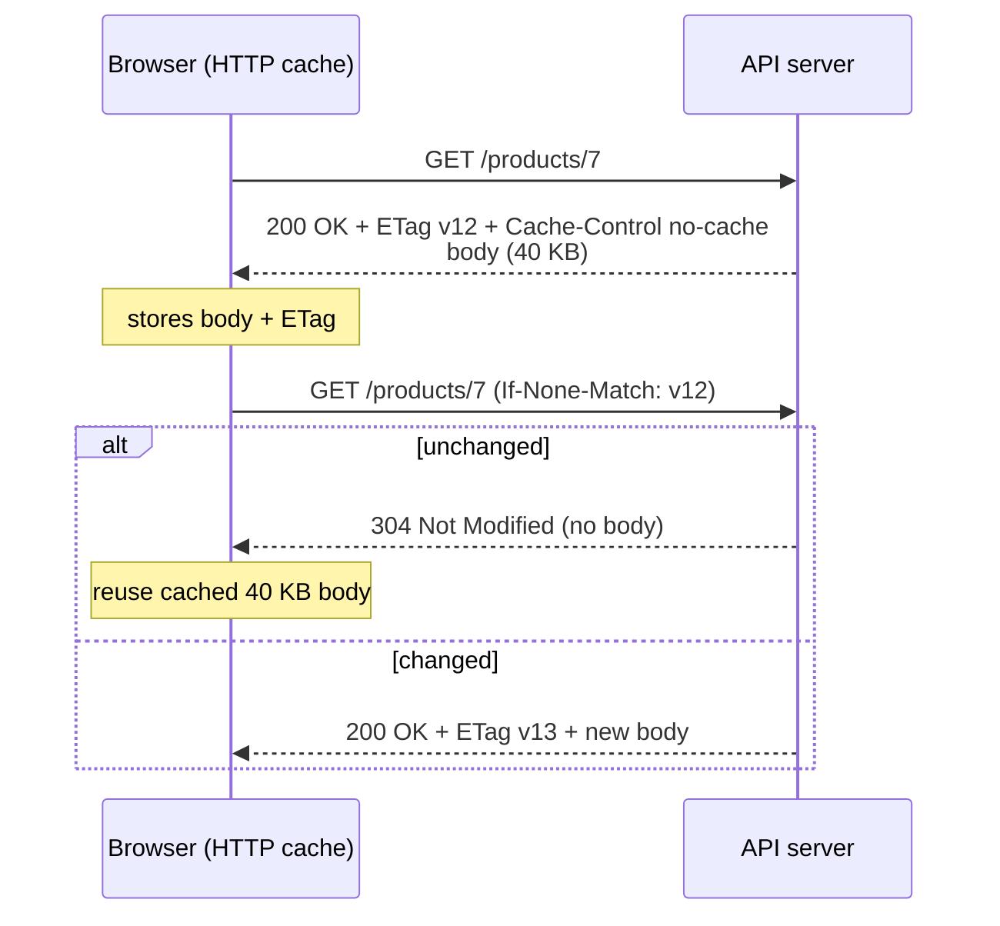

The same `ETag` also powers **optimistic concurrency** for writes:

```http
PATCH /documents/9 HTTP/1.1
If-Match: "v13"
Content-Type: application/json

{"title": "New title"}
```

If someone else saved first the ETag is now `"v14"` → server answers **`412 Precondition Failed`** instead of silently overwriting their change ("lost update" problem).

> **Cache keys:** shared caches key by URL (+ headers listed in `Vary`). Responses that depend on the user **must** be `private` (or `Vary` on the relevant header) — otherwise a CDN can serve user A's data to user B.

---

### Section 4: Over-fetching, Under-fetching and Pagination

#### 4.1 The two classic REST problems

| Problem | What happens | Cost |
|---|---|---|
| **Over-fetching** | `GET /users/42` returns 40 fields; the avatar chip needs 2 | Wasted bytes, parse time, memory (worst on mobile) |
| **Under-fetching** | One screen needs data from several resources → several requests, often **sequential** | Request **waterfalls** → latency multiplied by round trips |

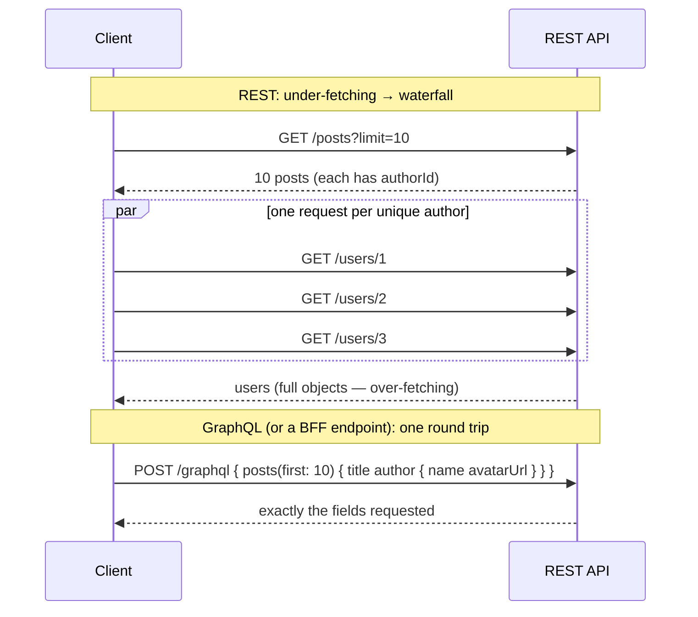

REST fixes that don't need GraphQL:

- **Sparse fieldsets:** `GET /users/42?fields=name,avatarUrl`
- **Includes / expansion:** `GET /posts?include=author` ([JSON:API](https://jsonapi.org/format/) standardises both `fields[...]` and `include`)
- **Screen-specific endpoints in a BFF** (see [System Design Angle](#system-design-angle--bff-and-api-gateways))

#### 4.2 Pagination styles

| Style | Request | Pros | Cons |
|---|---|---|---|
| **Offset / limit** | `?offset=40&limit=20` or `?page=3` | Simple; jump to page N; total count | Slow on deep pages (DB scans skipped rows); **items shift** when data changes → duplicates/gaps |
| **Cursor** (opaque) | `?after=eyJpZCI6MTAwfQ&limit=20` | Stable under inserts/deletes; fast | No random page jumps; total count is extra work |
| **Keyset** (cursor made of sort keys) | `?created_before=2026-11-01T10:00Z&id_lt=981` | Uses an index → constant speed | Requires a stable, unique sort key |
| **Page token** (Google AIP style) | `?page_token=abc&page_size=20` → `next_page_token` | Server can change implementation freely | Same as cursor |

```text
Why offset pagination duplicates items in a live feed:
  t0  page 1 = items [A B C D E]   (limit 5, offset 0)
  t1  new item Z inserted at the top → list is now [Z A B C D E F ...]
  t2  page 2 = offset 5 → [E F G H I]   ← E shown twice
Cursor version: page 2 = "items after E" → [F G H I J]  ← correct
```

> **Rule of thumb:** infinite scroll / feeds / anything that changes → **cursor**. Admin tables where users jump to "page 37 of 120" → **offset** is acceptable. Links to next/prev pages can be returned in the `Link` header ([RFC 8288](https://www.rfc-editor.org/rfc/rfc8288)) or in the body. GraphQL standardises cursor pagination by convention with **Relay-style connections** (`edges`, `node`, `pageInfo { hasNextPage endCursor }`).

---

### Section 5: GraphQL — Schema, Operations and Execution

**GraphQL** is a query language and execution engine for APIs ([GraphQL specification](https://spec.graphql.org/)). The server publishes a **strongly typed schema**; the client sends a **document** describing exactly what it wants; the response mirrors the shape of the request.

#### 5.1 Schema (SDL)

```graphql
type User {
  id: ID!
  name: String!
  avatarUrl(size: Int = 64): String
  posts(first: Int = 10, after: String): PostConnection!   # Relay-style connection
}
type Post { id: ID!  title: String!  author: User! }
type PostConnection { edges: [PostEdge!]!  pageInfo: PageInfo! }
type PostEdge { cursor: String!  node: Post! }
type PageInfo { hasNextPage: Boolean!  endCursor: String }

type Query        { me: User  post(id: ID!): Post }
type Mutation     { createPost(input: CreatePostInput!): CreatePostPayload! }
type Subscription { postAdded: Post! }

input CreatePostInput { title: String! }
type CreatePostPayload { post: Post }
```

`!` = non-null. Types, arguments and nullability are **validated before execution** — a typo in a field name is rejected without touching any resolver.

#### 5.2 The three operation types

```graphql
# Query — read (fields may be resolved in parallel)
query Feed($first: Int!) {
  me {
    name
    posts(first: $first) {
      edges { node { ...PostCard } }
      pageInfo { hasNextPage endCursor }
    }
  }
}

fragment PostCard on Post {
  id
  title
  author { id name avatarUrl(size: 32) }
}

# Mutation — write (top-level fields run serially, in order)
mutation CreatePost($input: CreatePostInput!) {
  createPost(input: $input) { post { id title } }
}

# Subscription — a stream of results over a long-lived transport
subscription OnPostAdded {
  postAdded { id title }
}
```

- **Fragments** let each UI component declare its own data needs (co-location — the core idea behind Relay and the "fragment masking" in GraphQL Codegen).
- **Variables** keep the document static (cacheable, persistable) and values separate — never build GraphQL strings by concatenation.
- **Subscriptions:** the spec defines the semantics, **not the transport**. Common choices are the [`graphql-ws`](https://github.com/enisdenjo/graphql-ws) protocol over WebSockets or GraphQL over SSE (see the [next note](./websockets-sse-long-polling.md)). (The older `subscriptions-transport-ws` library is unmaintained — don't start new work on it.)

#### 5.3 Execution: parse → validate → execute

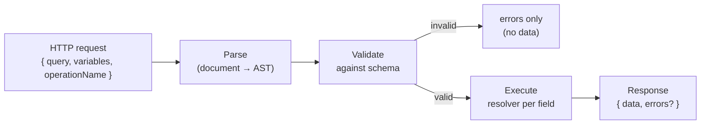

Every field has a **resolver** — a function `(parent, args, context, info) => value | Promise<value>`. Execution walks the selection set; results are assembled into a JSON object with the same shape as the query.

**Partial success is normal:** a response can contain both `data` and `errors`. Each error has a `message`, optional `locations`, and a `path` pointing at the failed field; that field is `null` and, if it is non-null in the schema, the null **propagates up** to the nearest nullable parent.

```json
{
  "data": { "me": { "name": "Ada", "avatarUrl": null } },
  "errors": [
    { "message": "Image service timeout", "path": ["me", "avatarUrl"] }
  ]
}
```

#### 5.4 GraphQL over HTTP

The core spec doesn't mandate HTTP. The community [GraphQL-over-HTTP specification](https://graphql.github.io/graphql-over-http/draft/) (a draft at the time of writing) describes current practice:

- **`POST`** with a JSON body `{ "query", "variables", "operationName" }` — works for everything.
- **`GET`** with the query in the URL — allowed for **queries only**, never mutations. This is what enables HTTP/CDN caching.
- Traditional servers answer **`200 OK` even when `errors` is present**. With the newer `application/graphql-response+json` media type, requests that fail before execution (parse/validation errors, no `data`) get a 4xx status. Either way, **the frontend must inspect the `errors` array**, not just the status code.

---

### Section 6: GraphQL in Production — N+1, Caching, Persisted Queries, Limits

#### 6.1 The N+1 problem and DataLoader

Naive resolvers run once **per parent object**. Fetching 50 posts and their authors makes 1 query for posts + **50** queries for authors.

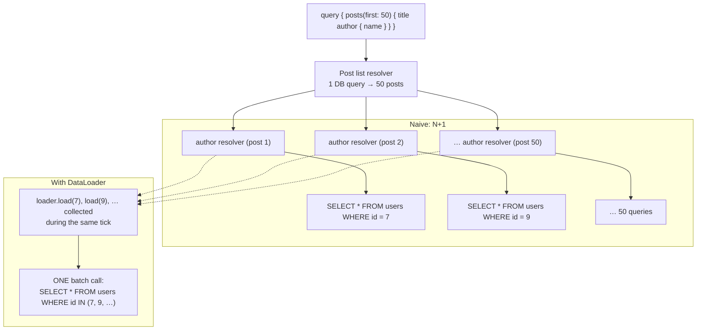

[DataLoader](https://github.com/graphql/dataloader) collects every `.load(key)` call made during one tick of the event loop, calls your **batch function once** with all the keys, and **memoises per request**:

```typescript
import DataLoader from 'dataloader';

// Create loaders PER REQUEST (in the GraphQL context) — never share across users
export function createLoaders(db: Db) {
  return {
    userById: new DataLoader<string, User | null>(async (ids) => {
      const rows = await db.users.findMany({ where: { id: { in: [...ids] } } });
      const byId = new Map(rows.map((u) => [u.id, u]));
      return ids.map((id) => byId.get(id) ?? null); // MUST return results in the same order as keys
    }),
  };
}

// Resolver
const resolvers = {
  Post: {
    author: (post: Post, _args: unknown, ctx: Context) => ctx.loaders.userById.load(post.authorId),
  },
};
```

> N+1 is a **server** concern, but frontend engineers designing a schema or BFF must know it exists: a "cheap-looking" nested query can be expensive. REST has the same problem on the **client** side (the waterfall in Section 4).

#### 6.2 Why HTTP caching is harder

| REST | GraphQL (default setup) |
|---|---|
| Many URLs → each response has its own cache key | One URL (`/graphql`) → URL is useless as a key |
| `GET` → browsers/CDNs cache it | `POST` → browsers and CDNs do not cache it in practice |
| `Cache-Control` per resource | One response mixes fields with different freshness needs |

Solutions, from client to edge:

1. **Normalized client cache** (Apollo Client `InMemoryCache`, Relay store, urql Graphcache): responses are split into entities keyed by `__typename` + `id`. Any query that touches `User:42` sees the update — a mutation result that returns the changed fields updates every screen automatically.
2. **GET + persisted queries** → a short, stable URL that a CDN can cache.
3. **Server-side response / field caching** (e.g. per-field cache hints in some servers).

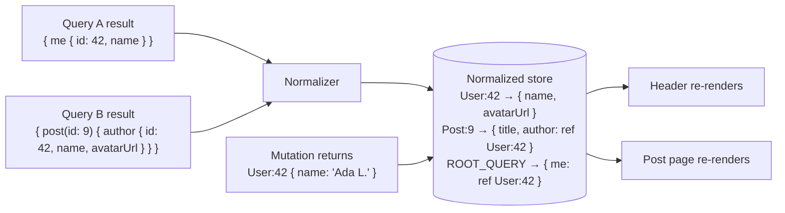

Normalized-cache gotchas: objects **without an `id`** can't be normalized (configure `keyFields` / custom keys); always **request `id`** in mutations so the cache can merge; lists (adds/removes) usually need manual `update`/`refetchQueries` because the cache can't know a new item belongs in some list.

#### 6.3 Persisted queries

Sending a 3 KB query string on every request wastes upload bandwidth and prevents GET caching (URL too long). Two variants:

| Variant | How | Main benefit |
|---|---|---|
| **Automatic Persisted Queries (APQ)** — Apollo convention | Client sends only a SHA-256 hash; on a cache miss the server asks for the full text once | Smaller requests; enables GET + CDN caching |
| **Trusted documents / persisted-query allowlist** | Hashes are registered **at build time**; the server **rejects any operation not in the list** | **Security** — attackers can't send arbitrary expensive queries; plus the same bandwidth benefits |

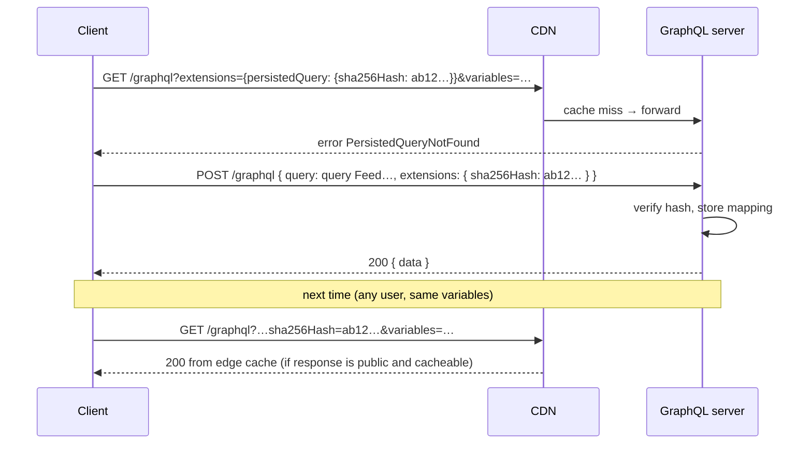

> APQ alone is **not** a security control — anyone can register a new hash. For public-facing apps where you own all clients, the **allowlist** variant is the stronger option.

#### 6.4 Protecting the server: complexity limits

A single GraphQL request can ask for a huge tree (`friends { friends { friends { … } } }`) or use aliases to repeat an expensive field hundreds of times. Common defences:

| Defence | What it limits |
|---|---|
| **Max depth** | Nesting levels |
| **Query cost / complexity analysis** | A computed score (e.g. list fields × `first` argument) checked **before** execution |
| **Pagination caps** | `first` ≤ 100, required on list fields |
| **Alias / batch limits** | Number of root fields, aliases, or operations per HTTP request |
| **Timeouts** | Wall-clock per operation |
| **Rate limiting by cost**, not by request count | GitHub's and Shopify's public GraphQL APIs use cost/point-based limits |
| **Trusted documents** | Only known operations run at all |
| **Introspection** | Often disabled or restricted for public production endpoints (it's not a security boundary on its own, but reduces casual schema discovery) |

---

### Section 7: gRPC-Web — Protobuf in the Browser

#### 7.1 gRPC in one paragraph

**gRPC** is an RPC framework: you define services and messages in **Protocol Buffers** (`.proto`), generate client and server code, and call remote methods like local functions. On the wire it uses **HTTP/2**: each message is **length-prefixed** (1-byte compressed flag + 4-byte length), the method is the path (`/package.Service/Method`), and the final status is sent in **HTTP trailers** (`grpc-status`, `grpc-message`). It supports **unary**, **server streaming**, **client streaming** and **bidirectional streaming** calls.

```protobuf
syntax = "proto3";

package shop.v1;

service OrderService {
  rpc GetOrder(GetOrderRequest) returns (Order);                       // unary
  rpc WatchOrderStatus(WatchOrderStatusRequest) returns (stream OrderStatus); // server streaming
}

message GetOrderRequest { string order_id = 1; }

message Order {
  string id = 1;
  int64 total_cents = 2;   // proto3 JSON mapping encodes int64 as a STRING
  repeated LineItem items = 3;
  reserved 4;              // field number of a removed field — never reuse it
}

message LineItem { string sku = 1; int32 quantity = 2; }
message WatchOrderStatusRequest { string order_id = 1; }
message OrderStatus { string state = 1; }
```

Protobuf strengths: **compact binary encoding**, **fast parsing**, and **schema evolution rules** — fields are identified by **number**, not name, so adding fields is backward compatible; removing/renaming is safe as long as you never reuse a number.

#### 7.2 Why browsers can't speak gRPC directly

Browser JavaScript talks HTTP through `fetch`/XHR, which deliberately hide the transport:

- JS **cannot choose HTTP/2** or see HTTP/2 frames — the browser decides the protocol.
- JS **cannot read HTTP trailers**, where gRPC puts the call's status.
- Full-duplex streaming over `fetch` (sending a request body while reading the response) is not generally available.

**gRPC-Web** is a variant protocol designed for these constraints: it works over HTTP/1.1 or HTTP/2, **moves the trailers into the response body** as a final flagged frame, uses content types like `application/grpc-web+proto` (or `application/grpc-web-text`, base64-encoded), and supports **unary and server-streaming** calls only. Something must translate between gRPC-Web and native gRPC:

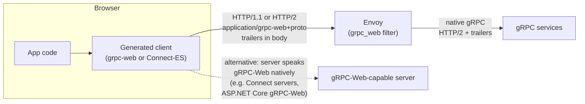

- The official [grpc-web](https://github.com/grpc/grpc-web) project uses **Envoy** (built-in `grpc_web` HTTP filter) as the default proxy.
- Some server frameworks accept gRPC-Web **directly**, removing the separate proxy hop.
- In the official grpc-web JS client, **server streaming requires the `grpcwebtext` mode**; client streaming and bidirectional streaming are **not supported** from browsers.
- Cross-origin calls need **CORS**: the content type and the `x-grpc-web` / `x-user-agent` headers trigger a preflight, so the proxy must answer `OPTIONS` and expose `grpc-status`, `grpc-message`.

#### 7.3 The Connect protocol — an alternative worth knowing

[Connect](https://connectrpc.com/docs/introduction) (by Buf) is a family of libraries plus its own [Connect protocol](https://connectrpc.com/docs/protocol). Stated carefully:

- Connect **servers** (e.g. `connect-go`, Connect for Node.js) handle **three protocols on the same endpoint**: Connect, gRPC and gRPC-Web — so browsers can call them **without a translating proxy**.
- The **Connect protocol's unary calls are ordinary HTTP POSTs** with `Content-Type: application/json` or `application/proto`. Errors come back as a JSON body with a `code` and `message` and a mapped HTTP status — readable in DevTools and callable with `curl`.
- Methods marked side-effect-free in the `.proto` (`option idempotency_level = NO_SIDE_EFFECTS;`) can be called with **HTTP GET**, which makes them **cacheable** by browsers and CDNs.
- The browser client (**Connect-ES**, `@connectrpc/connect-web`) can use **either** the Connect protocol or gRPC-Web as transport, with types generated by `protoc-gen-es`.
- Browser limits still apply: unary and server streaming work; client and bidirectional streaming need full-duplex HTTP, which browsers' `fetch` does not provide.

> Choose gRPC-Web/Connect when the backend is **already protobuf/gRPC-first** and you want **one schema** from database service to UI. If the API is public and consumed by many unknown clients, REST/OpenAPI is usually friendlier.

---

### Section 8: tRPC and RPC-Style APIs

Not every API needs a language-neutral contract.

**[tRPC](https://trpc.io/docs)** lets a TypeScript client call TypeScript server procedures with **types inferred directly from the server code** — no schema file, no codegen step:

```typescript
// server/router.ts
import { initTRPC } from '@trpc/server';
import { z } from 'zod';

const t = initTRPC.create();
export const appRouter = t.router({
  postById: t.procedure
    .input(z.object({ id: z.string() }))
    .query(({ input }) => db.post.findUnique({ where: { id: input.id } })),
});
export type AppRouter = typeof appRouter; // ← only the TYPE is imported by the client

// client — `post` is fully typed from the server's return type
const post = await trpc.postById.query({ id: '9' });
```

| tRPC is great when… | tRPC is a poor fit when… |
|---|---|
| Same team owns client + server, in one TypeScript monorepo | Clients are written in other languages (mobile native, partners) |
| Internal app, fast iteration | Public API that needs versioning and documentation |
| You want refactors to break the client build instantly | Server and client deploy independently with long-lived old clients |

Other RPC-style patterns you'll meet: **React Server Functions / Server Actions** (`'use server'` functions invoked from the client via framework-generated POST requests), **JSON-RPC 2.0**, and plain "`POST /api/doThing`" endpoints. All share RPC's trade-off: **easy to write, but no URL-per-resource → no free HTTP caching** and tighter client/server coupling.

---

### Section 9: Error Handling & Type Generation

#### 9.1 Where errors live in each style

| Style | Transport-level failure | Application error |
|---|---|---|
| REST | `fetch` rejects (network/CORS/abort) | HTTP status + Problem Details body |
| GraphQL | `fetch` rejects; 4xx for malformed requests (with the newer media type) | `errors[]` array (often with HTTP 200) **or** typed error results in the schema |
| gRPC-Web / Connect | `fetch` rejects | `grpc-status` code (e.g. `NOT_FOUND`, `UNAUTHENTICATED`) / Connect error JSON |

**Normalize everything into one client-side error type** so UI code doesn't care which protocol produced it:

```typescript
type ApiError =
  | { kind: 'network'; cause: unknown }              // offline, DNS, CORS
  | { kind: 'aborted' }                              // user navigated / timeout
  | { kind: 'unauthenticated' }                      // 401 / UNAUTHENTICATED
  | { kind: 'forbidden' }                            // 403 / PERMISSION_DENIED
  | { kind: 'not-found' }
  | { kind: 'validation'; fields: Record<string, string> } // 422 / INVALID_ARGUMENT
  | { kind: 'rate-limited'; retryAfterMs?: number }  // 429 / RESOURCE_EXHAUSTED
  | { kind: 'server'; status?: number; requestId?: string };
```

**GraphQL tip — model expected errors in the schema** instead of the generic `errors` array, so they are typed:

```graphql
union CreatePostResult = CreatePostSuccess | ValidationError | RateLimited

type CreatePostSuccess { post: Post! }
type ValidationError { fieldErrors: [FieldError!]! }
type FieldError { field: String!  message: String! }
type RateLimited { retryAfterSeconds: Int! }
```

#### 9.2 Type generation: one source of truth

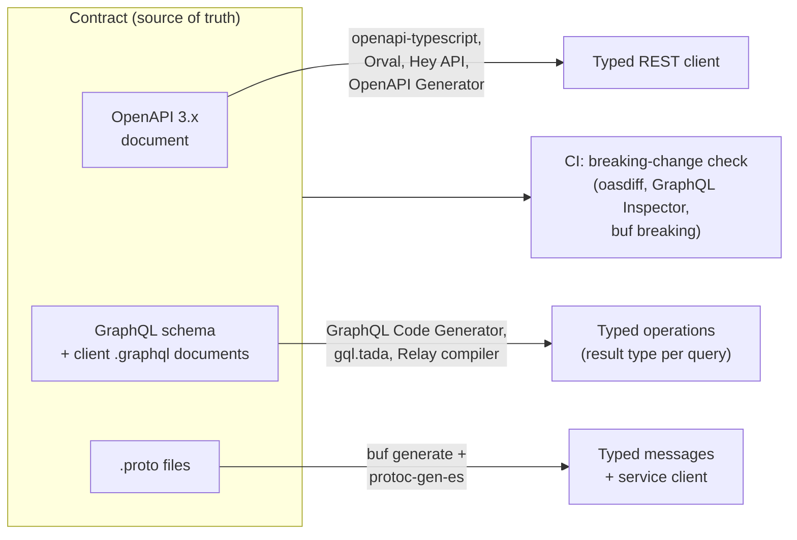

| Approach | Strength | Watch out |
|---|---|---|
| **OpenAPI codegen** | Works with any backend language; doubles as docs | Spec must stay in sync with the server — generate it **from** code or validate responses in tests |
| **GraphQL codegen** | Types per **operation** — exactly the fields you selected | Re-run on every schema/document change (watch mode) |
| **Protobuf codegen** | Same `.proto` for every language and service | Generated code size; JSON mapping quirks (`int64` → string) |
| **tRPC inference** | Zero codegen | TypeScript-only, shared repo |

> **Generated types are compile-time promises, not runtime guarantees.** For data crossing a trust boundary (third-party APIs, independently deployed services) validate at runtime too (e.g. Zod/Valibot schemas at the fetch boundary), or at least in contract tests.

---

## System Design Angle — BFF and API Gateways

A **Backend for Frontend (BFF)** is a server-side layer **owned by the frontend team** and dedicated to **one experience** (web app, iOS app, TV app). The pattern was described by Sam Newman ([BFF pattern](https://samnewman.io/patterns/architectural/bff/)), building on work at SoundCloud.

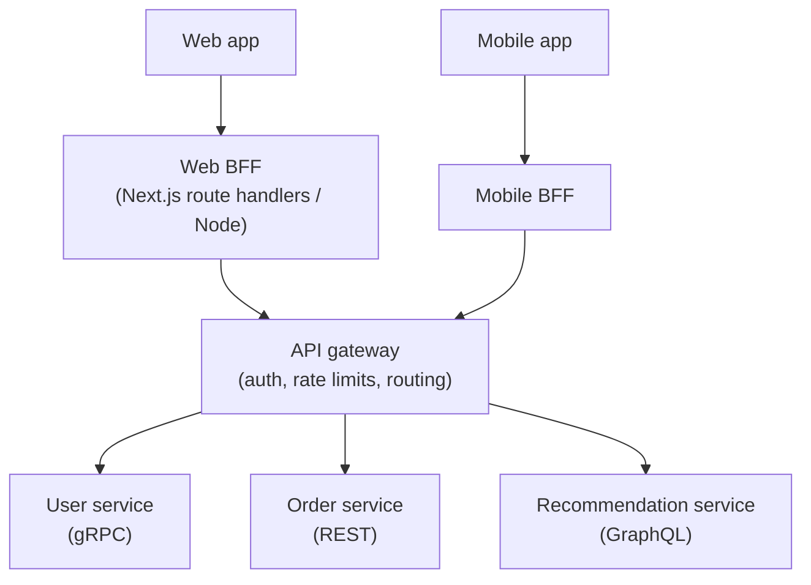

What a BFF does for the frontend:

| Responsibility | Effect |
|---|---|
| **Aggregation** | One request per screen instead of a client waterfall (Section 4) |
| **Shaping** | Returns exactly the fields this UI needs — solves over-fetching without GraphQL |
| **Protocol translation** | Speaks gRPC/internal protocols to services, JSON/HTTP to the browser |
| **Security** | Keeps OAuth tokens **server-side** and gives the browser an `HttpOnly` session cookie — the approach recommended in the IETF draft [OAuth 2.0 for Browser-Based Applications](https://datatracker.ietf.org/doc/draft-ietf-oauth-browser-based-apps/) |
| **Caching** | Can cache aggregated responses and set correct `Cache-Control` |
| **Decoupling** | Frontend changes ship without negotiating with every backend team |

**API gateway vs BFF:** a gateway is a **generic**, cross-cutting edge (auth, TLS, routing, rate limits) shared by all clients; a BFF is **experience-specific** business shaping. They are often combined, as above.

**GraphQL as a "universal BFF":** a GraphQL layer (often a federated "supergraph" composed from several services, e.g. Apollo Federation) can replace per-client BFFs because each client selects its own fields. Trade-off: you take on schema governance, query-cost protection and harder HTTP caching.

**BFF risks:** another service to run and monitor; a BFF that grows business logic becomes a second monolith; duplicated logic across multiple BFFs. Keep BFFs **thin** — composition and shaping, not domain rules.

---

## Decision Matrix

| Criterion | REST (+ OpenAPI) | GraphQL | gRPC-Web / Connect | tRPC |
|---|---|---|---|---|
| Public / third-party API | ✅ Best default | ✅ Good (with cost limits) | ⚠️ Possible, less familiar | ❌ TS-only |
| Many clients with different data needs | ⚠️ Needs BFFs / sparse fields | ✅ Client selects fields | ⚠️ Server-defined messages | ⚠️ |
| HTTP/CDN caching | ✅ Native | ⚠️ Needs GET + persisted queries | ⚠️ Connect GET for side-effect-free methods | ⚠️ GET for queries |
| Client-side cache consistency | Manual / query-key based (TanStack Query, SWR) | ✅ Normalized caches | Manual / query-key based | Query-key based (TanStack Query) |
| Payload size | JSON (compressible) | JSON, only requested fields | ✅ Compact binary protobuf | JSON |
| Type safety | Codegen from OpenAPI | ✅ Codegen per operation | ✅ Codegen from `.proto` | ✅ Inference, no codegen |
| Real-time | Separate SSE/WebSocket | Subscriptions (transport chosen by you) | Server streaming | Subscriptions (SSE/WebSocket) |
| Debuggability in DevTools | ✅ Excellent | Good | Poor (binary gRPC-Web); good (Connect JSON) | Good |
| Infra needed in browsers | None | GraphQL server | Proxy (Envoy) **or** gRPC-Web-capable server | Node/TS server |
| Learning curve / ops cost | Low | Medium–high (N+1, cost limits, caching) | Medium (protobuf toolchain) | Low |

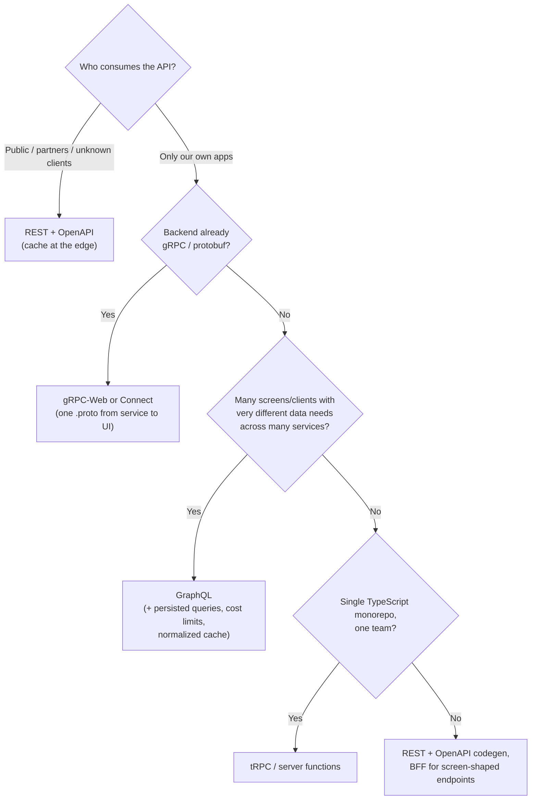

> These options are **not exclusive**. A common shape: REST/OpenAPI for public APIs, GraphQL or a BFF for the product's own UI, gRPC between internal services, and SSE/WebSockets for real-time pushes.

---

## Real-World Examples

**Example 1 — A robust REST client (timeouts, cancellation, status handling):**
```typescript
// BAD: no timeout, no cancellation, treats 404/500 as success, crashes on 204
async function getUserBad(id: string) {
  const res = await fetch(`/api/users/${id}`);
  return res.json();
}

// GOOD
class HttpError extends Error {
  constructor(public status: number, public problem?: { title?: string; detail?: string }) {
    super(problem?.title ?? `HTTP ${status}`);
  }
}

async function request<T>(url: string, init: RequestInit & { timeoutMs?: number } = {}): Promise<T> {
  const { timeoutMs = 10_000, signal, ...rest } = init;
  // Combine the caller's signal (e.g. component unmount) with a timeout.
  // AbortSignal.any is supported in current Chrome, Firefox and Safari — feature-detect for older targets.
  const timeout = AbortSignal.timeout(timeoutMs);
  const combined = signal ? AbortSignal.any([signal, timeout]) : timeout;

  const res = await fetch(url, {
    ...rest,
    signal: combined,
    headers: { Accept: 'application/json', ...rest.headers },
  });

  if (!res.ok) {
    const isProblem = res.headers.get('Content-Type')?.includes('application/problem+json');
    throw new HttpError(res.status, isProblem ? await res.json() : undefined);
  }
  if (res.status === 204) return undefined as T;
  return (await res.json()) as T;
}

// Usage in a component effect
const controller = new AbortController();
request<User>('/api/users/42', { signal: controller.signal })
  .then(render)
  .catch((err) => {
    if (err.name === 'AbortError' || err.name === 'TimeoutError') return; // expected
    showError(err);
  });
// on unmount: controller.abort();
```

**Example 2 — Safe retries for a non-idempotent POST:**
```typescript
async function placeOrder(cart: Cart) {
  const idempotencyKey = crypto.randomUUID(); // one key per user intent, reused across retries
  for (let attempt = 0; attempt < 3; attempt++) {
    try {
      return await request<Order>('/api/orders', {
        method: 'POST',
        headers: { 'Content-Type': 'application/json', 'Idempotency-Key': idempotencyKey },
        body: JSON.stringify(cart),
      });
    } catch (err) {
      const retriable = !(err instanceof HttpError) || err.status >= 500 || err.status === 429;
      if (!retriable || attempt === 2) throw err;
      await new Promise((r) => setTimeout(r, 2 ** attempt * 500 * Math.random())); // backoff + jitter
    }
  }
}
```

**Example 3 — A GraphQL query with plain `fetch` (no client library):**
```typescript
const FEED_QUERY = /* GraphQL */ `
  query Feed($first: Int!, $after: String) {
    feed(first: $first, after: $after) {
      edges { node { id title author { id name } } }
      pageInfo { hasNextPage endCursor }
    }
  }
`;

async function gql<T>(query: string, variables: Record<string, unknown>, signal?: AbortSignal): Promise<T> {
  const res = await fetch('/graphql', {
    method: 'POST',
    headers: { 'Content-Type': 'application/json', Accept: 'application/graphql-response+json, application/json' },
    body: JSON.stringify({ query, variables }),
    signal,
  });
  const body = await res.json().catch(() => null);
  if (!body || (!res.ok && !body.data)) throw new Error(`GraphQL HTTP ${res.status}`);
  if (body.errors?.length) {
    // Partial data is possible: decide per screen whether to render it or fail
    console.warn('GraphQL errors', body.errors.map((e: { message: string; path?: unknown[] }) => [e.path, e.message]));
    if (!body.data) throw new Error(body.errors[0].message);
  }
  return body.data as T;
}

const data = await gql<FeedQuery>(FEED_QUERY, { first: 20 });
// In a real app: use Apollo/urql/Relay for normalized caching (configure keyFields for types
// without `id`, merge functions for paginated lists) and GraphQL Codegen to generate FeedQuery.
```

**Example 4 — Calling a Connect / gRPC-Web service from the browser (Connect-ES v2 API):**
```typescript
import { createClient } from '@connectrpc/connect';
import { createConnectTransport, createGrpcWebTransport } from '@connectrpc/connect-web';
import { OrderService } from './gen/shop/v1/order_pb'; // generated by buf + protoc-gen-es

// Connect protocol (JSON or binary over plain HTTP; works directly against Connect servers)
const transport = createConnectTransport({ baseUrl: 'https://api.example.com' });
// …or gRPC-Web (e.g. behind Envoy): createGrpcWebTransport({ baseUrl: 'https://api.example.com' })

const orders = createClient(OrderService, transport);
const order = await orders.getOrder({ orderId: 'o_123' }, { signal: AbortSignal.timeout(5000) });

// Server streaming
for await (const status of orders.watchOrderStatus({ orderId: 'o_123' })) {
  updateStatusBadge(status.state);
}
```
*(API names follow Connect-ES v2; v1 used `createPromiseClient`. Check the [Connect-ES docs](https://connectrpc.com/docs/web/getting-started) for your version.)*

---

## Key Points Summary

| Concept | One-Line Explanation |
|---|---|
| **REST** | Resources at URLs + HTTP methods + status codes + cache headers |
| **Idempotent method** | Repeating it has the same server effect (GET, PUT, DELETE…); POST/PATCH aren't by default |
| **Idempotency-Key** | Client-generated key that lets the server dedupe retried POSTs |
| **ETag** | Version tag: `If-None-Match` → 304 (no body); `If-Match` → 412 on a stale write |
| **Over- / under-fetching** | Too many fields / too many round trips (waterfalls) for one screen |
| **Cursor pagination** | "Items after X" — stable for live data, no page jumps |
| **GraphQL** | Typed schema; client selects fields; one endpoint; `data` + `errors` |
| **N+1 / DataLoader** | Per-parent resolver calls → batch and cache per request |
| **Normalized cache** | Client store keyed by `__typename:id` so updates propagate everywhere |
| **Persisted queries** | Send a hash instead of the query; allowlist variant blocks unknown queries |
| **gRPC-Web** | Browser-compatible gRPC variant: trailers in body, unary + server streaming, needs proxy or native support |
| **Connect** | Protocol + libraries; servers speak Connect, gRPC and gRPC-Web; unary calls are plain HTTP |
| **tRPC** | TypeScript end-to-end inference, no codegen, same-repo coupling |
| **BFF** | Frontend-owned backend per experience: aggregate, shape, secure tokens |
| **Codegen** | Generate client types from OpenAPI / GraphQL / `.proto`; guard with breaking-change checks in CI |

---

## Test Your Understanding

**Q1 (Basic):**
Which HTTP methods are idempotent, and why does it matter for a frontend that retries failed requests?

<details>
<summary>Answer</summary>

`GET`, `HEAD`, `OPTIONS`, `TRACE` (the safe ones) plus **`PUT`** and **`DELETE`** are idempotent per RFC 9110. `POST` is not, and `PATCH` is not guaranteed to be.

It matters because a failure can happen **after** the server already applied the change (e.g. the response was lost). Retrying an idempotent request can't double-apply it, so automatic retry with backoff is safe. Retrying a `POST /payments` could charge twice — so either don't auto-retry, or send an **`Idempotency-Key`** that the server uses to recognise and replay the original result.
</details>

**Q2 (Basic):**
Your REST endpoint returns the same 200 KB product catalogue to every user and changes about once an hour. Which headers would you set, and what happens on the second request?

<details>
<summary>Answer</summary>

Something like `Cache-Control: public, max-age=60, s-maxage=600, stale-while-revalidate=300` plus an **`ETag`**.

- Within `max-age`, the browser reuses its copy **without any request**.
- The CDN (`s-maxage`) serves other users from the edge without hitting your server.
- After expiry, the browser sends `If-None-Match: "<etag>"`; if unchanged the server returns **`304 Not Modified`** with no body, saving the 200 KB.
- `stale-while-revalidate` lets a stale copy be shown instantly while a background refresh happens.

It's `public` because the data isn't user-specific. If it were per-user, it would need `private` so a CDN never shares it.
</details>

**Q3 (Application):**
A GraphQL query `posts(first: 50) { author { name } }` makes the database run 51 queries. Explain why and how to fix it.

<details>
<summary>Answer</summary>

This is the **N+1 problem**: the `posts` resolver runs one query (the "1"), then the `author` resolver runs **once per post** (the "N" = 50), each doing its own `SELECT … WHERE id = ?`.

Fix with **DataLoader** (or an equivalent batching layer): `author` resolvers call `loaders.userById.load(post.authorId)`. DataLoader collects all keys requested during the same tick and calls one batch function → `SELECT … WHERE id IN (…)`, then returns each caller its result (in key order). Loaders must be **created per request**, so their memoisation cache doesn't leak data between users. Alternatives: join-aware query planning, or look-ahead using the `info` argument.
</details>

**Q4 (Application):**
Your team moved from REST to GraphQL and the CDN hit rate dropped to almost zero. Why, and what are your options?

<details>
<summary>Answer</summary>

Shared caches key responses by **URL** (plus `Vary`d headers), and only cache **GET** in practice. A typical GraphQL setup sends every operation as a **`POST` to `/graphql`** — one URL, uncacheable method, and a body the CDN doesn't key on.

Options:
1. Send **queries as GET** (the GraphQL-over-HTTP draft allows GET for queries, never mutations).
2. Use **persisted queries** so the GET URL is short and stable (a hash + variables) — ideally the **allowlisted/trusted documents** variant, which also blocks arbitrary queries.
3. Set correct `Cache-Control` on responses (`public` only for non-user-specific data; servers that compute per-field cache hints can derive the overall max-age).
4. Rely on the **normalized client cache** for per-user data, and keep truly public, hot data (e.g. catalogue) behind cacheable GET endpoints.
</details>

**Q5 (Tricky):**
Why can't a browser app call a standard gRPC server directly, and what are two ways to make it work?

<details>
<summary>Answer</summary>

Native gRPC depends on HTTP/2 features that browser JavaScript can't control: JS **can't force HTTP/2 or access its frames**, and **can't read HTTP trailers**, which is where gRPC sends `grpc-status`. Full-duplex streaming over `fetch` is also not generally available.

Ways to make it work:
1. **gRPC-Web + a translating proxy** — e.g. **Envoy** with its `grpc_web` filter converts gRPC-Web (trailers encoded in the body, works over HTTP/1.1 or HTTP/2) into native gRPC.
2. **A server that speaks gRPC-Web natively** — e.g. Connect servers (which also accept the simpler **Connect protocol** — plain HTTP POST/GET with JSON or protobuf) or frameworks with built-in gRPC-Web support. No separate proxy hop.

Either way, only **unary and server-streaming** calls work from browsers.
</details>

**Q6 (System design):**
You're designing the web app for a marketplace with 8 backend microservices (some gRPC, some REST). The product page needs data from 5 of them, and the mobile app needs different fields. What API layer do you propose?

<details>
<summary>Answer</summary>

Put a layer between clients and services rather than letting the browser fan out to 5 services (5 round trips, waterfalls, 5 auth surfaces, CORS everywhere):

- **Option A — BFF per client** (web BFF, mobile BFF), owned by each frontend team. Each exposes screen-shaped endpoints (`GET /bff/product/:id`), calls the services in parallel (gRPC internally), shapes the response, sets `Cache-Control`, and keeps OAuth tokens server-side behind an `HttpOnly` session cookie. Simple, cache-friendly; risk is duplicated logic across BFFs.
- **Option B — a GraphQL gateway** (possibly federated) used by both clients; each client selects its fields, normalized client cache keeps screens consistent. Requires DataLoader, cost limits and persisted queries; HTTP caching needs GET + persisted queries.

Either way: generate client types (OpenAPI or GraphQL Codegen), run breaking-change checks in CI, and use SSE/WebSockets separately for live updates such as price or stock changes. For a team without GraphQL experience, a **thin BFF** is usually the lower-risk start.
</details>

---

## Cheat Sheet

**Key Definitions:**
- **REST:** resource URLs + standard methods + status codes + HTTP caching.
- **Safe / idempotent:** read-only / repeat-without-extra-effect (RFC 9110).
- **ETag:** opaque version of a representation; `If-None-Match` → `304`, `If-Match` → `412` on conflict.
- **Problem Details:** standard JSON error body, `application/problem+json` (RFC 9457).
- **GraphQL:** typed schema, client-selected fields; queries, mutations, subscriptions; `data` + `errors`.
- **DataLoader:** per-request batching + memoisation to fix N+1.
- **Persisted queries:** hash instead of query text; allowlist = security, APQ = bandwidth/caching.
- **gRPC-Web:** browser-compatible gRPC (trailers in body; unary + server streaming; proxy or native server support).
- **Connect:** protocol + libraries; plain-HTTP unary calls, GET for side-effect-free methods; servers also speak gRPC and gRPC-Web.
- **BFF:** frontend-owned backend per experience for aggregation, shaping and token handling.

**Quick Reference — status codes:**
```text
2xx  200 OK · 201 Created (+Location) · 202 Accepted (async) · 204 No Content (no body!)
3xx  304 Not Modified (cache revalidation)
4xx  400 bad request · 401 not authenticated · 403 not allowed · 404 not found
     409 conflict · 412 precondition failed (ETag) · 422 validation · 429 rate limited (Retry-After)
5xx  500 server · 502 bad gateway · 503 unavailable (Retry-After) · 504 gateway timeout
Retry automatically: network errors, 429, 502/503/504 — and only idempotent requests (or with Idempotency-Key)
```

**Quick Reference — which API style:**
```text
Public / partner API ............................. REST + OpenAPI (+ ETags, CDN)
Own UI, many services, varied data needs ......... GraphQL (DataLoader, cost limits, persisted queries)
Own UI, simple backend, different team/lang ...... REST + BFF + OpenAPI codegen
Backend is gRPC/protobuf already ................. Connect or gRPC-Web (+ Envoy if needed)
One TS monorepo, one team ........................ tRPC / server functions
Live updates ..................................... SSE / WebSockets alongside any of the above
```

**Common Mistakes to Avoid:**

| Mistake | Why Wrong | Fix |
|---|---|---|
| `GET /deleteUser?id=7` | GET is assumed safe; prefetchers/crawlers may trigger it | Use `DELETE /users/7` |
| Assuming `fetch` rejects on 404/500; `res.json()` on a 204 | `fetch` only rejects on network errors/abort; 204 has no body | Check `res.ok` and status; normalize errors |
| Auto-retrying `POST` without a key | Can double-charge / duplicate | `Idempotency-Key` or no auto-retry |
| Per-user responses without `private` | CDN may serve one user's data to another | `Cache-Control: private` / `no-store` |
| Offset pagination for live feeds | Inserts shift pages → duplicates/gaps | Cursor/keyset pagination |
| GraphQL resolvers without batching | N+1 database queries | DataLoader, created per request |
| GraphQL with no depth/cost limits | One query can DoS the server | Cost analysis, pagination caps, trusted documents |
| Ignoring `errors` when status is 200 | GraphQL often returns 200 with errors | Always inspect `errors[]` |
| Mutation results without `id` | Normalized cache can't merge the update | Always select `id` (+ changed fields) |
| Treating APQ as security | Anyone can register a new hash | Use an allowlist of trusted documents |
| Expecting bidi streaming via gRPC-Web | Browsers only support unary + server streaming | Use WebSockets/WebTransport for bidirectional |
| Trusting generated types at runtime | Types vanish at runtime; contracts drift | Runtime validation at boundaries, CI breaking-change checks |
| Fat BFF with domain logic | Becomes a second monolith | Keep BFF to aggregation/shaping/auth |

---

## References & Further Reading

**Core docs**
- MDN: [HTTP request methods](https://developer.mozilla.org/en-US/docs/Web/HTTP/Reference/Methods) · [HTTP response status codes](https://developer.mozilla.org/en-US/docs/Web/HTTP/Reference/Status)
- MDN: [Idempotent (glossary)](https://developer.mozilla.org/en-US/docs/Glossary/Idempotent) · [Safe (glossary)](https://developer.mozilla.org/en-US/docs/Glossary/Safe/HTTP)
- MDN: [HTTP caching](https://developer.mozilla.org/en-US/docs/Web/HTTP/Guides/Caching) · [`ETag`](https://developer.mozilla.org/en-US/docs/Web/HTTP/Reference/Headers/ETag) · [Using the Fetch API](https://developer.mozilla.org/en-US/docs/Web/API/Fetch_API/Using_Fetch)
- web.dev: [Prevent unnecessary network requests with the HTTP Cache](https://web.dev/articles/http-cache)

**Specs**
- IETF: [RFC 9110 — HTTP Semantics](https://www.rfc-editor.org/rfc/rfc9110) · [RFC 9111 — HTTP Caching](https://www.rfc-editor.org/rfc/rfc9111)
- IETF: [RFC 9457 — Problem Details for HTTP APIs](https://www.rfc-editor.org/rfc/rfc9457) · [RFC 8288 — Web Linking](https://www.rfc-editor.org/rfc/rfc8288) · [RFC 5789 — PATCH](https://www.rfc-editor.org/rfc/rfc5789) · [RFC 5861 — stale-while-revalidate](https://www.rfc-editor.org/rfc/rfc5861)
- IETF draft: [The Idempotency-Key HTTP Header Field](https://datatracker.ietf.org/doc/draft-ietf-httpapi-idempotency-key-header/)
- [GraphQL Specification](https://spec.graphql.org/) · [GraphQL over HTTP (draft)](https://graphql.github.io/graphql-over-http/draft/)
- [gRPC-Web protocol (PROTOCOL-WEB.md)](https://github.com/grpc/grpc/blob/master/doc/PROTOCOL-WEB.md) · [Connect protocol reference](https://connectrpc.com/docs/protocol)
- [OpenAPI Specification](https://spec.openapis.org/oas/latest.html) · [JSON:API](https://jsonapi.org/format/)

**GraphQL**
- graphql.org: [Learn GraphQL](https://graphql.org/learn/) · [Pagination](https://graphql.org/learn/pagination/) · [Serving over HTTP](https://graphql.org/learn/serving-over-http/)
- [DataLoader](https://github.com/graphql/dataloader)
- Apollo: [Automatic persisted queries](https://www.apollographql.com/docs/apollo-server/performance/apq) · [Caching in Apollo Client](https://www.apollographql.com/docs/react/caching/overview)
- The Guild: [GraphQL Code Generator](https://the-guild.dev/graphql/codegen)
- [graphql-ws (GraphQL over WebSocket)](https://github.com/enisdenjo/graphql-ws)

**gRPC-Web, protobuf & Connect**
- gRPC docs: [gRPC-Web basics](https://grpc.io/docs/platforms/web/basics/) · blog: [The state of gRPC in the browser](https://grpc.io/blog/state-of-grpc-web/)
- [grpc-web repository](https://github.com/grpc/grpc-web)
- Envoy: [gRPC-Web filter](https://www.envoyproxy.io/docs/envoy/latest/configuration/http/http_filters/grpc_web_filter)
- Protocol Buffers: [Language guide (proto3)](https://protobuf.dev/programming-guides/proto3/)
- Connect: [Introduction](https://connectrpc.com/docs/introduction) · [Connect-ES for the web](https://connectrpc.com/docs/web/getting-started)

**Typing, RPC & architecture**
- [openapi-typescript](https://openapi-ts.dev/) · [tRPC docs](https://trpc.io/docs)
- Sam Newman: [Backends For Frontends pattern](https://samnewman.io/patterns/architectural/bff/)
- IETF draft: [OAuth 2.0 for Browser-Based Applications (BFF section)](https://datatracker.ietf.org/doc/draft-ietf-oauth-browser-based-apps/)
- Google: [AIP-158 — Pagination](https://google.aip.dev/158)
- Stripe: [Idempotent requests](https://docs.stripe.com/api/idempotent_requests)

---

> **Previous Topic:** [TCP/TLS Handshake](./tcp-tls-handshake.md)
> — How connections are established before any API call happens

> **Next Topic:** [WebSockets & SSE & Long Polling](./websockets-sse-long-polling.md)
> — Pushing data from server to client in real time

*Saved on: 2026-11-06 | Repo: Frontend System Design Learning Notes*
