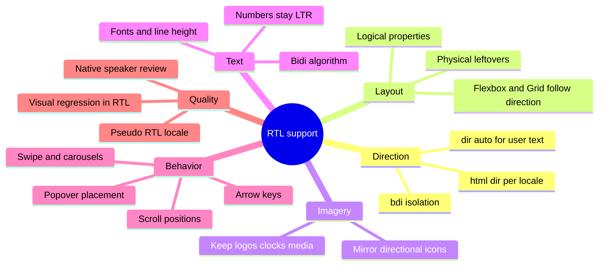
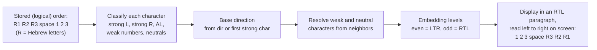
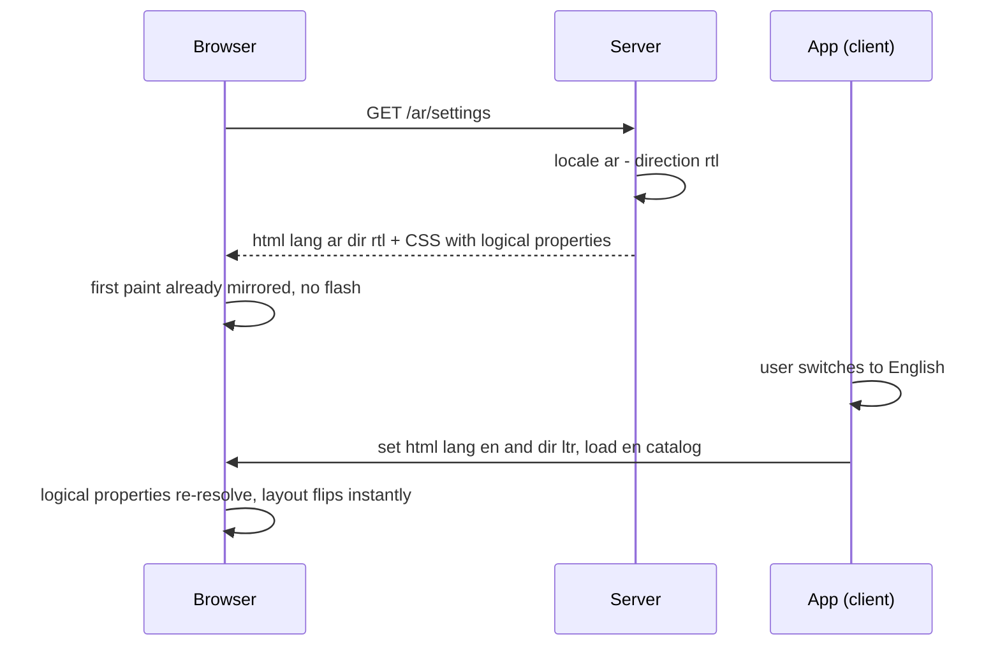
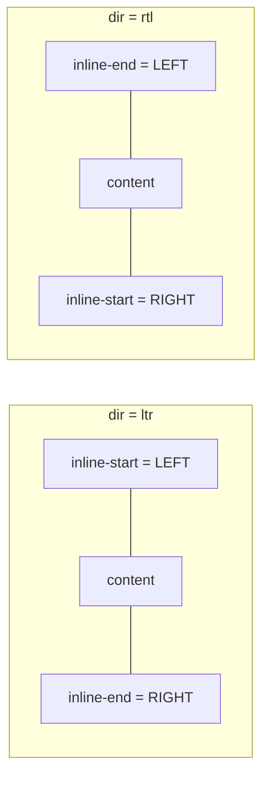
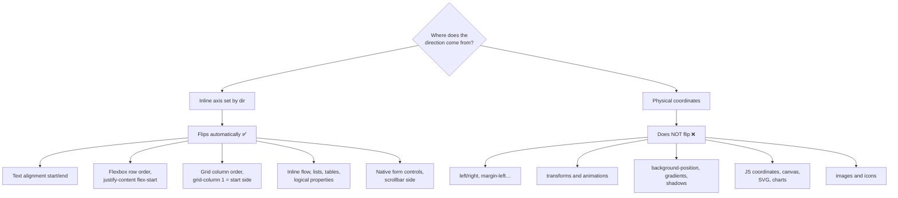
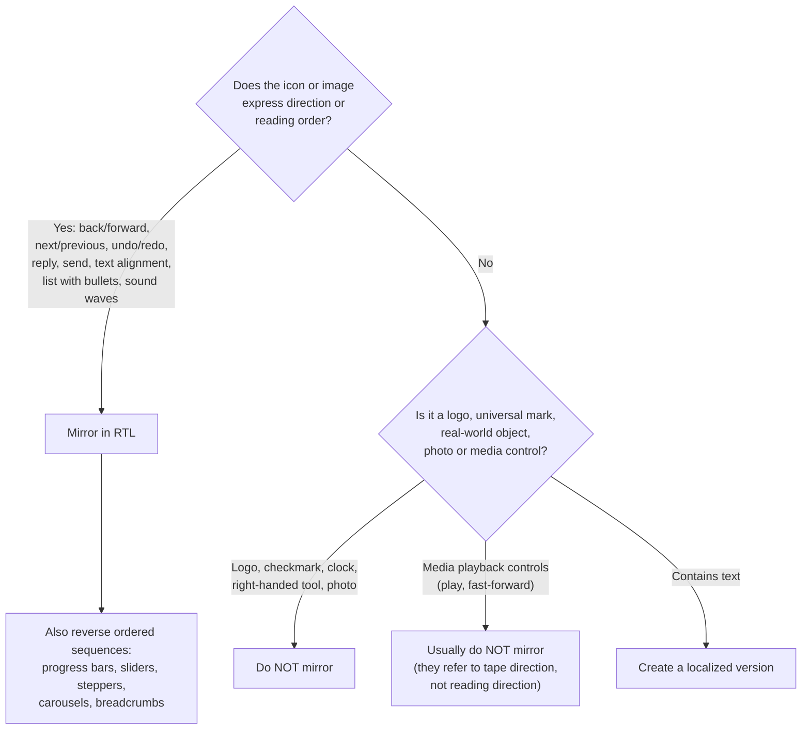
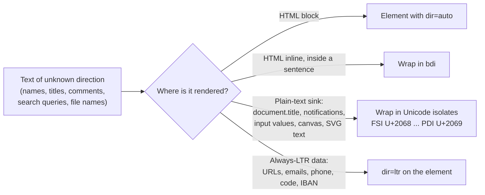
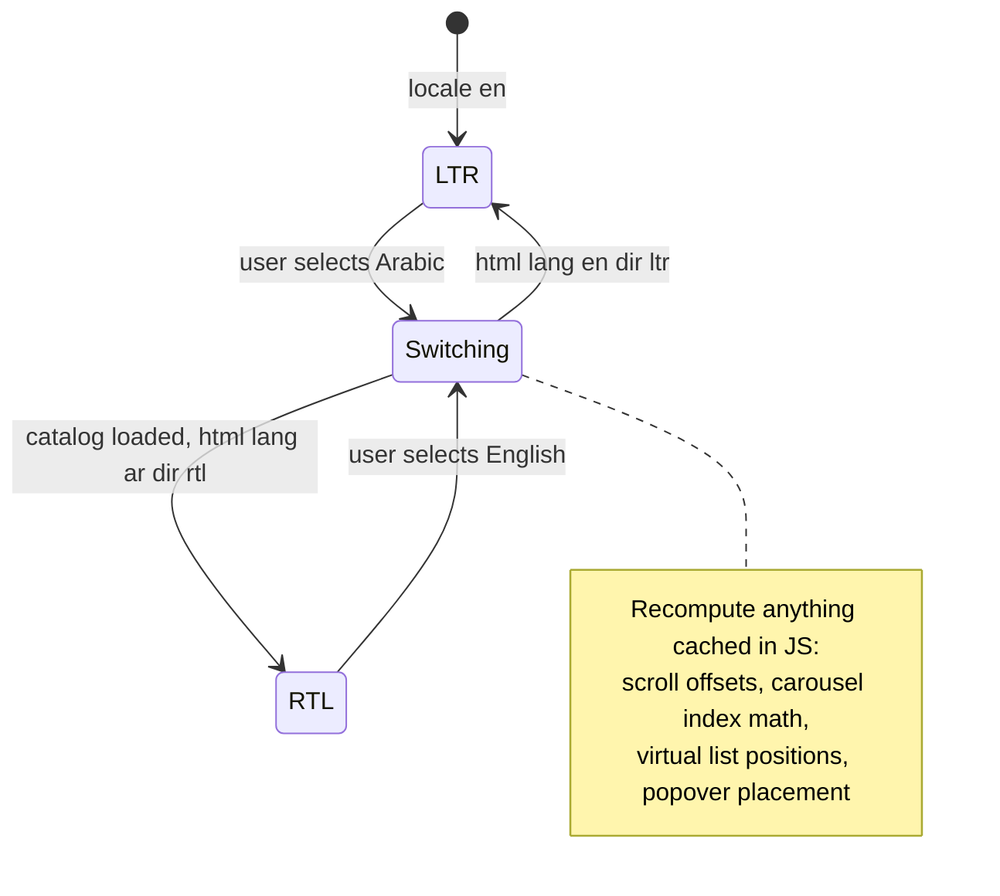
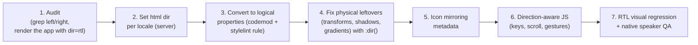

<!-- Generated by scripts/sync-knowledge.js from notes/ and README.md — do not edit here. -->
<!-- sections (line ranges in this file): Table of Contents 19-40 · ELI5 41-53 · Core Concept 54-442 · Framework & Platform Support 443-457 · Real-World Examples 458-618 · Key Points Summary 619-639 · Test Your Understanding 640-734 · Cheat Sheet 735-782 · References & Further Reading 783-825 -->

# RTL Layout Support

> **Date:** 2026-11-06 · **Last updated:** 2026-11-06
> **Category:** Frontend System Design
> **Sub-Topic:** Internationalization / Bidirectional (RTL) layout
> **Level:** Intermediate · **Reading time:** ~28 min
> **Informs:** document direction (`<html dir>`) per locale, CSS logical properties as a design-system rule, icon mirroring policy, bidi-safe rendering of user-generated content (`dir="auto"`, `<bdi>`), direction-aware JS (scroll, keyboard, gestures, positioning), RTL support in component libraries and native apps, RTL visual regression testing

> **Pre-requisite:** [Internationalization (i18n) Architecture](./internationalization-i18n-architecture.md) (how the locale — and therefore the direction — is chosen) and [CSS Architecture (CSS-in-JS, Tailwind, CSS Modules)](./css-architecture-css-in-js-tailwind-css-modules.md).
> This note covers how to make one codebase render correctly for **right-to-left scripts** (Arabic, Hebrew, Persian, Urdu…) without maintaining a second stylesheet.

**Previous:** [Internationalization (i18n) Architecture](./internationalization-i18n-architecture.md) · **Next:** [Date, Number & Currency Formatting](./date-number-and-currency-formatting.md)

---

## Table of Contents

1. [ELI5 — Simple Explanation](#eli5--simple-explanation)
2. [Section 1: Which Languages and What "RTL" Really Means](#section-1-which-languages-and-what-rtl-really-means)
3. [Section 2: The Unicode Bidirectional Algorithm](#section-2-the-unicode-bidirectional-algorithm)
4. [Section 3: Setting Direction — dir, bdi, bdo and CSS](#section-3-setting-direction--dir-bdi-bdo-and-css)
5. [Section 4: CSS Logical Properties](#section-4-css-logical-properties)
6. [Section 5: What Flips Automatically and What Doesn't](#section-5-what-flips-automatically-and-what-doesnt)
7. [Section 6: Icons and Imagery — What to Mirror](#section-6-icons-and-imagery--what-to-mirror)
8. [Section 7: Bidi Text in the UI — User Content, Numbers, Inputs](#section-7-bidi-text-in-the-ui--user-content-numbers-inputs)
9. [Section 8: Typography for Arabic and Hebrew Scripts](#section-8-typography-for-arabic-and-hebrew-scripts)
10. [Section 9: Direction-Aware JavaScript](#section-9-direction-aware-javascript)
11. [Section 10: Tooling and Migrating an LTR Codebase](#section-10-tooling-and-migrating-an-ltr-codebase)
12. [Framework & Platform Support](#framework--platform-support)
13. [Real-World Examples](#real-world-examples)
14. [Key Points Summary](#key-points-summary)
15. [Test Your Understanding](#test-your-understanding)
16. [Cheat Sheet](#cheat-sheet)
17. [References & Further Reading](#references--further-reading)

---

## ELI5 — Simple Explanation

Think of a shop with its counter and shelves arranged for customers who walk in from the **left door**. Now the shop opens a branch where everyone enters from the **right door**.

- You don't build a new shop — you **mirror the floor plan**: the counter, the "next aisle" signs and the queue all flip to the other side.
- But some things must **not** flip: the clock on the wall, the brand logo, the price tags (`25` is still `25`, not `52`), and the photo of the shop owner.
- Some signs mix both: an Arabic sign with an English brand name and a phone number inside it. Each piece keeps its own reading direction, and the sign as a whole reads right to left.
- If the shop was originally designed with **"left"/"right"** written on every blueprint, mirroring is painful. If it said **"entrance side"/"far side"** (start/end), mirroring is automatic.

> **Build layouts with *start* and *end*, never *left* and *right* — then right-to-left is a setting, not a second codebase. Mirror what shows direction; never mirror what doesn't.**

---

## Core Concept — Step by Step

### Section 1: Which Languages and What "RTL" Really Means

**Right-to-left scripts in common use:** Arabic (`ar`), Hebrew (`he`), Persian/Farsi (`fa`), Urdu (`ur`), Pashto (`ps`), Sindhi (`sd`), Central Kurdish/Sorani (`ckb`), Uyghur (`ug`), Yiddish (`yi`), Dhivehi (`dv`). Together they serve hundreds of millions of people, so for many markets RTL is not an edge case.

**Direction belongs to the script, not the language name.** Some languages are written in more than one script (e.g. Kurdish, Punjabi, Azerbaijani), so derive direction from the resolved script when you can:

```javascript
// Newer API (renamed from an earlier `textInfo` getter; check MDN for current support)
new Intl.Locale('ar-EG').getTextInfo?.();   // { direction: 'rtl' }
new Intl.Locale('he').maximize().script;    // 'Hebr'
```

**"RTL" is really "bidirectional" (bidi).** Even a fully Arabic page contains left-to-right runs — numbers, Latin brand names, URLs, code, email addresses. Every RTL UI is a bidi UI.



---

### Section 2: The Unicode Bidirectional Algorithm

Text is **stored in logical order** (the order it's typed and read) and the browser computes the **visual order** with the Unicode Bidirectional Algorithm (UBA, [UAX #9](https://www.unicode.org/reports/tr9/)). You never reverse strings yourself.



| Character class | Examples | Behavior |
|---|---|---|
| **Strong LTR** (L) | Latin, Cyrillic, CJK letters | Always LTR |
| **Strong RTL** (R, AL) | Hebrew, Arabic letters | Always RTL |
| **Weak** | Digits, `+ - % $`, separators | Direction depends on context; digits are laid out LTR |
| **Neutral** | Spaces, most punctuation `! ? . ( )` | Take the direction of their neighbors, or the **base direction** at boundaries |

**The classic bug — neutrals at the edge of a run:**

```text
<p dir="rtl">Hello!</p>
Logical:  H e l l o !
Visual:   !Hello          ← "!" sits between an LTR run and the end of an RTL paragraph,
                            so it resolves to RTL and is placed on the LEFT
Fix:      the paragraph is really English → <p dir="ltr"> or dir="auto"
```

```text
<li><span>SARAH COHEN</span> - 3 reviews</li>      (UPPERCASE = Hebrew letters, LTR page)
Logical:  [Hebrew name] space - space 3 space reviews
Visual:   3 - NEHOC HARAS reviews   ← the " - 3" is pulled into the RTL run of the name,
                                       so the number jumps to the other side of it
Fix:      <li><bdi>SARAH COHEN</bdi> - 3 reviews</li>  → the name is isolated, order is kept
```

Two lessons: **set the correct base direction for every block of text**, and **isolate embedded text of unknown direction** (Section 7).

---

### Section 3: Setting Direction — dir, bdi, bdo and CSS

| Tool | Use it for |
|---|---|
| `<html lang="ar" dir="rtl">` | The **document** direction. Set it server-side per locale so the first paint is correct |
| `dir="ltr"` / `dir="rtl"` on an element | A region whose direction you know (an English code block inside an Arabic page) |
| `dir="auto"` | Text whose direction you **don't** know — user names, comments, search queries. The browser uses the first strong character |
| `<bdi>…</bdi>` | **Isolate** an inline piece of unknown direction so it can't reorder its neighbors (defaults to `dir="auto"` behavior) |
| `<bdo dir="rtl">` | **Override** the algorithm and force visual order. Rare — demos and special cases only |
| CSS `direction` / `unicode-bidi` | Low-level; the CSS Writing Modes spec tells authors to use markup (`dir`, `<bdi>`) for HTML instead, because direction is a property of the content, not presentation |

```html
<!-- Server-rendered per locale -->
<html lang="ar" dir="rtl">
  <body>
    <h1>الإعدادات</h1>

    <!-- Unknown-direction user content: isolate it -->
    <p>آخر تعديل بواسطة <bdi>Sarah O'Neil</bdi> منذ ٣ دقائق</p>

    <!-- A region that is always LTR -->
    <pre dir="ltr"><code>npm install</code></pre>

    <!-- User input: let the browser pick per content, and submit the direction -->
    <textarea name="comment" dir="auto" dirname="comment.dir"></textarea>
  </body>
</html>
```

**Why `dir` on `<html>` and not just a CSS class?** `dir` affects the bidi algorithm, default `text-align: start`, form controls, scrollbars (on the left in RTL), table column order, the `:dir()` selector and assistive technology. A CSS class only affects the styles you write.



---

### Section 4: CSS Logical Properties

Logical properties describe layout relative to the **writing mode and direction** instead of the physical screen. With `dir="rtl"`, *inline-start* is the right edge; with `dir="ltr"`, it's the left.



| Physical (avoid) | Logical (use) | Notes |
|---|---|---|
| `margin-left` / `margin-right` | `margin-inline-start` / `margin-inline-end` | Shorthand `margin-inline: 1rem 2rem` (start end) |
| `padding-left` / `padding-right` | `padding-inline-start` / `padding-inline-end` | `padding-inline` shorthand |
| `margin-top` / `margin-bottom` | `margin-block-start` / `margin-block-end` | Block axis (vertical in horizontal writing modes) |
| `left` / `right` | `inset-inline-start` / `inset-inline-end` | `inset-inline: 0` for both |
| `border-left` | `border-inline-start` | Also `-width`, `-color`, `-style` |
| `border-top-left-radius` | `border-start-start-radius` | Pattern: `border-<block>-<inline>-radius` |
| `text-align: left` | `text-align: start` | `start` is already the initial value |
| `float: left` / `clear: left` | `float: inline-start` / `clear: inline-start` | Newer than other logical properties — check MDN |
| `width` / `height` | `inline-size` / `block-size` | Also `min-`/`max-` variants |
| `margin: 0 auto` | `margin-inline: auto` | Centering works the same both ways |
| `resize: horizontal` | `resize: inline` | |
| `overflow-x` | `overflow-inline` | Recently supported across engines — check MDN before relying on it |
| `scroll-padding-left` | `scroll-padding-inline-start` | Same for `scroll-margin-*` |

**Support:** the core properties (`margin-inline-*`, `padding-inline-*`, `inset-inline-*`, `border-inline-*`, logical radii, `inline-size`) are supported in all current evergreen browsers. A few values (`float: inline-start`, `overflow-inline`) arrived later — verify on MDN for your support matrix.

**What logical properties do *not* cover** — still physical, need a direction hook:
- `transform: translateX()`, `rotate()` direction, and keyframe animations that slide horizontally
- `background-position`, `linear-gradient(to right, …)`
- `box-shadow` / `text-shadow` horizontal offsets
- `clip-path`, SVG coordinates, `object-position`
- JS measurements: `getBoundingClientRect()`, `offsetLeft`, `clientX`

Use the `:dir()` pseudo-class (follows the **computed** direction, including inherited `dir`) or a direction custom property:

```css
:root            { --dir: 1; }
:root:dir(rtl)   { --dir: -1; }        /* :dir() is supported in current evergreen browsers */

.drawer--closed  { transform: translateX(calc(-100% * var(--dir))); }
.hint            { box-shadow: calc(4px * var(--dir)) 4px 12px rgb(0 0 0 / 0.2); }
.fade-edge       { background: linear-gradient(to right, transparent, white); }
.fade-edge:dir(rtl) { background: linear-gradient(to left, transparent, white); }
```

> Prefer `:dir(rtl)` over `[dir="rtl"] .x`. The attribute selector only knows about ancestors with the attribute; it breaks inside a nested `dir="ltr"` region and doesn't see `dir="auto"` results.

---

### Section 5: What Flips Automatically and What Doesn't



- **Flexbox and Grid are your friends**: `flex-direction: row`, `justify-content: flex-start`, `gap` and grid tracks follow the inline direction. A sidebar declared as the first grid column appears on the right in RTL. Avoid `flex-direction: row-reverse` as a "RTL hack" — it flips in *both* directions.
- **Absolutely positioned UI** (badges, close buttons, dropdown arrows) is where most RTL bugs hide: use `inset-inline-end` instead of `right`.
- **Vertical writing modes** (`writing-mode: vertical-rl` for Japanese/Chinese/Mongolian layouts) are another reason to prefer logical properties: the *block* and *inline* axes rotate, and logical properties follow.

---

### Section 6: Icons and Imagery — What to Mirror

Mirror an image only if it **shows direction in reading order**. Apple's HIG and Material Design's bidirectionality guidance agree on the core rules:



| Mirror ✅ | Don't mirror ❌ |
|---|---|
| Back/forward arrows, chevrons in nav, "next" in pagination | Logos and brand marks |
| Progress bars, sliders, steppers, ratings (fill from the right) | Checkmarks and other universal marks |
| Breadcrumb separators (`›` → `‹`) | Clocks (they turn clockwise everywhere) |
| Text-alignment, indent and list icons | Icons of right-handed tools (pencil, scissors) |
| Undo/redo, reply, "send" paper-plane | Photos, illustrations, maps |
| Speaker with sound waves, a person walking forward | Media playback controls and the media scrubber — Material Design keeps them LTR (they show tape direction, not reading direction) |
| Order of a horizontal image sequence | **The digits inside a number** (`541` stays `541`) |

Implementation options:

```css
/* 1. Flip the glyph (works for symmetrical directional icons) */
.icon--directional:dir(rtl) { transform: scaleX(-1); }   /* or: scale: -1 1; */

/* 2. Swap the icon: preferred when the mirrored glyph isn't simply flipped (e.g. a badge position) */
```
```tsx
// 3. Choose by direction in a component
const BackIcon = dir === 'rtl' ? ChevronRight : ChevronLeft;
```

Mark directional icons in your **icon set metadata** (`mirrorInRtl: true`) so the design system applies the rule once, instead of every feature team deciding.

---

### Section 7: Bidi Text in the UI — User Content, Numbers, Inputs

The hardest RTL bugs come from **text you don't control**:

```text
Arabic UI string:   "{user} علق على منشورك"   ("{user} commented on your post")
user = "Dana 2"     → digits and Latin may attach to the wrong side and reorder the sentence
user = "דנה"        → Hebrew name inside Arabic: fine
user = "@dana_92!"  → neutral "!" migrates to the far edge
```



**Unicode bidi control characters** (for places where you can't use markup):

| Character | Code point | Use |
|---|---|---|
| FSI — First Strong Isolate | U+2068 | Isolate text whose direction is unknown (like `dir="auto"`) |
| LRI / RLI — Left/Right-to-Left Isolate | U+2066 / U+2067 | Isolate text of known direction |
| PDI — Pop Directional Isolate | U+2069 | Closes any of the three isolates |
| LRM / RLM — Left/Right-to-Left Mark | U+200E / U+200F | Invisible strong character; fixes a stray neutral (e.g. trailing `!`) |
| ALM — Arabic Letter Mark | U+061C | Like RLM, for Arabic contexts |

Prefer the **isolates** (FSI/LRI/RLI…PDI) over the older embeddings (LRE/RLE/PDF), which leak into surrounding text. Some i18n libraries can insert isolates around placeholders automatically — check yours.

**Numbers:**
- Digits are always laid out left-to-right, even in Arabic text. Don't reverse them.
- Arabic locales may use **Arabic-Indic digits** (`١٢٣`) or Western digits (`123`) depending on region and product choice; Persian uses Extended Arabic-Indic digits (`۱۲۳`); Hebrew uses Western digits. Let `Intl.NumberFormat` decide (`ar-EG` vs `ar-EG-u-nu-latn`) — see [Date, Number & Currency Formatting](./date-number-and-currency-formatting.md).
- `Intl` output for RTL locales can include invisible bidi marks (e.g. around a minus sign or between date parts). Never compare formatted strings in tests or parse them back.

**Form inputs:**
- `type="email"`, `type="url"`, `type="tel"`, codes, card numbers and IBANs → `dir="ltr"` (and usually `text-align: end` in an RTL form so they still line up with the other fields — a design decision to validate with users).
- Free-text fields (`name`, comments, search) → `dir="auto"` so typing Hebrew in an English UI, or English in an Arabic UI, renders naturally. Add `dirname` if the server needs to know the direction.
- Placeholder text follows the field's direction; keep it short to avoid ambiguity.

---

### Section 8: Typography for Arabic and Hebrew Scripts

| Rule | Why |
|---|---|
| **Use a font that covers the script** and supports Arabic shaping (initial/medial/final/isolated forms, ligatures) | Latin web fonts have no Arabic or Hebrew glyphs; fallbacks may look inconsistent |
| **Don't apply `letter-spacing` to Arabic** | Arabic is cursive: letters join. Extra spacing breaks the connections or is ignored inconsistently |
| **`text-transform: uppercase` does nothing** | Arabic and Hebrew have no case. Don't rely on caps for emphasis or hierarchy |
| **Avoid synthetic italics** | Italic isn't a traditional emphasis style in Arabic; use weight or color |
| **Give Arabic more line height** and often a slightly larger size | Marks above and below letters (dots, vowel marks) need room |
| **Load fonts per script** with `unicode-range` | Users download Arabic glyphs only when needed — see [Font Loading Strategies](./font-loading-strategies.md) |
| **Set `lang`** | Lets the browser choose language-specific shaping/fallbacks; screen readers switch voices |

```css
:root:lang(ar) {
  --font-body: 'Noto Naskh Arabic', 'Noto Sans Arabic', system-ui, sans-serif;
  --line-height-body: 1.8;
  --letter-spacing-heading: normal;   /* design tokens that were tuned for Latin must be overridden */
}
```

Design tokens tuned for Latin text (letter-spacing on headings, uppercase labels, tight line heights) should have **per-script overrides** — see [Design Tokens](./design-tokens.md).

---

### Section 9: Direction-Aware JavaScript

CSS logical properties don't reach your JavaScript. Anything that reads or writes **x coordinates** needs a direction check:

| Area | RTL behavior | What to do |
|---|---|---|
| **`element.scrollLeft`** | Per the CSSOM View spec, `0` at the **start** (rightmost) and **negative** toward the left. Chromium adopted this in Chrome 85; older Chrome used positive values | Use `scrollBy({ left })` with a direction sign, or `scrollIntoView` / `scrollTo` on elements; don't hard-code positive offsets |
| **Keyboard arrows** in horizontal widgets (tabs, menubars, carousels, sliders, tree expand/collapse) | Users expect **ArrowLeft = next / forward** visually in RTL | Map keys through the direction (Example 3) |
| **Swipe gestures / drag** | "Next" slide comes from the **left** | Multiply deltas by the direction sign |
| **Popovers, tooltips, dropdowns** | `placement: 'right'` is physical | Use the library's logical placements/alignments where offered, and test both directions |
| **Canvas / charts / maps** | Canvas has a `direction` property for text only; drawing coordinates are physical | Decide per chart whether axes mirror (time axes are often kept LTR — validate with native speakers) |
| **Measuring** (`getBoundingClientRect`, `clientX`, `offsetLeft`) | Always physical | Convert: `start = dir === 'rtl' ? rect.right : rect.left` |

**Get the direction from the DOM, not from the locale string**, so nested `dir` regions work:

```javascript
const isRtl = (el) => getComputedStyle(el).direction === 'rtl';
// or: el.matches(':dir(rtl)')
```



---

### Section 10: Tooling and Migrating an LTR Codebase

Two strategies:

| Strategy | How | Pros | Cons |
|---|---|---|---|
| **Build-time flipping** (RTLCSS, `postcss-rtlcss`) | A tool rewrites `left`↔`right`, `margin-left`↔`margin-right`, etc. into an RTL stylesheet or into `[dir=rtl]`-scoped rules | Fast to retrofit a large legacy codebase | Two outputs (or bigger CSS); needs `/* rtl:ignore */` annotations for things that must not flip; JS and inline styles aren't covered |
| **Logical properties at the source** ✅ | Write `margin-inline-start` etc. everywhere; lint against physical properties | One stylesheet; works with runtime direction switching; works with any writing mode | Migration effort; a few physical leftovers need `:dir()` |



**Tooling worth knowing:**
- **Linting:** Stylelint plugins such as `stylelint-use-logical` flag physical properties.
- **Tailwind CSS:** logical utilities (`ms-*`, `me-*`, `ps-*`, `pe-*`, `text-start`, `text-end`, logical inset utilities) plus `rtl:` and `ltr:` variants for the physical leftovers. Utility names have evolved between major versions — check the docs for yours.
- **Component libraries:** see the table below — some need explicit setup.
- **Testing:** render the whole app with `dir="rtl"` in Storybook (a toolbar global), run visual regression snapshots in both directions, and use a **pseudo-RTL locale** (Android's `ar-XB`, Xcode's "Right-to-Left Pseudolanguage" scheme option) to catch hard-coded LTR assumptions before real translations exist.

---

## Framework & Platform Support

| Stack | How direction is set | Notes |
|---|---|---|
| **React / Next.js** | Render `<html lang={locale} dir={dir}>` in the root layout (server) | Radix: `DirectionProvider`; React Aria: `I18nProvider` and `useLocale()` returns `{ locale, direction }`; MUI: theme `direction: 'rtl'` **plus** an RTL style plugin (`stylis-plugin-rtl`) per its docs |
| **Vue / Nuxt** | Bind `dir` on `<html>` (e.g. via `useHead`) from the active locale | Vuetify and Quasar have RTL modes |
| **Angular** | Set `dir` on `<html>`; Angular CDK `Directionality` / `[dir]` directive | Angular Material components read CDK `Directionality` |
| **Svelte / SvelteKit** | Set `lang`/`dir` in `app.html` placeholders or in the server hook via `transformPageChunk` | No built-in helper; plain CSS logical properties |
| **iOS (UIKit/SwiftUI)** | Automatic from the app language; Auto Layout **leading/trailing** constraints flip | `semanticContentAttribute`; SwiftUI `\.layoutDirection`, `.flipsForRightToLeftLayoutDirection(true)` for images |
| **Android (Views/Compose)** | `android:supportsRtl="true"`; use **start/end** attributes (`paddingStart`, `layout_marginEnd`) | Vector drawables: `android:autoMirrored="true"`; Compose reads `LocalLayoutDirection`; developer option "Force RTL layout direction" |
| **Flutter** | `Directionality` from the locale | Use `EdgeInsetsDirectional`, `AlignmentDirectional`, `PositionedDirectional` |
| **React Native** | `I18nManager.isRTL`; `I18nManager.allowRTL` / `forceRTL` (takes effect after an app reload) | Use `marginStart`/`paddingEnd`/`start`/`end` style props instead of left/right |

---

## Real-World Examples

**Example 1 — A card component (BAD → GOOD):**
```css
/* ❌ BAD: physical properties — badge, icon and spacing stay on the wrong side in Arabic */
.card          { padding-left: 24px; border-left: 4px solid var(--accent); text-align: left; }
.card__badge   { position: absolute; top: 8px; right: 8px; }
.card__icon    { margin-right: 12px; float: left; }
.card__chevron { transform: rotate(0deg); }               /* points right = "forward" in LTR only */

/* ✅ GOOD: logical properties + one :dir() rule for the directional icon */
.card          { padding-inline-start: 24px; border-inline-start: 4px solid var(--accent); text-align: start; }
.card__badge   { position: absolute; inset-block-start: 8px; inset-inline-end: 8px; }
.card__icon    { margin-inline-end: 12px; float: inline-start; }
.card__chevron:dir(rtl) { transform: scaleX(-1); }        /* "forward" now points left in RTL */
```

**Example 2 — Setting direction on the server (Next.js App Router layout):**
```tsx
// app/[lang]/layout.tsx
import type { ReactNode } from 'react';

const RTL_LANGUAGES = new Set(['ar', 'he', 'fa', 'ur', 'ps', 'sd', 'ckb', 'ug', 'yi', 'dv']);

export function getDir(locale: string): 'ltr' | 'rtl' {
  const loc = new Intl.Locale(locale);
  // Prefer the platform when available; fall back to a list (the API is recent)
  const info = (loc as any).getTextInfo?.() as { direction?: 'ltr' | 'rtl' } | undefined;
  return info?.direction ?? (RTL_LANGUAGES.has(loc.language) ? 'rtl' : 'ltr');
}

export default async function RootLayout({
  children,
  params,
}: {
  children: ReactNode;
  params: Promise<{ lang: string }>;
}) {
  const { lang } = await params;
  return (
    <html lang={lang} dir={getDir(lang)}>
      <body>{children}</body>
    </html>
  );
}
```

**Example 3 — Direction-aware keyboard handling for a tab list:**
```tsx
import { useRef, type KeyboardEvent } from 'react';

export function Tabs({ tabs }: { tabs: { id: string; label: string }[] }) {
  const listRef = useRef<HTMLDivElement>(null);

  function onKeyDown(e: KeyboardEvent<HTMLDivElement>) {
    const isRtl = listRef.current?.matches(':dir(rtl)') ?? false;
    const forwardKey = isRtl ? 'ArrowLeft' : 'ArrowRight';
    const backKey = isRtl ? 'ArrowRight' : 'ArrowLeft';
    const items = [...(listRef.current?.querySelectorAll<HTMLElement>('[role="tab"]') ?? [])];
    const i = items.indexOf(document.activeElement as HTMLElement);
    if (i === -1) return;

    let next = i;
    if (e.key === forwardKey) next = (i + 1) % items.length;
    else if (e.key === backKey) next = (i - 1 + items.length) % items.length;
    else return;

    e.preventDefault();
    items[next].focus();
  }

  return (
    <div role="tablist" ref={listRef} onKeyDown={onKeyDown}>
      {tabs.map((t, i) => (
        <button key={t.id} role="tab" id={`tab-${t.id}`} tabIndex={i === 0 ? 0 : -1}>
          {t.label}
        </button>
      ))}
    </div>
  );
}
```
(Full tab semantics — `aria-selected`, `aria-controls`, roving tabindex — are in [Keyboard Navigation & Focus Management](./keyboard-navigation-and-focus-management.md).)

**Example 4 — Carousel scroll that works in both directions:**
```typescript
export function scrollCarousel(track: HTMLElement, step: 'next' | 'prev') {
  const sign = getComputedStyle(track).direction === 'rtl' ? -1 : 1;  // scrollLeft goes negative in RTL
  const delta = track.clientWidth * (step === 'next' ? 1 : -1) * sign;
  track.scrollBy({ left: delta, behavior: 'smooth' });
}

// Even simpler: let the browser compute it with scroll snap + scrollIntoView
export function goToSlide(track: HTMLElement, index: number) {
  track.children[index]?.scrollIntoView({ inline: 'start', block: 'nearest', behavior: 'smooth' });
}
```

**Example 5 — User-generated names inside translated sentences:**
```tsx
// ❌ BAD: a Latin username with digits/punctuation reorders the Arabic sentence
<p>{t('commented', { user: comment.author })}</p>

// ✅ GOOD (HTML): isolate the placeholder — react-intl accepts React elements as values
<p>
  <FormattedMessage
    id="commented"
    defaultMessage="{user} commented on your post"
    values={{ user: <bdi>{comment.author}</bdi> }}
  />
</p>
```
```typescript
// ✅ GOOD (plain-text sinks: document.title, Notification, <title>, canvas)
const FSI = '⁨';
const PDI = '⁩';
const isolate = (s: string) => `${FSI}${s}${PDI}`;
document.title = t('chatWith', { name: isolate(contact.name) });
```

**Example 6 — Tailwind CSS with logical utilities and direction variants:**
```tsx
export function Alert({ children }: { children: React.ReactNode }) {
  return (
    <div className="flex items-start gap-3 border-s-4 border-amber-500 ps-4 pe-3 text-start">
      {/* Directional icon: flip only in RTL */}
      <svg className="size-5 shrink-0 rtl:-scale-x-100" aria-hidden="true" viewBox="0 0 20 20">
        <path d="M7 4l6 6-6 6" />
      </svg>
      <p>{children}</p>
    </div>
  );
}
```

**Example 7 — Storybook: render every story in both directions:**
```typescript
// .storybook/preview.ts
import type { Preview } from '@storybook/react-vite'; // or your framework's Storybook package

const preview: Preview = {
  globalTypes: {
    direction: {
      description: 'Text direction',
      toolbar: { icon: 'transfer', items: ['ltr', 'rtl'], dynamicTitle: true },
    },
  },
  initialGlobals: { direction: 'ltr' },
  decorators: [
    (Story, context) => {
      document.documentElement.dir = context.globals.direction;
      document.documentElement.lang = context.globals.direction === 'rtl' ? 'ar' : 'en';
      return Story();
    },
  ],
};
export default preview;
```

---

## Key Points Summary

| Concept | One-Line Explanation |
|---|---|
| **RTL = bidi** | RTL pages always contain LTR runs (numbers, brands, URLs) |
| **Logical order** | Strings are stored in reading order; the bidi algorithm computes display order |
| **`<html dir>`** | Set server-side per locale; drives text, form controls, scrollbars, `:dir()` |
| **`dir="auto"`** | For blocks of unknown direction — first strong character wins |
| **`<bdi>` / FSI…PDI** | Isolate inline text of unknown direction (markup / plain text) |
| **Logical properties** | `inline-start/end`, `block-start/end` replace left/right/top/bottom |
| **Flex & Grid** | Follow inline direction automatically; never use `row-reverse` as an RTL hack |
| **Physical leftovers** | Transforms, shadows, gradients, background-position → `:dir(rtl)` or `--dir` |
| **Icon policy** | Mirror directional icons and progress; keep logos, checkmarks, clocks, media controls |
| **Digits** | Always LTR; digit *shapes* depend on locale numbering system |
| **Arabic typography** | No letter-spacing, no uppercase, more line height, script-specific fonts |
| **Direction-aware JS** | Keys, swipes, `scrollLeft` (negative in RTL), measurements |
| **Migration** | Build-time flipping for legacy; logical properties + lint for the long term |
| **Testing** | Pseudo-RTL locale, both-direction visual snapshots, native-speaker review |

---

## Test Your Understanding

**Q1 (Basic):**
Why set `dir="rtl"` on `<html>` instead of adding an `.rtl` class and writing RTL overrides?

<details>
<summary>Answer</summary>

`dir` is semantic: it sets the **base direction for the Unicode bidi algorithm**, so punctuation and mixed-script text are ordered correctly. It also changes defaults that a class can't: `text-align: start`, the order of table columns, native form controls, the scrollbar side, `:dir()` matching, and what assistive technology reports. With logical properties, the same CSS then works in both directions with no overrides. A class only toggles the styles you remembered to write, and leaves text ordering wrong.

Set it **server-side** per locale so the first paint is already mirrored (no layout flash on hydration).
</details>

**Q2 (Application):**
Convert this to work in both directions: `.toast { position: fixed; right: 16px; bottom: 16px; padding-left: 40px; border-top-left-radius: 8px; animation: slide-in 200ms; } @keyframes slide-in { from { transform: translateX(100%); } }`

<details>
<summary>Answer</summary>

```css
.toast {
  position: fixed;
  inset-inline-end: 16px;
  inset-block-end: 16px;
  padding-inline-start: 40px;
  border-start-start-radius: 8px;
  animation: slide-in 200ms;
}
:root { --dir: 1; }
:root:dir(rtl) { --dir: -1; }
@keyframes slide-in { from { transform: translateX(calc(100% * var(--dir))); } }
```

Position, padding and radius map to logical properties directly. The animation is a **transform**, which is physical: in RTL the toast sits on the left, so it must slide in from the left (`-100%`). A direction custom property (or a separate `:dir(rtl)` keyframe) handles that.
</details>

**Q3 (Tricky):**
In your Arabic UI, a notification reads correctly for most users but is scrambled when the username is `Ahmed_99!`. Why, and what are two fixes depending on where the text is rendered?

<details>
<summary>Answer</summary>

The username contains strong LTR letters, weak digits and neutral punctuation. Inserted into an RTL sentence without isolation, the bidi algorithm resolves its digits and the `!` together with the **surrounding** Arabic text, so characters attach to the wrong run and parts of the sentence reorder.

Fixes: in **HTML**, wrap the placeholder in `<bdi>` (or an element with `dir="auto"`), which isolates it. In **plain-text sinks** (`document.title`, system notifications, canvas, input values), wrap it in Unicode isolates **FSI U+2068 … PDI U+2069**. Some i18n libraries can add the isolates around placeholders automatically.
</details>

**Q4 (Tricky):**
A designer asks you to mirror all icons in RTL "to be consistent". Which ones would you push back on, and why?

<details>
<summary>Answer</summary>

Mirror only icons that express **reading direction or order**: back/forward, next/previous, undo/redo, reply/send, list and alignment icons, progress bars and sliders. Push back on:
- **Logos** — flipping is wrong and can have legal consequences.
- **Universal marks** like the checkmark — people expect a consistent shape.
- **Real-world objects** such as clocks (they turn clockwise everywhere) and right-handed tools.
- **Media playback controls** — commonly kept unmirrored because they depict tape direction, not reading direction.
- **Photos and illustrations** — flipping changes meaning (text in the image, handedness, geography).
- **Digits in numbers**, and icons containing text (localize them instead).

Encode the decision in icon metadata (`mirrorInRtl`) so it's applied consistently by the design system.
</details>

**Q5 (Application):**
Your image carousel works in English, but in Hebrew the "next" button scrolls the wrong way and swipe feels inverted. What JS assumptions broke?

<details>
<summary>Answer</summary>

1. **`scrollLeft` math**: in RTL, `scrollLeft` is `0` at the start (rightmost) and becomes **negative** toward the end (CSSOM View; Chrome 85+, Firefox, Safari). Code that adds a positive offset to go "next" moves backwards or clamps at 0.
2. **Swipe deltas**: "next" in RTL is a swipe to the **right** (content moves in from the left). Multiply gesture deltas by a direction sign.
3. **Arrow keys**: ArrowLeft should mean "next" in RTL.
4. **Button icons**: the chevrons must mirror, and the "next" button sits on the left.

Fix: read the direction from the element (`getComputedStyle(track).direction` or `:dir(rtl)`), multiply horizontal deltas by `±1`, or avoid coordinate math entirely with scroll snapping + `scrollIntoView({ inline: 'start' })`, which is direction-aware.
</details>

**Q6 (System design):**
You're adding Arabic and Hebrew to a design system used by 30 product teams, with ~4,000 CSS files written with physical properties. Plan the rollout.

<details>
<summary>Answer</summary>

- **Foundation:** server-rendered `<html lang dir>` per locale; direction exposed in the i18n context for JS; `--dir` custom property and `:dir()` conventions documented.
- **Short term:** if launch is urgent, use a **build-time flipper** (`postcss-rtlcss`) to produce `[dir=rtl]` rules automatically, with `rtl:ignore` annotations for exceptions.
- **Long term:** codemod components to **logical properties**, enforce with a Stylelint rule (`stylelint-use-logical`) so no new physical properties land; Tailwind teams use `ms-/me-/ps-/pe-` and `rtl:` variants.
- **Design system components first** (buttons, inputs, menus, tabs, popovers, carousels) with direction-aware keyboard, scroll and placement; icons get `mirrorInRtl` metadata.
- **Typography tokens per script:** Arabic/Hebrew fonts via `unicode-range`, increased line height, no letter-spacing or uppercase.
- **Content:** `dir="auto"`/`<bdi>` for all user-generated text; `dir="ltr"` for email/URL/phone fields.
- **Quality:** Storybook direction toggle, visual regression in both directions, pseudo-RTL locale in staging, native-speaker review before launch.
</details>

---

## Cheat Sheet

**Key Definitions:**
- **Bidi:** Text containing both LTR and RTL runs; ordered by the Unicode Bidirectional Algorithm (UAX #9)
- **Logical order:** The order characters are stored and read; visual order is computed at render time
- **Base direction:** The paragraph direction (`dir`, or first strong character with `dir="auto"`)
- **Isolation:** Preventing embedded text from affecting its surroundings (`<bdi>`, `dir`, FSI…PDI)
- **Logical properties:** CSS properties expressed as inline/block start/end instead of left/right/top/bottom
- **Mirroring:** Flipping UI elements that express direction or order in RTL

**Quick Reference:**
```text
Document:        <html lang="ar" dir="rtl">        (server-rendered per locale)
Unknown text:    dir="auto" (block) · <bdi> (inline) · U+2068 … U+2069 (plain text)
Always-LTR data: dir="ltr" on email / url / tel / code / IBAN fields
Spacing:         margin-inline-start/end · padding-inline · margin-block
Position:        inset-inline-start/end · inset-block-start/end
Borders/radius:  border-inline-start · border-start-start-radius · border-start-end-radius
Text/float:      text-align: start|end · float: inline-start|inline-end
Size:            inline-size · block-size
Physical only:   transform · box-shadow · gradients · background-position → :dir(rtl) or --dir: -1
Selectors:       prefer :dir(rtl) over [dir="rtl"] ancestors
Icons:           mirror arrows/progress/undo/reply/lists · keep logos/checkmarks/clocks/media/photos
JS:              scrollLeft ≤ 0 in RTL · ArrowLeft = next · swipe × sign · rect.right = start edge
Arabic type:     script font · no letter-spacing · no uppercase · line-height ↑
Test:            Storybook dir toggle · RTL snapshots · pseudo-RTL (ar-XB) · native speakers
```

**Common Mistakes to Avoid:**

| Mistake | Why Wrong | Fix |
|---|---|---|
| `margin-left`, `right: 0`, `text-align: left` | Don't flip in RTL | Logical properties (`margin-inline-start`, `inset-inline-end`, `text-align: start`) |
| `flex-direction: row-reverse` to "support RTL" | Reverses LTR too; breaks tab order vs visual order | Plain `row` — it already follows `dir` |
| Setting direction with CSS `direction: rtl` or a class | Doesn't inform semantics; spec tells authors to use markup | `dir` attribute on `<html>` / elements |
| Setting `dir` only on the client | Layout flips after hydration (visible jump) | Render `dir` on the server |
| Mirroring every icon | Logos, checkmarks, clocks, media controls become wrong | Mirror only directional icons via metadata |
| Inserting usernames raw into sentences | Bidi reordering scrambles the sentence | `<bdi>` / `dir="auto"` / FSI…PDI |
| Email/URL inputs inheriting RTL | Characters like `@` and `.` jump around while typing | `dir="ltr"` on those fields |
| `letter-spacing` / `uppercase` on Arabic | Breaks joining / has no effect | Per-script typography tokens |
| Positive `scrollLeft` math | Negative in RTL per spec | Direction sign, `scrollBy`, `scrollIntoView` |
| Arrow keys not flipped in horizontal widgets | "Next" goes the wrong way | Map keys by computed direction |
| `[dir=rtl] .x` selectors everywhere | Miss nested `dir="ltr"` regions and `dir="auto"` | `:dir(rtl)` |
| Comparing `Intl` output in RTL tests | Contains invisible bidi marks | Test with `formatToParts` or semantic assertions |
| Testing RTL only at the end | Hundreds of physical-property bugs at once | Lint + Storybook toggle + pseudo-RTL from day one |

---

## References & Further Reading

**Core docs**
- MDN: [`dir` global attribute](https://developer.mozilla.org/en-US/docs/Web/HTML/Reference/Global_attributes/dir) · [`<bdi>`](https://developer.mozilla.org/en-US/docs/Web/HTML/Reference/Elements/bdi) · [`<bdo>`](https://developer.mozilla.org/en-US/docs/Web/HTML/Reference/Elements/bdo)
- MDN: [CSS logical properties and values](https://developer.mozilla.org/en-US/docs/Web/CSS/CSS_logical_properties_and_values) · [Basic concepts of logical properties](https://developer.mozilla.org/en-US/docs/Web/CSS/CSS_logical_properties_and_values/Basic_concepts_of_logical_properties_and_values)
- MDN: [`:dir()`](https://developer.mozilla.org/en-US/docs/Web/CSS/:dir) · [`direction`](https://developer.mozilla.org/en-US/docs/Web/CSS/direction) · [`unicode-bidi`](https://developer.mozilla.org/en-US/docs/Web/CSS/unicode-bidi) · [`Element.scrollLeft`](https://developer.mozilla.org/en-US/docs/Web/API/Element/scrollLeft)
- MDN: [`Intl.Locale.prototype.getTextInfo()`](https://developer.mozilla.org/en-US/docs/Web/JavaScript/Reference/Global_Objects/Intl/Locale/getTextInfo)
- web.dev: [Logical properties (Learn CSS)](https://web.dev/learn/css/logical-properties)

**W3C Internationalization**
- [Structural markup and right-to-left text in HTML](https://www.w3.org/International/questions/qa-html-dir)
- [Inline markup and bidirectional text in HTML](https://www.w3.org/International/articles/inline-bidi-markup/)
- [Unicode controls vs. markup for bidi support](https://www.w3.org/International/questions/qa-bidi-unicode-controls)
- [Arabic & Persian Layout Requirements](https://www.w3.org/TR/alreq/) · [Hebrew Layout Requirements](https://w3c.github.io/hlreq/)

**Specs**
- Unicode: [UAX #9 — Unicode Bidirectional Algorithm](https://www.unicode.org/reports/tr9/)
- W3C: [CSS Logical Properties and Values Level 1](https://www.w3.org/TR/css-logical-1/) · [CSS Writing Modes Level 4](https://www.w3.org/TR/css-writing-modes-4/)
- W3C: [CSSOM View — scrolling](https://drafts.csswg.org/cssom-view/#dom-element-scrollleft)

**Design guidance**
- Apple: [Human Interface Guidelines — Right to left](https://developer.apple.com/design/human-interface-guidelines/right-to-left)
- Material Design: [Bidirectionality](https://m2.material.io/design/usability/bidirectionality.html)

**Framework & platform docs**
- MUI: [Right-to-left support](https://mui.com/material-ui/customization/right-to-left/)
- Radix UI: [Direction Provider](https://www.radix-ui.com/primitives/docs/utilities/direction-provider) · React Aria: [Internationalization](https://react-spectrum.adobe.com/react-aria/internationalization.html)
- Angular CDK: [Bidirectionality](https://material.angular.dev/cdk/bidi/overview)
- Tailwind CSS: [Hover, focus and other states (`rtl`/`ltr` variants)](https://tailwindcss.com/docs/hover-focus-and-other-states)
- RTLCSS: [rtlcss.com](https://rtlcss.com/) · Stylelint: [stylelint-use-logical](https://github.com/csstools/stylelint-use-logical)
- Android: [Support different languages and cultures (RTL)](https://developer.android.com/training/basics/supporting-devices/languages)
- Flutter: [`Directionality` class](https://api.flutter.dev/flutter/widgets/Directionality-class.html)
- React Native: [`I18nManager`](https://reactnative.dev/docs/i18nmanager)

---

> **Previous Topic:** [Internationalization (i18n) Architecture](./internationalization-i18n-architecture.md)
> — Locales, negotiation, ICU messages, catalogs and the translation pipeline

> **Next Topic:** [Date, Number & Currency Formatting](./date-number-and-currency-formatting.md)
> — `Intl` APIs, time zones, money in minor units and the Temporal API

*Saved on: 2026-11-06 | Repo: Frontend System Design Learning Notes*
