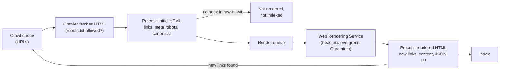
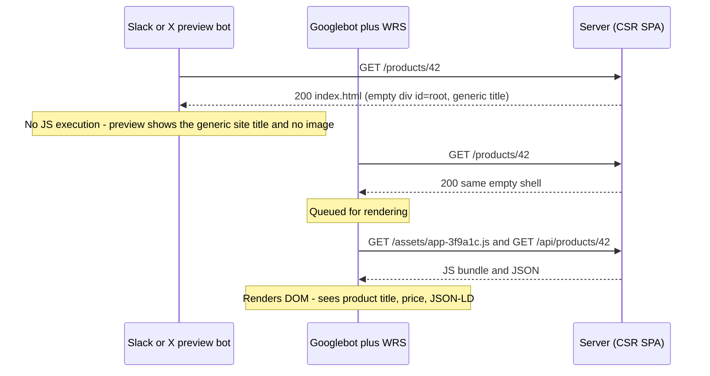
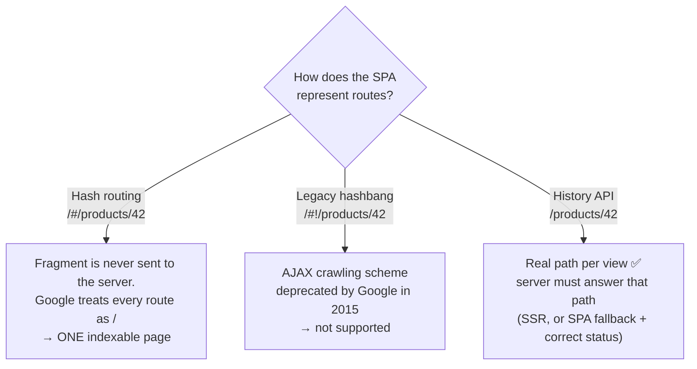
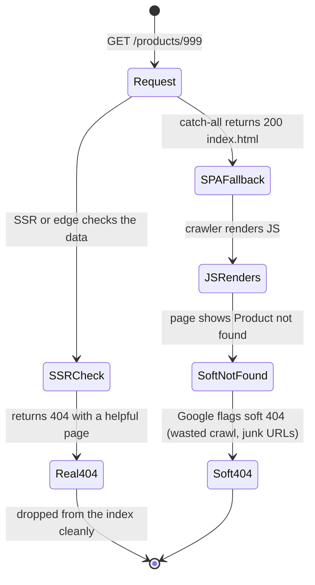
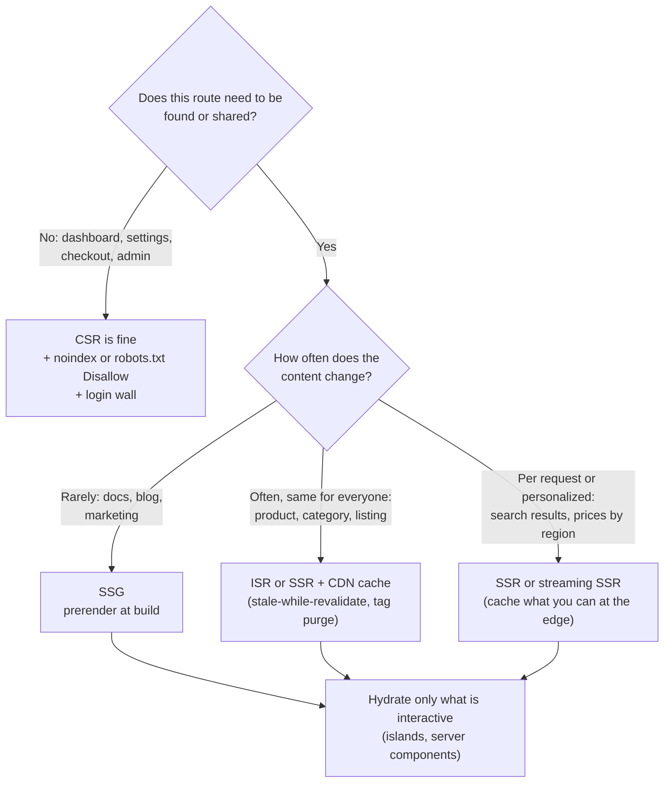
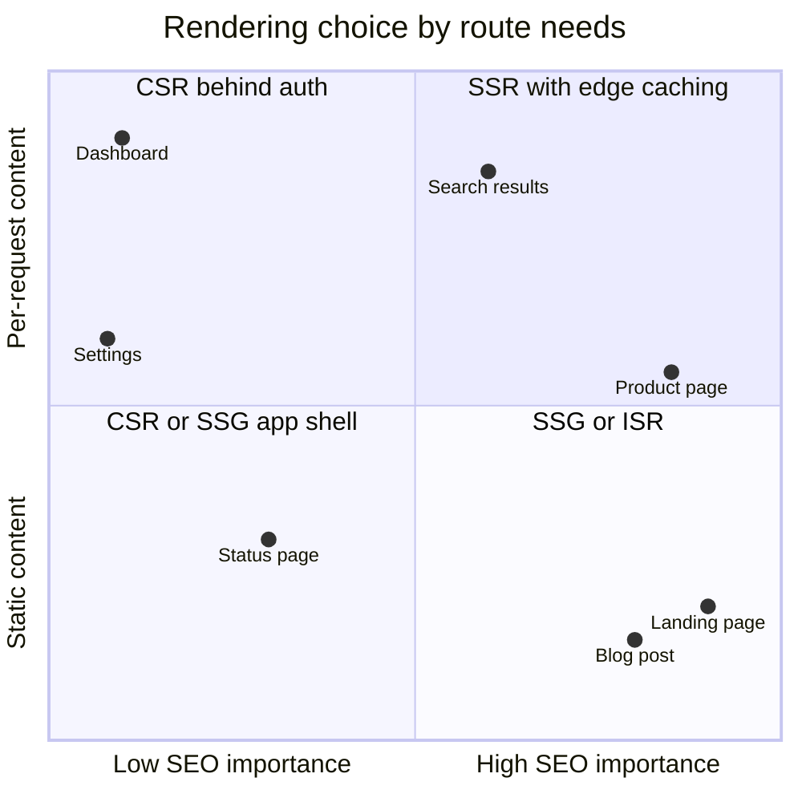
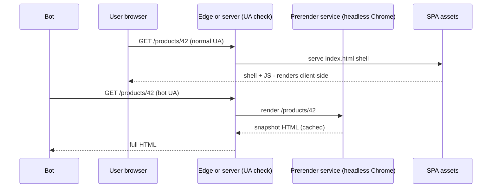
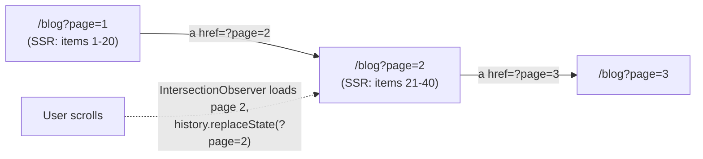
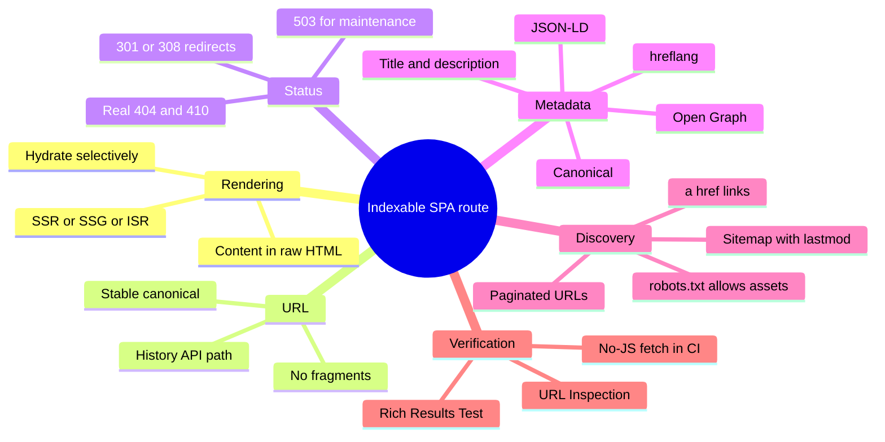

<!-- Generated by scripts/sync-knowledge.js from notes/ and README.md — do not edit here. -->
<!-- sections (line ranges in this file): Table of Contents 19-42 · ELI5 43-56 · Core Concept 57-489 · Framework Comparison 490-507 · Real-World Examples 508-736 · Key Points Summary 737-759 · Test Your Understanding 760-841 · Cheat Sheet 842-893 · References & Further Reading 894-940 -->

# SEO for SPAs & Dynamic Content

> **Date:** 2026-11-06 · **Last updated:** 2026-11-09
> **Category:** Frontend System Design
> **Sub-Topic:** Advanced Topics / Search & Discoverability
> **Level:** Advanced · **Reading time:** ~32 min
> **Informs:** rendering strategy per route (CSR vs SSR/SSG/ISR) for indexable pages, URL and routing design (History API vs hash), HTTP status codes and soft 404s in SPAs, metadata/Open Graph/structured data pipeline, sitemaps and robots policy, link previews for social and AI crawlers, infinite scroll and faceted navigation crawlability

> **Pre-requisite:** [Client-Side Rendering (CSR)](./client-side-rendering-csr.md) (why an SPA ships an empty shell) and [Server-Side Rendering (SSR)](./server-side-rendering-ssr.md) (how HTML can arrive already filled in).
> This note answers one question: **what does a crawler actually see when it requests your JavaScript app — and how do you design routes, rendering and metadata so the answer is "everything"?**

**Previous:** [Authentication Architecture (BFF Pattern)](./authentication-architecture-bff-pattern.md) · **Next:** [Deployment & CI/CD for Frontend](./deployment-and-ci-cd-for-frontend.md)

---

## Table of Contents

1. [ELI5 — Simple Explanation](#eli5--simple-explanation)
2. [Section 1: How Search Engines Process JavaScript](#section-1-how-search-engines-process-javascript)
3. [Section 2: Not Every Bot Runs JavaScript](#section-2-not-every-bot-runs-javascript)
4. [Section 3: URLs, Routing and Links](#section-3-urls-routing-and-links)
5. [Section 4: Status Codes and Soft 404s](#section-4-status-codes-and-soft-404s)
6. [Section 5: Metadata — Title, Description, Canonical, Robots](#section-5-metadata--title-description-canonical-robots)
7. [Section 6: Open Graph and Link Previews](#section-6-open-graph-and-link-previews)
8. [Section 7: Structured Data (JSON-LD)](#section-7-structured-data-json-ld)
9. [Section 8: Choosing a Rendering Strategy for SEO](#section-8-choosing-a-rendering-strategy-for-seo)
10. [Section 9: Dynamic Rendering and Prerender Services (Legacy)](#section-9-dynamic-rendering-and-prerender-services-legacy)
11. [Section 10: Dynamic Content — Lazy Loading, Infinite Scroll, Facets](#section-10-dynamic-content--lazy-loading-infinite-scroll-facets)
12. [Section 11: Sitemaps, robots.txt and Crawl Budget](#section-11-sitemaps-robotstxt-and-crawl-budget)
13. [Section 12: International SEO and Performance Signals](#section-12-international-seo-and-performance-signals)
14. [Framework Comparison](#framework-comparison)
15. [Real-World Examples](#real-world-examples)
16. [Key Points Summary](#key-points-summary)
17. [Test Your Understanding](#test-your-understanding)
18. [Cheat Sheet](#cheat-sheet)
19. [References & Further Reading](#references--further-reading)

---

## ELI5 — Simple Explanation

Imagine a **library catalogue clerk** who visits bookshops to record what each one sells.

- A **traditional shop** (server-rendered HTML) has every book on the shelf when the clerk walks in. The clerk writes it all down in one visit.
- A **flat-pack shop** (client-side SPA) shows an empty room and a box labelled *"assemble me"*. The clerk can assemble it (Google renders JavaScript), but **assembling goes on a waiting list**, and some clerks (social-preview bots, many AI crawlers) **never assemble anything** — they just write "empty room".
- The **shop sign** (title, description, preview image) must be painted **on the door**, not inside the box, or passers-by never see it.
- A **"Closed — this shop no longer exists"** notice (a real 404) must be on the door too. If the door says "Open" and the room is empty, the clerk files it as a weird empty shop (**soft 404**).
- The clerk only walks through **real doors** (`<a href>` links). A painted door you have to knock on in a special way (`onClick` navigation) is ignored.

> **Put everything a crawler needs — content, links, metadata and the correct status code — into the HTML the server sends. JavaScript may improve the page; it should not be required to understand it.**

---

## Core Concept — Step by Step

### Section 1: How Search Engines Process JavaScript

Google processes JavaScript pages in **three phases**: crawl, render, index. Rendering uses the **Web Rendering Service (WRS)**, which runs an **evergreen Chromium** (kept close to the current stable Chrome).



What this means for an SPA:

| Fact (Google's documentation) | Design consequence |
|---|---|
| Rendering is a **separate, queued** step after crawling | Content that exists only after JS runs is discovered **later** than content in the raw HTML |
| `noindex` found in the **initial** HTML stops rendering | You **cannot** "remove noindex with JavaScript" — Google never runs your JS |
| Links are extracted from the HTML **and** from the rendered DOM | Real `<a href>` links in server HTML are discovered fastest |
| WRS is **stateless** between page loads: cookies, `localStorage`, `sessionStorage` are cleared | Content must not depend on a previous visit, a consent click, or a login |
| Googlebot **declines permission prompts** (geolocation, notifications) | Never gate content behind a permission |
| Googlebot does **not click or scroll** like a user; it renders with a tall viewport | Content revealed only by clicks or scroll **events** may be missed (Section 10) |
| WRS caches fetched resources aggressively and may ignore your cache headers | Use **content-hashed filenames** so a new deploy is a new URL |
| Rendering has resource limits; failing API calls or JS errors leave an empty DOM | Server-render the primary content of indexable routes |

Bing also renders JavaScript with a modern Chromium-based engine. **Other search engines and bots vary**, and none publish a guarantee that matches your exact app — which is why the robust answer is server-rendered HTML.

> **Not a ranking penalty, a risk.** Google states that a well-built CSR page *can* be indexed. The problems are delay, fragility (one failing API = empty page) and every non-Google consumer that does not render.

---

### Section 2: Not Every Bot Runs JavaScript



| Consumer | Executes JS? | What it needs in raw HTML |
|---|---|---|
| **Googlebot** | Yes (WRS, deferred) | Ideally everything; at minimum correct status, `robots`, canonical, links |
| **Bingbot** | Yes (Chromium-based) | Same as Google |
| **Link-preview bots** (Facebook, LinkedIn, X, Slack, Discord, iMessage, WhatsApp) | Generally **no** | `og:*` / `twitter:*` meta tags, `<title>` |
| **AI crawlers / answer engines** | Many observed **not** to execute JS (public analyses, e.g. Vercel's 2024 crawler study); behaviour differs by vendor and changes | Server-rendered text content |
| **Accessibility tools, reader modes, archive crawlers** | Varies | Semantic HTML |

**Design rule:** if a page should be *shared* or *found*, its title, description, preview image and primary text must be in the **server response**. This rule alone rules out pure CSR for marketing pages, product pages, articles and public profiles.

---

### Section 3: URLs, Routing and Links

#### 3.1 One piece of content = one stable, crawlable URL



- Use **History API routing** (`pushState`) — the default in React Router, TanStack Router, Vue Router (`createWebHistory`), Angular Router (`PathLocationStrategy`) and SvelteKit.
- Google **ignores URL fragments** for indexing. `/#/a` and `/#/b` are the same URL to a crawler.
- Keep URLs **stable and canonical**: one casing, one trailing-slash policy, no session IDs, sorted or minimal query parameters.

#### 3.2 Links must be real anchors

Google follows **`<a>` elements with an `href`** that resolves to a URL. It does not follow `onclick` handlers, `<button>` navigation, or `<a>` without `href`.

```html
<!-- ✅ Crawlable -->
<a href="/products/42">Blue mug</a>

<!-- ❌ Not crawlable -->
<span onclick="router.push('/products/42')">Blue mug</span>
<a onclick="goTo('/products/42')">Blue mug</a>
<a href="javascript:goTo('/products/42')">Blue mug</a>
```

Framework link components (`<Link>` in Next.js / React Router, `<RouterLink>` in Vue, `routerLink` in Angular, plain `<a>` in SvelteKit) **render a real `<a href>`** and intercept the click for client-side navigation — the best of both.

#### 3.3 Client-side navigation and analytics

In an SPA, a navigation does not reload the page, so:
- Update `<title>`, meta description and canonical **on every route change** (frameworks do this for you when metadata is declared per route).
- Move focus to the new page's heading for screen readers (see [Keyboard Navigation & Focus Management](./keyboard-navigation-and-focus-management.md)).
- Fire a page-view event on route change (see [Analytics Architecture](./analytics-architecture.md)).

---

### Section 4: Status Codes and Soft 404s

A server-rendered site returns `404` for a missing product. A **CSR SPA with a catch-all fallback** returns `200 index.html` for *every* path — including `/products/does-not-exist` and `/totally-random`. The JS then shows "Not found", but the HTTP status says **success**.



**Fixes, best first:**

| Fix | How | Notes |
|---|---|---|
| **SSR / SSG returns the real status** | `notFound()` (Next.js), `error(404)` (SvelteKit), `createError({ statusCode: 404 })` (Nuxt), set status in Angular SSR's response | The correct solution for indexable routes |
| **Server knows the route table** | SPA fallback serves `index.html` with **200 only for known route patterns**, `404` otherwise | Cheap improvement for pure SPAs (Example 4) |
| **JS redirect to a real 404 URL** | `location.replace('/not-found')` where the server returns `404` | Google-documented option for CSR |
| **JS adds `noindex`** | Inject `<meta name="robots" content="noindex">` when data is missing | Google-documented option; works because the raw HTML had no `noindex` |

Other status codes matter too:
- **Redirects:** use server `301`/`308` for permanent moves. A JS redirect (`location.replace`) is followed by Google but is slower to process and invisible to non-rendering bots.
- **`410 Gone`** for content removed on purpose.
- **`503` + `Retry-After`** for maintenance — never serve a `200` "we'll be back" page, or it may be indexed.
- **Error pages:** a failing API should produce a `5xx` (SSR) — not a `200` with an empty list that gets indexed as thin content.

---

### Section 5: Metadata — Title, Description, Canonical, Robots

```html
<head>
  <title>Blue Ceramic Mug — 350 ml | Acme Store</title>
  <meta name="description" content="Hand-glazed 350 ml ceramic mug. Dishwasher safe. Ships in 2 days.">
  <link rel="canonical" href="https://shop.example/products/blue-ceramic-mug">
  <meta name="robots" content="index, follow, max-image-preview:large">
</head>
```

| Tag | Purpose | SPA pitfall |
|---|---|---|
| `<title>` | Primary title candidate for the result | One generic title for all routes in the shell |
| `meta description` | Snippet candidate (Google may rewrite it) | Same description everywhere → duplicates |
| `link rel="canonical"` | Which URL is the "real" one among duplicates (query params, sorting, tracking params) | Set **only** by JS, or set to a different value by JS than in raw HTML. Google advises keeping the canonical consistent and present in the initial HTML |
| `meta robots` | `noindex`, `nofollow`, `max-snippet`, `max-image-preview`, `unavailable_after` | `noindex` in the shell HTML for every route (a staging setting shipped to prod) blocks the whole site |
| `X-Robots-Tag` header | Same directives for non-HTML (PDFs, images) or set at the CDN | Forgotten on preview deployments → preview URLs get indexed |
| `lang` on `<html>` | Language of the page | Left as `en` on localized routes |

**Canonical rules of thumb:**
- Self-referencing canonical on every indexable page, as an **absolute URL**.
- Strip tracking parameters (`utm_*`, `gclid`) from the canonical.
- Filtered/sorted list variants usually canonicalise to the unfiltered list, unless the filtered view is a real landing page (Section 10).
- Canonical is a **hint**, not a directive; consistent internal links, sitemaps and redirects reinforce it.

> **Preview and staging environments:** send `X-Robots-Tag: noindex` from the platform for every non-production deployment, and never copy that header into production config. This is safer than a `<meta>` tag in the app code, which can leak into prod.

---

### Section 6: Open Graph and Link Previews

Link-preview bots read meta tags from the **raw HTML** and usually do not run JS.

```html
<meta property="og:type" content="product">
<meta property="og:title" content="Blue Ceramic Mug — 350 ml">
<meta property="og:description" content="Hand-glazed, dishwasher safe.">
<meta property="og:url" content="https://shop.example/products/blue-ceramic-mug">
<meta property="og:image" content="https://shop.example/og/blue-ceramic-mug.png">
<meta property="og:image:width" content="1200">
<meta property="og:image:height" content="630">
<meta property="og:image:alt" content="A blue ceramic mug on a wooden table">
<meta name="twitter:card" content="summary_large_image">
```

- Use **absolute HTTPS URLs** for `og:image` and `og:url`.
- 1200×630 is a widely used size for large previews; check each platform's current documentation for exact limits.
- Platforms **cache previews**. After changing tags, use the platform's debugger/inspector to refresh (e.g. Facebook Sharing Debugger, LinkedIn Post Inspector).
- **Dynamic OG images** (title + price rendered into an image) can be generated at request time with tools such as Next.js `ImageResponse` (built on Satori) or `@vercel/og`; cache them at the CDN with a content-based URL.

---

### Section 7: Structured Data (JSON-LD)

Structured data describes the page in a machine-readable vocabulary ([schema.org](https://schema.org)) and makes it **eligible** for rich results (product stars, prices, breadcrumbs, articles). Google recommends **JSON-LD**.

```html
<script type="application/ld+json">
{
  "@context": "https://schema.org",
  "@type": "Product",
  "name": "Blue Ceramic Mug",
  "image": ["https://shop.example/img/mug-1x1.jpg"],
  "sku": "MUG-BLUE-350",
  "offers": {
    "@type": "Offer",
    "price": "18.00",
    "priceCurrency": "EUR",
    "availability": "https://schema.org/InStock"
  }
}
</script>
```

| Rule | Why |
|---|---|
| Mark up **only what is visible** on the page | Mismatched structured data violates Google's guidelines and can lead to a manual action |
| Google can read JSON-LD **injected by JavaScript** | Supported, but it inherits the render delay — server-render it for important pages |
| Validate with the **Rich Results Test** and the **Schema Markup Validator** | Eligibility rules are per result type and change over time |
| Escape `<` when serialising (`\u003c`) | A `</script>` inside a string would break out of the tag (an XSS vector) |
| Rich results are **not guaranteed** | Valid markup makes a page eligible, not entitled |

Google has retired or limited several rich result types over the years (for example, HowTo and FAQ rich results were reduced in 2023). Check the Search Gallery for what is currently supported.

---

### Section 8: Choosing a Rendering Strategy for SEO



| Strategy | Raw HTML has content? | Freshness | Cost | SEO verdict |
|---|---|---|---|---|
| **CSR** ([note](./client-side-rendering-csr.md)) | ❌ shell only | Live | Cheapest server | OK only for non-indexable routes |
| **SSG** ([note](./static-site-generation-ssg.md)) | ✅ | Build-time | Cheapest serving | Best for stable content |
| **ISR** ([note](./incremental-static-regeneration-isr.md)) | ✅ | Seconds–minutes stale | Low | Best for large catalogues |
| **SSR** ([note](./server-side-rendering-ssr.md)) | ✅ | Per request | Highest | Best for dynamic, public data |
| **Streaming SSR / RSC** ([note](./streaming-ssr-and-react-server-components.md)) | ✅ (content inside Suspense arrives later in the same response) | Per request | High | Good; keep primary content outside slow Suspense boundaries |
| **Islands** ([note](./island-architecture.md)) | ✅ | Build or request | Low | Excellent for content sites |
| **Dynamic rendering** (Section 9) | ✅ for bots only | Depends on prerender cache | Extra infra | Legacy workaround |

> **Streaming caveat:** content streamed late in the response is still part of the HTML document, and Google processes it. But bots with short timeouts or no JS may not see content that is filled in by client-side script after streaming. Put the title, primary text and metadata in the first part of the stream.



---

### Section 9: Dynamic Rendering and Prerender Services (Legacy)

**Dynamic rendering** = detect crawler user agents and serve them a **prerendered HTML snapshot** (from a headless browser), while users get the CSR app.



**Status (late 2026):** Google's documentation describes dynamic rendering as **a workaround and not a recommended long-term solution**, and recommends server-side rendering, static rendering or hydration instead. Google's own open-source prerenderer, **Rendertron, is no longer maintained**. Commercial prerender services still exist.

| Problem | Why |
|---|---|
| Two code paths | Bot and user HTML can drift; bugs appear only for bots |
| UA sniffing is fragile | New bots (AI crawlers, new preview bots) aren't in your list |
| Cost and latency | A headless browser per uncached request |
| Cloaking risk | Serving bots **substantially different** content than users violates spam policies; dynamic rendering is acceptable only when the content is equivalent |

**When it is still reasonable:** a large legacy CSR app that cannot adopt SSR soon. Treat it as a bridge with an exit plan — migrate high-value routes to SSR/SSG first.

---

### Section 10: Dynamic Content — Lazy Loading, Infinite Scroll, Facets

#### 10.1 Lazy-loaded content

Googlebot renders with a tall viewport instead of scrolling, so content loaded by **`scroll` event listeners** may never load.

| Pattern | Crawlable? |
|---|---|
| `` (native) | ✅ |
| `IntersectionObserver` triggering loads | ✅ (Google-recommended approach) |
| `window.onscroll` + position math | ⚠️ May never fire for the renderer |
| Content behind "Load more" **button** with no URL | ❌ Not reached — no link to follow |
| Content in tabs/accordions present in the DOM but visually hidden | ✅ Indexed (it's in the DOM) |
| Content fetched only on **click** of a tab | ❌ Not reached |

See [Web APIs (Intersection Observer, ResizeObserver)](./web-apis-intersection-observer-resizeobserver.md).

#### 10.2 Infinite scroll and pagination

Crawlers don't scroll forever. Back infinite scroll with **paginated URLs**:



- Each page has a **unique URL** that returns that slice when requested directly.
- Each page links to the next with a real `<a href>` (it can be visually replaced by the scroll loader).
- Google **no longer uses `rel="next"`/`rel="prev"`** as an indexing signal (announced 2019) — plain links do the job. Other engines may still read them; they're harmless.
- Each paginated page is canonical to **itself**, not to page 1 (otherwise items on page 2+ may not be discovered).

More: [Pagination & Infinite Scroll](./pagination-and-infinite-scroll.md).

#### 10.3 Faceted navigation (filters)

Filters (`?color=blue&size=m&sort=price`) can generate millions of near-duplicate URLs that waste crawl capacity.

| Facet type | Treatment |
|---|---|
| High-demand landing facets (`/mugs/blue`) | Clean path, self-canonical, in sitemap, linked internally |
| Sort order, view mode, page size | Canonical to the unsorted URL; consider not linking them as `<a href>` |
| Long-tail combinations | `noindex` or canonical to the parent; block infinite combinations in `robots.txt` if they're crawled heavily |
| Session/tracking params | Strip before rendering links; canonical without them |

---

### Section 11: Sitemaps, robots.txt and Crawl Budget

```text
robots.txt         → which URLs crawlers MAY FETCH (crawl control, not index control)
meta robots / X-Robots-Tag noindex → whether a fetched page may be INDEXED
sitemap.xml        → which URLs you WANT crawled, with lastmod
```

**robots.txt rules for SPAs:**
- **Never disallow** the JS, CSS or API endpoints the renderer needs to build the page — a blocked `/api/` turns your pages into empty shells for Google.
- `Disallow` does **not** remove a URL from the index (it can still be indexed from links, without content). To de-index, allow crawling and serve `noindex`.

**Sitemaps:**
- Up to **50,000 URLs or 50 MB (uncompressed)** per file; use a sitemap index for more.
- Google uses `<lastmod>` when it is consistently accurate and **ignores `<priority>` and `<changefreq>`**.
- Generate them from the same data source as the routes (Example 2), and submit them in Search Console / Bing Webmaster Tools and list them in `robots.txt`.

**Crawl budget** matters mainly for **large or fast-changing sites** (Google's guidance mentions sites with roughly a million or more unique pages, or tens of thousands of pages changing daily). Rendering JS costs more crawl resources than plain HTML, so SSR helps large sites twice.

**IndexNow** is a protocol to notify participating search engines (Bing, Yandex and others) of changed URLs immediately. Google does not use IndexNow; it relies on sitemaps and crawling.

---

### Section 12: International SEO and Performance Signals

**hreflang** tells search engines which URL serves which language/region:

```html
<link rel="alternate" hreflang="en-us" href="https://shop.example/en-us/mugs">
<link rel="alternate" hreflang="de-de" href="https://shop.example/de-de/mugs">
<link rel="alternate" hreflang="x-default" href="https://shop.example/mugs">
```

- Annotations must be **reciprocal** (every page lists all alternates, including itself).
- Use **distinct URLs per locale** (path or subdomain). Locale switched only by cookie or `Accept-Language` on one URL means crawlers see only one language.
- Don't auto-redirect by IP/language without a way to reach other locales — crawlers mostly crawl from one region.
- See [Internationalization (i18n) Architecture](./internationalization-i18n-architecture.md).

**Performance and page experience:** Google uses **Core Web Vitals** (LCP, INP, CLS) as part of its page experience signals, alongside HTTPS and the absence of intrusive interstitials. Google describes them as aligned with what its ranking systems reward, but **relevance and content quality dominate**. Fast pages still help indirectly (crawl efficiency, engagement). See [Core Web Vitals (LCP, INP, CLS)](./core-web-vitals-lcp-inp-cls.md).

**Mobile-first indexing:** Google indexes the **mobile** version of pages. Content, links, structured data and metadata must be equivalent on mobile — don't drop them from the mobile layout.



---

## Framework Comparison

| Framework | Per-route metadata | Real 404 status | Sitemap / robots | SEO-friendly rendering |
|---|---|---|---|---|
| **Next.js (App Router)** | `export const metadata` / `generateMetadata()` | `notFound()` | `app/sitemap.ts`, `app/robots.ts` | SSG, ISR, SSR, streaming, RSC |
| **React Router v7 (framework mode) / Remix** | `meta` export per route | Throw a `404` `Response`/`data()` from a loader | Resource routes | SSR, prerender |
| **React SPA (Vite)** | React 19 renders `<title>`/`<meta>` anywhere and hoists them to `<head>`; older apps used `react-helmet-async` | Server can't know → Section 4 fixes | Build-time script | CSR only — add prerendering or migrate |
| **Nuxt (Vue)** | `useSeoMeta()`, `useHead()` (Unhead) | `throw createError({ statusCode: 404 })` | Nuxt SEO modules | SSR, SSG, hybrid route rules |
| **Vue SPA** | `@unhead/vue` | Section 4 fixes | Build-time script | CSR only |
| **Angular** | `Title` and `Meta` services | Set the status on the SSR response (see Angular SSR docs) | Build-time script | Angular SSR with hydration, prerendering (`@angular/ssr`) |
| **SvelteKit** | `<svelte:head>` | `error(404, ...)` in `load` | `+server.ts` endpoint | SSR by default, `prerender` per route |
| **Astro** | Frontmatter + `<head>` in layouts | `Astro.response.status = 404` or a `404.astro` page | `@astrojs/sitemap` | SSG by default, islands |
| **Native mobile** | Not crawled as apps; publish **web equivalents** and connect them with Universal Links (iOS) / App Links (Android) | — | — | Web pages are what gets indexed |

APIs evolve quickly; check each framework's SEO/metadata guide for the version you use.

---

## Real-World Examples

**Example 1 — Next.js App Router product page: metadata, JSON-LD and a real 404:**
```tsx
// app/products/[slug]/page.tsx
import type { Metadata } from 'next';
import { notFound } from 'next/navigation';
import { getProduct } from '@/lib/products';

type Props = { params: Promise<{ slug: string }> };

export const revalidate = 300; // ISR: regenerate at most every 5 minutes

export async function generateMetadata({ params }: Props): Promise<Metadata> {
  const { slug } = await params;
  const product = await getProduct(slug); // fetch is deduplicated with the page below
  if (!product) return { title: 'Product not found', robots: { index: false } };

  return {
    title: `${product.name} | Acme Store`,
    description: product.summary,
    alternates: { canonical: `/products/${product.slug}` }, // resolved against metadataBase
    openGraph: {
      type: 'website',
      title: product.name,
      description: product.summary,
      images: [{ url: product.ogImage, width: 1200, height: 630, alt: product.imageAlt }],
    },
    twitter: { card: 'summary_large_image' },
  };
}

export default async function ProductPage({ params }: Props) {
  const { slug } = await params;
  const product = await getProduct(slug);
  if (!product) notFound(); // renders not-found.tsx with HTTP 404

  const jsonLd = {
    '@context': 'https://schema.org',
    '@type': 'Product',
    name: product.name,
    image: [product.image],
    sku: product.sku,
    offers: {
      '@type': 'Offer',
      price: product.price.toFixed(2),
      priceCurrency: product.currency,
      availability: product.inStock ? 'https://schema.org/InStock' : 'https://schema.org/OutOfStock',
    },
  };

  return (
    <main>
      <h1>{product.name}</h1>
      <p>{product.description}</p>
      <script
        type="application/ld+json"
        // escape "<" so a value containing </script> cannot break out of the tag
        dangerouslySetInnerHTML={{ __html: JSON.stringify(jsonLd).replace(/</g, '\\u003c') }}
      />
    </main>
  );
}
```

> In recent Next.js versions, metadata from `generateMetadata` may be **streamed** for regular browsers while the page renders; Next.js detects known bots and blocks on metadata for them so it lands in `<head>`. Check the Next.js `generateMetadata` docs for your version.

**Example 2 — Sitemap and robots generated from the data source (Next.js):**
```typescript
// app/sitemap.ts
import type { MetadataRoute } from 'next';
import { listPublishedProducts } from '@/lib/products';

export default async function sitemap(): Promise<MetadataRoute.Sitemap> {
  const products = await listPublishedProducts(); // only indexable, in-stock-or-relevant items
  return [
    { url: 'https://shop.example/', lastModified: new Date() },
    ...products.map((p) => ({
      url: `https://shop.example/products/${p.slug}`,
      lastModified: p.updatedAt, // must reflect real content changes, or Google stops trusting it
    })),
  ];
}

// app/robots.ts
import type { MetadataRoute } from 'next';

export default function robots(): MetadataRoute.Robots {
  const isProd = process.env.VERCEL_ENV === 'production' || process.env.APP_ENV === 'production';
  if (!isProd) return { rules: { userAgent: '*', disallow: '/' } }; // previews: also send X-Robots-Tag: noindex
  return {
    rules: { userAgent: '*', allow: '/', disallow: ['/account/', '/checkout/'] },
    sitemap: 'https://shop.example/sitemap.xml',
  };
}
```

**Example 3 — Vue/Nuxt, Angular and SvelteKit equivalents:**
```typescript
// Nuxt 3+: pages/products/[slug].vue  (<script setup lang="ts">)
const route = useRoute();
const { data: product } = await useFetch(`/api/products/${route.params.slug}`);
if (!product.value) throw createError({ statusCode: 404, statusMessage: 'Product not found' });
useSeoMeta({
  title: () => `${product.value!.name} | Acme Store`,
  description: () => product.value!.summary,
  ogTitle: () => product.value!.name,
  ogImage: () => product.value!.ogImage,
  twitterCard: 'summary_large_image',
});

// Angular (with @angular/ssr so tags are in the server HTML)
import { Component, inject, input, effect } from '@angular/core';
import { Meta, Title } from '@angular/platform-browser';
@Component({ selector: 'app-product', template: `<h1>{{ product().name }}</h1>` })
export class ProductComponent {
  product = input.required<{ name: string; summary: string }>();
  private title = inject(Title);
  private meta = inject(Meta);
  constructor() {
    effect(() => {
      this.title.setTitle(`${this.product().name} | Acme Store`);
      this.meta.updateTag({ name: 'description', content: this.product().summary });
    });
  }
}

// SvelteKit: src/routes/products/[slug]/+page.server.ts
import { error } from '@sveltejs/kit';
export async function load({ params }) {
  const product = await getProduct(params.slug);
  if (!product) error(404, 'Product not found'); // real 404 status
  return { product };
}
// +page.svelte:  <svelte:head><title>{data.product.name} | Acme Store</title></svelte:head>
```

**Example 4 — Pure SPA: stop returning 200 for every path (BAD → GOOD):**
```javascript
import express from 'express';
const app = express();
app.use('/assets', express.static('dist/assets', { immutable: true, maxAge: '1y', fallthrough: false }));

// ❌ BAD: every unknown path is "200 OK" → soft 404s, junk URLs indexed
// app.get('*', (req, res) => res.sendFile('index.html', { root: 'dist' }));

// ✅ GOOD: the server knows which route patterns exist
const KNOWN_ROUTES = [/^\/$/, /^\/products\/[a-z0-9-]+$/, /^\/blog(\/[a-z0-9-]+)?$/, /^\/about$/];

app.use((req, res) => {
  const known = KNOWN_ROUTES.some((re) => re.test(req.path));
  res.status(known ? 200 : 404);
  res.set('Cache-Control', 'no-cache');
  res.sendFile('index.html', { root: 'dist' }); // the SPA still renders its Not Found view
});

app.listen(3000);
```

**Example 5 — CSR fallback when the data turns out to be missing (Google-documented options):**
```typescript
async function loadProduct(slug: string) {
  const res = await fetch(`/api/products/${slug}`);
  if (res.status === 404) {
    // Option A: send the crawler to a URL whose server response is a real 404
    location.replace('/not-found');
    return;
    // Option B (instead of A): mark this page as not indexable
    // const m = document.createElement('meta');
    // m.name = 'robots'; m.content = 'noindex';
    // document.head.appendChild(m);
  }
  render(await res.json());
}
```

**Example 6 — Infinite scroll that crawlers can follow:**
```tsx
import { useEffect, useRef } from 'react';

export function PostList({ posts, page, hasNext }: { posts: Post[]; page: number; hasNext: boolean }) {
  const sentinel = useRef<HTMLAnchorElement>(null);

  useEffect(() => {
    if (!hasNext || !sentinel.current) return;
    const io = new IntersectionObserver(([entry]) => {
      if (entry.isIntersecting) loadPage(page + 1); // append + history.replaceState(null, '', `?page=${page + 1}`)
    });
    io.observe(sentinel.current);
    return () => io.disconnect();
  }, [page, hasNext]);

  return (
    <>
      <ul>{posts.map((p) => <li key={p.id}><a href={`/blog/${p.slug}`}>{p.title}</a></li>)}</ul>
      {/* A real link: crawlers follow it; users rarely see it because the observer loads first */}
      {hasNext && <a ref={sentinel} href={`/blog?page=${page + 1}`}>Next page</a>}
    </>
  );
}
```

**Example 7 — Test what non-rendering bots see, in CI:**
```bash
# Raw HTML as a preview bot sees it: title, description, og tags, canonical must be present
curl -s -A "facebookexternalhit/1.1" https://shop.example/products/blue-ceramic-mug \
  | grep -iE '<title>|name="description"|property="og:|rel="canonical"|application/ld\+json'

# Missing product must be a real 404, not 200
curl -s -o /dev/null -w "%{http_code}\n" https://shop.example/products/does-not-exist   # expect 404
```

```typescript
// Playwright: render the page with JavaScript disabled and assert the content is there
import { test, expect } from '@playwright/test';

test.use({ javaScriptEnabled: false });

test('product page is meaningful without JS', async ({ page }) => {
  const res = await page.goto('/products/blue-ceramic-mug');
  expect(res?.status()).toBe(200);
  await expect(page.locator('h1')).toHaveText(/Blue Ceramic Mug/);
  await expect(page.locator('link[rel="canonical"]')).toHaveAttribute('href', /\/products\/blue-ceramic-mug$/);
  await expect(page.locator('meta[property="og:image"]')).toHaveAttribute('content', /^https:\/\//);
});
```

---

## Key Points Summary

| Concept | One-Line Explanation |
|---|---|
| **Crawl → render → index** | Google renders JS in a separate, queued step with evergreen Chromium |
| **Raw HTML matters** | Preview bots and many AI crawlers don't run JS; put content and metadata in the server response |
| **`noindex` in raw HTML** | Stops rendering — JS cannot undo it |
| **History API URLs** | Fragments (`#/route`) are ignored; hashbang crawling is long dead |
| **`<a href>` links** | The only links crawlers reliably follow |
| **Soft 404** | `200` page that says "not found"; fix with real status codes |
| **Canonical** | Absolute, self-referencing, consistent in raw HTML; a hint, not a directive |
| **Open Graph** | `og:*` tags in raw HTML control link previews |
| **JSON-LD** | Structured data for rich-result eligibility; must match visible content |
| **SSR / SSG / ISR** | The robust way to make SPA routes indexable |
| **Dynamic rendering** | Bot-only prerendering; a legacy workaround, not recommended long term |
| **Lazy content** | Use `IntersectionObserver`/native lazy loading, not scroll events or click-only loads |
| **Paginated URLs** | Back infinite scroll with crawlable `?page=N` links |
| **robots.txt** | Controls crawling, not indexing; never block JS/CSS/API needed to render |
| **Sitemaps** | Accurate `lastmod`; Google ignores `priority`/`changefreq` |
| **hreflang** | Reciprocal language alternates on distinct URLs |

---

## Test Your Understanding

**Q1 (Basic):**
"Google can render JavaScript, so a client-side-rendered SPA is fine for SEO." What's right and what's wrong about this statement?

<details>
<summary>Answer</summary>

**Right:** Googlebot renders pages with an evergreen Chromium, so a well-built CSR page *can* be indexed.

**Wrong / incomplete:**
- Rendering is a **separate queued step**, so JS-only content is discovered later, and anything that fails during rendering (API error, timeout, JS exception, blocked resource) leaves an **empty page**.
- **Other consumers don't render**: link-preview bots (Slack, X, LinkedIn, Facebook) and many AI crawlers read only the raw HTML, so shared links show a generic title and no image.
- A CSR catch-all usually returns **200 for every path**, producing soft 404s.
- Metadata, canonical and `noindex` decisions made only in JS are fragile (a `noindex` in the raw HTML is never undone).

So CSR is acceptable for non-indexable routes. Indexable routes should be SSR/SSG/ISR.
</details>

**Q2 (Application):**
An e-commerce SPA uses `/#/product/42`-style URLs and a `<div onClick>` grid for product cards. Search Console shows only the home page indexed. Explain why and list the changes.

<details>
<summary>Answer</summary>

Two independent causes:
1. **Hash routing:** the fragment is never sent to the server and Google ignores it for indexing, so every product URL is the same URL (`/`).
2. **No crawlable links:** `<div onClick>` is not a link. Even with correct URLs, Google would find no `<a href>` pointing to product pages.

Changes: switch to **History API routing** (`/products/42`), render product cards as **`<a href>`** (via the framework's `Link`), make the server answer every product path (ideally with **SSR/ISR**, and a real 404 for unknown IDs), add per-route title/description/canonical, and submit a **sitemap** listing product URLs with accurate `lastmod`. Set up 301 redirects from any old URLs you can map (fragments can't be redirected server-side, so handle `/#/…` with a small client-side redirect).
</details>

**Q3 (Tricky):**
Your SPA's `index.html` contains `<meta name="robots" content="noindex">` (left over from staging). The app removes it with JavaScript on production routes. Indexing still fails. Why?

<details>
<summary>Answer</summary>

Google reads `noindex` in the **initial HTML** before rendering. When it finds it there, Google **does not render the page**, so your JavaScript that removes the tag never runs and the page is not indexed. The reverse direction works (adding `noindex` with JS to a page that was indexable in raw HTML), which is why it's a valid soft-404 fix.

Fix: never ship `noindex` in production HTML. Control non-production environments with an `X-Robots-Tag: noindex` header set by the hosting platform per environment.
</details>

**Q4 (Tricky):**
Marketing complains that product links pasted into Slack show "Acme Store" and no image, although the page looks perfect in Chrome and Google's URL Inspection tool shows the right title. What's going on and how do you fix it?

<details>
<summary>Answer</summary>

The URL Inspection tool shows **Google's rendered** HTML, after JavaScript ran. Slack's unfurler (like most link-preview bots) fetches the **raw HTML** and does **not** run JavaScript, so it sees the shell's generic `<title>` and no `og:*` tags.

Fix: put per-route `og:title`, `og:description`, `og:image` (absolute URL) and `twitter:card` in the **server response** — SSR/SSG/ISR for product routes, or, as a stop-gap, an edge function that injects meta tags into `index.html` for product paths. Then refresh the platform's preview cache. Verify with `curl -A` in CI (Example 7).
</details>

**Q5 (Application):**
A news site uses infinite scroll on `/latest`. Older articles are not being indexed. How do you redesign the list?

<details>
<summary>Answer</summary>

Crawlers don't scroll indefinitely and don't trigger `scroll` handlers, so articles beyond the first batch are only reachable through JS that never runs for them.

Redesign: give each slice a **URL** (`/latest?page=2`) that server-renders exactly that slice, add a real **`<a href="?page=N+1">`** link at the end of each slice, load the next slice with **`IntersectionObserver`** for users and update the URL with `history.replaceState`, keep each page **self-canonical** (not canonical to page 1), and list articles in a **news/article sitemap** with accurate `lastmod`. Each article also needs its own stable URL, linked from the list.
</details>

**Q6 (System design):**
You're designing a marketplace with 5 million listings, a logged-in dashboard, search results pages and a blog, built with React. Choose rendering, URL, status and discovery strategies per area, and justify them.

<details>
<summary>Answer</summary>

- **Listings (5M, change often, must rank and be shared):** **ISR or SSR with CDN caching** (stale-while-revalidate, tag-based purge on edit). Stable slug URLs, server-rendered JSON-LD (`Product`/`Offer`), Open Graph, **real 404/410** for removed listings. Split sitemaps (sitemap index, ≤ 50,000 URLs per file) with accurate `lastmod`. At this size, **crawl budget** matters: avoid rendering-dependent content, keep server responses fast, and control facet URL explosion.
- **Search/category pages:** SSR. Index only curated landing facets (`/bikes/road`) with clean paths; sort/view params canonicalise to the base; long-tail combinations `noindex`. Paginated URLs with `<a href>` links.
- **Blog:** **SSG** (or islands), prerendered at build or on publish.
- **Dashboard:** **CSR** behind login, `Disallow` in robots.txt plus `noindex`, since nothing there should be indexed.
- **Cross-cutting:** History API routing; framework `Link` components for real anchors; `X-Robots-Tag: noindex` on preview deployments; CI checks that fetch key routes without JS and assert title, canonical, og tags and status codes; monitor in Search Console (Page indexing report, Crawl stats) and track Core Web Vitals.

Trade-off to name: SSR/ISR adds server cost and complexity, but at this scale the cost of discovery delays and soft 404s is higher. Dynamic rendering would be a stop-gap only.
</details>

---

## Cheat Sheet

**Key Definitions:**
- **WRS (Web Rendering Service):** Google's headless, evergreen Chromium that renders pages after crawling
- **Soft 404:** a page returning `200` whose content says it doesn't exist
- **Canonical URL:** the preferred URL among duplicates, signalled by `rel="canonical"` (a hint)
- **Open Graph:** `og:*` meta tags used by link-preview bots
- **JSON-LD:** structured data in a `<script type="application/ld+json">` using schema.org
- **Dynamic rendering:** serving prerendered HTML to bots only (legacy workaround)
- **hreflang:** link annotations mapping language/region alternates
- **Crawl budget:** how many URLs a search engine will crawl on your site in a period

**Quick Reference:**
```text
Indexable route?          → SSR / SSG / ISR (CSR only for non-indexable routes)
URLs                      → History API paths, never #/ fragments; one canonical per content
Links                     → <a href> (framework Link), never onClick-only navigation
Missing content           → real 404 / 410 (SSR) · CSR: redirect to a 404 URL or add noindex via JS
Moved content             → 301 / 308 server redirect
Maintenance               → 503 + Retry-After
Per-route head            → title, description, canonical (absolute), robots, og:*, twitter:card, JSON-LD
Raw HTML must contain     → content, links, metadata, status (bots that don't run JS)
noindex in raw HTML       → page is NOT rendered → JS can't remove it
robots.txt                → crawl control only; never block JS/CSS/API used for rendering
Sitemaps                  → ≤ 50,000 URLs / 50 MB per file; accurate lastmod; priority/changefreq ignored by Google
Lazy content              → IntersectionObserver or loading="lazy"; not scroll events or click-only fetches
Infinite scroll           → ?page=N URLs, <a href> to next, self-canonical
Preview deployments       → X-Robots-Tag: noindex (platform header)
Verify                    → URL Inspection, Rich Results Test, curl -A bot, Playwright with JS disabled
```

**Common Mistakes to Avoid:**

| Mistake | Why Wrong | Fix |
|---|---|---|
| Pure CSR for product/article pages | Delayed indexing; no previews; empty page if an API fails during render | SSR / SSG / ISR for indexable routes |
| Hash routing (`/#/route`) | Fragments are ignored; whole app = one URL | History API routing |
| `onClick` navigation without `href` | Crawlers can't discover the target URL | Framework `Link` → `<a href>` |
| SPA catch-all returning `200` everywhere | Soft 404s, junk URLs in the index | Real 404s (SSR), known-route allowlist, or JS `noindex` |
| `noindex` in the shell HTML, removed by JS | Google skips rendering when it sees `noindex` | Never ship it; use `X-Robots-Tag` per environment |
| Same title/description on every route | Duplicates, poor snippets | Per-route metadata from the data |
| Canonical set only by JS, or conflicting | Mixed signals | Absolute self-canonical in raw HTML |
| `og:*` tags injected client-side | Preview bots don't run JS | Server-render meta tags |
| Blocking `/api/` or `/assets/` in robots.txt | Renderer can't build the page | Allow everything rendering needs |
| Using `Disallow` to remove pages from Google | Blocked URLs can still be indexed without content | Allow crawl + `noindex`, or 404/410 |
| Infinite scroll with no paginated URLs | Content beyond the first batch is unreachable | `?page=N` + `<a href>` + `IntersectionObserver` |
| Structured data that doesn't match the page | Guideline violation; possible manual action | Generate JSON-LD from the same data as the UI |
| Dynamic rendering as the long-term plan | Two code paths, UA sniffing, cloaking risk | Migrate to SSR/SSG route by route |
| Locale chosen only by cookie/`Accept-Language` | Crawlers see one language | Distinct locale URLs + reciprocal hreflang |

---

## References & Further Reading

**Google Search Central (official)**
- [Understand JavaScript SEO basics](https://developers.google.com/search/docs/crawling-indexing/javascript/javascript-seo-basics)
- [Fix Search-related JavaScript problems](https://developers.google.com/search/docs/crawling-indexing/javascript/fix-search-javascript)
- [Dynamic rendering as a workaround](https://developers.google.com/search/docs/crawling-indexing/javascript/dynamic-rendering)
- [Fix lazy-loaded content](https://developers.google.com/search/docs/crawling-indexing/javascript/lazy-loading)
- [Make your links crawlable](https://developers.google.com/search/docs/crawling-indexing/links-crawlable)
- [How HTTP status codes affect Google Search](https://developers.google.com/search/docs/crawling-indexing/http-network-errors)
- [Consolidate duplicate URLs (canonicalization)](https://developers.google.com/search/docs/crawling-indexing/consolidate-duplicate-urls)
- [Robots meta tag and X-Robots-Tag specifications](https://developers.google.com/search/docs/crawling-indexing/robots-meta-tag)
- [Build and submit a sitemap](https://developers.google.com/search/docs/crawling-indexing/sitemaps/build-sitemap)
- [Introduction to structured data](https://developers.google.com/search/docs/appearance/structured-data/intro-structured-data) · [Search Gallery](https://developers.google.com/search/docs/appearance/structured-data/search-gallery)
- [Pagination, incremental page loading, and their impact on Google Search](https://developers.google.com/search/docs/specialty/ecommerce/pagination-and-incremental-page-loading)
- [Managing crawling of faceted navigation URLs](https://developers.google.com/search/docs/crawling-indexing/crawling-managing-faceted-navigation)
- [Large site owner's guide to managing your crawl budget](https://developers.google.com/search/docs/crawling-indexing/large-site-managing-crawl-budget)
- [Localized versions of your page (hreflang)](https://developers.google.com/search/docs/specialty/international/localized-versions)
- [Understanding page experience in Google Search results](https://developers.google.com/search/docs/appearance/page-experience)

**Specs and protocols**
- [The Open Graph protocol](https://ogp.me/)
- [schema.org](https://schema.org/) · [Schema Markup Validator](https://validator.schema.org/)
- [Sitemaps protocol](https://www.sitemaps.org/protocol.html)
- IETF: [RFC 9309 — Robots Exclusion Protocol](https://www.rfc-editor.org/rfc/rfc9309)
- [IndexNow](https://www.indexnow.org/)

**Framework docs**
- Next.js: [Metadata and OG images](https://nextjs.org/docs/app/getting-started/metadata-and-og-images) · [`generateMetadata`](https://nextjs.org/docs/app/api-reference/functions/generate-metadata) · [`notFound`](https://nextjs.org/docs/app/api-reference/functions/not-found)
- React: [`<title>`](https://react.dev/reference/react-dom/components/title) and [`<meta>`](https://react.dev/reference/react-dom/components/meta) components
- Nuxt: [SEO and Meta](https://nuxt.com/docs/getting-started/seo-meta)
- Angular: [Server-side and hybrid rendering](https://angular.dev/guide/ssr) · [`Meta` service](https://angular.dev/api/platform-browser/Meta)
- SvelteKit: [SEO](https://svelte.dev/docs/kit/seo)

**Deep dives**
- web.dev: [Rendering on the Web](https://web.dev/articles/rendering-on-the-web)
- Bing Webmaster Guidelines: [Bing Webmaster Tools help](https://www.bing.com/webmasters/help/webmasters-guidelines-30fba23a)
- Vercel: [The rise of the AI crawler](https://vercel.com/blog/the-rise-of-the-ai-crawler)

---

> **Previous Topic:** [Authentication Architecture (BFF Pattern)](./authentication-architecture-bff-pattern.md)
> — Keeping tokens on the server and sessions in cookies

> **Next Topic:** [Deployment & CI/CD for Frontend](./deployment-and-ci-cd-for-frontend.md)
> — From a merged pull request to safely serving new bytes to every user

*Saved on: 2026-11-06 | Repo: Frontend System Design Learning Notes*
