<!-- Generated by scripts/sync-knowledge.js from notes/ and README.md — do not edit here. -->
<!-- sections (line ranges in this file): Table of Contents 19-41 · ELI5 42-55 · Core Concept 56-403 · System Design Angle 404-450 · Decision Matrix 451-483 · Real-World Examples 484-647 · Key Points Summary 648-666 · Test Your Understanding 667-740 · Cheat Sheet 741-788 · References & Further Reading 789-828 -->

# Server State vs Client State

> **Date:** 2026-11-06 · **Last updated:** 2026-11-06
> **Category:** Frontend System Design
> **Sub-Topic:** State & Data / State Management
> **Level:** Intermediate · **Reading time:** ~26 min
> **Informs:** state ownership per data type, choice of data-fetching library vs global store, cache invalidation after mutations, URL vs store vs component state, SSR/RSC data hydration, duplicated-state bugs

> **Pre-requisite:** [Client State Management Patterns](./client-state-management-patterns.md) and [Browser Caching Strategies](./browser-caching-strategies.md) (freshness, `stale-while-revalidate`).
> This note draws the line that decides **which tool owns which data** — the most important state-management decision in a modern frontend.

**Previous:** [Zustand / Jotai / Recoil](./zustand-jotai-recoil.md) · **Next:** [React Query / TanStack Query](./react-query-tanstack-query.md)

---

## Table of Contents

1. [ELI5 — Simple Explanation](#eli5--simple-explanation)
2. [Section 1: Two Kinds of State](#section-1-two-kinds-of-state)
3. [Section 2: The Full State Taxonomy](#section-2-the-full-state-taxonomy)
4. [Section 3: Why Server State Is Hard](#section-3-why-server-state-is-hard)
5. [Section 4: The useEffect Fetching Trap](#section-4-the-useeffect-fetching-trap)
6. [Section 5: Server Data in a Global Store](#section-5-server-data-in-a-global-store)
7. [Section 6: The Server-Cache Mental Model](#section-6-the-server-cache-mental-model)
8. [Section 7: Mutations, Invalidation and Ownership](#section-7-mutations-invalidation-and-ownership)
9. [Section 8: Where Client State Should Live](#section-8-where-client-state-should-live)
10. [Section 9: SSR, Server Components and Server State](#section-9-ssr-server-components-and-server-state)
11. [Section 10: The Landscape Across Frameworks](#section-10-the-landscape-across-frameworks)
12. [System Design Angle](#system-design-angle)
13. [Decision Matrix](#decision-matrix)
14. [Real-World Examples](#real-world-examples)
15. [Key Points Summary](#key-points-summary)
16. [Test Your Understanding (with answers)](#test-your-understanding)
17. [Cheat Sheet](#cheat-sheet)
18. [References & Further Reading](#references--further-reading)

---

## ELI5 — Simple Explanation

Think of a **notebook** and a **library book**:

- **Client state = your own notebook.** You wrote it, only you have it, and it's always "correct" because *you* are the source of truth. Which page is open, what you highlighted, whether the cover is folded — nobody else cares.
- **Server state = a book borrowed from the library.** You hold a **copy**. The real book lives at the library, and other people (other users, other tabs, background jobs) can publish a new edition while yours sits on your desk. Your copy can become **out of date** without you noticing.
- So with the library book you need rules your notebook never needed: *How old is my copy? When do I check for a new edition? If two friends ask for the same book, do I borrow it twice? When I return a corrected page, which copies must be thrown away?*

The classic mistake is to **photocopy the library book into your notebook** (put API data into a global store) and then forget it's a copy.

> **Client state is owned by the UI and is always current. Server state is a cached snapshot of data someone else owns — treat it as a cache, not as your state.**

---

## Core Concept — Step by Step

### Section 1: Two Kinds of State

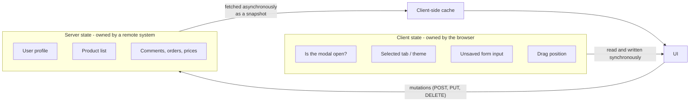

| Property | **Client state** | **Server state** |
|---|---|---|
| **Owner / source of truth** | The UI (this tab) | A server, database or third-party API |
| **Access** | Synchronous | Asynchronous (network, can fail) |
| **Shared with** | Usually nobody | Other users, devices, tabs, background jobs |
| **Can be out of date?** | No — it *is* the truth | Yes — the moment it arrives it's a snapshot |
| **Lifetime** | Session or component lifetime (unless persisted) | Outlives the page; persisted remotely |
| **Typical problems** | Prop drilling, re-render scope, derived values | Loading/error states, caching, deduping, staleness, invalidation, races, pagination, retries |
| **Typical tools** | `useState`, context, Zustand, Jotai, Redux, signals, Pinia | TanStack Query, SWR, RTK Query, Apollo, urql, Relay, framework loaders |

The key insight (popularised by the TanStack Query docs and Kent C. Dodds' writing) is that **most "global state" in typical apps is actually server state**. Once you move it into a server-cache library, the client state that remains is usually small enough for component state, the URL and a tiny store.

---

### Section 2: The Full State Taxonomy

"Client vs server" is the first split. In practice there are more buckets, each with a natural home:

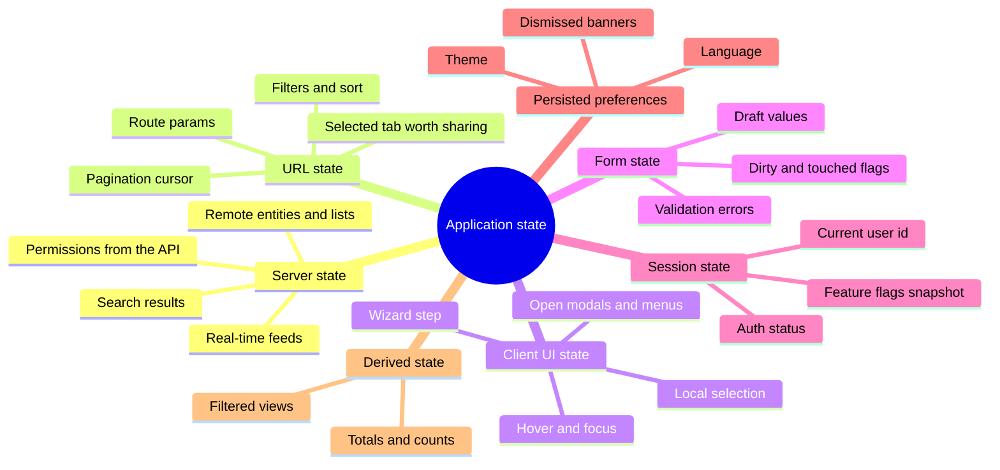

| Bucket | Example | Natural home | Why |
|---|---|---|---|
| **Server cache** | `GET /api/orders` result | TanStack Query / SWR / RTK Query / GraphQL client | Needs freshness, dedupe, invalidation |
| **URL state** | `?status=open&sort=date&page=3` | Router search params | Shareable, bookmarkable, survives reload, works with Back |
| **Local UI state** | Dropdown open, accordion expanded | Component state | Nobody else needs it |
| **Shared UI state** | Sidebar collapsed, toast queue, command palette | Small store (Zustand, Jotai, Pinia, signals, context) | Read by distant components |
| **Form state** | Draft address before submit | Form library or component state | High-frequency updates; discarded or submitted |
| **Session state** | Logged-in user id, auth status | Usually server state (`/api/me`) + an httpOnly cookie | The server decides who you are |
| **Persisted preferences** | Theme, locale | Store + `localStorage` (or a user-settings API if it must sync across devices) | Survives reload |
| **Derived state** | `cartTotal`, `visibleTodos` | **Compute during render** (or a selector/`computed`) | Storing it creates a second copy that can drift |

> **Rule of thumb:** before adding a field to any store, ask *"who owns this value?"* and *"could I compute it instead?"* Most bugs in state management are **two copies of one truth**.

---

### Section 3: Why Server State Is Hard

Fetching once is easy. Keeping a **correct, fast, cheap copy** of remote data is a caching problem with many sub-problems:

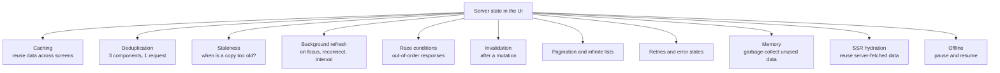

| Problem | Symptom when ignored |
|---|---|
| No caching | Spinner every time the user navigates back to a list |
| No dedupe | Header, sidebar and page all call `/api/me` on mount → 3 identical requests |
| No staleness policy | Data never refreshes, or refreshes on every render |
| No background refresh | User returns to a tab after an hour and sees yesterday's prices |
| Races | Typing "re" then "react" — the slow "re" response arrives last and overwrites the correct results |
| No invalidation | User renames a project; the sidebar still shows the old name |
| No GC | Long-lived SPA slowly accumulates every response it ever fetched |
| No hydration | SSR fetched the data, then the client fetches it again and flashes a spinner |

Writing all of this by hand — per endpoint — is what server-state libraries replace.

---

### Section 4: The useEffect Fetching Trap

The "fetch in `useEffect`, store in `useState`" pattern looks innocent but re-creates every problem above.

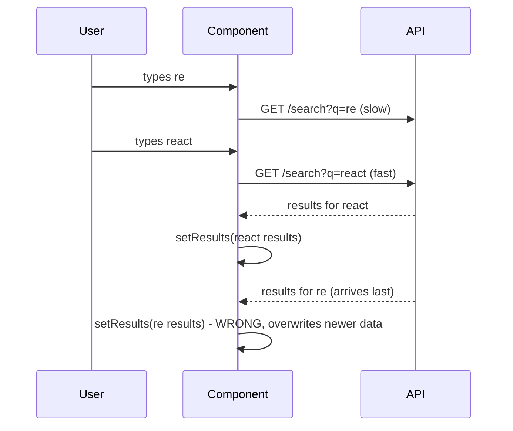

```tsx
// ❌ BAD: race condition, no cache, no dedupe, no retry, no cancellation
function Search({ q }: { q: string }) {
  const [results, setResults] = useState<Result[]>([]);
  const [loading, setLoading] = useState(false);

  useEffect(() => {
    setLoading(true);
    fetch(`/api/search?q=${encodeURIComponent(q)}`)
      .then((r) => r.json())
      .then((data) => setResults(data)) // may be an OLD response
      .finally(() => setLoading(false));
  }, [q]);
  // ...
}
```

The React docs show the minimal manual fix — ignore stale responses in the cleanup — and then recommend a framework's data fetching or a client cache instead of hand-rolled effects:

```tsx
// ⚠️ BETTER, but still no cache / dedupe / retry / refetch-on-focus
useEffect(() => {
  const controller = new AbortController();
  fetch(`/api/search?q=${encodeURIComponent(q)}`, { signal: controller.signal })
    .then((r) => r.json())
    .then(setResults)
    .catch((e) => { if (e.name !== 'AbortError') setError(e); });
  return () => controller.abort(); // cancels the previous request when q changes
}, [q]);
```

Also note: in development with `<StrictMode>`, React mounts, unmounts and re-mounts components once to surface missing cleanups — so an effect without cleanup visibly fires twice. That's a bug detector, not a bug.

---

### Section 5: Server Data in a Global Store

Before server-cache libraries were common, the standard Redux pattern was: dispatch `FETCH_START` → call API → dispatch `FETCH_SUCCESS` with the payload → store it in the global store. It works, but you hand-write a cache:

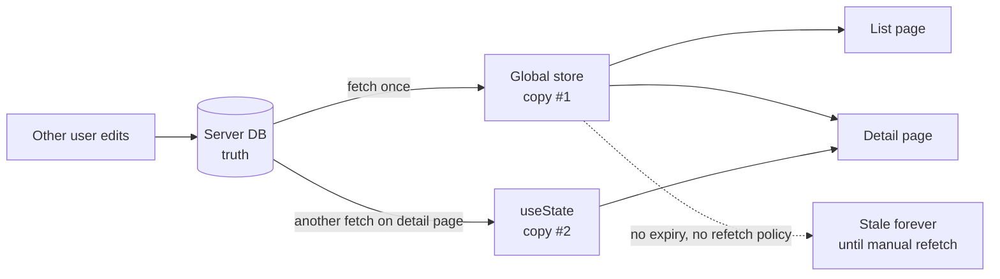

| Hand-rolled in the store | What a server-cache library gives you |
|---|---|
| `isLoading`, `error`, `data` per endpoint | Status per query key, automatically |
| "Did we already fetch this?" flags | Dedupe and cache by key |
| Manual "refetch after save" thunks | `invalidateQueries` / tag invalidation / `mutate(key)` |
| No expiry | `staleTime` / dedupe interval, background refresh |
| Stale entries never removed | Garbage collection of unused entries |
| Race-prone thunks | Latest-key-wins, request cancellation |

**This doesn't mean "never use Redux".** Redux Toolkit ships **RTK Query** precisely so server data goes into a purpose-built cache (inside the Redux store, with tags) instead of hand-written slices. See [Redux & Redux Toolkit](./redux-and-redux-toolkit.md). The anti-pattern is **hand-managed copies**, not a particular library.

---

### Section 6: The Server-Cache Mental Model

Every server-state library implements roughly the same model: a **cache keyed by a serializable key**, entries that go **fresh → stale**, and **observers** (mounted components) that decide when a refetch is worth it. This is the HTTP `stale-while-revalidate` idea applied to parsed data in memory.

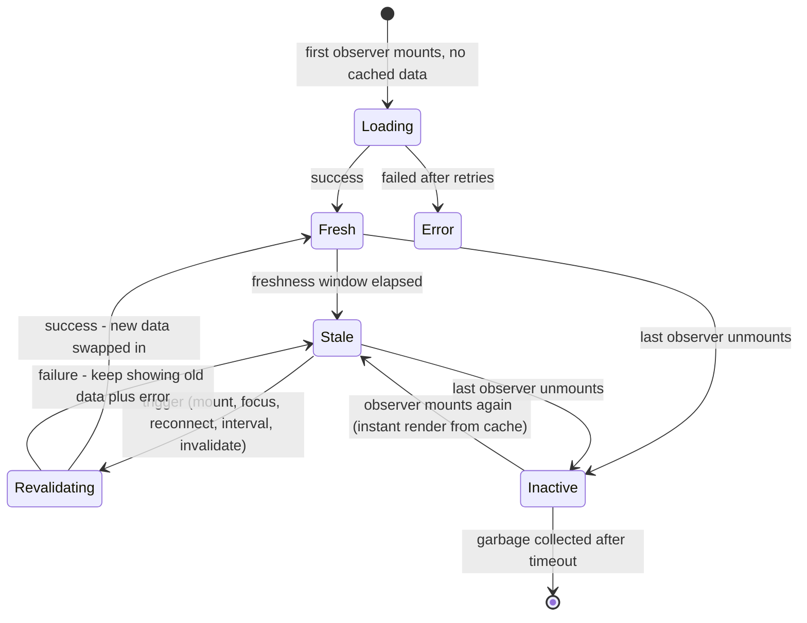

```text
              ┌─────────── fresh ───────────┐┌──────────── stale ─────────────┐
data arrives ─┤ served from cache, no fetch ├┤ served from cache AND refetched │
              └─────────────────────────────┘│ on the next trigger            │
                                             └────────────────────────────────┘
when no component uses the key:  kept for a while (inactive) → then garbage-collected
```

| Concept | TanStack Query | SWR | RTK Query | HTTP cache analogue |
|---|---|---|---|---|
| Cache key | `queryKey` array | `key` (string, array, object, or `null` to skip) | endpoint + args | URL (+ `Vary`) |
| Freshness window | `staleTime` (default `0`) | `dedupingInterval` (default 2 s) for request dedupe | `refetchOnMountOrArgChange` etc. | `max-age` |
| Unused-data lifetime | `gcTime` (default 5 min on the client) | Kept in the cache provider (a `Map` by default) | `keepUnusedDataFor` (default 60 s) | Eviction |
| Invalidation | `invalidateQueries({ queryKey })` | `mutate(key)` | `providesTags` / `invalidatesTags` | Unsafe method invalidates the URL |

Details per library: [React Query / TanStack Query](./react-query-tanstack-query.md) and [SWR & Stale-While-Revalidate](./swr-and-stale-while-revalidate.md).

---

### Section 7: Mutations, Invalidation and Ownership

When the client **changes** server state, the server stays the owner. The client sends an intent and then **re-syncs its cache**:

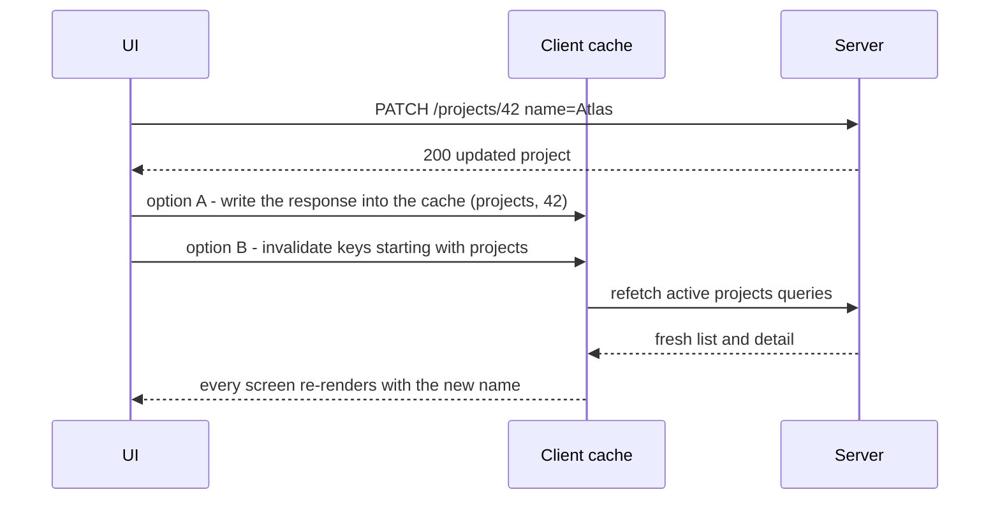

| Strategy | When to use | Cost |
|---|---|---|
| **Invalidate and refetch** | Default. Server may change more than you know (sorting, computed fields, other lists) | Extra request(s) |
| **Write the response into the cache** | The mutation returns the full updated entity | Must update every list that contains it |
| **Optimistic update** | Fast, low-risk actions (like, toggle, reorder) | Rollback logic on error — see [Optimistic UI Updates](./optimistic-ui-updates.md) |
| **Server push** | Other users' changes must appear live | Socket/SSE infra — see [Real-Time Data Sync](./real-time-data-sync.md) |

> **Ownership test:** if two browser tabs disagree about a value, which one is right? If the answer is "whatever the server says", it's server state — never let a client store become its source of truth.

---

### Section 8: Where Client State Should Live

Once server data is out of the way, place each remaining piece of client state as **close to where it's used** as possible:

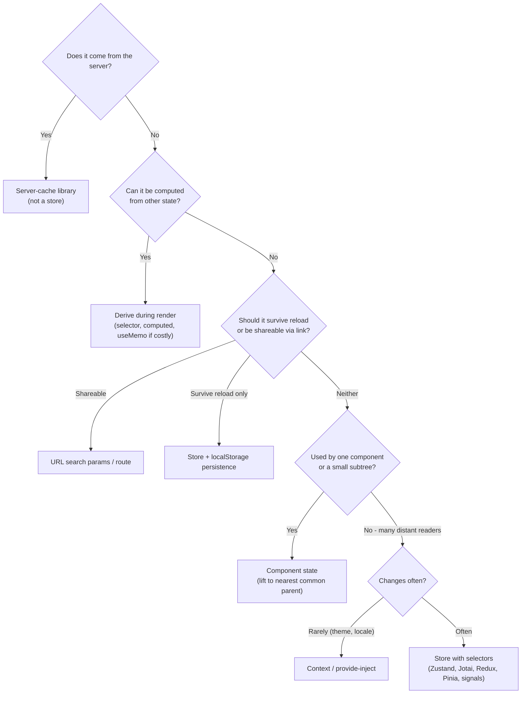

Why **URL state** deserves special attention:
- Filters, sort, pagination, selected tab and search text that a user might **share or bookmark** belong in the URL.
- The URL is then part of the **query key**: `['orders', { status, page }]` comes straight from search params, so Back/Forward "just works" with cached results.
- Keeping filters in a store *and* the URL creates — again — two copies of one truth.

Store choices for the remaining shared client state are covered in [Client State Management Patterns](./client-state-management-patterns.md) and [Zustand / Jotai / Recoil](./zustand-jotai-recoil.md).

---

### Section 9: SSR, Server Components and Server State

Server rendering moves *where* server state is first fetched, but the client still needs a cache if the data changes while the page is open.

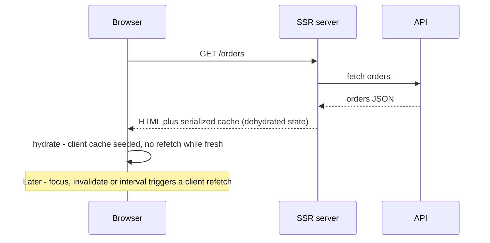

| Approach | Who holds server state | Notes |
|---|---|---|
| **Classic SSR + client cache** | Server fetches, serializes the cache (e.g. TanStack Query `dehydrate` → `HydrationBoundary`, SWR `fallback`) | Set a non-zero freshness window (e.g. `staleTime`) so the client doesn't refetch immediately after hydration |
| **React Server Components** | Server components fetch directly; data is rendered, not shipped as a client cache | Mutations re-render via Server Actions / revalidation. Client components that need live, refetchable data still use a client cache. See [Streaming SSR & React Server Components](./streaming-ssr-and-react-server-components.md) |
| **Route loaders** (React Router / Remix, SvelteKit `load`, Nuxt `useFetch`/`useAsyncData`) | Router fetches per route and revalidates after actions/mutations | Loader + action pairs give a built-in invalidation model |

> **Framework caching changes often.** For example, Next.js changed its default `fetch` caching behaviour between major versions. Read the current caching docs of your framework rather than relying on blog posts.

---

### Section 10: The Landscape Across Frameworks

The server/client split is framework-agnostic; only the tools differ.

| Stack | Server state | Client state |
|---|---|---|
| **React** | TanStack Query, SWR, RTK Query, Apollo / urql / Relay (GraphQL), RSC + Server Actions, React Router loaders | `useState`/`useReducer`, context, Zustand, Jotai, Redux Toolkit |
| **Vue / Nuxt** | TanStack Vue Query, Pinia Colada, Nuxt `useFetch` / `useAsyncData` | `ref`/`reactive`, Pinia |
| **Angular** | `HttpClient` + RxJS caching, `resource()` / `httpResource()` (newer signal-based APIs — check their stability status in the Angular docs), TanStack Angular Query (published as an experimental package) | Signals, services, NgRx Store / SignalStore |
| **Svelte / SvelteKit** | SvelteKit `load` functions + `invalidate()`, TanStack Svelte Query | Runes (`$state`), stores |
| **Solid** | `createResource`, TanStack Solid Query | Signals, stores |
| **Android (native)** | Repository pattern with a local database (Room) as the single source of truth, refreshed from the network | `ViewModel` + `StateFlow` / Compose state |
| **iOS (native)** | Repository/service layer with `URLSession` caching or a local store (SwiftData / Core Data) | `@State`, `@Observable` models |
| **React Native** | Same React libraries; wire focus/online detection to `AppState` and a network-status library | Same as React |

Native mobile guidance is instructive: Android's architecture guide recommends a **data layer** that exposes data from a single source of truth — exactly the "server state is a cache with an owner" idea, with a database instead of an in-memory map.

---

## System Design Angle

A well-structured frontend has **separate layers** for each kind of state:

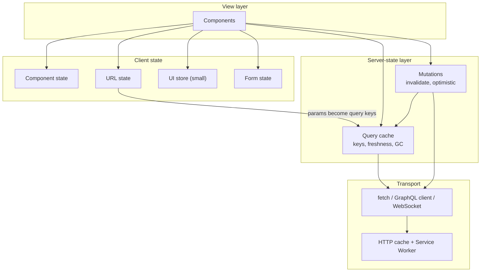

Design-review questions to ask:
1. **Inventory** — list every piece of state on the screen and label its owner (server / URL / UI / form / derived).
2. **Freshness budget** — per server resource, how stale may it be? (prices: seconds; country list: hours). This becomes `staleTime` / dedupe / HTTP `max-age`.
3. **Invalidation map** — for each mutation, which keys change? Encode it once (key factories, tags).
4. **Real-time needs** — polling, refetch-on-focus, or push? See [WebSockets & SSE & Long Polling](./websockets-sse-long-polling.md).
5. **Normalization** — do the same entities appear in many lists? Document cache vs normalized cache — see [Data Normalization & Caching](./data-normalization-and-caching.md).
6. **Offline** — must mutations queue while offline? See [Offline-First Architecture](./offline-first-architecture.md).
7. **SSR/RSC** — where is data first fetched, and how is it handed to the client cache?

---

## Decision Matrix

| Need | Recommended | Why |
|---|---|---|
| REST/JSON API, rich cache control, mutations, infinite lists, devtools | **TanStack Query** | Most complete server-state feature set; adapters for React, Vue, Svelte, Solid, Angular |
| Mostly reads, small API surface, minimal bundle and API | **SWR** | Tiny, hook-first, good defaults for revalidation |
| App already on Redux Toolkit | **RTK Query** | Lives in the existing store and devtools; tag-based invalidation |
| GraphQL with heavily shared entities | **Apollo Client / urql (graphcache) / Relay** | Normalized caches update every view of an entity — see [GraphQL Client (Apollo, urql)](./graphql-client-apollo-urql.md) |
| Content pages, data mostly read at navigation time | **Framework loaders / RSC** | Fetch on the server; little client cache needed |
| Small, shared UI state | **Zustand / Jotai / Pinia / signals / context** | Synchronous, owned by the client |
| Shareable view state | **URL** | Free persistence, links and Back button |

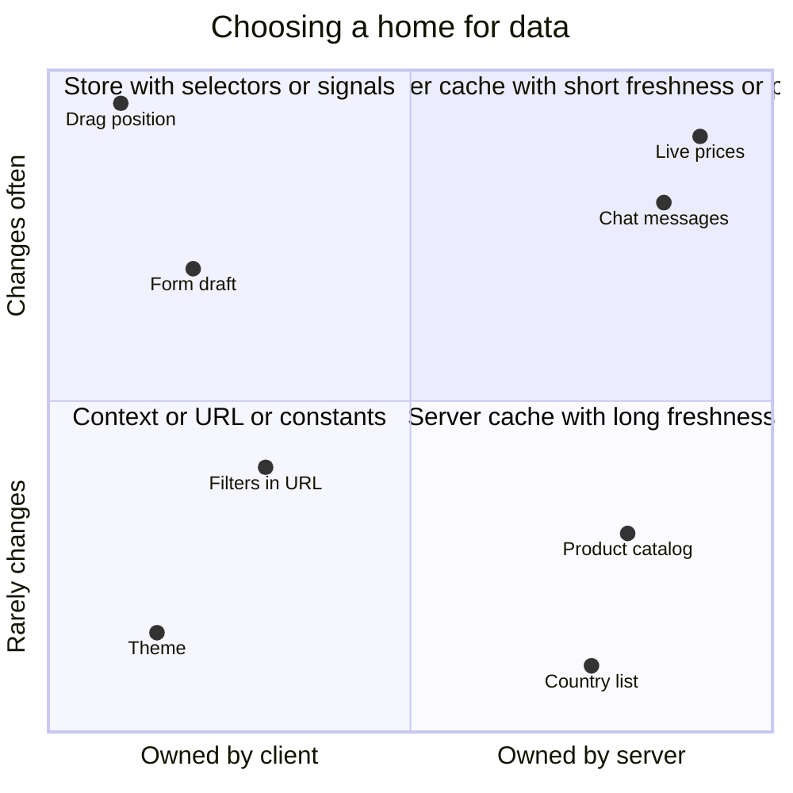

---

## Real-World Examples

**Example 1 — Replacing a hand-rolled Redux fetch slice (BAD → GOOD):**
```tsx
// ❌ BAD: server data copied into a global store by hand
const projectsSlice = createSlice({
  name: 'projects',
  initialState: { items: [] as Project[], status: 'idle' as 'idle' | 'loading' | 'failed' },
  reducers: {
    loaded(state, action: PayloadAction<Project[]>) { state.items = action.payload; state.status = 'idle'; },
  },
});
// ...plus thunks, "already fetched?" checks, manual refetch after every save,
// and nothing ever marks this data as stale.

// ✅ GOOD: server state lives in a server-state cache
import { useQuery, useMutation, useQueryClient } from '@tanstack/react-query';

export function useProjects() {
  return useQuery({
    queryKey: ['projects'],
    queryFn: ({ signal }) => fetch('/api/projects', { signal }).then((r) => {
      if (!r.ok) throw new Error(`HTTP ${r.status}`);
      return r.json() as Promise<Project[]>;
    }),
    staleTime: 30_000, // this list may be up to 30 s old before a background refetch
  });
}

export function useRenameProject() {
  const qc = useQueryClient();
  return useMutation({
    mutationFn: (p: { id: string; name: string }) =>
      fetch(`/api/projects/${p.id}`, {
        method: 'PATCH',
        headers: { 'Content-Type': 'application/json' },
        body: JSON.stringify({ name: p.name }),
      }).then((r) => r.json()),
    onSuccess: () => qc.invalidateQueries({ queryKey: ['projects'] }), // re-sync every view
  });
}
```

**Example 2 — Labelling every piece of state on a product listing page:**
```text
Screen: /products?category=shoes&sort=price&page=2

Category, sort, page            → URL state         (shareable, part of the query key)
Product list for those params   → server state      (query key ['products', {category, sort, page}])
Cart contents                   → server state      (if carts sync across devices) — else client store + localStorage
"Filters panel open" on mobile  → local UI state    (useState in the panel's parent)
Price slider while dragging     → local UI state    (commit to URL on release, debounced)
Number of items in the cart     → derived           (compute from the cart query: items.length)
Logged-in user                  → server state      (['me'] query; the session lives in an httpOnly cookie)
Theme                           → persisted client  (small store + localStorage)
```

**Example 3 — URL state as the source for the query key (React Router):**
```tsx
import { useSearchParams } from 'react-router';
import { useQuery, keepPreviousData } from '@tanstack/react-query';

function OrdersPage() {
  const [params, setParams] = useSearchParams();
  const status = params.get('status') ?? 'open';
  const page = Number(params.get('page') ?? '1');

  const orders = useQuery({
    queryKey: ['orders', { status, page }],          // URL → key; Back/Forward reuse cached pages
    queryFn: ({ signal }) => api.orders({ status, page }, { signal }),
    placeholderData: keepPreviousData,                // keep page 1 visible while page 2 loads
  });

  return (
    <>
      <StatusTabs value={status} onChange={(s) => setParams({ status: s, page: '1' })} />
      <OrderTable rows={orders.data?.rows ?? []} dimmed={orders.isPlaceholderData} />
    </>
  );
}
```
In Next.js App Router use `useSearchParams()` from `next/navigation` (plus `router.push`), in Vue Router `useRoute().query`, in Angular `ActivatedRoute.queryParamMap`, and in SvelteKit `page.url.searchParams`.

**Example 4 — A tiny client store next to a server cache:**
```tsx
import { create } from 'zustand';

// Client state only: no API data in here.
type UiState = {
  sidebarOpen: boolean;
  selectedIds: Set<string>;
  toggleSidebar: () => void;
  toggleSelected: (id: string) => void;
};

export const useUi = create<UiState>((set) => ({
  sidebarOpen: true,
  selectedIds: new Set(),
  toggleSidebar: () => set((s) => ({ sidebarOpen: !s.sidebarOpen })),
  toggleSelected: (id) =>
    set((s) => {
      const next = new Set(s.selectedIds);
      next.has(id) ? next.delete(id) : next.add(id);
      return { selectedIds: next };
    }),
}));

// Component combines both: server data from the cache, selection from the store.
function ProjectList() {
  const { data: projects = [] } = useProjects();
  const selected = useUi((s) => s.selectedIds);
  const selectedCount = projects.filter((p) => selected.has(p.id)).length; // derived, not stored
  return <Toolbar count={selectedCount} />;
}
```
Store **ids**, not copies of server objects — copies go stale; ids are resolved against the cache at render time.

**Example 5 — Same split in Vue, Angular and SvelteKit:**
```typescript
// Vue 3 + TanStack Vue Query (server state) + Pinia (client state)
import { useQuery } from '@tanstack/vue-query';
const projects = useQuery({ queryKey: ['projects'], queryFn: fetchProjects, staleTime: 30_000 });

// Angular (signal-based resource API — check current stability in the Angular docs)
import { httpResource } from '@angular/common/http';
export class ProjectsComponent {
  projects = httpResource<Project[]>(() => '/api/projects'); // projects.value(), projects.isLoading()
}

// SvelteKit — +page.ts load function; call invalidate('app:projects') after a mutation
import type { PageLoad } from './$types';
export const load: PageLoad = async ({ fetch, depends }) => {
  depends('app:projects');
  return { projects: await fetch('/api/projects').then((r) => r.json()) };
};
```

**Example 6 — Seeding the client cache from SSR (TanStack Query, Next.js Pages Router style):**
```tsx
import { dehydrate, HydrationBoundary, QueryClient, useQuery } from '@tanstack/react-query';

export async function getServerSideProps() {
  const qc = new QueryClient();
  await qc.prefetchQuery({ queryKey: ['projects'], queryFn: fetchProjects });
  return { props: { dehydratedState: dehydrate(qc) } };
}

export default function Page({ dehydratedState }: { dehydratedState: unknown }) {
  return (
    <HydrationBoundary state={dehydratedState}>
      <Projects />
    </HydrationBoundary>
  );
}

function Projects() {
  // Same key → data is already in the cache; with staleTime > 0 there is no immediate refetch
  const { data } = useQuery({ queryKey: ['projects'], queryFn: fetchProjects, staleTime: 60_000 });
  return <List items={data ?? []} />;
}
```

---

## Key Points Summary

| Concept | One-Line Explanation |
|---|---|
| **Client state** | Owned by the UI, synchronous, always current |
| **Server state** | A cached snapshot of remotely owned data; asynchronous and can go stale |
| **Source of truth** | Exactly one owner per value; everything else is a cache or derived |
| **URL state** | Shareable view state (filters, page, tab) — also the natural query-key input |
| **Derived state** | Compute it; storing it creates drift |
| **Server-cache library** | Handles keys, dedupe, freshness, refetch triggers, GC, retries, invalidation |
| **Freshness window** | How long a copy is trusted before a background refetch (`staleTime`, dedupe interval) |
| **Invalidation** | After a mutation, mark affected keys stale and refetch the active ones |
| **useEffect fetching** | Race-prone and cache-less; prefer a framework loader or server-cache library |
| **Global store for API data** | Hand-written cache with no expiry — use RTK Query or a query library instead |
| **SSR hydration** | Serialize the server's cache into the page so the client doesn't refetch immediately |
| **Native mobile** | Same idea: a repository with one source of truth (often a local DB) refreshed from the network |

---

## Test Your Understanding

**Q1 (Basic):**
Classify each as server, URL, local UI, form, or derived state: (a) the current user's avatar URL, (b) "is the dropdown open", (c) `?sort=price`, (d) unsaved comment text, (e) "number of unread notifications" when you already have the notifications list.

<details>
<summary>Answer</summary>

(a) **Server state** — the server owns the profile; the client holds a cached copy (e.g. an `['me']` query). (b) **Local UI state** — nobody else needs it. (c) **URL state** — shareable and part of the query key. (d) **Form state** — a draft owned by the client until it's submitted; then it becomes server state. (e) **Derived** — compute it from the notifications query (`list.filter(n => !n.read).length`). Storing it separately creates a second value that can disagree with the list — unless the server provides an authoritative count for data you haven't loaded, in which case that count is itself server state.
</details>

**Q2 (Application):**
A dashboard has a header avatar, a sidebar with the user's teams, and a settings page — all need `/api/me`. Today each component fetches it in `useEffect`. List the problems and the fix.

<details>
<summary>Answer</summary>

Problems: **three identical requests** on load (no dedupe); each component has its **own copy**, so after the user changes their name in settings, the header and sidebar show the old name (no shared cache, no invalidation); each has hand-written loading/error code; no refetch when the user returns to the tab; potential races and no cancellation.

Fix: one hook, e.g. `useMe()` = `useQuery({ queryKey: ['me'], queryFn })` (or `useSWR('/api/me')`). All three components share **one cache entry and one request**. The settings mutation calls `invalidateQueries({ queryKey: ['me'] })` (or writes the response with `setQueryData`), so every consumer updates together.
</details>

**Q3 (Tricky):**
A teammate says: "We use TanStack Query, so we don't need Zustand or Redux at all." When is this true, and when is it not?

<details>
<summary>Answer</summary>

It's often **mostly true**: once server data moves into a query cache, much of what used to be "global state" disappears. The remaining client state (modals, form drafts, filters) usually fits in component state and the URL.

It's **not true** when the app has substantial client-owned state shared across distant components that changes often: a canvas/editor document before it's saved, multi-step wizard drafts, complex selection state, undo/redo history, offline drafts. That state has no server owner yet, so a query library is the wrong tool — a store (Zustand, Jotai, Redux, signals) fits. The point is **not to put server data into that store**, not to ban stores.
</details>

**Q4 (Tricky):**
After SSR with a dehydrated query cache, the page renders instantly — then every list flashes a loading indicator and refetches. Why, and how do you fix it?

<details>
<summary>Answer</summary>

With TanStack Query's default `staleTime: 0`, hydrated data is considered **stale immediately**, so when the components mount on the client the "refetch on mount" trigger fires for every query. (A flash of a loading spinner specifically suggests the UI is checking `isFetching` instead of `isPending`, or the keys don't match so the hydrated data isn't found.)

Fix: set a sensible `staleTime` (e.g. 30–60 s, often as a `QueryClient` default) so hydrated data counts as fresh; make sure server and client use **identical query keys**; and only show full loading states for `isPending` (no data yet), using a subtle indicator for background `isFetching`.
</details>

**Q5 (Application):**
You store a selected `Project` object (from the API) in a Zustand store so the details panel can show it. Users report the panel shows an old name after renaming. What's the design flaw?

<details>
<summary>Answer</summary>

The store holds a **copy of server state**. The rename mutation invalidates and refetches the `['projects']` query, but the object in the store is a separate snapshot that nobody updates — two sources of truth.

Fix: store only the **id** (`selectedProjectId`) as client state, and resolve it against the cache at render time (`projects.find(p => p.id === selectedId)` or a `['project', id]` query). Ids don't go stale; copies do. Even better, if the selection should survive reload or be shareable, put the id in the URL (`/projects/42`).
</details>

**Q6 (System design):**
Design the state architecture for a collaborative task board (lists, cards, comments, assignees) used by teams of ~20 people. What is server state, what is client state, and how do changes from other users show up?

<details>
<summary>Answer</summary>

**Server state:** boards, lists, cards, comments, members — cached with keys like `['board', boardId]`, `['card', cardId]`, `['comments', cardId]`. Because the same card appears in a list and in a detail modal, consider a **normalized** cache or update both keys on change.

**URL state:** current board id, open card id (`/b/42/c/981`), filters (`?assignee=me`) — so links open the exact view.

**Client state:** drag-in-progress position and hover target (local, high-frequency — never in the query cache until drop), open menus, comment draft (form state, maybe persisted locally), multi-select.

**Mutations:** moving a card is an **optimistic update** (reorder in the cache immediately, roll back on error, invalidate on settle). Use a mutation queue/scope so rapid moves are sent in order.

**Other users' changes:** a WebSocket/SSE channel per board delivers events (`card.moved`, `comment.added`); the handler either patches the cache (`setQueryData`) or invalidates the affected keys. Keep refetch-on-focus as a safety net for missed events after sleep/reconnect.
</details>

---

## Cheat Sheet

**Key Definitions:**
- **Client state:** State created and owned by the UI; synchronous; e.g. modal open, form draft
- **Server state:** Data owned remotely; the client holds an asynchronous, possibly stale cached copy
- **Source of truth:** The single place whose value wins when copies disagree
- **URL state:** View state encoded in the route/search params; shareable and history-aware
- **Derived state:** Values computed from other state; should not be stored
- **Freshness window:** Time a cached copy is trusted without refetching
- **Invalidation:** Marking cached entries stale (and refetching active ones) after data changes
- **Hydration (data):** Seeding the client cache with data fetched during SSR

**Quick Reference:**
```text
Who owns it?
  server / database / third party        → server-cache library (TanStack Query, SWR, RTK Query, GraphQL client)
  shareable view (filters, page, tab)    → URL search params → feed into query keys
  one component / small subtree          → component state (lift to common parent)
  many distant components, changes often → small store with selectors (Zustand, Jotai, Redux, Pinia, signals)
  rarely changing app-wide value         → context / provide-inject
  computable from other state            → derive during render (selector / computed)
  must survive reload                    → store + localStorage (or a settings API to sync devices)

Server-cache essentials
  key = everything the request depends on   ['orders', { status, page }]
  freshness per resource                    seconds (prices) … hours (country list)
  after a mutation                          invalidate affected keys (or write the response / optimistic)
  SSR                                        prefetch → dehydrate → hydrate; set staleTime > 0
  store ids, not copies of server objects
```

**Common Mistakes to Avoid:**

| Mistake | Why Wrong | Fix |
|---|---|---|
| Copying API responses into a global store | Second source of truth; no expiry or invalidation | Server-cache library (or RTK Query if on Redux) |
| Fetching in `useEffect` + `useState` everywhere | Races, duplicate requests, no cache, no retry | Framework loader or query hook; at minimum abort/ignore stale responses |
| Storing derived values (`total`, `count`) | Drifts from the data it's derived from | Compute during render / selector |
| Filters only in a store | Not shareable, lost on reload, Back button broken | Put them in the URL |
| Storing a selected server object in UI state | Goes stale after mutations | Store the id; look it up in the cache |
| Putting drag/hover positions in the server cache or global store | High-frequency updates re-render everything | Local state; commit on drop |
| No invalidation plan for mutations | Some screens show old data | Key factories / tags; invalidate by prefix |
| Hydrated data immediately refetched | Default `staleTime: 0` treats it as stale | Set `staleTime` > 0; identical keys server and client |
| Treating auth status as purely client state | Client can't know if the session is still valid | Derive from a `/me` query + httpOnly cookie session |
| One giant "app state" object | Every change re-renders every subscriber | Split by owner and by subscriber |

---

## References & Further Reading

**Core docs**
- TanStack Query: [Overview — "server state is totally different"](https://tanstack.com/query/latest/docs/framework/react/overview)
- TanStack Query: [Does TanStack Query replace Redux, MobX or other global state managers?](https://tanstack.com/query/latest/docs/framework/react/guides/does-this-replace-client-state)
- TanStack Query: [Important defaults](https://tanstack.com/query/latest/docs/framework/react/guides/important-defaults)
- SWR: [Documentation](https://swr.vercel.app/docs/getting-started)
- Redux Toolkit: [RTK Query overview](https://redux-toolkit.js.org/rtk-query/overview)
- Redux: [FAQ — Organizing State](https://redux.js.org/faq/organizing-state)

**React guidance**
- react.dev: [You Might Not Need an Effect](https://react.dev/learn/you-might-not-need-an-effect)
- react.dev: [`useEffect` — fetching data with Effects](https://react.dev/reference/react/useEffect#fetching-data-with-effects)
- react.dev: [Choosing the State Structure](https://react.dev/learn/choosing-the-state-structure)
- react.dev: [Sharing State Between Components](https://react.dev/learn/sharing-state-between-components)

**Other frameworks and platforms**
- Vue: [State Management](https://vuejs.org/guide/scaling-up/state-management)
- Nuxt: [Data fetching](https://nuxt.com/docs/getting-started/data-fetching)
- Angular: [Async reactivity with resources](https://angular.dev/guide/signals/resource)
- SvelteKit: [Loading data](https://svelte.dev/docs/kit/load)
- React Router: [Data loading](https://reactrouter.com/start/framework/data-loading)
- Next.js: [Fetching data](https://nextjs.org/docs/app/getting-started/fetching-data)
- Android Developers: [Data layer (single source of truth)](https://developer.android.com/topic/architecture/data-layer)

**Deep dives**
- TkDodo: [Practical React Query](https://tkdodo.eu/blog/practical-react-query)
- TkDodo: [React Query as a State Manager](https://tkdodo.eu/blog/react-query-as-a-state-manager)
- Kent C. Dodds: [Application State Management with React](https://kentcdodds.com/blog/application-state-management-with-react)
- web.dev: [Keeping things fresh with stale-while-revalidate](https://web.dev/articles/stale-while-revalidate)

---

> **Previous Topic:** [Zustand / Jotai / Recoil](./zustand-jotai-recoil.md)
> — Lightweight client-state stores and atoms (and Recoil's archived status)

> **Next Topic:** [React Query / TanStack Query](./react-query-tanstack-query.md)
> — The most complete server-state cache: keys, staleTime, mutations, infinite queries and SSR

*Saved on: 2026-11-06 | Repo: Frontend System Design Learning Notes*
