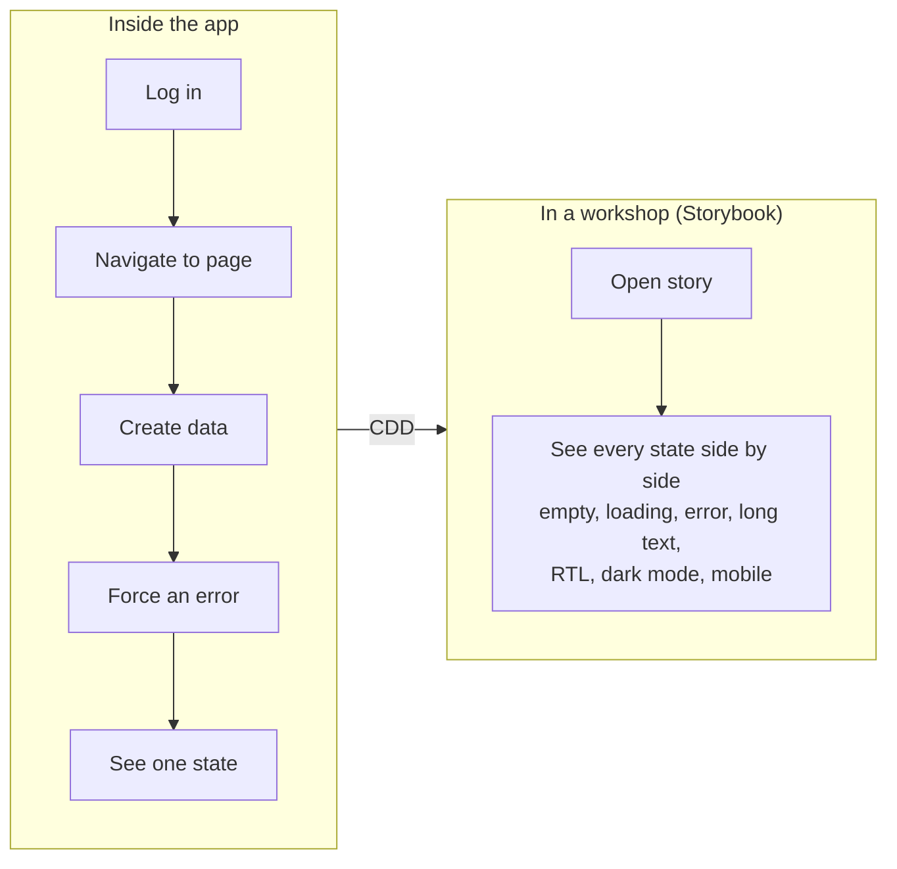
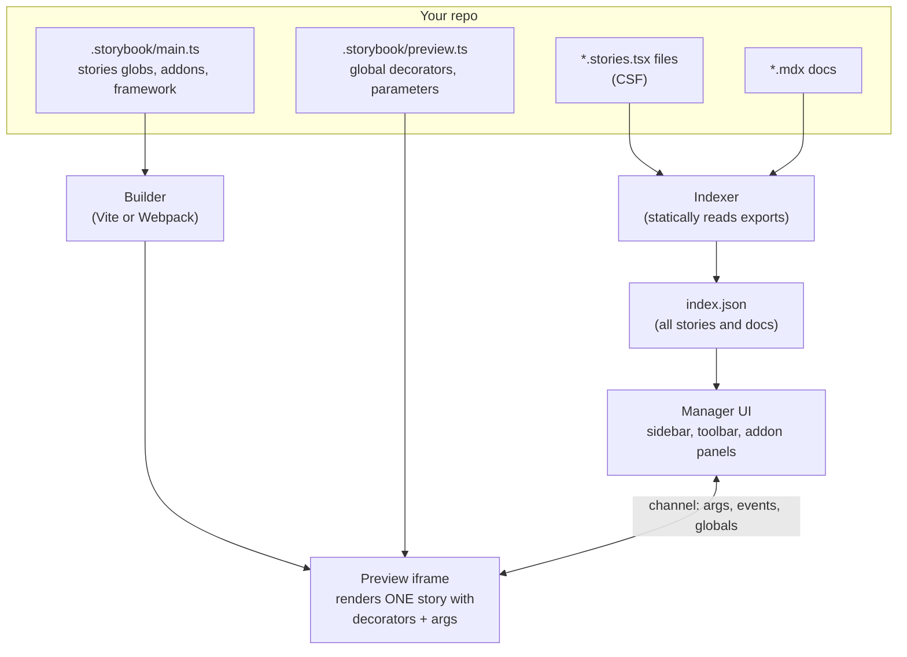
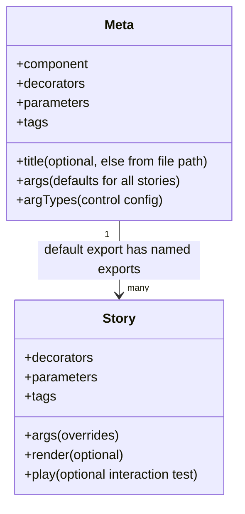
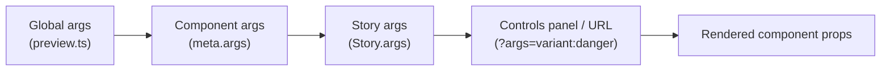
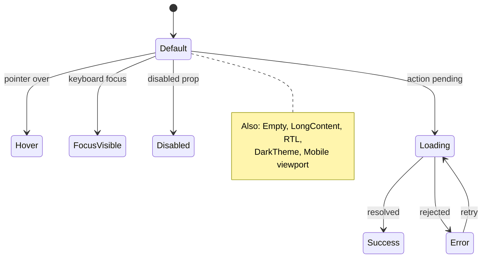
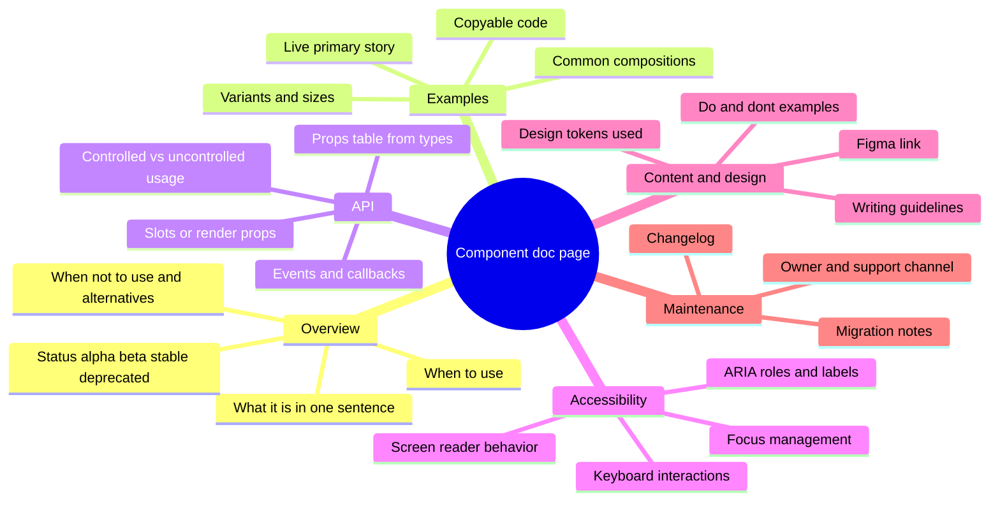
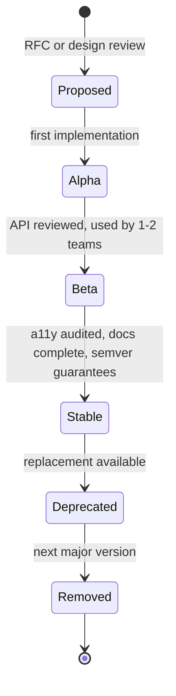
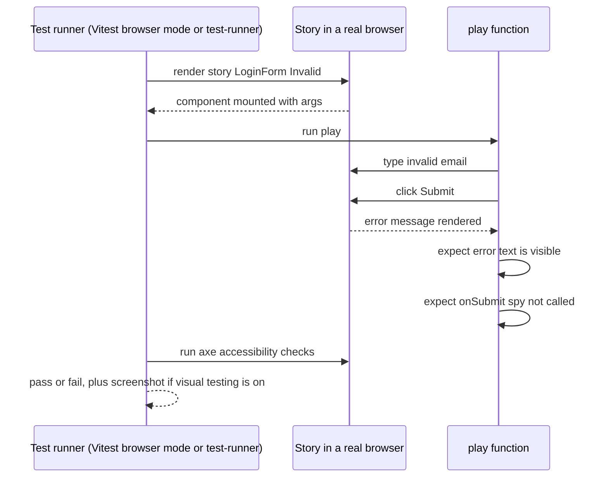
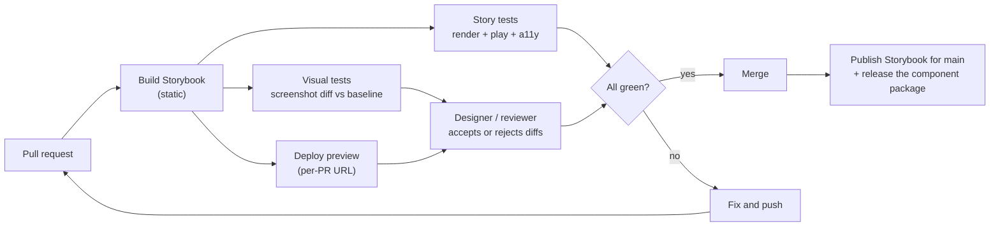
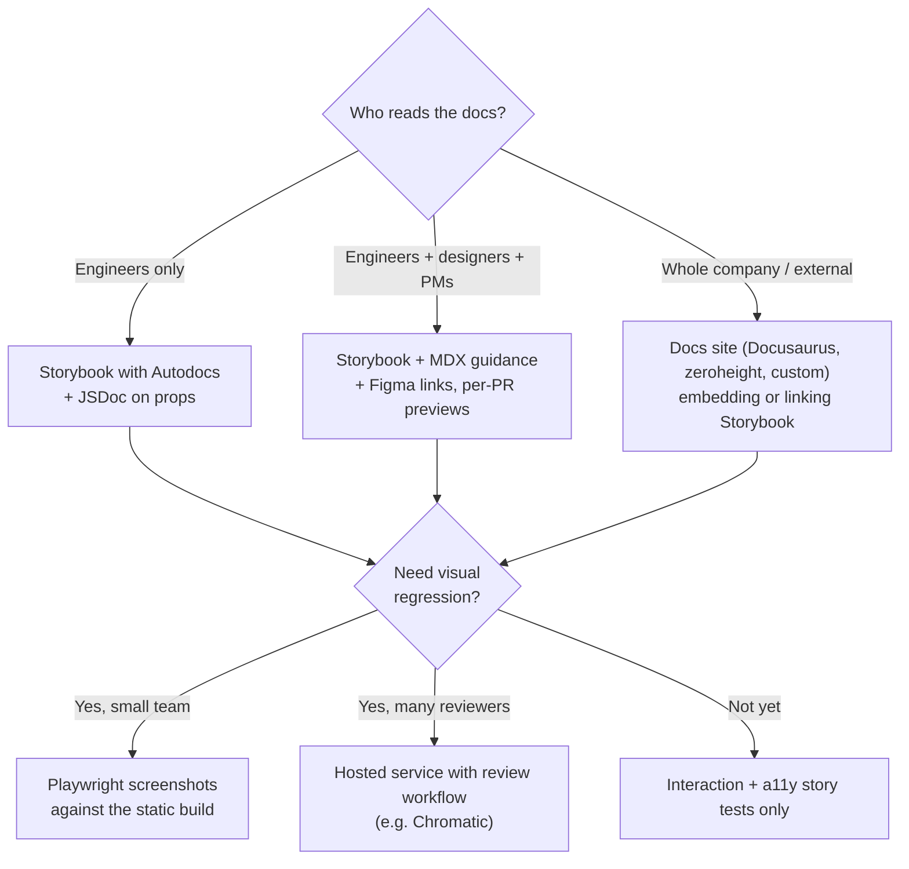

<!-- Generated by scripts/sync-knowledge.js from notes/ and README.md — do not edit here. -->
<!-- sections (line ranges in this file): Table of Contents 19-41 · ELI5 42-54 · Core Concept 55-627 · System Design Angle 628-663 · Real-World Examples 664-799 · Key Points Summary 800-821 · Test Your Understanding 822-899 · Cheat Sheet 900-948 · References & Further Reading 949-986 -->

# Storybook & Component Documentation

> **Date:** 2026-11-06 · **Last updated:** 2026-11-06
> **Category:** Frontend System Design
> **Sub-Topic:** Design Systems & Components / Design System Documentation
> **Level:** Intermediate · **Reading time:** ~28 min
> **Informs:** component workshop and docs tooling choice, story coverage per component state, design-system documentation structure, component testing strategy (interaction, a11y, visual regression), CI for UI libraries, design-to-code handoff, mocking data and network for isolated components, multi-framework and native-mobile component catalogs

> **Pre-requisite:** [Component Architecture & Design Systems](./component-architecture-and-design-systems.md) (what a design system ships) and [Custom Hooks Patterns](./custom-hooks-patterns.md) (the logic behind the components you'll document).
> This note covers **developing, documenting and testing components in isolation** with Storybook, what good component documentation contains, and how it fits into CI. Storybook moves quickly — version-specific details are flagged; check the [official docs](https://storybook.js.org/docs) for your version.

**Previous:** [Custom Hooks Patterns](./custom-hooks-patterns.md) · **Next:** [CSS Architecture (CSS-in-JS, Tailwind, CSS Modules)](./css-architecture-css-in-js-tailwind-css-modules.md)

---

## Table of Contents

1. [ELI5 — Simple Explanation](#eli5--simple-explanation)
2. [Section 1: Why Develop Components in Isolation](#section-1-why-develop-components-in-isolation)
3. [Section 2: How Storybook Works](#section-2-how-storybook-works)
4. [Section 3: Component Story Format (CSF)](#section-3-component-story-format-csf)
5. [Section 4: Args, Controls, Actions, Decorators, Parameters](#section-4-args-controls-actions-decorators-parameters)
6. [Section 5: Which Stories to Write](#section-5-which-stories-to-write)
7. [Section 6: Mocking Data, Network and Modules](#section-6-mocking-data-network-and-modules)
8. [Section 7: Documentation — Autodocs and MDX](#section-7-documentation--autodocs-and-mdx)
9. [Section 8: What Good Component Documentation Contains](#section-8-what-good-component-documentation-contains)
10. [Section 9: Stories as Tests](#section-9-stories-as-tests)
11. [Section 10: Storybook in CI and Publishing](#section-10-storybook-in-ci-and-publishing)
12. [Section 11: Other Frameworks, Native Mobile and Alternatives](#section-11-other-frameworks-native-mobile-and-alternatives)
13. [System Design Angle](#system-design-angle)
14. [Real-World Examples](#real-world-examples)
15. [Key Points Summary](#key-points-summary)
16. [Test Your Understanding (with answers)](#test-your-understanding)
17. [Cheat Sheet](#cheat-sheet)
18. [References & Further Reading](#references--further-reading)

---

## ELI5 — Simple Explanation

Imagine a car factory.

- You don't test a new **headlight** by building a whole car and driving it at night. You put the headlight on a **test bench**, plug it in, and try every setting: low beam, high beam, broken bulb, foggy glass.
- **Storybook is that test bench for UI components.** Each **story** is one setting: "Button — primary", "Button — disabled", "Button — very long label in German".
- Next to the bench is a **catalog** with photos, specs and "how to install" notes. That's the **component documentation**, so other teams can pick the right part without asking you.
- Before a new headlight ships, a robot clicks every switch and compares photos with last week's (interaction and visual tests). If something changed by accident, the line stops.

> **Storybook renders each component state in isolation as a "story". Those stories become living documentation, a review surface for designers, and test cases — one artifact, three uses.**

---

## Core Concept — Step by Step

### Section 1: Why Develop Components in Isolation

Building a component inside the full app means: log in, navigate three screens, create test data, and trigger an error just to see the error state. **Component-driven development (CDD)** flips this: build components bottom-up, each in isolation, then compose them into pages.



| Benefit | Why it matters for a team |
|---|---|
| **Every state is reachable** | Edge cases (empty, error, 500 items, missing image) are one click away, so they get built and reviewed |
| **Fast feedback** | No backend, auth or routing needed; hot reload on one component |
| **Shared vocabulary** | Designers, PMs, QA and engineers review the same URL |
| **Living documentation** | Docs are generated from real, running code, so they can't drift as easily as a wiki |
| **Test fixtures for free** | Each story is a ready-made test case for interaction, a11y and visual tests |
| **Forces good component APIs** | If a component can't render without the whole app, its dependencies are too tangled |

---

### Section 2: How Storybook Works

Storybook is a separate dev server (and static build) that runs **next to** your app, using your app's bundler config through a **framework** package (e.g. React + Vite, Next.js, Vue 3 + Vite, Angular, SvelteKit, Web Components).



| Piece | Role |
|---|---|
| **Framework** | Package that ties a UI framework to a builder (e.g. `@storybook/react-vite`, `@storybook/nextjs`, `@storybook/vue3-vite`, `@storybook/angular`, `@storybook/sveltekit`) |
| **Builder** | Bundles stories with Vite or Webpack, reusing your app's config where possible |
| **Indexer** | Statically analyzes story files to list stories **without executing them** — so story exports must be statically analyzable |
| **Manager** | The Storybook UI: sidebar, toolbar, addon panels (Controls, Actions, Accessibility, Interactions) |
| **Preview** | An **iframe** that renders the selected story, isolated from the manager's CSS and JS |
| **Addons** | Extend manager and/or preview (docs, a11y, designs, themes, MSW, …) |

Setup (one-time):

```bash
# Detects your framework and builder, adds config and example stories
npm create storybook@latest
# older CLI form, still widely documented:  npx storybook@latest init

npm run storybook          # dev server (default port 6006)
npm run build-storybook    # static site → storybook-static/
```

---

### Section 3: Component Story Format (CSF)

Stories are written in **CSF** — an open, ES-module-based format: the **default export** describes the component (**meta**), and each **named export** is a story. CSF 3 stories are **objects** with `args`, so most stories need no render function.



```tsx
// Button.stories.tsx
import type { Meta, StoryObj } from '@storybook/react-vite';  // import from your framework package
import { fn } from 'storybook/test';                           // Storybook 8: '@storybook/test'
import { Button } from './Button';

const meta = {
  component: Button,
  title: 'Components/Button',          // optional: auto-title from the file path otherwise
  tags: ['autodocs'],                  // generate a Docs page
  args: { children: 'Save', onClick: fn() },   // fn() = spy shown in the Actions panel
  argTypes: {
    variant: { control: 'inline-radio', options: ['primary', 'secondary', 'danger'] },
  },
} satisfies Meta<typeof Button>;

export default meta;
type Story = StoryObj<typeof meta>;

export const Primary: Story = { args: { variant: 'primary' } };
export const Secondary: Story = { args: { variant: 'secondary' } };
export const Disabled: Story = { args: { disabled: true } };
export const Loading: Story = { args: { isLoading: true } };
export const LongLabel: Story = {
  args: { children: 'Datenschutzeinstellungen speichern und fortfahren' },
};
```

> **Version note:** In Storybook 8, types came from `@storybook/react` and test utilities from `@storybook/test`. Recent major versions consolidated many packages (e.g. `storybook/test`) and recommend importing types from the framework package. A newer, more type-safe "CSF factories" format has also been introduced. Run the official migration (`npx storybook@latest upgrade`) rather than hand-editing imports.

**Naming:** stories are named after **states or use cases** (`Disabled`, `WithIcon`, `EmptyCart`), not test IDs. The export name becomes the display name (`LongLabel` → "Long Label").

---

### Section 4: Args, Controls, Actions, Decorators, Parameters

**Args** are a story's inputs (props). They merge from four levels; the most specific wins:



| Concept | What it is | Example |
|---|---|---|
| **Args** | Story inputs, merged across levels | `args: { variant: 'primary' }` |
| **ArgTypes** | Metadata about args: control type, options, description, category | `argTypes: { size: { control: 'select', options: ['sm', 'md'] } }` |
| **Controls** | Panel generated from args/argTypes to edit props live | Toggle `disabled`, edit `children` |
| **Actions** | Panel logging calls to callback args | `onClick: fn()` |
| **Decorators** | Wrappers around stories: providers, layout, theme, router | `decorators: [(Story) => <ThemeProvider><Story /></ThemeProvider>]` |
| **Parameters** | Static config for addons and features | `parameters: { layout: 'centered', a11y: { … } }` |
| **Globals** | Toolbar-wide values (theme, locale, viewport) read by decorators | Theme switcher in the toolbar |
| **Tags** | Labels that control docs, tests and sidebar inclusion | `tags: ['autodocs']`, `tags: ['!test']` |

**Decorator nesting:** story decorators are innermost, then component (meta) decorators, then global (preview) decorators on the outside.

```tsx
// .storybook/preview.tsx — global setup applied to every story
import type { Preview } from '@storybook/react-vite';
import { ThemeProvider } from '../src/theme';
import '../src/styles/global.css';

const preview: Preview = {
  parameters: {
    layout: 'centered',
    controls: { matchers: { color: /(background|color)$/i, date: /Date$/i } },
  },
  globalTypes: {
    theme: {
      description: 'Color theme',
      toolbar: { title: 'Theme', icon: 'paintbrush', items: ['light', 'dark'], dynamicTitle: true },
    },
  },
  initialGlobals: { theme: 'light' },
  decorators: [
    (Story, context) => (
      <ThemeProvider theme={context.globals.theme}>
        <Story />
      </ThemeProvider>
    ),
  ],
};

export default preview;
```

> Older Storybook versions used `globals` instead of `initialGlobals` in `preview`. If the toolbar doesn't appear, check the docs for your version.

---

### Section 5: Which Stories to Write

Write **one story per meaningful state** — the states a designer would draw or a bug report would describe.



**Story checklist per component:**

| Category | Stories |
|---|---|
| **Variants** | Every visual variant and size (`Primary`, `Secondary`, `Small`, `Large`) |
| **Interactive states** | Disabled, loading, selected, expanded, invalid; hover/focus via pseudo-state addon or interaction |
| **Data states** | Empty, one item, many items, very long text, missing optional data (no avatar), error |
| **Environment** | Dark theme, RTL (`dir="rtl"`), narrow/mobile viewport, a long-word language (German, Finnish) |
| **Composition** | Typical usage inside a parent (`Button` in a `Form`, `Card` in a `Grid`) |
| **Pages** | Full screens composed from components, with mocked data (Section 6) |

> **Rule of thumb:** if QA could file a bug about a state, there should be a story for it. If a story needs more than a few lines of setup, the component probably has too many hidden dependencies.

---

### Section 6: Mocking Data, Network and Modules

Isolated components still need data. Options, from simplest to most realistic:

| Technique | How | Best for |
|---|---|---|
| **Props/args** | Pass fixture data as args | Presentational components (the majority) |
| **Decorators with providers** | Wrap in a `QueryClientProvider`, router, i18n, store with seeded state | Components reading context |
| **Network mocking (MSW)** | `msw-storybook-addon` intercepts `fetch`/XHR with a Service Worker; per-story `parameters.msw.handlers` | Container/page components that fetch |
| **Module mocking** | Replace modules (e.g. `lib/session`) via subpath imports or builder aliases | Components importing services directly |
| **Loaders / `beforeEach`** | Async setup before the story renders | Seeding data, resetting mocks |

```tsx
// ProductList.stories.tsx — page-level story with mocked network
import { http, HttpResponse, delay } from 'msw';
import type { Meta, StoryObj } from '@storybook/react-vite';
import { ProductList } from './ProductList';

const meta = { component: ProductList } satisfies Meta<typeof ProductList>;
export default meta;
type Story = StoryObj<typeof meta>;

export const Loaded: Story = {
  parameters: {
    msw: { handlers: [http.get('/api/products', () => HttpResponse.json(productsFixture))] },
  },
};

export const Empty: Story = {
  parameters: {
    msw: { handlers: [http.get('/api/products', () => HttpResponse.json([]))] },
  },
};

export const SlowNetwork: Story = {
  parameters: {
    msw: {
      handlers: [
        http.get('/api/products', async () => {
          await delay('infinite');               // stays in the loading state forever
          return HttpResponse.json([]);
        }),
      ],
    },
  },
};

export const ServerError: Story = {
  parameters: {
    msw: { handlers: [http.get('/api/products', () => new HttpResponse(null, { status: 500 }))] },
  },
};
```

> Mocking the **network** (not the data library) means the real TanStack Query/SWR/Apollo cache logic runs in the story — the same approach recommended for tests in [Custom Hooks Patterns](./custom-hooks-patterns.md). With a shared QueryClient decorator, create a **fresh client per story** or cached data leaks between stories.

---

### Section 7: Documentation — Autodocs and MDX

**Autodocs** builds a Docs page per component from the meta and stories when the `autodocs` tag is present (per component or globally in `preview`):
- the component **description** from its JSDoc comment,
- a **props table** (ArgTypes) extracted from TypeScript types/PropTypes, including JSDoc on each prop and default values,
- the **primary story** with live controls,
- **all stories** with "Show code" snippets.

```tsx
export type ButtonProps = {
  /** Visual style. Use `danger` only for destructive, irreversible actions. */
  variant?: 'primary' | 'secondary' | 'danger';
  /** Shows a spinner, disables the button and sets `aria-busy`. */
  isLoading?: boolean;
  children: React.ReactNode;
} & React.ButtonHTMLAttributes<HTMLButtonElement>;

/**
 * Triggers an action. For navigation use `<Link>` instead.
 * One primary button per view.
 */
export function Button({ variant = 'primary', isLoading = false, ...rest }: ButtonProps) { /* ... */ }
```

> For React, prop extraction uses `react-docgen` or `react-docgen-typescript` (configurable in `main.ts` under `typescript.reactDocgen`). The TypeScript-based option handles complex/imported types better but is slower. If a prop is missing from the table, this setting is the first thing to check.

**MDX docs** let you write long-form guidance (usage, do/don't, accessibility) and embed live stories with **doc blocks**:

```text
{/* Button.mdx */}
import { Meta, Canvas, Controls, Stories } from '@storybook/addon-docs/blocks';
import * as ButtonStories from './Button.stories';

<Meta of={ButtonStories} />

# Button

Use a button to trigger an action. For navigation, use **Link**.

<Canvas of={ButtonStories.Primary} />
<Controls />

## When to use
- Submitting a form, opening a dialog, confirming a choice.

## Accessibility
- Always has a visible text label, or an `aria-label` when icon-only.
- `isLoading` keeps focus on the button and announces progress with `aria-busy`.

<Stories />
```

> The doc-block import path depends on the version: `@storybook/blocks` in Storybook 7–8, `@storybook/addon-docs/blocks` in more recent releases.

---

### Section 8: What Good Component Documentation Contains

Generated props tables answer **"what can I pass?"** Teams also need **"should I use this, and how?"** — that part has to be written.



**Component status lifecycle** — publish it on every page so teams know what's safe to adopt:



| Docs principle | In practice |
|---|---|
| **Docs live with code** | Stories and MDX sit next to the component and change in the **same PR** |
| **Docs are part of "done"** | PR template / CI check: new component → stories + docs + a11y notes |
| **Show, then tell** | A live example first, prose second |
| **Document decisions** | "Why there's no `size="xl"`" saves the same question every month |
| **Versioned** | Publish docs per major version; link migration guides from deprecated components |
| **One source of truth** | Avoid a separate wiki that drifts; if you need a marketing-grade site (Docusaurus, zeroheight, Supernova, a custom site), embed or link stories instead of copying code |

---

### Section 9: Stories as Tests

Because each story is a fully set-up component state, it doubles as a **test case**:

| Test type | How with Storybook | Catches |
|---|---|---|
| **Smoke / render** | Every story renders without throwing | Crashes, missing providers |
| **Interaction** | A story's `play` function simulates user actions and asserts | Broken behavior (validation, keyboard, state changes) |
| **Accessibility** | `@storybook/addon-a11y` runs axe-core on each story (panel, and in tests) | Missing labels, contrast, invalid ARIA |
| **Visual regression** | Screenshot each story and diff against a baseline (Chromatic, or Playwright screenshots against the static build) | Unintended visual changes |
| **Reuse in unit/E2E tests** | **Portable stories**: `composeStories()` imports stories into Vitest/Jest/Playwright CT | Duplicate fixture code |



```tsx
// LoginForm.stories.tsx — an interaction test that also documents behavior
import { expect, fn, userEvent, within } from 'storybook/test';   // Storybook 8: '@storybook/test'
import type { Meta, StoryObj } from '@storybook/react-vite';
import { LoginForm } from './LoginForm';

const meta = { component: LoginForm, args: { onSubmit: fn() } } satisfies Meta<typeof LoginForm>;
export default meta;
type Story = StoryObj<typeof meta>;

export const InvalidEmail: Story = {
  play: async ({ canvasElement, args }) => {
    const canvas = within(canvasElement);
    await userEvent.type(canvas.getByLabelText(/email/i), 'not-an-email');
    await userEvent.click(canvas.getByRole('button', { name: /sign in/i }));

    await expect(canvas.getByText(/enter a valid email/i)).toBeVisible();
    await expect(args.onSubmit).not.toHaveBeenCalled();
  },
};

export const SubmitsValidCredentials: Story = {
  play: async ({ canvasElement, args }) => {
    const canvas = within(canvasElement);
    await userEvent.type(canvas.getByLabelText(/email/i), 'ada@example.com');
    await userEvent.type(canvas.getByLabelText(/password/i), 'correct horse');
    await userEvent.click(canvas.getByRole('button', { name: /sign in/i }));

    await expect(args.onSubmit).toHaveBeenCalledWith({ email: 'ada@example.com', password: 'correct horse' });
  },
};
```

**Running stories as tests:**
- **Vitest addon** (recent versions): runs stories as Vitest tests in a real browser (Vitest browser mode with Playwright), from the Storybook UI or CLI, with a11y checks and coverage.
- **`@storybook/test-runner`**: the older Jest + Playwright runner that visits each story of a running or static Storybook.
- **Portable stories** (`composeStories` from your renderer package) let any test framework reuse stories, so fixtures and providers aren't duplicated.

See [Visual Regression Testing](./visual-regression-testing.md), [Accessibility Testing](./accessibility-testing.md) and [Testing Strategies & Pyramid](./testing-strategies-and-pyramid.md).

---

### Section 10: Storybook in CI and Publishing



**Publishing options:**
- **Static hosting:** `storybook build` outputs a static site — deploy to any static host or CDN (Netlify, Vercel, Cloudflare Pages, GitHub Pages, S3 + CloudFront). Per-PR preview URLs make design review async.
- **Chromatic** (built by the Storybook maintainers): hosting, visual and interaction testing, and a review/approval workflow — a commercial service with a free tier.
- **Composition:** a host Storybook can embed others via `refs` in `main.ts` — useful when the design system and product teams each publish their own Storybook.

```ts
// .storybook/main.ts
import type { StorybookConfig } from '@storybook/react-vite';

const config: StorybookConfig = {
  framework: '@storybook/react-vite',
  stories: ['../src/**/*.mdx', '../src/**/*.stories.@(ts|tsx)'],
  addons: ['@storybook/addon-docs', '@storybook/addon-a11y'],
  staticDirs: ['../public'],
  refs: {
    'design-system': { title: 'Design System', url: 'https://design.example.com/storybook' },
  },
  typescript: { reactDocgen: 'react-docgen-typescript' },
};

export default config;
```

> Which features are built into core versus separate addons has changed across major versions (e.g. Controls, Actions, Viewport and Backgrounds were once the "essentials" addon bundle). Let the CLI generate `main.ts` and check the migration guide when upgrading.

**Performance tips for big Storybooks (thousands of stories):** use the Vite builder, keep story files light (no heavy top-level side effects — the indexer reads them), lazy-compile stories in dev (the default with modern builders), and shard test runs in CI.

---

### Section 11: Other Frameworks, Native Mobile and Alternatives

| Stack | How components are developed and documented in isolation |
|---|---|
| **Vue 3** | Storybook `@storybook/vue3-vite`; stories render via a `template` with `v-bind="args"`. **Histoire** is a Vite-native alternative popular with Vue/Svelte |
| **Angular** | Storybook `@storybook/angular`; `moduleMetadata` / `applicationConfig` decorators provide imports and providers; Compodoc can feed the props table |
| **Svelte** | Storybook `@storybook/sveltekit` or `@storybook/svelte-vite`; the Svelte CSF addon lets you write stories in `.stories.svelte` files |
| **Web Components** | Storybook `@storybook/web-components-vite`; Custom Elements Manifest for props tables (see [Web Components & Shadow DOM](./web-components-and-shadow-dom.md)) |
| **React Native** | **Storybook for React Native** runs stories **on device/simulator**; components can also run in the browser via React Native Web |
| **iOS (SwiftUI)** | Xcode **Previews** (`#Preview { … }`) render views in isolation in the IDE; snapshot-testing libraries cover visual regression |
| **Android (Compose)** | `@Preview` composables render in Android Studio; catalog apps (e.g. Airbnb's Showkase) and screenshot-test tools (e.g. Paparazzi, Roborazzi) cover browsing and visual regression |
| **React alternatives** | **Ladle** (Vite-based, CSF-compatible, lightweight), **React Cosmos** (fixtures-based) |

```typescript
// Vue 3 story (CSF 3)
import type { Meta, StoryObj } from '@storybook/vue3-vite';
import BaseButton from './BaseButton.vue';

const meta = {
  component: BaseButton,
  args: { label: 'Save', variant: 'primary' },
  render: (args) => ({
    components: { BaseButton },
    setup: () => ({ args }),
    template: '<BaseButton v-bind="args" />',
  }),
} satisfies Meta<typeof BaseButton>;
export default meta;

export const Primary: StoryObj<typeof meta> = {};
export const Danger: StoryObj<typeof meta> = { args: { variant: 'danger' } };
```

```typescript
// Angular story with providers
import type { Meta, StoryObj } from '@storybook/angular';
import { applicationConfig } from '@storybook/angular';
import { provideHttpClient } from '@angular/common/http';
import { UserCardComponent } from './user-card.component';

const meta: Meta<UserCardComponent> = {
  component: UserCardComponent,
  decorators: [applicationConfig({ providers: [provideHttpClient()] })],
  args: { name: 'Ada Lovelace', role: 'Admin' },
};
export default meta;

export const Default: StoryObj<UserCardComponent> = {};
```

---

## System Design Angle

When a design system or product team asks **"how do we document and test components?"**, the decision usually comes down to these questions:



| Decision | Options | Trade-off |
|---|---|---|
| **Workshop tool** | Storybook / Ladle / Histoire / React Cosmos | Storybook: biggest ecosystem, multi-framework, heavier. Alternatives: faster and simpler, fewer addons |
| **Docs location** | Storybook only / separate docs site / both | One tool = less drift; a separate site = better narrative and branding but needs embedding |
| **Story scope** | Components only / components + pages | Page stories catch integration issues but need network/module mocking |
| **Test strategy** | Story-based tests / separate unit tests / both | Story tests reuse fixtures and document behavior; keep pure logic in unit tests |
| **Visual testing** | Hosted service / self-hosted screenshots / none | Hosted: review UI and baselines managed, costs money. Self-hosted: free, but you handle flakiness, fonts and baseline storage |
| **Monorepo layout** | One Storybook / per-package Storybooks + composition | One is simpler; composition scales across teams with separate deploys ([Monorepo Tooling](./monorepo-tooling-turborepo-nx.md)) |

**Requirements a mature setup usually meets:**
- Every exported component has stories for its states and a Docs page; CI fails if a new component has none.
- Stories run as tests (render, interactions, a11y) on every PR; visual diffs need explicit approval.
- A per-PR Storybook URL is posted on the PR for design review.
- Docs show **status** (alpha/beta/stable/deprecated), **owner**, **a11y notes**, and **migration notes**.
- Storybook builds with the **same** tokens, global CSS and providers as the app, so it doesn't drift from production.

---

## Real-World Examples

**Example 1 — BAD → GOOD stories:**
```tsx
// ❌ BAD: one "kitchen sink" story with hard-coded props and an app dependency
export const Everything = () => (
  <AppProviders>                 {/* pulls in auth, router, real API client */}
    <ProductCard product={realApiCall()} />
  </AppProviders>
);

// ✅ GOOD: one story per state, fixtures as args, minimal providers via decorators
const meta = {
  component: ProductCard,
  args: { product: productFixture, onAddToCart: fn() },
  decorators: [(Story) => <div style={{ width: 320 }}><Story /></div>],
} satisfies Meta<typeof ProductCard>;
export default meta;
type Story = StoryObj<typeof meta>;

export const Default: Story = {};
export const OnSale: Story = { args: { product: { ...productFixture, salePrice: 19.99 } } };
export const OutOfStock: Story = { args: { product: { ...productFixture, stock: 0 } } };
export const NoImage: Story = { args: { product: { ...productFixture, imageUrl: undefined } } };
export const VeryLongTitle: Story = {
  args: { product: { ...productFixture, title: 'Ergonomic wireless keyboard with backlit keys and a very long product name' } },
};
export const RightToLeft: Story = {
  decorators: [(Story) => <div dir="rtl"><Story /></div>],
};
```

**Example 2 — Fresh QueryClient per story (avoid cache leaks):**
```tsx
// .storybook/preview.tsx (excerpt)
import { QueryClient, QueryClientProvider } from '@tanstack/react-query';

const withQueryClient: Decorator = (Story) => {
  const client = new QueryClient({ defaultOptions: { queries: { retry: false } } });
  return (
    <QueryClientProvider client={client}>
      <Story />
    </QueryClientProvider>
  );
};

export default { decorators: [withQueryClient] } satisfies Preview;
```
> `retry: false` makes error stories show the error state immediately instead of retrying for several seconds. `Decorator` and `Preview` types come from your framework package.

**Example 3 — Reusing stories in a Vitest test (portable stories):**
```tsx
import { composeStories } from '@storybook/react-vite';   // older setups: '@storybook/react'
import { render, screen } from '@testing-library/react';
import { expect, test } from 'vitest';
import * as stories from './ProductCard.stories';

const { OutOfStock } = composeStories(stories);

test('out-of-stock card disables the add button', () => {
  render(<OutOfStock />);                    // args, decorators and project annotations applied
  expect(screen.getByRole('button', { name: /add to cart/i })).toBeDisabled();
});
```
> For project-level decorators/parameters to apply, portable stories need the project annotations set once in the test setup file (`setProjectAnnotations`). The Storybook docs describe the exact setup per test framework.

**Example 4 — Accessibility checks per story:**
```tsx
// Component-level: configure axe rules for this component's stories
const meta = {
  component: IconButton,
  parameters: {
    a11y: {
      // Run checks and report results; recent versions can be set to fail tests on violations
      config: { rules: [{ id: 'color-contrast', enabled: true }] },
    },
  },
} satisfies Meta<typeof IconButton>;
```
> The a11y addon catches **automatically detectable** issues (missing labels, invalid ARIA, contrast). It can't judge keyboard flows or screen-reader wording — pair it with `play` functions for keyboard behavior and manual testing. See [Automated A11y Testing (axe, Lighthouse)](./automated-a11y-testing-axe-lighthouse.md).

**Example 5 — CI workflow (GitHub Actions):**
```yaml
name: storybook
on: [pull_request]
jobs:
  storybook:
    runs-on: ubuntu-latest
    steps:
      - uses: actions/checkout@v4
      - uses: actions/setup-node@v4
        with:
          node-version: 22
          cache: npm
      - run: npm ci
      - run: npx playwright install --with-deps chromium
      - run: npm run build-storybook -- --quiet
      # Run stories as tests (render + play + a11y). Script name depends on your setup:
      #   Vitest addon:  vitest --project=storybook
      #   test-runner:   serve storybook-static, then test-storybook --url http://127.0.0.1:6006
      - run: npm run test-storybook
      - uses: actions/upload-artifact@v4
        with:
          name: storybook-static
          path: storybook-static
```

**Example 6 — Documenting a design-system component status in MDX:**
```text
{/* Tabs.mdx */}
import { Meta, Canvas, Controls } from '@storybook/addon-docs/blocks';
import * as TabsStories from './Tabs.stories';

<Meta of={TabsStories} />

# Tabs  ·  Status: Beta  ·  Owner: #design-system

Switch between related views in the same context. **Not** for navigation between pages — use **NavBar**.

<Canvas of={TabsStories.Default} />
<Controls />

## Keyboard
| Key | Action |
|---|---|
| Left / Right Arrow | Move focus between tabs |
| Home / End | First / last tab |
| Enter / Space | Activate the focused tab (manual activation mode) |

## Changelog
- 2.3.0 — added `orientation="vertical"`
- 2.0.0 — renamed `onSelect` to `onChange` (codemod available)
```

---

## Key Points Summary

| Concept | One-Line Explanation |
|---|---|
| **Storybook** | A workshop that renders components in isolation, one story per state |
| **Component-driven development** | Build bottom-up from isolated components to pages |
| **Story** | A named export describing one component state via args |
| **CSF** | Component Story Format: default export = meta, named exports = stories |
| **Args / ArgTypes** | Story inputs and their control metadata; merged global → component → story |
| **Decorators** | Wrappers providing context (theme, router, query client) |
| **Parameters / Globals** | Static addon config / toolbar-wide values like theme and locale |
| **Autodocs** | Generated docs page: description, props table, live examples |
| **MDX + doc blocks** | Long-form guidance with embedded live stories |
| **play function** | Scripted interactions + assertions inside a story |
| **Story-based testing** | Render, interaction, a11y and visual tests reuse stories |
| **Portable stories** | `composeStories` reuses stories in Vitest/Jest/Playwright tests |
| **MSW in stories** | Mock the network, not the data library |
| **Composition (`refs`)** | Embed multiple published Storybooks in one UI |
| **Docs are part of done** | Stories + docs + a11y notes ship in the same PR as the component |

---

## Test Your Understanding

**Q1 (Basic):**
What is a "story", and why does Storybook render it in an iframe separate from its own UI?

<details>
<summary>Answer</summary>

A story is a **named, reproducible state of a component** — in CSF, a named export with `args` (and optionally `render`, `play`, decorators, parameters). `Button.Disabled` is a story.

Storybook renders the selected story in a **preview iframe** so the component runs in a clean document: Storybook's own (manager) CSS and JS can't leak into the component, and the component's global CSS can't break Storybook's UI. The manager and preview talk through a message channel (args updates, events, globals), which is also what lets one manager compose several remote Storybooks.
</details>

**Q2 (Application):**
List the stories you'd write for a `CommentList` component that fetches comments and supports "load more".

<details>
<summary>Answer</summary>

- **Loaded** (a few comments), **Empty** ("Be the first to comment"), **Loading** (MSW `delay('infinite')`), **ServerError** (500 → error message + retry), **HasMorePages** with a `play` function clicking "Load more" and asserting new items appear, **LastPage** (no "Load more" button).
- Content edge cases: **VeryLongComment**, **DeletedAuthor / missing avatar**, **ManyComments** (performance or virtualization).
- Environment: **DarkTheme**, **RightToLeft**, **Mobile viewport**.
- Network mocked with **MSW per story** so the real data-fetching hook and cache run, with a fresh QueryClient per story to avoid cached data leaking between stories.
</details>

**Q3 (Tricky):**
A story's error state works when you open it directly, but shows the success data when you navigate to it from the `Loaded` story. Why?

<details>
<summary>Answer</summary>

**State leaks between stories.** Most likely a **shared `QueryClient`** (or store, or module-level cache) created once in `preview` and reused: `Loaded` filled the cache for `['comments']`, and the `ServerError` story reads cached data instead of hitting the mocked 500. Another cause can be MSW handlers being added at runtime with `worker.use()` and never reset.

Fix: create the client **inside the decorator** so each story render gets a fresh one (Example 2), disable retries in stories, reset stores/mocks in `beforeEach` or loaders, and define MSW handlers per story through `parameters.msw`.
</details>

**Q4 (Tricky):**
The props table on a component's Docs page is missing half the props, all inherited from a type imported from another package. What's going on?

<details>
<summary>Answer</summary>

Autodocs extracts props with a **docgen** tool. The faster `react-docgen` works from the component's own source and can miss props defined through complex or **imported types** (from other packages, mapped/conditional types, or `extends` of library types). `react-docgen-typescript` uses the TypeScript compiler and resolves them, at the cost of slower builds.

Options: switch `typescript.reactDocgen` to `react-docgen-typescript` (and configure `propFilter` to hide hundreds of inherited HTML attributes), or declare important props explicitly on the component's own props type with JSDoc. You can also fill gaps manually with `argTypes` descriptions.
</details>

**Q5 (Application):**
Your team keeps unit tests in Vitest + Testing Library with hand-built fixtures, and separately writes stories with the same fixtures. How do you remove the duplication?

<details>
<summary>Answer</summary>

Make **stories the single source of fixtures**:
1. Use **portable stories** — `composeStories(stories)` in Vitest tests renders each story with its args, decorators and project annotations (after `setProjectAnnotations` in the setup file). Tests assert on top of the story.
2. Move interaction assertions into **`play` functions** and run all stories as tests (Vitest addon or test-runner). Each story then documents *and* tests behavior.
3. Keep pure logic (reducers, formatters, hooks) in plain unit tests with `renderHook` — stories are for UI states.

The result: one fixture per state, visible in Storybook, used by CI, and impossible to drift apart.
</details>

**Q6 (System design):**
You run a design system used by 12 product teams across React and Angular apps in a monorepo. Design the documentation and component-testing setup.

<details>
<summary>Answer</summary>

- **Structure:** per-framework component packages (or Web Components with thin wrappers), each with its own Storybook (`react-vite`, `angular`); a **host Storybook composes them via `refs`**, plus product teams can compose the design-system Storybook into theirs.
- **Content:** autodocs for API, **MDX pages** for usage, do/don't, keyboard and ARIA notes, status (alpha → stable → deprecated), owner, changelog and migration guides; Figma links on each component; token documentation generated from the token source ([Design Tokens](./design-tokens.md)).
- **Stories:** one per state including RTL, dark theme and mobile; page-level stories using MSW.
- **CI per PR:** affected-only builds (monorepo task runner), story tests (render + play + a11y with axe) in a real browser, visual regression with a review step, and a **per-PR Storybook URL** posted for designers. Merge requires approved visual diffs.
- **Release:** publish Storybook for `main` and for each major version; deprecations show a banner in docs and a console warning in dev builds; codemods for breaking changes.
- **Governance:** a PR checklist and CI check that new components have stories and docs; usage analytics (which components/props teams use) to guide deprecations.
- **Native:** if there are mobile apps, mirror the catalog with Storybook for React Native or SwiftUI/Compose previews, sharing tokens rather than components.
</details>

---

## Cheat Sheet

**Key Definitions:**
- **Story:** one named, reproducible component state (a CSF named export).
- **Meta:** the default export describing the component, default args, decorators and parameters.
- **Args / ArgTypes:** story inputs / metadata controlling the Controls panel and docs.
- **Decorator:** a wrapper that provides context or layout to stories.
- **Parameters / Globals:** static addon config / toolbar values (theme, locale).
- **Autodocs:** generated docs page from the meta, stories and component types.
- **play function:** interaction script + assertions run after a story renders.
- **Portable stories:** `composeStories()` to reuse stories in other test frameworks.
- **Composition:** `refs` to show other published Storybooks inside yours.

**Quick Reference:**
```text
Setup            npm create storybook@latest   ·   npm run storybook (6006)   ·   storybook build → storybook-static/
Story file       Component.stories.tsx  next to the component
CSF 3            const meta = { component, args, argTypes, decorators, parameters, tags } satisfies Meta<typeof C>
                 export default meta;  export const State: StoryObj<typeof meta> = { args: { … } }
Spies            args: { onClick: fn() }            (storybook/test; SB8: @storybook/test)
Docs             tags: ['autodocs']  +  JSDoc on component and props  +  MDX with <Meta of={…} />
Interactions     play: async ({ canvasElement, args }) => { within(canvasElement) … expect(…) }
Network          msw-storybook-addon  →  parameters.msw.handlers per story
A11y             @storybook/addon-a11y (axe-core)  +  keyboard tests in play functions
Visual           Chromatic or Playwright screenshots against the static build
Tests in CI      Vitest addon (browser mode)  or  @storybook/test-runner
Compose          main.ts → refs: { key: { title, url } }
Stories per comp variants · states · empty/long/error data · dark · RTL · mobile · composition
Upgrade          npx storybook@latest upgrade   (runs automigrations)
```

**Common Mistakes to Avoid:**

| Mistake | Why Wrong | Fix |
|---|---|---|
| One "kitchen sink" story per component | Hides states; useless as tests or docs | One story per state |
| Stories that need the real backend/auth | Flaky, slow, can't show errors | Args fixtures, decorators, MSW |
| Shared QueryClient/store across stories | State leaks between stories | Fresh instance per story in a decorator |
| Storybook styles differ from the app | Docs lie; visual tests miss real bugs | Import the same global CSS, tokens and providers in `preview` |
| Docs in a separate wiki | Drifts from code | Stories + MDX next to the component, same PR |
| Only autodocs, no guidance | Teams know props but not when to use it | MDX: when to use, do/don't, a11y, status |
| Treating the a11y addon as full a11y testing | Automated checks find only part of the issues | Add keyboard `play` tests + manual screen-reader checks |
| Duplicating fixtures in unit tests | Two sources of truth drift | Portable stories (`composeStories`) |
| Visual tests on animated or time-dependent stories | Flaky diffs | Disable animations, freeze dates, mock randomness |
| Hand-editing imports when upgrading | Misses breaking changes | `npx storybook@latest upgrade` + migration guide |
| Heavy side effects at the top of story files | Slows indexing, breaks static analysis | Keep story files declarative |

---

## References & Further Reading

**Core docs (Storybook)**
- Storybook: [Docs home](https://storybook.js.org/docs) · [Why Storybook?](https://storybook.js.org/docs/get-started/why-storybook)
- Storybook: [How to write stories](https://storybook.js.org/docs/writing-stories) · [Args](https://storybook.js.org/docs/writing-stories/args) · [Decorators](https://storybook.js.org/docs/writing-stories/decorators) · [Parameters](https://storybook.js.org/docs/writing-stories/parameters)
- Storybook: [Autodocs](https://storybook.js.org/docs/writing-docs/autodocs) · [MDX](https://storybook.js.org/docs/writing-docs/mdx)
- Storybook: [Interaction tests](https://storybook.js.org/docs/writing-tests/interaction-testing) · [Accessibility tests](https://storybook.js.org/docs/writing-tests/accessibility-testing) · [Visual tests](https://storybook.js.org/docs/writing-tests/visual-testing)
- Storybook: [Portable stories in Vitest](https://storybook.js.org/docs/api/portable-stories/portable-stories-vitest)
- Storybook: [Storybook composition](https://storybook.js.org/docs/sharing/storybook-composition) · [Publish Storybook](https://storybook.js.org/docs/sharing/publish-storybook)
- Storybook: [Migration guide](https://storybook.js.org/docs/releases/migration-guide)
- Component Story Format: [CSF specification](https://github.com/ComponentDriven/csf)

**Mocking & testing**
- MSW Storybook addon: [msw-storybook-addon](https://github.com/mswjs/msw-storybook-addon)
- Deque: [axe-core](https://github.com/dequelabs/axe-core)
- Chromatic: [Docs](https://www.chromatic.com/docs/)

**Component documentation practice**
- Component Driven: [Component Driven User Interfaces](https://www.componentdriven.org/)
- GOV.UK Design System: [Components (example of usage guidance)](https://design-system.service.gov.uk/components/)
- W3C WAI-ARIA Authoring Practices Guide: [Patterns](https://www.w3.org/WAI/ARIA/apg/patterns/) (what keyboard/ARIA docs should describe)

**Other frameworks & native**
- Histoire: [Docs](https://histoire.dev/)
- Ladle: [Docs](https://ladle.dev/)
- Storybook for React Native: [GitHub](https://github.com/storybookjs/react-native)
- Apple: [Previews in Xcode](https://developer.apple.com/documentation/swiftui/previews-in-xcode)
- Android: [Preview your UI with composable previews](https://developer.android.com/develop/ui/compose/tooling/previews)

---

> **Previous Topic:** [Custom Hooks Patterns](./custom-hooks-patterns.md)
> — Packaging and sharing stateful logic across components

> **Next Topic:** [CSS Architecture (CSS-in-JS, Tailwind, CSS Modules)](./css-architecture-css-in-js-tailwind-css-modules.md)
> — How to scope, scale and ship styles for a component library

*Saved on: 2026-11-06 | Repo: Frontend System Design Learning Notes*
