<!-- Generated by scripts/sync-knowledge.js from notes/ and README.md — do not edit here. -->
<!-- sections (line ranges in this file): Table of Contents 19-42 · ELI5 43-54 · Core Concept 55-420 · Decision Matrix 421-445 · Real-World Examples 446-729 · Key Points Summary 730-750 · Test Your Understanding 751-826 · Cheat Sheet 827-885 · References & Further Reading 886-926 -->

# Streaming SSR & React Server Components

> **Date:** 2026-11-06 · **Last updated:** 2026-11-06
> **Category:** Frontend System Design
> **Sub-Topic:** Rendering & Architecture / Rendering Patterns
> **Level:** Advanced · **Reading time:** ~35 min
> **Informs:** Suspense boundary placement, TTFB vs FCP/LCP trade-offs, client JS bundle size, server/client component split, data-fetching waterfalls, Server Actions security, proxy/CDN buffering config, SEO status codes under streaming

> **Pre-requisite:** [Server-Side Rendering (SSR)](./server-side-rendering-ssr.md) (render → HTML → hydrate) and [DOM & Virtual DOM](./dom-and-virtual-dom.md); [Incremental Static Regeneration (ISR)](./incremental-static-regeneration-isr.md) for how cached and dynamic parts combine.
> This note covers two related ideas: **sending HTML in pieces as data becomes ready**, and **components that run only on the server and ship no JavaScript**.

**Previous:** [Incremental Static Regeneration (ISR)](./incremental-static-regeneration-isr.md) · **Next:** [Island Architecture](./island-architecture.md)

---

## Table of Contents

1. [ELI5 — Simple Explanation](#eli5--simple-explanation)
2. [Section 1: The Problem with Classic SSR](#section-1-the-problem-with-classic-ssr)
3. [Section 2: Streaming SSR — HTML in Chunks](#section-2-streaming-ssr--html-in-chunks)
4. [Section 3: Suspense Boundaries — Shell and Holes](#section-3-suspense-boundaries--shell-and-holes)
5. [Section 4: How Out-of-Order Streaming Works on the Wire](#section-4-how-out-of-order-streaming-works-on-the-wire)
6. [Section 5: Selective Hydration](#section-5-selective-hydration)
7. [Section 6: Streaming Constraints — Status Codes, Proxies, SEO](#section-6-streaming-constraints--status-codes-proxies-seo)
8. [Section 7: React Server Components — The Model](#section-7-react-server-components--the-model)
9. [Section 8: The Server/Client Boundary](#section-8-the-serverclient-boundary)
10. [Section 9: The RSC Payload and Navigation](#section-9-the-rsc-payload-and-navigation)
11. [Section 10: Data Fetching and Waterfalls](#section-10-data-fetching-and-waterfalls)
12. [Section 11: Server Functions and Security](#section-11-server-functions-and-security)
13. [Section 12: Framework Landscape](#section-12-framework-landscape)
14. [Decision Matrix](#decision-matrix)
15. [Real-World Examples](#real-world-examples)
16. [Key Points Summary](#key-points-summary)
17. [Test Your Understanding (with answers)](#test-your-understanding)
18. [Cheat Sheet](#cheat-sheet)
19. [References & Further Reading](#references--further-reading)

---

## ELI5 — Simple Explanation

Imagine a **restaurant**:

- **Classic SSR** = the waiter won't bring *anything* until every dish for the table is cooked. The slowest dish (the 20-minute steak) decides when you see food. When it all arrives, you still can't eat until the waiter explains every plate (hydration).
- **Streaming SSR** = bread and drinks arrive immediately (the **shell**), with a "steak coming" card on the plate (a **Suspense fallback**). Each dish is brought as soon as it's ready, and the card is swapped for the real thing. You can start eating the soup while the steak is still cooking (**selective hydration**).
- **React Server Components** = some dishes are **fully prepared in the kitchen** — you get the finished plate, not the recipe and raw ingredients. Only the dishes you assemble yourself at the table (a salad you toss — **Client Components**) come with instructions (JavaScript).

> **Streaming = don't make the fast parts wait for the slow parts. Server Components = don't send code to the browser for UI that never changes there.**

---

## Core Concept — Step by Step

### Section 1: The Problem with Classic SSR

Classic SSR (`renderToString`) is **all-or-nothing** at every step:

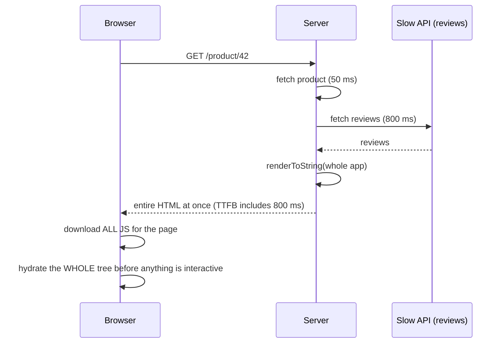

| Waterfall step | Classic SSR problem |
|---|---|
| **Fetch data** | Must fetch *everything* before rendering *anything* — the slowest query sets TTFB |
| **Render HTML** | Whole page rendered before the first byte of body is sent |
| **Load JS** | Must download code for *every* component before hydrating |
| **Hydrate** | Whole tree hydrated in one blocking pass — input during it is not handled |

React 18 introduced **Streaming SSR + Selective Hydration** to break all four "all-or-nothing" steps into per-boundary pieces. React Server Components (stable for frameworks in React 19) then remove the JS-download and hydration cost entirely for components that don't need interactivity.

---

### Section 2: Streaming SSR — HTML in Chunks

HTTP lets a server send a response body **incrementally**: chunked transfer encoding in HTTP/1.1, DATA frames in HTTP/2 and HTTP/3. The browser parses and renders HTML **as it arrives** (see [How Browsers Work](./how-browsers-work.md)).

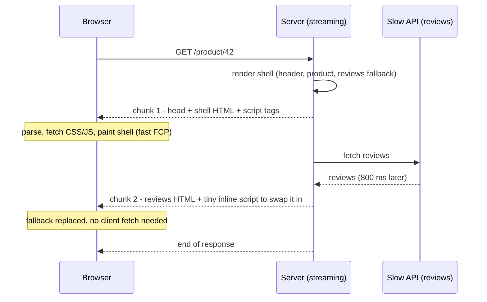

| React API | Environment | Notes |
|---|---|---|
| `renderToString` | Any | Legacy: no streaming; Suspense boundaries render their fallback only |
| `renderToPipeableStream` | Node.js streams | `onShellReady`, `onShellError`, `onAllReady`, `onError`, `bootstrapScripts`; returns `{ pipe, abort }` |
| `renderToReadableStream` | Web Streams (Workers, Deno, Bun; Node.js since React 19.2) | Returns a Promise of a stream; `stream.allReady` resolves when everything is rendered |
| `prerender` / `prerenderToNodeStream` (`react-dom/static`, React 19) | Build / static | Waits for **all** data — for SSG, not streaming |
| `resume` / `resumeToPipeableStream`, `resumeAndPrerender` (React 19.2) | Server | Partial pre-rendering: prerender a static prelude, resume the postponed dynamic parts later |

React's docs recommend Node streams in Node.js (`renderToPipeableStream`), since they are faster there and Web Streams don't support compression by default.

**What improves and what doesn't:**
- ✅ **TTFB and FCP** no longer wait for the slowest data source.
- ✅ **LCP** improves if the LCP element is in the shell (keep it there!).
- ⚠️ **Total time to complete content** is unchanged — the slow query is still slow.
- ⚠️ If the LCP element is *inside* a slow boundary, LCP is still bound to that data.

---

### Section 3: Suspense Boundaries — Shell and Holes

`<Suspense fallback={…}>` is the unit of streaming. Everything **outside** any boundary is the **shell** — it must be ready before the first byte of body is sent.

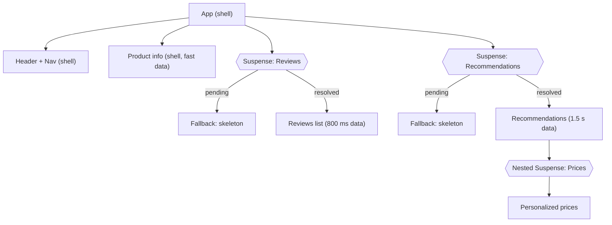

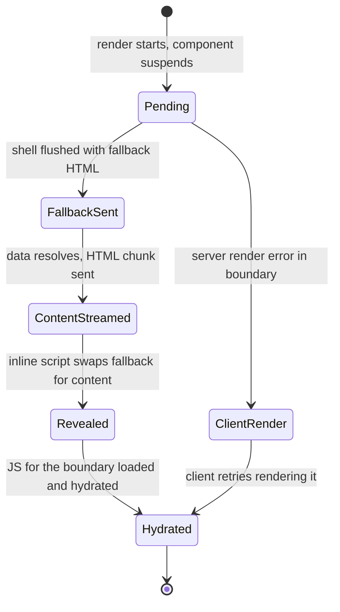

**Boundary placement rules:**
- **Wrap slow, independent, below-the-fold** data in boundaries. Keep **above-the-fold / LCP** content in the shell or a fast boundary.
- **Don't wrap everything individually** — many boundaries popping in one by one cause layout shift and a "popcorn" effect. Group related content; give fallbacks the **same dimensions** as the content (CLS).
- **A boundary is also an error-isolation point:** if a component inside fails on the server, React sends the fallback and retries on the client (and you can add an error boundary for a real error UI). An error in the **shell** fails the whole response (`onShellError`) — serve a fallback page.
- React 19.2 **batches reveals** of server-rendered boundaries for a short time so more content appears together, and stops batching as page load time approaches the LCP threshold.

**Frameworks wrap this for you:** Next.js App Router `loading.tsx` = an automatic Suspense boundary around a route segment's page.

---

### Section 4: How Out-of-Order Streaming Works on the Wire

React streams **out of order**: a boundary's content can arrive after content that comes *later* in the document. Simplified (React's exact markup is an implementation detail and changes between versions):

```html
<!-- Chunk 1: the shell -->
<html><head>…<link rel="stylesheet" href="/app.css"></head>
<body>
  <header>…</header>
  <main><h1>Ergonomic Chair</h1>…</main>
  <!--$?--><template id="B:0"></template>
  <div class="skeleton">Loading reviews…</div><!--/$-->
  <script src="/client.js" async></script>

<!-- Chunk 2: 800 ms later, appended at the END of the document -->
  <div hidden id="S:0"><ul><li>★★★★★ Great chair</li>…</ul></div>
  <script>/* tiny runtime: move #S:0 content into the place of B:0, remove the fallback */</script>
</body></html>
```

Consequences:
- The swap is done by **inline scripts**. With JavaScript disabled, the fallback stays. Pages that must work without JS need their critical content in the shell.
- A strict **Content-Security-Policy** must allow those inline scripts — pass a **nonce** to React (`nonce` option of the render APIs; Next.js reads it from the CSP header set in middleware/proxy).
- In-order streaming (Vue, Astro, SolidStart's in-order mode, plain template engines) can only flush top-to-bottom: a slow component blocks everything after it.

---

### Section 5: Selective Hydration

With `hydrateRoot`, React 18+ hydrates **each Suspense boundary independently**, as soon as its HTML *and* its JS code are available — and **prioritizes** the boundary the user interacts with.

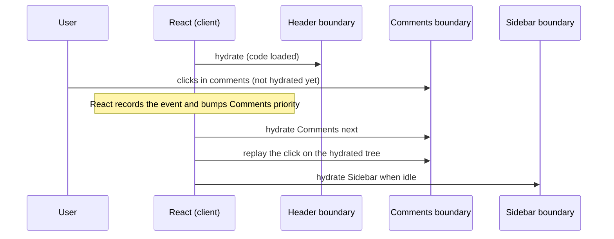

| Without selective hydration | With selective hydration |
|---|---|
| Whole tree hydrates in one long task | Per-boundary, interruptible work |
| Clicks during hydration are lost or delayed | Clicked boundary hydrates first; supported discrete events are replayed |
| One slow chunk of code delays everything | Lazy (`React.lazy`) boundaries hydrate when their code arrives |

This improves **INP** and perceived interactivity — but hydration is still work. The bigger lever is **hydrating less**, which is what Server Components (and [Island Architecture](./island-architecture.md)) do.

---

### Section 6: Streaming Constraints — Status Codes, Proxies, SEO

**Status codes and headers are committed with the first byte.** Once the shell is flushed with `200`, you can't turn the response into a `404`, `500` or a redirect.

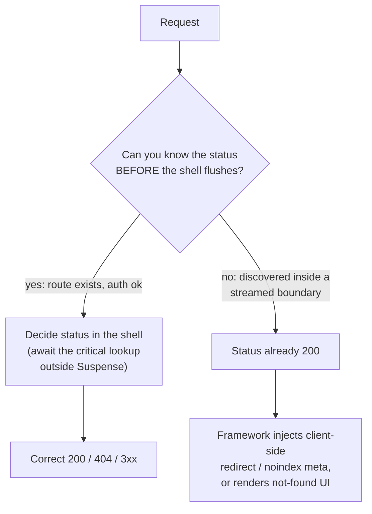

Rules:
- Do **existence and auth checks before the shell** (outside Suspense) so 404s and redirects get real status codes. Next.js documents that when `redirect`/`notFound` happen after streaming started, the status stays `200` and the signal is delivered within the streamed content.
- **Buffering kills streaming.** Anything between server and browser that buffers the full response turns streaming back into classic SSR:
  - **nginx** buffers proxied responses by default → `proxy_buffering off` for those routes or send `X-Accel-Buffering: no`.
  - **Compression middleware** that waits for the whole body; use streaming-aware compression or flush per chunk.
  - **Some serverless platforms / CDN configurations** buffer function responses unless response streaming is enabled. Check your platform's docs.
- **SEO:** crawlers receive the complete streamed document (the stream finishes with all content inline). For bots, some setups wait for `onAllReady`/`allReady` before sending so the HTML is complete in one go. Metadata (`<title>`, meta tags) should be resolvable early; Next.js streams metadata for browsers but blocks on it for known limited bots (`htmlLimitedBots` config).
- **Caching:** a streamed response can be cached by a CDN like any other, but if it contains per-user data it must be `private`. Static shells + dynamic holes are better served by Partial Prerendering (see [ISR](./incremental-static-regeneration-isr.md)).

---

### Section 7: React Server Components — The Model

A **Server Component** is a React component that **runs only on the server** (at request time or at build time). Its code is never sent to the browser; only its rendered **output** is.

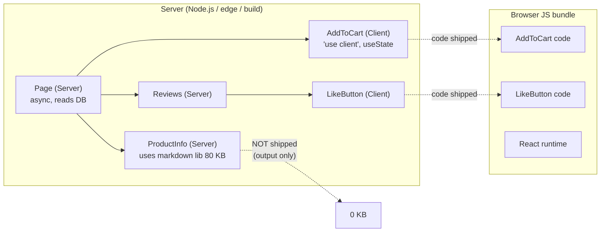

| | Server Component (default in RSC frameworks) | Client Component (`'use client'`) |
|---|---|---|
| **Runs** | Server only (request or build time) | Server (SSR to HTML) **and** browser (hydration) |
| **JS shipped** | None for the component or its server-only imports | Component + its imports |
| **Can be `async`** | Yes — `await db.query()` directly | No (use `use(promise)` or a data library) |
| **State/effects** (`useState`, `useEffect`) | ❌ | ✅ |
| **Event handlers, browser APIs** | ❌ | ✅ |
| **Secrets, DB, filesystem** | ✅ (stay on the server) | ❌ — never put secrets here |
| **Context** | Can't read React context | ✅ |

**Common misconceptions:**
- **"Client Components only run in the browser."** No — they are still server-rendered to HTML on the first load; "client" means "also ships JS and hydrates".
- **"`'use server'` marks Server Components."** No — Server Components need no directive. `'use server'` marks **Server Functions** (Server Actions), callable from the client (Section 11).
- **"RSC replaces SSR."** No — they are complementary. RSC decides *which* components run where; SSR turns the result into HTML for the first paint. Server Components can also be used without SSR (e.g. rendered at build time, or fetched during navigation).

---

### Section 8: The Server/Client Boundary

`'use client'` at the top of a file marks a **module boundary**: that module and **everything it imports** become part of the client bundle.

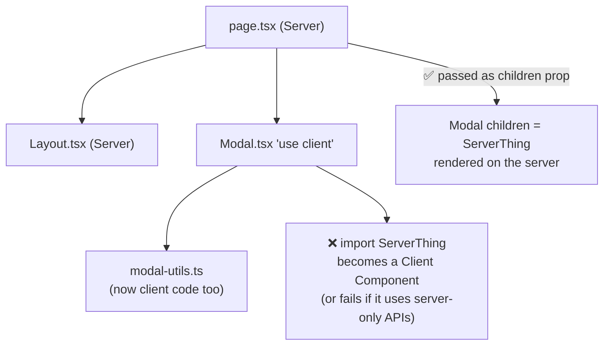

**Rules:**
1. A Client Component **cannot import** a Server Component — but it **can render one passed as `children` or another prop** (the server renders it first, the client receives the output). This is the "donut" pattern: client shell, server-rendered filling.
2. Props crossing from server to client must be **serializable**: primitives, globally registered symbols (`Symbol.for`), arrays, `Map`, `Set`, typed arrays, `ArrayBuffer`, `Date`, plain objects, **Promises**, JSX elements and **Server Functions**. **Not** allowed: ordinary functions, classes, class instances (other than the built-ins listed), null-prototype objects, unregistered symbols.
3. Push `'use client'` **down to the leaves** — mark the small interactive part (`<LikeButton>`), not the whole page.
4. Protect server-only modules with `import 'server-only'` (build error if imported from a Client Component); its counterpart `client-only` exists for browser-only modules.
5. Third-party components that use hooks but lack `'use client'` need a tiny wrapper file that re-exports them with the directive.

---

### Section 9: The RSC Payload and Navigation

The server renders Server Components into the **RSC Payload** (React's "Flight" format): a streamable, serialized description of the UI tree — rendered output of Server Components, **references** to Client Component modules, and their props.

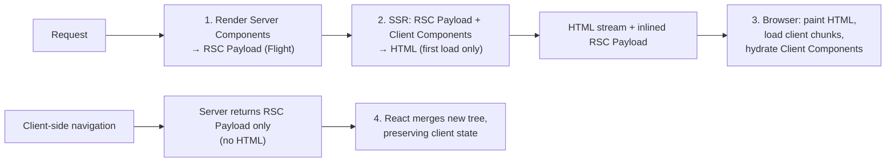

What this buys:
- **First load:** HTML (fast paint) + payload (so React can reconcile without re-running Server Components in the browser).
- **Navigation:** the router fetches just the payload for the new route and **merges** it — Client Component state (inputs, open menus) is preserved where the tree matches.
- **Refreshing data:** re-render Server Components on the server (e.g. `router.refresh()` in Next.js, or after a Server Action) without a full reload.
- **Cost to watch:** the payload duplicates the content that is already in the HTML on first load. Large lists of data passed as props to Client Components are serialized **twice** (HTML + payload). Pass only what the client needs.

---

### Section 10: Data Fetching and Waterfalls

Server Components can `await` data directly — which makes **server-side waterfalls** easy to write by accident.

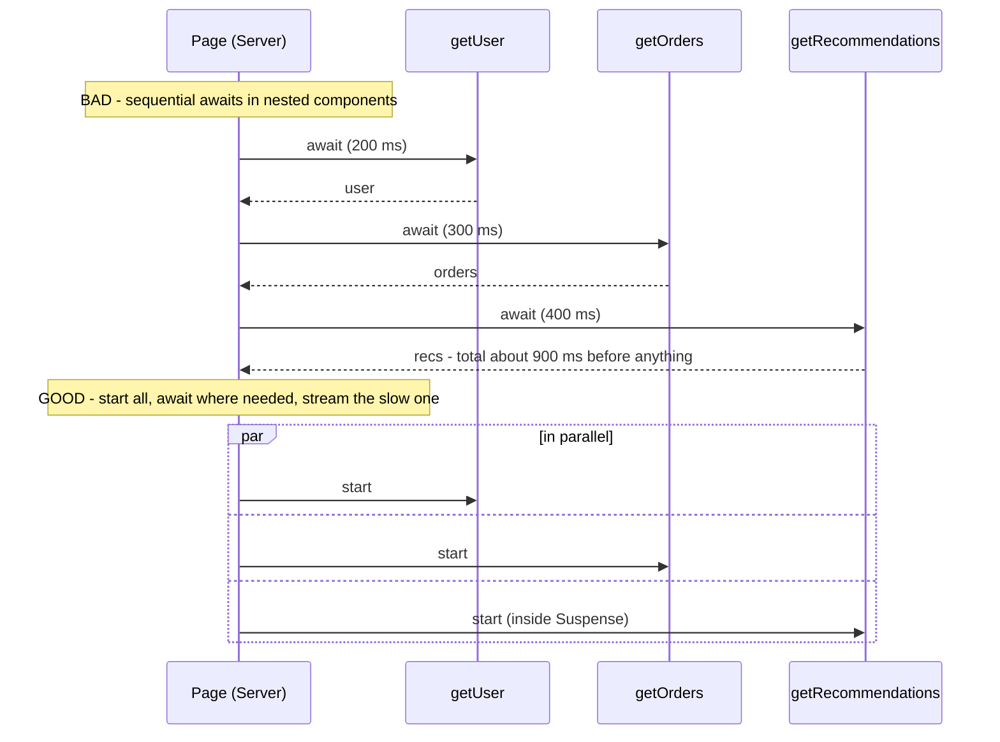

Patterns:
- **Start fetches early, await late:** create promises at the top, `await` them where needed or `Promise.all` independent ones.
- **Pass promises to Client Components** and unwrap with `use(promise)` inside a Suspense boundary — the server doesn't block on it.
- **Deduplicate per request** with React's `cache()` (server-only) so several components can call `getUser()` without extra queries. Next.js also memoizes identical `fetch` calls within a render.
- **Avoid client-side waterfalls too:** fetch in a Server Component instead of `useEffect` chains in Client Components.
- **Mutations** go through Server Functions or API routes; afterwards revalidate (`revalidatePath`/`revalidateTag`/`refresh`) so the server tree re-renders.

---

### Section 11: Server Functions and Security

A function marked with `'use server'` (inline or at the top of a module) is a **Server Function**. When passed to a form `action` or called from a Client Component, React turns it into an **HTTP endpoint** invoked with serialized arguments.

**Treat every Server Function as a public API endpoint:**
- **Authenticate and authorize inside it** — don't rely on the button being hidden.
- **Validate arguments** (e.g. with Zod or Valibot); they come from the network.
- Return only the data the caller should see.
- Don't pass secrets as props to Client Components; React's experimental **taint APIs** (`experimental_taintObjectReference`, `experimental_taintUniqueValue`) can mark objects/values that must never be serialized to the client.
- Next.js adds protections (encrypted closure variables, non-guessable action IDs, Origin/Host checks on actions), but those are defense in depth, not authorization.

> **Security history (keep RSC packages updated):** on 3 December 2025, React disclosed **CVE-2025-55182**, a critical unauthenticated remote-code-execution flaw in how the RSC packages (`react-server-dom-webpack`/`-parcel`/`-turbopack`) decoded Server Function payloads, affecting frameworks such as Next.js, React Router (RSC), Waku, `@parcel/rsc`, `@vitejs/plugin-rsc` and RedwoodSDK. Follow-up advisories covered denial-of-service and source-code-exposure issues. Apps that don't run RSC on a server weren't affected. Patch promptly and follow the React and framework security advisories.

---

### Section 12: Framework Landscape

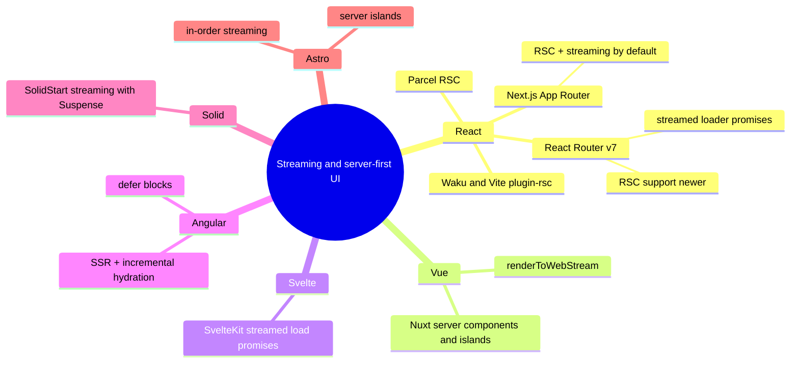

| Framework | Streaming SSR | "Server-only components" equivalent |
|---|---|---|
| **Next.js (App Router)** | Default; `loading.tsx` and `<Suspense>` | RSC by default; `'use client'` opt-in |
| **React Router v7 / Remix** | Return promises from loaders, render with `<Await>` inside `<Suspense>` | RSC support exists but is newer — check maturity in the docs |
| **Waku, Parcel, Vite `@vitejs/plugin-rsc`, RedwoodSDK** | Yes | RSC-first, smaller ecosystems |
| **Vue / Nuxt** | `vue/server-renderer` streaming APIs (`renderToWebStream`, `pipeToNodeWritable`) — **in order** | Nuxt server components (`.server.vue`) and `<NuxtIsland>` (component islands; check experimental status) |
| **SvelteKit** | Non-awaited promises returned from server `load` stream in; use `{#await}` | Server `load` functions; components always ship JS |
| **Angular** | Not out-of-order streaming | `@defer` blocks + **incremental hydration** (hydrate triggers like `on viewport`) and event replay reduce upfront JS/hydration |
| **SolidStart** | Streaming with Suspense | Fine-grained reactivity keeps hydration cheap; server functions via `"use server"` |
| **Astro** | Streams HTML in order | Zero-JS by default; `server:defer` server islands — see [Island Architecture](./island-architecture.md) |
| **React Native** | n/a | Expo Router has **experimental** RSC support — check status before relying on it |

---

## Decision Matrix

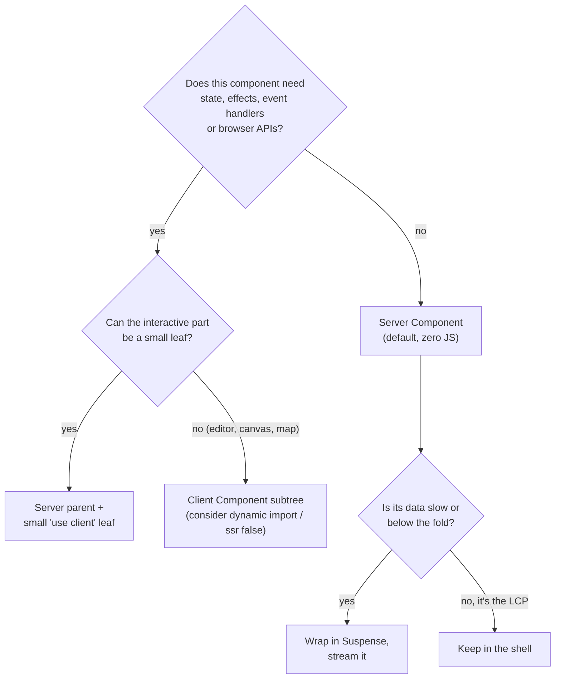

| Situation | Choose | Why |
|---|---|---|
| Content-heavy page, little interactivity (docs, blog, product details) | **RSC + streaming** (or islands) | Minimal JS, fast LCP |
| Dashboard with slow widgets | **Streaming SSR** with one boundary per widget group | Fast shell; widgets fill in independently |
| Highly interactive app (editor, design tool) behind login | **CSR or Client Component subtree**, SSR shell optional | Most UI needs JS anyway; SEO irrelevant |
| Must return correct 404/301 for SEO | Resolve existence **before** the shell | Status can't change after streaming starts |
| Behind a proxy you don't control that buffers | Classic SSR or fix the proxy | Streaming gives no benefit if buffered |
| Static marketing site | **SSG/ISR** (optionally RSC at build time) | No need for per-request streaming |

---

## Real-World Examples

**Example 1 — Streaming SSR with Node.js and Express (`renderToPipeableStream`):**
```tsx
// server.tsx
import express from 'express';
import { renderToPipeableStream } from 'react-dom/server';
import { App } from './App';

const app = express();
app.use('/assets', express.static('dist/assets', { immutable: true, maxAge: '1y' }));

app.use((req, res) => {                        // final middleware = every other GET (Express 4 and 5)
  let didError = false;
  const isBot = /bot|crawler|spider/i.test(req.get('user-agent') ?? '');

  const { pipe, abort } = renderToPipeableStream(<App url={req.url} />, {
    bootstrapScripts: ['/assets/client.js'],
    // Browsers: flush as soon as the shell is ready
    onShellReady() {
      if (isBot) return;                         // bots: wait for everything (below)
      res.status(didError ? 500 : 200);
      res.setHeader('Content-Type', 'text/html; charset=utf-8');
      res.setHeader('X-Accel-Buffering', 'no');  // tell nginx not to buffer
      pipe(res);
    },
    // Bots / static generation: send complete HTML in one go
    onAllReady() {
      if (!isBot) return;
      res.status(didError ? 500 : 200);
      res.setHeader('Content-Type', 'text/html; charset=utf-8');
      pipe(res);
    },
    onShellError() {
      res.status(500).send('<!doctype html><p>Something went wrong</p>');
    },
    onError(err) {
      didError = true;
      console.error(err);                        // boundary errors retry on the client
    },
  });

  setTimeout(() => abort(), 10_000);             // don't hold sockets forever
});

app.listen(3000);
```

```tsx
// client.tsx
import { hydrateRoot } from 'react-dom/client';
import { App } from './App';
hydrateRoot(document, <App url={location.pathname} />);
```

**Example 2 — Web Streams (Cloudflare Workers / Deno / Bun) with `renderToReadableStream`:**
```tsx
import { renderToReadableStream } from 'react-dom/server';
import { App } from './App';

export default {
  async fetch(request: Request): Promise<Response> {
    const controller = new AbortController();
    setTimeout(() => controller.abort(), 10_000);

    const stream = await renderToReadableStream(<App url={request.url} />, {
      bootstrapScripts: ['/client.js'],
      signal: controller.signal,
      onError(error) { console.error(error); },
    }); // the await resolves when the SHELL is ready (rejects on shell error)

    if (/bot|crawler/i.test(request.headers.get('user-agent') ?? '')) {
      await stream.allReady;                     // complete HTML for crawlers
    }
    return new Response(stream, { headers: { 'Content-Type': 'text/html; charset=utf-8' } });
  },
};
```

**Example 3 — Next.js App Router: shell + streamed boundaries:**
```tsx
// app/product/[id]/page.tsx  (Server Component — no directive needed)
import { Suspense } from 'react';
import { notFound } from 'next/navigation';
import { getProduct, getReviews, getRecommendations } from '@/lib/data';
import { AddToCart } from './add-to-cart';          // 'use client' leaf
import { ReviewsSkeleton, RecsSkeleton } from './skeletons';

export default async function ProductPage({ params }: { params: Promise<{ id: string }> }) {
  const { id } = await params;
  const product = await getProduct(id);             // fast + decides 404 BEFORE streaming
  if (!product) notFound();

  return (
    <main>
      <h1>{product.name}</h1>                       {/* LCP content stays in the shell */}
      
      <AddToCart productId={product.id} price={product.price} />

      <Suspense fallback={<ReviewsSkeleton />}>
        <Reviews productId={id} />                  {/* streams in when ready */}
      </Suspense>
      <Suspense fallback={<RecsSkeleton />}>
        <Recommendations productId={id} />
      </Suspense>
    </main>
  );
}

async function Reviews({ productId }: { productId: string }) {
  const reviews = await getReviews(productId);      // slow API, isolated in its boundary
  return <ul>{reviews.map((r) => <li key={r.id}>{r.text}</li>)}</ul>;
}

async function Recommendations({ productId }: { productId: string }) {
  const recs = await getRecommendations(productId);
  return <ul>{recs.map((p) => <li key={p.id}>{p.name}</li>)}</ul>;
}
```

```tsx
// app/product/[id]/add-to-cart.tsx
'use client';
import { useState, useTransition } from 'react';
import { addToCart } from './actions';

export function AddToCart({ productId, price }: { productId: string; price: number }) {
  const [qty, setQty] = useState(1);
  const [pending, startTransition] = useTransition();
  return (
    <div>
      <input type="number" min={1} value={qty} onChange={(e) => setQty(Number(e.target.value))} />
      <button disabled={pending} onClick={() => startTransition(() => addToCart(productId, qty))}>
        Add — {(price * qty).toFixed(2)}
      </button>
    </div>
  );
}
```

**Example 4 — Server Function with auth and validation (BAD → GOOD):**
```typescript
// app/product/[id]/actions.ts
'use server';
import { z } from 'zod';
import { auth } from '@/lib/auth';
import { db } from '@/lib/db';
import { revalidatePath } from 'next/cache';

// ❌ BAD: trusts the client completely — anyone can POST any productId/qty/userId
export async function addToCartUnsafe(userId: string, productId: string, qty: number) {
  await db.cart.add({ userId, productId, qty });
}

// ✅ GOOD: identity from the session, input validated, minimal return value
const Input = z.object({ productId: z.string().uuid(), qty: z.number().int().min(1).max(99) });

export async function addToCart(productId: string, qty: number) {
  const session = await auth();
  if (!session) throw new Error('Unauthorized');
  const input = Input.parse({ productId, qty });
  await db.cart.add({ userId: session.userId, ...input });
  revalidatePath('/cart');
  return { ok: true };
}
```

**Example 5 — Composition: Client wrapper, Server children (BAD → GOOD):**
```tsx
// ❌ BAD: importing a Server Component into a Client Component
'use client';
import { ServerPriceTable } from './price-table';   // now bundled as client code (or a build error)
export function Tabs() { /* … */ return <ServerPriceTable />; }

// ✅ GOOD: the Client Component accepts children; the Server parent composes
// tabs.tsx
'use client';
import { useState, type ReactNode } from 'react';
export function Tabs({ panels }: { panels: { label: string; content: ReactNode }[] }) {
  const [i, setI] = useState(0);
  return (
    <div>
      {panels.map((p, n) => <button key={p.label} onClick={() => setI(n)}>{p.label}</button>)}
      {panels[i].content}
    </div>
  );
}

// page.tsx (Server)
import { Tabs } from './tabs';
import { ServerPriceTable } from './price-table';
export default function Page() {
  return <Tabs panels={[{ label: 'Prices', content: <ServerPriceTable /> }]} />;
}
```

**Example 6 — Avoiding a server waterfall; streaming a promise to the client:**
```tsx
// page.tsx (Server)
import { Suspense } from 'react';
import { Comments } from './comments';   // 'use client'

export default async function Post({ params }: { params: Promise<{ slug: string }> }) {
  const { slug } = await params;
  const commentsPromise = getComments(slug);         // start now, DON'T await
  const [post, author] = await Promise.all([getPost(slug), getAuthor(slug)]); // parallel
  return (
    <article>
      <h1>{post.title}</h1><p>by {author.name}</p>
      <Suspense fallback={<p>Loading comments…</p>}>
        <Comments commentsPromise={commentsPromise} />  {/* Promises are serializable */}
      </Suspense>
    </article>
  );
}

// comments.tsx
'use client';
import { use } from 'react';
export function Comments({ commentsPromise }: { commentsPromise: Promise<{ id: string; text: string }[]> }) {
  const comments = use(commentsPromise);              // suspends until the streamed data arrives
  return <ul>{comments.map((c) => <li key={c.id}>{c.text}</li>)}</ul>;
}
```

```typescript
// lib/data.ts — per-request deduplication + keep it off the client
import 'server-only';
import { cache } from 'react';
export const getUser = cache(async (id: string) => db.user.findUnique({ where: { id } }));
```

**Example 7 — Proxy configuration that doesn't break streaming (nginx):**
```nginx
location / {
    proxy_pass http://app:3000;
    proxy_http_version 1.1;
    proxy_buffering off;          # or have the app send X-Accel-Buffering: no
    proxy_set_header Host $host;
}
```

**Example 8 — Equivalents in other frameworks:**
```typescript
// SvelteKit: src/routes/product/[id]/+page.server.ts
export async function load({ params }) {
  return {
    product: await getProduct(params.id),        // awaited → in the initial HTML
    reviews: getReviews(params.id),              // NOT awaited → streamed in later
  };
}
// +page.svelte:  {#await data.reviews}<Skeleton/>{:then reviews}<List {reviews}/>{/await}
```

```typescript
// React Router v7 loader: return promises; render with <Suspense><Await resolve={reviews}>
export async function loader({ params }: { params: { id: string } }) {
  return { product: await getProduct(params.id), reviews: getReviews(params.id) };
}
```

```typescript
// Vue: stream SSR HTML (in order) with Web Streams
import { createSSRApp } from 'vue';
import { renderToWebStream } from 'vue/server-renderer';
import App from './App.vue';

export function handle(): Response {
  const app = createSSRApp(App);
  return new Response(renderToWebStream(app), { headers: { 'Content-Type': 'text/html' } });
}
```

```html
<!-- Angular (v19+): defer a heavy block and hydrate it only when visible (incremental hydration) -->
@defer (hydrate on viewport) {
  <app-reviews [productId]="id" />
} @placeholder {
  <div class="skeleton"></div>
}
```

---

## Key Points Summary

| Concept | One-Line Explanation |
|---|---|
| **Streaming SSR** | Send the HTML shell first, then each Suspense boundary's HTML as its data resolves |
| **Shell** | Everything outside Suspense boundaries — must be ready before the first body byte |
| **Out-of-order streaming** | Late boundaries are appended and swapped into place by inline scripts |
| **Selective hydration** | Each boundary hydrates independently; the one the user touches goes first |
| **Status codes** | Fixed once the shell flushes — do 404/redirect checks before streaming |
| **Buffering** | Proxies/compression/serverless that buffer turn streaming back into classic SSR |
| **Server Component** | Runs only on the server; ships output, not code; can be async |
| **Client Component** | `'use client'`; SSR'd **and** hydrated; has state, effects, events |
| **`'use client'` boundary** | Marks a module and everything it imports as client code |
| **Composition** | Clients can't import Servers but can render Server JSX passed as props/children |
| **Serializable props** | Primitives, plain objects, arrays, Map/Set, Date, Promises, JSX, Server Functions |
| **RSC Payload** | Serialized UI tree (Flight) used for hydration and client navigation |
| **Server Functions** | `'use server'` functions exposed as HTTP endpoints — authenticate and validate |
| **Waterfalls** | Start fetches early, `Promise.all`, pass promises, `cache()` for dedup |

---

## Test Your Understanding

**Q1 (Basic):**
A product page fetches product info (50 ms) and reviews (800 ms). With classic `renderToString`, TTFB is ~850 ms+. What changes if you wrap the reviews in `<Suspense>` and switch to streaming? What does *not* change?

<details>
<summary>Answer</summary>

The server can flush the **shell** (head, CSS/JS links, product info, and the reviews skeleton) after ~50 ms, so **TTFB and FCP** drop dramatically and the browser starts downloading CSS/JS in parallel with the slow query. When reviews resolve, their HTML is streamed in the same response and swapped into place by an inline script — no extra client request.

What doesn't change: the reviews still take 800 ms to arrive (total completion time is the same), and if the **LCP element** were inside the reviews boundary, LCP would still be ~800 ms+. Streaming helps only when the important content is in the shell.
</details>

**Q2 (Application):**
After deploying streaming SSR behind your company's nginx, the Network panel shows the whole HTML arriving at once after ~1 s, just like before. Code is unchanged from local, where it streams fine. What's happening and how do you fix it?

<details>
<summary>Answer</summary>

Something between the app and the browser is **buffering the response**. nginx buffers proxied responses by default (`proxy_buffering on`), so it collects the whole body before sending it. Other common culprits: compression middleware that waits for the full body, a CDN or serverless platform that doesn't support response streaming in the current config.

Fix: disable buffering for those routes (`proxy_buffering off`) or send `X-Accel-Buffering: no` from the app, make sure compression flushes per chunk, and enable response streaming on the platform. Verify with `curl -N` and watch chunks arrive over time.
</details>

**Q3 (Tricky):**
A Next.js page looks up a product inside a component wrapped in `<Suspense>` and calls `notFound()` when it doesn't exist. SEO reports show those URLs return HTTP `200`. Why, and what's the fix?

<details>
<summary>Answer</summary>

The shell (outside the boundary) was already flushed with status `200`. Headers, including the status code, are sent with the first byte, so when `notFound()` runs later inside the streamed boundary, the status **can't be changed** — the framework can only render not-found UI (and signal it inside the streamed content).

Fix: perform the **existence check before streaming starts** — `await getProduct(id)` in the page itself, outside any Suspense boundary, and call `notFound()` there (also make sure a `loading.tsx` isn't wrapping it in a boundary). Keep only genuinely slow, non-critical data inside Suspense. The same rule applies to redirects and auth checks.
</details>

**Q4 (Tricky):**
A developer adds `'use client'` to `app/layout.tsx` "so we can use a theme context". The bundle grows by hundreds of KB, and server-only code starts failing to build. Explain, and restructure it.

<details>
<summary>Answer</summary>

`'use client'` marks a **module boundary**: the layout and **everything it imports** become Client Components. Every component imported from the layout (and their dependencies — markdown parsers, date libraries, DB helpers) is now bundled for the browser, and modules that use server-only APIs (or `import 'server-only'`) fail to build.

Restructure: keep the layout a Server Component. Create a small `ThemeProvider.tsx` with `'use client'` that holds the context, and render `<ThemeProvider>{children}</ThemeProvider>` from the server layout. `children` are rendered on the server and passed through, so pages remain Server Components while consuming components (marked `'use client'`) can read the theme context.
</details>

**Q5 (Application):**
Which of these props can a Server Component pass to a Client Component: (a) `new Date()`, (b) `onClick={() => track()}`, (c) a `Map` of IDs to names, (d) an instance of `class Money`, (e) a Promise from `getComments()`, (f) a Server Function `saveDraft`? Fix the ones that fail.

<details>
<summary>Answer</summary>

- (a) ✅ `Date` is serializable.
- (b) ❌ Plain functions can't be serialized. Define the handler inside the Client Component, or pass a Server Function if the work must happen on the server.
- (c) ✅ `Map` (and `Set`) with serializable contents are supported.
- (d) ❌ Class instances aren't supported. Pass a plain object (`{ amount: 1299, currency: 'EUR' }`) and recreate the class on the client if needed.
- (e) ✅ Promises are supported. The client unwraps it with `use()` inside a Suspense boundary, letting the server stream the data.
- (f) ✅ Server Functions (`'use server'`) are passed as references. The client calls them over the network, so they must authenticate and validate.
</details>

**Q6 (System design):**
You're designing a large e-commerce product page: header with user's cart count, product hero (LCP), price and stock, reviews (slow third-party API), personalized recommendations (slow ML service). Lay out Server vs Client Components, Suspense boundaries, caching and the failure behavior.

<details>
<summary>Answer</summary>

- **Shell (Server Components):** layout, header, product hero, title, description and price, fetched from a fast cached source (ISR/`'use cache'` with tags so price updates propagate). Do the existence check here so 404s get a real status. Keep the hero image in the shell for LCP.
- **Client leaves:** `AddToCart` (quantity, pending state, calls a validated Server Function), image gallery carousel, cart badge.
- **Per-user parts:** cart count and recommendations depend on the user, so they're dynamic. Put them in Suspense boundaries (dynamic holes with Partial Prerendering/Cache Components) so the shell stays cacheable. Stock may also be a dynamic hole if it must be exact.
- **Reviews:** a Server Component in its own boundary with a fixed-height skeleton (avoid CLS). Optionally cache the API response for minutes.
- **Failure behavior:** if reviews or recommendations fail, an error boundary inside their Suspense renders a small "unavailable" message. The page still works. A shell failure (product service down) triggers `onShellError` → serve an error page with the correct status.
- **Infrastructure:** make sure proxies/CDN don't buffer, CSP nonces are passed for React's inline scripts, and Server Functions check the session and validate input. Keep RSC packages patched.
</details>

---

## Cheat Sheet

**Key Definitions:**
- **Streaming SSR:** Sending server-rendered HTML incrementally over one response
- **Shell:** UI outside all Suspense boundaries, flushed first
- **Suspense boundary:** Unit of streaming, loading UI, error isolation and selective hydration
- **Selective hydration:** Independent, prioritized hydration per boundary
- **React Server Component (RSC):** Component executed only on the server, output serialized to the client
- **Client Component:** Component in a `'use client'` module graph; SSR'd and hydrated
- **RSC Payload / Flight:** Streamed serialization of the server-rendered tree with client references
- **Server Function / Server Action:** `'use server'` function callable from the client over HTTP

**Quick Reference:**
```text
React APIs
  renderToPipeableStream (Node)   onShellReady → pipe · onAllReady (bots/SSG) · onShellError · onError · abort()
  renderToReadableStream (Web)    await → shell ready · stream.allReady · signal
  prerender / prerenderToNodeStream (react-dom/static)   wait for all data (SSG)
  resume / resumeToPipeableStream (19.2)                 partial pre-rendering
  hydrateRoot(document, <App/>)   selective hydration per Suspense boundary

Boundaries
  LCP + status-deciding data  → shell (outside Suspense)
  slow / below-fold / per-user → <Suspense fallback={sized skeleton}>
  Next.js loading.tsx          → automatic boundary per segment

RSC
  Default = Server Component (async ok, no hooks/events, no JS shipped)
  'use client' at module top = boundary; push it to leaves
  Client can't import Server; pass Server JSX as children/props
  Props: primitives, plain objects, arrays, Map/Set, Date, Promise, JSX, Server Functions
  import 'server-only' · cache() for per-request dedup · use(promise) on the client
  'use server' = Server Function → public endpoint: auth + validate

Infra
  nginx: proxy_buffering off / X-Accel-Buffering: no · CSP nonce for inline scripts
  test: curl -N https://site/page   (chunks should arrive over time)
```

**Common Mistakes to Avoid:**

| Mistake | Why Wrong | Fix |
|---|---|---|
| LCP content inside a slow Suspense boundary | LCP still waits for slow data | Keep LCP content in the shell |
| `notFound()`/`redirect()` inside a streamed boundary | Status already `200` | Check existence/auth before the shell |
| Proxy/CDN buffering | Streaming silently disabled | `proxy_buffering off`, streaming-enabled platform |
| One boundary per tiny component | Popcorn UI, layout shift | Group content; sized skeletons |
| `'use client'` on layouts/pages | Whole subtree + imports shipped to browser | Small client leaves; providers as client wrappers |
| Importing a Server Component into a Client one | Becomes client code or breaks | Pass as `children`/props |
| Passing functions/class instances as props | Not serializable | Plain objects; handlers inside Client Components |
| Sequential `await`s in nested Server Components | Server waterfall delays the shell | `Promise.all`, start early, pass promises |
| Large data passed to Client Components | Serialized in HTML **and** payload | Send only what the client renders |
| Unauthenticated Server Functions | They are public HTTP endpoints | Session check + schema validation in every one |
| Secrets in props to Client Components | Shipped to the browser | `server-only`, taint APIs, never pass secrets |
| Strict CSP without nonce | Inline swap scripts blocked → fallbacks forever | Pass a nonce to React / framework |
| Outdated `react-server-dom-*` / framework | Known critical RSC vulnerabilities (Dec 2025 onward) | Patch promptly, follow advisories |

---

## References & Further Reading

**Core docs (React)**
- React: [`renderToPipeableStream`](https://react.dev/reference/react-dom/server/renderToPipeableStream) · [`renderToReadableStream`](https://react.dev/reference/react-dom/server/renderToReadableStream) · [`prerender`](https://react.dev/reference/react-dom/static/prerender)
- React: [`<Suspense>`](https://react.dev/reference/react/Suspense) · [`hydrateRoot`](https://react.dev/reference/react-dom/client/hydrateRoot) · [`use`](https://react.dev/reference/react/use) · [`cache`](https://react.dev/reference/react/cache)
- React: [Server Components](https://react.dev/reference/rsc/server-components) · [`'use client'`](https://react.dev/reference/rsc/use-client) · [`'use server'`](https://react.dev/reference/rsc/use-server) · [Server Functions](https://react.dev/reference/rsc/server-functions)
- React: [`experimental_taintObjectReference`](https://react.dev/reference/react/experimental_taintObjectReference)
- React blog: [React 19](https://react.dev/blog/2024/12/05/react-19) · [React 19.2](https://react.dev/blog/2025/10/01/react-19-2)
- React blog: [Critical security vulnerability in React Server Components (CVE-2025-55182)](https://react.dev/blog/2025/12/03/critical-security-vulnerability-in-react-server-components)
- React working group: [New Suspense SSR Architecture in React 18](https://github.com/reactwg/react-18/discussions/37)

**Next.js**
- Next.js: [Server and Client Components](https://nextjs.org/docs/app/getting-started/server-and-client-components)
- Next.js: [Streaming](https://nextjs.org/docs/app/guides/streaming) · [`loading.js`](https://nextjs.org/docs/app/api-reference/file-conventions/loading)
- Next.js: [Data security](https://nextjs.org/docs/app/guides/data-security) · [Content Security Policy](https://nextjs.org/docs/app/guides/content-security-policy)

**Other frameworks**
- Vue: [Server-side rendering — streaming API](https://vuejs.org/api/ssr.html)
- SvelteKit: [Streaming with promises](https://svelte.dev/docs/kit/load#Streaming-with-promises)
- React Router: [Streaming with Suspense](https://reactrouter.com/how-to/suspense)
- Angular: [Incremental hydration](https://angular.dev/guide/incremental-hydration)
- Nuxt: [`<NuxtIsland>` / server components](https://nuxt.com/docs/api/components/nuxt-island)

**Specs & web platform**
- MDN: [`Transfer-Encoding`](https://developer.mozilla.org/en-US/docs/Web/HTTP/Reference/Headers/Transfer-Encoding) · [Streams API](https://developer.mozilla.org/en-US/docs/Web/API/Streams_API)
- nginx: [`proxy_buffering`](https://nginx.org/en/docs/http/ngx_http_proxy_module.html#proxy_buffering)
- web.dev: [Rendering on the Web](https://web.dev/articles/rendering-on-the-web)

**Deep dives**
- Dan Abramov / React team: [RSC From Scratch, Part 1](https://github.com/reactwg/server-components/discussions/5)
- Josh W. Comeau: [Making Sense of React Server Components](https://www.joshwcomeau.com/react/server-components/)

---

> **Previous Topic:** [Incremental Static Regeneration (ISR)](./incremental-static-regeneration-isr.md)
> — Static pages regenerated in the background, on a timer or on demand

> **Next Topic:** [Island Architecture](./island-architecture.md)
> — Static HTML pages with small, independently hydrated interactive islands

*Saved on: 2026-11-06 | Repo: Frontend System Design Learning Notes*
