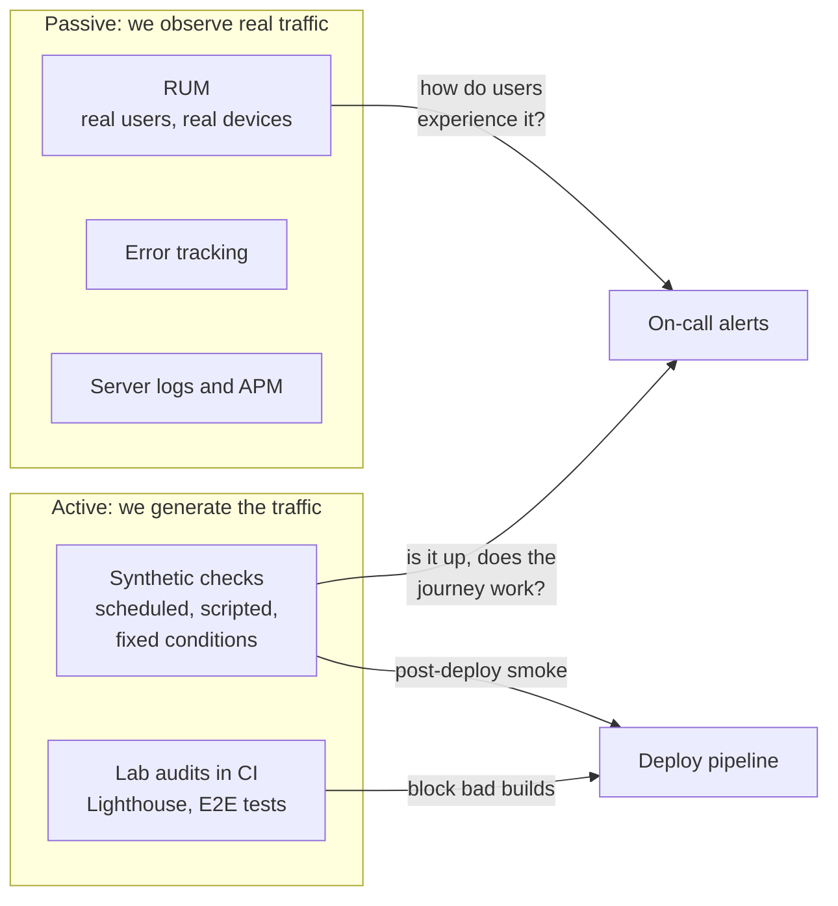
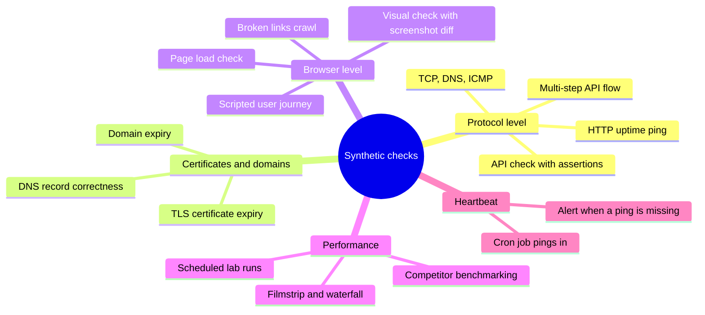
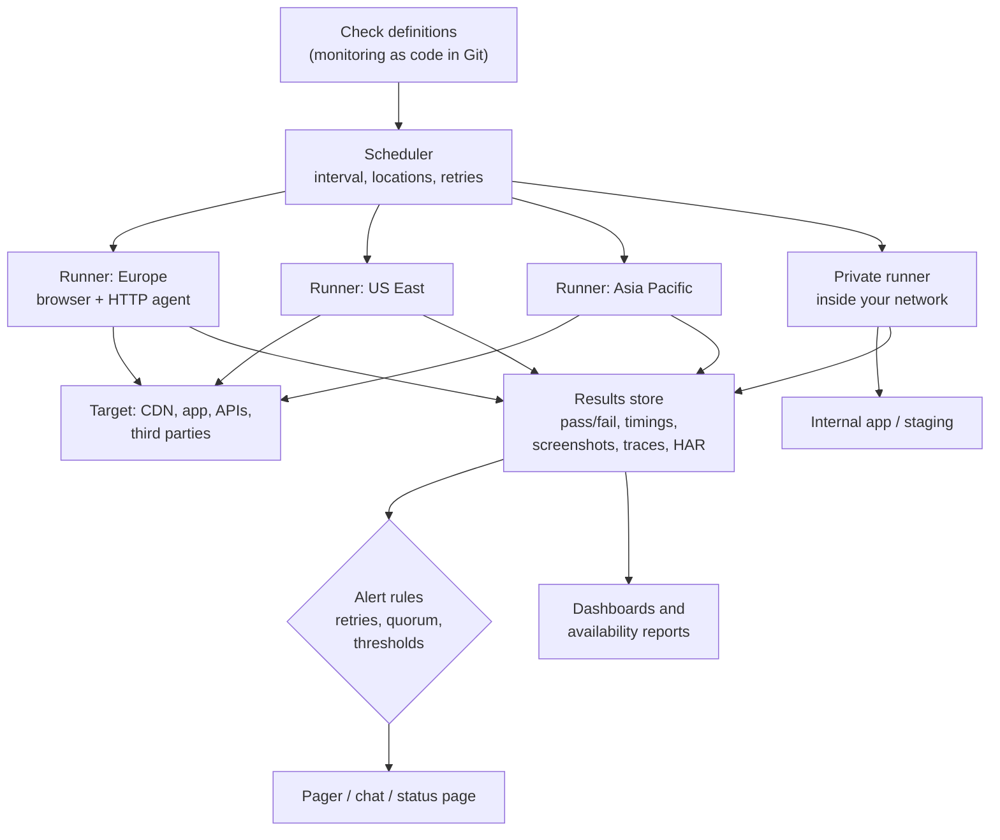
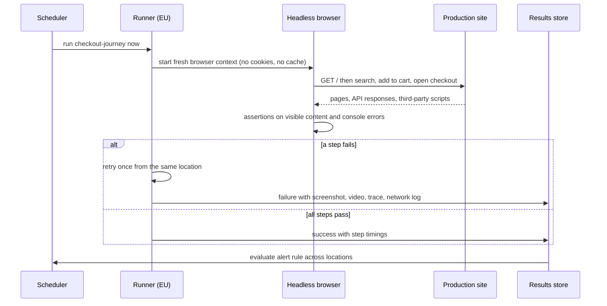
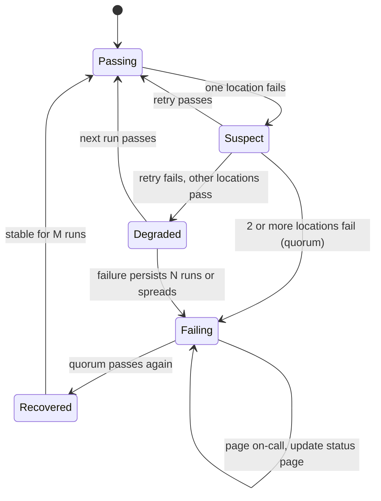
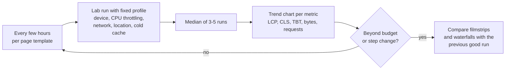
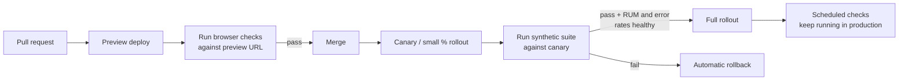
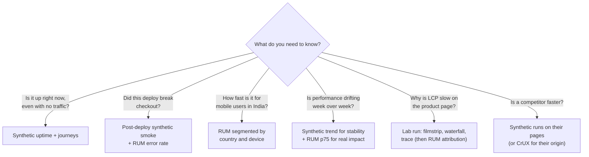

<!-- Generated by scripts/sync-knowledge.js from notes/ and README.md — do not edit here. -->
<!-- sections (line ranges in this file): Table of Contents 19-43 · ELI5 44-57 · Core Concept 58-389 · Synthetic vs RUM 390-418 · Tooling Landscape 419-433 · Framework and Platform Notes 434-446 · Real-World Examples 447-589 · Key Points Summary 590-610 · Test Your Understanding 611-680 · Cheat Sheet 681-726 · References & Further Reading 727-756 -->

# Synthetic Monitoring

> **Date:** 2026-11-06 · **Last updated:** 2026-11-06
> **Category:** Frontend System Design
> **Sub-Topic:** Monitoring & Observability / Synthetic Monitoring
> **Level:** Intermediate · **Reading time:** ~28 min
> **Informs:** uptime and availability SLOs, which user journeys to script as browser checks, check frequency and location count vs cost, alert quorum and retry policy, post-deploy smoke gates, scheduled lab performance tracking, private locations for internal apps, test accounts and synthetic-traffic tagging, synthetic vs RUM coverage

> **Pre-requisite:** [Real User Monitoring (RUM)](./real-user-monitoring-rum.md) (the field side) and [Lighthouse & Performance Auditing](./lighthouse-and-performance-auditing.md) (lab measurement basics).
> This note covers **scripted, scheduled checks against production**: is the site up, do critical journeys work, and did performance drift, measured the same way every time.

**Previous:** [Real User Monitoring (RUM)](./real-user-monitoring-rum.md) · **Next:** [Feature Flags & A/B Testing](./feature-flags-and-a-b-testing.md)

---

## Table of Contents

1. [ELI5 — Simple Explanation](#eli5--simple-explanation)
2. [Section 1: What Synthetic Monitoring Is](#section-1-what-synthetic-monitoring-is)
3. [Section 2: Types of Synthetic Checks](#section-2-types-of-synthetic-checks)
4. [Section 3: Architecture of a Synthetic Platform](#section-3-architecture-of-a-synthetic-platform)
5. [Section 4: Why Frontends Need Browser Checks](#section-4-why-frontends-need-browser-checks)
6. [Section 5: Frequency, Locations and Cost](#section-5-frequency-locations-and-cost)
7. [Section 6: Alerting Without Noise](#section-6-alerting-without-noise)
8. [Section 7: Synthetic Performance Monitoring](#section-7-synthetic-performance-monitoring)
9. [Section 8: Synthetic Checks in the Deploy Pipeline](#section-8-synthetic-checks-in-the-deploy-pipeline)
10. [Section 9: Test Data, Accounts and Side Effects](#section-9-test-data-accounts-and-side-effects)
11. [Section 10: Private Locations, Auth and Bot Protection](#section-10-private-locations-auth-and-bot-protection)
12. [Section 11: Availability SLOs from Synthetic Data](#section-11-availability-slos-from-synthetic-data)
13. [Synthetic vs RUM](#synthetic-vs-rum)
14. [Tooling Landscape](#tooling-landscape)
15. [Framework and Platform Notes](#framework-and-platform-notes)
16. [Real-World Examples](#real-world-examples)
17. [Key Points Summary](#key-points-summary)
18. [Test Your Understanding (with answers)](#test-your-understanding)
19. [Cheat Sheet](#cheat-sheet)
20. [References & Further Reading](#references--further-reading)

---

## ELI5 — Simple Explanation

Think of a **night watchman** checking a shopping mall.

- Every 10 minutes he walks the **same route**: tries the front door, takes the escalator, buys a coffee with a test card, and checks the fire exit.
- He does this **even at 3 a.m. when no customers are around**, so problems are found before the morning rush.
- There are watchmen at **several entrances** (London, Virginia, Singapore). If only one says "the door is stuck", it might be his key. If **two or more** say so, you call the manager.
- He writes the **time** each step took. If the escalator is getting slower every week, you notice the trend.
- He is not a real customer. He can't tell you whether shoppers are happy; that's what **customer feedback** (RUM) is for.

> **One-line takeaway: synthetic monitoring runs the same scripted visit on a schedule from known places, so you find outages and regressions before users do, even when there is no traffic.**

---

## Core Concept — Step by Step

### Section 1: What Synthetic Monitoring Is

**Synthetic monitoring** (also called active monitoring) runs **scripted requests or browser sessions** against your production (or staging) system **on a schedule**, from **chosen locations**, under **controlled conditions**, and alerts when they fail or get slow.



| Property | What it gives you |
|---|---|
| **Works with zero traffic** | Catches outages at night, on new pages, in regions with few users |
| **Controlled and repeatable** | Same script, browser, device profile and network every run, so trends are comparable |
| **Known expected outcome** | You assert exact results ("cart shows 1 item"), not statistical signals |
| **Proactive** | Often the first signal of DNS, TLS, CDN, auth or third-party failures |
| **Limited coverage** | Only the paths you scripted, from the places you chose, with the accounts you made |

It is **not** a test suite replacement: E2E tests in CI verify a build before release (see [E2E Testing (Playwright, Cypress)](./e2e-testing-playwright-cypress.md)); synthetic checks verify the **running production system**, continuously, including everything a build can't control (DNS, certificates, CDN, third-party APIs, config, data).

---

### Section 2: Types of Synthetic Checks



| Check type | Runs | Asserts | Cost per run | Catches |
|---|---|---|---|---|
| **HTTP / uptime** | A single request | Status code, response time, maybe a body keyword | Very low | Server down, DNS/TLS failure, 5xx, CDN outage |
| **API check** | One request with auth | Status, JSON fields, headers, latency | Low | Broken endpoints, bad deploys, contract changes |
| **Multi-step API** | A chain (login → create → read → delete) | Each step, passing values between steps | Low–medium | Broken workflows behind the UI |
| **TLS / DNS / domain** | Certificate and record lookup | Days until expiry, expected records | Very low | Expired certificates, hijacked or broken DNS |
| **Browser page load** | Real (usually headless) browser loads a URL | Element visible, no console errors, timings | Medium | Blank SPA pages, JS errors, missing assets |
| **Browser journey** | Scripted clicks and typing (Playwright, Selenium) | Business outcome reached | High | Broken login, search, cart, checkout |
| **Performance run** | Lab tool with throttling (WebPageTest, Lighthouse) | Metric thresholds, trends | High | Gradual or sudden performance regressions |
| **Heartbeat / cron** | *Your* job calls the monitor | A ping arrived in time | Very low | Silent failures of scheduled jobs (sitemaps, emails, builds) |

---

### Section 3: Architecture of a Synthetic Platform

Whether you buy it or build it, the moving parts are the same:



**One browser-check run, step by step:**



**Artifacts make or break triage.** A failed browser check should store a **screenshot**, a **trace or video**, the **console log** and the **network log (HAR)** of the failing run. Without them, on-call engineers rerun the check, it passes, and nobody learns anything.

---

### Section 4: Why Frontends Need Browser Checks

An HTTP check on an SPA is almost useless on its own: the server returns the **same `index.html` with `200 OK`** whether the app works or not.

```text
HTTP check:      GET https://shop.example.com/  ->  200 OK, 1.2 KB  ✅ "up"
What users see:  blank white page, because /assets/app-3f9a1c.js returns 404 after a bad deploy  ❌
```

Frontend failure modes that only a **real browser** check catches:

| Failure | Why HTTP checks miss it | Browser-check assertion |
|---|---|---|
| Missing or wrong hashed asset after deploy | HTML is still 200 | Key element visible; no failed script requests |
| JavaScript exception during render or hydration | Happens in the browser | Zero uncaught errors in the console |
| API returns 200 with an error payload or empty list | Status looks fine | "Products grid has ≥ 1 item" |
| CDN serves stale HTML pointing at deleted chunks | Origin is healthy | Navigation to a lazy-loaded route works |
| Third-party script (payment, auth, consent) broken or blocked | Not your server | Payment iframe loads; login redirect returns |
| CSP blocks a script after a header change | Headers are valid HTTP | No CSP violation messages in the console |
| Feature flag misconfigured for a region | Same HTML everywhere | Run the journey from several regions |
| Cookie banner or modal covers the page | Not visible in HTTP | Main call to action is clickable |

> **Assert on what the user needs, not on implementation details.** "The *Add to cart* button is visible and enabled" survives refactors; "`div.sc-17xk3 > span:nth-child(2)` exists" breaks every sprint and trains people to ignore the alert.

---

### Section 5: Frequency, Locations and Cost

Every check runs **interval × locations** times. Cost and noise scale with that product.

```text
1 check every 5 min from 3 locations:
  runs per day   = (24 × 60 / 5) × 3 = 864
  runs per month ≈ 864 × 30           = 25,920

1 browser journey every 1 min from 5 locations:
  runs per month ≈ 1,440 × 5 × 30     = 216,000   (browser runs are the expensive kind)
```

| Decision | Guideline |
|---|---|
| **Uptime / API checks** | Frequent (every 1–5 minutes) and from several regions; they are cheap |
| **Critical browser journeys** (login, checkout) | Every 5–15 minutes from 2–3 regions where your users are |
| **Secondary journeys** | Every 15–60 minutes, one or two regions |
| **Scheduled performance runs** | A few times per day per key page template; trend matters, not minute-level detection |
| **TLS / domain expiry** | Daily is enough; alert weeks before expiry |
| **Locations** | Match where users are and where your CDN/edge regions are; include at least one region far from your origin |

**Time to detect (worst case)** ≈ check interval + (retries × run time) + confirmation from other locations. With a 5-minute interval and "fail twice in a row", an outage that starts just after a successful run can take about 10 minutes to alert. If that's too slow for a journey, increase frequency for **that** journey only.

> Staggering helps: run each location at a different offset (for example EU at :00, US at :01, APAC at :02) so a 5-minute interval across 3 locations samples the site several times per interval.

---

### Section 6: Alerting Without Noise

Synthetic checks fail for reasons that are **not** outages: a runner's network blip, a slow third party, a flaky selector. If on-call gets paged for those, they'll start ignoring the pager.



| Technique | What it prevents |
|---|---|
| **Immediate retry** from the same location | One-off network or runner hiccups |
| **Quorum across locations** (for example ≥ 2 of 3 fail) | Problems with a single runner or a single network path |
| **Consecutive failures** before paging | Transient blips |
| **Separate severities** | Single-region failure → ticket/chat; multi-region failure on checkout → page |
| **Degraded vs down** | Slow but working ("p95 step time above X for 3 runs") is a different alert than "failing" |
| **Maintenance windows** | Pages during planned deploys or downtime |
| **Dependency awareness** | One upstream outage firing 40 alerts; group checks and alert once |
| **Flake budget** | Track each check's false-alarm rate; fix or delete checks that cry wolf |

> A **single-region failure is still information**: it often means a CDN POP, regional DNS or a geo-specific feature flag problem. Route it to a channel even when it doesn't page.

---

### Section 7: Synthetic Performance Monitoring

Scheduled lab runs give a **stable, comparable** performance trend for key page templates, without waiting for traffic.



| Synthetic performance gives | It can't give |
|---|---|
| Comparable trends (same profile every run) | What real users on real devices experience (use RUM) |
| Filmstrips, waterfalls, request lists for diagnosis | INP from real interactions (lab uses TBT as a proxy, or scripted interactions) |
| Detection on low-traffic or new pages | Effects of personalization, A/B variants and warm caches unless you script them |
| Competitor and pre-launch measurements | Distribution across devices and networks |

Practical rules (consistent with [Lighthouse & Performance Auditing](./lighthouse-and-performance-auditing.md)):
- Fix the **profile**: same device emulation, throttling, browser version and test location for every run in a series.
- Use the **median of several runs**; single runs are noisy.
- Track **metrics and resource counts/bytes**, not just a score.
- Test **cold and warm** (repeat view) separately if repeat visitors matter.
- Annotate charts with **deploys**, so step changes line up with releases.
- Feed thresholds from your [Performance Budgets](./performance-budgets.md).

---

### Section 8: Synthetic Checks in the Deploy Pipeline

The same check scripts can protect deploys, not only watch production.



| Stage | Purpose | Notes |
|---|---|---|
| **Preview / staging** | Catch broken journeys before merge | Same scripts as production checks, different base URL |
| **Post-deploy smoke** | Confirm production works right after a release | Run immediately, from several regions; gate the rollout or trigger rollback |
| **Canary** | Compare canary vs stable with real traffic plus synthetic checks pinned to the canary | Route the check to the canary with a header or cookie your edge understands |
| **Scheduled** | Continuous detection between deploys | Catches config, data, certificate and third-party changes that no deploy caused |

> **"Monitoring as code"**: keep check definitions in the repo next to the app, review them in PRs, and deploy them with the app. When a feature changes its UI, the PR updates its check in the same change, instead of on-call discovering a broken monitor at 3 a.m.

---

### Section 9: Test Data, Accounts and Side Effects

Journeys that **write** (sign up, place an order, send a message) need care, because they run hundreds of times a day in production.

| Concern | Practice |
|---|---|
| **Test accounts** | Dedicated synthetic users per environment, flagged in the backend as test accounts |
| **Orders and payments** | Payment provider test mode or a test card routed to a sandbox; or stop before the final "Pay" step and assert the payment form is ready |
| **Side effects** | Backend recognizes test accounts and skips fulfilment, emails, SMS and loyalty points |
| **Cleanup** | Each run deletes what it created (or a nightly job does), so data doesn't pile up |
| **Idempotency** | Unique run IDs in created data so parallel runs from several locations don't collide |
| **Analytics pollution** | Tag synthetic traffic (custom header or user-agent suffix) and filter it out of analytics, RUM and A/B experiment results |
| **Secrets** | Store passwords, API keys and TOTP seeds in the monitoring tool's secret store, never in the script |
| **MFA** | Use a test account with TOTP generated from a stored seed, or an environment-specific bypass that only works for that account and only from known runners |

```text
❌ Synthetic checkout buys a real item every 5 minutes → real warehouse picks, real refunds
❌ Synthetic sessions counted in conversion funnels → A/B test results skewed
✅ Test account + sandbox payment + backend "isSynthetic" flag + analytics filter on the synthetic header
```

---

### Section 10: Private Locations, Auth and Bot Protection

| Situation | Approach |
|---|---|
| **Internal apps, staging behind VPN** | Run a **private location** (the vendor's agent as a container inside your network) that pulls jobs from the vendor and pushes results out |
| **Site behind SSO** | Script the login with a test identity, or use a long-lived test session token stored as a secret; check the login journey itself separately |
| **WAF / bot management blocks the runners** | Allow-list runner traffic by a **secret header** or signed token, or the vendor's published IP ranges. Don't disable bot protection globally |
| **Rate limits** | Exempt or budget synthetic traffic so checks don't trigger throttling and false alarms |
| **Geo-restricted content** | Run from the regions where the content is offered |
| **Consent banners** | Accept or dismiss them in the script (or set the consent cookie) the way a real user would |

> A runner that bypasses the WAF entirely also stops testing the WAF. Prefer a narrow bypass (one header, one rule) and keep at least one check that goes through the full edge stack exactly like a user.

---

### Section 11: Availability SLOs from Synthetic Data

Synthetic checks are the simplest way to measure **availability** of a journey:

```text
availability = successful checks / total checks          (per journey, per window)

Error budget for a 30-day window:
  99.9 %  →  0.1 % of 43,200 min  =  43.2 minutes of failure
  99.5 %  →  0.5 % of 43,200 min  =  216 minutes
```

| Design choice | Recommendation |
|---|---|
| What counts as a failure | A run that failed after retries **and** met the quorum rule, not every single failed attempt |
| Windows | Rolling 28 or 30 days, matching your other SLOs |
| Per journey | "Checkout available" and "Search available" are separate SLOs with separate owners |
| Pair with RUM | Synthetic availability measures "can a clean, scripted session succeed"; RUM error rates and failed API calls measure "did real users succeed". Both can disagree, and both matter |
| Status page | Drive a public status page from multi-region synthetic results, with human confirmation for major incidents |

---

## Synthetic vs RUM



| | **Synthetic** | **RUM** |
|---|---|---|
| Traffic needed | None | Yes; low-traffic pages have weak data |
| Conditions | Fixed, known | Real, varied |
| Coverage | Only scripted paths | Everything users do |
| Detects outages at 3 a.m. | ✅ | Only if users are around |
| Measures INP from real interactions | ❌ (scripted at best) | ✅ |
| Diagnostic artifacts | Screenshots, video, waterfall, trace | Attribution fields, limited by browser APIs |
| Comparable over time | ✅ very | Affected by traffic mix |
| Competitor measurement | ✅ | ❌ (CrUX gives some) |
| Cost driver | Runs (interval × locations × steps) | Sessions or events ingested |

> Mature teams use both: **synthetic to detect and to gate deploys**, **RUM to measure impact and set priorities**, lab tools to diagnose. See [Real User Monitoring (RUM)](./real-user-monitoring-rum.md).

---

## Tooling Landscape

| Category | Examples | Notes |
|---|---|---|
| **Monitoring as code, Playwright-based** | Checkly | Playwright scripts deployed as checks from the repo via a CLI |
| **Full observability platforms** | Datadog Synthetic Monitoring, New Relic Synthetics, Dynatrace, Grafana Cloud Synthetic Monitoring (k6 scripts, including k6 browser) | Integrates with RUM, APM and alerting in the same product; private locations supported |
| **Uptime-focused** | Pingdom, UptimeRobot, Better Stack and similar | Cheap HTTP/keyword checks, status pages |
| **Synthetic performance** | WebPageTest (Catchpoint), SpeedCurve, Calibre, DebugBear | Scheduled lab runs with filmstrips, budgets, competitor comparisons |
| **CI-native** | Lighthouse CI, Playwright tests in CI against preview URLs | Pre-release only, not continuous production monitoring |
| **DIY** | Playwright + a scheduler (Kubernetes CronJob, cloud functions) + your alerting | Full control; you own runners in multiple regions, artifacts, retries and alert logic |

> Feature sets and pricing change often. Compare on: supported check types, scripting language (Playwright vs proprietary recorder), locations and private locations, artifacts on failure, alerting rules (retries, quorum), CI integration, and how cost scales with runs.

---

## Framework and Platform Notes

| Stack | Synthetic-specific advice |
|---|---|
| **React SPA (Vite)** | Assert on rendered content, never on the HTTP status of `/`; include one lazy-loaded route in the journey to catch missing chunks |
| **Next.js / Nuxt / SvelteKit / Angular SSR** | Check both the server-rendered HTML (API/HTTP check with a content keyword) and the hydrated page (browser check: interactive element works). Hydration errors show up in the console |
| **Vue / Angular / Svelte** | Same approach; use role-based locators or stable `data-testid` attributes your components expose, so checks survive markup refactors |
| **Micro-frontends** | One journey that crosses team boundaries (shell → remote → remote) catches version-skew failures that per-team tests miss |
| **Native mobile apps** | Synthetic mobile checks run on device farms or emulators with Appium, XCUITest or Espresso scripts; the backend APIs the app uses are usually monitored with API checks, which are far cheaper |
| **PWAs / Service Workers** | Run journeys with a **fresh context** (no SW) and with a **warmed context** (SW installed), because a stale Service Worker can serve old shells after a deploy |

---

## Real-World Examples

**Example 1 — A Playwright journey written to be a good production check:**
```typescript
// checks/checkout.check.spec.ts
import { test, expect } from '@playwright/test';

test('guest can reach a ready payment form', async ({ page }) => {
  const consoleErrors: string[] = [];
  page.on('console', (msg) => { if (msg.type() === 'error') consoleErrors.push(msg.text()); });
  const failedRequests: string[] = [];
  page.on('requestfailed', (req) => failedRequests.push(req.url()));

  await test.step('home renders', async () => {
    await page.goto('/');
    await expect(page.getByRole('searchbox', { name: /search/i })).toBeVisible();
  });

  await test.step('search returns products', async () => {
    await page.getByRole('searchbox', { name: /search/i }).fill('synthetic-test-item');
    await page.keyboard.press('Enter');
    await expect(page.getByRole('listitem').first()).toBeVisible();
  });

  await test.step('add to cart and open checkout', async () => {
    await page.getByRole('listitem').first().getByRole('button', { name: /add to cart/i }).click();
    await page.getByRole('link', { name: /cart/i }).click();
    await page.getByRole('button', { name: /checkout/i }).click();
    // stop BEFORE paying: assert the payment iframe is ready
    await expect(page.frameLocator('iframe[title*="payment" i]').getByRole('textbox').first()).toBeVisible();
  });

  expect(failedRequests, 'no failed network requests').toEqual([]);
  expect(consoleErrors, 'no console errors').toEqual([]);
});
```

**Example 2 — Playwright config tuned for monitoring (artifacts, tagging, retries):**
```typescript
// playwright.monitoring.config.ts
import { defineConfig, devices } from '@playwright/test';

export default defineConfig({
  testDir: './checks',
  testMatch: /.*\.check\.spec\.ts/,
  retries: 1,                                  // one retry absorbs runner blips
  timeout: 60_000,
  reporter: [['json', { outputFile: 'results.json' }]],
  use: {
    baseURL: process.env.TARGET_URL ?? 'https://www.example.com',
    trace: 'retain-on-failure',                // full trace only when it failed
    screenshot: 'only-on-failure',
    video: 'retain-on-failure',
    extraHTTPHeaders: {
      'x-synthetic-check': process.env.CHECK_RUN_ID ?? 'local', // filter out of analytics and RUM
    },
  },
  projects: [
    { name: 'desktop-chrome', use: { ...devices['Desktop Chrome'] } },
    { name: 'mobile-safari', use: { ...devices['iPhone 13'] } },
  ],
});
```
> `extraHTTPHeaders` are added to every request the page makes, including third-party ones, which may then fail CORS preflights. If that happens, add the header only to your own origin with `page.route()`, or use a user-agent suffix instead.

**Example 3 — BAD → GOOD uptime check for an SPA:**
```typescript
// ❌ BAD: passes even when the app is a blank page
const res = await fetch('https://www.example.com/');
if (res.status !== 200) alert('down');

// ✅ BETTER (cheap HTTP level): check the HTML references an asset that really exists
const html = await (await fetch('https://www.example.com/', { headers: { 'x-synthetic-check': 'uptime' } })).text();
const entry = html.match(/src="(\/assets\/index-[\w-]+\.js)"/)?.[1];
if (!entry) throw new Error('entry script tag missing');
const asset = await fetch(new URL(entry, 'https://www.example.com'), { method: 'HEAD' });
if (!asset.ok) throw new Error(`entry asset ${entry} returned ${asset.status}`);

// ✅ BEST: a browser check (Example 1) that asserts visible content and zero console errors
```

**Example 4 — Collecting lab timings inside a browser check:**
```typescript
import { test, expect } from '@playwright/test';

test('product page timings', async ({ page }) => {
  await page.goto('/product/synthetic-test-item');
  await expect(page.getByRole('heading', { level: 1 })).toBeVisible();

  const timings = await page.evaluate(() => {
    const nav = performance.getEntriesByType('navigation')[0] as PerformanceNavigationTiming;
    const lcp = performance.getEntriesByType('largest-contentful-paint').at(-1); // Chromium, Firefox, newer Safari
    return {
      ttfb: Math.round(nav.responseStart),
      domContentLoaded: Math.round(nav.domContentLoadedEventEnd),
      lcp: lcp ? Math.round(lcp.startTime) : null,
      requests: performance.getEntriesByType('resource').length,
    };
  });
  test.info().annotations.push({ type: 'timings', description: JSON.stringify(timings) });
  expect(timings.ttfb, 'TTFB from this region').toBeLessThan(800);
});
```
> These numbers come from a fast data-centre machine without throttling unless you add it, so treat thresholds as **regression guards**, not as user experience. For throttled, comparable performance runs use a dedicated tool (WebPageTest, Lighthouse) and medians.

**Example 5 — Heartbeat monitoring for a frontend build job:**
```bash
#!/usr/bin/env bash
# Nightly job that regenerates the sitemap; the monitor alerts if no ping arrives within its window.
set -euo pipefail
curl -fsS -m 10 "$HEARTBEAT_URL/start" > /dev/null   # optional "started" ping (offered by some heartbeat services)
node scripts/build-sitemap.js
aws s3 cp dist/sitemap.xml s3://www-example/sitemap.xml
curl -fsS -m 10 "$HEARTBEAT_URL" > /dev/null    # success ping; a missing ping = failure
```

**Example 6 — Why a CI cron is not a monitor:**
```yaml
# .github/workflows/synthetic.yml
# OK as a cheap extra signal, NOT as your primary monitor:
#  - one runner region, shared hardware
#  - GitHub documents that scheduled workflows can be delayed during high load (minimum interval 5 minutes)
#  - no quorum across locations, and alerting is up to you
on:
  schedule:
    - cron: '*/15 * * * *'
  workflow_dispatch: {}
jobs:
  checks:
    runs-on: ubuntu-latest
    steps:
      - uses: actions/checkout@v4
      - uses: actions/setup-node@v4
        with: { node-version: 22 }
      - run: npm ci && npx playwright install --with-deps chromium
      - run: npx playwright test -c playwright.monitoring.config.ts --project=desktop-chrome
        env:
          TARGET_URL: https://www.example.com
          CHECK_RUN_ID: gha-${{ github.run_id }}
```

---

## Key Points Summary

| Concept | One-Line Explanation |
|---|---|
| **Synthetic monitoring** | Scheduled, scripted checks against production from chosen locations |
| **Uptime / API checks** | Cheap and frequent; catch server, DNS, TLS and API failures |
| **Browser checks** | Real browser journeys; the only way to know an SPA actually renders and works |
| **Assert user outcomes** | Check visible, meaningful content, not status codes or brittle selectors |
| **Interval × locations** | Drives both cost and time to detect |
| **Retries + quorum** | Page only when failures repeat and appear in multiple locations |
| **Artifacts** | Screenshot, trace/video, console and network logs on every failure |
| **Synthetic performance** | Fixed-profile lab runs on a schedule; comparable trends, not user experience |
| **Deploy gates** | Same scripts run on previews, canaries and right after release |
| **Test accounts** | Flagged users, sandbox payments, cleanup, no real side effects |
| **Tag synthetic traffic** | Filter it out of analytics, RUM and experiments |
| **Private locations** | Agents inside your network for internal or staging apps |
| **Availability SLO** | Successful checks / total checks per journey over a rolling window |
| **Heartbeat** | Your job pings the monitor; silence means failure |

---

## Test Your Understanding

**Q1 (Basic):**
Your uptime monitor showed 100 % availability last month, but customers reported a two-hour outage where the site was a blank white page. How is that possible, and what check would have caught it?

<details>
<summary>Answer</summary>

The uptime monitor only made an HTTP request to `/` and checked for `200`. An SPA's server returns the same small `index.html` whether the JavaScript bundle loads or not, so a missing hashed asset, a JS exception during render, a CSP change or a broken API still looks "up". A **browser check** that loads the page in a real browser and asserts a meaningful element is visible (and that there are no console errors or failed script requests) would have failed immediately. A cheaper middle step is an HTTP check that also fetches the entry script referenced in the HTML.
</details>

**Q2 (Basic):**
What does synthetic monitoring give you that RUM cannot, and the other way round?

<details>
<summary>Answer</summary>

**Synthetic:** works with no traffic (night, new pages, small regions), uses fixed conditions so trends are comparable, asserts exact outcomes, produces rich artifacts (screenshots, video, waterfalls) and can measure competitors. **RUM:** reflects real devices, networks, content and behaviour; covers every path users take, not only scripted ones; measures real interactions (INP) and the true distribution. Synthetic detects and gates; RUM measures impact and sets priorities.
</details>

**Q3 (Application):**
Your checkout browser check runs every minute from 6 locations and pages on any single failure. On-call is paged several times a week, and most pages are false alarms. Redesign the setup.

<details>
<summary>Answer</summary>

- Add an **immediate retry** from the same location to absorb transient blips.
- Page only on a **quorum** (for example ≥ 2 of 3 locations) and/or **N consecutive failures**; single-location failures go to a chat channel as information.
- Reduce cost and noise: every 5 minutes from **3 staggered locations** is usually enough for checkout; keep a cheap API check on the checkout endpoints at a higher frequency.
- Fix the **flakiness itself**: role-based locators, waiting on user-visible state instead of fixed sleeps, stable test data, dismissing the consent banner.
- Track each check's **false-alarm rate** and treat a flaky monitor as a bug.
- Store **trace, screenshot and console/network logs** on failure so each real page is quick to triage.
</details>

**Q4 (Tricky):**
A synthetic browser check of your product page reports LCP of 900 ms from every location, while RUM shows a p75 LCP of 3.4 s on mobile. Which is right?

<details>
<summary>Answer</summary>

Both, for their conditions. The synthetic runner is a fast data-centre machine on a fast network, often desktop-sized, possibly with warm CDN edges, usually without throttling unless configured. RUM is the distribution across real phones and networks, and p75 sits in its slower part. Synthetic numbers are for **detecting change** under a fixed profile; RUM numbers are the user experience. If you want synthetic performance closer to real users, configure CPU and network throttling and a mobile viewport (or use a lab tool that does), and still treat the result as a trend, not as the truth.
</details>

**Q5 (Tricky):**
Marketing says the A/B test of a new checkout shows variant B converting worse, but only since the synthetic checkout monitor was added. What happened, and how do you prevent it?

<details>
<summary>Answer</summary>

The synthetic sessions are counted as real users in analytics and the experiment. They are bucketed into variants like everyone else, never convert (the script stops before paying), and add many non-converting sessions, so whichever variant they happen to land in more often looks worse. Prevention: **tag synthetic traffic** (header or user-agent marker, or a flag on the test account), **exclude** it from analytics, RUM and experiment assignment (or pin it to a fixed variant you exclude), and audit filters whenever a new check is added. See [Feature Flags & A/B Testing](./feature-flags-and-a-b-testing.md).
</details>

**Q6 (System design):**
Design synthetic monitoring for a global food-delivery web app (SSR + SPA), with an internal admin dashboard behind VPN and a weekly release train plus daily config changes.

<details>
<summary>Answer</summary>

- **Protocol layer:** HTTP checks on home, a restaurant page and key APIs every 1–2 minutes from regions matching the markets; TLS and domain expiry daily; DNS record checks.
- **Browser journeys (Playwright, in the repo):** search → restaurant → add item → checkout ready (stop before paying), login, and order-status page, every 5–10 minutes from 2–3 regions per major market; one journey crosses into a lazy-loaded route.
- **Admin dashboard:** the same tooling from a **private location** inside the VPN, with an SSO test identity whose secrets live in the tool's vault.
- **Test data:** dedicated test restaurants and accounts flagged `isSynthetic`, sandbox payments, no dispatch to couriers, nightly cleanup; synthetic header filtered from analytics, RUM and experiments.
- **Alerting:** retry once, quorum of 2 locations, separate severities (checkout multi-region = page; single region = chat), maintenance windows for the release train, artifacts on failure.
- **Pipeline:** run the journeys against preview deploys and as **post-deploy smoke** from several regions with automatic rollback; because config changes happen daily without a deploy, the scheduled checks are what catch those.
- **Performance:** scheduled lab runs (throttled mobile profile, median of several runs) on the home, restaurant and checkout templates, annotated with releases; RUM for real-user p75.
- **SLOs:** availability per journey from synthetic results, paired with RUM error rates.
</details>

---

## Cheat Sheet

**Key Definitions:**
- **Synthetic monitoring:** Active, scripted checks on a schedule from chosen locations
- **Browser check:** Real browser running a scripted journey with assertions
- **Location / runner:** Where checks run; **private location** = runner inside your network
- **Quorum:** Number of locations that must fail before alerting
- **Heartbeat:** Monitor that expects a ping from your job; silence triggers the alert
- **Monitoring as code:** Check definitions stored, reviewed and deployed from the repo
- **Synthetic traffic tagging:** Marking check traffic so it can be excluded from analytics and RUM

**Quick Reference:**
```text
Check mix:     uptime/API (1-5 min, many regions)  +  critical browser journeys (5-15 min, 2-3 regions)
               + TLS/domain expiry (daily)  +  scheduled perf runs (few per day, median)  +  heartbeats
SPA rule:      never trust 200 on "/" ; assert visible content, no console errors, no failed requests
Assertions:    user outcomes via roles/text ; stop before irreversible steps (pay, send)
Alerting:      retry once -> quorum (>= 2 locations) and/or N consecutive -> severity by journey
Artifacts:     screenshot + trace/video + console + network log on failure
Cost:          runs = (minutes in period / interval) x locations ; browser runs cost most
Detect time:   ~ interval + retries + confirmation
Pipeline:      preview -> post-deploy smoke (multi-region) -> canary -> scheduled
Data:          flagged test accounts, sandbox payments, cleanup, x-synthetic header filtered everywhere
SLO:           availability = successful runs / total runs (after retries + quorum), 28-30 day window
Error budget:  99.9 % of 30 days = 43.2 min ; 99.5 % = 216 min
```

**Common Mistakes to Avoid:**

| Mistake | Why Wrong | Fix |
|---|---|---|
| HTTP 200 check as the only SPA monitor | Blank pages and JS failures still return 200 | Browser check with content assertions |
| Paging on a single failure from one location | Runner and network blips cause false alarms | Retry + quorum + consecutive failures |
| Brittle CSS selectors | Checks break on every refactor | Role/text locators or stable test IDs |
| Synthetic checkout placing real orders | Real cost and operational side effects | Sandbox payments, flagged accounts, stop before paying |
| Counting synthetic sessions in analytics | Skews funnels and A/B tests | Tag and filter synthetic traffic |
| Treating synthetic timings as user experience | Fast machines and networks, fixed profile | Use RUM for experience; synthetic for trends |
| No artifacts on failure | Can't triage, reruns pass | Keep trace, screenshot, logs |
| Secrets inside scripts | Leaks through repo and logs | Tool secret store / vault |
| CI cron as the only monitor | One region, delays, no quorum | Dedicated multi-region monitoring |
| Disabling the WAF for runners | Stops testing what users go through and weakens security | Narrow, secret-based allow rule |
| Never pruning checks | Cost grows and flaky checks get ignored | Review checks quarterly; delete or fix noisy ones |
| Only checking at deploy time | Misses config, certificate, data and third-party changes | Scheduled checks between deploys |

---

## References & Further Reading

**Core docs**
- Playwright: [Writing tests](https://playwright.dev/docs/writing-tests) · [Locators](https://playwright.dev/docs/locators) · [Trace viewer](https://playwright.dev/docs/trace-viewer) · [Test configuration](https://playwright.dev/docs/test-configuration)
- MDN: [Navigation timing](https://developer.mozilla.org/en-US/docs/Web/API/Performance_API/Navigation_timing)
- GitHub Docs: [Events that trigger workflows — `schedule`](https://docs.github.com/en/actions/reference/workflows-and-actions/events-that-trigger-workflows#schedule)

**Vendors and tooling**
- Datadog: [Synthetic Monitoring](https://docs.datadoghq.com/synthetics/)
- New Relic: [Synthetic monitoring](https://docs.newrelic.com/docs/synthetics/)
- Grafana: [Synthetic Monitoring](https://grafana.com/docs/grafana-cloud/testing/synthetic-monitoring/)
- Checkly: [Documentation](https://www.checklyhq.com/docs/)
- WebPageTest: [Documentation (Catchpoint)](https://docs.catchpoint.com/wpt/docs/webpageteststarter)
- Lighthouse CI: [Getting started](https://github.com/GoogleChrome/lighthouse-ci/blob/main/docs/getting-started.md)

**Reliability practice**
- Google SRE Book: [Monitoring Distributed Systems](https://sre.google/sre-book/monitoring-distributed-systems/)
- Google SRE Book: [Service Level Objectives](https://sre.google/sre-book/service-level-objectives/)
- Google SRE Workbook: [Alerting on SLOs](https://sre.google/workbook/alerting-on-slos/)
- web.dev: [Why lab and field data can be different](https://web.dev/articles/lab-and-field-data-differences)

---

> **Previous Topic:** [Real User Monitoring (RUM)](./real-user-monitoring-rum.md)
> — Measuring what real users experience, on their devices and networks

> **Next Topic:** [Feature Flags & A/B Testing](./feature-flags-and-a-b-testing.md)
> — Decoupling deploy from release, and measuring changes with controlled experiments

*Saved on: 2026-11-06 | Repo: Frontend System Design Learning Notes*
