<!-- Generated by scripts/sync-knowledge.js from notes/ and README.md — do not edit here. -->
<!-- sections (line ranges in this file): Table of Contents 19-44 · ELI5 45-58 · Core Concept 59-510 · Full Visual 511-541 · Real-World Examples 542-658 · Key Points Summary 659-682 · Test Your Understanding 683-769 · Cheat Sheet 770-834 · References & Further Reading 835-877 -->

# TCP/TLS Handshake

> **Date:** 2026-11-06 · **Last updated:** 2026-11-06
> **Category:** Frontend System Design
> **Sub-Topic:** Networking / Connections
> **Level:** Intermediate · **Reading time:** ~30 min
> **Informs:** connection setup latency, preconnect, HTTPS/HSTS policy, critical-request sizing, mobile performance

> **Pre-requisite:** [DNS Resolution & CDN](./dns-resolution-and-cdn.md) (how the browser gets an IP and why the edge should be close) and [HTTP/1.1 vs HTTP/2 vs HTTP/3](./http1-vs-http2-vs-http3.md).
> This note counts the **round trips** between "I know the IP" and "the first byte of HTML arrives" — and shows which of them you can remove.

**Previous:** [DNS Resolution & CDN](./dns-resolution-and-cdn.md) · **Next:** [REST vs GraphQL vs gRPC-Web](./rest-vs-graphql-vs-grpc-web.md)

---

## Table of Contents

1. [ELI5 — Simple Explanation](#eli5--simple-explanation)
2. [Section 1: The Cost of a New Connection](#section-1-the-cost-of-a-new-connection)
3. [Section 2: The TCP 3-Way Handshake](#section-2-the-tcp-3-way-handshake)
4. [Section 3: Slow Start, the Congestion Window and the 14KB Guideline](#section-3-slow-start-the-congestion-window-and-the-14kb-guideline)
5. [Section 4: TLS 1.2 Handshake — Two Round Trips](#section-4-tls-12-handshake--two-round-trips)
6. [Section 5: TLS 1.3 Handshake — One Round Trip](#section-5-tls-13-handshake--one-round-trip)
7. [Section 6: Session Resumption and 0-RTT](#section-6-session-resumption-and-0-rtt)
8. [Section 7: Certificates and the Chain of Trust](#section-7-certificates-and-the-chain-of-trust)
9. [Section 8: SNI and Encrypted Client Hello](#section-8-sni-and-encrypted-client-hello)
10. [Section 9: ALPN — Negotiating h2 and h3](#section-9-alpn--negotiating-h2-and-h3)
11. [Section 10: HSTS and the Preload List](#section-10-hsts-and-the-preload-list)
12. [Section 11: QUIC — Transport and Crypto in One Handshake](#section-11-quic--transport-and-crypto-in-one-handshake)
13. [Section 12: Connection Reuse and Coalescing](#section-12-connection-reuse-and-coalescing)
14. [Section 13: Preconnect — Cost vs Benefit](#section-13-preconnect--cost-vs-benefit)
15. [Section 14: RTT Math for Mobile Networks](#section-14-rtt-math-for-mobile-networks)
16. [Full Visual — Cold vs Warm Connection](#full-visual--cold-vs-warm-connection)
17. [Real-World Examples](#real-world-examples)
18. [Key Points Summary](#key-points-summary)
19. [Test Your Understanding (with answers)](#test-your-understanding)
20. [Cheat Sheet](#cheat-sheet)
21. [References & Further Reading](#references--further-reading)

---

## ELI5 — Simple Explanation

Think of calling a company's **secure support line**.

- **TCP handshake = getting the call connected.** "Hello, can you hear me?" — "Yes, can you hear me?" — "Yes!" Nobody has said anything useful yet, but one full back-and-forth has passed.
- **TLS handshake = verifying identities and agreeing on a secret code.** The company shows an ID card signed by a trusted authority (**certificate**), and you both agree on a secret language nobody listening can understand (**key exchange**). Old procedure (TLS 1.2): two more back-and-forths. New procedure (TLS 1.3): one.
- **Slow start = the new agent talks slowly at first.** They don't know how good the line is, so they send a little, wait for "got it", then send twice as much, and so on. That is why the **first ~14KB** of your page is special: it is roughly what fits before the first "got it".
- **Resumption / 0-RTT = "It's me again, here's my ticket from last time."** You can skip most of the identity check — and with 0-RTT you even start talking immediately, at the risk that someone could record and **replay** that first sentence.
- **QUIC (HTTP/3) = connecting and verifying in the same breath.** One back-and-forth does both jobs.

> **One-line takeaway: before the first byte of HTML, a cold HTTPS visit pays DNS + TCP + TLS + request round trips. On a high-latency mobile link each round trip is expensive, so the winning moves are: fewer new connections, TLS 1.3 / QUIC, resumption, HSTS instead of redirects, and a small first response.**

---

## Core Concept — Step by Step

### Section 1: The Cost of a New Connection

A **round trip time (RTT)** is the time for a packet to go to the server and for the reply to come back. Connection setup cost is measured in RTTs because **bandwidth can't fix latency** — no matter how fast the link, each handshake step has to wait for the other side.

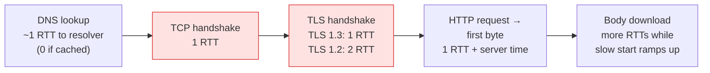

| Setup | RTTs before the HTTP request can be sent | RTTs to first response byte (excl. DNS & server time) |
|---|---|---|
| TCP + TLS 1.2 (full handshake) | 3 | **4** |
| TCP + TLS 1.3 (full handshake) | 2 | **3** |
| TCP + TLS 1.3 with **0-RTT** resumption | 1 | **2** |
| QUIC / HTTP/3 (new connection) | 1 | **2** |
| QUIC / HTTP/3 with **0-RTT** resumption | 0 | **1** |
| **Reused** existing connection | 0 | **1** |

> **The cheapest handshake is the one you don't do.** Reusing a warm connection beats every protocol optimisation in this note.

---

### Section 2: The TCP 3-Way Handshake

TCP ([RFC 9293](https://datatracker.ietf.org/doc/html/rfc9293)) gives a reliable, ordered byte stream on top of unreliable IP packets. Before any data flows, both sides agree on initial sequence numbers:

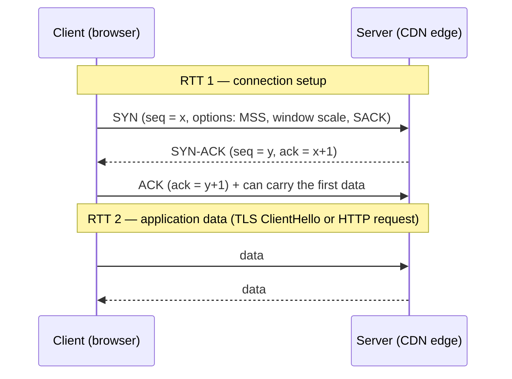

- The client can send data together with its final `ACK`, so the handshake costs **1 RTT** before the first useful byte is sent.
- Options negotiated in the SYN/SYN-ACK — **MSS** (max segment size, ~1460 bytes on typical Ethernet paths), **window scaling**, **SACK** — affect throughput for the life of the connection.
- **TCP Fast Open** ([RFC 7413](https://datatracker.ietf.org/doc/html/rfc7413)) lets repeat clients put data in the SYN, but middlebox problems mean it has seen little use in browsers. Don't plan around it.
- TCP delivers bytes **in order**: one lost packet stalls everything behind it on that connection (**transport-level head-of-line blocking**) — the core motivation for QUIC (Section 11 and [HTTP/1.1 vs HTTP/2 vs HTTP/3](./http1-vs-http2-vs-http3.md)).

---

### Section 3: Slow Start, the Congestion Window and the 14KB Guideline

#### 3.1 Why TCP starts slowly

A new connection knows nothing about the path's capacity. To avoid flooding it, the sender limits unacknowledged data in flight to the **congestion window (cwnd)** and grows it as ACKs arrive:

- **Slow start:** cwnd grows by roughly one segment per ACK → it **roughly doubles every RTT**.
- On loss (or when reaching the slow-start threshold) the algorithm switches to slower growth (**congestion avoidance**). Common algorithms: **CUBIC** (Linux default), **BBR** (model-based, used by Google and some CDNs).
- The sender is also limited by the receiver's advertised window (**rwnd**) — in-flight data ≤ min(cwnd, rwnd).
- Many stacks **reset cwnd after an idle period** (slow-start restart), so a long-idle keep-alive connection may ramp up again.

#### 3.2 Where "14KB" comes from

[RFC 6928](https://datatracker.ietf.org/doc/html/rfc6928) raised TCP's **initial window** to **10 segments** (widely deployed; Linux default since 2011). With a typical MSS of ~1460 bytes:

```text
initial cwnd ≈ 10 segments × 1460 bytes ≈ 14,600 bytes ≈ 14KB

RTT   cwnd (segments)   sent this RTT   cumulative
 1          10            ~14.6 KB        ~14.6 KB
 2          20            ~29.2 KB        ~43.8 KB
 3          40            ~58.4 KB       ~102.2 KB
 4          80           ~116.8 KB       ~219.0 KB
(ideal: no loss, rwnd and bandwidth not limiting)
```

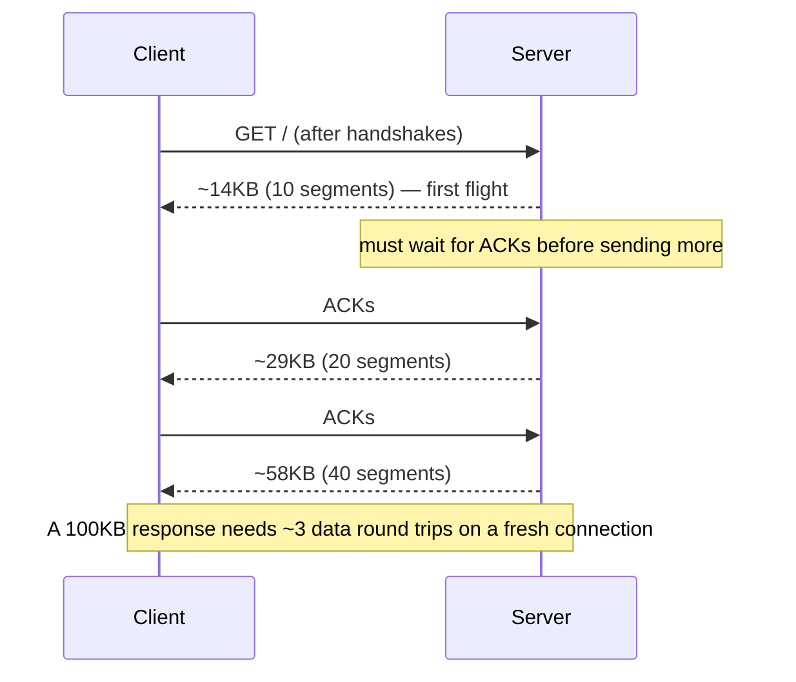

**The guideline:** if the HTML (compressed) that is needed for first render — including inlined critical CSS — fits in about **14KB**, it can arrive in the **first flight** without waiting for an extra round trip (see [Critical Rendering Path](./critical-rendering-path.md)).

Treat it as a **commonly cited rule of thumb, not a hard limit**:

- It is derived from the initial cwnd of ~10 segments; the real number depends on MSS, the server's configured initial window (some CDNs tune it), TLS record and HTTP header overhead, and — on TLS — the **server's certificate chain**, which travels in the same early flights.
- **Compression happens first** — the budget is in *compressed* bytes on the wire.
- QUIC has a similar default: [RFC 9002](https://datatracker.ietf.org/doc/html/rfc9002) recommends an initial window of about 10 × max datagram size (≈ 14,720 bytes cap at the typical size).
- It matters most on **high-RTT links** and **new connections**. On a warm connection with a grown cwnd, the effect disappears.

---

### Section 4: TLS 1.2 Handshake — Two Round Trips

TLS gives **confidentiality, integrity and server authentication**. A full TLS 1.2 handshake (with ECDHE key exchange) costs **2 RTTs** on top of TCP:

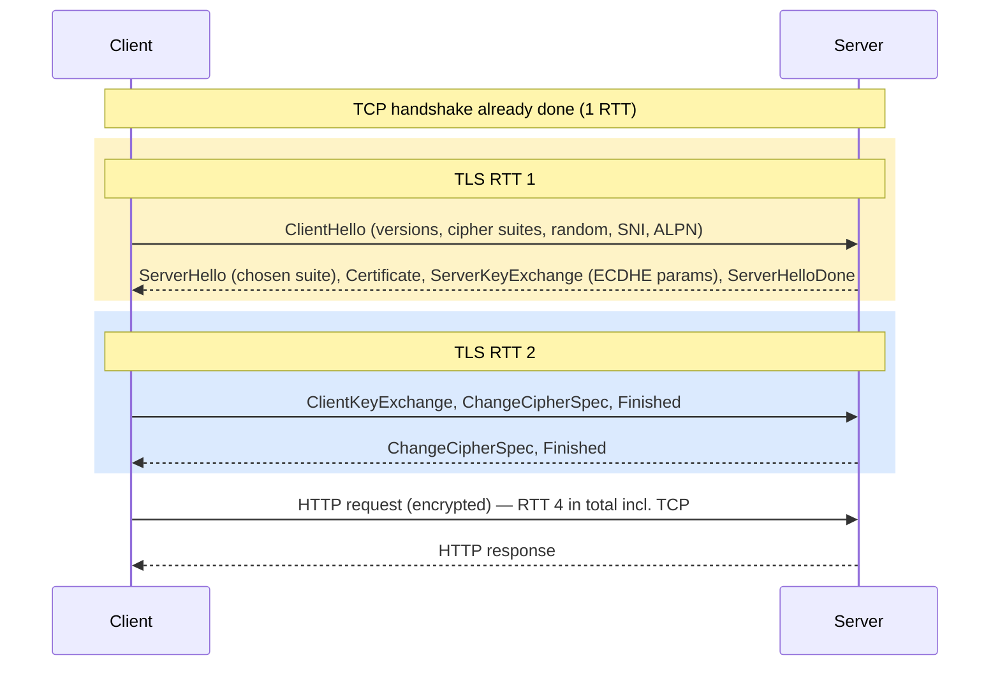

- The certificate is sent **in plaintext** in TLS 1.2.
- **TLS False Start** ([RFC 7918](https://datatracker.ietf.org/doc/html/rfc7918)) lets the client send application data right after its `Finished` (without waiting for the server's), saving 1 RTT when forward-secret ciphers are used — browsers adopted it, but it's a TLS 1.2-era workaround that TLS 1.3 makes unnecessary.
- **TLS 1.0 and 1.1 are deprecated** ([RFC 8996](https://datatracker.ietf.org/doc/html/rfc8996)) and disabled in all major browsers. Serve **TLS 1.3, with TLS 1.2 as a fallback**.

---

### Section 5: TLS 1.3 Handshake — One Round Trip

TLS 1.3 ([RFC 8446](https://datatracker.ietf.org/doc/html/rfc8446), 2018) redesigned the handshake. The client **guesses** the key-exchange group and sends its key share in the very first message, so the server can derive keys and respond with everything at once:

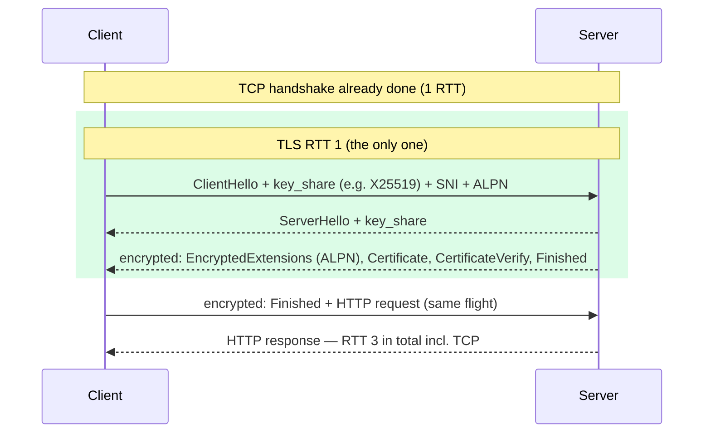

| | TLS 1.2 | TLS 1.3 |
|---|---|---|
| Full handshake | 2 RTT | **1 RTT** |
| Resumption | 1 RTT | 1 RTT, or **0-RTT** with early data |
| Key exchange | RSA or (EC)DHE | **(EC)DHE only** → forward secrecy always |
| Certificate visible on the wire | Yes | **No** (encrypted) |
| Cipher suites | Many, incl. weak ones | 5 defined, all **AEAD** (e.g. AES-GCM, ChaCha20-Poly1305) |
| Removed | — | RSA key transport, CBC/RC4, compression, renegotiation, static DH |

- If the client guessed the wrong group, the server sends a **HelloRetryRequest** → +1 RTT. Clients send key shares for widely supported groups to avoid it.
- Modern browsers also send **post-quantum hybrid key shares** (e.g. X25519 combined with ML-KEM). These are larger, so the ClientHello can span more than one packet — another reason not to treat byte counts as exact.

---

### Section 6: Session Resumption and 0-RTT

#### 6.1 Resumption

After a handshake, the server can give the client a **ticket** (TLS 1.3: `NewSessionTicket` → a **pre-shared key, PSK**). On the next connection the client presents it and both sides skip certificate verification:

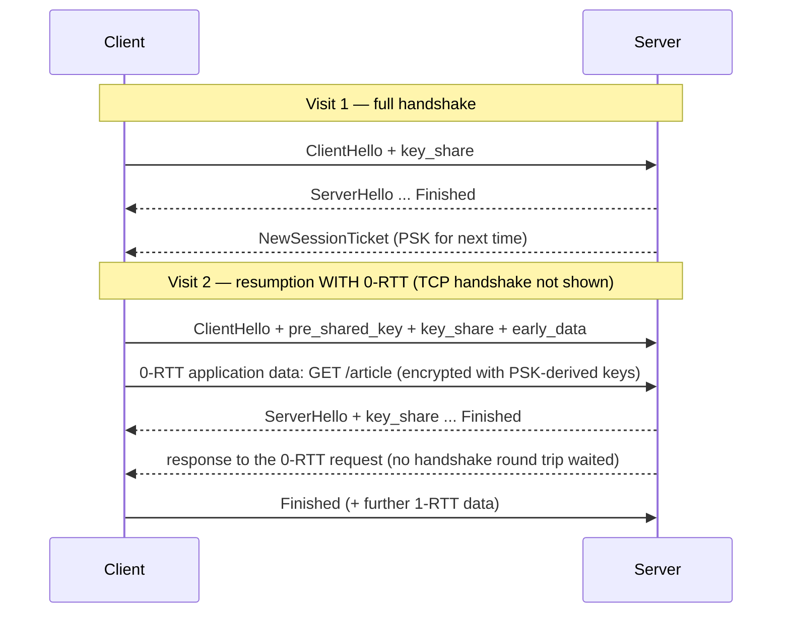

| Mechanism | TLS version | Saves |
|---|---|---|
| Session IDs (server-side cache) | 1.2 | 1 RTT + certificate work |
| Session tickets ([RFC 5077](https://datatracker.ietf.org/doc/html/rfc5077)) | 1.2 | Same, without server-side state |
| PSK resumption | 1.3 | Certificate work; with (EC)DHE still forward-secret |
| **0-RTT early data** | 1.3 (and QUIC) | The whole handshake RTT for the first request |

> Tickets are scoped per server name and the browser's network partition. A CDN can resume across its PoPs only if it shares ticket keys between them — a CDN implementation detail, but it explains why resumption rates differ by provider.

#### 6.2 Why 0-RTT can be replayed

0-RTT data is encrypted only with keys from the earlier PSK and is sent **before** the server has proven anything fresh about this connection. An attacker who captured it can **resend the same bytes** to the server (possibly to another server sharing the ticket keys). RFC 8446 §8 describes server-side mitigations (single-use tickets, ClientHello recording, freshness windows), but **applications must still assume early data may be replayed**. Early data is also **not forward-secret** with respect to the PSK.

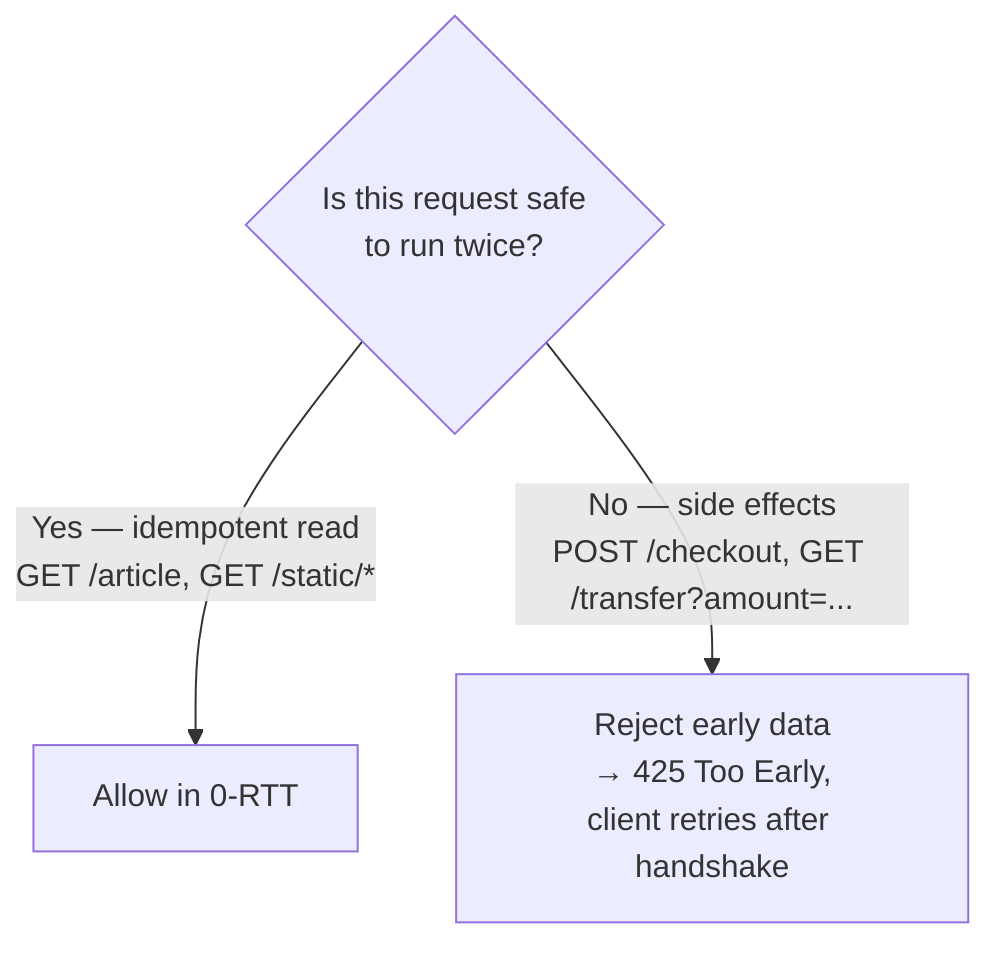

- [RFC 8470](https://datatracker.ietf.org/doc/html/rfc8470) defines HTTP semantics: intermediaries add `Early-Data: 1` when forwarding early data, and servers answer **`425 Too Early`** to make the client retry after the handshake.
- Browser and CDN behaviour varies: some CDNs only accept 0-RTT for safe methods, and browsers use it mostly on resumed QUIC/HTTP/3 connections. Verify on your stack before relying on it.
- **Rule:** any GET with side effects (a classic anti-pattern anyway) becomes a security bug with 0-RTT.

---

### Section 7: Certificates and the Chain of Trust

The server proves it owns `shop.example.com` with an **X.509 certificate** signed by a Certificate Authority (CA) the browser trusts.

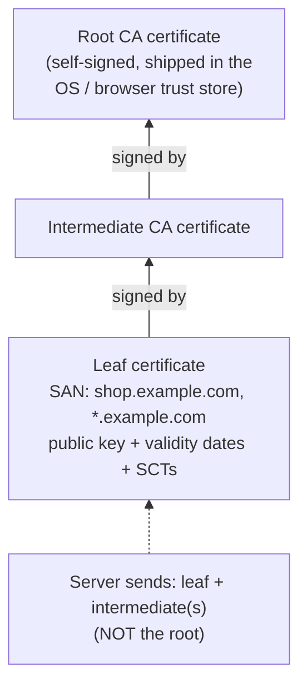

What the browser checks:

| Check | Fails when |
|---|---|
| **Chain builds to a trusted root** | Server forgot to send the intermediate ("works in Chrome, fails in curl/Android" is the classic symptom) |
| **Hostname matches a SAN entry** | Wrong cert / missing subdomain; the legacy Common Name is ignored by modern browsers |
| **Validity dates** | Expired cert (automate renewal!) or wrong device clock |
| **Certificate Transparency (CT)** | Chrome and Safari require publicly trusted certs to be logged in CT logs (proved by SCTs) |
| **Not revoked** | Revocation checking is browser-specific (see below) |

**Trends a frontend architect should know (verify current dates before quoting):**

- **Shorter lifetimes.** CA/Browser Forum ballot SC-081 (2025) phases down the maximum TLS certificate validity: **200 days from 15 March 2026**, then 100 days (2027) and **47 days (2029)**. Manual renewal is no longer viable → **automate with ACME** (Let's Encrypt, your CDN's managed certificates).
- **Revocation is moving away from OCSP.** Chrome doesn't do live OCSP checks by default (it uses its own pushed revocation lists, CRLSets); CRLs are mandatory for CAs while OCSP became optional, and Let's Encrypt shut down its OCSP service in 2025. Firefox is moving to CRLite (compressed revocation lists).
- **OCSP stapling** ([RFC 6066](https://datatracker.ietf.org/doc/html/rfc6066) `status_request`): the server fetches a signed "still valid" response from its CA and staples it into the handshake, so the client needn't contact the CA (privacy + latency). It's still worth enabling where your CA offers OCSP, but it is **no longer a major performance lever** given the shift above.
- **Size matters:** every byte of the chain travels in the first server flight. **ECDSA** certificates are much smaller than RSA-2048/4096, and **TLS certificate compression** ([RFC 8879](https://datatracker.ietf.org/doc/html/rfc8879)) shrinks chains further. Big chains can overflow the initial cwnd (Section 3) or QUIC's anti-amplification limit (Section 11) and cost an extra RTT.
- **CAA DNS records** restrict which CAs may issue for your domain (see [DNS Resolution & CDN](./dns-resolution-and-cdn.md)).

---

### Section 8: SNI and Encrypted Client Hello

Many sites share one IP (every site on a CDN PoP). The server must pick the right certificate **before** encryption starts, so the client says which host it wants in the **Server Name Indication** (SNI) extension of the ClientHello ([RFC 6066](https://datatracker.ietf.org/doc/html/rfc6066)).

- SNI is sent in **plaintext**, even in TLS 1.3 → network observers learn the hostname even with encrypted DNS.
- **Encrypted Client Hello (ECH)** encrypts the inner ClientHello (including SNI) with a public key the server publishes in its **HTTPS DNS record**. Chrome and Firefox have enabled ECH (Firefox when DNS-over-HTTPS is on), and some CDNs, notably Cloudflare, support it. The visible "outer" SNI names the provider, not your site.
- Practical impact for frontend: **none on latency** when it works; privacy improves. ECH depends on HTTPS DNS records — another reason to publish them (see [DNS Resolution & CDN](./dns-resolution-and-cdn.md)).

---

### Section 9: ALPN — Negotiating h2 and h3

**Application-Layer Protocol Negotiation** ([RFC 7301](https://datatracker.ietf.org/doc/html/rfc7301)) chooses the HTTP version **inside the TLS handshake**, costing no extra round trip:

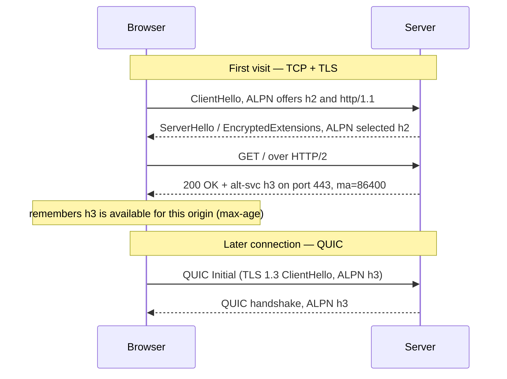

- **`h2`** is negotiated via ALPN over TLS/TCP. Browsers only use HTTP/2 over TLS.
- **`h3`** can't be negotiated over a TCP connection — it's a different transport. Browsers discover it via:
  1. the **`Alt-Svc`** response header ([RFC 7838](https://datatracker.ietf.org/doc/html/rfc7838)) on an earlier TCP response → used for *later* connections; or
  2. an **HTTPS DNS record** with `alpn="h3"` → can be used on the **first** connection.
- Browsers typically **race or fall back** to TCP if UDP/QUIC is blocked (common on some corporate networks), so HTTP/3 must always be backed by a working HTTP/2 path.

---

### Section 10: HSTS and the Preload List

When a user types `example.com`, the browser has historically tried `http://` first. A redirect to HTTPS then costs a **whole extra connection + request** — and the plaintext hop is a downgrade/attack opportunity.

**HTTP Strict Transport Security** ([RFC 6797](https://datatracker.ietf.org/doc/html/rfc6797)) tells the browser: "for this host, only ever use HTTPS":

```http
Strict-Transport-Security: max-age=63072000; includeSubDomains; preload
```

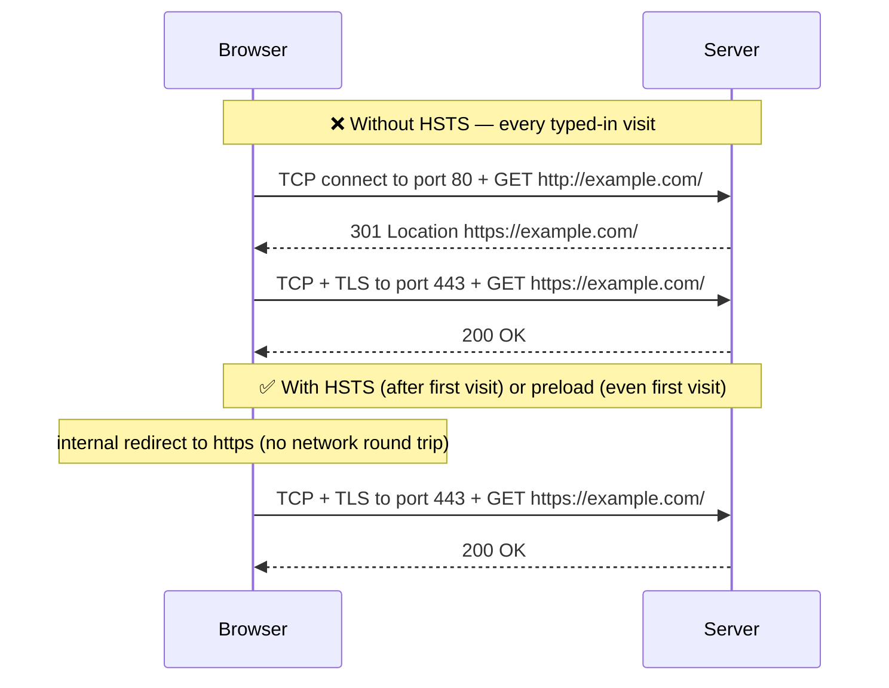

| Directive | Meaning |
|---|---|
| `max-age=N` | Remember the policy for N seconds (refreshed on every HTTPS response) |
| `includeSubDomains` | Apply to every subdomain too — make sure **all** of them serve HTTPS first |
| `preload` | Consent to be included in browsers' built-in **preload list** |

- **Trust on first use:** the header only takes effect after the browser has seen it once over HTTPS. The **preload list** ([hstspreload.org](https://hstspreload.org/)) is compiled into browsers, protecting even the first visit.
- Preload requirements include: a valid certificate, redirecting HTTP→HTTPS on the same host, serving all subdomains over HTTPS, and the header on the base domain with `max-age` of at least one year, `includeSubDomains` and `preload`.
- **Removal is slow** (it ships with browser releases) — treat preloading as a one-way door. Roll out with a short `max-age` first, then increase.
- HSTS is set on **HTTPS responses only**; browsers ignore it over HTTP.
- HTTPS DNS records (Section 9) can also signal HTTPS support and let browsers upgrade without a redirect.

---

### Section 11: QUIC — Transport and Crypto in One Handshake

QUIC ([RFC 9000](https://datatracker.ietf.org/doc/html/rfc9000), with TLS integration in [RFC 9001](https://datatracker.ietf.org/doc/html/rfc9001)) runs over **UDP** and **embeds the TLS 1.3 handshake inside the transport handshake**. There is no separate TCP step:

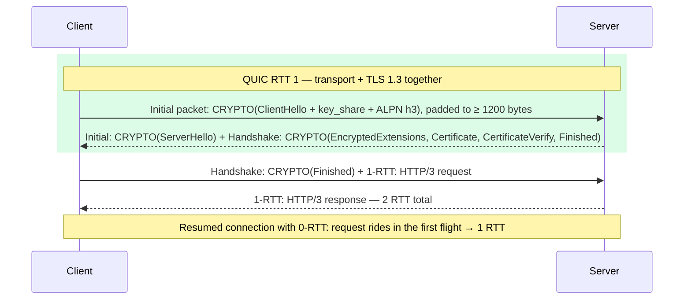

| | TCP + TLS 1.3 | QUIC |
|---|---|---|
| New connection to first byte | 3 RTT | **2 RTT** |
| Resumption with 0-RTT | 2 RTT | **1 RTT** |
| Head-of-line blocking | Whole connection stalls on loss | Only the affected **stream** stalls |
| Encryption | TCP headers in clear | Almost all transport headers encrypted |
| Network change (Wi-Fi → 4G) | Connection breaks (new IP:port) | **Connection migration** via connection IDs |
| Runs in | OS kernel | User space (browser/server) — faster to evolve |

Details that matter:

- **Anti-amplification limit:** until the client's address is validated, a server may send at most **3×** the bytes it received. The client pads its first Initial to ≥ 1200 bytes, so the server's first flight is limited to about 3.6KB — a large certificate chain may not fit and costs an extra RTT. Smaller (ECDSA) chains and certificate compression help here too.
- **UDP may be blocked** or throttled on some networks; browsers fall back to TCP (Section 9).
- Protocol details and HTTP/3 multiplexing: see [HTTP/1.1 vs HTTP/2 vs HTTP/3](./http1-vs-http2-vs-http3.md).

---

### Section 12: Connection Reuse and Coalescing

#### 12.1 Reuse

- **HTTP/1.1 keep-alive** keeps a TCP connection open for sequential requests; browsers open up to ~6 parallel connections per origin.
- **HTTP/2 and HTTP/3** multiplex everything for an origin over **one** connection — so one well-warmed connection with a large cwnd serves the whole page.
- Connections close on idle timeouts (client and server both have them) — a page that goes idle for a while may need a new handshake later.

#### 12.2 Coalescing (HTTP/2 and HTTP/3)

A browser may send requests for **a different hostname** over an existing connection if the server is authoritative for it:

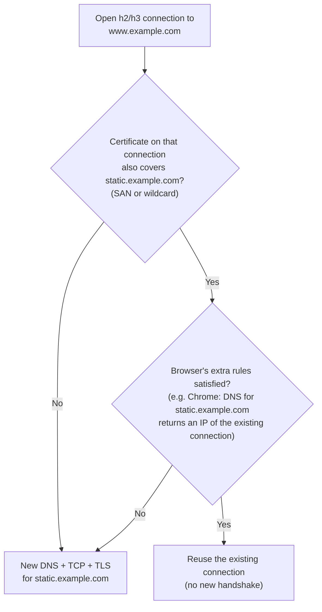

- Rules differ by browser (DNS overlap checks, the HTTP/2 `ORIGIN` frame from [RFC 8336](https://datatracker.ietf.org/doc/html/rfc8336)). If a server receives a request it shouldn't have, it answers **`421 Misdirected Request`** and the browser retries on a new connection.
- **Domain sharding** (`static1.`, `static2.` …) was an HTTP/1.1 trick for more parallel connections; under HTTP/2+ it **adds** handshakes and splits cwnd. Prefer a **single origin** (or hostnames that coalesce).
- **Credentialed vs anonymous:** requests in CORS "anonymous" mode (e.g. fonts) use a **separate connection** from credentialed ones to the same host — the reason `preconnect` needs `crossorigin` for fonts.
- Browsers increasingly **partition connections by top-level site** for privacy, so a connection to a shared third-party CDN opened on site A isn't reused on site B.

---

### Section 13: Preconnect — Cost vs Benefit

`<link rel="preconnect">` performs **DNS + TCP + TLS** ahead of time (see [DNS Resolution & CDN](./dns-resolution-and-cdn.md) for the hint family).

| Benefit | Cost |
|---|---|
| Removes up to 3–4 RTTs from the first request to that origin (DNS + TCP + TLS) | CPU for key exchange and certificate verification on both client and server |
| Overlaps setup with HTML/CSS download | Bandwidth for handshake bytes (certificate chain) — contends with critical resources on slow links |
| Biggest win on high-RTT mobile links | Chrome closes a preconnected socket left unused for ~10 s → all work wasted |
| | Server/CDN resources for half-used connections |

**Decision rule:**

```text
Will this origin be requested during the initial load, on (nearly) every page?
  yes, and it's on the critical path (LCP image CDN, font host, API) → preconnect (crossorigin if CORS)
  yes, but late or not critical                                      → dns-prefetch
  maybe / only after interaction                                     → nothing, or dns-prefetch
Is it the page's own origin?                                         → never (already connected)
Total preconnects                                                     → keep to a handful (≈ 2–4)
```

Even better than preconnect: **remove the origin** — self-host fonts and libraries on your main origin/CDN so they reuse the already-open connection.

---

### Section 14: RTT Math for Mobile Networks

Latency, not bandwidth, dominates small requests. Mobile adds:

- **Higher and more variable RTTs** than wired connections, especially on congested or weak-signal cells.
- **Radio wake-up:** an idle cellular radio must transition to an active state before sending, adding delay to the first packet after idleness.
- **Packet loss** on wireless links → retransmissions and cwnd reductions (worse for TCP's head-of-line blocking than for QUIC).

**Worked example.** Use **150 ms RTT** — the value Lighthouse's default mobile simulation uses — and ignore server think-time:

```text
                                      DNS   TCP   TLS   Request→first byte   Total
TCP + TLS 1.2, cold                   150 + 150 + 300 + 150                = 750 ms
TCP + TLS 1.3, cold                   150 + 150 + 150 + 150                = 600 ms
QUIC (HTTP/3), cold                   150 +   (150)   + 150                = 450 ms
QUIC 0-RTT resumption, DNS cached       0 +    0      + 150                = 150 ms
Reused warm connection                  0 +    0      + 150                = 150 ms

Add-ons that silently double it:
+ http:// → https:// redirect (no HSTS)      +1 TCP connect + 1 request    ≈ +300 ms (more if TLS 1.2 elsewhere)
+ apex → www redirect on another origin      +DNS + new connection + req   ≈ +450–750 ms
+ critical third-party origin, no preconnect +DNS + TCP + TLS              ≈ +450 ms on the critical path
+ 100KB (compressed) HTML on a new connection  ~3 data RTTs instead of 1     ≈ +300 ms
```

*(Illustrative arithmetic, not measurements — real values vary per network, device and server. DNS can be more than 1 RTT on a resolver miss.)*

**System design consequences:**

| Decision | Why (RTT view) |
|---|---|
| Serve HTML from a **CDN edge** near users | Every handshake RTT shrinks — the single biggest lever |
| **TLS 1.3 + HTTP/3** enabled at the edge | −1 RTT (1.2→1.3), −1 more (TCP→QUIC); 0-RTT on repeat visits |
| **HSTS (+ preload)**, canonical URLs, no redirect chains | Each redirect can cost a full new connection |
| **Few critical origins**; self-host fonts/libs | Each origin = DNS + TCP + TLS |
| `preconnect` for the 1–3 unavoidable ones; **103 Early Hints** | Overlap setup with server think-time |
| Keep the **critical HTML + inline CSS ≈ 14KB** compressed | First paint possible after the first data flight |
| **ECDSA certs**, compressed chains, session tickets enabled | Smaller first flight, cheaper repeat handshakes |
| Measure **field TTFB and connection timing** per country / network | Lab numbers on office Wi-Fi hide all of this |

---

## Full Visual — Cold vs Warm Connection

```text
RTT = 150 ms                        0        150       300       450       600 ms
                                    |---------|---------|---------|---------|
❌ Cold, TCP + TLS 1.3, no HSTS
   http:// redirect first:          [DNS][TCP][GET→301]
   then the real request:                             [TCP][TLS 1.3][GET→HTML]   → ~900 ms
✅ Cold, HSTS + TCP + TLS 1.3:      [DNS][TCP][TLS 1.3][GET→HTML]                → ~600 ms
✅ Cold, HSTS + HTTP/3:             [DNS][QUIC+TLS][GET→HTML]                    → ~450 ms
✅ Repeat visit, HTTP/3 0-RTT:      [GET→HTML (rides in the first flight)]        → ~150 ms
```

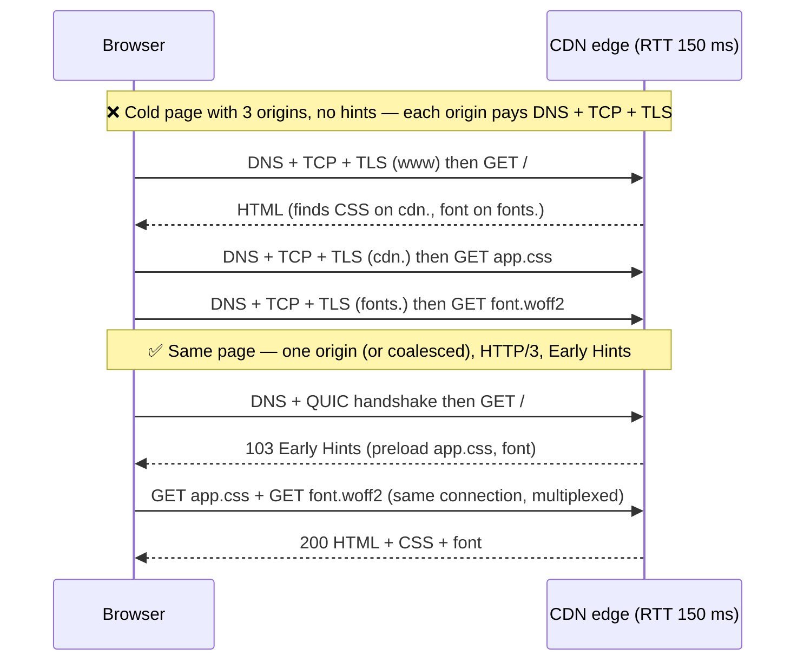

---

## Real-World Examples

**Example 1 — Time each phase with `curl -w`:**
```bash
curl -s -o /dev/null https://www.example.com/ -w '
  dns       %{time_namelookup}s
  tcp       %{time_connect}s
  tls       %{time_appconnect}s
  ttfb      %{time_starttransfer}s
  total     %{time_total}s
  http      %{http_version}
'
# Cumulative timestamps:  TCP handshake = time_connect − time_namelookup
#                         TLS handshake = time_appconnect − time_connect

# Compare protocols (HTTP/3 needs a curl built with HTTP/3 support)
curl -sI --http2 https://www.example.com/ -o /dev/null -w '%{http_version} %{time_appconnect}\n'
curl -sI --http3 https://www.example.com/ -o /dev/null -w '%{http_version} %{time_appconnect}\n'
```

**Example 2 — Inspect the TLS handshake with `openssl s_client`:**
```bash
# Protocol, cipher, ALPN result and the certificate chain the server actually sends
openssl s_client -connect www.example.com:443 -servername www.example.com \
  -alpn h2,http/1.1 -showcerts </dev/null 2>/dev/null \
  | grep -E 'Protocol|Cipher|ALPN|s:|i:'

# Force TLS 1.2 to check that the fallback still works
openssl s_client -connect www.example.com:443 -servername www.example.com -tls1_2 </dev/null

# Is an OCSP response stapled?
openssl s_client -connect www.example.com:443 -servername www.example.com -status </dev/null \
  | grep -A3 'OCSP response'
```

**Example 3 — nginx TLS / HTTP/3 settings (nginx 1.25+):**
```nginx
server {
    listen 443 ssl;
    listen 443 quic reuseport;                 # HTTP/3 over UDP
    http2 on;
    server_name www.example.com;

    ssl_certificate     /etc/ssl/example-ecdsa-fullchain.pem;  # leaf + intermediates, ECDSA = smaller
    ssl_certificate_key /etc/ssl/example-ecdsa.key;
    ssl_protocols TLSv1.2 TLSv1.3;             # no 1.0/1.1

    ssl_session_cache   shared:SSL:10m;        # TLS 1.2 session resumption
    ssl_session_tickets on;                    # rotate ticket keys regularly if you manage them

    ssl_early_data on;                         # 0-RTT — only if the app handles replay:
    proxy_set_header Early-Data $ssl_early_data;   # app returns 425 for unsafe requests

    add_header Alt-Svc 'h3=":443"; ma=86400' always;
    add_header Strict-Transport-Security "max-age=63072000; includeSubDomains; preload" always;
}

server {                                       # HTTP → HTTPS on the SAME host (HSTS preload requirement)
    listen 80;
    server_name www.example.com;
    return 301 https://$host$request_uri;
}
```

**Example 4 — Redirect chains (BAD → GOOD):**
```text
❌ BAD   http://example.com → https://example.com → https://www.example.com → https://www.example.com/en/
         up to 3 extra requests, 2 of them possibly on new connections

✅ GOOD  HSTS-preloaded apex, links/ads/canonical tags point straight at https://www.example.com/en/
         a remaining bare-domain visit gets ONE 301 directly to the final URL
```

**Example 5 — Preconnect only what the critical path needs:**
```html
<!-- ❌ BAD: font preconnect without crossorigin (fonts use an anonymous CORS connection, so this
     warmed socket is never used) + preconnect to own origin + 6 "maybe" vendors -->
<link rel="preconnect" href="https://fonts.gstatic.com">
<link rel="preconnect" href="https://www.example.com">

<!-- ✅ GOOD -->
<link rel="preconnect" href="https://img.example-cdn.com">              <!-- LCP image host -->
<link rel="preconnect" href="https://fonts.gstatic.com" crossorigin>   <!-- font files -->
<link rel="dns-prefetch" href="https://www.googletagmanager.com">     <!-- non-critical -->
```

**Example 6 — Measure connection setup in the field (RUM):**
```javascript
new PerformanceObserver((list) => {
  for (const e of list.getEntries()) {
    if (e.connectStart === e.connectEnd) continue;            // reused connection (or no TAO header)
    report({
      url: e.name,
      protocol: e.nextHopProtocol,                            // 'h2' | 'h3' | 'http/1.1'
      dns: e.domainLookupEnd - e.domainLookupStart,
      tcpAndTls: e.connectEnd - e.connectStart,
      tls: e.secureConnectionStart > 0 ? e.connectEnd - e.secureConnectionStart : 0,
      ttfb: e.responseStart - e.requestStart,
    });
  }
}).observe({ type: 'resource', buffered: true });
// Cross-origin resources only expose these timings with a Timing-Allow-Origin response header.
```

**Example 7 — 0-RTT safe-guard in an app server (Express-style):**
```javascript
// Reject replayable early data for anything that changes state (RFC 8470)
app.use((req, res, next) => {
  const isEarly = req.get('Early-Data') === '1';
  const isSafe = req.method === 'GET' || req.method === 'HEAD';
  if (isEarly && !isSafe) return res.status(425).send('Too Early'); // client retries after the handshake
  next();
});
```

---

## Key Points Summary

| Concept | One-Line Explanation |
|---|---|
| **RTT** | One packet's round trip; handshakes are counted in RTTs |
| **TCP 3-way handshake** | SYN → SYN-ACK → ACK; 1 RTT before data |
| **Congestion window (cwnd)** | Max unacknowledged data in flight; starts at ~10 segments |
| **Slow start** | cwnd roughly doubles per RTT until loss/threshold |
| **14KB guideline** | ≈ initial cwnd (10 × 1460 B): critical HTML that fits arrives in the first flight — rule of thumb |
| **TLS 1.2** | 2-RTT full handshake; certificate in clear |
| **TLS 1.3** | 1-RTT full handshake; forward secrecy mandatory; certificate encrypted |
| **Resumption (PSK / tickets)** | Skip certificate work on repeat connections |
| **0-RTT** | Request sent in the first flight on resumption — replayable, idempotent requests only |
| **Chain of trust** | Leaf → intermediate(s) → trusted root; server must send intermediates |
| **OCSP stapling** | Server attaches proof of non-revocation — declining relevance as CAs move to CRLs |
| **SNI / ECH** | Hostname in ClientHello (plaintext) / encrypted via HTTPS DNS record keys |
| **ALPN** | Negotiates `h2` / `http/1.1` inside TLS; `h3` discovered via Alt-Svc or HTTPS RR |
| **HSTS / preload** | Browser goes straight to HTTPS — no redirect round trip, no downgrade |
| **QUIC** | UDP transport with built-in TLS 1.3: 1-RTT setup, 0-RTT resumption, no TCP HOL |
| **Coalescing** | Reuse an h2/h3 connection for another hostname covered by the same cert |
| **Preconnect** | Pay DNS+TCP+TLS early for a few critical origins; unused ones are wasted |

---

## Test Your Understanding

**Q1 (Basic):**
How many round trips does a brand-new HTTPS request over TCP + TLS 1.3 take before the first byte of the response arrives (ignoring DNS and server time)? What changes with TLS 1.2 and with HTTP/3?

<details>
<summary>Answer</summary>

**3 RTTs** with TLS 1.3: 1 for the TCP handshake, 1 for the TLS 1.3 handshake, 1 for request → first byte (the request is sent together with the client's `Finished`).

- **TLS 1.2:** 4 RTTs — its full handshake needs 2 round trips because the client can only send its key exchange after seeing the server's certificate and parameters (False Start can claw one back).
- **HTTP/3 (QUIC):** 2 RTTs — the transport and TLS 1.3 handshakes are combined into a single round trip, then 1 for the request. With 0-RTT resumption, just 1.
</details>

**Q2 (Basic):**
Where does the "keep critical HTML under ~14KB" advice come from, and why is it a guideline rather than a rule?

<details>
<summary>Answer</summary>

From TCP slow start: a new connection's **initial congestion window** is commonly **10 segments** (RFC 6928) × ~1460 bytes MSS ≈ **14.6KB**. That's roughly what the server can send before waiting for the first ACKs; anything more needs at least one more round trip. If the compressed HTML + inline critical CSS fits, the browser can start rendering after the first data flight.

It's a guideline because: MSS varies; servers/CDNs can configure larger initial windows; TLS records, HTTP headers and the certificate chain share the early flights; QUIC uses a similar but separately specified window; and on a reused connection cwnd has already grown. It's a **budget heuristic for high-RTT, first-visit** loads, not a cliff.
</details>

**Q3 (Application):**
A product manager asks you to "turn on 0-RTT everywhere — it's free speed". What do you tell them?

<details>
<summary>Answer</summary>

0-RTT is real speed on **repeat visits** (the first request rides in the first flight), but **early data can be replayed**: an attacker who captures it can resend it, and it isn't forward-secret with respect to the resumption key. So:

- Allow it for **idempotent, side-effect-free** requests (static assets, cacheable GETs, page HTML that doesn't change state).
- **Reject it for anything with side effects** — POSTs, and any "GET that does something" (`/logout`, `/unsubscribe?id=`, `/transfer`). Servers forward `Early-Data: 1` and the app answers **425 Too Early** so the browser retries after the handshake (RFC 8470).
- Check what your CDN does by default — several only accept 0-RTT for safe methods.

So: yes for safe requests, with an explicit guard; never "everywhere".
</details>

**Q4 (Application):**
Lighthouse shows a 600 ms "initial server connection" phase on mobile for your marketing site. List the connection-level fixes in order of impact.

<details>
<summary>Answer</summary>

1. **Serve from a CDN edge close to users** — shrinks every RTT in every handshake.
2. **Remove redirects** — HSTS (+ preload) so `http://` never hits the network, and link straight to the canonical `https://www.` URL; a single redirect can cost a whole extra connection.
3. **TLS 1.3** (−1 RTT vs 1.2) and **HTTP/3** at the edge (−1 more RTT vs TCP; 0-RTT on repeat visits).
4. **Session resumption** enabled (tickets/PSK) so repeat visits skip certificate work.
5. **Smaller handshake bytes** — ECDSA certificate, full but minimal chain, certificate compression — so the server's first flight fits in the initial window / QUIC amplification limit.
6. For **other origins** on the critical path: consolidate/self-host, or `preconnect` (with `crossorigin` where needed) and send **103 Early Hints**.

Measure before/after with `curl -w` and field Resource/Navigation Timing, segmented by country and connection type.
</details>

**Q5 (Tricky):**
You add `Strict-Transport-Security: max-age=63072000; includeSubDomains; preload` and submit to the preload list. A week later the internal tool at `http://legacy.example.com` stops working for everyone. Why, and what should you have done?

<details>
<summary>Answer</summary>

`includeSubDomains` makes browsers force **HTTPS for every subdomain**. `legacy.example.com` only serves plain HTTP, so browsers now refuse to load it over HTTP (and HSTS failures can't be clicked through). Once it's in the **preload list**, the policy ships inside browsers — removing it takes a long time (browser release cycles), so you can't simply delete the header.

Should have: inventoried all subdomains and moved them to HTTPS first; rolled out with a **short `max-age`** without `preload`, increased it gradually, and only then added `preload` and submitted. Preloading is a one-way door.
</details>

**Q6 (Tricky / System design):**
Your app loads HTML from `www.example.com`, JS/CSS from `static.example.com`, images from `img.example-cdn.com` and fonts from a third-party font host. On a 150 ms RTT mobile network, what's the connection cost and how would you redesign it?

<details>
<summary>Answer</summary>

**Cold cost:** each distinct origin needs DNS + TCP + TLS 1.3 ≈ 3 RTT ≈ 450 ms before its first request (2 RTT with QUIC). The three subresource origins are discovered only after the HTML/CSS arrive, so their setups land **on the critical path** — potentially +450 ms for the CSS origin and again for the font (discovered inside CSS).

**Redesign:**
- **Serve JS/CSS from `www.example.com`** (same CDN) → reuse the HTML's warm connection; or make `static.` coalescable (same cert SAN + same IPs).
- **Self-host fonts** on the main origin; `preload` the one LCP-critical font.
- Keep the image CDN if its transformations are worth it, but **`preconnect` to it** (or route images through the main domain via the CDN) and preload the LCP image with `fetchpriority="high"`.
- Enable **HTTP/3 + TLS 1.3 + HSTS preload** and **103 Early Hints** for the remaining hints.
- Check the result with RUM: count connections per page view (entries where `connectStart !== connectEnd`) and the protocol (`nextHopProtocol`).

Result: one or two connections instead of four, with the second warmed in parallel — saving on the order of several hundred ms on cold mobile loads.
</details>

---

## Cheat Sheet

**Key Definitions:**
- **RTT:** round-trip time — the unit of handshake cost.
- **3-way handshake:** SYN, SYN-ACK, ACK — 1 RTT.
- **cwnd / slow start:** in-flight data limit; starts ≈ 10 segments, ~doubles per RTT.
- **TLS 1.3:** 1-RTT handshake, forward secrecy always, encrypted certificate.
- **PSK / session ticket:** resumption secret from a previous connection.
- **0-RTT (early data):** request in the first flight on resumption — replayable.
- **SNI / ECH:** hostname in ClientHello / encrypted ClientHello.
- **ALPN:** picks `h2` / `http/1.1` inside the TLS handshake.
- **Alt-Svc / HTTPS RR:** how browsers learn an origin supports `h3`.
- **HSTS:** "HTTPS only for this host"; **preload** makes it apply on first visit.
- **QUIC:** UDP transport + TLS 1.3 in one handshake; connection migration; per-stream loss recovery.
- **Coalescing:** reuse one h2/h3 connection for several hostnames covered by its cert.

**Quick Reference — RTTs to first byte (excl. DNS):**
```text
Reused connection ............................ 1
QUIC + 0-RTT resumption ...................... 1
QUIC (HTTP/3), new ........................... 2
TCP + TLS 1.3 + 0-RTT ........................ 2
TCP + TLS 1.3, new ........................... 3
TCP + TLS 1.2, new ........................... 4   (3 with False Start)
+ http→https redirect without HSTS ........... +2 or more (extra connection + request)
+ each extra critical origin ................. + DNS + full handshake
```

**Quick Reference — slow start (ideal, MSS 1460):**
```text
RTT 1: ~14.6 KB   RTT 2: ~43.8 KB total   RTT 3: ~102 KB total   RTT 4: ~219 KB total
→ keep compressed critical HTML + inline CSS ≈ 14KB (guideline, not a law)
```

**Quick Reference — headers & config:**
```text
Strict-Transport-Security: max-age=63072000; includeSubDomains; preload
Alt-Svc: h3=":443"; ma=86400
Early-Data: 1   →   app may answer 425 Too Early
<link rel="preconnect" href="https://fonts.gstatic.com" crossorigin>
ssl_protocols TLSv1.2 TLSv1.3;  ssl_session_tickets on;  ssl_early_data on (+ replay guard)
curl -w '%{time_connect} %{time_appconnect} %{time_starttransfer} %{http_version}'
openssl s_client -connect host:443 -servername host -alpn h2,http/1.1 -showcerts
```

**Common Mistakes to Avoid:**

| Mistake | Why Wrong | Fix |
|---|---|---|
| Treating bandwidth as the fix for slow first loads | Handshakes are latency-bound; more Mbps doesn't remove RTTs | Fewer connections, closer edge, TLS 1.3 / QUIC |
| Still allowing only TLS 1.2 (or 1.0/1.1) | Extra RTT; 1.0/1.1 deprecated and blocked by browsers | Enable TLS 1.3, keep 1.2 as fallback |
| Enabling 0-RTT without a replay guard | Early data can be replayed → duplicate side effects | Only safe methods in early data; 425 Too Early otherwise |
| Serving only the leaf certificate | Clients without the intermediate fail chain building | Serve the full chain (leaf + intermediates) |
| Big RSA-4096 chains | First flight exceeds initial cwnd / QUIC amplification limit → extra RTT | ECDSA certs, trim chain, certificate compression |
| Manual certificate renewal | Lifetimes are shrinking (200 days in 2026, heading to 47) → outages | ACME automation / CDN-managed certs |
| `http→https` and apex→www redirect chains | Each hop can cost a new connection | HSTS preload, link to the canonical URL directly |
| `includeSubDomains; preload` before auditing subdomains | HTTP-only subdomains break; preload is slow to undo | Migrate all subdomains first; ramp `max-age` |
| Domain sharding under HTTP/2/3 | More handshakes, split cwnd, no multiplexing benefit | One origin, or coalescable hostnames |
| Preconnecting to many/own origins | Wasted CPU/bandwidth; unused sockets closed after ~10 s | 2–4 critical origins; `dns-prefetch` the rest |
| Font preconnect without `crossorigin` | Fonts use a separate anonymous connection | Add `crossorigin` |
| HTTP/3 without a working HTTP/2 fallback | UDP is blocked on some networks | Always serve h2 over TCP too |
| Testing only on office Wi-Fi | Hides high-RTT, lossy mobile reality | Throttle (Lighthouse mobile / DevTools) + field RUM |

---

## References & Further Reading

**Core docs**
- MDN: [Transport Layer Security](https://developer.mozilla.org/en-US/docs/Web/Security/Defenses/Transport_Layer_Security)
- MDN: [`Strict-Transport-Security`](https://developer.mozilla.org/en-US/docs/Web/HTTP/Reference/Headers/Strict-Transport-Security) · [`Alt-Svc`](https://developer.mozilla.org/en-US/docs/Web/HTTP/Reference/Headers/Alt-Svc) · [`425 Too Early`](https://developer.mozilla.org/en-US/docs/Web/HTTP/Reference/Status/425)
- MDN: [Connection management in HTTP/1.x](https://developer.mozilla.org/en-US/docs/Web/HTTP/Guides/Connection_management_in_HTTP_1.x)
- MDN: [`rel="preconnect"`](https://developer.mozilla.org/en-US/docs/Web/HTML/Reference/Attributes/rel/preconnect) · [`PerformanceResourceTiming`](https://developer.mozilla.org/en-US/docs/Web/API/PerformanceResourceTiming)

**Performance (web.dev / Chrome)**
- web.dev: [Establish network connections early](https://web.dev/articles/preconnect-and-dns-prefetch)
- web.dev: [Optimize Time to First Byte](https://web.dev/articles/optimize-ttfb)
- web.dev: [Critical rendering path](https://web.dev/articles/critical-rendering-path)
- Chrome for Developers: [103 Early Hints](https://developer.chrome.com/docs/web-platform/early-hints)
- Chrome for Developers: [Lighthouse — Avoid multiple page redirects](https://developer.chrome.com/docs/lighthouse/performance/redirects)

**Vendor learning centres**
- Cloudflare: [What happens in a TLS handshake?](https://www.cloudflare.com/learning/ssl/what-happens-in-a-tls-handshake/) · [What is TLS?](https://www.cloudflare.com/learning/ssl/transport-layer-security-tls/)
- Cloudflare: [What is SNI?](https://www.cloudflare.com/learning/ssl/what-is-sni/) · [What is HTTP/3?](https://www.cloudflare.com/learning/performance/what-is-http3/)
- Cloudflare blog: [Introducing 0-RTT](https://blog.cloudflare.com/introducing-0-rtt/) — replay trade-offs in practice
- HSTS preload list: [hstspreload.org](https://hstspreload.org/)

**Specs**
- IETF: [RFC 9293 — TCP](https://datatracker.ietf.org/doc/html/rfc9293) · [RFC 6928 — Increasing TCP's Initial Window](https://datatracker.ietf.org/doc/html/rfc6928) · [RFC 5681 — TCP Congestion Control](https://datatracker.ietf.org/doc/html/rfc5681)
- IETF: [RFC 8446 — TLS 1.3](https://datatracker.ietf.org/doc/html/rfc8446) · [RFC 8996 — Deprecating TLS 1.0 and 1.1](https://datatracker.ietf.org/doc/html/rfc8996)
- IETF: [RFC 8470 — Using Early Data in HTTP](https://datatracker.ietf.org/doc/html/rfc8470) · [RFC 7301 — ALPN](https://datatracker.ietf.org/doc/html/rfc7301) · [RFC 7838 — Alt-Svc](https://datatracker.ietf.org/doc/html/rfc7838)
- IETF: [RFC 6797 — HSTS](https://datatracker.ietf.org/doc/html/rfc6797) · [RFC 6066 — TLS Extensions (SNI, status_request)](https://datatracker.ietf.org/doc/html/rfc6066) · [RFC 8879 — Certificate Compression](https://datatracker.ietf.org/doc/html/rfc8879)
- IETF: [RFC 9000 — QUIC](https://datatracker.ietf.org/doc/html/rfc9000) · [RFC 9001 — Using TLS to Secure QUIC](https://datatracker.ietf.org/doc/html/rfc9001) · [RFC 9002 — QUIC Loss Detection and Congestion Control](https://datatracker.ietf.org/doc/html/rfc9002)
- IETF: [RFC 8336 — The ORIGIN HTTP/2 Frame](https://datatracker.ietf.org/doc/html/rfc8336) · [RFC 9460 — SVCB and HTTPS records](https://datatracker.ietf.org/doc/html/rfc9460)

**Deep dives**
- Ilya Grigorik: [High Performance Browser Networking](https://hpbn.co/) — chapters on TCP, TLS and mobile networks
- The Illustrated TLS 1.3 Connection: [tls13.xargs.org](https://tls13.xargs.org/) — every byte of a real handshake
- The Illustrated QUIC Connection: [quic.xargs.org](https://quic.xargs.org/)

---

> **Previous Topic:** [DNS Resolution & CDN](./dns-resolution-and-cdn.md)
> — How the browser finds the server, and why that server should be at the edge

> **Next Topic:** [REST vs GraphQL vs gRPC-Web](./rest-vs-graphql-vs-grpc-web.md)
> — What to send over the connection once it's open

*Saved on: 2026-11-06 | Repo: Frontend System Design Learning Notes*
