<!-- Generated by scripts/sync-knowledge.js from notes/ and README.md — do not edit here. -->
<!-- sections (line ranges in this file): Table of Contents 19-41 · ELI5 42-57 · Core Concept 58-428 · System Design Angle 429-476 · Real-World Examples 477-674 · Key Points Summary 675-694 · Test Your Understanding 695-773 · Cheat Sheet 774-824 · References & Further Reading 825-859 -->

# Testing Strategies & Pyramid

> **Date:** 2026-11-06 · **Last updated:** 2026-11-06
> **Category:** Frontend System Design
> **Sub-Topic:** Testing / Test Strategy
> **Level:** Intermediate · **Reading time:** ~26 min
> **Informs:** test mix per layer (unit/integration/E2E), mocking boundaries, CI pipeline stages and time budget, flaky-test policy, coverage targets, release confidence and shift-right monitoring

> **Pre-requisite:** [Unit Testing Components (Jest, Vitest)](./unit-testing-components-jest-vitest.md), [Integration Testing](./integration-testing.md) and [E2E Testing (Playwright, Cypress)](./e2e-testing-playwright-cypress.md).
> This note is the **capstone of the testing phase**: it ties every test type together into one strategy — what to test, at which layer, how many, and when they run.

**Previous:** [Accessibility Testing](./accessibility-testing.md) · **Next:** [Error Boundaries & Global Error Handling](./error-boundaries-and-global-error-handling.md)

---

## Table of Contents

1. [ELI5 — Simple Explanation](#eli5--simple-explanation)
2. [Section 1: What a Test Strategy Is For](#section-1-what-a-test-strategy-is-for)
3. [Section 2: The Test Pyramid](#section-2-the-test-pyramid)
4. [Section 3: The Testing Trophy and Other Shapes](#section-3-the-testing-trophy-and-other-shapes)
5. [Section 4: The Catalogue of Frontend Test Types](#section-4-the-catalogue-of-frontend-test-types)
6. [Section 5: Choosing the Right Layer for a Behavior](#section-5-choosing-the-right-layer-for-a-behavior)
7. [Section 6: Test Boundaries, Mocks and Test Doubles](#section-6-test-boundaries-mocks-and-test-doubles)
8. [Section 7: Tests in the CI/CD Pipeline](#section-7-tests-in-the-cicd-pipeline)
9. [Section 8: Flaky Tests](#section-8-flaky-tests)
10. [Section 9: Coverage, Mutation Testing and Meaningful Metrics](#section-9-coverage-mutation-testing-and-meaningful-metrics)
11. [Section 10: Shift Left and Shift Right](#section-10-shift-left-and-shift-right)
12. [Section 11: Framework and Platform Landscape](#section-11-framework-and-platform-landscape)
13. [System Design Angle — Strategy by Product Type](#system-design-angle--strategy-by-product-type)
14. [Real-World Examples](#real-world-examples)
15. [Key Points Summary](#key-points-summary)
16. [Test Your Understanding (with answers)](#test-your-understanding)
17. [Cheat Sheet](#cheat-sheet)
18. [References & Further Reading](#references--further-reading)

---

## ELI5 — Simple Explanation

Think of checking a **new car** before it leaves the factory:

- **Static checks** = the spell-checker on the manual and the robot that checks every bolt has the right size. Instant, automatic, catches silly mistakes.
- **Unit tests** = testing each part on a bench: does this spark plug spark? Cheap, fast, thousands of them.
- **Integration tests** = putting the engine, gearbox and wheels together on a rolling road. Do the parts actually work *together*?
- **End-to-end tests** = a test driver takes the finished car around a real track. Most realistic, but slow and expensive, so only a few laps.
- **Monitoring in production** = sensors in every car already sold, reporting problems from real roads that no track could imitate.

You don't test-drive every spark plug, and you don't skip the test drive. A **strategy** is deciding how much of each kind of check gives you the most confidence for the money and time.

> **A testing strategy is a budget: spend it on the cheapest test that gives real confidence about a behavior — many fast checks at the bottom, a few realistic journeys at the top, and monitoring after release.**

---

## Core Concept — Step by Step

### Section 1: What a Test Strategy Is For

Tests exist to give **confidence to change code and ship it**. Every test has a cost (writing, running, maintaining, debugging when it's flaky) and a value (how likely it catches a real regression that a user would notice).

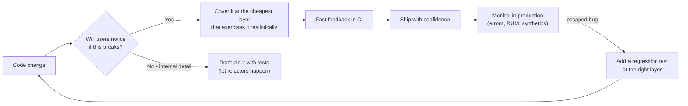

A good strategy answers five questions explicitly:

| Question | Example answer |
|---|---|
| **What risks matter most?** | Checkout must never break; layout glitches on old Safari are tolerable |
| **Which layer covers each risk?** | Price formatting → unit; cart flow → integration; pay-with-card → E2E |
| **How fast must feedback be?** | PR checks under ~10 minutes; full regression nightly |
| **What runs where?** | Local watch mode, PR pipeline, post-merge, pre-release, production |
| **What happens on failure?** | Block merge; flaky tests quarantined with an owner and deadline |

**Properties of a valuable test** (they pull against each other — no test maximizes all):

| Property | Meaning |
|---|---|
| **Fast** | Runs in milliseconds to seconds, so people actually run it |
| **Deterministic** | Same code → same result, every time |
| **Realistic** | Exercises the code the way users and production do |
| **Isolated failure** | When it fails, you know *where* the bug is |
| **Resistant to refactoring** | Doesn't fail when behavior is unchanged (no implementation-detail assertions) |
| **Cheap to write and read** | A new teammate understands what it protects |

---

### Section 2: The Test Pyramid

The **test pyramid** was popularized by Mike Cohn (*Succeeding with Agile*) and later explained in depth on Martin Fowler's site (*The Practical Test Pyramid*). The idea: **many fast, isolated tests at the bottom; fewer, slower, broader tests at the top**.

```text
                 ▲  slower, costlier, more realistic, harder to debug
                /E\         E2E / UI tests        — a few critical journeys
               /---\
              / Int \       Integration / service — components + modules together
             /-------\
            /  Unit   \     Unit tests            — many, fast, isolated
           /-----------\
                 ▼  faster, cheaper, more isolated, less realistic
```

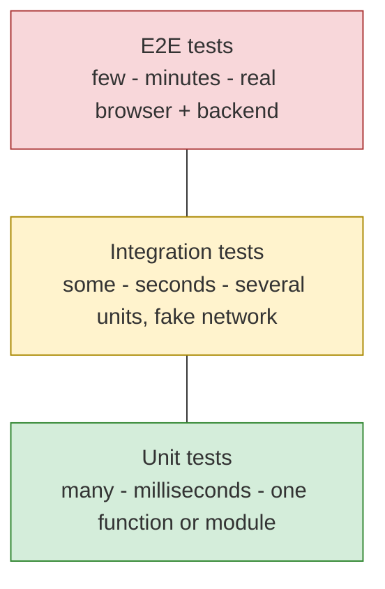

**The two lasting lessons of the pyramid:**
1. **Write tests at different granularities.**
2. **The higher the level, the fewer tests you should have** — because they are slower, flakier and harder to diagnose.

**Where the original pyramid fits less well on the frontend:**
- In UI code, a lot of logic lives in **how components interact** (state, events, effects, data fetching), not in pure functions. Pure unit tests of tiny functions miss the bugs users see.
- Modern tools (jsdom/happy-dom, Vitest/Jest, Testing Library, MSW, browser-mode runners) made **integration-style component tests** nearly as fast as unit tests.
- "Unit" is ambiguous: one function? one component? one component plus its hooks? Teams waste time arguing about labels instead of about **cost vs confidence**.

**The anti-pattern: the ice-cream cone** — mostly manual and E2E tests, few unit tests. Feedback takes hours, failures are hard to locate, and the suite becomes too flaky to trust.

```text
   ███████████████   manual testing        ← most effort here
    █████████████    E2E / UI
      ████████       integration
        ████         unit                  ← least here
```

---

### Section 3: The Testing Trophy and Other Shapes

Kent C. Dodds proposed the **Testing Trophy** for JavaScript applications, building on the advice "Write tests. Not too many. Mostly integration." (originally tweeted by Guillermo Rauch — see Kent's article in the references).

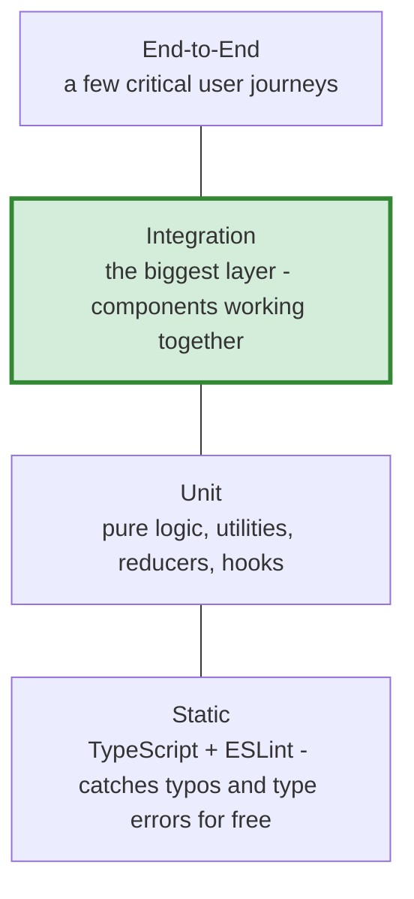

| Layer | Tools (examples) | What it catches |
|---|---|---|
| **Static** | TypeScript, ESLint (incl. `eslint-plugin-jsx-a11y`, React Hooks rules), Prettier | Typos, wrong prop types, null access, hooks misuse, some a11y mistakes |
| **Unit** | Vitest, Jest, Node's built-in test runner | Logic in pure functions, reducers, formatters, validators |
| **Integration** | Testing Library + Vitest/Jest, MSW for the network | Components + hooks + state + data fetching behaving as the user sees them |
| **E2E** | Playwright, Cypress, WebdriverIO | The whole app in a real browser against a real (or staging) backend |

**The shapes compared:**

| Shape | Biggest layer | Context where it fits |
|---|---|---|
| **Pyramid** | Unit | Logic-heavy code, libraries, backends, SDKs |
| **Trophy** | Integration | UI applications — most bugs live in component interaction |
| **Honeycomb** (Spotify engineering) | Integration | Microservices — the risk is in service interactions, not internal code |
| **Ice-cream cone** ❌ | Manual/E2E | Nowhere on purpose — a symptom of missing lower layers |

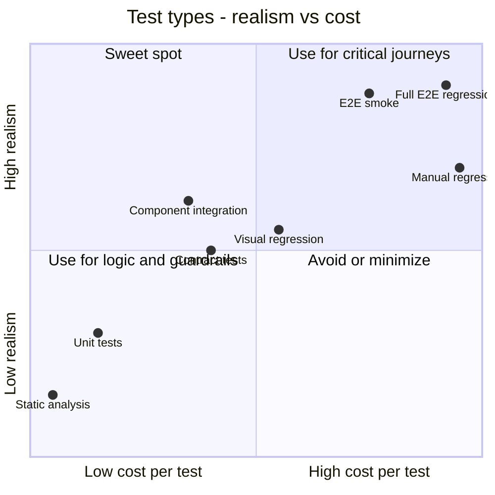

> **The shape is a heuristic, not a rule.** The real rule from both models: **test behavior the way users use the software, at the cheapest layer that does so realistically.** A design-system library may look like a pyramid; a CRUD dashboard may look like a trophy. Both are fine.

---

### Section 4: The Catalogue of Frontend Test Types

| Type | Question it answers | Typical tools | Where it runs | Deep-dive note |
|---|---|---|---|---|
| **Static analysis** | Is the code well-formed and type-safe? | TypeScript, ESLint, Stylelint | Editor, pre-commit, PR | [Module Bundling & Build Systems](./module-bundling-and-build-systems.md) |
| **Unit** | Does this function/hook/reducer compute the right thing? | Vitest, Jest | Watch mode, PR | [Unit Testing Components](./unit-testing-components-jest-vitest.md) |
| **Component** | Does this component render and respond correctly? | Testing Library, Vue Test Utils, Angular TestBed, Vitest browser mode, Playwright/Cypress component testing | PR | [React Testing Library Patterns](./react-testing-library-patterns.md) |
| **Integration** | Do several components + state + data layer work together? | Testing Library + MSW | PR | [Integration Testing](./integration-testing.md) |
| **Contract** | Does the API still return what the frontend expects? | Pact, schema validation (OpenAPI, GraphQL schema checks, Zod) | PR (both repos) | [REST vs GraphQL vs gRPC-Web](./rest-vs-graphql-vs-grpc-web.md) |
| **E2E** | Can a user complete a critical journey? | Playwright, Cypress | PR (smoke), post-merge (full) | [E2E Testing](./e2e-testing-playwright-cypress.md) |
| **Visual regression** | Did the UI change pixels unexpectedly? | Playwright screenshots, Chromatic, Percy | PR | [Visual Regression Testing](./visual-regression-testing.md) |
| **Accessibility** | Can everyone use it? | axe-core (jest-axe, @axe-core/playwright), manual screen reader passes | PR + manual | [Accessibility Testing](./accessibility-testing.md) |
| **Performance** | Is it fast enough and staying within budget? | Lighthouse CI, bundle-size checks, Playwright traces | PR + nightly | [Performance Testing](./performance-testing.md) |
| **Security** | Are there known-vulnerable dependencies or unsafe patterns? | `npm audit`, Dependabot/Renovate, Snyk, CodeQL | PR + scheduled | [Dependency Vulnerability Scanning](./dependency-vulnerability-scanning.md) |
| **Exploratory / manual** | What did nobody think to automate? | Humans, session notes | Pre-release | — |
| **Production checks** | Is it working for real users right now? | Synthetic monitoring, RUM, error tracking | Continuously | [Synthetic Monitoring](./synthetic-monitoring.md) |

**Static analysis is the cheapest test you will ever write.** TypeScript in strict mode removes a whole class of tests ("what if `user` is undefined?") from the other layers.

---

### Section 5: Choosing the Right Layer for a Behavior

The most useful skill is placing each behavior at the right layer:

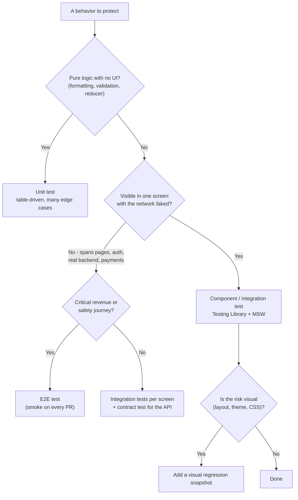

**Worked placement for an e-commerce cart:**

| Behavior | Layer | Why there |
|---|---|---|
| `formatPrice(1999, 'EUR', 'de-DE')` → `19,99 €` | Unit | Pure function, many locale edge cases, milliseconds each |
| Quantity stepper can't go below 1 | Component | One component, user-visible, no network |
| Adding an item updates the cart badge and total | Integration | Several components + store + mocked API |
| Server error shows a retry message | Integration | Easy to force with MSW; hard to force on a real server |
| Guest can search → add to cart → pay with a test card | E2E | Crosses pages, auth, payment provider — only a real browser proves it |
| Cart drawer looks right in dark mode on mobile width | Visual regression | Pixel-level risk that assertions miss |
| Cart API still returns `items[].priceCents` | Contract | Breaks when the *backend* changes, not the frontend |

> **Push each test down to the lowest layer that still exercises the behavior realistically.** If the same assertion exists at two layers, delete the higher one unless it adds new confidence.

---

### Section 6: Test Boundaries, Mocks and Test Doubles

Every test draws a line: **real code inside, fakes outside**. Where you draw it decides how realistic and how brittle the test is.

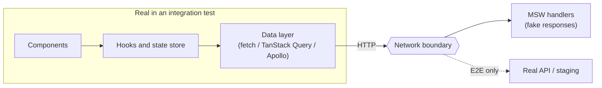

**Rule of thumb: mock at the network boundary, not inside your own code.** Mocking your own hooks or modules (`vi.mock('./useCart')`) means the test passes even when the real hook is broken. Faking HTTP with **MSW** (Mock Service Worker) keeps the whole client stack real, and the same handlers can be reused in Storybook, local development and tests.

**Test doubles vocabulary** (from Gerard Meszaros, *xUnit Test Patterns*):

| Double | What it does | Frontend example |
|---|---|---|
| **Dummy** | Fills a parameter, never used | `onClose={() => {}}` passed only to satisfy props |
| **Stub** | Returns canned answers | `getFlag = () => true` |
| **Spy** | Records how it was called | `const onSubmit = vi.fn()`; assert it was called with the form values |
| **Mock** | Pre-programmed with expectations | `vi.mock('analytics')` with call assertions |
| **Fake** | A working lightweight implementation | MSW handlers, an in-memory IndexedDB (`fake-indexeddb`), fake timers |

**What to fake and what to keep real:**

| Keep real | Fake |
|---|---|
| Your components, hooks, stores, routers | The network (MSW) |
| The framework's rendering | Time (`vi.useFakeTimers()`), randomness, `Date.now()` |
| CSS-in-JS / class names (in browser mode) | Third-party SDKs (payments, analytics, maps) |
| Browser APIs available in the environment | Browser APIs missing in jsdom (`IntersectionObserver`, `matchMedia`) — or run in a real browser |

> **jsdom is not a browser.** It has no layout engine (every size is 0), partial or missing Web APIs, and no real focus/scroll behavior. For layout-, focus- or API-dependent behavior, use a real-browser runner (Vitest browser mode, Playwright/Cypress component testing) or push the check to E2E.

---

### Section 7: Tests in the CI/CD Pipeline

A strategy is also a **schedule**: cheap checks run constantly, expensive ones run less often.

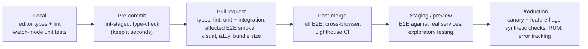

**A PR pipeline with a time budget** (illustrative durations — measure your own):

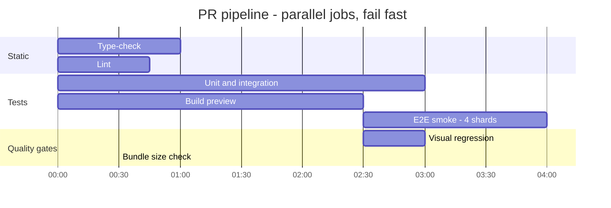

**Techniques that keep the pipeline fast:**

| Technique | How |
|---|---|
| **Parallel jobs** | Static checks, unit tests and the build run at the same time |
| **Fail fast** | Cheap jobs first; cancel the rest when one fails |
| **Sharding** | `playwright test --shard=1/4`, `vitest --shard=1/4` split a suite across machines |
| **Affected-only** | In a monorepo, Nx/Turborepo run tests only for projects touched by the change (see [Mono-repo vs Multi-repo](./mono-repo-vs-multi-repo.md)) |
| **Caching** | Cache dependencies, build outputs and browser binaries between runs |
| **Tiering** | Smoke E2E on PRs, full regression post-merge or nightly |
| **Preview deployments** | Run E2E against a per-PR preview URL instead of a shared, contended staging |

---

### Section 8: Flaky Tests

A **flaky test** passes and fails on the same code. Flakiness destroys trust: once people learn to hit "re-run", real failures get ignored too.

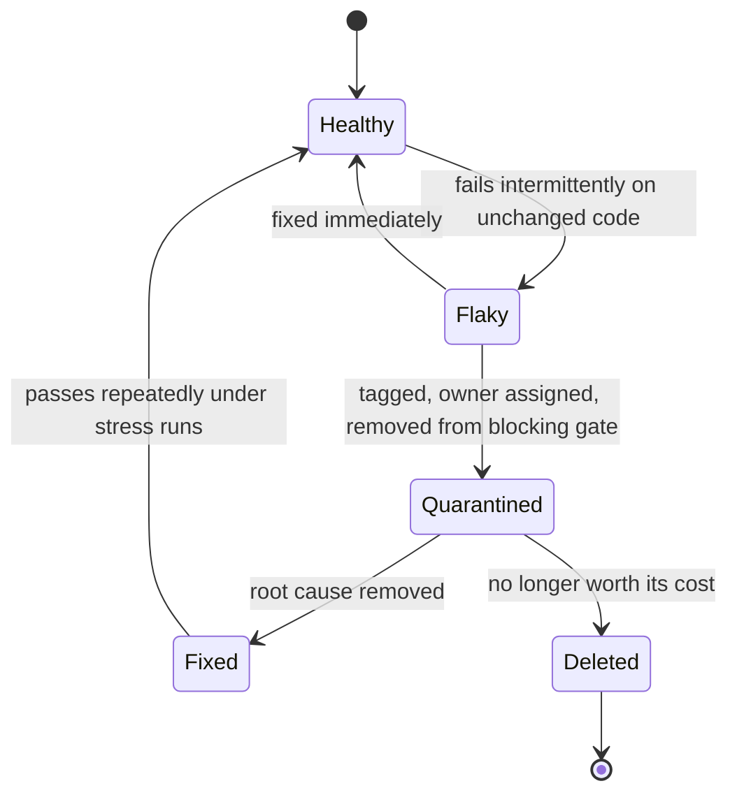

| Cause | Symptom | Fix |
|---|---|---|
| **Fixed sleeps** (`waitForTimeout(2000)`) | Fails on slow CI machines | Wait for a condition: web-first assertions (`await expect(locator).toBeVisible()`), `findBy*` queries |
| **Shared state between tests** | Fails only in a certain order | Fresh state per test; isolate storage, DB seeds and users |
| **Real time / dates / time zones** | Fails at midnight or in another TZ | Fake timers, fixed clock, set `TZ` in CI |
| **Real network / third parties** | Fails when a service is slow | MSW in integration tests; route-mock third parties in E2E |
| **Animations and transitions** | Click lands on a moving element | Disable animations in test mode (`prefers-reduced-motion`), use actionability-aware tools |
| **Unawaited async work** | "act" warnings, assertions before updates | Await user events and `findBy*`; don't leak promises |
| **Order-dependent test data** | Duplicate key / already exists | Unique IDs per test run |

**Policy that works:** detect flakiness (retries that pass are reported as "flaky", which Playwright does by default when retries are enabled), **quarantine** with an owner and a deadline, and track the flaky rate as a team metric. Retries hide symptoms — use them as a signal, not a fix.

---

### Section 9: Coverage, Mutation Testing and Meaningful Metrics

**Code coverage** (lines/branches executed by tests, via V8 or Istanbul instrumentation) tells you **what is definitely untested**. It does **not** tell you what is well tested — a test with no assertions still produces coverage.

```text
Coverage = 100%, assertions = 0  →  zero confidence
Coverage = 70% of the code that matters, strong behavioral assertions → high confidence
```

| Metric | Useful for | Misused as |
|---|---|---|
| **Line / branch coverage** | Finding untested areas; preventing coverage from dropping on new code | A target to game ("hit 90%") |
| **Mutation score** (Stryker) | Checking that tests actually *detect* changes: the tool mutates code (`>` → `>=`) and checks a test fails | Running on the whole codebase on every PR (slow) — scope it to critical modules |
| **Escaped defects** | How many bugs reached production, and which layer should have caught them | — |
| **Suite duration (p50/p95)** | Keeping feedback fast | — |
| **Flaky rate** | Trust in the suite | Hidden by automatic retries |
| **Time to diagnose a failure** | Whether failures point at the cause | — |

> **Set coverage thresholds as a floor for *changed* code (a ratchet), not as a global vanity target.** Exclude generated code, stories and type-only files.

---

### Section 10: Shift Left and Shift Right

- **Shift left** = catch problems earlier: types, linting, tests in the editor, design reviews, contract checks before integration.
- **Shift right** = accept that some problems only appear with real users, devices and data — and **test in production safely**: feature flags, canaries, synthetic monitoring, RUM and error tracking.

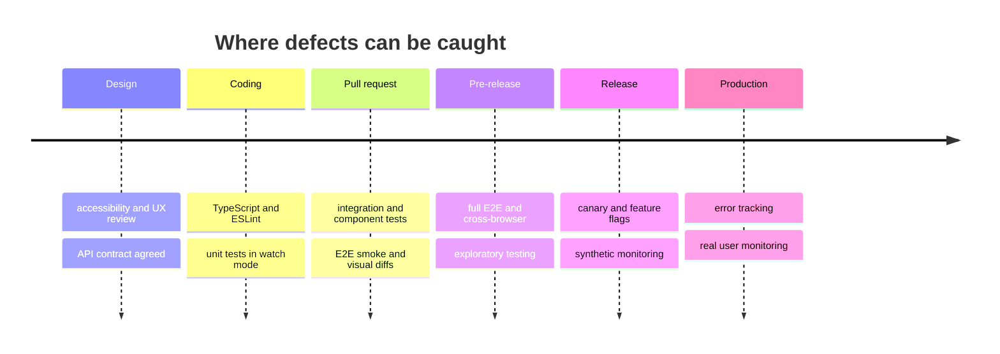

Shift-right practices are covered in Phase 9: [Error Tracking (Sentry, Datadog RUM)](./error-tracking-sentry-datadog-rum.md), [Real User Monitoring (RUM)](./real-user-monitoring-rum.md), [Synthetic Monitoring](./synthetic-monitoring.md) and [Feature Flags & A/B Testing](./feature-flags-and-a-b-testing.md). Every escaped production bug should end with the question: **"Which layer should have caught this, and why didn't it?"**

---

### Section 11: Framework and Platform Landscape

The strategy is the same everywhere; the tools differ.

| Stack | Unit / component | Integration helpers | E2E |
|---|---|---|---|
| **React** | Vitest or Jest + React Testing Library | MSW, `@testing-library/user-event` | Playwright, Cypress |
| **Vue** | Vitest + Vue Test Utils or `@testing-library/vue` | MSW, Pinia testing utilities (`@pinia/testing`) | Playwright, Cypress |
| **Angular** | TestBed + Vitest (the default for new Angular CLI projects; Karma + Jasmine is still documented for existing projects, with a migration guide), Angular Testing Library | `HttpTestingController`, MSW | Playwright, Cypress |
| **Svelte / SvelteKit** | Vitest + `@testing-library/svelte` (or Vitest browser mode) | MSW | Playwright (the SvelteKit starter offers it) |
| **Solid** | Vitest + `@solidjs/testing-library` | MSW | Playwright |
| **React Native** | Jest + React Native Testing Library | MSW (with React Native setup) | Detox, Maestro, Appium |
| **Native iOS / Android** | XCTest; JUnit + Robolectric / Compose UI tests | — | XCUITest; Espresso / UI Automator |

**Real-browser component testing** is growing: Vitest browser mode, Playwright component testing and Cypress component testing run components in a real browser instead of jsdom. They trade some speed for realism (real layout, focus, CSS). These tools are moving fast — for example, Playwright recently replaced its old `@playwright/experimental-ct-*` packages with a framework-agnostic `mount` fixture that drives a story-gallery page served by your own dev server. Check each tool's current docs before choosing.

---

## System Design Angle — Strategy by Product Type

There is no universal ratio. Shape the mix to where **risk** and **change** concentrate:

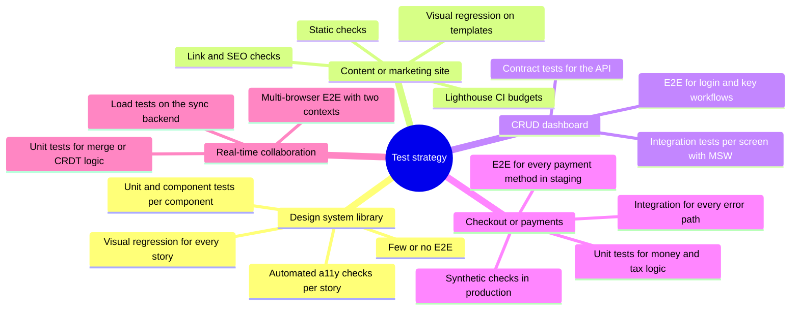

**Decision matrix — which layer gets the most investment:**

| Signal in the product | Lean toward | Reason |
|---|---|---|
| Complex pure logic (pricing, permissions, parsers) | **Unit** | Many edge cases, cheap to enumerate |
| Many screens over a stable API | **Integration** | Bugs are in wiring and states (loading/empty/error) |
| Few journeys that make money | **E2E smoke** on those journeys | One break = lost revenue |
| Shared UI components used by many teams | **Component + visual + a11y** | One change ripples everywhere |
| Backend owned by another team | **Contract tests** | Catches breaking API changes before the frontend deploys |
| High traffic, many devices/browsers | **Shift right**: RUM, error tracking, canaries | Real-world diversity can't be reproduced in CI |
| Micro-frontends | Contract tests between shell and remotes + E2E for composition | Integration failures happen at deploy time |

**Questions to ask in a design review or interview:** What is the cost of a bug here (money, safety, trust)? How often does this area change? Who owns the backend? How long may CI take? Which browsers and devices matter? Is there a staging environment with realistic data?

---

## Real-World Examples

**Example 1 — Implementation details vs behavior (BAD → GOOD):**
```tsx
// ❌ BAD: tests internal state and structure — breaks on refactor, misses real bugs
import { render } from '@testing-library/react';
import { Counter } from './Counter';

test('increments state', () => {
  const { container } = render(<Counter />);
  container.querySelector('.btn-inc')!.dispatchEvent(new MouseEvent('click', { bubbles: true }));
  expect(container.querySelector('.count')!.textContent).toBe('1');
});

// ✅ GOOD: interacts like a user, asserts what a user sees
import { render, screen } from '@testing-library/react';
import userEvent from '@testing-library/user-event';

test('increments the count when the user clicks "Increase"', async () => {
  const user = userEvent.setup();
  render(<Counter />);
  await user.click(screen.getByRole('button', { name: /increase/i }));
  expect(screen.getByRole('status')).toHaveTextContent('1');
});
```

**Example 2 — An integration test with the network faked by MSW:**
```tsx
// cart.integration.test.tsx
import { http, HttpResponse } from 'msw';
import { setupServer } from 'msw/node';
import { render, screen } from '@testing-library/react';
import userEvent from '@testing-library/user-event';
import { App } from './App';

const server = setupServer(
  http.get('/api/products/42', () =>
    HttpResponse.json({ id: '42', name: 'Desk Lamp', priceCents: 2999 })
  ),
  http.post('/api/cart', async ({ request }) => {
    const body = (await request.json()) as { productId: string };
    return HttpResponse.json({ items: [{ productId: body.productId, qty: 1 }], totalCents: 2999 });
  })
);

beforeAll(() => server.listen({ onUnhandledRequest: 'error' })); // unexpected calls fail loudly
afterEach(() => server.resetHandlers());
afterAll(() => server.close());

test('adding a product updates the cart badge and total', async () => {
  const user = userEvent.setup();
  render(<App initialUrl="/products/42" />);

  await user.click(await screen.findByRole('button', { name: /add to cart/i }));

  expect(await screen.findByRole('link', { name: /cart, 1 item/i })).toBeInTheDocument();
  expect(screen.getByText('$29.99')).toBeInTheDocument();
});

test('shows a retry message when the cart API fails', async () => {
  server.use(http.post('/api/cart', () => new HttpResponse(null, { status: 503 })));
  const user = userEvent.setup();
  render(<App initialUrl="/products/42" />);

  await user.click(await screen.findByRole('button', { name: /add to cart/i }));

  expect(await screen.findByRole('alert')).toHaveTextContent(/couldn't add/i);
});
```

**Example 3 — One E2E smoke test for the money path (Playwright):**
```typescript
// e2e/checkout.smoke.spec.ts
import { test, expect } from '@playwright/test';

test('@smoke guest can buy a product', async ({ page }) => {
  await page.goto('/');
  await page.getByRole('searchbox', { name: 'Search' }).fill('desk lamp');
  await page.getByRole('searchbox', { name: 'Search' }).press('Enter');
  await page.getByRole('link', { name: 'Desk Lamp' }).click();
  await page.getByRole('button', { name: 'Add to cart' }).click();
  await page.getByRole('link', { name: /cart/i }).click();
  await page.getByRole('button', { name: 'Checkout' }).click();

  // The payment provider is in test mode on staging; never hit real payment rails in tests
  await page.getByLabel('Email').fill(`e2e+${Date.now()}@example.com`);
  await page.getByRole('button', { name: 'Pay' }).click();

  await expect(page.getByRole('heading', { name: 'Thank you for your order' })).toBeVisible();
});
```

**Example 4 — Playwright config: retries as a signal, traces for diagnosis:**
```typescript
// playwright.config.ts
import { defineConfig, devices } from '@playwright/test';

export default defineConfig({
  testDir: './e2e',
  fullyParallel: true,
  forbidOnly: !!process.env.CI,          // a stray test.only must not silently skip the suite
  retries: process.env.CI ? 2 : 0,       // passes-on-retry are reported as "flaky"
  reporter: process.env.CI ? [['html'], ['github']] : 'list',
  use: {
    baseURL: process.env.BASE_URL ?? 'http://localhost:4173',
    trace: 'on-first-retry',             // a full trace whenever something was flaky or failed
  },
  projects: [
    { name: 'chromium', use: { ...devices['Desktop Chrome'] } },
    { name: 'webkit', use: { ...devices['Desktop Safari'] } },
    { name: 'mobile', use: { ...devices['Pixel 7'] } },
  ],
});
```

**Example 5 — Contract check at the boundary with a runtime schema:**
```typescript
// api/schemas.ts — the frontend's expectations of the cart API, in one place
import { z } from 'zod';

export const CartSchema = z.object({
  items: z.array(z.object({ productId: z.string(), qty: z.number().int().positive() })),
  totalCents: z.number().int().nonnegative(),
});
export type Cart = z.infer<typeof CartSchema>;

// contract.test.ts — runs in CI against the backend's published example responses
import { CartSchema } from './api/schemas';
import examples from '../contracts/cart.examples.json'; // pulled from the backend repo / OpenAPI examples

test.each(examples)('cart example %# matches the frontend contract', (example) => {
  expect(() => CartSchema.parse(example)).not.toThrow();
});
```
> For consumer-driven contracts across teams, **Pact** formalizes this: the frontend publishes the interactions it relies on, and the provider's CI verifies them before deploying.

**Example 6 — A tiered GitHub Actions pipeline:**
```yaml
# .github/workflows/ci.yml
name: CI
on: [pull_request]
concurrency: { group: ci-${{ github.ref }}, cancel-in-progress: true }

jobs:
  static:
    runs-on: ubuntu-latest
    steps:
      - uses: actions/checkout@v4
      - uses: actions/setup-node@v4
        with: { node-version: 22, cache: npm }
      - run: npm ci
      - run: npm run typecheck && npm run lint

  unit-integration:
    runs-on: ubuntu-latest
    steps:
      - uses: actions/checkout@v4
      - uses: actions/setup-node@v4
        with: { node-version: 22, cache: npm }
      - run: npm ci
      - run: npx vitest run --coverage

  e2e-smoke:
    needs: [static]                      # don't spend browser minutes on code that doesn't type-check
    runs-on: ubuntu-latest
    strategy:
      matrix: { shard: [1, 2, 3, 4] }
    steps:
      - uses: actions/checkout@v4
      - uses: actions/setup-node@v4
        with: { node-version: 22, cache: npm }
      - run: npm ci && npx playwright install --with-deps chromium
      - run: npm run build && npx playwright test --grep @smoke --project=chromium --shard=${{ matrix.shard }}/4
```

**Other frameworks, same strategy:**
```typescript
// Vue — @testing-library/vue keeps the same user-centric queries
import { render, screen } from '@testing-library/vue';
import userEvent from '@testing-library/user-event';
import Counter from './Counter.vue';

test('increments', async () => {
  render(Counter);
  await userEvent.click(screen.getByRole('button', { name: /increase/i }));
  expect(screen.getByRole('status')).toHaveTextContent('1');
});

// Angular — Angular Testing Library wraps TestBed
// import { render, screen } from '@testing-library/angular';
// await render(CounterComponent); then the same queries and assertions

// Svelte — @testing-library/svelte
// render(Counter); then the same queries and assertions
```

---

## Key Points Summary

| Concept | One-Line Explanation |
|---|---|
| **Test strategy** | Deciding which risks to cover, at which layer, how often, and what happens on failure |
| **Test pyramid** | Many fast unit tests, fewer integration tests, very few E2E tests |
| **Testing trophy** | Static base, then unit, a large integration layer and a few E2E — tuned for UI apps |
| **Ice-cream cone** | Anti-pattern: mostly manual/E2E, few low-level tests → slow and flaky |
| **Lowest realistic layer** | Push each check down to the cheapest layer that still exercises it like a user |
| **Mock at the network boundary** | Fake HTTP with MSW, keep your own components/hooks/stores real |
| **Test doubles** | Dummy, stub, spy, mock, fake — pick the least powerful one that works |
| **Contract tests** | Catch API breaking changes between independently deployed frontend and backend |
| **Pipeline tiers** | Static/unit on every change, smoke E2E on PRs, full regression post-merge/nightly |
| **Flaky tests** | Quarantine with an owner; fix root causes (sleeps, shared state, time, network) |
| **Coverage** | Shows what is untested, not what is well tested; use as a ratchet on changed code |
| **Mutation testing** | Checks that tests fail when the code is wrong |
| **Shift right** | Feature flags, canaries, synthetics, RUM and error tracking catch what CI can't |

---

## Test Your Understanding

**Q1 (Basic):**
What are the two core lessons of the test pyramid, and why does the Testing Trophy make *integration* the largest layer for frontend apps?

<details>
<summary>Answer</summary>

The pyramid's lessons: **write tests at different granularities**, and **have fewer tests the higher (broader, slower) the level**, because high-level tests are slower, flakier and harder to diagnose.

The Trophy keeps that cost logic but notes that in UI applications most user-visible bugs live in **how pieces work together** — components, hooks, state, data fetching, loading/error states — not in isolated pure functions. Tools like Testing Library, jsdom/browser runners and MSW made integration tests almost as fast as unit tests, so they give the best **confidence per unit of cost**. Static analysis at the base adds cheap protection against typos and type errors.
</details>

**Q2 (Application):**
Place each of these at a test layer and justify: (a) VAT calculation for 27 countries, (b) "Delete" shows a confirmation dialog and focus returns to the button on cancel, (c) logging in with SSO then viewing invoices, (d) the API renamed `total` to `totalCents`.

<details>
<summary>Answer</summary>

- **(a) Unit**, table-driven: pure logic with many edge cases; each case runs in milliseconds.
- **(b) Component/integration test**, ideally in a **real-browser** runner (Vitest browser mode or Playwright/Cypress component testing), because focus management is unreliable in jsdom. An automated a11y check (axe) can run in the same test.
- **(c) E2E**: crosses an external identity provider, redirects, cookies and multiple pages — only a real browser against a real or staging stack proves it. Keep it to the critical path.
- **(d) Contract test**: the frontend didn't change, the backend did. A consumer-driven contract (Pact) or schema check against the provider's examples fails **in the backend's CI** before deploy, which no frontend-only test can do.
</details>

**Q3 (Tricky):**
A team has 92% line coverage, yet bugs keep reaching production in the checkout flow. How is that possible, and what would you change?

<details>
<summary>Answer</summary>

Coverage only measures **which lines executed**, not whether assertions would catch a wrong result. Likely causes: tests that render without meaningful assertions, heavy mocking of the team's own hooks/modules (so the real wiring is never exercised), snapshot tests that get blindly updated, and no tests at the integration seams (API errors, loading states, the payment redirect).

Changes: review **escaped defects** and map each to the layer that should have caught it; add **integration tests with MSW** for checkout's error paths; add a small set of **E2E smoke tests** for the payment journeys; run **mutation testing** (e.g. Stryker) on money/tax modules to find weak assertions; and replace the global coverage target with a **ratchet on changed code**.
</details>

**Q4 (Tricky):**
Your E2E suite takes 45 minutes and fails randomly about one run in five. Developers now merge on red. What's your plan?

<details>
<summary>Answer</summary>

1. **Restore trust first:** turn on retries *as a signal* and report tests that pass on retry as flaky; **quarantine** them out of the blocking gate with an owner and a deadline.
2. **Fix root causes:** replace fixed sleeps with web-first assertions, give each test its own data/user, mock third-party services at the route level, disable animations, fix the clock and time zone.
3. **Shrink the top of the pyramid:** many E2E tests probably check things an integration test could cover (validation messages, empty states). Move them down; keep E2E for critical journeys.
4. **Tier and parallelize:** tag `@smoke` tests for PRs (minutes, sharded), run the full regression post-merge or nightly.
5. **Measure:** track suite duration p95 and flaky rate on a dashboard so regression is visible.
</details>

**Q5 (Application):**
Why is "mock at the network boundary" preferred over `vi.mock('./useCart')` in an integration test? When is mocking a module still right?

<details>
<summary>Answer</summary>

Mocking `useCart` replaces **your own code** with a fake, so the test can pass while the real hook is broken (wrong query key, bad cache update, unhandled error). Faking at the **HTTP boundary** with MSW keeps components, hooks, the data-fetching library and caching real, so the test fails when real users would hit a bug. It also tests behavior rather than implementation, so refactoring the hook doesn't break the test, and the same handlers can serve Storybook and local development.

Module mocks are still right for things you **don't own or can't run**: third-party SDKs (payments, analytics, maps), non-deterministic sources (time, randomness, crypto UUIDs), or browser APIs missing in the test environment.
</details>

**Q6 (System design):**
You're the frontend lead for a new banking web app (React, separate backend team, strict release process, millions of users on varied devices). Outline the test strategy.

<details>
<summary>Answer</summary>

- **Static:** strict TypeScript, ESLint with hooks and jsx-a11y rules, blocking on PRs.
- **Unit:** money formatting, rounding, IBAN/validation, permission rules — exhaustive and table-driven; mutation testing on the money modules.
- **Integration (largest layer):** each screen with Testing Library + MSW, covering loading, empty, error, session-expired and validation states; axe checks in the same tests.
- **Contract:** consumer-driven contracts (Pact) or OpenAPI schema checks with the backend team, verified in **their** pipeline before deploy.
- **E2E:** a small `@smoke` set on every PR (login with MFA in a test tenant, view balance, transfer between own accounts) and a fuller cross-browser regression nightly, including mobile viewports and WebKit.
- **Visual regression** for the design system; **manual screen-reader passes** before major releases (automated tools only catch part of a11y issues).
- **Performance budgets** in CI (bundle size, Lighthouse CI).
- **Shift right:** feature flags and canary releases, synthetic monitoring of login and transfer, error tracking and RUM with strict PII scrubbing.
- **Policies:** PR pipeline time budget, flaky-test quarantine with owners, every escaped defect gets a regression test at the right layer.
</details>

---

## Cheat Sheet

**Key Definitions:**
- **Unit test:** Checks one small piece of logic in isolation
- **Integration test:** Checks several units working together (components + state + data layer), usually with the network faked
- **E2E test:** Drives the full app in a real browser against a real or staging backend
- **Contract test:** Verifies that the API provider still satisfies what the consumer relies on
- **Test double:** Stand-in for a real dependency (dummy, stub, spy, mock, fake)
- **Flaky test:** Passes and fails on the same code
- **Mutation testing:** Deliberately changes code to check that tests notice
- **Shift left / right:** Catch defects earlier in development / safely in production

**Quick Reference:**
```text
Layers (cheapest → costliest):  static → unit → component/integration → contract → E2E → manual
Pyramid:   many unit, some integration, few E2E           (logic-heavy code, libraries)
Trophy:    static base, mostly integration, few E2E        (UI applications)
Honeycomb: mostly integration                              (microservices)

Placement rule:  lowest layer that exercises the behavior like a user would
Mocking rule:    fake the network (MSW), time and third parties — keep your own code real
Query rule:      getByRole / getByLabelText over CSS selectors and test IDs

Pipeline:
  local      → types, lint, watch-mode tests
  PR         → static + unit/integration + E2E smoke (sharded) + visual + a11y + bundle size
  post-merge → full E2E, cross-browser, Lighthouse CI
  production → canary, feature flags, synthetics, RUM, error tracking

Flaky test:  quarantine + owner + deadline; no fixed sleeps; isolate data; fake time
Coverage:    floor/ratchet on changed code, never a vanity target
```

**Common Mistakes to Avoid:**

| Mistake | Why Wrong | Fix |
|---|---|---|
| Ice-cream cone (mostly E2E/manual) | Slow feedback, flaky, failures hard to locate | Move checks down to integration/unit; keep E2E for critical journeys |
| Testing implementation details (state, class names, private functions) | Breaks on refactors, misses user-visible bugs | Query by role/label, assert what the user sees |
| Mocking your own modules and hooks | Test passes while real wiring is broken | Mock at the network boundary with MSW |
| Same assertion at every layer | Triple the maintenance for no extra confidence | Keep it at the lowest realistic layer |
| Fixed sleeps in E2E | Flaky on slow machines, slow on fast ones | Web-first assertions, `findBy*` queries |
| Chasing a global coverage percentage | Encourages assertion-free tests | Ratchet on changed code; mutation-test critical modules |
| Retries as the "fix" for flakiness | Hides real race conditions | Treat pass-on-retry as a flaky signal; quarantine and fix |
| Trusting jsdom for layout/focus | jsdom has no layout engine and partial APIs | Real-browser component tests or E2E for those behaviors |
| No contract between frontend and backend teams | Backend changes break production without a failing frontend test | Pact or schema checks in the provider's CI |
| Treating CI as the last line of defense | Real devices, data and networks differ | Feature flags, canaries, synthetics, RUM, error tracking |
| Blindly updating snapshots | Snapshot tests stop catching anything | Small, focused snapshots or visual regression with review |

---

## References & Further Reading

**Core concepts**
- Martin Fowler's site: [The Practical Test Pyramid (Ham Vocke)](https://martinfowler.com/articles/practical-test-pyramid.html)
- Martin Fowler: [Test Pyramid (bliki)](https://martinfowler.com/bliki/TestPyramid.html) · [Test Shapes](https://martinfowler.com/articles/2021-test-shapes.html) · [Test Double](https://martinfowler.com/bliki/TestDouble.html) · [Eradicating Non-Determinism in Tests](https://martinfowler.com/articles/nonDeterminism.html)
- Kent C. Dodds: [The Testing Trophy and Testing Classifications](https://kentcdodds.com/blog/the-testing-trophy-and-testing-classifications) · [Write tests. Not too many. Mostly integration.](https://kentcdodds.com/blog/write-tests) · [Testing Implementation Details](https://kentcdodds.com/blog/testing-implementation-details)
- Spotify Engineering: [Testing of Microservices (the honeycomb)](https://engineering.atspotify.com/2018/01/testing-of-microservices)
- Google Testing Blog: [Just Say No to More End-to-End Tests](https://testing.googleblog.com/2015/04/just-say-no-to-more-end-to-end-tests.html)
- web.dev: [Testing strategies](https://web.dev/articles/ta-strategies)

**Tools — official docs**
- [Vitest guide](https://vitest.dev/guide/) · [Vitest browser mode](https://vitest.dev/guide/browser/) · [Jest](https://jestjs.io/docs/getting-started)
- [Testing Library — guiding principles](https://testing-library.com/docs/guiding-principles) · [Query priority](https://testing-library.com/docs/queries/about/#priority)
- [Mock Service Worker (MSW)](https://mswjs.io/docs/)
- [Playwright — best practices](https://playwright.dev/docs/best-practices) · [Retries and flaky tests](https://playwright.dev/docs/test-retries) · [Sharding](https://playwright.dev/docs/test-sharding)
- [Cypress — testing types](https://docs.cypress.io/app/core-concepts/testing-types)
- [Pact — consumer-driven contract testing](https://docs.pact.io/)
- [Stryker Mutator](https://stryker-mutator.io/docs/)

**Framework testing guides**
- [Vue — Testing](https://vuejs.org/guide/scaling-up/testing.html)
- [Angular — Testing](https://angular.dev/guide/testing)
- [Svelte — Testing](https://svelte.dev/docs/svelte/testing)
- [React Native — Testing overview](https://reactnative.dev/docs/testing-overview)
- [Android — Fundamentals of testing](https://developer.android.com/training/testing/fundamentals) · [Apple — XCTest](https://developer.apple.com/documentation/xctest)

---

> **Previous Topic:** [Accessibility Testing](./accessibility-testing.md)
> — Automated and manual checks that everyone can use the interface

> **Next Topic:** [Error Boundaries & Global Error Handling](./error-boundaries-and-global-error-handling.md)
> — Phase 9 begins: catching and containing the errors that tests didn't

*Saved on: 2026-11-06 | Repo: Frontend System Design Learning Notes*
