<!-- Generated by scripts/sync-knowledge.js from notes/ and README.md — do not edit here. -->
<!-- sections (line ranges in this file): Table of Contents 19-42 · ELI5 43-57 · Core Concept 58-524 · System Design Angle 525-556 · Real-World Examples 557-817 · Key Points Summary 818-839 · Test Your Understanding 840-926 · Cheat Sheet 927-977 · References & Further Reading 978-1011 -->

# Unit Testing Components (Jest, Vitest)

> **Date:** 2026-11-06 · **Last updated:** 2026-11-06
> **Category:** Frontend System Design
> **Sub-Topic:** Testing / Unit & Component Testing
> **Level:** Beginner · **Reading time:** ~26 min
> **Informs:** test runner choice (Jest vs Vitest vs framework CLI), DOM environment (jsdom, happy-dom, real browser), mocking boundaries, fake timers, snapshot policy, coverage thresholds, test file layout, CI sharding, testability of component APIs

> **Pre-requisite:** [Component API Design](./component-api-design.md) (props in, events out — the contract you test) and [Custom Hooks Patterns](./custom-hooks-patterns.md) (logic you can test without UI).
> This note covers **the runner layer**: how Jest and Vitest execute component tests, configure the DOM, mock things and measure coverage. Query and interaction patterns are in the next note, [React Testing Library Patterns](./react-testing-library-patterns.md).

**Previous:** [Dependency Vulnerability Scanning](./dependency-vulnerability-scanning.md) · **Next:** [React Testing Library Patterns](./react-testing-library-patterns.md)

---

## Table of Contents

1. [ELI5 — Simple Explanation](#eli5--simple-explanation)
2. [Section 1: What a "Unit" Is in a Component World](#section-1-what-a-unit-is-in-a-component-world)
3. [Section 2: The Toolchain — Who Does What](#section-2-the-toolchain--who-does-what)
4. [Section 3: Jest vs Vitest](#section-3-jest-vs-vitest)
5. [Section 4: Anatomy of a Test](#section-4-anatomy-of-a-test)
6. [Section 5: The DOM Environment — jsdom, happy-dom, Real Browser](#section-5-the-dom-environment--jsdom-happy-dom-real-browser)
7. [Section 6: Test Doubles — Stubs, Spies, Mocks, Fakes](#section-6-test-doubles--stubs-spies-mocks-fakes)
8. [Section 7: Module Mocking and Hoisting](#section-7-module-mocking-and-hoisting)
9. [Section 8: Async Code and Fake Timers](#section-8-async-code-and-fake-timers)
10. [Section 9: Testing Hooks, Context and Providers](#section-9-testing-hooks-context-and-providers)
11. [Section 10: Snapshot Testing — Use Sparingly](#section-10-snapshot-testing--use-sparingly)
12. [Section 11: Coverage and Test Quality](#section-11-coverage-and-test-quality)
13. [Section 12: Vue, Angular, Svelte and React Native](#section-12-vue-angular-svelte-and-react-native)
14. [System Design Angle — Choosing and Scaling the Setup](#system-design-angle--choosing-and-scaling-the-setup)
15. [Real-World Examples](#real-world-examples)
16. [Key Points Summary](#key-points-summary)
17. [Test Your Understanding](#test-your-understanding)
18. [Cheat Sheet](#cheat-sheet)
19. [References & Further Reading](#references--further-reading)

---

## ELI5 — Simple Explanation

Think of a **car factory**. Before a gearbox goes into a car, it's put on a **test bench**: engineers feed it known inputs (turn this shaft at 2,000 rpm) and check the outputs (the other shaft turns at 800 rpm). They don't need the whole car, a road or a driver.

- The **gearbox** is your component or hook.
- The **test bench** is the **test runner** (Jest or Vitest) plus a **fake dashboard** (jsdom — a pretend browser).
- **Dummy parts** bolted on so the gearbox can run — a fake engine, a fake wheel — are **mocks and stubs**.
- The **checklist** ("output shaft at 800 rpm ± 5") is your **assertions**.

Bench tests are **fast and cheap**, so you run hundreds of them on every change. But a gearbox that passes the bench can still rattle in a real car — that's what **integration** and **end-to-end** tests are for.

> **A unit test checks one component or function in isolation, fast, with controlled inputs — props, events, mocked dependencies — and asserts on what the user or caller would observe.**

---

## Core Concept — Step by Step

### Section 1: What a "Unit" Is in a Component World

For UI code, a "unit" is usually **one of these**:

| Unit | Inputs | Observable outputs | Example |
|---|---|---|---|
| **Pure function** | Arguments | Return value | `formatPrice(1999, 'EUR', 'de-DE')` |
| **Reducer / state machine** | State + action | Next state | `cartReducer(state, { type: 'add' })` |
| **Custom hook** | Arguments, context, time | Returned values, calls to dependencies | `useDebouncedValue(value, 300)` |
| **Presentational component** | Props | Rendered DOM, accessible names, callback calls | `<Rating value={3} onChange={…} />` |
| **Container component** | Props + data source | DOM after loading/error/success | `<UserCard id="42" />` with a mocked API |

The component contract you test:

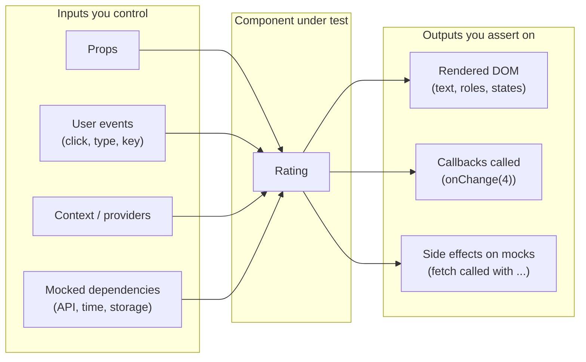

**What NOT to assert on:** internal state variables, private methods, the number of renders, CSS class names that are styling details, or the exact component tree. Those are **implementation details** — refactors change them without changing behavior, and tests that depend on them break for no reason.

> Where unit tests sit in the overall strategy (pyramid vs trophy, how many of each) is covered in [Testing Strategies & Pyramid](./testing-strategies-and-pyramid.md).

---

### Section 2: The Toolchain — Who Does What

A component test touches **six layers**. Jest and Vitest bundle several of them, which is why they're called "test frameworks".

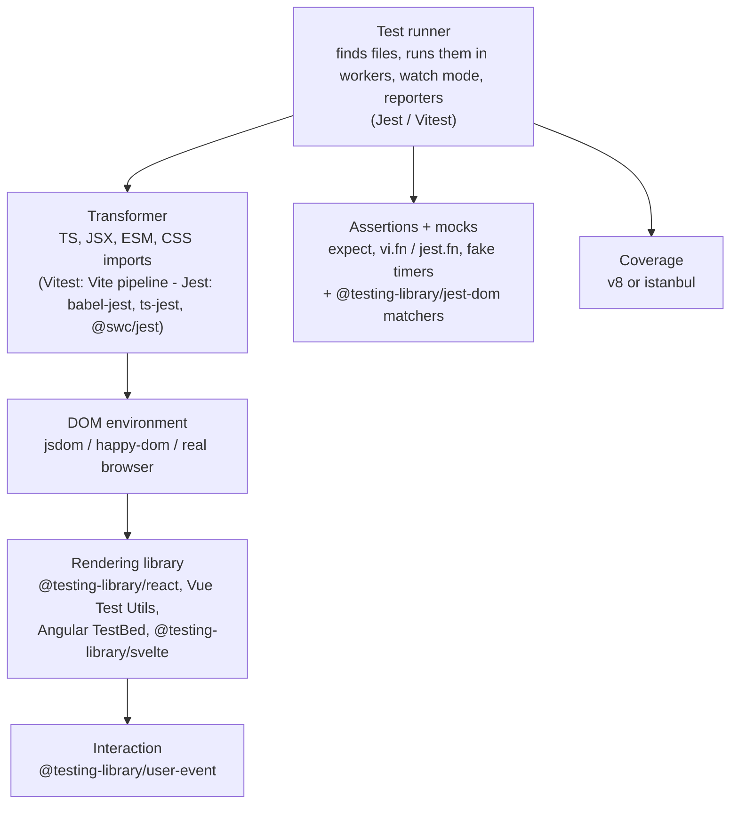

| Layer | Jest | Vitest |
|---|---|---|
| Runner + assertions + mocks | Built in (`expect`, `jest.fn`, `jest.mock`) | Built in, Jest-compatible API (`expect`, `vi.fn`, `vi.mock`) |
| Transform TS/JSX | `babel-jest` (default), `ts-jest`, `@swc/jest` | Vite's transform pipeline (and your Vite plugins) |
| DOM environment | `jest-environment-jsdom` (separate package; default env is `node`) | `environment: 'jsdom'` or `'happy-dom'` (install the package), or Browser Mode |
| Extra matchers | `@testing-library/jest-dom` | `@testing-library/jest-dom/vitest` |
| Coverage | istanbul via Babel (default) or `coverageProvider: 'v8'` | `@vitest/coverage-v8` (default) or `@vitest/coverage-istanbul` |

**How one test run flows:**

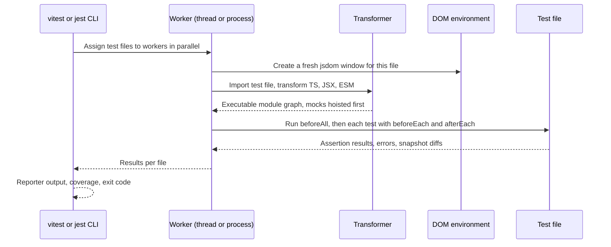

Each **test file** gets its own isolated module registry and environment by default, so files can run in parallel. Tests **within** a file run sequentially by default and share module state — that's where leaks between tests come from (Section 4).

---

### Section 3: Jest vs Vitest

Both are mature, widely used and API-compatible enough that most test **bodies** look the same. The difference is mostly in **configuration and module handling**.

| | **Jest** | **Vitest** |
|---|---|---|
| Origin | Created at Meta, now an OpenJS Foundation project | Created by the Vite team / community |
| Config | `jest.config.{js,ts}` — separate from your bundler | Reuses `vite.config.ts` (aliases, plugins, `define`) or `vitest.config.ts` |
| TypeScript / JSX | Needs a transformer (Babel, ts-jest, SWC) | Works out of the box via Vite |
| Native ESM | Supported, but still behind `--experimental-vm-modules`; ESM mocking uses `jest.unstable_mockModule` | Native ESM is the default |
| Mock API | `jest.fn`, `jest.mock`, `jest.spyOn` | `vi.fn`, `vi.mock`, `vi.spyOn` (+ `vi.hoisted`) |
| Watch mode | Based on changed files / git | Based on Vite's module graph — reruns affected tests |
| Real-browser runs | Not built in (use Playwright/Cypress component testing) | **Browser Mode** (Playwright or WebdriverIO provider) |
| Extras | Huge ecosystem, long history, React Native default | In-source tests, type tests (`expectTypeOf`), benchmark mode, UI |
| Sharding | `--shard=1/3` | `--shard=1/3` |

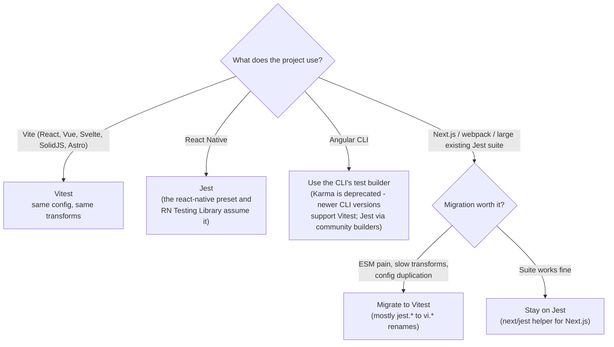

> **Don't pick on benchmarks you read online.** Speed depends on transforms, environment, isolation settings and your machine. Measure your own suite if speed is the deciding factor. Check the official docs for current version numbers and features — both projects ship majors regularly.

---

### Section 4: Anatomy of a Test

```typescript
import { describe, it, expect, beforeEach, vi } from 'vitest'; // Jest: globals, or import from '@jest/globals'

describe('formatPrice', () => {                     // group: the unit under test
  it('formats cents as a localized currency string', () => {
    // Arrange
    const cents = 199_900;
    // Act
    const result = formatPrice(cents, 'USD', 'en-US');
    // Assert
    expect(result).toBe('$1,999.00');
  });

  it.each([
    [0, '$0.00'],
    [5, '$0.05'],
  ])('formats %i cents as %s', (cents, expected) => {
    expect(formatPrice(cents, 'USD', 'en-US')).toBe(expected);
  });
});
```

> Many locales put a **non-breaking** space between number and currency (e.g. `de-DE` euros), and ICU data changes between runtime versions, so hard-coded strings with plain spaces can fail. Compare against the same `Intl.NumberFormat` call, normalize whitespace, or use a regex — see [Date, Number & Currency Formatting](./date-number-and-currency-formatting.md).

**The lifecycle hooks:**

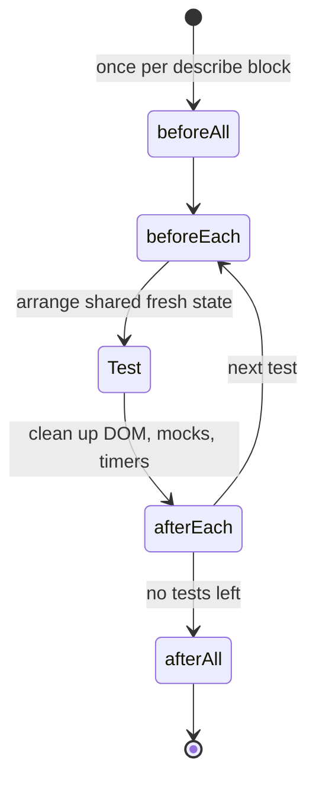

**Rules that keep a suite reliable:**

| Rule | Why |
|---|---|
| **One behavior per test**, named as a sentence | A failure message tells you what broke |
| **Arrange-Act-Assert** (or Given-When-Then) | Readable, consistent structure |
| **No shared mutable state** between tests | Order-dependent tests pass alone and fail in CI (or vice versa) |
| **Reset mocks** between tests (`clearMocks` / `mockReset` / `restoreMocks` in config) | A mock's queued return values or call counts leak into the next test. The exact semantics of each option differ between Jest and Vitest majors — check the config docs |
| **Clean up the DOM** after each test | RTL auto-cleans only when a global `afterEach` exists — Jest has one, Vitest only with `globals: true` (otherwise call `cleanup()` yourself) |
| **Deterministic inputs**: fixed dates, seeded IDs, mocked network | Flaky tests destroy trust in the suite |
| **Test the public contract** | Refactors shouldn't break tests unless behavior changed |

---

### Section 5: The DOM Environment — jsdom, happy-dom, Real Browser

Component tests need `document` and `window`. Node doesn't have them, so the runner installs a **simulated DOM**.

| | **jsdom** | **happy-dom** | **Real browser** (Vitest Browser Mode, Playwright/Cypress CT) |
|---|---|---|---|
| What it is | Pure-JS implementation of DOM + many web standards | Lighter pure-JS DOM implementation | Chromium / Firefox / WebKit |
| Layout (`getBoundingClientRect`, `offsetWidth`) | ❌ Always zeros | ❌ No real layout | ✅ Real |
| CSS cascade, media queries | Partial; `matchMedia` missing | Partial | ✅ Real |
| `IntersectionObserver`, `ResizeObserver`, `scrollIntoView` | ❌ Not implemented — mock them | Varies | ✅ |
| Canvas, WebGL | ❌ (without extra packages) | ❌ | ✅ |
| Focus, keyboard, pointer events | Simulated; mostly OK through user-event | Simulated | ✅ Real |
| Speed | Fast | Often faster than jsdom | Slower to start; still fine for focused suites |
| Fidelity | Good for most DOM logic | Some APIs less complete | Highest |

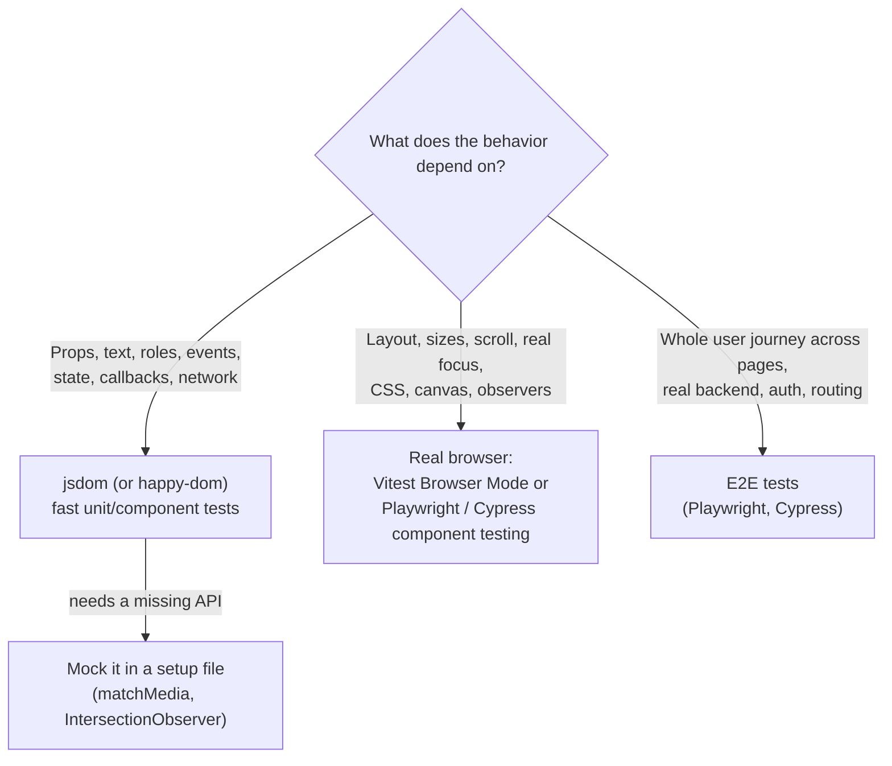

**Per-file environment:** you can keep the default environment as `node` for pure logic and switch only component files:

```typescript
// @vitest-environment jsdom        ← Vitest docblock
// @jest-environment jsdom          ← Jest docblock (at the top of the file)
```

---

### Section 6: Test Doubles — Stubs, Spies, Mocks, Fakes

"Mock" is used loosely. The precise terms help you choose the lightest tool:

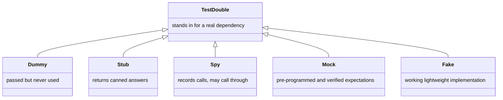

| Double | Vitest | Jest | Example |
|---|---|---|---|
| **Stub** | `vi.fn().mockReturnValue(42)` | `jest.fn().mockReturnValue(42)` | `getFlag` always returns `true` |
| **Spy** | `vi.spyOn(obj, 'method')` | `jest.spyOn(obj, 'method')` | Assert `console.error` was called, without replacing it |
| **Mock function** | `const onChange = vi.fn()` | `const onChange = jest.fn()` | `expect(onChange).toHaveBeenCalledWith(4)` |
| **Module mock** | `vi.mock('./api')` | `jest.mock('./api')` | Replace a whole module |
| **Fake** | In-memory repo, **MSW** handlers, fake timers | Same | MSW intercepts `fetch` with realistic responses |

**Where to put the seam — what to mock:**

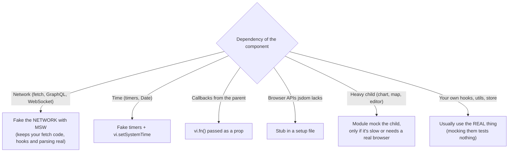

> **Mock at the boundary of your system, not inside it.** Mocking your own `useCart` hook to test `<CartBadge>` proves only that the badge renders whatever the mock says. Mocking the **network** keeps the hook, the cache and the component under test together. Network mocking in depth: [React Testing Library Patterns](./react-testing-library-patterns.md).

---

### Section 7: Module Mocking and Hoisting

`vi.mock()` and `jest.mock()` calls are **hoisted** to the top of the file — they run **before** the imports, so the module is replaced before anything imports it.

```typescript
import { describe, it, expect, vi } from 'vitest';
import { getUser } from './api';      // ← receives the mocked version
import { loadProfile } from './profile';

vi.mock('./api', () => ({ getUser: vi.fn() }));   // hoisted above the imports

it('loads the profile', async () => {
  vi.mocked(getUser).mockResolvedValue({ id: '1', name: 'Ada' });
  await expect(loadProfile('1')).resolves.toMatchObject({ name: 'Ada' });
});
```

**Hoisting gotcha:** because the factory runs before the rest of the file, it can't use variables declared in the file:

```typescript
// ❌ ReferenceError: the factory runs before `mockGetUser` is initialized
const mockGetUser = vi.fn();
vi.mock('./api', () => ({ getUser: mockGetUser }));

// ✅ Vitest: create it with vi.hoisted so it's hoisted too
const { mockGetUser } = vi.hoisted(() => ({ mockGetUser: vi.fn() }));
vi.mock('./api', () => ({ getUser: mockGetUser }));

// ✅ Jest (babel-jest): variables whose names start with `mock` may be referenced
//    (they still must be initialized before the factory is CALLED, i.e. lazily inside functions)
```

| Need | Vitest | Jest |
|---|---|---|
| Replace a module | `vi.mock(path, factory)` | `jest.mock(path, factory)` |
| Keep the rest of the real module | `vi.mock(path, async (importOriginal) => ({ ...(await importOriginal()), fn: vi.fn() }))` | `jest.mock(path, () => ({ ...jest.requireActual(path), fn: jest.fn() }))` |
| Mock one test only | `vi.doMock` + dynamic `import()` | `jest.doMock` + `require`/`import()` |
| Typed access | `vi.mocked(fn)` | `jest.mocked(fn)` |
| ESM-native mocking | Default | `jest.unstable_mockModule` + `await import()` |
| Reset between tests | `vi.resetAllMocks()` / config options | `jest.resetAllMocks()` / config options |

---

### Section 8: Async Code and Fake Timers

Components are async: effects run after render, data loads, debounced inputs wait. Two tools handle this:

1. **Await the UI** — Testing Library's `findBy…` queries and `waitFor` retry until the DOM matches (details in the next note).
2. **Control time** — fake timers make `setTimeout`, `setInterval` and `Date` deterministic.

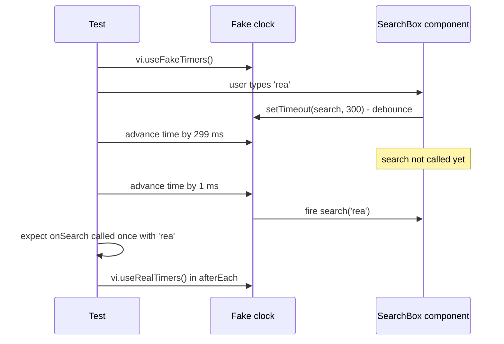

```typescript
import { render, screen } from '@testing-library/react';
import userEvent from '@testing-library/user-event';
import { afterEach, beforeEach, expect, it, vi } from 'vitest';
import { SearchBox } from './SearchBox';

beforeEach(() => vi.useFakeTimers());
afterEach(() => vi.useRealTimers());

it('debounces search by 300 ms', async () => {
  const onSearch = vi.fn();
  // Tell user-event how to move the fake clock, or its internal delays hang
  const user = userEvent.setup({ advanceTimers: vi.advanceTimersByTime });
  render(<SearchBox onSearch={onSearch} />);

  await user.type(screen.getByRole('searchbox', { name: /search/i }), 'rea');
  await vi.advanceTimersByTimeAsync(299);
  expect(onSearch).not.toHaveBeenCalled();

  await vi.advanceTimersByTimeAsync(1);
  expect(onSearch).toHaveBeenCalledTimes(1);
  expect(onSearch).toHaveBeenCalledWith('rea');
});
```

| Fake-timer API (Vitest / Jest) | Use |
|---|---|
| `vi.useFakeTimers()` / `jest.useFakeTimers()` | Replace timers and `Date` |
| `vi.advanceTimersByTime(ms)` / `jest.advanceTimersByTime(ms)` | Move the clock forward |
| `vi.advanceTimersByTimeAsync(ms)` / `jest.advanceTimersByTimeAsync(ms)` | Same, but flushes promises between timers — use when timers and promises interleave |
| `vi.runAllTimers()` / `jest.runAllTimers()` | Run everything queued (infinite loops with `setInterval`!) |
| `vi.setSystemTime(date)` / `jest.setSystemTime(date)` | Freeze "now" for date logic |
| `vi.useRealTimers()` / `jest.useRealTimers()` | Restore — always in `afterEach` |

> **`act()` warnings** in React mean a state update happened outside of what the test awaited. Testing Library wraps `render`, user-event and `waitFor` in `act` for you; the fix is usually to **await the resulting UI** (`await screen.findBy…`), not to sprinkle `act` manually. When you do need it, import `act` from `react` — `react-dom/test-utils` `act` is deprecated.

---

### Section 9: Testing Hooks, Context and Providers

**Hooks** can be tested directly with `renderHook`, which renders a tiny test component that calls the hook:

```typescript
import { renderHook, act } from '@testing-library/react';
import { expect, it } from 'vitest';
import { useCounter } from './useCounter';

it('increments and respects the max', () => {
  const { result } = renderHook(() => useCounter({ initial: 9, max: 10 }));
  act(() => result.current.increment());
  act(() => result.current.increment());
  expect(result.current.count).toBe(10);
});
```

`renderHook` lives in `@testing-library/react` (the old standalone `@testing-library/react-hooks` package is deprecated). Prefer testing a hook **through a component** when the hook's value is only meaningful in the UI; use `renderHook` for reusable hooks with a clear API — see [Custom Hooks Patterns](./custom-hooks-patterns.md).

**Providers:** components that read context (router, theme, i18n, query client, store) need those providers in tests. Build **one** helper and use it everywhere:

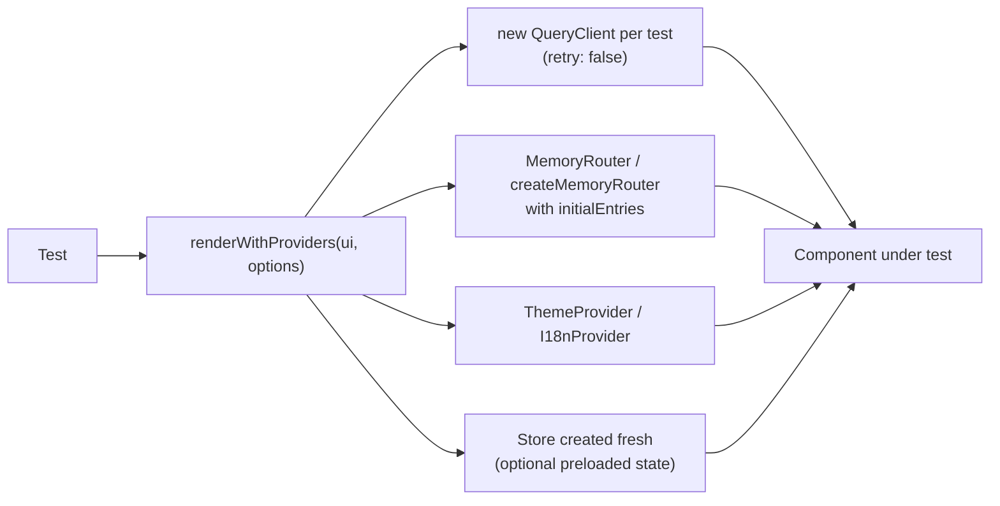

**Create every stateful provider fresh per test.** A module-level `QueryClient` or store shares cached data between tests — the second test sees the first test's data and passes or fails depending on order. Full helper: Example 4.

---

### Section 10: Snapshot Testing — Use Sparingly

`expect(value).toMatchSnapshot()` saves a serialized value to a file the first time, and fails when it later differs.

| Good uses | Poor uses |
|---|---|
| Small, stable serialized output: an error message, a generated config, a CLI's help text | Whole component trees (`render(<Page />)` → hundreds of lines) |
| `toMatchInlineSnapshot()` for short values reviewers can read in the test | Anything with dates, random IDs, or class names from CSS-in-JS |
| Guarding a data transformation where the exact output matters | "We have no assertions, so snapshot everything" |

Large DOM snapshots fail on every harmless markup change, so people run `-u` (update) **without reading the diff** — at that point they test nothing. Prefer explicit assertions on what the user sees (`toHaveTextContent`, `toBeDisabled`, `toHaveAccessibleName`). For **visual** regressions use screenshot tools ([Visual Regression Testing](./visual-regression-testing.md)), not DOM snapshots.

---

### Section 11: Coverage and Test Quality

```bash
vitest run --coverage        # needs @vitest/coverage-v8 (default) or @vitest/coverage-istanbul
jest --coverage              # istanbul via Babel by default; coverageProvider: 'v8' to switch
```

| Metric | Measures | Trap |
|---|---|---|
| **Line / statement** | Which lines executed | Executed ≠ asserted |
| **Branch** | Which `if`/`?:`/`&&` paths ran | More useful than lines for UI logic |
| **Function** | Which functions were called | Says nothing about correctness |
| **Mutation score** (Stryker) | Whether tests **fail** when code is deliberately broken | Slow — run on critical modules or nightly |

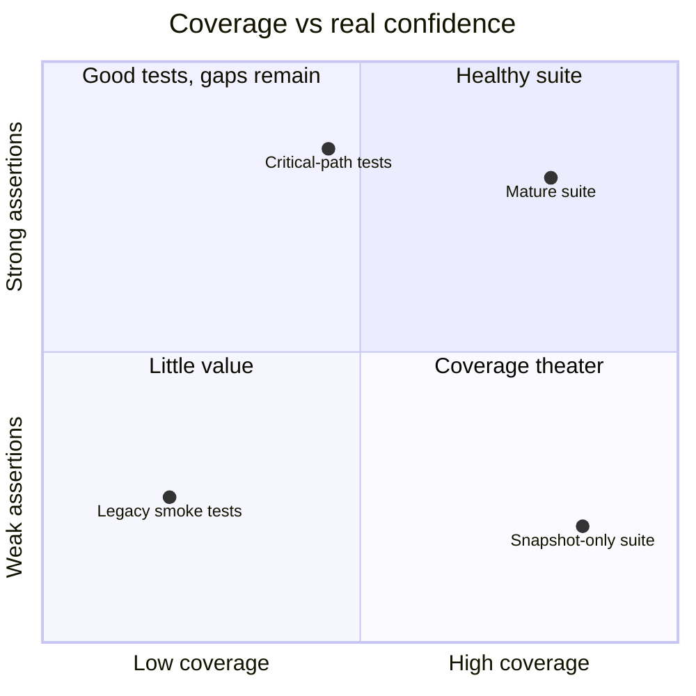

**Practical policy:** set **thresholds** to stop coverage from *dropping* (e.g. per-folder thresholds on domain logic), review **uncovered branches** in PRs, and don't chase 100% on glue code. A test with no meaningful `expect` still counts as coverage — mutation testing is the honest check.

---

### Section 12: Vue, Angular, Svelte and React Native

The runner concepts (describe/it, mocks, fake timers, jsdom) are identical; the **mounting API** differs per framework.

| Stack | Runner (typical) | Mount API | Notes |
|---|---|---|---|
| **React** | Vitest or Jest | `render` from `@testing-library/react` | `renderHook` for hooks |
| **Vue 3** | Vitest | `mount` / `shallowMount` from `@vue/test-utils`, or `@testing-library/vue` | `await wrapper.trigger('click')` and `await nextTick()` for DOM updates; `global.plugins` for Pinia/router |
| **Angular** | The Angular CLI's test builder | `TestBed.configureTestingModule` + `TestBed.createComponent`, or `@testing-library/angular` | Karma is deprecated; recent CLI versions support Vitest (check angular.dev for the current default). `fixture.detectChanges()` / `await fixture.whenStable()` drive change detection |
| **Svelte 5** | Vitest | `render` from `@testing-library/svelte` (or Svelte's `mount` + `flushSync`) | Configure Vitest to resolve Svelte's **browser** build (the Testing Library Vite plugin does this) |
| **SolidJS** | Vitest | `render` from `@solidjs/testing-library` | Uses the Solid Vite plugin |
| **React Native** | Jest with the `react-native` preset | `render` from `@testing-library/react-native` | Native modules must be mocked; no DOM — queries target the RN host tree |
| **Next.js (App Router)** | Vitest or Jest (`next/jest`) | RTL for **client** components | **Async Server Components** aren't supported by these runners' rendering — test their logic as functions and cover them with E2E |

---

## System Design Angle — Choosing and Scaling the Setup

| Decision | Recommendation | Why |
|---|---|---|
| **Runner** | Vitest for Vite-based apps; Jest for React Native and suites already happy on Jest; the CLI's builder for Angular | One transform pipeline for app and tests; ecosystem defaults |
| **Environment** | `node` by default, `jsdom` for component files (or per project); real browser for layout-dependent components | Fast logic tests, browser fidelity where it matters |
| **File layout** | Colocate: `Button.tsx` + `Button.test.tsx` | Tests move and get deleted with the code |
| **Mocking boundary** | Network via MSW; time via fake timers; real hooks/stores | Tests survive refactors |
| **Providers** | One `renderWithProviders` helper, fresh state per test | No cross-test leaks |
| **Reset policy** | `clearMocks` + `restoreMocks` (or `mockReset`) in config | No manual cleanup to forget |
| **Snapshots** | Inline, small, reviewed; no full-page DOM snapshots | Avoid rubber-stamp `-u` |
| **Coverage** | Thresholds that prevent drops; branch coverage on domain logic | Signal without theater |
| **CI** | `--shard` across machines, run only affected tests on PRs in monorepos (Nx/Turborepo), full run on main | Feedback time stays flat as the suite grows |
| **Flakiness** | Quarantine label + owner + deadline; never auto-retry silently forever | Trust in the suite is the asset |
| **Testability in API design** | Accessible roles/labels, injectable dependencies (props, context), pure logic in functions/hooks | Components that are easy to test are usually easier to use |

```mermaid
gantt
    title Feedback loop by test layer (relative, not measured)
    dateFormat X
    axisFormat %s
    section On save
    Unit and component tests in watch mode : 0, 2
    section On PR
    Full unit plus component suite sharded : 2, 6
    Integration with MSW : 2, 7
    section Before merge or deploy
    E2E smoke suite : 7, 15
```

---

## Real-World Examples

**Example 1 — Vitest config for a React + TypeScript app:**
```typescript
// vitest.config.ts
import { defineConfig } from 'vitest/config';
import react from '@vitejs/plugin-react';

export default defineConfig({
  plugins: [react()],
  test: {
    environment: 'jsdom',              // npm i -D jsdom
    globals: true,                     // describe/it/expect without imports + RTL auto-cleanup
    setupFiles: ['./src/test/setup.ts'],
    clearMocks: true,                  // clear call history of every mock after each test
    restoreMocks: true,                // restore vi.spyOn spies to the original implementation
    css: false,                        // don't process CSS in unit tests
    coverage: {
      provider: 'v8',
      include: ['src/**/*.{ts,tsx}'],
      exclude: ['src/**/*.stories.tsx', 'src/test/**'],
      thresholds: { lines: 80, branches: 75 },
    },
  },
});
```

For `globals: true` with TypeScript, add `"types": ["vitest/globals"]` to `tsconfig.json`.

**Example 2 — The setup file: matchers and missing browser APIs:**
```typescript
// src/test/setup.ts
import '@testing-library/jest-dom/vitest';   // Jest: import '@testing-library/jest-dom'
import { vi } from 'vitest';

// jsdom has no matchMedia
Object.defineProperty(window, 'matchMedia', {
  writable: true,
  value: vi.fn().mockImplementation((query: string) => ({
    matches: false,
    media: query,
    onchange: null,
    addEventListener: vi.fn(),
    removeEventListener: vi.fn(),
    addListener: vi.fn(),        // legacy API some libraries still call
    removeListener: vi.fn(),
    dispatchEvent: vi.fn(),
  })),
});

// jsdom has no IntersectionObserver / ResizeObserver
class NoopObserver {
  observe() {}
  unobserve() {}
  disconnect() {}
  takeRecords() { return []; }
}
vi.stubGlobal('IntersectionObserver', NoopObserver);
vi.stubGlobal('ResizeObserver', NoopObserver);

// jsdom doesn't implement scrollIntoView
Element.prototype.scrollIntoView = vi.fn();
```

> `restoreMocks` doesn't undo `vi.stubGlobal`; that's fine here because these stubs are meant to last for the whole run. Use `vi.unstubAllGlobals()` for per-test stubs.

**Example 3 — The same setup in Jest:**
```javascript
// jest.config.js
/** @type {import('jest').Config} */
module.exports = {
  testEnvironment: 'jsdom',                        // npm i -D jest-environment-jsdom
  setupFilesAfterEnv: ['<rootDir>/src/test/setup.ts'],
  transform: { '^.+\\.(t|j)sx?$': '@swc/jest' },   // or babel-jest / ts-jest
  moduleNameMapper: {
    '\\.(css|scss)$': 'identity-obj-proxy',        // CSS Modules return their class names
    '^@/(.*)$': '<rootDir>/src/$1',                // mirror your tsconfig/bundler aliases
  },
  clearMocks: true,
  restoreMocks: true,
  coverageProvider: 'v8',
};
```

In Jest, the setup file uses `jest.fn()` instead of `vi.fn()`, and `Object.defineProperty(window, 'IntersectionObserver', …)` instead of `vi.stubGlobal`. For Next.js, wrap the config with `next/jest`, which configures SWC transforms, CSS/image mocks and `.env` loading.

**Example 4 — A component and its tests (BAD → GOOD):**
```tsx
// Rating.tsx
type RatingProps = { value: number; max?: number; onChange: (value: number) => void; label: string };

export function Rating({ value, max = 5, onChange, label }: RatingProps) {
  return (
    <fieldset>
      <legend>{label}</legend>
      {Array.from({ length: max }, (_, i) => i + 1).map((n) => (
        <button
          key={n}
          type="button"
          aria-pressed={n <= value}
          aria-label={`${n} star${n > 1 ? 's' : ''}`}
          onClick={() => onChange(n)}
        >
          {n <= value ? '★' : '☆'}
        </button>
      ))}
    </fieldset>
  );
}
```

```tsx
// Rating.test.tsx
import { render, screen } from '@testing-library/react';
import userEvent from '@testing-library/user-event';
import { expect, it, vi } from 'vitest';
import { Rating } from './Rating';

// ❌ BAD: implementation details — breaks if markup or classes change, proves little
it('renders 5 buttons with the right class', () => {
  const { container } = render(<Rating value={3} onChange={() => {}} label="Quality" />);
  expect(container.querySelectorAll('button')).toHaveLength(5);
  expect(container.innerHTML).toContain('★★★☆☆');
});

// ✅ GOOD: observable behavior through accessible roles and the callback contract
it('shows the current rating as pressed stars', () => {
  render(<Rating value={3} onChange={vi.fn()} label="Quality" />);
  expect(screen.getByRole('button', { name: '3 stars' })).toHaveAttribute('aria-pressed', 'true');
  expect(screen.getByRole('button', { name: '4 stars' })).toHaveAttribute('aria-pressed', 'false');
});

it('calls onChange with the chosen value', async () => {
  const user = userEvent.setup();
  const onChange = vi.fn();
  render(<Rating value={1} onChange={onChange} label="Quality" />);

  await user.click(screen.getByRole('button', { name: '4 stars' }));

  expect(onChange).toHaveBeenCalledTimes(1);
  expect(onChange).toHaveBeenCalledWith(4);
});
```

**Example 5 — `renderWithProviders` helper:**
```tsx
// src/test/render.tsx
import { render, type RenderOptions } from '@testing-library/react';
import { QueryClient, QueryClientProvider } from '@tanstack/react-query';
import { MemoryRouter } from 'react-router';
import type { ReactElement, ReactNode } from 'react';

type Options = Omit<RenderOptions, 'wrapper'> & { route?: string };

export function renderWithProviders(ui: ReactElement, { route = '/', ...options }: Options = {}) {
  const queryClient = new QueryClient({
    defaultOptions: { queries: { retry: false } }, // no retries → fast, clear failures
  });
  function Wrapper({ children }: { children: ReactNode }) {
    return (
      <QueryClientProvider client={queryClient}>
        <MemoryRouter initialEntries={[route]}>{children}</MemoryRouter>
      </QueryClientProvider>
    );
  }
  return { queryClient, ...render(ui, { wrapper: Wrapper, ...options }) };
}
```

**Example 6 — Mocking a module vs faking the network:**
```typescript
// ❌ BAD: mocking your own data hook — the test can't catch bugs in the hook, cache or parsing
vi.mock('./useUser', () => ({ useUser: () => ({ data: { name: 'Ada' }, isLoading: false }) }));

// ✅ GOOD: fake the network; the real hook, query cache and component run together
import { http, HttpResponse } from 'msw';
import { setupServer } from 'msw/node';

const server = setupServer(
  http.get('/api/users/:id', ({ params }) => HttpResponse.json({ id: params.id, name: 'Ada' })),
);
beforeAll(() => server.listen({ onUnhandledRequest: 'error' }));
afterEach(() => server.resetHandlers());
afterAll(() => server.close());

it('shows the user name', async () => {
  renderWithProviders(<UserCard id="42" />);
  expect(await screen.findByRole('heading', { name: 'Ada' })).toBeInTheDocument();
});

// ✅ ALSO GOOD: module-mock a heavy third-party child that jsdom can't render
vi.mock('./RevenueChart', () => ({ RevenueChart: () => <div data-testid="chart" /> }));
```

**Example 7 — Vue, Angular and Svelte equivalents of the Rating test:**
```typescript
// Vue 3 — Rating.spec.ts (Vitest + @vue/test-utils)
import { expect, it } from 'vitest';
import { mount } from '@vue/test-utils';
import Rating from './Rating.vue';

it('emits update:modelValue with the chosen value', async () => {
  const wrapper = mount(Rating, { props: { modelValue: 1, label: 'Quality' } });
  await wrapper.get('button[aria-label="4 stars"]').trigger('click');
  expect(wrapper.emitted('update:modelValue')?.[0]).toEqual([4]);
});
```

```typescript
// Angular — rating.component.spec.ts (TestBed, standalone component)
import { TestBed } from '@angular/core/testing';
import { RatingComponent } from './rating.component';

it('emits the chosen value', async () => {
  await TestBed.configureTestingModule({ imports: [RatingComponent] }).compileComponents();
  const fixture = TestBed.createComponent(RatingComponent);
  fixture.componentRef.setInput('value', 1);
  fixture.componentRef.setInput('label', 'Quality');
  fixture.detectChanges();

  const emitted: number[] = [];
  fixture.componentInstance.valueChange.subscribe((v: number) => emitted.push(v));
  (fixture.nativeElement as HTMLElement)
    .querySelector<HTMLButtonElement>('button[aria-label="4 stars"]')!
    .click();

  expect(emitted).toEqual([4]);
});
```

```typescript
// Svelte 5 — Rating.test.ts (Vitest + @testing-library/svelte)
import { expect, it, vi } from 'vitest';
import { render, screen } from '@testing-library/svelte';
import userEvent from '@testing-library/user-event';
import Rating from './Rating.svelte';

it('calls onchange with the chosen value', async () => {
  const onchange = vi.fn();
  render(Rating, { props: { value: 1, label: 'Quality', onchange } });
  await userEvent.click(screen.getByRole('button', { name: '4 stars' }));
  expect(onchange).toHaveBeenCalledWith(4);
});
```

**Example 8 — Migrating a Jest test file to Vitest:**
```typescript
// Most changes are mechanical:
// jest.fn()              → vi.fn()
// jest.mock(p, f)        → vi.mock(p, f)          (factory may be async; use vi.hoisted for shared vars)
// jest.requireActual(p)  → await vi.importActual(p)  or the importOriginal factory argument
// jest.useFakeTimers()   → vi.useFakeTimers()
// jest.spyOn(o, 'm')     → vi.spyOn(o, 'm')
// @jest-environment      → @vitest-environment
// testEnvironment        → test.environment
// setupFilesAfterEnv     → test.setupFiles
// moduleNameMapper       → resolve.alias (shared with the app's Vite config)
```

---

## Key Points Summary

| Concept | One-Line Explanation |
|---|---|
| **Unit test** | One function, hook or component, isolated, fast, asserting observable behavior |
| **Test runner** | Finds and runs tests in parallel workers (Jest, Vitest) |
| **Jest vs Vitest** | Similar test APIs; Vitest reuses Vite config and native ESM, Jest needs its own transforms |
| **jsdom / happy-dom** | Simulated DOM in Node: no layout, missing APIs — mock or use a real browser |
| **Browser Mode** | Vitest running component tests in real browsers for layout/focus fidelity |
| **AAA** | Arrange, Act, Assert — one behavior per test |
| **Test doubles** | Stub (canned answers), spy (records calls), mock (verified), fake (working substitute) |
| **Mock boundary** | Fake the network (MSW) and time; keep your own code real |
| **Hoisting** | `vi.mock`/`jest.mock` run before imports; use `vi.hoisted` for shared variables |
| **Fake timers** | Deterministic `setTimeout`/`Date`; tell user-event via `advanceTimers` |
| **`renderHook`** | Test a hook through a tiny component; from `@testing-library/react` |
| **Fresh providers** | New QueryClient/store/router per test, or tests leak state |
| **Snapshots** | Small and inline only; big DOM snapshots get rubber-stamped |
| **Coverage** | Shows what ran, not what was checked; use thresholds and branch coverage |
| **Server Components** | Async RSC aren't renderable in Jest/Vitest — test logic + E2E |

---

## Test Your Understanding

**Q1 (Basic):**
What's the difference between a test **runner**, a **DOM environment** and a **rendering library**? Name one of each for a React project.

<details>
<summary>Answer</summary>

- The **runner** finds test files, runs them (in parallel workers), provides `describe/it/expect`, mocks, timers, watch mode and reporting — **Vitest** or **Jest**.
- The **DOM environment** gives Node a `window` and `document` so components can render — **jsdom** (or happy-dom, or a real browser through Vitest Browser Mode).
- The **rendering library** mounts the component into that DOM and gives you queries — **`@testing-library/react`** (plus `@testing-library/user-event` for interactions).

They're separate layers, which is why you can swap jsdom for happy-dom, or Jest for Vitest, while keeping most of the test code unchanged.
</details>

**Q2 (Application):**
A test for a debounced search input times out after you add `vi.useFakeTimers()`. The test uses `userEvent.setup()` and `await user.type(...)`. Why, and how do you fix it?

<details>
<summary>Answer</summary>

`user-event` adds small delays between simulated keystrokes using `setTimeout` (the `delay` option, 0 ms by default but still a timer). With fake timers installed, those timers **never fire on their own**, so `await user.type()` waits forever and the test times out.

Fix: tell user-event how to advance the fake clock — `userEvent.setup({ advanceTimers: vi.advanceTimersByTime })` (Jest: `jest.advanceTimersByTime`) — or set `delay: null`. Then move time explicitly with `vi.advanceTimersByTimeAsync(300)` to trigger the debounce, and restore real timers in `afterEach`.
</details>

**Q3 (Tricky):**
After switching from Jest to Vitest, tests pass individually but fail when run together: queries find **two** matching buttons. Nothing else changed. What happened?

<details>
<summary>Answer</summary>

**Missing cleanup.** React Testing Library unmounts rendered trees after each test automatically by registering an `afterEach` hook — but only if a **global** `afterEach` exists. Jest provides globals by default; Vitest does **not** unless `globals: true` is set. Without it, every test's render stays in `document.body`, so the second test sees the first test's button too.

Fix: set `test.globals: true` in the Vitest config (and add `vitest/globals` types), or call `cleanup()` from `@testing-library/react` in an `afterEach` inside your setup file.
</details>

**Q4 (Tricky):**
This test throws `ReferenceError: Cannot access 'mockFetchUser' before initialization`. Why, and what are two fixes?

```typescript
import { vi } from 'vitest';
import { Profile } from './Profile';
const mockFetchUser = vi.fn();
vi.mock('./api', () => ({ fetchUser: mockFetchUser }));
```

<details>
<summary>Answer</summary>

`vi.mock` is **hoisted** above all imports and declarations so the module is replaced before `./Profile` imports `./api`. Importing `./Profile` evaluates `./api`'s mock factory, which references `mockFetchUser` — but that `const` hasn't been initialized yet (temporal dead zone).

Fixes:
1. Declare the mock with **`vi.hoisted`** so it's hoisted too: `const { mockFetchUser } = vi.hoisted(() => ({ mockFetchUser: vi.fn() }));`
2. Create the mock **inside** the factory (`vi.mock('./api', () => ({ fetchUser: vi.fn() }))`), then get a typed handle in the test with `vi.mocked(fetchUser)` after importing it from `./api`.
</details>

**Q5 (Application):**
A `<StickyHeader>` component should add a shadow once the page has scrolled more than its own height, measured with `getBoundingClientRect()` and an `IntersectionObserver`. How would you test it?

<details>
<summary>Answer</summary>

This behavior depends on **layout and a browser observer** — jsdom returns zero sizes and doesn't implement `IntersectionObserver`, so a jsdom test would either test your mocks or nothing. Options:
- Extract the **decision logic** into a pure function or hook (`shouldShowShadow(scrollY, headerHeight)`) and unit-test that in Node.
- Test the integrated component in a **real browser**: Vitest Browser Mode, or Playwright/Cypress component testing, scrolling the page and asserting the class/style.
- In jsdom, keep only a light test that the observer is **created and disconnected on unmount** (with a stubbed `IntersectionObserver`), if that cleanup matters.

The general rule: test logic in Node, test layout in a browser.
</details>

**Q6 (System design):**
Your monorepo has 12 apps (React + Vite, one Next.js app, one Angular app, one React Native app) and the unit/component suite takes 25 minutes in CI. Propose a testing setup.

<details>
<summary>Answer</summary>

- **Runner per stack:** Vitest for the Vite apps and shared packages (shared Vite config, native ESM); Next.js on Vitest or `next/jest`; Angular on its CLI test builder; React Native on Jest + RN Testing Library. Keep test **bodies** in a common style so moving between runners is cheap.
- **Shared test utilities package:** `renderWithProviders`, MSW handlers built from the API contract, setup files with the standard jsdom polyfills, and lint rules (testing-library and vitest/jest ESLint plugins).
- **Environment split:** pure logic in `node`; component tests in `jsdom`; a small Browser Mode project for layout-sensitive components.
- **Speed:** run only **affected** projects on PRs (Nx/Turborepo dependency graph), `--shard` the remaining work across CI machines, cache install and transform caches, and avoid huge snapshots and real timers. Profile the slowest files first.
- **Reliability:** mock reset options in config, fresh providers per test, `onUnhandledRequest: 'error'` in MSW, fake time for anything time-based, a quarantine process with owners for flaky tests.
- **Quality signals:** branch-coverage thresholds that prevent drops in domain packages, periodic mutation testing on critical modules, and E2E smoke tests for what unit tests can't see (routing, auth, Server Components).
</details>

---

## Cheat Sheet

**Key Definitions:**
- **Test runner:** Executes tests, provides `describe/it/expect`, mocks, watch mode (Jest, Vitest)
- **jsdom / happy-dom:** JavaScript DOM implementations for Node — no layout
- **Browser Mode:** Vitest running tests inside real browsers via Playwright/WebdriverIO
- **Stub / Spy / Mock / Fake:** Canned answers / call recorder / verified expectations / working substitute
- **Hoisting:** `vi.mock`/`jest.mock` move above imports so the mock exists first
- **Fake timers:** Controlled clock for `setTimeout`, `setInterval`, `Date`
- **`renderHook`:** Renders a hook inside a test component and exposes `result.current`
- **Coverage provider:** v8 (native) or istanbul (instrumented) coverage collection

**Quick Reference:**
```text
Run                vitest | vitest run | vitest --coverage | vitest --shard=1/3
                   jest   | jest --watch | jest --coverage | jest --shard=1/3
Environment        test.environment: 'jsdom'  ·  Jest: testEnvironment: 'jsdom' (+ jest-environment-jsdom)
Per file           // @vitest-environment jsdom   ·   // @jest-environment jsdom
Matchers           import '@testing-library/jest-dom/vitest'  (Jest: '@testing-library/jest-dom')
Cleanup            Vitest: globals: true  or  afterEach(cleanup)
Mock fn            vi.fn() / jest.fn()  →  toHaveBeenCalledWith(...)
Spy                vi.spyOn(obj, 'm') / jest.spyOn(obj, 'm')
Module             vi.mock('./x', factory)  ·  shared vars: vi.hoisted(() => ...)
Partial module     vi.mock(p, async (orig) => ({ ...(await orig()), fn: vi.fn() }))
Timers             vi.useFakeTimers() → advanceTimersByTimeAsync(ms) → useRealTimers() in afterEach
user-event+timers  userEvent.setup({ advanceTimers: vi.advanceTimersByTime })
Reset              clearMocks + restoreMocks in config (semantics vary by runner/version)
Hooks              renderHook(() => useX(), { wrapper })  from '@testing-library/react'
Network            MSW setupServer(...) with onUnhandledRequest: 'error'
Layout/observers   real browser (Browser Mode / Playwright CT), not jsdom
```

**Common Mistakes to Avoid:**

| Mistake | Why Wrong | Fix |
|---|---|---|
| Asserting on internal state, class names, render counts | Breaks on refactors; doesn't prove behavior | Assert on roles, text, callbacks |
| Vitest without `globals` and no `cleanup` | DOM leaks between tests | `globals: true` or `afterEach(cleanup)` |
| Mocks not reset between tests | Order-dependent failures | `clearMocks` + `restoreMocks` in config |
| Module-level `QueryClient` / store in tests | Cached data leaks across tests | Create fresh per test in the render helper |
| Mocking your own hooks/stores | Tests the mock, not the code | Mock the network (MSW) instead |
| Fake timers + user-event without `advanceTimers` | Tests hang and time out | `userEvent.setup({ advanceTimers })` |
| Forgetting `useRealTimers()` | Later tests run with a frozen clock | Restore in `afterEach` |
| Testing layout in jsdom | Every size is 0 — test proves nothing | Real browser or extract logic |
| Big DOM snapshots | Rubber-stamped `-u` updates | Small inline snapshots or explicit assertions |
| Chasing 100% coverage | Assertion-free tests inflate numbers | Branch thresholds, mutation testing on critical code |
| Real network or real dates in tests | Flaky, slow, time-zone dependent | MSW, `vi.setSystemTime`, fixed TZ in CI |
| Rendering async Server Components in Jest/Vitest | Not supported by these renderers | Test logic as functions; E2E for the page |

---

## References & Further Reading

**Core docs**
- Vitest: [Getting Started](https://vitest.dev/guide/) · [Mocking](https://vitest.dev/guide/mocking) · [`vi` API](https://vitest.dev/api/vi) · [Test Environment](https://vitest.dev/guide/environment) · [Coverage](https://vitest.dev/guide/coverage) · [Browser Mode](https://vitest.dev/guide/browser/)
- Vitest: [Migrating from Jest](https://vitest.dev/guide/migration)
- Jest: [Getting Started](https://jestjs.io/docs/getting-started) · [Configuring Jest](https://jestjs.io/docs/configuration) · [Mock Functions](https://jestjs.io/docs/mock-function-api) · [Timer Mocks](https://jestjs.io/docs/timer-mocks) · [ECMAScript Modules](https://jestjs.io/docs/ecmascript-modules)
- Testing Library: [React Testing Library](https://testing-library.com/docs/react-testing-library/intro/) · [`renderHook`](https://testing-library.com/docs/react-testing-library/api#renderhook) · [user-event options (`advanceTimers`)](https://testing-library.com/docs/user-event/options#advancetimers)
- testing-library/jest-dom: [Custom matchers](https://github.com/testing-library/jest-dom)
- MSW: [Documentation](https://mswjs.io/docs/)

**Framework guides**
- React: [`act`](https://react.dev/reference/react/act)
- Next.js: [Testing with Vitest](https://nextjs.org/docs/app/guides/testing/vitest) · [Testing with Jest](https://nextjs.org/docs/app/guides/testing/jest)
- Vue: [Testing guide](https://vuejs.org/guide/scaling-up/testing) · [Vue Test Utils](https://test-utils.vuejs.org/)
- Angular: [Testing](https://angular.dev/guide/testing)
- Svelte: [Testing](https://svelte.dev/docs/svelte/testing)
- React Native: [Testing overview](https://reactnative.dev/docs/testing-overview) · [React Native Testing Library](https://callstack.github.io/react-native-testing-library/)

**Deep dives**
- Kent C. Dodds: [Testing Implementation Details](https://kentcdodds.com/blog/testing-implementation-details)
- Kent C. Dodds: [Common mistakes with React Testing Library](https://kentcdodds.com/blog/common-mistakes-with-react-testing-library)
- Martin Fowler: [Mocks Aren't Stubs](https://martinfowler.com/articles/mocksArentStubs.html)
- Stryker Mutator: [Introduction to mutation testing](https://stryker-mutator.io/docs/)
- jsdom: [Project README (implemented and unimplemented features)](https://github.com/jsdom/jsdom)

---

> **Previous Topic:** [Dependency Vulnerability Scanning](./dependency-vulnerability-scanning.md)
> — Finding and fixing known-vulnerable and malicious packages in your supply chain

> **Next Topic:** [React Testing Library Patterns](./react-testing-library-patterns.md)
> — Queries, user events, async UI and providers: testing components the way users use them

*Saved on: 2026-11-06 | Repo: Frontend System Design Learning Notes*
