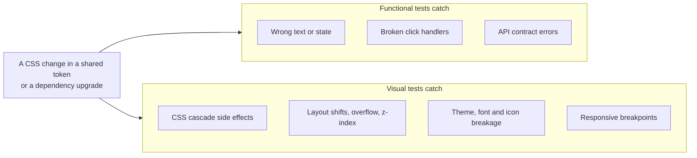
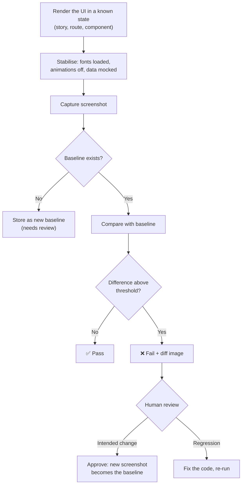
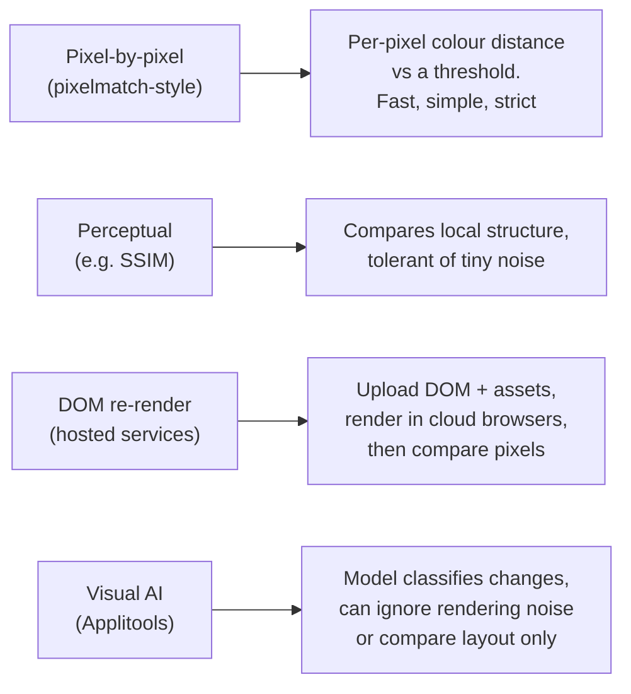
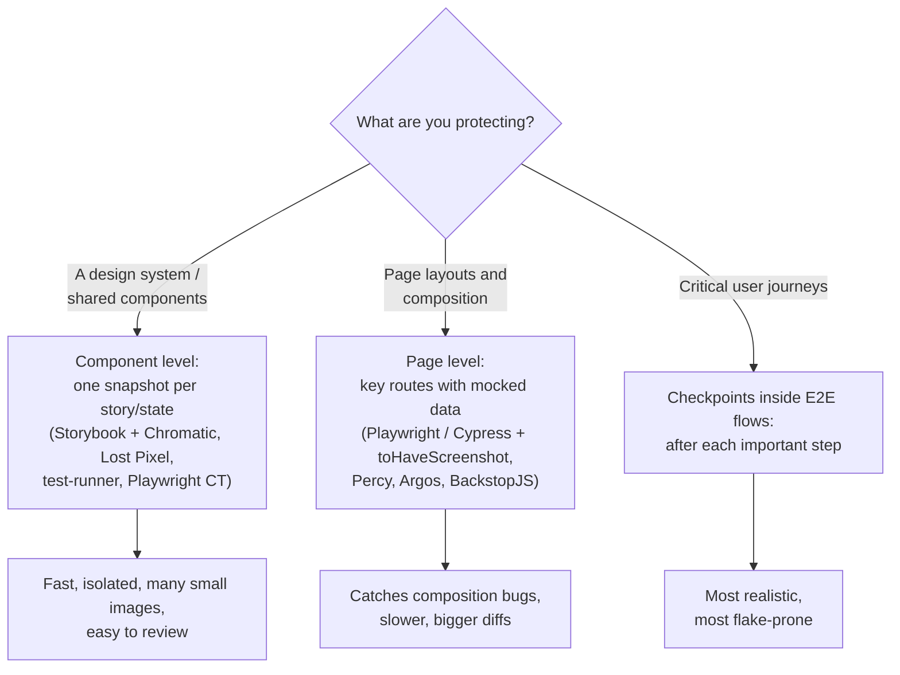
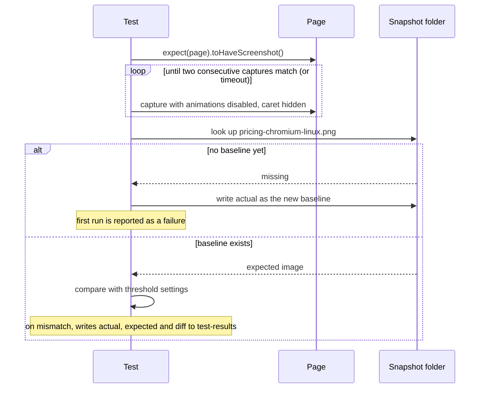
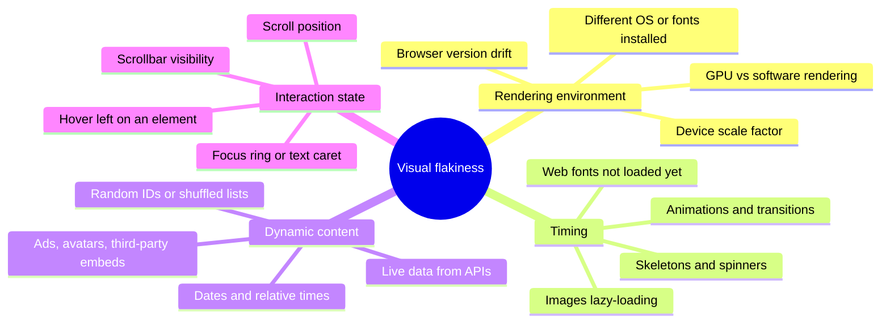
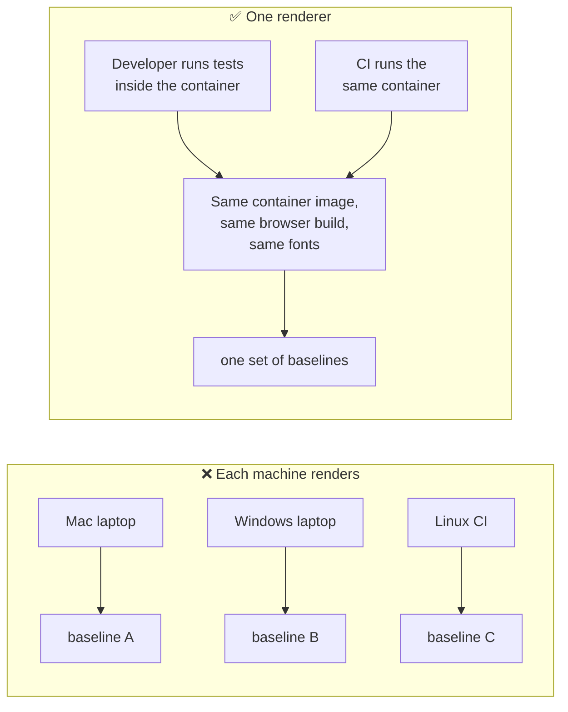
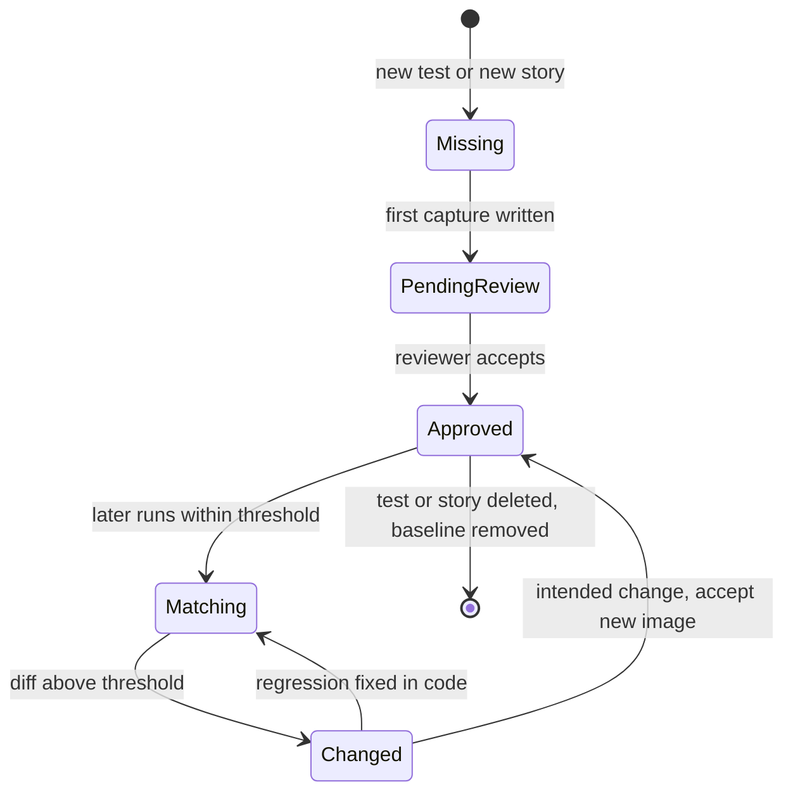
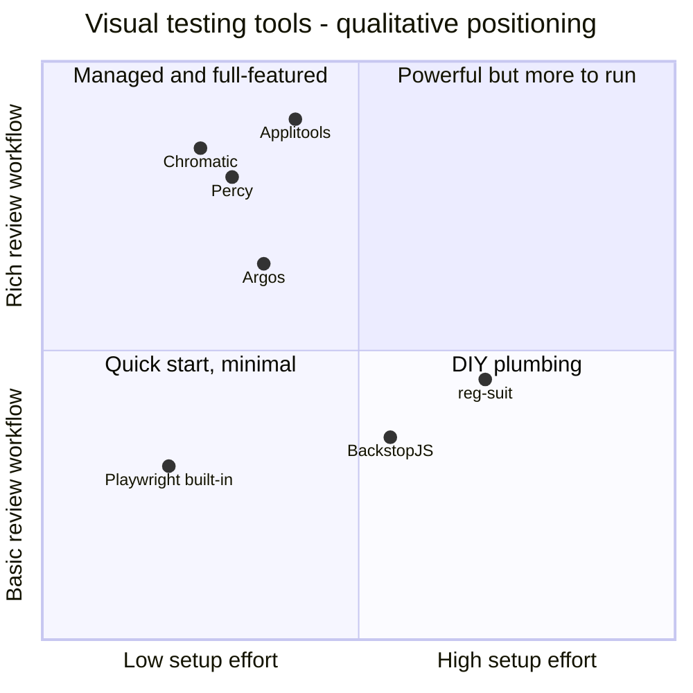
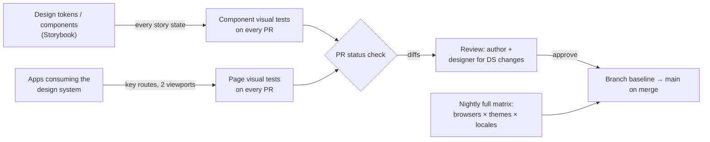

<!-- Generated by scripts/sync-knowledge.js from notes/ and README.md — do not edit here. -->
<!-- sections (line ranges in this file): Table of Contents 19-41 · ELI5 42-55 · Core Concept 56-431 · System Design Angle 432-458 · Real-World Examples 459-635 · Key Points Summary 636-654 · Test Your Understanding 655-730 · Cheat Sheet 731-780 · References & Further Reading 781-814 -->

# Visual Regression Testing

> **Date:** 2026-11-06 · **Last updated:** 2026-11-06
> **Category:** Frontend System Design
> **Sub-Topic:** Testing / Visual Regression
> **Level:** Intermediate · **Reading time:** ~26 min
> **Informs:** UI regression gates in CI, design-system release safety, choosing self-hosted vs hosted screenshot tooling, baseline storage and review workflow, snapshot matrix (browsers, viewports, themes, locales), flake control (fonts, animations, time, data), CI rendering environment (Docker)

> **Pre-requisite:** [E2E Testing (Playwright, Cypress)](./e2e-testing-playwright-cypress.md) and [Storybook & Component Documentation](./storybook-and-component-documentation.md).
> This note covers **catching unintended visual changes** — how screenshots are captured, compared, reviewed and kept stable in CI.

**Previous:** [E2E Testing (Playwright, Cypress)](./e2e-testing-playwright-cypress.md) · **Next:** [Performance Testing](./performance-testing.md)

---

## Table of Contents

1. [ELI5 — Simple Explanation](#eli5--simple-explanation)
2. [Section 1: What Visual Regression Testing Is](#section-1-what-visual-regression-testing-is)
3. [Section 2: The Capture, Compare, Review Loop](#section-2-the-capture-compare-review-loop)
4. [Section 3: How Images Are Compared](#section-3-how-images-are-compared)
5. [Section 4: Where to Take Snapshots](#section-4-where-to-take-snapshots)
6. [Section 5: Playwright toHaveScreenshot](#section-5-playwright-tohavescreenshot)
7. [Section 6: Sources of Flakiness](#section-6-sources-of-flakiness)
8. [Section 7: A Deterministic Rendering Environment](#section-7-a-deterministic-rendering-environment)
9. [Section 8: Baselines — Storage, Updates and Review](#section-8-baselines--storage-updates-and-review)
10. [Section 9: Self-Hosted vs Hosted Services](#section-9-self-hosted-vs-hosted-services)
11. [Section 10: The Snapshot Matrix and Its Cost](#section-10-the-snapshot-matrix-and-its-cost)
12. [Section 11: Other Frameworks and Native Mobile](#section-11-other-frameworks-and-native-mobile)
13. [System Design Angle](#system-design-angle)
14. [Real-World Examples](#real-world-examples)
15. [Key Points Summary](#key-points-summary)
16. [Test Your Understanding (with answers)](#test-your-understanding)
17. [Cheat Sheet](#cheat-sheet)
18. [References & Further Reading](#references--further-reading)

---

## ELI5 — Simple Explanation

Think of a **"spot the difference" puzzle**:

- You keep a **reference photo** of every screen when it looks right — the **baseline**.
- Every time someone changes the code, a robot takes a **new photo** of the same screen, in the same room, with the same lighting.
- The robot lays the two photos on top of each other and **circles every pixel that changed** — the **diff**.
- A human looks at the circled spots and decides: *"That's the new button colour we wanted"* (**approve** → the new photo becomes the reference) or *"Why did the footer jump 20 px?"* (**reject** → fix the code).
- If the lighting changes between photos (a different computer, a clock showing a new time, a spinner caught mid-spin), the robot circles things that aren't real changes. Most of the craft is **keeping the room identical**.

> **Visual regression testing compares screenshots against approved baselines so CSS and layout bugs that no assertion would catch get seen by a human before users see them.**

---

## Core Concept — Step by Step

### Section 1: What Visual Regression Testing Is

Functional tests check **behaviour** ("clicking Save calls the API"). They pass happily when the Save button is white text on a white background, overlaps the footer, or wraps into three lines in German. Visual regression tests check **appearance**.



| Kind of check | What it compares | Catches pixels? | Example |
|---|---|---|---|
| **DOM / markup snapshot** | Serialized HTML or a component tree as text | ❌ No — CSS isn't in it | Jest `toMatchSnapshot()` on rendered markup |
| **ARIA snapshot** | The accessibility tree as YAML | ❌ No — structure and names only | Playwright `toMatchAriaSnapshot()` |
| **Visual (screenshot) snapshot** | Rendered pixels | ✅ Yes | Playwright `toHaveScreenshot()`, Chromatic, Percy |
| **Visual AI** | Rendered pixels, with a model that ignores "insignificant" differences | ✅ Yes | Applitools Eyes |

**Typical regressions it catches:**
- A global CSS change (reset, token, utility class) that restyles components far away from the edited file.
- A dependency upgrade (UI library, icon set, font package) that shifts spacing or glyphs.
- Breakpoint bugs: the layout is fine at 1280 px but the nav overlaps the logo at 768 px.
- Theme bugs: dark mode or high-contrast mode missing a token.
- Long or translated strings overflowing their containers.

**What it does not replace:** functional tests (a pixel-perfect page can still submit the wrong data), accessibility testing (contrast can be measured, but meaning, focus order and screen-reader output can't be seen in a PNG — see [Accessibility Testing](./accessibility-testing.md)), and real-user monitoring.

---

### Section 2: The Capture, Compare, Review Loop

Every tool — Playwright, BackstopJS, Chromatic, Percy, Applitools — runs the same loop:



| Term | Meaning |
|---|---|
| **Baseline** (golden, reference, expected) | The approved screenshot a new capture is compared against |
| **Actual** (candidate) | The screenshot from the current run |
| **Diff image** | A third image highlighting changed pixels |
| **Threshold** | How much difference is tolerated before failing |
| **Approve / accept** | Promote the actual to be the new baseline |
| **Mask** | A region painted over before comparing (timestamps, ads, avatars) |

> The **review step is the product**. A visual test that fails gives a human a picture to judge — it can't know on its own whether a change was intended. Budget reviewer time like you budget CI minutes.

---

### Section 3: How Images Are Compared



**Pixel comparison knobs** (names from Playwright, but every tool has equivalents):

| Knob | Meaning | Use it for |
|---|---|---|
| `threshold` | Per-pixel colour tolerance, `0` (strict) to `1` (lax). Playwright's default is `0.2` | Ignoring anti-aliasing and colour-rounding noise |
| `maxDiffPixels` | How many pixels may differ in total | Small, known noise on a large page |
| `maxDiffPixelRatio` | Fraction of pixels that may differ (`0`–`1`) | Scaling tolerance with screenshot size |
| Anti-aliasing detection | pixelmatch can skip pixels it classifies as anti-aliased edges | Text and curved edges |

**How to pick a tolerance:**
- Start **strict** (defaults) in a deterministic environment (Section 7). Loosen only when you can name the noise source.
- A 1-px border colour change on a button is a **real** regression and is only a few hundred pixels — a large `maxDiffPixelRatio` on a full page will hide it. Prefer **smaller, element-level screenshots** over looser thresholds.
- Never "fix" flakiness by raising the threshold until the test passes. You'll silently accept the regressions the test exists to catch.

---

### Section 4: Where to Take Snapshots



| Level | Strengths | Weaknesses |
|---|---|---|
| **Component (story)** | Each state isolated; small images; failures point at one component; runs fast in parallel | Misses bugs that only appear when components are composed (margins collapsing, z-index, grid overflow) |
| **Page (route)** | Catches composition and global CSS bugs | Large diffs are harder to review; needs mocked data for stability |
| **E2E checkpoint** | Real flow, real state | Slow; more dynamic content; flakier |

**Common split:** snapshot **every story state** of the design system, plus a **small set of key pages** per app (home, product, checkout, settings) at 2–3 viewports. Don't screenshot every step of every E2E test.

---

### Section 5: Playwright toHaveScreenshot

Playwright Test has visual comparison built in — no plugin or service needed.

```typescript
import { test, expect } from '@playwright/test';

test('pricing page', async ({ page }) => {
  await page.goto('/pricing');
  await expect(page).toHaveScreenshot('pricing.png');                     // whole viewport
  await expect(page.getByRole('table')).toHaveScreenshot('plans.png');    // one element
});
```

**What happens on each run:**



**Key behaviours to know:**
- **First run fails and writes the baseline.** Review the generated image, then commit it. Re-run to pass.
- **Baseline names include the browser and platform**, e.g. `pricing-chromium-linux.png`. A baseline recorded on macOS won't be used on Linux CI — by design, because fonts and anti-aliasing differ per OS.
- **Stability wait:** it re-captures until two consecutive screenshots match before comparing, which absorbs short-lived rendering.
- **Sensible defaults for screenshots in assertions:** CSS animations and transitions are stopped (`animations: 'disabled'`), the text caret is hidden (`caret: 'hide'`), and the image is taken at CSS pixel scale (`scale: 'css'`).
- **Update baselines** with `npx playwright test --update-snapshots` (short `-u`). Recent versions also accept a mode (e.g. update only changed or only missing snapshots) — check the CLI docs for your version.
- On failure, the **HTML report** shows actual, expected, diff and a slider/overlay view.

**Useful options:**

| Option | What it does |
|---|---|
| `mask: [locator, …]` | Paints over dynamic regions (default colour is magenta; `maskColor` changes it) |
| `stylePath` | Injects a stylesheet only while capturing — hide or freeze volatile elements |
| `fullPage: true` | Captures the full scrollable page instead of the viewport |
| `clip` | Captures a fixed rectangle |
| `omitBackground: true` | Transparent background instead of white |
| `threshold`, `maxDiffPixels`, `maxDiffPixelRatio` | Tolerance (Section 3) |
| `timeout` | How long to wait for a stable, matching screenshot |

Project-wide defaults go in `playwright.config.ts` under `expect.toHaveScreenshot`, and `snapshotPathTemplate` controls where baselines are stored (Example 1).

> **Cypress** has no built-in screenshot comparison. Use a community plugin (for example a maintained fork of `cypress-image-snapshot`) or a hosted service SDK (Percy, Applitools, Chromatic for Cypress). `cy.screenshot()` only captures — it doesn't compare.

---

### Section 6: Sources of Flakiness

A visual test is only useful if it fails **only** on real changes. These are the usual culprits:



| Source | Fix |
|---|---|
| Fonts render differently per OS | Run every capture in the **same container image** (Section 7) |
| Web font still loading (fallback font in the shot) | `await page.evaluate(async () => { await document.fonts.ready; })`; self-host fonts; avoid `font-display: swap` races in tests |
| "Updated 3 minutes ago", today's date | Freeze time: Playwright's `page.clock` (`setFixedTime` / `install`), or inject a fixed `Date` |
| Live API data | Mock the network (`page.route`, MSW) with fixed fixtures |
| Random values, shuffled order | Seed the RNG; sort deterministically in tests |
| Animations, carousels, skeletons | Disabled by default in `toHaveScreenshot`; also emulate `reducedMotion: 'reduce'`; wait for the loaded state, not a timeout |
| Lazy images below the fold in a full-page shot | Scroll through first or set `loading="eager"` in test builds; wait for `img.complete` |
| Ads, maps, video, avatars | `mask` them or replace with placeholders via `stylePath` |
| Hover/focus left over from a previous step | Move the mouse away; blur the active element; capture fresh pages |

> **Rule:** every `waitForTimeout(2000)` before a screenshot is a bug report waiting to happen. Wait for a **condition** (fonts ready, network idle for that request, element visible), never for time.

---

### Section 7: A Deterministic Rendering Environment

Screenshots depend on fonts, font hinting, sub-pixel anti-aliasing and the browser build. A developer's Mac, a Windows laptop and an Ubuntu CI runner produce **different pixels** for identical code.



Options:
- **Official Playwright Docker image** (`mcr.microsoft.com/playwright:v<version>-<distro>`), with the tag matching your installed `@playwright/test` version. Run both baseline updates and CI checks inside it (Example 2).
- **Generate baselines only in CI**: a workflow job (manual trigger or PR comment command) updates snapshots and commits them, so nobody records baselines locally.
- **Hosted services** (Chromatic, Percy, Applitools) render in **their** browser infrastructure, so local OS differences don't matter. You upload a DOM snapshot or story build, not a screenshot.

Pin the rest of the environment too: **viewport**, **device scale factor**, **locale and time zone** (`locale`, `timezoneId` in Playwright), **colour scheme**, and installed fonts.

---

### Section 8: Baselines — Storage, Updates and Review



**Where baselines live:**

| Option | How | Trade-off |
|---|---|---|
| **In git, next to tests** | Playwright default `*.spec.ts-snapshots/` folders | Simple, versioned with code, reviewable in the PR diff. Repo grows with every update; consider Git LFS for large suites |
| **In a hosted service** | Chromatic, Percy, Applitools, Argos keep baselines per branch | No repo bloat, web review UI, branch-aware baselines. Costs money; data leaves your network |
| **In object storage** (S3 etc.) | reg-suit-style tools upload and compare | Self-managed; needs glue code for branch logic |

**Review workflow that works:**
1. A PR changes UI code. CI runs visual tests.
2. Changes are reported as a **PR status check** with links to diffs.
3. A reviewer (often the author plus a designer for design-system changes) **approves** intended changes and rejects regressions.
4. Approved images become the baseline for that branch; on merge they become the baseline for `main`.

**Rules:**
- **Never run `--update-snapshots` blindly** to make CI green. That approves every regression in the run. Update, then *look at* the changed images in the PR diff.
- Keep updates in the **same PR** as the code change, so the reviewer sees cause and effect together.
- Delete baselines for removed tests — orphaned images accumulate silently and confuse reviewers.
- Branch baselines matter: two PRs that both change the header should each compare against `main`, not against each other.

---

### Section 9: Self-Hosted vs Hosted Services



*(Placement is an opinionated, qualitative summary of documented features — not a benchmark.)*

| Tool | Type | Captures | Notes |
|---|---|---|---|
| **Playwright `toHaveScreenshot`** | Built into the test runner | Pages, elements, CT components | Free; baselines in git; you own the rendering environment |
| **jest-image-snapshot** | Jest matcher | Any image buffer (often from Puppeteer/Playwright) | `toMatchImageSnapshot()`; configurable diff thresholds |
| **Vitest browser mode** | Built-in screenshot assertion in recent versions | Components rendered in a real browser | Check the Vitest docs for `toMatchScreenshot` availability in your version |
| **BackstopJS** | Open-source CLI | URLs/scenarios from a config file | `reference` / `test` / `approve` workflow, HTML report |
| **Lost Pixel**, **reg-suit**, **Loki** | Open-source (some with hosted tiers) | Storybook stories, pages | Varying maintenance — check activity before adopting |
| **Chromatic** | Hosted (from the Storybook maintainers) | Every Storybook story; also Playwright/Cypress tests | Cloud rendering in several browsers; branch baselines; can snapshot only stories affected by a change (TurboSnap) |
| **Percy** (BrowserStack) | Hosted | DOM snapshots from Playwright, Cypress, Storybook and more | Re-renders across browsers and widths in the cloud |
| **Applitools Eyes** | Hosted | SDKs for most runners and native mobile | "Visual AI" match levels (e.g. strict vs layout); cross-browser grid |
| **Argos** | Hosted, open-source core | Playwright, Cypress, Storybook screenshots | GitHub/GitLab integration, PR review |

**Decision guide:**
- **Small team, one app, Playwright already in place** → built-in `toHaveScreenshot` in Docker, baselines in git.
- **Design system in Storybook** → Chromatic (or Lost Pixel / test-runner + jest-image-snapshot to stay self-hosted).
- **Many browsers × widths, large review load, budget available** → Percy or Applitools.
- **Strict data residency** → self-hosted only, or check vendors' private deployment options.

---

### Section 10: The Snapshot Matrix and Its Cost

Every dimension multiplies the number of images to capture, store and review:

```text
snapshots = states (stories or pages) × browsers × viewports × themes × locales

  200 stories × 3 browsers × 2 viewports × 2 themes × 1 locale = 2,400 images per run
```

Hosted services typically bill by snapshot count, and reviewers have limited attention. Choose the matrix deliberately:

| Dimension | Recommended default | Expand when |
|---|---|---|
| **Browsers** | One engine (Chromium) for most tests | Known engine-specific CSS (WebKit forms, Firefox fonts) — add a smaller cross-browser set |
| **Viewports** | Your real breakpoints (e.g. mobile + desktop) | Components with complex responsive behaviour |
| **Themes** | Light + dark if you ship both | Brand themes, high-contrast / forced-colors mode |
| **Locales** | Default locale | Add one long-text locale (German) and one RTL locale (Arabic/Hebrew) for layout-sensitive components |
| **States** | Default, hover/focus, disabled, error, loading, empty, overflow | Every state a designer cares about |

**Cost controls:** run only affected snapshots on PRs (dependency-aware selection such as Chromatic's TurboSnap, or test tagging), run the full matrix nightly or on `main`, and shard Playwright across CI machines.

---

### Section 11: Other Frameworks and Native Mobile

Visual testing works on **rendered output**, so it's mostly framework-agnostic:

| Stack | Typical approach |
|---|---|
| **React / Vue / Angular / Svelte (web)** | Storybook supports all four, so Chromatic, Lost Pixel and the Storybook test-runner work the same way. Playwright `toHaveScreenshot` works on any rendered page. Playwright's component testing packages (`@playwright/experimental-ct-react`, `-vue`, `-svelte`) are still marked experimental |
| **Angular** | Also: Cypress component testing + a visual plugin or service SDK |
| **iOS (Swift/SwiftUI)** | Point-Free's `swift-snapshot-testing` — `assertSnapshot(of: view, as: .image)` |
| **Android (Jetpack Compose / Views)** | Paparazzi (renders on the JVM, no emulator), Roborazzi (Robolectric), and Google's Compose Preview Screenshot Testing tool |
| **Flutter** | Built-in golden tests: `matchesGoldenFile('goldens/x.png')`, updated with `flutter test --update-goldens` |
| **React Native** | Screenshot via Detox/Maestro/Appium and compare (e.g. jest-image-snapshot), or hosted SDKs (Applitools, Percy for App) |

Same rules apply on mobile: pin the device/simulator model, OS version, fonts and scale, and render in CI only.

---

## System Design Angle

When designing the testing strategy for a product, visual regression answers: **"How do we change shared UI with confidence?"**



**Questions to settle in a design review:**
- **Who reviews diffs?** If nobody owns review, the suite becomes "approve all" within weeks.
- **What's the rendering environment?** Docker image or hosted renderer — decided up front, not after the first flaky week.
- **Which states are snapshot targets?** Tie them to the design system's documented states.
- **What's mocked?** Network fixtures, time, randomness, feature flags.
- **What's the cost envelope?** Snapshot count per PR and per month, CI minutes, review time.
- **How do baselines branch?** Git-versioned (simple) or service-managed (branch-aware).

**Signals that visual testing is worth it:** a shared design system, many teams editing global CSS, frequent dependency upgrades, theming/white-labelling, many locales. **Signals to keep it small:** a young product whose UI changes every day (constant approvals = noise).

---

## Real-World Examples

**Example 1 — Playwright config with stable visual defaults:**
```typescript
// playwright.config.ts
import { defineConfig, devices } from '@playwright/test';

export default defineConfig({
  testDir: './tests',
  // One folder for all baselines, grouped by platform and project
  snapshotPathTemplate: '{testDir}/__screenshots__/{platform}/{projectName}/{testFilePath}/{arg}{ext}',
  expect: {
    toHaveScreenshot: {
      maxDiffPixels: 0,          // strict by default; loosen per test with a reason
      animations: 'disabled',    // already the default, made explicit
      stylePath: './tests/visual.css',
    },
  },
  use: {
    baseURL: 'http://localhost:4173',
    locale: 'en-US',
    timezoneId: 'UTC',
    colorScheme: 'light',
  },
  projects: [
    { name: 'desktop', use: { ...devices['Desktop Chrome'], viewport: { width: 1280, height: 800 } } },
    { name: 'mobile', use: { ...devices['Pixel 7'] } },
  ],
  webServer: { command: 'npm run preview', url: 'http://localhost:4173', reuseExistingServer: !process.env.CI },
});
```

```css
/* tests/visual.css — injected only while capturing screenshots */
[data-testid="relative-time"],
.ad-slot,
video { visibility: hidden !important; }
*, *::before, *::after { scrollbar-width: none !important; }
```

**Example 2 — Deterministic page test (BAD → GOOD):**
```typescript
import { test, expect } from '@playwright/test';

// ❌ BAD: live data, real clock, arbitrary sleep, whole page at default tolerance
test('dashboard (flaky)', async ({ page }) => {
  await page.goto('/dashboard');
  await page.waitForTimeout(3000);
  await expect(page).toHaveScreenshot({ maxDiffPixelRatio: 0.2 }); // hides real regressions
});

// ✅ GOOD: fixed time, mocked API, wait for conditions, mask the truly dynamic part
test('dashboard', async ({ page }) => {
  await page.clock.setFixedTime(new Date('2026-01-15T10:00:00Z'));
  await page.route('**/api/stats', (route) =>
    route.fulfill({ path: 'tests/fixtures/stats.json' }),
  );
  await page.emulateMedia({ reducedMotion: 'reduce' });

  await page.goto('/dashboard');
  await expect(page.getByRole('heading', { name: 'Dashboard' })).toBeVisible();
  await page.evaluate(async () => { await document.fonts.ready; });

  await expect(page).toHaveScreenshot('dashboard.png', {
    fullPage: true,
    mask: [page.getByTestId('user-avatar')],
  });
});
```

**Example 3 — Run baselines and CI in the same container:**
```bash
# Use the Playwright image whose version matches your installed @playwright/test
PW_VERSION=$(npx playwright --version | awk '{print $2}')

# Update baselines locally, rendered exactly like CI (Linux, same fonts)
docker run --rm --ipc=host -v "$PWD":/work -w /work \
  "mcr.microsoft.com/playwright:v${PW_VERSION}-noble" \
  npx playwright test --grep @visual --update-snapshots

# Then inspect the changed PNGs before committing
git status -- tests/__screenshots__
```

```yaml
# .github/workflows/visual.yml — same container image as local baseline updates
name: visual
on: pull_request
jobs:
  visual:
    runs-on: ubuntu-latest
    steps:
      - uses: actions/checkout@v4
      - uses: actions/setup-node@v4
        with:
          node-version: lts/*
      - run: npm ci
      - name: Visual tests in the official Playwright image
        run: |
          PW_VERSION=$(npx playwright --version | awk '{print $2}')
          docker run --rm --ipc=host -v "$PWD":/work -w /work             "mcr.microsoft.com/playwright:v${PW_VERSION}-noble"             npx playwright test --grep @visual
      - uses: actions/upload-artifact@v4
        if: failure()
        with:
          name: visual-report
          path: playwright-report/
```

**Example 4 — Every Storybook story as a visual test (self-hosted):**
```typescript
// .storybook/test-runner.ts — @storybook/test-runner drives stories with Playwright
import type { TestRunnerConfig } from '@storybook/test-runner';
import { getStoryContext, waitForPageReady } from '@storybook/test-runner';
import { toMatchImageSnapshot } from 'jest-image-snapshot';

const config: TestRunnerConfig = {
  setup() {
    expect.extend({ toMatchImageSnapshot });
  },
  async postVisit(page, context) {
    const story = await getStoryContext(page, context);
    if (story.parameters?.visual?.disable) return;     // opt-out per story via parameters
    await waitForPageReady(page);
    const image = await page.locator('#storybook-root').screenshot({ animations: 'disabled' });
    expect(image).toMatchImageSnapshot({
      customSnapshotIdentifier: context.id,
      failureThreshold: 0.001,
      failureThresholdType: 'percent',
    });
  },
};
export default config;
```

> Hosted alternative: Chromatic snapshots every story without this file (`npx chromatic --project-token=…`), renders in cloud browsers, and shows diffs in a review UI and in Storybook's Visual Tests addon.

**Example 5 — Hosted service from an existing Playwright suite (Percy):**
```typescript
import { test } from '@playwright/test';
import percySnapshot from '@percy/playwright';

test('checkout', async ({ page }) => {
  await page.goto('/checkout');
  // Uploads a DOM snapshot; Percy renders it in its browsers at configured widths
  await percySnapshot(page, 'Checkout - empty cart');
});
```

```bash
# PERCY_TOKEN is set as a CI secret; without it, snapshots are skipped and tests still run
npx percy exec -- npx playwright test
```

**Example 6 — Native mobile goldens:**
```swift
// iOS — swift-snapshot-testing
import SnapshotTesting
import XCTest

final class ProfileCardTests: XCTestCase {
  func testProfileCard() {
    let vc = ProfileCardViewController(user: .fixture)
    assertSnapshot(of: vc, as: .image(on: .iPhone13))
  }
}
```

```dart
// Flutter — golden test, update with: flutter test --update-goldens
testWidgets('profile card', (tester) async {
  await tester.pumpWidget(MaterialApp(home: ProfileCard(user: fixtureUser)));
  await expectLater(find.byType(ProfileCard), matchesGoldenFile('goldens/profile_card.png'));
});
```

---

## Key Points Summary

| Concept | One-Line Explanation |
|---|---|
| **Visual regression test** | Compare a new screenshot to an approved baseline and flag differences |
| **Baseline** | The approved image; updating it is a review decision, not a CI chore |
| **Diff + review** | A human decides whether a change is intended — the review step is the value |
| **Threshold** | Tolerance for pixel noise; keep it strict and screenshots small |
| **Mask / stylePath** | Hide dynamic regions instead of loosening thresholds |
| **Determinism** | Same container, browser, fonts, viewport, locale, time zone and data every run |
| **Platform-specific baselines** | OSes render fonts differently, so baselines are per platform |
| **Component vs page** | Stories for breadth and clear failures; a few pages for composition bugs |
| **Hosted services** | Cloud rendering, branch baselines and review UI, priced per snapshot |
| **Snapshot matrix** | States × browsers × viewports × themes × locales — choose deliberately |
| **DOM snapshot ≠ visual** | Markup snapshots don't see CSS; screenshots do |
| **Native** | swift-snapshot-testing, Paparazzi/Roborazzi, Flutter goldens follow the same model |

---

## Test Your Understanding

**Q1 (Basic):**
Your team has Jest snapshot tests that serialize every component's rendered HTML. A designer asks whether you "already have visual regression tests". Do you?

<details>
<summary>Answer</summary>

No. A markup snapshot records the **HTML structure** as text. It doesn't include the CSS cascade, layout, fonts or images, so a change to a shared stylesheet, a design token, or a dependency's CSS can break the visuals while every markup snapshot still passes. In practice markup snapshots also tend to be approved without reading, because the diffs are long and noisy.

Visual regression tests compare **rendered pixels** in a real browser, which is what the designer cares about. Markup snapshots can still be useful for small, stable serializations, but they're not visual tests.
</details>

**Q2 (Application):**
Visual tests pass on every developer's MacBook but fail on CI with diffs around all the text. Nothing in the UI changed. What's going on, and how do you fix it properly?

<details>
<summary>Answer</summary>

The baselines were recorded on macOS and compared on Linux (or recorded by different machines). Text rendering — font availability, hinting and anti-aliasing — differs between operating systems, so the same page produces different pixels. (Playwright avoids silently mixing them by including the platform in the baseline file name, which is why a missing Linux baseline or a regenerated one shows up.)

The proper fix is a **single rendering environment**: record and compare baselines inside the same Docker image (e.g. the official Playwright image matching your version), or let a hosted service render in its own browsers. Raising the threshold until CI passes is the wrong fix — it also hides real text and spacing regressions.
</details>

**Q3 (Tricky):**
A full-page screenshot of the account page is configured with `maxDiffPixelRatio: 0.05` "because it was flaky". A PR changes the primary button's border colour by mistake and CI stays green. Why, and what should the test look like instead?

<details>
<summary>Answer</summary>

Five percent of a 1280×4000 full-page screenshot is over 250,000 pixels. A 1-px border on a few buttons changes a few hundred pixels, far under the tolerance. The loose threshold was added to hide **noise** (probably a timestamp, avatar or animation), and it hid a **real regression** too.

Better: find and remove the noise source (freeze the clock, mock data, mask the avatar, wait for fonts), restore a strict tolerance, and screenshot **smaller regions** (the form, the button group) so that small changes are a large fraction of the image. Element-level shots also make review faster.
</details>

**Q4 (Tricky):**
A developer's PR fails 140 visual tests after a font package upgrade. They run `--update-snapshots`, commit, and CI turns green. What risk did they just take, and what process prevents it?

<details>
<summary>Answer</summary>

They approved **all 140 changes without looking at them**. Most may be the intended font change, but any real regression in the same run (a wrapped label, a clipped heading, a button pushed below the fold) is now the baseline and will never be flagged again.

Prevention: require that baseline updates appear in the **PR diff** (git-stored PNGs show as image diffs on GitHub/GitLab) or in a hosted service's review UI, and that a reviewer actually approves them — for design-system changes, include a designer. Split large intentional changes (a font upgrade) into their own PR so reviewers can focus on them. Some teams restrict `--update-snapshots` to a CI job triggered by a reviewer.
</details>

**Q5 (System design):**
You're designing the test strategy for a design system with ~150 components used by 6 product apps, each with light/dark themes and 12 locales including Arabic. What visual testing setup do you propose?

<details>
<summary>Answer</summary>

- **Component level, every PR:** one story per meaningful state (default, hover/focus, disabled, error, loading, empty, long-text overflow), captured in one browser engine at the component's relevant widths, in **light and dark**. Use Chromatic (or a self-hosted Storybook test-runner + image snapshots in Docker). Use dependency-aware selection so only affected stories run on PRs.
- **Locale coverage:** not all 12 locales — pick **one long-text locale** (e.g. German) and **one RTL locale** (Arabic) for layout-sensitive components. The other locales differ in strings, not layout rules.
- **Cross-browser:** a smaller set (key components) in Firefox and WebKit, run nightly or on `main`.
- **Apps:** each app snapshots a handful of key routes at mobile + desktop with mocked data, to catch composition bugs.
- **Process:** design-system PRs need designer approval of diffs; baselines are branch-aware; snapshot budget per PR is tracked.

The trade-off being managed is **coverage vs cost and reviewer attention**: full matrix = 150 × states × 2 themes × 12 locales × 3 browsers is tens of thousands of images per run, which nobody can review.
</details>

**Q6 (Application):**
A visual test of a "Recent activity" panel fails randomly once every ~10 runs, always around the list items. Name three likely causes and a fix for each.

<details>
<summary>Answer</summary>

1. **Relative timestamps** ("2 minutes ago") — the clock moves between runs. Fix: freeze time (`page.clock.setFixedTime`) or mask/hide timestamp elements via `stylePath`.
2. **Live or unordered data** — the API returns items in a different order or with new entries. Fix: mock the endpoint with a fixture (`page.route`, MSW) and sort deterministically.
3. **Images/avatars still loading** when the capture is taken (or a skeleton shimmer). Fix: wait for the loaded state (e.g. images `complete`, skeleton gone) instead of a fixed timeout; mask avatars if they're third-party.

Others worth checking: a hover state left from a previous action, an animation not covered by `animations: 'disabled'` (e.g. JS-driven canvas), or lazy-loading triggered by scroll position. The general rule: identify the noise source and remove it, never just loosen the threshold.
</details>

---

## Cheat Sheet

**Key Definitions:**
- **Baseline / golden:** The approved reference image
- **Actual:** The newly captured image
- **Diff:** Image showing which pixels changed
- **Threshold / tolerance:** How much difference is accepted (per pixel and in total)
- **Mask:** A region excluded from comparison
- **Visual AI:** Model-based comparison that ignores rendering noise (Applitools)
- **TurboSnap-style selection:** Snapshot only the stories affected by changed files
- **Golden test:** Mobile/Flutter term for a visual snapshot test

**Quick Reference:**
```text
Playwright
  expect(page).toHaveScreenshot('name.png')           whole viewport (fullPage: true for all)
  expect(locator).toHaveScreenshot()                  one element (prefer this)
  npx playwright test -u                              update baselines (then REVIEW them)
  defaults: animations disabled, caret hidden, scale css, threshold 0.2
  options:  mask, maskColor, stylePath, clip, maxDiffPixels, maxDiffPixelRatio
  baselines: <test>-snapshots/<name>-<project>-<platform>.png

Stability checklist
  same Docker image · fixed viewport/DPR · locale + timezoneId · page.clock
  mocked network · seeded randomness · document.fonts.ready · reducedMotion
  wait for conditions, never waitForTimeout · mask ads/avatars/video

Where to snapshot
  every design-system story state  +  a few key pages × 2 viewports  +  nightly full matrix

Matrix cost = states × browsers × viewports × themes × locales
```

**Common Mistakes to Avoid:**

| Mistake | Why Wrong | Fix |
|---|---|---|
| Recording baselines on laptops | OS font rendering differs → CI noise | Record and compare in one container or a hosted renderer |
| Raising thresholds to fix flakes | Also hides real regressions | Remove the noise source; use strict, small screenshots |
| `waitForTimeout` before capture | Too short = flaky, too long = slow | Wait for fonts, data, element states |
| Blind `--update-snapshots` | Approves regressions along with intended changes | Review image diffs in the PR or service UI |
| Full-page shots of everything | Big, noisy diffs nobody reviews | Element/story shots + a few key pages |
| Live data and real clock | Every run differs | Mock network, freeze time, seed randomness |
| Snapshotting every locale × browser × theme | Cost and review load explode | Choose representative dimensions; full matrix nightly |
| Treating markup snapshots as visual tests | CSS isn't in the markup | Use real-browser screenshots |
| No owner for diff review | Suite becomes "approve all" | Assign reviewers; designers for DS changes |
| Visual tests instead of functional/a11y tests | Pixels can't verify behaviour or semantics | Layer them — see [Testing Strategies & Pyramid](./testing-strategies-and-pyramid.md) |

---

## References & Further Reading

**Core docs**
- Playwright: [Visual comparisons](https://playwright.dev/docs/test-snapshots)
- Playwright: [`toHaveScreenshot` options (PageAssertions)](https://playwright.dev/docs/api/class-pageassertions#page-assertions-to-have-screenshot-1)
- Playwright: [Clock](https://playwright.dev/docs/clock) · [Docker](https://playwright.dev/docs/docker) · [`snapshotPathTemplate`](https://playwright.dev/docs/api/class-testconfig#test-config-snapshot-path-template)
- Storybook: [Visual tests](https://storybook.js.org/docs/writing-tests/visual-testing) · [Test runner (GitHub)](https://github.com/storybookjs/test-runner)
- Vitest: [Visual regression testing (browser mode)](https://vitest.dev/guide/browser/visual-regression-testing)

**Tools**
- [Chromatic docs](https://www.chromatic.com/docs/) · [TurboSnap](https://www.chromatic.com/docs/turbosnap/)
- [Percy docs (BrowserStack)](https://www.browserstack.com/docs/percy)
- [Applitools Eyes docs](https://applitools.com/docs/)
- [Argos docs](https://argos-ci.com/docs)
- [BackstopJS (GitHub)](https://github.com/garris/BackstopJS) · [jest-image-snapshot (GitHub)](https://github.com/americanexpress/jest-image-snapshot) · [pixelmatch (GitHub)](https://github.com/mapbox/pixelmatch)

**Native mobile**
- [swift-snapshot-testing (Point-Free)](https://github.com/pointfreeco/swift-snapshot-testing)
- [Paparazzi (Cash App)](https://github.com/cashapp/paparazzi) · [Roborazzi](https://github.com/takahirom/roborazzi)
- Android Developers: [Compose Preview Screenshot Testing](https://developer.android.com/studio/preview/compose-screenshot-testing)
- Flutter: [`matchesGoldenFile`](https://api.flutter.dev/flutter/flutter_test/matchesGoldenFile.html)

**Related notes**
- [Storybook & Component Documentation](./storybook-and-component-documentation.md) · [Design Tokens](./design-tokens.md) · [Testing Strategies & Pyramid](./testing-strategies-and-pyramid.md)

---

> **Previous Topic:** [E2E Testing (Playwright, Cypress)](./e2e-testing-playwright-cypress.md)
> — Driving a real browser through full user journeys

> **Next Topic:** [Performance Testing](./performance-testing.md)
> — Load, lab and field performance tests that keep speed from regressing

*Saved on: 2026-11-06 | Repo: Frontend System Design Learning Notes*
