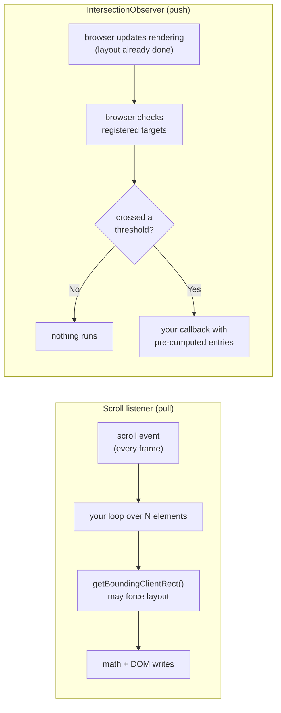
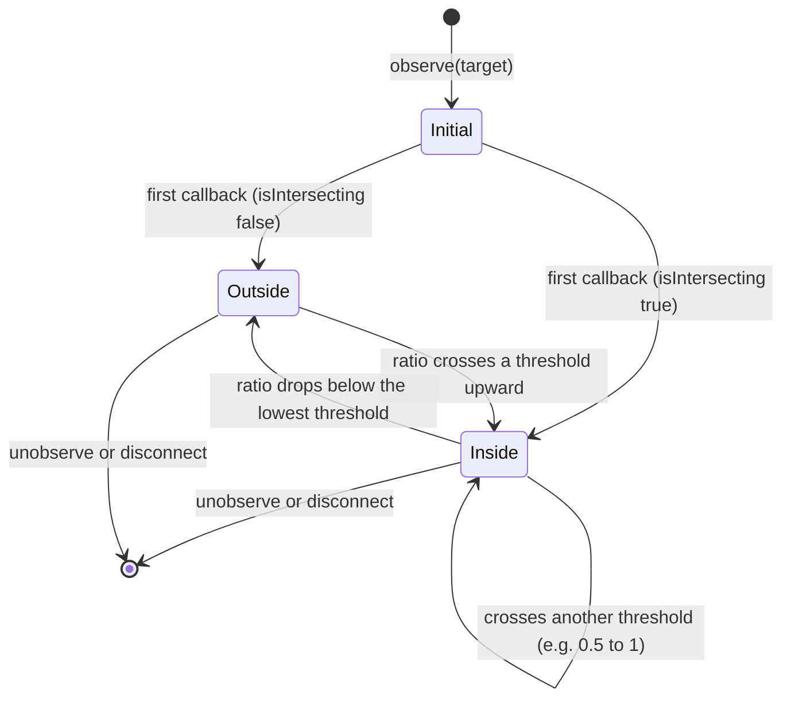
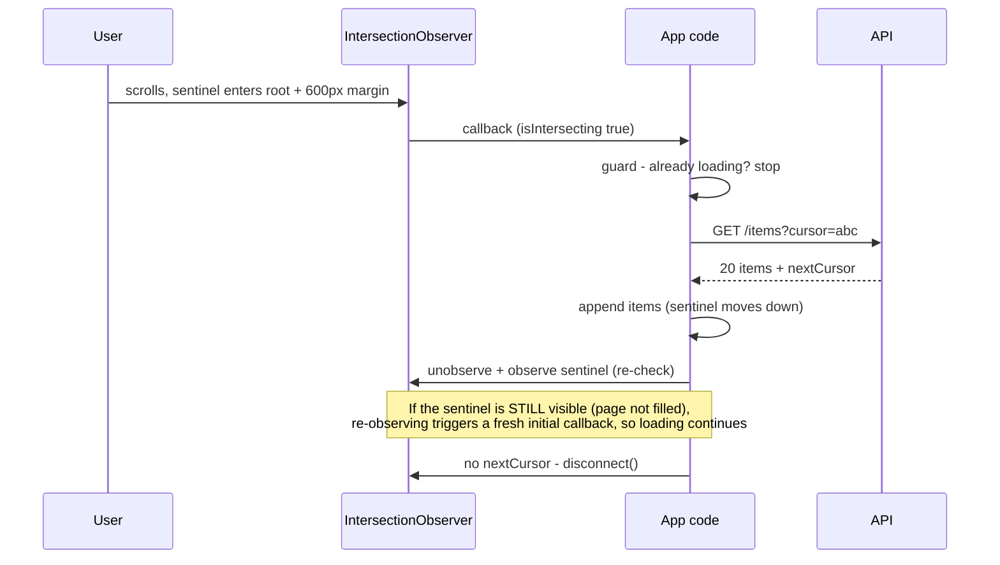
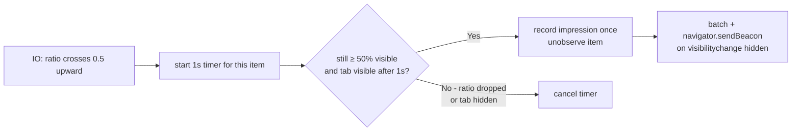
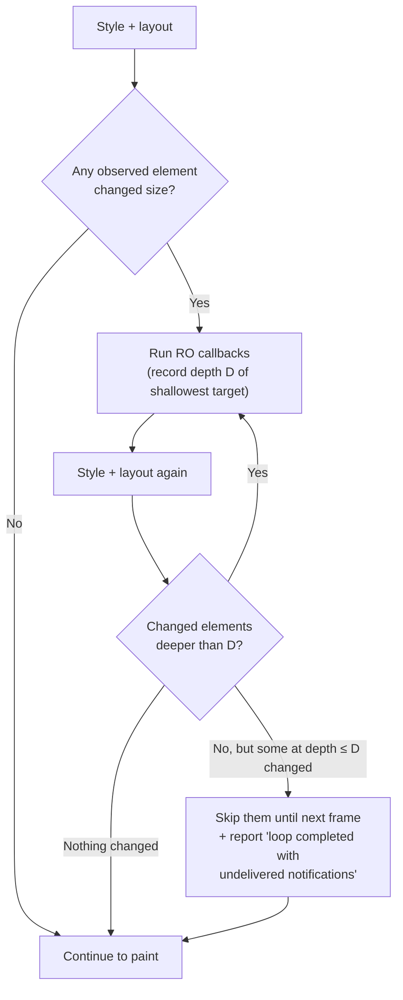
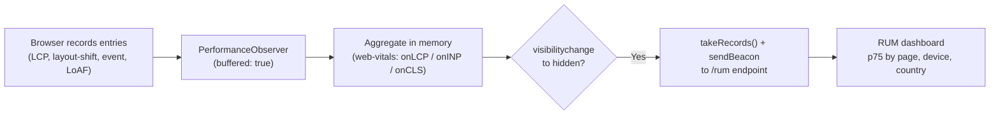
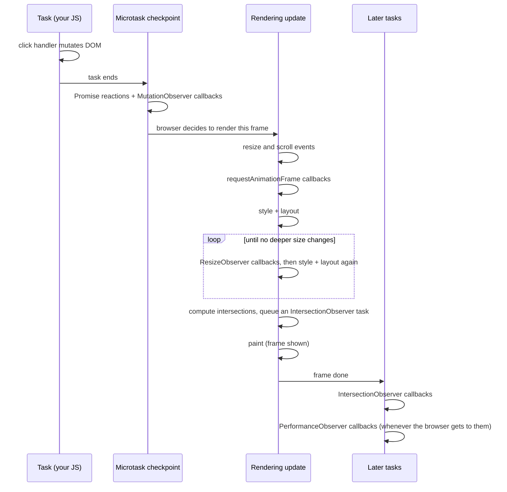
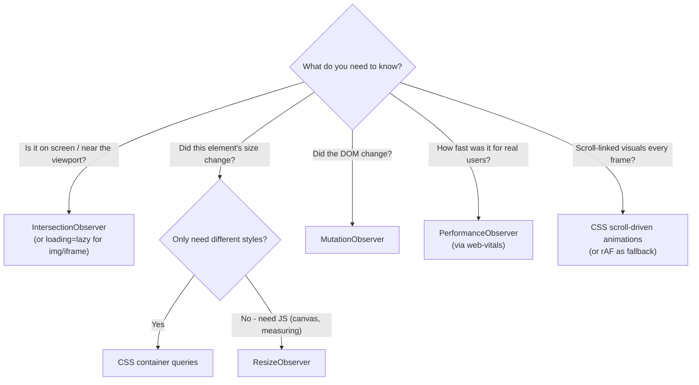

<!-- Generated by scripts/sync-knowledge.js from notes/ and README.md — do not edit here. -->
<!-- sections (line ranges in this file): Table of Contents 19-38 · ELI5 39-55 · Core Concept 56-526 · Which Observer? Decision Tree 527-542 · Real-World Examples 543-749 · Key Points Summary 750-771 · Test Your Understanding 772-835 · Cheat Sheet 836-893 · References & Further Reading 894-935 -->

# Web APIs (Intersection Observer, ResizeObserver)

> **Date:** 2026-11-06 · **Last updated:** 2026-11-06
> **Category:** Frontend System Design
> **Sub-Topic:** Browser APIs / Observers
> **Level:** Intermediate · **Reading time:** ~22 min
> **Informs:** lazy loading, infinite scroll, impression tracking, responsive components, RUM instrumentation

> **Pre-requisite:** Read [JavaScript Runtime & Event Loop](./javascript-runtime-event-loop.md) first (tasks, microtasks and the rendering step).
> This note covers the browser's **observer APIs** — how to react to visibility, size, DOM and performance changes without polling.

**Previous:** [Service Workers & Web Workers](./service-workers-and-web-workers.md) · **Next:** [Browser Caching Strategies](./browser-caching-strategies.md)

---

## Table of Contents

1. [ELI5 — Simple Explanation](#eli5--simple-explanation)
2. [Section 1: Why Observers Beat Scroll and Resize Listeners](#section-1-why-observers-beat-scroll-and-resize-listeners)
3. [Section 2: One Pattern, Four APIs](#section-2-one-pattern-four-apis)
4. [Section 3: IntersectionObserver](#section-3-intersectionobserver)
5. [Section 4: IntersectionObserver Use Cases](#section-4-intersectionobserver-use-cases)
6. [Section 5: ResizeObserver](#section-5-resizeobserver)
7. [Section 6: MutationObserver](#section-6-mutationobserver)
8. [Section 7: PerformanceObserver](#section-7-performanceobserver)
9. [Section 8: Where Callbacks Run in the Frame](#section-8-where-callbacks-run-in-the-frame)
10. [Which Observer? Decision Tree](#which-observer-decision-tree)
11. [Real-World Examples](#real-world-examples)
12. [Key Points Summary](#key-points-summary)
13. [Test Your Understanding (with answers)](#test-your-understanding)
14. [Cheat Sheet](#cheat-sheet)
15. [References & Further Reading](#references--further-reading)

---

## ELI5 — Simple Explanation

Imagine you're a lifeguard watching a beach:
- **Polling (scroll listener)** = walking up to every swimmer every few seconds and measuring how far they are from shore — exhausting, and you do it even when nobody moved.
- **Observer** = you hand each swimmer a buzzer: *"press it when you cross the red buoy line."* You relax until a buzzer goes off.

The browser already knows where every element is and how big it is (it computed that for layout). Observers let you **subscribe** to those facts instead of re-measuring them yourself.

- **IntersectionObserver** — "tell me when this element enters/leaves the screen (or a scroll box)."
- **ResizeObserver** — "tell me when this element's size changes."
- **MutationObserver** — "tell me when the DOM under this node changes."
- **PerformanceObserver** — "tell me when the browser records a performance event (LCP, layout shift, slow interaction...)."

> **Don't ask the browser "where is it now?" on every scroll — ask it to tell you when something changes.**

---

## Core Concept — Step by Step

### Section 1: Why Observers Beat Scroll and Resize Listeners

The classic "is it visible yet?" code listens to `scroll` and measures every element:

```javascript
// ❌ Runs on every scroll event, for every element, even when nothing changed
window.addEventListener('scroll', () => {
  for (const el of document.querySelectorAll('[data-lazy]')) {
    const rect = el.getBoundingClientRect();        // layout READ
    if (rect.top < window.innerHeight + 200) {
      el.classList.add('is-visible');                // style WRITE → invalidates layout
    }
  }
});
```

Three costs hide in this snippet:

1. **Frequency** — scroll fires continuously while the user scrolls (in modern browsers, scroll events are dispatched as part of the rendering steps, so up to once per frame). Your loop runs ~60–120 times per second even if no element crosses the line.
2. **Forced synchronous layout (layout thrashing)** — `getBoundingClientRect()` after a write (`classList.add`) forces the browser to recompute layout **inside your handler**, once per loop iteration. (See [layout thrashing](./javascript-runtime-event-loop.md#93-layout-thrashing-forced-synchronous-layout).)
3. **Main-thread contention** — every millisecond spent in the handler is a millisecond not spent on input handling and painting → jank and worse INP.



| | `scroll`/`resize` + measuring | Observer |
|---|---|---|
| **When your code runs** | Every event, whether anything changed or not | Only when the watched condition changes |
| **Layout cost** | Reads can force synchronous layout | Uses geometry the browser already computed |
| **Batching** | Manual (throttle/debounce, rAF) | Built in — one callback with many entries |
| **Element-level resize** | `window.resize` misses sidebar toggles, content loads, font swaps | ResizeObserver sees any box-size change |
| **Cross-origin iframes** | An iframe can't measure its position in the parent page | IntersectionObserver works inside cross-origin iframes |
| **Cleanup** | Remove listeners, cancel timers | `unobserve()` / `disconnect()` |

> Passive listeners (`{ passive: true }`) help with **touch/wheel** handlers not blocking scrolling, but they don't make the work inside a scroll handler any cheaper.

---

### Section 2: One Pattern, Four APIs

All four observers share the same shape: **construct with a callback → observe targets → receive batched records → disconnect.**

```javascript
const observer = new SomeObserver((records, observer) => {
  // records arrive batched — handle them all, then return quickly
}, constructorOptions);

observer.observe(target, observeOptions); // start watching
observer.unobserve(target);               // IntersectionObserver & ResizeObserver only
observer.takeRecords();                   // Intersection, Mutation & Performance observers: flush pending records now
observer.disconnect();                    // stop everything (always do this on teardown)
```

| API | Watches | Callback receives | When the callback runs | Support |
|---|---|---|---|---|
| **IntersectionObserver** | Overlap of a target with a root (viewport or scroll container) | `IntersectionObserverEntry[]` | Computed during the rendering update; callback delivered in a **later task** | All modern browsers |
| **ResizeObserver** | An element's content/border box size | `ResizeObserverEntry[]` | During the rendering update, **after layout, before paint** | All modern browsers |
| **MutationObserver** | DOM tree changes (children, attributes, text) | `MutationRecord[]` | **Microtask** after the code that mutated the DOM | All modern browsers |
| **PerformanceObserver** | Performance timeline entries (LCP, layout shifts, events...) | `PerformanceObserverEntryList` | Asynchronously in a queued task (can lag) | API everywhere; **entry types vary by browser** |

---

### Section 3: IntersectionObserver

Answers one question: **how much of this target overlaps the root right now, and did that cross one of my thresholds?**

```javascript
const io = new IntersectionObserver(onIntersect, {
  root: null,                 // null = the viewport (or top-level viewport for iframes)
  rootMargin: '200px 0px',    // grow (or shrink, with negatives) the root box — like CSS margin
  threshold: [0, 0.5, 1],     // fire when visible ratio crosses 0%, 50%, 100%
});

function onIntersect(entries, observer) {
  for (const entry of entries) {
    console.log(entry.target.id, entry.isIntersecting, entry.intersectionRatio.toFixed(2));
  }
}

document.querySelectorAll('.card').forEach((el) => io.observe(el)); // one observer, many targets
```

**The geometry:**

```text
   rootMargin: '200px 0px'  → root box grown 200px top & bottom
   ┌──────────────────────────────────────────┐ ◄─ effective root top (200px above viewport)
   │  ┌────────────── viewport ────────────┐  │
   │  │    ┌──────── target ────────┐      │  │
   │  │    │ intersectionRect       │      │  │
   │  └────┼────────────────────────┼──────┘  │
   │       │ inside margin = still  │         │
   │       └─ "intersecting" ───────┘         │
   └──────────────────────────────────────────┘ ◄─ effective root bottom

   intersectionRatio = area(intersectionRect) / area(boundingClientRect)
```

**Options:**

| Option | Default | Meaning |
|---|---|---|
| `root` | `null` | Element (must be an **ancestor** of the target, usually a scroll container) or `null` for the viewport |
| `rootMargin` | `'0px'` | Margin around the root, CSS shorthand, `px` or `%` only. Positive = detect earlier (pre-load); negative = detect only deeper inside |
| `threshold` | `0` | Number or array between 0 and 1 — the visible ratios that trigger the callback when crossed |

**Entry fields:**

| Field | What it tells you |
|---|---|
| `target` | The observed element |
| `isIntersecting` | `true` if the target overlaps the root (including a zero-area edge touch) |
| `intersectionRatio` | 0–1, fraction of the target that is visible |
| `boundingClientRect` | Target's rect (like `getBoundingClientRect()`, but already computed) |
| `intersectionRect` | The visible part of the target |
| `rootBounds` | Root rect including margin (`null` inside cross-origin iframes) |
| `time` | High-resolution timestamp of when the intersection was recorded |



**Gotchas worth memorizing:**

- **It always fires once right after `observe()`** with the current state — even if the element is off-screen (`isIntersecting: false`). Your callback must handle "not visible" entries.
- **Use `isIntersecting`, not `intersectionRatio > 0`** — an element touching the root edge intersects with ratio `0`.
- **`threshold: 1` may never fire** for an element taller/wider than the root — it can never be 100% visible. Use a lower threshold or observe a smaller child.
- **It only fires on threshold crossings.** If a target stays visible, you get no further callbacks (important for infinite scroll — see Section 4).
- **`display: none` elements never intersect** — they have no box.
- **`rootMargin` is ignored** when the target is inside a cross-origin iframe and the root is the implicit (top-level) viewport.
- **Not frame-accurate:** the callback arrives asynchronously after the frame. For scroll-linked visuals (parallax, progress bars) use CSS **scroll-driven animations** (`animation-timeline: scroll()/view()`) — supported in Chromium (115+) and Safari 26+, with Firefox support only now landing; feature-detect or treat as progressive enhancement.

> **IntersectionObserver v2** adds `trackVisibility: true` + `delay` and an `entry.isVisible` flag that accounts for occlusion, opacity and transforms (useful for ad/click-jacking checks). It's **Chromium-only** and more expensive — use it only where you need a "truly visible" guarantee.

---

### Section 4: IntersectionObserver Use Cases

#### 4.1 Lazy-loading: native first, IntersectionObserver for the rest

```html
<!-- ✅ Native: zero JS, browser chooses the pre-load distance -->

<iframe src="https://www.youtube-nocookie.com/embed/abc" title="Demo video" loading="lazy"></iframe>
```

| | `loading="lazy"` | IntersectionObserver |
|---|---|---|
| Works on | ``, `<iframe>` | Anything: CSS backgrounds, `<video>`, components, JS chunks, hydration |
| Distance control | Browser decides (Chromium varies it by connection speed) | You choose with `rootMargin` |
| Needs your JS | No | Yes |
| Support | All modern browsers | All modern browsers |
| Best for | Below-the-fold images and embeds | Everything else, or custom behavior |

> **Never lazy-load the LCP image** or anything above the fold — the browser delays it on purpose. Set `width`/`height` (or `aspect-ratio`) on lazy media so it doesn't cause layout shifts when it loads. See [Critical Rendering Path](./critical-rendering-path.md#section-7-optimizing-lcp-step-by-step).

#### 4.2 Infinite scroll with a sentinel

Instead of measuring scroll position, place an empty **sentinel** element after the last item and observe it.



Design points:
- **Guard concurrency** with an `isLoading` flag — the callback can fire again before the request finishes.
- **Re-observe after appending** — IO only reports *crossings*, so if 20 items didn't push the sentinel out of view, no new callback arrives. `unobserve()` + `observe()` produces a fresh initial notification.
- **Pre-load** with `rootMargin: '0px 0px 600px 0px'` so content arrives before the user hits the bottom.
- **Accessibility & UX:** keep a visible "Load more" button as a fallback, keep the footer reachable, and announce new content for screen readers.
- **Long lists:** pair with virtualization (only render visible rows) once the DOM grows to thousands of nodes.

#### 4.3 Impression analytics

"Was this product card seen?" is usually defined as *at least 50% visible for at least 1 continuous second* (the common MRC display-ad viewability rule; video uses 2 seconds). IO gives you the 50% part; you add the timer and dedupe.



#### 4.4 Scroll-spy (highlight the current section in a TOC)

Shrink the root into a band near the top of the viewport and mark whichever heading is inside it:

```javascript
const links = new Map(
  [...document.querySelectorAll('nav a[href^="#"]')].map((a) => [a.hash.slice(1), a])
);

const spy = new IntersectionObserver((entries) => {
  for (const entry of entries) {
    if (!entry.isIntersecting) continue;
    links.forEach((a) => a.removeAttribute('aria-current'));
    links.get(entry.target.id)?.setAttribute('aria-current', 'true');
  }
}, { rootMargin: '-20% 0px -70% 0px' }); // active band = 20%–30% from the top

document.querySelectorAll('main h2[id]').forEach((h) => spy.observe(h));
```

Other common uses: pause off-screen videos/animations/canvas loops, start a heavy widget's code download when it approaches the viewport, and detect when a `position: sticky` header becomes "stuck" (observe a 1px sentinel above it).

---

### Section 5: ResizeObserver

`window.resize` only tells you the **viewport** changed. Components resize for many other reasons: a sidebar collapses, content loads, a font swaps, a parent grid reflows. ResizeObserver reports **element** box-size changes, whatever caused them.

```javascript
const ro = new ResizeObserver((entries) => {
  for (const entry of entries) {
    const { inlineSize, blockSize } = entry.contentBoxSize[0]; // logical width/height
    entry.target.dataset.size = inlineSize < 400 ? 'sm' : inlineSize < 800 ? 'md' : 'lg';
  }
});

ro.observe(document.querySelector('.chart'));                     // default box: 'content-box'
ro.observe(document.querySelector('.panel'), { box: 'border-box' });
```

| Entry field | Meaning |
|---|---|
| `contentBoxSize[0]` | `{ inlineSize, blockSize }` of the content box (width/height in horizontal writing modes) |
| `borderBoxSize[0]` | Same for the border box (content + padding + border) |
| `devicePixelContentBoxSize[0]` | Content box in **device pixels** — for pixel-perfect `<canvas>` (Chromium and Firefox; not Safari at the time of writing) |
| `contentRect` | Legacy `DOMRectReadOnly` of the content box — fine for quick use |

The size fields are **arrays** so the spec can later report multi-fragment elements (e.g. across columns); today you read index `[0]`.

**What does (and doesn't) trigger it:**
- ✅ Any change to the observed box size, from any cause.
- ✅ An initial notification after `observe()` for an element that is rendered with a non-zero size — you don't need a separate first measurement.
- ❌ Position changes, and **CSS transforms** (`scale()` doesn't change the layout box).

#### 5.1 The "ResizeObserver loop" error

ResizeObserver callbacks run **after layout and before paint** in the same frame. If your callback changes sizes, the browser lays out again and delivers the new observations — but only for elements **deeper in the DOM** than the shallowest one it just processed. That rule guarantees the loop ends. Anything it had to skip is delivered next frame, and the browser reports an `ErrorEvent` on `window`:

```text
ResizeObserver loop completed with undelivered notifications.
(older Chromium wording: "ResizeObserver loop limit exceeded")
```



It isn't thrown into your code, but error monitoring tools and dev overlays surface it, and it means one frame rendered with stale sizes. **Fixes, in order of preference:**

1. **Don't resize the observed element (or its ancestors) from its own callback.** Size children or siblings instead.
2. **Bail out when nothing meaningful changed** — compare with the last size you handled (rounding to whole pixels helps).
3. **Defer the write** to the next frame with `requestAnimationFrame` (accepting a one-frame delay).
4. **Use CSS instead** — container queries need no JS at all.

#### 5.2 Element queries: ResizeObserver vs CSS container queries

```css
/* ✅ Pure CSS: the card adapts to its CONTAINER's width, not the viewport */
.card-list {
  container-type: inline-size;
  container-name: cards;
}

@container cards (min-width: 40rem) {
  .card { display: grid; grid-template-columns: 12rem 1fr; }
}

.card-title { font-size: clamp(1rem, 4cqi, 1.5rem); } /* container query units */
```

Size container queries are supported in all modern browsers (Baseline since 2023).

| Need | Use |
|---|---|
| Change **styles** based on a component's width | **CSS container queries** (no JS, no loop risk, works before hydration) |
| Redraw a `<canvas>`/chart/map at the new size | ResizeObserver |
| Compute **how many** items fit, truncate text with JS, measure rows for virtualization | ResizeObserver |
| Keep a JS layout engine or third-party widget in sync with its box | ResizeObserver |

---

### Section 6: MutationObserver

Watches the **DOM itself**: nodes added/removed, attributes changed, text edited. It replaced the old synchronous Mutation Events (`DOMNodeInserted` etc.), which were slow, are deprecated and have been removed from Chromium.

```javascript
const mo = new MutationObserver((records) => {
  for (const r of records) {
    if (r.type === 'childList') {
      r.addedNodes.forEach((node) => {
        if (node instanceof HTMLElement && node.matches('.third-party-banner')) node.hidden = true;
      });
    } else if (r.type === 'attributes') {
      console.log(`${r.attributeName}: ${r.oldValue} → ${r.target.getAttribute(r.attributeName)}`);
    }
  }
});

mo.observe(document.body, {
  childList: true,            // direct children added/removed
  subtree: true,              // ...anywhere below body
  attributes: true,
  attributeFilter: ['class', 'aria-expanded'], // only these attributes
  attributeOldValue: true,    // include previous value in the record
  // characterData: true, characterDataOldValue: true  → text node edits
});
```

**Timing:** records are queued synchronously as mutations happen and delivered in **one microtask** after the current script finishes. Append 100 nodes in a loop → one callback containing 100 records, delivered **before the browser renders**. You can fix the DOM up before the user sees it.

**Use it for:** reacting to DOM you don't control (third-party widgets, CMS content, browser extensions), syncing a `contenteditable` editor model, auto-enhancing elements as they are inserted, test/QA and accessibility tooling.

**Be careful:**
- `subtree: true` on `document.body` with a heavy callback taxes every DOM change on the page. Narrow the target and filter attributes.
- Mutating the DOM inside the callback produces new records → guard against infinite loops (or `disconnect()`, mutate, re-`observe()`).
- In React/Vue apps, prefer component state over observing your own DOM.

---

### Section 7: PerformanceObserver

The browser records a **performance timeline**: navigation timing, resource timing, paints, layout shifts, slow interactions. PerformanceObserver streams those entries to you — it is the foundation of **RUM** (real-user monitoring) and of the `web-vitals` library.

```javascript
// Always feature-detect entry types — support differs by browser
const supported = PerformanceObserver.supportedEntryTypes ?? [];

if (supported.includes('largest-contentful-paint')) {
  new PerformanceObserver((list) => {
    const entries = list.getEntries();
    const last = entries.at(-1);                  // latest LCP candidate wins
    console.log('LCP candidate', last.startTime, last.element);
  }).observe({ type: 'largest-contentful-paint', buffered: true }); // buffered: include entries recorded before this code ran
}
```

| Entry type | What it records | Feeds | Support |
|---|---|---|---|
| `navigation` | Document load timing (incl. TTFB) | TTFB | All modern browsers |
| `resource` | Each subresource fetch | Waterfalls, cache hit analysis | All modern browsers |
| `paint` | `first-paint`, `first-contentful-paint` | FCP | Broad (`first-paint` not everywhere) |
| `largest-contentful-paint` | Each new LCP candidate | **LCP** | Chromium, Firefox 122+, Safari 26.2+ |
| `event` / `first-input` | Event Timing for slow interactions (`interactionId`) | **INP** | Chromium, Firefox (`interactionId` since 144), Safari 26.2+ |
| `layout-shift` | Each unexpected layout shift | **CLS** | **Chromium only** |
| `long-animation-frame` | Frames whose rendering was delayed > 50 ms, with per-script attribution | INP debugging | **Chromium only** (Chrome 123+) |
| `longtask` | Tasks > 50 ms (no script detail) | TBT-style analysis | **Chromium only** |
| `mark` / `measure` | Your own `performance.mark()`/`measure()` | Custom metrics | All modern browsers |

> LCP and Event Timing (INP) only reached all three engines recently (Safari 26.2), so older browsers in your audience still lack them — always gate on `PerformanceObserver.supportedEntryTypes` and remember **CLS is still Chromium-only**. Use `observe({ type, buffered: true })` for a single type; the older `observe({ entryTypes: [...] })` form can't take `buffered`.

**How the Core Web Vitals come out of these entries (simplified):**

- **LCP** = `startTime` of the last `largest-contentful-paint` entry before the user first interacts or the page is hidden. (The browser stops emitting candidates after the first input.)
- **CLS** = largest **session window** of `layout-shift` values, ignoring shifts with `hadRecentInput: true`. A window groups shifts less than 1 s apart, up to 5 s long.
- **INP** = (roughly) the slowest interaction, grouping `event` entries by `interactionId`; on pages with many interactions one outlier per 50 is ignored. Event entries default to a `durationThreshold` of 104 ms (minimum 16).

The exact rules have edge cases (bfcache restores, prerendering, iframes) — in production use the [`web-vitals`](https://github.com/GoogleChrome/web-vitals) library and use raw PerformanceObserver for **attribution and custom metrics**.

**Long Animation Frames (LoAF)** answer "*why* was this interaction slow?":

```javascript
if (PerformanceObserver.supportedEntryTypes?.includes('long-animation-frame')) {
  new PerformanceObserver((list) => {
    for (const frame of list.getEntries()) {
      const worst = [...frame.scripts].sort((a, b) => b.duration - a.duration)[0];
      console.log({
        duration: frame.duration,
        blocking: frame.blockingDuration,
        script: worst?.sourceURL,
        invoker: worst?.invoker,                          // e.g. 'BUTTON#buy.onclick'
        forcedLayout: worst?.forcedStyleAndLayoutDuration, // layout thrashing shows up here
      });
    }
  }).observe({ type: 'long-animation-frame', buffered: true });
}
```



---

### Section 8: Where Callbacks Run in the Frame

Knowing **when** each callback runs explains most observer bugs. Simplified from the HTML Standard's event loop and its "update the rendering" steps:



| Observer | Runs | Consequence |
|---|---|---|
| **MutationObserver** | Microtask, right after the mutating script | Sees every change before paint → can patch DOM with no flicker |
| **ResizeObserver** | Inside the frame, after layout, before paint | Size-driven changes appear in the **same** frame (hence the loop guard) |
| **IntersectionObserver** | Computed in the frame, callback in a later task | Your reaction shows up **next frame or later** — fine for loading, not for pixel-perfect scroll effects |
| **PerformanceObserver** | Queued task, low urgency | Data can arrive late → use `buffered: true`, flush with `takeRecords()` on page hide |

> Browsers skip rendering for hidden tabs and when nothing changed, so ResizeObserver and IntersectionObserver are effectively paused in background tabs. MutationObserver still fires (it's not tied to rendering).

---

## Which Observer? Decision Tree



---

## Real-World Examples

**Example 1 — React `useInView` hook (TypeScript):**
```tsx
import { useCallback, useEffect, useState } from 'react';

type Options = { root?: Element | null; rootMargin?: string; threshold?: number; once?: boolean };

export function useInView<T extends Element>({
  root = null, rootMargin = '0px', threshold = 0, once = false,
}: Options = {}) {
  const [node, setNode] = useState<T | null>(null);
  const [inView, setInView] = useState(false);
  const ref = useCallback((el: T | null) => setNode(el), []); // callback ref: works when the node mounts later

  useEffect(() => {
    if (!node) return;
    if (typeof IntersectionObserver === 'undefined') { setInView(true); return; } // SSR / very old browsers
    const observer = new IntersectionObserver(([entry]) => {
      setInView(entry.isIntersecting);
      if (entry.isIntersecting && once) observer.disconnect();
    }, { root, rootMargin, threshold });
    observer.observe(node);
    return () => observer.disconnect(); // also handles StrictMode double-invoke
  }, [node, root, rootMargin, threshold, once]);

  return [ref, inView] as const;
}

// Usage: download the heavy chart code only when it approaches the viewport
function ChartSection() {
  const [ref, inView] = useInView<HTMLDivElement>({ rootMargin: '300px', once: true });
  return <div ref={ref} style={{ minHeight: 400 }}>{inView ? <LazyChart /> : null}</div>;
}
```

> For many targets, prefer a library that **shares one observer per options set** (e.g. [`react-intersection-observer`](https://github.com/thebuilder/react-intersection-observer)) rather than one observer per component.

**Example 2 — React `useElementSize` hook with ResizeObserver:**
```tsx
import { useCallback, useEffect, useState } from 'react';

export function useElementSize<T extends HTMLElement>() {
  const [node, setNode] = useState<T | null>(null);
  const [size, setSize] = useState({ width: 0, height: 0 });
  const ref = useCallback((el: T | null) => setNode(el), []);

  useEffect(() => {
    if (!node) return;
    const ro = new ResizeObserver(([entry]) => {
      const box = entry.contentBoxSize?.[0];
      const width = Math.round(box ? box.inlineSize : entry.contentRect.width);
      const height = Math.round(box ? box.blockSize : entry.contentRect.height);
      // bail out if unchanged → no extra render, less risk of a resize loop
      setSize((prev) => (prev.width === width && prev.height === height ? prev : { width, height }));
    });
    ro.observe(node);
    return () => ro.disconnect();
  }, [node]);

  return [ref, size] as const;
}

// Usage: a canvas chart that redraws at its container's real size
function Sparkline({ data }: { data: number[] }) {
  const [ref, { width }] = useElementSize<HTMLDivElement>();
  return <div ref={ref}>{width > 0 && <CanvasChart data={data} width={width} height={48} />}</div>;
}
```

**Example 3 — Vue 3 composable:**
```typescript
// useIntersection.ts
import { onBeforeUnmount, onMounted, ref, type Ref } from 'vue';

export function useIntersection(target: Ref<Element | null>, options: IntersectionObserverInit = {}) {
  const isIntersecting = ref(false);
  let observer: IntersectionObserver | undefined;

  onMounted(() => {
    if (!target.value) return;
    observer = new IntersectionObserver(([entry]) => {
      isIntersecting.value = entry.isIntersecting;
    }, options);
    observer.observe(target.value);
  });

  onBeforeUnmount(() => observer?.disconnect());
  return { isIntersecting };
}
```

```vue
<script setup lang="ts">
import { ref, watch } from 'vue';
import { useIntersection } from './useIntersection';

const sentinel = ref<HTMLElement | null>(null);
const { isIntersecting } = useIntersection(sentinel, { rootMargin: '0px 0px 600px 0px' });
watch(isIntersecting, (visible) => { if (visible) loadMore(); });
</script>

<template>
  <ul><li v-for="item in items" :key="item.id">{{ item.title }}</li></ul>
  <div ref="sentinel" aria-hidden="true"></div>
</template>
```

> [VueUse](https://vueuse.org/core/useIntersectionObserver/) ships `useIntersectionObserver`, `useResizeObserver` and `useMutationObserver` ready-made.

**Example 4 — Lazy-loading a CSS background image (BAD → GOOD):**
```javascript
// ❌ BAD: throttled scroll listener + manual measuring on every scroll
window.addEventListener('scroll', throttle(() => {
  document.querySelectorAll('.hero-bg[data-bg]').forEach((el) => {
    if (el.getBoundingClientRect().top < innerHeight) el.style.backgroundImage = `url(${el.dataset.bg})`;
  });
}, 100));

// ✅ GOOD: one observer, starts 300px early, each element handled once
const bgObserver = new IntersectionObserver((entries, obs) => {
  for (const entry of entries) {
    if (!entry.isIntersecting) continue;
    const el = entry.target;
    el.style.backgroundImage = `url(${el.dataset.bg})`;
    obs.unobserve(el); // one-shot
  }
}, { rootMargin: '300px 0px' });

document.querySelectorAll('.hero-bg[data-bg]').forEach((el) => bgObserver.observe(el));
```

**Example 5 — Infinite scroll with re-check:**
```javascript
const list = document.querySelector('#feed');
const sentinel = document.querySelector('#feed-sentinel');
let cursor = null;
let loading = false;

const feedObserver = new IntersectionObserver(async ([entry]) => {
  if (!entry.isIntersecting || loading) return;
  loading = true;
  try {
    const res = await fetch(`/api/feed?cursor=${encodeURIComponent(cursor ?? '')}`);
    const { items, nextCursor } = await res.json();
    list.append(...items.map(renderItem));
    cursor = nextCursor;
    if (!nextCursor) return feedObserver.disconnect(); // end of feed
    feedObserver.unobserve(sentinel);                   // re-observe → fresh initial callback,
    feedObserver.observe(sentinel);                     // so a still-visible sentinel loads again
  } finally {
    loading = false;
  }
}, { rootMargin: '0px 0px 600px 0px' });

feedObserver.observe(sentinel);
```

**Example 6 — Impression tracking (≥ 50% for ≥ 1 s, tab visible):**
```javascript
const timers = new Map();
const seen = new Set();
const queue = [];

const impressions = new IntersectionObserver((entries) => {
  for (const { target, isIntersecting, intersectionRatio } of entries) {
    const id = target.dataset.impressionId;
    if (isIntersecting && intersectionRatio >= 0.5 && !seen.has(id)) {
      timers.set(id, setTimeout(() => {
        if (document.visibilityState !== 'visible') return;
        seen.add(id);
        queue.push({ id, ts: Date.now() });
        impressions.unobserve(target);
      }, 1000));
    } else {
      clearTimeout(timers.get(id));
      timers.delete(id);
    }
  }
}, { threshold: [0, 0.5] });

document.querySelectorAll('[data-impression-id]').forEach((el) => impressions.observe(el));

document.addEventListener('visibilitychange', () => {
  if (document.visibilityState === 'hidden') {
    timers.forEach(clearTimeout);   // don't count time spent in a background tab
    timers.clear();
    if (queue.length) navigator.sendBeacon('/analytics/impressions', JSON.stringify(queue.splice(0)));
  }
});
```

> Simplification: an item that was mid-timer when the tab was hidden won't restart when the tab returns, because IO sends no new crossing. A production version re-observes those targets on `visibilitychange` to `visible`.

**Example 7 — RUM with `web-vitals` + attribution:**
```javascript
// The attribution build adds the "why": LCP element, INP's slowest script (from LoAF), CLS source
import { onCLS, onINP, onLCP } from 'web-vitals/attribution';

const send = ({ name, value, rating, attribution }) =>
  navigator.sendBeacon('/rum', JSON.stringify({ name, value, rating, page: location.pathname, attribution }));

onLCP(send); onINP(send); onCLS(send); // each reports only where the browser supports the metric
```

---

## Key Points Summary

| Concept | One-Line Explanation |
|---|---|
| **Observer pattern** | Subscribe to browser-computed changes instead of polling with listeners |
| **Layout thrashing** | Interleaving DOM writes and layout reads forces repeated synchronous layout |
| **IntersectionObserver** | Async notification when a target's overlap with a root crosses a threshold |
| **`rootMargin`** | Grows/shrinks the root box — positive values pre-load early |
| **`threshold`** | Visibility ratios (0–1) that trigger the callback when crossed |
| **`isIntersecting`** | Reliable "is it overlapping" flag — prefer over `intersectionRatio > 0` |
| **Sentinel** | Empty element after a list, observed to trigger infinite scroll |
| **`loading="lazy"`** | Native lazy-loading for ``/`<iframe>` — no JS needed |
| **ResizeObserver** | Element box-size changes, delivered after layout and before paint |
| **RO loop error** | Callback resized something shallower → notifications deferred to the next frame |
| **Container queries** | CSS-only element queries — prefer them for pure styling |
| **MutationObserver** | Batched DOM-change records, delivered as a microtask |
| **PerformanceObserver** | Streams timeline entries (LCP, event, layout-shift, LoAF) for RUM |
| **`buffered: true`** | Also deliver entries recorded before you started observing |
| **LoAF** | Long Animation Frames — slow-frame attribution for debugging INP (Chromium) |

---

## Test Your Understanding

**Q1 (Basic):**
A teammate lazy-loads 300 product images with a `scroll` listener that calls `getBoundingClientRect()` on each image. Scrolling feels janky on mid-range phones. Explain why, and what you'd replace it with.

<details>
<summary>Answer</summary>

The handler runs on every scroll event (up to once per frame) and loops over 300 elements regardless of whether anything changed. Each `getBoundingClientRect()` is a layout read; if anything wrote to the DOM in between (adding a class, setting `src` on a sized element), the browser must run layout synchronously, possibly once per iteration — **layout thrashing**. All of it competes with input and painting on the main thread.

Replace it with **`loading="lazy"`** on the `` tags (zero JS), or with **one IntersectionObserver** observing all images with a `rootMargin` like `'300px 0px'` and `unobserve()` after each loads. The browser checks intersections using layout it already computed, and your code only runs when an image actually crosses the threshold. Keep the first visible (LCP) images eager.
</details>

**Q2 (Application):**
You build an infinite feed with a sentinel and `rootMargin: '0px 0px 600px 0px'`. On a tall 4K monitor, the first page of 10 items doesn't fill the screen and **loading stops after the first fetch**. Why, and how do you fix it?

<details>
<summary>Answer</summary>

IntersectionObserver only calls back when the intersection **crosses** a threshold. After the first load, the sentinel moved down but is still inside the (grown) root, so its state never changed from "intersecting" to "not intersecting" and back — no new callback.

Fixes: after appending, `unobserve(sentinel)` then `observe(sentinel)` — observing produces a fresh initial notification, so if it's still visible the next page loads. Alternatively check the latest entry yourself or fetch a larger first page. Keep the `loading` guard so overlapping callbacks don't trigger duplicate requests, and `disconnect()` when the API says there's no next page.
</details>

**Q3 (Tricky):**
You observe a 3000px-tall article with `threshold: 1` to fire "read the whole article" analytics. It never fires. What's wrong?

<details>
<summary>Answer</summary>

`intersectionRatio` is the visible area divided by the **target's** area. On an 800px-high viewport, at most 800/3000 ≈ 0.27 of the article is ever visible, so a ratio of 1 can never be reached. Use a different signal: observe a small **end-of-article sentinel** (fires when the reader reaches the end), or use a low threshold and measure the time/scroll depth spent while intersecting.
</details>

**Q4 (Tricky):**
After adding a ResizeObserver that sets a panel's `height` to match its width, Sentry fills up with `ResizeObserver loop completed with undelivered notifications`. What does it mean and how do you fix it properly?

<details>
<summary>Answer</summary>

ResizeObserver callbacks run after layout and before paint. Changing the **observed element's own** size inside the callback triggers another layout; the browser only delivers new notifications for elements **deeper** than the ones already processed in this frame, to guarantee the loop terminates. The panel's change is skipped until the next frame and the browser reports the error. Users get a frame with stale sizes, and in bad cases the size oscillates every frame.

Fixes: avoid writing to the observed element in its own callback — here, CSS can do it without JS (`aspect-ratio: 1`). Otherwise, bail out when the size is unchanged, size a child instead, or defer the write with `requestAnimationFrame`. Don't just filter the error out of Sentry without understanding the loop.
</details>

**Q5 (Tricky):**
A script appends 100 `<li>` elements in a `for` loop to a list observed with `{ childList: true }`, then calls `await fetch(...)`. How many times does the MutationObserver callback run, and does it run before or after the browser paints the new items?

<details>
<summary>Answer</summary>

**Once**, with **100 `MutationRecord`s** (one per `appendChild`). Records are queued synchronously and delivered in a single microtask when the current script yields (here, at the `await`). Microtasks run before the browser gets a chance to render, so the callback runs **before paint** — which is why MutationObserver can patch DOM without visible flicker, and also why a slow callback delays the frame.
</details>

**Q6 (Application):**
Your RUM dashboard shows LCP and INP from Chrome, Edge, Firefox and some Safari users, but CLS only from Chromium browsers. A PM asks if the CLS data is broken. What do you say, and how should the instrumentation be written?

<details>
<summary>Answer</summary>

It isn't broken: the `layout-shift` entry type that CLS is built on is **only implemented in Chromium**. LCP and Event Timing (INP) have wider support, with Safari adding them more recently, so their coverage differs too. Instrumentation should feature-detect with `PerformanceObserver.supportedEntryTypes`, use `buffered: true` so early entries aren't missed, and preferably use the `web-vitals` library, which already handles these differences and edge cases (bfcache restores, prerender, page hide). Dashboards should segment by browser so missing CLS from Firefox/Safari isn't read as "zero shift".
</details>

---

## Cheat Sheet

**Key Definitions:**
- **IntersectionObserver:** Async API reporting when a target's visible ratio inside a root crosses thresholds
- **Root / rootMargin:** The box intersections are measured against (viewport or ancestor scroll container) and its CSS-margin-style adjustment
- **Threshold:** Visibility ratio(s) that trigger a callback when crossed
- **ResizeObserver:** Reports changes to an element's content/border box size, after layout and before paint
- **Container queries:** CSS `@container` rules that style elements based on their container's size
- **MutationObserver:** Reports batched DOM mutations in a microtask
- **PerformanceObserver:** Streams performance timeline entries (LCP, event, layout-shift, LoAF, resource...)
- **LoAF:** Long Animation Frame entry — a frame delayed > 50 ms, with script attribution

**Quick Reference:**
```text
IntersectionObserver
  new IntersectionObserver(cb, { root: null, rootMargin: '200px 0px', threshold: [0, 0.5, 1] })
  entry.isIntersecting · entry.intersectionRatio · entry.boundingClientRect · entry.target
  fires once on observe() · only on threshold crossings · unobserve() one-shot targets

ResizeObserver
  new ResizeObserver(cb).observe(el, { box: 'content-box' | 'border-box' | 'device-pixel-content-box' })
  entry.contentBoxSize[0].inlineSize / .blockSize   (fallback: entry.contentRect)
  don't resize the observed element in its own callback · prefer @container for styling

MutationObserver
  new MutationObserver(cb).observe(node, { childList, subtree, attributes, attributeFilter,
                                          attributeOldValue, characterData })
  microtask, batched · narrow the target · beware self-triggering loops

PerformanceObserver
  new PerformanceObserver(cb).observe({ type: 'largest-contentful-paint', buffered: true })
  gate on PerformanceObserver.supportedEntryTypes · layout-shift / LoAF / longtask = Chromium only
  production: web-vitals (onLCP / onINP / onCLS), flush on visibilitychange → hidden

Timing:  task → microtasks (MO) → [scroll/resize → rAF → style/layout → RO ↺ → IO compute → paint] → later tasks (IO cb, PO cb)
Always:  disconnect() on unmount
```

**Common Mistakes to Avoid:**

| Mistake | Why Wrong | Fix |
|---|---|---|
| Scroll listener + `getBoundingClientRect()` for visibility | Runs every frame, can force synchronous layout | IntersectionObserver or `loading="lazy"` |
| Checking `intersectionRatio > 0` | Edge-touching targets intersect with ratio 0 | Use `entry.isIntersecting` |
| `threshold: 1` on elements bigger than the root | Ratio can never reach 1 | Lower threshold or observe a small sentinel |
| Assuming IO fires while a target stays visible | It only fires on threshold crossings | Re-observe after content changes (infinite scroll) |
| Ignoring the initial callback | `observe()` always reports the current state, even "not visible" | Handle `isIntersecting: false` entries |
| Lazy-loading the LCP / above-the-fold image | Browser deliberately delays it → worse LCP | Eager + `fetchpriority="high"` for the hero |
| Resizing the observed element inside its RO callback | Triggers the RO loop error, stale frames | Size children, bail on unchanged size, CSS `aspect-ratio`/container queries |
| ResizeObserver just to switch CSS layouts | JS dependency, flash before hydration | CSS container queries |
| `MutationObserver` on `document.body` with `subtree` and heavy work | Taxes every DOM change on the page | Narrow target, `attributeFilter`, cheap callback |
| One observer per component for hundreds of items | Unnecessary overhead and memory | Share one observer per option set |
| Reading `layout-shift` and expecting all browsers | Chromium-only entry type | Feature-detect, segment RUM by browser |
| Forgetting `buffered: true` | Misses LCP/paint entries recorded before your script loaded | `observe({ type, buffered: true })` |
| Never calling `disconnect()` | Leaks observers and detached DOM nodes in SPAs | Disconnect in cleanup / `onBeforeUnmount` |

---

## References & Further Reading

**Core docs**
- MDN: [Intersection Observer API](https://developer.mozilla.org/en-US/docs/Web/API/Intersection_Observer_API)
- MDN: [`IntersectionObserverEntry`](https://developer.mozilla.org/en-US/docs/Web/API/IntersectionObserverEntry)
- MDN: [Resize Observer API](https://developer.mozilla.org/en-US/docs/Web/API/Resize_Observer_API)
- MDN: [`MutationObserver`](https://developer.mozilla.org/en-US/docs/Web/API/MutationObserver)
- MDN: [`PerformanceObserver`](https://developer.mozilla.org/en-US/docs/Web/API/PerformanceObserver)
- MDN: [Lazy loading](https://developer.mozilla.org/en-US/docs/Web/Performance/Guides/Lazy_loading)
- MDN: [CSS container queries](https://developer.mozilla.org/en-US/docs/Web/CSS/CSS_containment/Container_queries)
- MDN: [Long animation frame timing](https://developer.mozilla.org/en-US/docs/Web/API/Performance_API/Long_animation_frame_timing)

**web.dev / Chrome for Developers**
- web.dev: [Browser-level image lazy loading for the web](https://web.dev/articles/browser-level-image-lazy-loading)
- web.dev: [ResizeObserver: it's like `document.onresize` for elements](https://web.dev/articles/resize-observer)
- web.dev: [Trust is good, observation is better: Intersection Observer v2](https://web.dev/articles/intersectionobserver-v2)
- web.dev: [Custom metrics](https://web.dev/articles/custom-metrics)
- web.dev: [Debug performance in the field](https://web.dev/articles/debug-performance-in-the-field)
- web.dev: [LCP](https://web.dev/articles/lcp) · [INP](https://web.dev/articles/inp) · [CLS](https://web.dev/articles/cls)
- Chrome for Developers: [Long Animation Frames API](https://developer.chrome.com/docs/web-platform/long-animation-frames)

**Specs**
- W3C: [Intersection Observer](https://w3c.github.io/IntersectionObserver/)
- CSSWG: [Resize Observer](https://drafts.csswg.org/resize-observer/)
- WHATWG: [DOM Standard — Mutation observers](https://dom.spec.whatwg.org/#mutation-observers)
- WHATWG: [HTML Standard — Update the rendering](https://html.spec.whatwg.org/multipage/webappapis.html#update-the-rendering)
- W3C: [Performance Timeline](https://w3c.github.io/performance-timeline/) · [Largest Contentful Paint](https://w3c.github.io/largest-contentful-paint/) · [Event Timing](https://w3c.github.io/event-timing/) · [Long Animation Frames](https://w3c.github.io/long-animation-frames/)

**Libraries**
- [`web-vitals`](https://github.com/GoogleChrome/web-vitals) — LCP/INP/CLS in the field, with attribution
- [`react-intersection-observer`](https://github.com/thebuilder/react-intersection-observer) — React hook with shared observers
- [VueUse `useIntersectionObserver`](https://vueuse.org/core/useIntersectionObserver/) — Vue composables for all observers

---

> **Previous Topic:** [Service Workers & Web Workers](./service-workers-and-web-workers.md)
> — Running code off the main thread and intercepting the network

> **Next Topic:** [Browser Caching Strategies](./browser-caching-strategies.md)
> — HTTP cache headers, versioned assets, CDN and bfcache

*Saved on: 2026-11-06 | Repo: Frontend System Design Learning Notes*
