<!-- Generated by scripts/sync-knowledge.js from notes/ and README.md — do not edit here. -->
<!-- sections (line ranges in this file): Table of Contents 19-41 · ELI5 42-54 · Core Concept 55-560 · System Design Angle 561-603 · Real-World Examples 604-909 · Key Points Summary 910-931 · Test Your Understanding 932-1009 · Cheat Sheet 1010-1062 · References & Further Reading 1063-1100 -->

# Web Components & Shadow DOM

> **Date:** 2026-11-06 · **Last updated:** 2026-11-06
> **Category:** Frontend System Design
> **Sub-Topic:** Advanced Topics / Component Platform APIs
> **Level:** Advanced · **Reading time:** ~32 min
> **Informs:** framework-agnostic design systems, embeddable third-party widgets, micro-frontend integration contracts, style encapsulation vs theming (custom properties, `::part`), component API shape (attributes vs properties vs events), form participation and accessibility of custom controls, SSR with Declarative Shadow DOM, choosing Lit/Stencil vs framework components

> **Pre-requisite:** [Component Architecture & Design Systems](./component-architecture-and-design-systems.md) (component boundaries, design system layers) and [DOM & Virtual DOM](./dom-and-virtual-dom.md) (the DOM tree and how frameworks update it).
> This note covers the **browser's own component model**: Custom Elements, Shadow DOM, templates and slots, and what it takes to ship them in a real design system or widget.

**Previous:** [WebAssembly (WASM) in Frontend](./webassembly-wasm-in-frontend.md) · **Next:** [Authentication Architecture (BFF Pattern)](./authentication-architecture-bff-pattern.md)

---

## Table of Contents

1. [ELI5 — Simple Explanation](#eli5--simple-explanation)
2. [Section 1: The Building Blocks](#section-1-the-building-blocks)
3. [Section 2: Custom Elements and Their Lifecycle](#section-2-custom-elements-and-their-lifecycle)
4. [Section 3: Attributes, Properties and Reflection](#section-3-attributes-properties-and-reflection)
5. [Section 4: Shadow DOM — an Encapsulated Tree](#section-4-shadow-dom--an-encapsulated-tree)
6. [Section 5: Slots and Composition](#section-5-slots-and-composition)
7. [Section 6: Styling Across the Boundary](#section-6-styling-across-the-boundary)
8. [Section 7: Events Across the Boundary](#section-7-events-across-the-boundary)
9. [Section 8: Forms and Accessibility](#section-8-forms-and-accessibility)
10. [Section 9: Declarative Shadow DOM and SSR](#section-9-declarative-shadow-dom-and-ssr)
11. [Section 10: Registries, Versioning and Distribution](#section-10-registries-versioning-and-distribution)
12. [Section 11: Libraries and Framework Interop](#section-11-libraries-and-framework-interop)
13. [System Design Angle](#system-design-angle)
14. [Real-World Examples](#real-world-examples)
15. [Key Points Summary](#key-points-summary)
16. [Test Your Understanding](#test-your-understanding)
17. [Cheat Sheet](#cheat-sheet)
18. [References & Further Reading](#references--further-reading)

---

## ELI5 — Simple Explanation

Think of **LEGO bricks versus a sealed toy**.

- Normal HTML elements (`<button>`, `<input>`) are toys the browser ships. **Custom Elements** let you add **your own toy to the browser's catalogue**: once you register `<star-rating>`, any page, in any framework, can use it like a built-in tag.
- **Shadow DOM** is the toy's **sealed plastic case**. Its insides (markup and CSS) are hidden: the page's CSS can't scratch them, and the toy's CSS can't leak out and repaint the page.
- **Slots** are **windows in the case** where you can put your own stickers (your content) and the toy displays them in the right place.
- **Theming** works through a few **labelled dials** on the outside (CSS custom properties and `::part`). You can turn the dials, but you can't reach inside.

> **Web Components are framework-independent, browser-native components: a custom tag (Custom Elements) with a private inside (Shadow DOM), a public API made of attributes, properties, events, slots, and styling hooks.**

---

## Core Concept — Step by Step

### Section 1: The Building Blocks

"Web Components" is an umbrella term for several standards that work together:

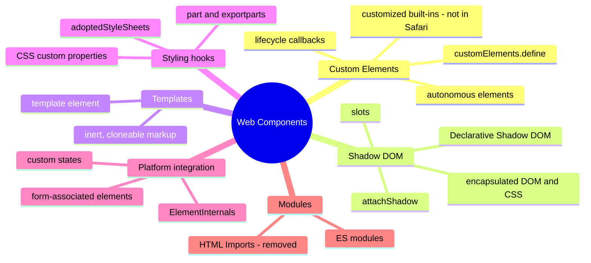

| Standard | What it gives you | Status |
|---|---|---|
| **Custom Elements** | Register a class for a tag name; lifecycle callbacks | All major browsers (autonomous elements) |
| **Shadow DOM** | A hidden DOM subtree with scoped CSS | All major browsers |
| **`<template>` / `<slot>`** | Inert markup to clone; insertion points for light-DOM children | All major browsers |
| **Declarative Shadow DOM** | Shadow roots written in HTML (for SSR) | All major browsers (Chrome 111, Firefox 123, Safari 16.4) |
| **`ElementInternals`** | Form participation, default ARIA semantics, custom states | All major browsers (Safari since 16.4) |
| **Constructable stylesheets** | Share one `CSSStyleSheet` across many shadow roots | All major browsers (Safari since 16.4) |
| **Scoped custom element registries** | Separate tag namespaces per shadow root | Newest Chromium and Safari releases; Firefox in progress. Check MDN |
| **HTML Imports** | (The original way to load components) | **Removed**. Use ES modules |

> **Customized built-ins** (`<button is="fancy-button">`, `extends: 'button'`) work in Chromium and Firefox, but **WebKit has declined to implement them**, so Safari doesn't support them. Prefer **autonomous** custom elements (`<fancy-button>`) and get native behaviour through `ElementInternals` instead.

---

### Section 2: Custom Elements and Their Lifecycle

```javascript
class HelloBadge extends HTMLElement {
  static observedAttributes = ['name'];

  connectedCallback() { this.render(); }
  attributeChangedCallback() { this.render(); }

  render() {
    this.textContent = `Hello, ${this.getAttribute('name') ?? 'world'}`;
  }
}

customElements.define('hello-badge', HelloBadge);
// <hello-badge name="Ada"></hello-badge>  →  Hello, Ada
```

**Naming rules:** the name must start with a lowercase ASCII letter, contain a **hyphen**, and not be one of a few reserved names (e.g. `font-face`). The hyphen guarantees no clash with future built-in elements. A name can be defined **only once** per registry; a second `define()` throws.

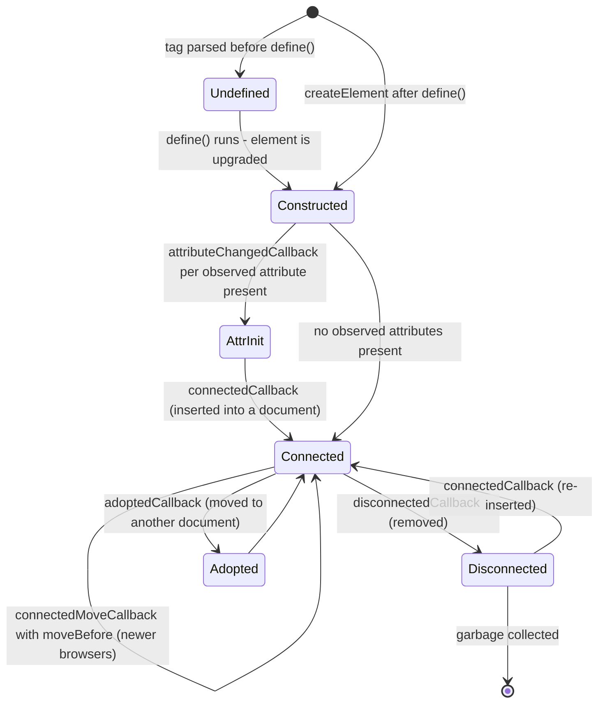

| Callback | When | Put here |
|---|---|---|
| `constructor()` | Element created or upgraded | `super()` first; set up internal state, `attachShadow()`, `attachInternals()`. **Don't** read attributes or add children/attributes to the host here |
| `connectedCallback()` | Inserted into a document (can run many times) | Render, add global listeners, start observers or timers |
| `disconnectedCallback()` | Removed from a document | **Clean up** everything `connectedCallback` started (leaks otherwise) |
| `attributeChangedCallback(name, old, new)` | An attribute listed in `static observedAttributes` changes | Sync the attribute to internal state |
| `adoptedCallback()` | Moved to another document (e.g. into an iframe) | Rarely needed |
| `connectedMoveCallback()` | Moved with `Element.moveBefore()` instead of remove + insert | Keep state during atomic moves (Chromium and Firefox; not Safari yet) |

**Upgrades and FOUC.** Tags in the HTML before `define()` are **undefined** elements, rendered as unknown inline elements with their light-DOM children visible. When the script runs, they're **upgraded** in place. Hide or reserve space for them until they're ready:

```css
star-rating:not(:defined) {
  display: inline-block;
  inline-size: 7.5rem;   /* reserve the final size: no layout shift (CLS) */
  block-size: 1.5rem;
  visibility: hidden;
}
```

```javascript
await customElements.whenDefined('star-rating'); // resolves once defined
customElements.get('star-rating');               // the class, or undefined
customElements.getName(StarRating);              // 'star-rating' (newer browsers)
customElements.upgrade(detachedElement);         // force-upgrade an element not yet in the document
```

---

### Section 3: Attributes, Properties and Reflection

A custom element's public API has **four channels**, exactly like built-in elements:

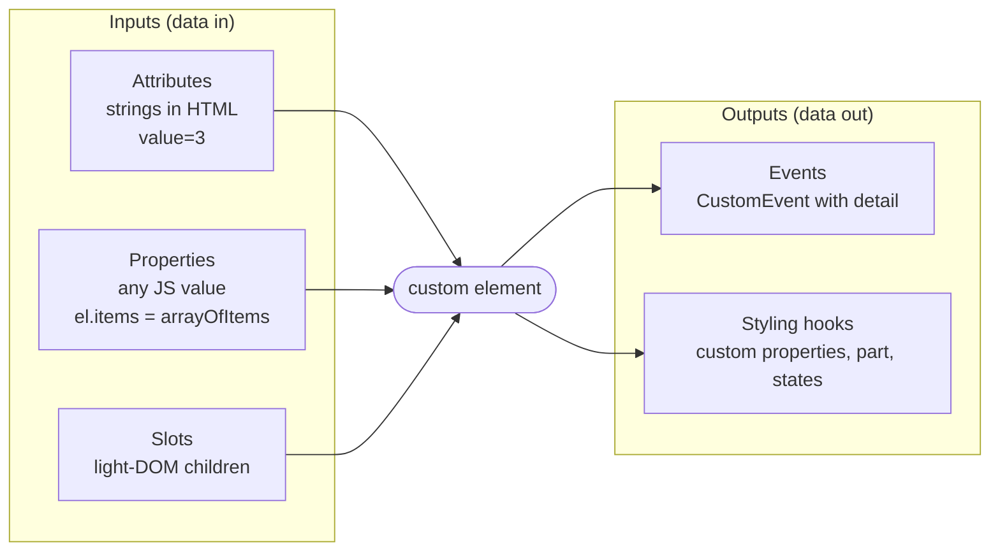

| | Attributes | Properties |
|---|---|---|
| Type | Strings only (or presence for booleans) | Any JS value: numbers, arrays, objects, functions |
| Set from | HTML, SSR, `setAttribute`, CSS selectors can match them | JavaScript, framework bindings |
| Good for | Simple config: `variant="primary"`, `disabled`, `value="3"` | Rich data: `items`, `formatter`, `config` |
| Observed via | `observedAttributes` + `attributeChangedCallback` | Getter/setter on the class |

**Reflection.** Built-in elements keep many attributes and properties in sync (`input.disabled` ↔ `disabled`). Do the same for simple values so CSS selectors (`:host([disabled])`) and SSR markup work:

```javascript
get disabled() { return this.hasAttribute('disabled'); }
set disabled(v) { this.toggleAttribute('disabled', Boolean(v)); } // property → attribute
```

**Rules for a framework-friendly API:**
- Every attribute has a matching **property**. Frameworks increasingly set properties, and rich data can only be passed as a property.
- **Don't reflect** rich data (arrays, objects) to attributes; serialising JSON into attributes is slow and lossy.
- Handle properties set **before upgrade**: a framework may set `el.items = [...]` on the undefined element, which creates an own property that **shadows** your class setter. Re-apply it in `connectedCallback` (the "lazy property" pattern in Example 1).
- Emit **events**, don't call parent callbacks. Name them in lowercase, like `rating-change`.
- Keep the element **stateless when controlled**: if the host app sets `value`, render it, and emit an event when the user tries to change it.

---

### Section 4: Shadow DOM — an Encapsulated Tree

`attachShadow()` gives an element a **shadow root**: a separate DOM tree rendered **in place of** the element's children. The element is the **shadow host**; its normal children are the **light DOM**.

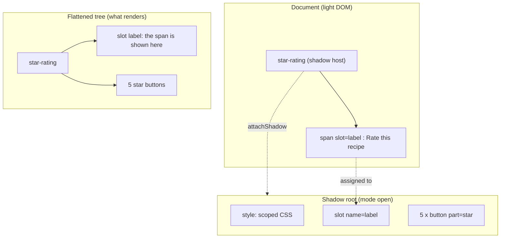

```javascript
class StarRating extends HTMLElement {
  constructor() {
    super();
    const root = this.attachShadow({ mode: 'open', delegatesFocus: true });
    root.innerHTML = `
      <style>:host { display: inline-flex; gap: .25rem }</style>
      <slot name="label"></slot>
      <div role="radiogroup"></div>`;
  }
}
```

| `attachShadow` option | Meaning |
|---|---|
| `mode: 'open'` | `el.shadowRoot` returns the root. **Recommended**: tests, tooling and frameworks need it |
| `mode: 'closed'` | `el.shadowRoot` returns `null`. **Not a security boundary**: scripts on the page can still patch `attachShadow` or read the DOM through other means. Mostly adds friction |
| `delegatesFocus: true` | Clicking the host or calling `host.focus()` focuses the first focusable element inside; `:focus` matches the host |
| `slotAssignment: 'manual'` | Assign light-DOM children to slots imperatively with `slot.assign(...)` |
| `clonable`, `serializable` | Allow `cloneNode` and `getHTML({ serializableShadowRoots: true })` to include the shadow root |

**What Shadow DOM encapsulates:**

| Encapsulated ✅ | Not encapsulated ❌ |
|---|---|
| `querySelector` from the document doesn't find shadow internals | **Inherited CSS properties** (`color`, `font`, `line-height`) flow into the shadow tree |
| Page selectors don't match shadow internals | **CSS custom properties** pierce the boundary (by design: the theming API) |
| Shadow styles don't leak out | Global JS: `window`, `document`, globals, prototypes |
| IDs are scoped to the shadow tree | The **custom element registry** is global (unless scoped registries are used) |
| Events are **retargeted** to the host | Security: same origin, same privileges; closed mode isn't a sandbox |

> **Not every element can host a shadow root.** Autonomous custom elements and a short list of built-ins (`div`, `span`, `section`, `article`, `p`, headings, etc.) can. Elements like `input`, `img` or `a` can't.

---

### Section 5: Slots and Composition

Slots let consumers pass **content** into a component while the component controls **layout**. Slotted nodes **stay in the light DOM**: they're styled by the page's CSS and remain part of the page for search engines, `querySelector` and accessibility.

```html
<!-- Component's shadow template -->
<article class="card">
  <header><slot name="title">Untitled</slot></header>   <!-- fallback content -->
  <div class="body"><slot></slot></div>                 <!-- default slot -->
  <footer><slot name="actions"></slot></footer>
</article>

<!-- Consumer -->
<info-card>
  <h2 slot="title">Shipping update</h2>
  <p>Your order left the warehouse.</p>               <!-- goes to the default slot -->
  <button slot="actions">Track</button>
</info-card>
```

```javascript
const slot = this.shadowRoot.querySelector('slot[name="actions"]');
slot.addEventListener('slotchange', () => {
  const buttons = slot.assignedElements({ flatten: true });
  this.toggleAttribute('has-actions', buttons.length > 0); // e.g. hide an empty footer
});
```

| Concept | Detail |
|---|---|
| **Named slot** | `<slot name="x">` receives children with `slot="x"` |
| **Default slot** | `<slot>` without a name receives everything else (including text nodes) |
| **Fallback content** | Children of `<slot>` render when nothing is assigned |
| **`slotchange`** | Fires when the assigned nodes change |
| **`assignedNodes()` / `assignedElements()`** | Read what's slotted; `{ flatten: true }` resolves nested slots |
| **Only direct children are slotted** | A grandchild with `slot="x"` is ignored |
| **Hiding empty slots** | Use `slotchange` to set a host attribute. A `:has-slotted` pseudo-class is emerging but not yet in all browsers |

**Composition vs configuration.** Slots are the Web Component equivalent of `children` and render props: prefer them over long lists of string attributes for anything that's content (rich text, icons, buttons). See [Compound Component Pattern](./compound-component-pattern.md) for the same idea in frameworks.

---

### Section 6: Styling Across the Boundary

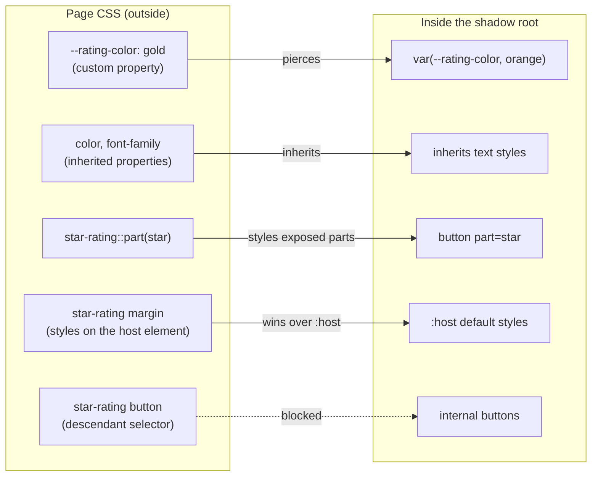

| Tool | Where | Use |
|---|---|---|
| `:host` / `:host(.compact)` / `:host([disabled])` | Inside | Default styles for the host, by state or attribute |
| `::slotted(img)` | Inside | Style **top-level** slotted elements (compound selectors only, no descendants) |
| `:state(open)` | Both | Match custom states set through `internals.states` (all major browsers in their recent versions) |
| **CSS custom properties** | Outside → inside | The main theming API: `--rating-color`, `--card-radius`. Document them |
| `part="star"` + `::part(star)` | Outside | Let consumers style specific internal elements. Supports pseudo-classes (`::part(star):hover`) but not descendants |
| `exportparts` | Nested components | Re-export a child component's parts upward |
| `adoptedStyleSheets` | Inside | One parsed `CSSStyleSheet` shared by every instance (memory and speed) |
| `:host-context(.dark)` | Inside | **Avoid**: Chromium-only and marked deprecated. Use custom properties or attributes instead |

**Cascade order across the boundary:** for normal declarations, the **outer context wins**. A page rule on `star-rating { display: block }` beats `:host { display: inline-flex }`, and page styles on slotted elements beat `::slotted()`. For `!important`, the inner context wins. That's what makes `:host` a safe **default** that consumers can override.

```javascript
// Shared stylesheet: parsed once, adopted by every instance
const sheet = new CSSStyleSheet();
sheet.replaceSync(`
  :host { display: inline-flex; gap: var(--rating-gap, .25rem); }
  button { color: var(--rating-color, #f5a623); background: none; border: 0; font-size: 1.5rem; }
  :host([disabled]) button { opacity: .5; cursor: not-allowed; }
`);

class StarRating extends HTMLElement {
  constructor() {
    super();
    this.attachShadow({ mode: 'open' }).adoptedStyleSheets = [sheet];
  }
}
```

**Styling gotchas:**
- **Global CSS frameworks don't reach inside.** Tailwind, Bootstrap or a reset stylesheet won't style shadow internals. Adopt the shared sheet inside each component, or don't use Shadow DOM for that component.
- **`@font-face` inside a shadow root** doesn't work reliably across browsers. Declare fonts in the document; the font family then inherits into the component.
- **CSS module scripts** (`import sheet from './x.css' with { type: 'css' }`) work in Chromium and recent Firefox, not Safari yet. Bundlers can turn CSS into a constructable stylesheet for you.
- **Design tokens** map naturally to custom properties. See [Design Tokens](./design-tokens.md) and [Theming & Dark Mode](./theming-and-dark-mode.md).

---

### Section 7: Events Across the Boundary

When an event crosses a shadow boundary, it's **retargeted**: listeners outside see `event.target` as the **host**, not the internal button. That keeps internals private.

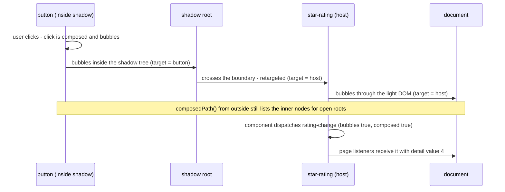

| Event | Crosses the shadow boundary? |
|---|---|
| UI events: `click`, `input`, `keydown`, `pointerdown`, `focusin` | ✅ Composed |
| `focus` / `blur` | ✅ Composed, but don't bubble (use `focusin`/`focusout`) |
| **`change`**, `submit`, `reset`, `load`, `scroll` on inner elements | ❌ Not composed: they stop at the shadow root |
| `new CustomEvent('x')` | ❌ by default: `composed: false`, `bubbles: false` |
| `new CustomEvent('x', { bubbles: true, composed: true })` | ✅ |

```javascript
// Re-dispatch meaningful events from the host
this.dispatchEvent(new CustomEvent('rating-change', {
  detail: { value: this.value },
  bubbles: true,
  composed: true,   // needed only if the HOST itself may sit inside another shadow root
}));
```

> **Gotcha:** the internal `<input>`'s `change` event never reaches the page. A component wrapping an input must listen inside and **re-dispatch** its own `change` (or a named event) from the host.

---

### Section 8: Forms and Accessibility

#### 8.1 Form-associated custom elements

A custom control inside `<form>` isn't submitted, validated or reset unless it opts in through **`ElementInternals`**:

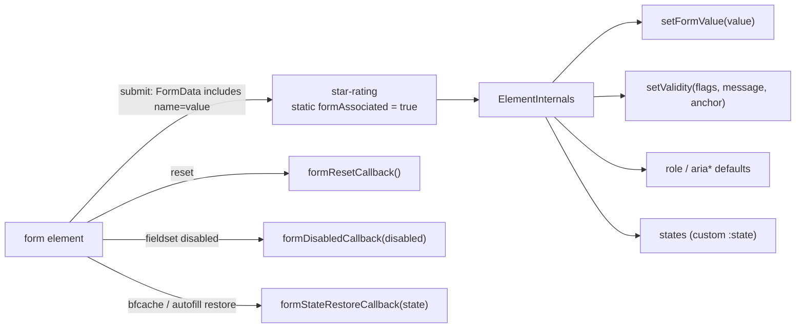

What you get by opting in: the value appears in `FormData`, `required`-style validation participates in `form.checkValidity()` and `:invalid`, `<label for>` works, `fieldset[disabled]` disables it, and reset restores it. See [Accessible Forms & Error Handling](./accessible-forms-and-error-handling.md).

#### 8.2 Accessibility

| Topic | Rule |
|---|---|
| **Semantics** | Use real elements inside (`<button>`, `<input>`), or set default semantics with `internals.role` / `internals.ariaLabel` etc. Page-set `role`/`aria-*` attributes on the host still override them |
| **Focus** | Use `delegatesFocus: true` for components wrapping one focusable control; manage roving `tabindex` for composite widgets. See [Keyboard Navigation & Focus Management](./keyboard-navigation-and-focus-management.md) |
| **ID references across roots** | `aria-labelledby`, `aria-describedby`, `for` and `aria-controls` use IDs, which **can't cross a shadow boundary**. A `<label for="x">` outside can't point at an `<input id="x">` inside |
| **Workarounds** | (1) Make the host itself the labelled control (form-associated + `internals.role`), (2) copy the label text in through a slot or property, (3) **element reflection** (`el.ariaLabelledByElements = [labelEl]`), which can point to elements in the same or an *ancestor* tree, now in all major browsers. A **Reference Target** proposal (`shadowRoot.referenceTarget`) to forward ID references into a shadow root is experimental — check MDN |
| **Slotted content** | Stays in the light DOM, so it keeps its own semantics and is read in the flattened order |
| **Testing** | Screen readers follow the flattened tree. Test with real assistive tech, not only automated checks. See [Screen Reader Testing](./screen-reader-testing.md) |

---

### Section 9: Declarative Shadow DOM and SSR

Client-only components render nothing until JavaScript runs. **Declarative Shadow DOM (DSD)** lets the server send the shadow root as HTML, so the component paints on first render, with no JS.

```html
<star-rating value="4">
  <template shadowrootmode="open">
    <style>:host { display: inline-flex } button { color: var(--rating-color, #f5a623) }</style>
    <span role="img" aria-label="4 out of 5 stars">★★★★☆</span>
  </template>
</star-rating>
<script type="module" src="/components/star-rating.js"></script>
```

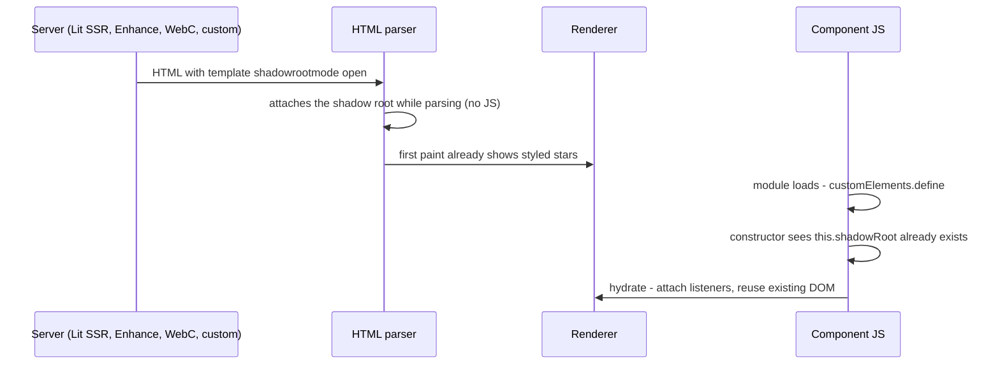

```javascript
constructor() {
  super();
  // DSD already created the shadow root? Reuse it instead of replacing it.
  // (For closed DSD roots, read it from this.attachInternals().shadowRoot.)
  this.root = this.shadowRoot ?? this.attachShadow({ mode: 'open' });
  if (!this.root.firstChild) this.root.innerHTML = TEMPLATE;
}
```

| DSD fact | Detail |
|---|---|
| Support | All major browsers. An older Chrome-only `shadowroot` attribute was replaced by `shadowrootmode` |
| Parsing | Only the **HTML parser** and the newer `setHTMLUnsafe()` / `Document.parseHTMLUnsafe()` create shadow roots from `<template shadowrootmode>`. `innerHTML` does **not** |
| Serializing | `el.getHTML({ serializableShadowRoots: true })` for roots created with `serializable` / `shadowrootserializable` |
| Extra attributes | `shadowrootdelegatesfocus`, `shadowrootclonable`, `shadowrootserializable` |
| Cost | Styles repeat for every instance in the HTML. Keep component CSS small, or accept the duplication for above-the-fold components only |

**SSR tools:** Lit's SSR package (`@lit-labs/ssr`, still labelled "labs"), Enhance, 11ty WebC and Stencil's hydrate app can render DSD. Framework meta-frameworks have partial support for rendering third-party custom elements. Many teams render a lightweight fallback (the slotted light-DOM content) and let the component upgrade on the client. See [Server-Side Rendering (SSR)](./server-side-rendering-ssr.md) and [Island Architecture](./island-architecture.md).

---

### Section 10: Registries, Versioning and Distribution

The global `customElements` registry has **one definition per tag name per page**. That becomes a problem when two micro-frontends bundle **different versions** of the same design system:

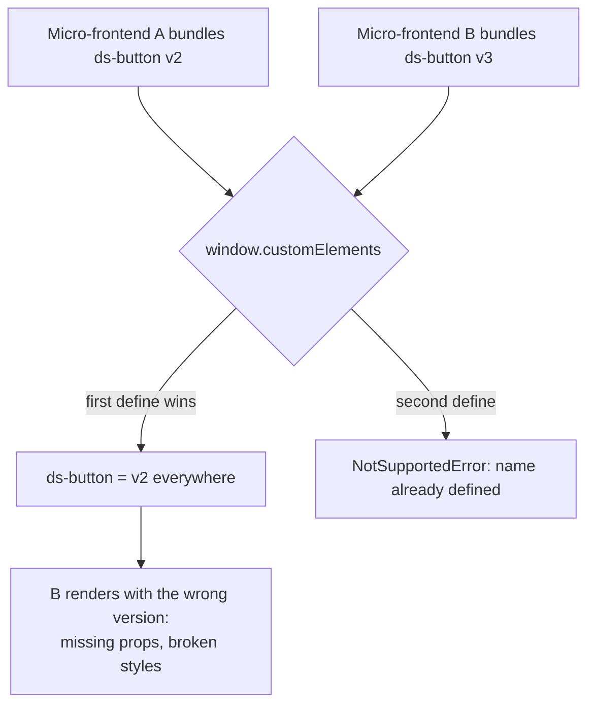

| Strategy | How | Trade-off |
|---|---|---|
| **Single shared version** | Load the design system once from the host (import maps or module federation shared deps) | Coordinated upgrades |
| **Guarded define** | `if (!customElements.get(tag)) customElements.define(tag, Cls)` | Avoids the error, but still "first wins" |
| **Version-suffixed tags** | `ds-button-v3` | Works everywhere; ugly, duplicates code |
| **Scoped custom element registries** | `new CustomElementRegistry()` per shadow root (`attachShadow({ customElementRegistry })`) | The real fix. Shipped in the newest Chromium and Safari; Firefox in progress. Polyfill exists |

**Distribution checklist for a component library:**
- Ship **ES modules** with a side-effect entry per component (`import '@acme/ds/button.js'` defines `<ds-button>`) plus class-only exports for consumers who define tags themselves.
- Publish a **Custom Elements Manifest** (`custom-elements.json`): IDEs, Storybook and framework wrapper generators read it.
- Ship **framework wrappers** where needed (React wrappers for React 18 and earlier; types for Vue/Angular templates).
- Document the **public API**: attributes, properties, events, slots, CSS custom properties, parts, states.
- Version the API with semver; renaming a part or custom property is a **breaking change**.

---

### Section 11: Libraries and Framework Interop

**Authoring libraries:**

| Library | Approach | Notes |
|---|---|---|
| **Vanilla** | `HTMLElement` + templates | No dependency; you write rendering, updates and attribute sync yourself |
| **Lit** (Google) | Reactive properties + `html` tagged templates, efficient updates | Small, widely used; SSR in labs |
| **Stencil** (Ionic) | Compiler with JSX, generates framework wrappers | Powers Ionic; good for multi-framework design systems |
| **FAST** (Microsoft) | Templates + design-token system | Used for Fluent UI web components |
| **Framework-to-WC** | Vue `defineCustomElement`, Angular Elements `createCustomElement`, Svelte `customElement` option | Reuse framework components as WCs; each element ships the framework runtime |

Public adopters include GitHub (e.g. `<relative-time>`), Adobe (Spectrum Web Components, Photoshop on the web), Salesforce (Lightning Web Components), Microsoft (Fluent), and Ionic.

**Consuming Web Components from frameworks** (see [Custom Elements Everywhere](https://custom-elements-everywhere.com/) for the current test results):

| Framework | Passing rich data | Listening to custom events | Setup |
|---|---|---|---|
| **React 19+** | Sets **properties** when the element has a matching property, attributes otherwise | Supported declaratively; check the React docs for event-name casing, or use a ref | None |
| **React ≤ 18** | Everything becomes a string **attribute** | No declarative support: use `ref` + `addEventListener`, or a wrapper (`@lit/react`) | Wrapper recommended |
| **Vue 3** | Sets DOM properties when `key in el`; `.prop` modifier forces it | `@rating-change="..."` | `compilerOptions.isCustomElement` |
| **Angular** | `[value]="x"` binds properties | `(rating-change)="on($event)"` | `CUSTOM_ELEMENTS_SCHEMA` |
| **Svelte** | Sets properties when they exist | Event listeners on the element | None |
| **Native mobile** | WebViews (Capacitor, Ionic) render WCs normally. **React Native and native UI have no DOM**, so share design tokens and behaviour specs, not the elements | — | — |

---

## System Design Angle

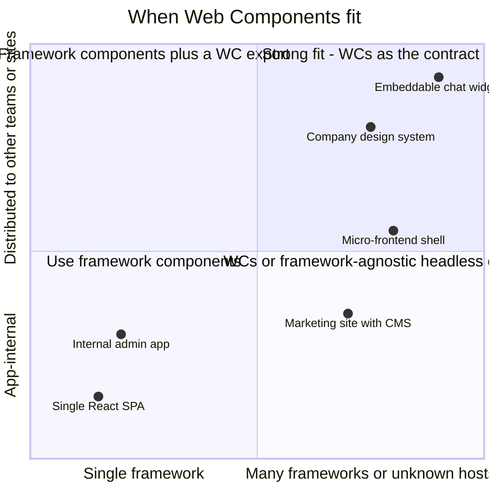

| Use case | Why WCs help | Watch out for |
|---|---|---|
| **Design system for many frameworks** | One implementation for React, Vue, Angular, server-rendered pages and CMS templates | React ≤ 18 wrappers, SSR story, theming API design |
| **Embeddable third-party widget** (chat, payments, reviews) | Shadow DOM shields the widget from the host site's CSS, and the host from yours | Host CSP, fonts, z-index and stacking contexts, `iframe` may still be better for security isolation (see [Clickjacking & iframe Protection](./clickjacking-and-iframe-protection.md)) |
| **Micro-frontends** | A custom element is a framework-neutral mount point with attributes in and events out | Registry version clashes, duplicated framework runtimes. See [Micro-Frontends Architecture](./micro-frontends-architecture.md) |
| **Progressive enhancement of server HTML** | Wrap existing markup ("HTML web components") and enhance it in `connectedCallback`, often **without** Shadow DOM | Keep the no-JS state usable |
| **Single-framework product** | Little benefit; the framework's own components are simpler | Extra API surface, SSR complexity |

**Shadow DOM is optional.** A custom element without a shadow root ("light DOM" component) is perfectly valid: global styles and utilities apply, IDs work across the page, and forms work natively. Choose Shadow DOM when **style isolation** is the goal (widgets, cross-site distribution), and light DOM when you want the page's CSS system (e.g. Tailwind) to style the component.

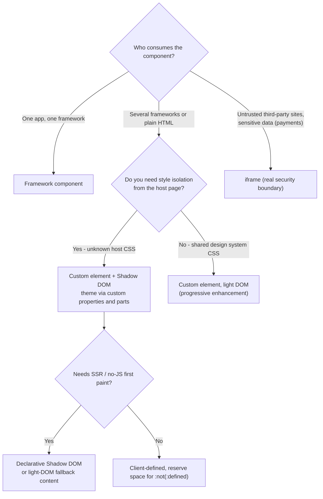

---

## Real-World Examples

**Example 1 — A form-associated, accessible `<star-rating>` (vanilla, TypeScript):**

```typescript
// star-rating.ts
const sheet = new CSSStyleSheet();
sheet.replaceSync(`
  :host { display: inline-flex; gap: var(--rating-gap, .125rem); }
  :host([disabled]) { opacity: .5; pointer-events: none; }
  button { font-size: var(--rating-size, 1.5rem); color: var(--rating-empty, #c4c4c4);
           background: none; border: 0; padding: 0; cursor: pointer; }
  button[aria-checked="true"], button.on { color: var(--rating-color, #f5a623); }
  button:focus-visible { outline: 2px solid var(--rating-focus, #2563eb); outline-offset: 2px; }
`);

export class StarRating extends HTMLElement {
  static formAssociated = true;
  static observedAttributes = ['value', 'max', 'disabled'];

  #internals = this.attachInternals();
  #root = this.attachShadow({ mode: 'open', delegatesFocus: true });

  constructor() {
    super();
    this.#root.adoptedStyleSheets = [sheet];
    this.#internals.role = 'radiogroup';
    this.#root.addEventListener('click', (e) => {
      const btn = (e.target as Element).closest('button');
      if (btn) this.#select(Number(btn.dataset.value));
    });
    this.#root.addEventListener('keydown', (e) => this.#onKey(e));
  }

  get value() { return Number(this.getAttribute('value') ?? 0); }
  set value(v: number) { this.setAttribute('value', String(v)); }
  get max() { return Number(this.getAttribute('max') ?? 5); }
  set max(v: number) { this.setAttribute('max', String(v)); } // frameworks may assign properties

  connectedCallback() {
    // Lazy-property pattern: a framework may have set .value before upgrade
    if (Object.hasOwn(this, 'value')) {
      const v = (this as any).value;
      delete (this as any).value;
      this.value = v;
    }
    this.#render();
  }

  attributeChangedCallback() {
    if (this.isConnected) this.#render();
  }

  formResetCallback() { this.value = 0; }
  formDisabledCallback(disabled: boolean) { this.toggleAttribute('disabled', disabled); }

  #select(v: number) {
    if (v === this.value) return;
    this.value = v;
    this.dispatchEvent(new CustomEvent('rating-change', {
      detail: { value: v }, bubbles: true, composed: true,
    }));
  }

  #onKey(e: KeyboardEvent) {
    const deltas: Record<string, number> = { ArrowRight: 1, ArrowUp: 1, ArrowLeft: -1, ArrowDown: -1 };
    const delta = deltas[e.key];
    if (!delta) return;
    e.preventDefault();
    const next = Math.min(this.max, Math.max(1, this.value + delta));
    this.#select(next);
    this.#root.querySelector<HTMLButtonElement>(`button[data-value="${next}"]`)?.focus();
  }

  #render() {
    const { value, max } = this;
    this.#internals.setFormValue(value ? String(value) : null);
    this.#internals.setValidity(
      this.hasAttribute('required') && !value ? { valueMissing: true } : {},
      'Please choose a rating',
    );
    this.#root.innerHTML = Array.from({ length: max }, (_, i) => {
      const n = i + 1;
      const checked = n === value;
      return `<button type="button" role="radio" data-value="${n}"
                aria-checked="${checked}" aria-label="${n} of ${max} stars"
                class="${n <= value ? 'on' : ''}"
                tabindex="${checked || (!value && n === 1) ? 0 : -1}">★</button>`;
    }).join('');
  }
}

if (!customElements.get('star-rating')) customElements.define('star-rating', StarRating);
```

```html
<form>
  <label id="rating-label">Rate this recipe</label>
  <star-rating name="rating" required aria-labelledby="rating-label"></star-rating>
  <button>Submit</button>   <!-- FormData now contains rating=4 -->
</form>
```

Note the label sits on the **host** (`aria-labelledby` on `<star-rating>`), which works because the host and the label are in the same tree. Pointing a label at the inner buttons would not.

**Example 2 — The same component with Lit:**

```typescript
import { LitElement, html, css } from 'lit';

export class LitStarRating extends LitElement {
  static properties = {
    value: { type: Number, reflect: true },
    max: { type: Number },
  };
  static styles = css`
    :host { display: inline-flex; gap: var(--rating-gap, .125rem); }
    button { color: var(--rating-empty, #c4c4c4); background: none; border: 0; font-size: 1.5rem; }
    button.on { color: var(--rating-color, #f5a623); }
  `;

  // `declare` avoids class fields shadowing Lit's reactive accessors
  declare value: number;
  declare max: number;

  constructor() {
    super();
    this.value = 0;
    this.max = 5;
  }

  #select(v: number) {
    this.value = v;
    this.dispatchEvent(new CustomEvent('rating-change', { detail: { value: v }, bubbles: true, composed: true }));
  }

  render() {
    return html`${Array.from({ length: this.max }, (_, i) => html`
      <button part="star" class=${i < this.value ? 'on' : ''}
              aria-label="${i + 1} of ${this.max} stars"
              @click=${() => this.#select(i + 1)}>★</button>`)}`;
  }
}
customElements.define('lit-star-rating', LitStarRating);
```

Lit re-renders only the changed parts of the template when a reactive property changes, and batches updates into a microtask.

**Example 3 — Theming from the outside (BAD → GOOD):**

```css
/* ❌ BAD: descendant selectors can't reach into the shadow root — nothing happens */
star-rating button { color: hotpink; }

/* ❌ BAD: :host-context is Chromium-only and deprecated */

/* ✅ GOOD: the component's documented theming API */
star-rating {
  --rating-color: hotpink;
  --rating-size: 2rem;
}
.dark star-rating { --rating-empty: #555; }   /* custom properties inherit: dark mode for free */

/* ✅ GOOD: exposed parts for deeper styling (Lit example exposes part="star") */
lit-star-rating::part(star):hover { transform: scale(1.15); }
```

**Example 4 — Using it from React (18 and 19) and from other frameworks:**

```tsx
// Works in every React version: ref + addEventListener + property assignment
import { useEffect, useRef } from 'react';
import './star-rating';

export function Rating({ value, onChange }: { value: number; onChange: (v: number) => void }) {
  const ref = useRef<HTMLElement & { value: number }>(null);

  useEffect(() => {
    if (ref.current) ref.current.value = value; // set the PROPERTY
  }, [value]);

  useEffect(() => {
    const el = ref.current;
    if (!el) return;
    const handler = (e: Event) => onChange((e as CustomEvent<{ value: number }>).detail.value);
    el.addEventListener('rating-change', handler);
    return () => el.removeEventListener('rating-change', handler);
  }, [onChange]);

  return <star-rating ref={ref} max={5} />;
}

// TypeScript: declare the tag for JSX (React 19 types)
declare module 'react' {
  namespace JSX {
    interface IntrinsicElements {
      'star-rating': React.DetailedHTMLProps<React.HTMLAttributes<HTMLElement>, HTMLElement> & { max?: number };
    }
  }
}
```

```typescript
// Or generate a typed wrapper once with @lit/react
import * as React from 'react';
import { createComponent } from '@lit/react';
import { StarRating } from './star-rating';

export const StarRatingReact = createComponent({
  tagName: 'star-rating',
  elementClass: StarRating,
  react: React,
  events: { onRatingChange: 'rating-change' },
});
```

```typescript
// Vue 3 + Vite: tell the compiler these tags are custom elements
// vite.config.ts
import vue from '@vitejs/plugin-vue';
export default {
  plugins: [vue({ template: { compilerOptions: { isCustomElement: (tag: string) => tag === 'star-rating' } } })],
};
// Template: <star-rating :value="rating" @rating-change="rating = $event.detail.value" />
```

```typescript
// Angular (standalone component)
import { Component, CUSTOM_ELEMENTS_SCHEMA, signal } from '@angular/core';
import './star-rating';

@Component({
  selector: 'app-review',
  schemas: [CUSTOM_ELEMENTS_SCHEMA],
  template: `<star-rating [value]="rating()" (rating-change)="rating.set($any($event).detail.value)"></star-rating>`,
})
export class ReviewComponent {
  rating = signal(0);
}
```

```svelte
<!-- Svelte 5 -->
<script lang="ts">
  import './star-rating';
  let rating = $state(0);
  let el = $state<HTMLElement>();
  $effect(() => {
    if (!el) return;
    const target = el;
    const handler = (e: Event) => (rating = (e as CustomEvent).detail.value);
    target.addEventListener('rating-change', handler);
    return () => target.removeEventListener('rating-change', handler);
  });
</script>

<star-rating bind:this={el} value={rating}></star-rating>
```

**Example 5 — An embeddable widget loader (third-party script):**

```javascript
// https://widgets.example.com/reviews.js  — host pages add one script tag
(() => {
  const TAG = 'acme-reviews';
  if (customElements.get(TAG)) return; // the host may include the script twice

  class AcmeReviews extends HTMLElement {
    #root = this.attachShadow({ mode: 'open' }); // isolate from unknown host CSS
    #abort;

    async connectedCallback() {
      this.#abort = new AbortController();
      this.#root.innerHTML = `<style>:host{all:initial;display:block;font:inherit}</style><p>Loading reviews…</p>`;
      try {
        const res = await fetch(`https://api.example.com/reviews?product=${encodeURIComponent(this.getAttribute('product') ?? '')}`,
          { signal: this.#abort.signal });
        const reviews = await res.json();
        const list = document.createElement('ul');
        for (const r of reviews) {
          const li = document.createElement('li');
          li.textContent = `${r.author}: ${r.text}`; // textContent, never innerHTML, for user content
          list.append(li);
        }
        this.#root.replaceChildren(this.#root.querySelector('style'), list);
      } catch (err) {
        if (err.name !== 'AbortError') this.#root.querySelector('p').textContent = 'Reviews unavailable';
      }
    }

    disconnectedCallback() { this.#abort?.abort(); } // no leaks when the host SPA removes it
  }
  customElements.define(TAG, AcmeReviews);
})();
```

```html
<!-- Host page -->
<acme-reviews product="sku-123"></acme-reviews>
<script src="https://widgets.example.com/reviews.js" async></script>
```

`all: initial` on `:host` stops inherited host styles (fonts, colours, line height) from leaking in; `font: inherit` then deliberately keeps the host's font. Shadow DOM isolates **styles**, not **scripts**: the widget runs with the host page's privileges, so it must also respect the host's CSP and never inject user content as HTML (see [XSS Prevention](./xss-prevention-reflected-stored-dom.md)).

---

## Key Points Summary

| Concept | One-Line Explanation |
|---|---|
| **Custom Elements** | Register a class for a hyphenated tag; the browser creates and upgrades instances |
| **Lifecycle** | `constructor` → `attributeChangedCallback` → `connectedCallback` … `disconnectedCallback` (clean up!) |
| **Customized built-ins** | `is="..."` isn't supported in Safari; use autonomous elements |
| **Attributes vs properties** | Strings for HTML and CSS; properties for rich data; reflect simple ones |
| **Shadow DOM** | A private subtree with scoped CSS and IDs, rendered in place of the light DOM |
| **Closed mode** | Not a security boundary; prefer `open` |
| **Slots** | Light-DOM children projected into the shadow layout; still styled by the page |
| **Styling API** | Custom properties and `::part` go in; `:host` provides overridable defaults |
| **Retargeting** | Outside listeners see the host as `event.target` |
| **`composed: true`** | Needed for a custom event to cross shadow boundaries; `change`/`submit` never do |
| **`ElementInternals`** | Form value, validity, default ARIA role, custom states |
| **Cross-root ARIA** | ID references can't cross shadow boundaries; label the host or use element reflection |
| **Declarative Shadow DOM** | `<template shadowrootmode>` renders shadow roots from HTML: SSR without JS |
| **Global registry** | One definition per tag per page; scoped registries are the fix for version clashes |
| **Framework interop** | React 19+, Vue, Angular, Svelte bind properties and events; React ≤ 18 needs wrappers |

---

## Test Your Understanding

**Q1 (Basic):**
What are the three main standards behind Web Components, and which problem does each one solve?

<details>
<summary>Answer</summary>

- **Custom Elements** — let you define new HTML tags backed by a JS class, with lifecycle callbacks. They solve **reuse across frameworks**: the browser itself knows the component.
- **Shadow DOM** — attaches a private DOM tree with scoped CSS and IDs. It solves **encapsulation**: the page's CSS can't break the component, and the component's CSS can't leak out.
- **HTML templates and slots** — `<template>` holds inert markup to clone, and `<slot>` projects consumer content into the component's layout. They solve **composition**.

They're independent: you can use custom elements without Shadow DOM (light-DOM components), or Shadow DOM on a plain `<div>`.
</details>

**Q2 (Application):**
Your company has React, Angular and Vue apps plus server-rendered marketing pages. Leadership wants one design system. Design it.

<details>
<summary>Answer</summary>

- **Implementation:** Web Components (vanilla or Lit/Stencil) as the single source of truth, built on **design tokens** exposed as CSS custom properties.
- **API conventions:** every attribute has a property; rich data via properties only; lowercase hyphenated events with `detail`; slots for content; documented custom properties, parts and states; form controls are **form-associated** with `ElementInternals`.
- **Styling:** Shadow DOM for encapsulation, with shared `adoptedStyleSheets`. Theming via tokens (`--ds-color-primary`), and `::part` for escape hatches.
- **Interop:** generate React wrappers (for React ≤ 18 consumers and better types), Vue/Angular type declarations, and publish a **Custom Elements Manifest**.
- **SSR:** Declarative Shadow DOM for above-the-fold components via Lit SSR or Stencil hydrate; meaningful light-DOM fallback content elsewhere; reserve space for `:not(:defined)` to avoid CLS.
- **Distribution:** ES modules per component, semver, one shared copy loaded by each app; guard `define()` and plan for scoped registries in micro-frontend setups.
- **Accessibility:** real buttons and inputs inside, `delegatesFocus`, label-the-host patterns, screen-reader testing across the flattened tree.
</details>

**Q3 (Tricky):**
A component wraps an `<input>` inside Shadow DOM. The page's `form.addEventListener('change', …)` never fires for it, and the form submits without its value. Why, and how do you fix both?

<details>
<summary>Answer</summary>

1. **`change` isn't a composed event.** It stops at the shadow root, so listeners in the light DOM never see it. Fix: listen to the inner input's `change` and **re-dispatch** a `change` (or named) event from the host with `bubbles: true` (and `composed: true` if the host may itself be inside another shadow root).
2. **Inputs inside a shadow root don't belong to the outer form.** The form only collects controls in its own tree. Fix: make the host **form-associated** (`static formAssociated = true`, `attachInternals()`) and call `internals.setFormValue(value)` whenever the value changes; add `setValidity` for validation and `formResetCallback` for reset.
</details>

**Q4 (Tricky):**
A consumer sets `<ds-button style="display:block">` and `ds-button { color: red }` and it works. But `ds-button span { color: red }` doesn't, and `:host { display: inline-flex }` inside the component is ignored when the consumer sets `display: block`. Explain the rules.

<details>
<summary>Answer</summary>

- Outer CSS can style the **host element itself**: it's in the light DOM. `color` is inherited, so it also flows into the shadow tree.
- Outer **descendant selectors can't match shadow internals** (`ds-button span`). The component must expose styling hooks: custom properties or `part` attributes (`ds-button::part(label)`).
- When outer rules and `:host` rules conflict for **normal** declarations, the **outer context wins**. That's intentional: `:host` provides **defaults** that consumers can override. (For `!important` the inner context wins.)
</details>

**Q5 (Tricky):**
Two micro-frontends on the same page both bundle your design system, one at v2 and one at v3. One team reports `NotSupportedError: 'ds-button' has already been defined`; after they guard the `define()` call, their buttons render with missing features. What's going on, and what are your options?

<details>
<summary>Answer</summary>

The **global custom element registry** allows one class per tag name per page. Whichever bundle runs first defines `ds-button`; the second `define()` throws. Guarding it removes the error, but the second app then gets the **first app's version** (v2), which lacks v3 features.

Options: (1) **share a single version** loaded by the shell (import maps, module federation shared deps) and coordinate upgrades; (2) **version-suffixed tag names** (`ds-button-v3`) so both can coexist, at the cost of duplicated code; (3) **scoped custom element registries**: each micro-frontend's shadow root gets its own `CustomElementRegistry`. That's the real fix, newly available in Chromium and Safari with a polyfill for other browsers. Pick based on browser support needs and how independently teams must deploy.
</details>

**Q6 (System design):**
You're building an embeddable "Book a demo" widget that thousands of customer websites will include with one script tag. Would you use a Web Component, an iframe, or both? Explain the decision.

<details>
<summary>Answer</summary>

It depends on **what needs isolation**:

- **Web Component with Shadow DOM** isolates **styles** in both directions and integrates naturally (inherits the host's fonts if you want, sizes to content, accessible in the host's flow, sends events to the host page). But it runs **in the host's JS context**: the host page can read and modify everything, and the widget is subject to the host's CSP and any XSS on that site.
- **An iframe** gives a **security boundary**: separate origin, separate JS, its own CSP and cookies (subject to third-party cookie rules). Required if the widget handles sensitive data (payments, authenticated user data) or must be protected from host scripts. Costs: resizing via `postMessage`, harder theming, extra document load.

A common design is **both**: a small custom element (`<acme-demo-booking>`) as the public API (attributes for config, events for `booked`), which renders a lightweight launcher in Shadow DOM and opens an **iframe** for the sensitive form. Load it `async`, guard double inclusion, reserve space to avoid CLS, avoid global side effects, and document the CSP entries hosts need (`script-src`, `frame-src`, `connect-src`).
</details>

---

## Cheat Sheet

**Key Definitions:**
- **Custom element:** A hyphenated tag backed by a class registered with `customElements.define`
- **Autonomous vs customized built-in:** `<my-el>` vs `<button is="my-button">` (the latter isn't in Safari)
- **Upgrade:** Converting an already-parsed undefined element into an instance of its class
- **Shadow root / host / light DOM:** The private tree, the element that owns it, and the element's normal children
- **Slot:** A placeholder in the shadow tree where light-DOM children are rendered
- **Retargeting:** Outside listeners see the host as the event target
- **Composed event:** An event that propagates across shadow boundaries
- **`ElementInternals`:** API for form participation, default ARIA semantics and custom states
- **Declarative Shadow DOM:** `<template shadowrootmode="open">` parsed into a shadow root by the HTML parser
- **Scoped registry:** A `CustomElementRegistry` attached to a shadow root instead of the global one

**Quick Reference:**
```text
Define:        customElements.define('x-foo', XFoo)   — guard with customElements.get('x-foo')
Lifecycle:     constructor → attributeChanged (initial) → connected … disconnected (clean up)
Observed:      static observedAttributes = ['value', 'disabled']
Shadow:        this.attachShadow({ mode: 'open', delegatesFocus: true })
Styles:        root.adoptedStyleSheets = [sharedSheet]
Theming:       --custom-properties (pierce) · part="x" + ::part(x) · exportparts · :state(x)
Host styles:   :host · :host([attr]) · :host(.class) — outer CSS overrides them
Slots:         <slot name="x"> + slot="x" · slotchange · assignedElements({ flatten: true })
Events:        new CustomEvent('x-change', { detail, bubbles: true, composed: true })
Not composed:  change, submit, reset → re-dispatch from the host
Forms:         static formAssociated = true · attachInternals() · setFormValue · setValidity
A11y:          real controls inside · internals.role · label the host · ariaLabelledByElements
SSR:           <template shadowrootmode="open"> · reuse this.shadowRoot in the constructor
FOUC/CLS:      x-foo:not(:defined) { reserve size; visibility: hidden }
Frameworks:    React 19 props+events · React ≤ 18 wrapper · Vue isCustomElement · Angular CUSTOM_ELEMENTS_SCHEMA
```

**Common Mistakes to Avoid:**

| Mistake | Why Wrong | Fix |
|---|---|---|
| Reading attributes or adding children in the constructor | Attributes may not exist yet; `createElement` throws if children/attributes are added | Do it in `connectedCallback` |
| No cleanup in `disconnectedCallback` | Listeners, timers and observers leak when SPAs remove the element | Mirror every setup with a teardown (AbortController helps) |
| Using `is="..."` customized built-ins | Not supported in Safari | Autonomous elements + `ElementInternals` |
| Passing objects as attributes | Stringified to `[object Object]` | Use properties |
| Expecting page CSS (Tailwind, resets) inside Shadow DOM | Styles don't cross the boundary | Adopt shared sheets, use custom properties, or use light DOM |
| Using `:host-context()` | Chromium-only, deprecated | Custom properties or host attributes |
| Custom events without `bubbles`/`composed` | Never reach listeners outside nested shadow roots | `bubbles: true, composed: true` where needed |
| Relying on an inner input's `change`/form membership | Not composed; not part of the outer form | Re-dispatch events; form-associated element |
| `aria-labelledby` pointing into or out of a shadow root by ID | ID references don't cross roots | Label the host, slot the label, or element reflection |
| `mode: 'closed'` "for security" | Not a security boundary; hurts testing | `open`; use an iframe for real isolation |
| Unguarded `customElements.define` | Throws when the script loads twice | `if (!customElements.get(tag))` |
| Rendering nothing until JS loads | Blank space, CLS, no SEO content | DSD or light-DOM fallback; reserve space for `:not(:defined)` |
| Setting properties before upgrade without the lazy-property pattern | The own property shadows the class setter | Re-apply own properties in `connectedCallback` |

---

## References & Further Reading

**Core docs**
- MDN: [Web Components](https://developer.mozilla.org/en-US/docs/Web/API/Web_components)
- MDN: [Using custom elements](https://developer.mozilla.org/en-US/docs/Web/API/Web_components/Using_custom_elements) · [Using shadow DOM](https://developer.mozilla.org/en-US/docs/Web/API/Web_components/Using_shadow_DOM) · [Using templates and slots](https://developer.mozilla.org/en-US/docs/Web/API/Web_components/Using_templates_and_slots)
- MDN: [`ElementInternals`](https://developer.mozilla.org/en-US/docs/Web/API/ElementInternals) · [`::part()`](https://developer.mozilla.org/en-US/docs/Web/CSS/::part) · [`:host`](https://developer.mozilla.org/en-US/docs/Web/CSS/:host) · [`:state()`](https://developer.mozilla.org/en-US/docs/Web/CSS/:state)
- MDN: [`<template>` (including `shadowrootmode`)](https://developer.mozilla.org/en-US/docs/Web/HTML/Reference/Elements/template)
- web.dev: [Custom Elements v1](https://web.dev/articles/custom-elements-v1) · [Shadow DOM v1](https://web.dev/articles/shadowdom-v1) · [Declarative Shadow DOM](https://web.dev/articles/declarative-shadow-dom)
- web.dev: [More capable form controls (form-associated custom elements)](https://web.dev/articles/more-capable-form-controls)

**Specs**
- WHATWG HTML: [Custom elements](https://html.spec.whatwg.org/multipage/custom-elements.html)
- WHATWG DOM: [Shadow trees](https://dom.spec.whatwg.org/#shadow-trees)
- W3C: [CSS Scoping Module Level 1](https://www.w3.org/TR/css-scoping-1/) · [CSS Shadow Parts](https://www.w3.org/TR/css-shadow-parts-1/)

**Libraries and tooling**
- [Lit documentation](https://lit.dev/docs/) · [Lit SSR](https://lit.dev/docs/ssr/overview/) · [`@lit/react`](https://lit.dev/docs/frameworks/react/)
- [Stencil documentation](https://stenciljs.com/docs/introduction)
- [Custom Elements Manifest](https://custom-elements-manifest.open-wc.org/)
- [Open Web Components](https://open-wc.org/) — recommendations, testing and tooling
- Vue: [Vue and Web Components](https://vuejs.org/guide/extras/web-components.html)
- Angular: [Angular elements overview](https://angular.dev/guide/elements)
- React: [React 19 release notes — support for custom elements](https://react.dev/blog/2024/12/05/react-19#support-for-custom-elements)

**Deep dives**
- [Custom Elements Everywhere](https://custom-elements-everywhere.com/) — framework interop test results
- Nolan Lawson: [Shadow DOM and accessibility: the trouble with ARIA](https://nolanlawson.com/2022/11/28/shadow-dom-and-accessibility-the-trouble-with-aria/)
- WICG: [Scoped custom element registries proposal](https://github.com/WICG/webcomponents/blob/gh-pages/proposals/Scoped-Custom-Element-Registries.md)

---

> **Previous Topic:** [WebAssembly (WASM) in Frontend](./webassembly-wasm-in-frontend.md)
> — Running compiled, sandboxed code next to JavaScript for heavy computation

> **Next Topic:** [Authentication Architecture (BFF Pattern)](./authentication-architecture-bff-pattern.md)
> — Keeping tokens on the server with a Backend-for-Frontend

*Saved on: 2026-11-06 | Repo: Frontend System Design Learning Notes*
