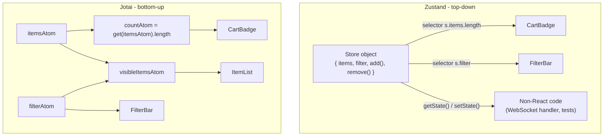
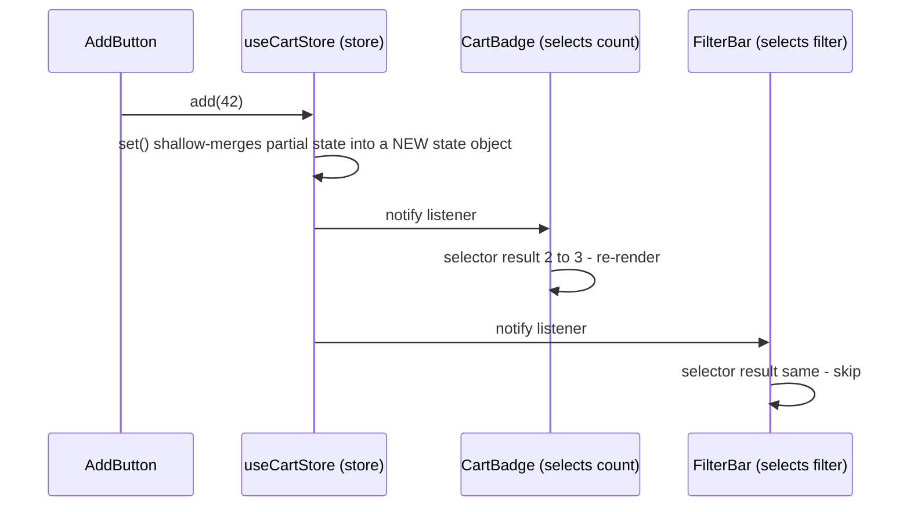
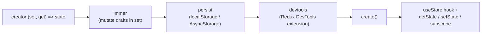
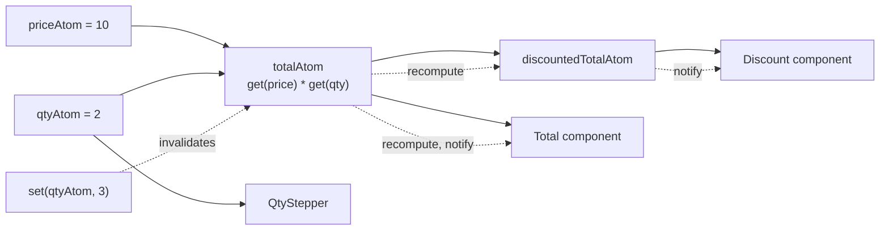
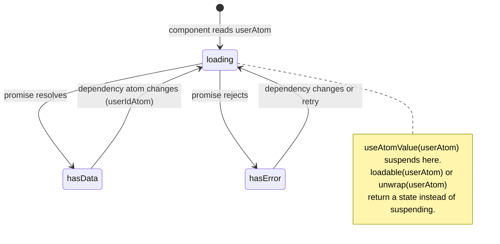
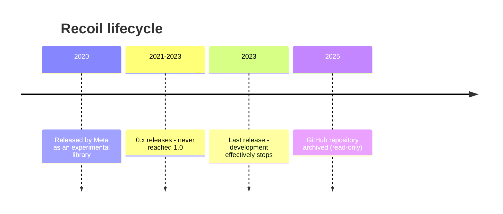
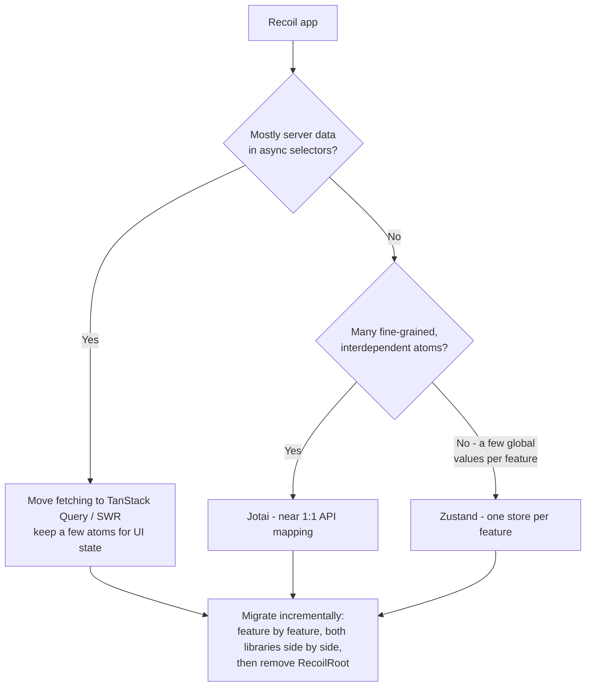
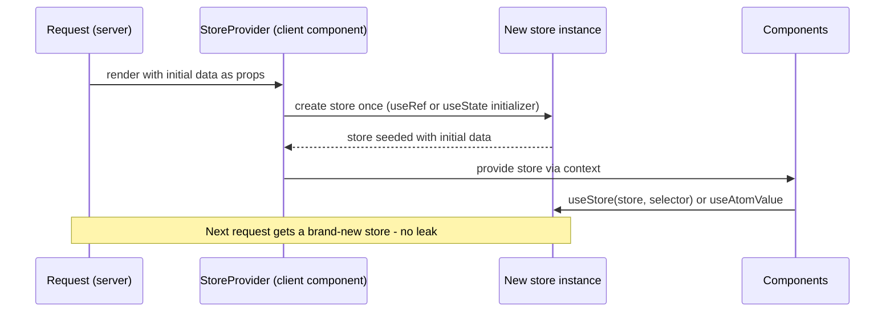
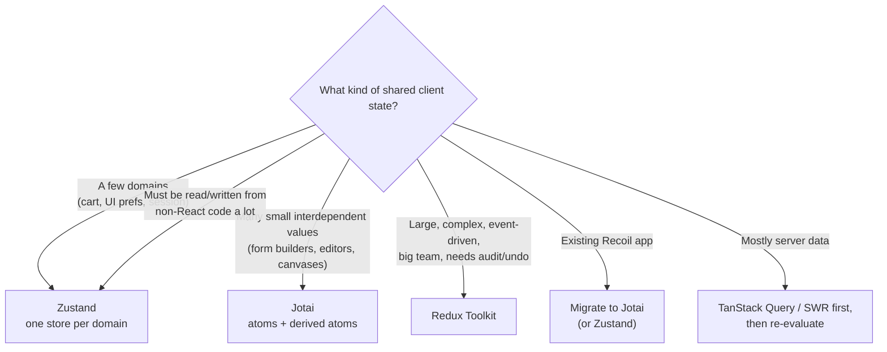

<!-- Generated by scripts/sync-knowledge.js from notes/ and README.md — do not edit here. -->
<!-- sections (line ranges in this file): Table of Contents 19-42 · ELI5 43-54 · Core Concept 55-458 · Comparison Table 459-475 · Decision Matrix 476-499 · Framework Comparison 500-517 · Real-World Examples 518-671 · Key Points Summary 672-692 · Test Your Understanding 693-778 · Cheat Sheet 779-833 · References & Further Reading 834-869 -->

# Zustand / Jotai / Recoil

> **Date:** 2026-11-06 · **Last updated:** 2026-11-06
> **Category:** Frontend System Design
> **Sub-Topic:** State & Data / State Management
> **Level:** Intermediate · **Reading time:** ~30 min
> **Informs:** choosing a lightweight React state library (module store vs atomic), selector and re-render strategy, store-per-request SSR setup, persistence and hydration, migrating off Recoil, sharing state outside React

> **Pre-requisite:** [Client State Management Patterns](./client-state-management-patterns.md) (pattern families, selectors, tearing) and [Redux & Redux Toolkit](./redux-and-redux-toolkit.md) (the heavyweight option these are compared against).
> This note covers the two dominant **lightweight** React state libraries — **Zustand** (module store) and **Jotai** (atomic) — and **Recoil**, the atomic library that popularized the model but is **no longer maintained**.

**Previous:** [Redux & Redux Toolkit](./redux-and-redux-toolkit.md) · **Next:** [Server State vs Client State](./server-state-vs-client-state.md)

---

## Table of Contents

1. [ELI5 — Simple Explanation](#eli5--simple-explanation)
2. [Section 1: Two Models — Top-Down Store vs Bottom-Up Atoms](#section-1-two-models--top-down-store-vs-bottom-up-atoms)
3. [Section 2: Zustand — Anatomy of a Store](#section-2-zustand--anatomy-of-a-store)
4. [Section 3: Zustand Selectors and Re-renders](#section-3-zustand-selectors-and-re-renders)
5. [Section 4: Zustand Middleware, Slices and Vanilla Stores](#section-4-zustand-middleware-slices-and-vanilla-stores)
6. [Section 5: Jotai — Atoms and the Dependency Graph](#section-5-jotai--atoms-and-the-dependency-graph)
7. [Section 6: Jotai Async Atoms, Utilities and Stores](#section-6-jotai-async-atoms-utilities-and-stores)
8. [Section 7: Recoil — What It Was and Its Status](#section-7-recoil--what-it-was-and-its-status)
9. [Section 8: Migrating from Recoil](#section-8-migrating-from-recoil)
10. [Section 9: SSR, Next.js and Hydration](#section-9-ssr-nextjs-and-hydration)
11. [Section 10: Persistence](#section-10-persistence)
12. [Comparison Table](#comparison-table)
13. [Decision Matrix](#decision-matrix)
14. [Framework Comparison](#framework-comparison)
15. [Real-World Examples](#real-world-examples)
16. [Key Points Summary](#key-points-summary)
17. [Test Your Understanding (with answers)](#test-your-understanding)
18. [Cheat Sheet](#cheat-sheet)
19. [References & Further Reading](#references--further-reading)

---

## ELI5 — Simple Explanation

Imagine organizing a kitchen:
- **Redux** is a restaurant kitchen with a head chef: every change goes through a written order ticket, and there's a rulebook for everything. Great for a big team — heavy for a home cook.
- **Zustand** is **one well-organized cupboard per topic** (a "cart" cupboard, a "UI" cupboard). Each cupboard has the food *and* the instructions for using it taped inside the door. You open it, grab exactly the shelf you need, and anyone in the house can use it — even people who aren't cooking (code outside React).
- **Jotai** is a **spice rack of tiny jars**. Each jar (atom) holds one thing. Some jars are "recipes" that combine other jars — when you refill the paprika, only recipes that use paprika get remade.
- **Recoil** was the first popular spice rack of this kind, built by Meta. It was never finished (it stayed "experimental") and Meta has **stopped looking after it**, so the jars are still on the shelf but nobody will fix them if they crack.

> **Zustand = small top-down stores with selectors. Jotai = bottom-up atoms with automatic dependency tracking. Recoil = the archived predecessor of the atomic model — migrate to Jotai (closest) or Zustand.**

---

## Core Concept — Step by Step

### Section 1: Two Models — Top-Down Store vs Bottom-Up Atoms



| | **Zustand** | **Jotai** | **Recoil** |
|---|---|---|---|
| Model | Module store (Flux-ish, without reducers required) | Atomic, derived atoms | Atomic, with string keys |
| Maintainers | Poimandres (pmndrs) open-source collective | Poimandres (pmndrs) | Meta (archived) |
| Unit of state | One store per domain, you design its shape | One atom per value | One atom per value |
| Subscription | Selector function you write | Automatic — per atom read | Automatic — per atom/selector |
| Provider needed | No (optional for SSR / scoping) | No (optional `Provider`) | Yes (`RecoilRoot`) |
| Outside React | First-class (`getState`, `setState`, `subscribe`) | Via a `store` (`store.get/set/sub`) | Limited |
| Async | Write async actions yourself | Async atoms + Suspense built in | Async selectors + Suspense |
| Status (late 2026) | Active | Active | **Archived — don't start new projects** |

Both Zustand and Jotai are very small libraries; check a bundle analyzer (e.g. bundlephobia) for current sizes rather than trusting numbers in blog posts.

---

### Section 2: Zustand — Anatomy of a Store

A Zustand store is **state + actions in one object**, created with `create`. The hook it returns *is* the store.

```typescript
import { create } from 'zustand';

type CartItem = { id: string; qty: number };
type CartState = {
  items: CartItem[];
  add: (id: string) => void;
  remove: (id: string) => void;
  clear: () => void;
};

// Note the curried create<T>()(...) — required for correct TypeScript inference with middleware
export const useCartStore = create<CartState>()((set) => ({
  items: [],
  add: (id) =>
    set((state) => {
      const found = state.items.find((i) => i.id === id);
      return {
        items: found
          ? state.items.map((i) => (i.id === id ? { ...i, qty: i.qty + 1 } : i))
          : [...state.items, { id, qty: 1 }],
      };
    }),
  remove: (id) => set((state) => ({ items: state.items.filter((i) => i.id !== id) })),
  clear: () => set({ items: [] }),
}));
```



**`set` semantics:**
- `set(partial)` or `set(state => partial)` **shallow-merges one level** into the state (like class-component `setState`). Nested objects must still be copied immutably.
- `set(newState, true)` **replaces** the whole state (careful — it drops the actions too unless you include them).
- `get()` (second argument of the creator) reads current state inside actions.

**Outside React** — the hook has static methods:

```typescript
useCartStore.getState().add('42');                       // e.g. from a WebSocket handler
const unsub = useCartStore.subscribe((state, prev) => {  // e.g. analytics
  if (state.items.length !== prev.items.length) track('cart_changed');
});
```

---

### Section 3: Zustand Selectors and Re-renders

A component re-renders when **its selector's result changes** (compared with `Object.is`).

```text
const count = useCartStore((s) => s.items.length);        ✅ primitive
const add   = useCartStore((s) => s.add);                 ✅ actions are stable references
const items = useCartStore((s) => s.items);               ✅ existing reference
const all   = useCartStore();                             ⚠️ no selector = whole state = re-render on ANY change
const { a, b } = useCartStore((s) => ({ a: s.a, b: s.b }));  ❌ new object every time
```

> **Zustand v5:** a selector that returns a **new reference on every call** can cause an infinite render loop ("Maximum update depth exceeded"), because v5 relies on React's `useSyncExternalStore` directly. Wrap such selectors in **`useShallow`**, or select fields separately.

```typescript
import { useShallow } from 'zustand/react/shallow';

// ✅ shallow-compares the returned object/array
const { items, clear } = useCartStore(useShallow((s) => ({ items: s.items, clear: s.clear })));
const ids = useCartStore(useShallow((s) => s.items.map((i) => i.id)));
```

If you need a custom equality function per hook (the v4 style), Zustand provides `createWithEqualityFn` from `zustand/traditional`.

**Pattern: export custom hooks, not the raw store.** It keeps selectors consistent and lets you change the store shape later:

```typescript
export const useCartCount = () => useCartStore((s) => s.items.reduce((n, i) => n + i.qty, 0));
export const useCartActions = () => useCartStore(useShallow((s) => ({ add: s.add, remove: s.remove, clear: s.clear })));
```

---

### Section 4: Zustand Middleware, Slices and Vanilla Stores

Middleware wraps the store creator. Order matters — `devtools` usually goes **outermost**.



| Middleware | Import | Purpose |
|---|---|---|
| `devtools` | `zustand/middleware` | Connects to the Redux DevTools extension (actions are labelled by an optional third `set` argument) |
| `persist` | `zustand/middleware` | Saves/restores state to storage with `partialize`, `version`, `migrate` |
| `immer` | `zustand/middleware/immer` | Write `set((s) => { s.items.push(x) })` (requires the `immer` package) |
| `subscribeWithSelector` | `zustand/middleware` | `store.subscribe(selector, listener)` — listen to a slice outside React |
| `combine` | `zustand/middleware` | Infers types from initial state + actions |

**Slices pattern** — split a large store into feature slices that are combined into one store (useful when slices need to read each other). For unrelated domains, prefer **separate stores**.

**Vanilla stores** — `createStore` from `zustand/vanilla` creates a store with no React dependency; read it in React with `useStore(store, selector)`. This is the building block for **per-request stores in SSR** (Section 9) and for sharing state with non-React code.

---

### Section 5: Jotai — Atoms and the Dependency Graph

An **atom** is a *config object* describing a piece of state. Values live in a **store**; components subscribe to exactly the atoms they read. No string keys — atoms are identified by **object reference**.

```typescript
import { atom } from 'jotai';

export const priceAtom = atom(10);                                // primitive (read-write)
export const qtyAtom = atom(2);
export const totalAtom = atom((get) => get(priceAtom) * get(qtyAtom)); // derived (read-only)

export const discountedTotalAtom = atom(
  (get) => get(totalAtom) * 0.9,                                  // read
  (get, set, newTotal: number) => set(priceAtom, newTotal / 0.9 / get(qtyAtom)) // write
);

export const resetAtom = atom(null, (_get, set) => {              // write-only "action" atom
  set(priceAtom, 10);
  set(qtyAtom, 2);
});
```



| Hook | Returns | Re-renders on change? |
|---|---|---|
| `useAtom(a)` | `[value, setValue]` | Yes |
| `useAtomValue(a)` | `value` | Yes |
| `useSetAtom(a)` | `setValue` | **No** — use for buttons that only write |

**Why atoms scale for fine-grained UIs:** dependencies are tracked automatically from `get()` calls, so you never write selectors, and adding a new derived value is one line. Atoms are also naturally **code-split** — an atom defined in a lazily loaded module costs nothing until used.

**Gotcha — define atoms outside render.** `atom()` inside a component body creates a new atom (new identity, new state) every render. If you need per-instance atoms, create them with `useMemo`, or use a parameterized utility such as `atomFamily` (it caches atoms per parameter; remove unused entries to avoid memory growth — check the Jotai docs for the current recommended package and API).

---

### Section 6: Jotai Async Atoms, Utilities and Stores

**Async atoms** return a Promise; reading them **suspends** the component until it resolves (wrap in `<Suspense>` and an error boundary).



```typescript
import { atom } from 'jotai';
import { loadable, unwrap } from 'jotai/utils';

export const userIdAtom = atom('u1');
export const userAtom = atom(async (get, { signal }) => {
  const res = await fetch(`/api/users/${get(userIdAtom)}`, { signal }); // aborted if userId changes
  if (!res.ok) throw new Error(`HTTP ${res.status}`);
  return (await res.json()) as { id: string; name: string };
});

export const userLoadableAtom = loadable(userAtom);          // { state: 'loading' | 'hasData' | 'hasError', ... }
export const userOrNullAtom = unwrap(userAtom, () => null);  // keeps last value / fallback, no Suspense
```

> Async atoms are fine for **derived async computations**, but for real server data (caching, refetching, invalidation, retries) use a server-state library — or the **`jotai-tanstack-query`** integration that exposes TanStack Query as atoms. See [Server State vs Client State](./server-state-vs-client-state.md).

**Useful utilities** (`jotai/utils` unless noted): `atomWithStorage` (persistence), `atomWithReset` + `RESET`, `atomWithReducer`, `selectAtom` (select part of a big atom), `splitAtom` (array → atom per item, great for lists), `loadable`, `unwrap`, `useHydrateAtoms` (SSR). Ecosystem packages add optics (`jotai-optics`), effects (`jotai-effect`), Immer (`jotai-immer`) and DevTools (`jotai-devtools`).

**Stores and Providers:**

```typescript
import { createStore, Provider } from 'jotai';

const store = createStore();          // an isolated atom-value container
store.set(userIdAtom, 'u2');          // outside React
store.get(userIdAtom);
const unsub = store.sub(userIdAtom, () => console.log('changed'));

// <Provider store={store}>...</Provider> scopes atom values to a subtree.
// Without a Provider, Jotai uses a default global store ("provider-less mode") — fine for SPAs, not for SSR.
```

---

### Section 7: Recoil — What It Was and Its Status

Recoil was released by Meta (as `facebookexperimental/Recoil`) in 2020 and introduced many React developers to **atoms and selectors**: `atom({ key, default })`, `selector({ key, get })`, `RecoilRoot`, `useRecoilState`, async selectors with Suspense, atom families, snapshots and atom effects.



**Status as of late 2026:**
- The repository is **archived** — no fixes, no security patches, no new React support.
- It always remained **experimental** (0.x).
- Recoil relied on React internals; developers have reported **breakage with React 19**, and no fix will come. Treat it as incompatible with current React unless you've verified otherwise in your exact setup.
- **Don't start new projects with Recoil.** Plan a migration for existing ones, especially before upgrading React.

| Recoil concept | Why it mattered | Modern equivalent |
|---|---|---|
| `atom({ key, default })` | Fine-grained shared state | Jotai `atom(default)` (no key needed) |
| `selector({ key, get })` | Derived state with dependency tracking | Jotai derived atom `atom((get) => ...)` |
| Async selector + Suspense | Data-dependent derived values | Jotai async atom; TanStack Query for server data |
| `atomFamily` / `selectorFamily` | Parameterized state | Jotai `atomFamily` utility, or atoms created per id |
| `RecoilRoot` | State container | Jotai `Provider` (optional) |
| Atom effects | Sync atoms with storage/URL/server | `atomWithStorage`, `onMount`, `jotai-effect` |
| Snapshots / time travel | Debugging | `jotai-devtools`; Redux DevTools with Zustand |

---

### Section 8: Migrating from Recoil



```typescript
// BEFORE — Recoil
import { atom, selector, useRecoilState, useRecoilValue } from 'recoil';
const todosState = atom<Todo[]>({ key: 'todosState', default: [] });
const remainingState = selector({
  key: 'remainingState',
  get: ({ get }) => get(todosState).filter((t) => !t.done).length,
});
// const [todos, setTodos] = useRecoilState(todosState);
// const remaining = useRecoilValue(remainingState);

// AFTER — Jotai
import { atom, useAtom, useAtomValue } from 'jotai';
const todosAtom = atom<Todo[]>([]);
const remainingAtom = atom((get) => get(todosAtom).filter((t) => !t.done).length);
// const [todos, setTodos] = useAtom(todosAtom);
// const remaining = useAtomValue(remainingAtom);
```

Migration tips:
- Migrate **leaf features first**; Recoil and Jotai can coexist during the transition.
- Replace **async selectors that fetch** with a query library rather than porting them 1:1.
- Recoil `key` strings disappear — but give atoms a `debugLabel` for DevTools.
- Re-test Suspense boundaries: async atoms suspend in similar places, but loading states may shift.

---

### Section 9: SSR, Next.js and Hydration

Module-level stores are **shared across requests on the server**. Both libraries document a per-request pattern.



| | Zustand | Jotai |
|---|---|---|
| Per-request store | `createStore` (vanilla) inside a context provider; read with `useStore(store, selector)` | `<Provider>` (creates its own store) or `<Provider store={createStore()}>` |
| Seed initial data | Pass to the store factory | `useHydrateAtoms([[atom, value]])` inside the Provider |
| Server Components | Can't use either (no hooks/context) — pass data as props | Same |
| Docs | "Setup with Next.js" guide | "Next.js" and "SSR" guides |

**Hydration mismatch with persistence:** the server can't read `localStorage`, so if the client's first render uses persisted values, the HTML won't match. Options: render the default first and apply persisted values after mount (Zustand `persist` with `skipHydration: true` + `useStore.persist.rehydrate()` in an effect; Jotai's `atomWithStorage` by default starts from the initial value and reads storage after mount), or keep server-relevant values (theme, locale) in **cookies**.

---

### Section 10: Persistence

```typescript
import { create } from 'zustand';
import { createJSONStorage, devtools, persist } from 'zustand/middleware';

type Prefs = { density: 'comfortable' | 'compact'; recent: string[]; setDensity: (d: Prefs['density']) => void };

export const usePrefs = create<Prefs>()(
  devtools(
    persist(
      (set) => ({
        density: 'comfortable',
        recent: [],
        setDensity: (density) => set({ density }, undefined, 'prefs/setDensity'), // 3rd arg = DevTools action name
      }),
      {
        name: 'prefs',                                     // storage key
        storage: createJSONStorage(() => localStorage),    // React Native: () => AsyncStorage
        partialize: (s) => ({ density: s.density }),       // whitelist — don't persist everything
        version: 2,
        migrate: (persisted, version) => {
          const old = persisted as { density?: string };
          return version < 2 ? { density: old.density === 'small' ? 'compact' : 'comfortable' } : (persisted as Prefs);
        },
      }
    ),
    { name: 'PrefsStore' }
  )
);
```

```typescript
// Jotai
import { atomWithStorage } from 'jotai/utils';
export const densityAtom = atomWithStorage<'comfortable' | 'compact'>('density', 'comfortable');
// Uses localStorage by default; pass createJSONStorage(() => sessionStorage) as the 3rd argument to change it.
```

Same rules as any persisted state: **whitelist** fields, **version + migrate**, never store tokens or sensitive data in `localStorage` (see [Browser Storage Mechanisms](./browser-storage-mechanisms.md)), and handle `storage` events if tabs must stay in sync.

---

## Comparison Table

| Criterion | Redux Toolkit | Zustand | Jotai | Recoil |
|---|---|---|---|---|
| Mental model | Events → reducers | Store object with actions | Atoms + derived atoms | Atoms + selectors |
| Boilerplate | Medium (much less than legacy Redux) | Very low | Very low | Low |
| Re-render control | Selectors (`useSelector`) | Selectors (+ `useShallow`) | Automatic per atom | Automatic per atom |
| Derived state | `createSelector` | Compute in selectors/custom hooks | Derived atoms (first-class) | Selectors (first-class) |
| Async | Thunks, listeners, RTK Query | Plain async actions | Async atoms + Suspense | Async selectors + Suspense |
| DevTools | Redux DevTools (built in) | Redux DevTools via `devtools` | `jotai-devtools` | Recoil DevTools tooling (unmaintained) |
| Use outside React | Yes | Yes (first-class) | Yes (`store.get/set/sub`) | Limited |
| SSR | Store per request | Vanilla store per request | Provider per request | `RecoilRoot` per request |
| Enforced structure | Strong | Weak | Weak | Weak |
| Status | Active | Active | Active | **Archived** |

---

## Decision Matrix



| Situation | Pick | Reason |
|---|---|---|
| Global UI state (sidebar, modals, toasts, theme) | Zustand | Tiny API, selectors, easy outside React (toast from anywhere) |
| Shopping cart, player state, auth session info | Zustand | Natural "object with actions" shape |
| Spreadsheet/form-builder/diagram where each cell/field is independently editable | Jotai | Per-atom subscriptions, derived graph, `splitAtom` for lists |
| State that depends on async data per item | Jotai async atoms (or TanStack Query + atoms) | Suspense integration, dependency tracking |
| 30+ engineers, strict conventions, complex workflows | Redux Toolkit | Enforced structure, middleware, DevTools |
| New project considering Recoil | **Don't** — use Jotai | Recoil is archived |
| Sharing state across Astro islands / frameworks | Nanostores | Framework-agnostic |

---

## Framework Comparison

Zustand and Jotai are **React libraries** (Zustand's vanilla core and Jotai's `jotai/vanilla` store are framework-agnostic, but the ergonomic APIs target React). The equivalent idioms elsewhere:

| Stack | "Zustand-like" (module store) | "Jotai-like" (atomic / fine-grained) |
|---|---|---|
| **React Native** | Zustand (persist with `AsyncStorage`) | Jotai (`atomWithStorage` + `createJSONStorage(() => AsyncStorage)`) |
| **Vue 3** | **Pinia** setup stores | `ref`/`computed` in shared composables (Vue's reactivity is already fine-grained) |
| **Angular** | Signal-based services, **NgRx SignalStore** | `signal()` + `computed()` — atoms are built in |
| **Svelte 5** | `$state` objects in `.svelte.ts` modules, classes with `$state` fields | `$state` + `$derived` |
| **Solid** | `createStore` | `createSignal` + `createMemo` |
| **Multi-framework / islands** | **Nanostores** (`atom`, `map`, `computed`) | Nanostores |
| **SwiftUI / Compose** | `@Observable` model / `ViewModel` + `StateFlow` | Fine-grained observation is built into both |

> The atomic idea that Recoil popularized is essentially what **signals** provide natively in Angular, Vue, Svelte and Solid — see [Client State Management Patterns](./client-state-management-patterns.md).

---

## Real-World Examples

**Example 1 — Zustand selectors (BAD → GOOD):**
```tsx
import { useShallow } from 'zustand/react/shallow';
import { useCartStore } from './cartStore';

// ❌ BAD: subscribes to the whole store — re-renders on every change anywhere in it
function CartBadgeBad() {
  const { items } = useCartStore();
  return <span>{items.length}</span>;
}

// ❌ BAD (v5): new object every call → infinite loop / constant re-renders
function CartSummaryBad() {
  const { items, clear } = useCartStore((s) => ({ items: s.items, clear: s.clear }));
  return <button onClick={clear}>Clear {items.length}</button>;
}

// ✅ GOOD: primitive selector
function CartBadge() {
  const count = useCartStore((s) => s.items.reduce((n, i) => n + i.qty, 0));
  return <span aria-label={`${count} items in cart`}>{count}</span>;
}

// ✅ GOOD: shallow-compared object
function CartSummary() {
  const { items, clear } = useCartStore(useShallow((s) => ({ items: s.items, clear: s.clear })));
  return <button onClick={clear}>Clear {items.length}</button>;
}
```

**Example 2 — Zustand with Immer, DevTools and a toast store used outside React:**
```typescript
import { create } from 'zustand';
import { devtools } from 'zustand/middleware';
import { immer } from 'zustand/middleware/immer';

type Toast = { id: number; message: string; kind: 'info' | 'error' };
type ToastState = { toasts: Toast[]; push: (message: string, kind?: Toast['kind']) => void; dismiss: (id: number) => void };

let nextId = 1;
export const useToasts = create<ToastState>()(
  devtools(
    immer((set) => ({
      toasts: [],
      push: (message, kind = 'info') =>
        set((s) => { s.toasts.push({ id: nextId++, message, kind }); }),   // Immer draft
      dismiss: (id) =>
        set((s) => { s.toasts = s.toasts.filter((t) => t.id !== id); }),
    })),
    { name: 'ToastStore' }
  )
);

// Anywhere — an API client interceptor, not a component:
export function onApiError(err: Error) {
  useToasts.getState().push(err.message, 'error');
}
```

**Example 3 — Zustand store per request for Next.js App Router:**
```tsx
// stores/counter-store.ts
import { createStore } from 'zustand/vanilla';
export type CounterState = { count: number; inc: () => void };
export const createCounterStore = (init = 0) =>
  createStore<CounterState>()((set) => ({ count: init, inc: () => set((s) => ({ count: s.count + 1 })) }));
export type CounterStore = ReturnType<typeof createCounterStore>;

// providers/counter-store-provider.tsx
'use client';
import { createContext, useContext, useRef, type ReactNode } from 'react';
import { useStore } from 'zustand';
import { createCounterStore, type CounterState, type CounterStore } from '../stores/counter-store';

const CounterStoreContext = createContext<CounterStore | null>(null);

export function CounterStoreProvider({ initial, children }: { initial: number; children: ReactNode }) {
  const ref = useRef<CounterStore | null>(null);
  if (!ref.current) ref.current = createCounterStore(initial); // one per request / per tab
  return <CounterStoreContext.Provider value={ref.current}>{children}</CounterStoreContext.Provider>;
}

export function useCounterStore<T>(selector: (s: CounterState) => T): T {
  const store = useContext(CounterStoreContext);
  if (!store) throw new Error('useCounterStore must be used within CounterStoreProvider');
  return useStore(store, selector);
}
```

**Example 4 — Jotai: per-item atoms for a large editable list (`splitAtom`):**
```tsx
import { atom, useAtom, useAtomValue, useSetAtom, type PrimitiveAtom } from 'jotai';
import { splitAtom } from 'jotai/utils';

type Row = { id: string; label: string; done: boolean };
const rowsAtom = atom<Row[]>([]);
const rowAtomsAtom = splitAtom(rowsAtom, (r) => r.id);         // one atom per row, keyed by id
const doneCountAtom = atom((get) => get(rowsAtom).filter((r) => r.done).length);

function RowItem({ rowAtom, remove }: { rowAtom: PrimitiveAtom<Row>; remove: () => void }) {
  const [row, setRow] = useAtom(rowAtom);                       // editing one row re-renders only this row
  return (
    <li>
      <input type="checkbox" checked={row.done} onChange={() => setRow({ ...row, done: !row.done })} aria-label={row.label} />
      <input value={row.label} onChange={(e) => setRow({ ...row, label: e.target.value })} />
      <button onClick={remove}>Delete</button>
    </li>
  );
}

export function RowList() {
  const [rowAtoms, dispatch] = useAtom(rowAtomsAtom);
  const done = useAtomValue(doneCountAtom);
  const setRows = useSetAtom(rowsAtom);                          // write-only: no re-render from this hook
  return (
    <>
      <p>{done} done</p>
      <ul>
        {rowAtoms.map((rowAtom) => (
          <RowItem key={`${rowAtom}`} rowAtom={rowAtom} remove={() => dispatch({ type: 'remove', atom: rowAtom })} />
        ))}
      </ul>
      <button onClick={() => setRows((rows) => [...rows, { id: crypto.randomUUID(), label: '', done: false }])}>Add</button>
    </>
  );
}
```

**Example 5 — Jotai SSR hydration with a scoped Provider:**
```tsx
'use client';
import { Provider } from 'jotai';
import { useHydrateAtoms } from 'jotai/utils';
import type { ReactNode } from 'react';
import { userIdAtom } from './atoms';

function Hydrate({ userId, children }: { userId: string; children: ReactNode }) {
  useHydrateAtoms([[userIdAtom, userId]]);   // sets the value once, before children read it
  return children;
}

export function AtomsProvider({ userId, children }: { userId: string; children: ReactNode }) {
  return (
    <Provider>                               {/* new store per Provider instance = per request */}
      <Hydrate userId={userId}>{children}</Hydrate>
    </Provider>
  );
}
```

---

## Key Points Summary

| Concept | One-Line Explanation |
|---|---|
| **Zustand** | Hook-based module store: state + actions in one object, selectors for subscriptions |
| **`set`** | Shallow-merges one level; `set(x, true)` replaces |
| **`useShallow`** | Shallow-compares selector results that are new objects/arrays |
| **Zustand outside React** | `getState`, `setState`, `subscribe` on the hook |
| **Vanilla store** | `createStore` from `zustand/vanilla` — per-request SSR, non-React use |
| **Jotai atom** | Config object for one value; identity = reference, no string key |
| **Derived atom** | `atom(get => ...)`; dependencies tracked automatically |
| **Write-only atom** | `atom(null, (get, set, arg) => ...)` — an "action" |
| **Async atom** | Returns a Promise; suspends readers; `loadable`/`unwrap` to avoid Suspense |
| **`splitAtom`** | Turns an array atom into per-item atoms for fine-grained lists |
| **Jotai store / Provider** | Holds atom values; Provider scopes them (required per request in SSR) |
| **Recoil** | Meta's atomic library — archived, experimental forever, reported issues with React 19 |
| **Recoil → Jotai** | Near 1:1 mapping: atom → atom, selector → derived atom, RecoilRoot → Provider |
| **Persistence** | `persist` (Zustand) / `atomWithStorage` (Jotai); whitelist, version, migrate |

---

## Test Your Understanding

**Q1 (Basic):**
What's the core difference between Zustand's and Jotai's models, and how does each decide which components re-render?

<details>
<summary>Answer</summary>

**Zustand** is top-down: you design one store object (state + actions) per domain, and each component passes a **selector**; after any `set`, Zustand re-runs every subscribed selector and re-renders components whose result changed (`Object.is`, or shallow with `useShallow`).

**Jotai** is bottom-up: state is many small **atoms**, and derived atoms declare dependencies by calling `get()`. A component re-renders only when an atom it **reads** changes; derived atoms recompute only when their dependencies change. There are no selectors to write — the dependency graph *is* the subscription system.
</details>

**Q2 (Application):**
After upgrading to Zustand v5, a component crashes with "Maximum update depth exceeded". It uses `const { user, logout } = useAuth((s) => ({ user: s.user, logout: s.logout }))`. Why, and what are two fixes?

<details>
<summary>Answer</summary>

The selector returns a **new object on every call**. Zustand v5 uses React's `useSyncExternalStore` directly, which requires `getSnapshot` to return a cached (identical) value when nothing changed; a fresh object every time looks like a constant change, so React keeps re-rendering until it bails out with this error. (In v4 the same code "only" caused unnecessary re-renders.)

Fixes: (1) wrap with `useShallow`: `useAuth(useShallow((s) => ({ user: s.user, logout: s.logout })))`; (2) select separately: `const user = useAuth((s) => s.user); const logout = useAuth((s) => s.logout);`. For a custom equality, use `createWithEqualityFn` from `zustand/traditional`.
</details>

**Q3 (Tricky):**
A developer writes this, and the counter resets to 0 on every re-render of the parent. Why?
```tsx
function Counter() {
  const countAtom = atom(0);
  const [count, setCount] = useAtom(countAtom);
  return <button onClick={() => setCount((c) => c + 1)}>{count}</button>;
}
```

<details>
<summary>Answer</summary>

Jotai atoms are identified by **object reference**. `atom(0)` inside the component body creates a **new atom on every render**, so after any re-render `useAtom` subscribes to a brand-new atom whose value is its initial `0`. (The old atom's value is orphaned and garbage-collected.)

Fix: define atoms at **module level**. If you really need one atom per component instance, create it once with `useMemo(() => atom(0), [])` (or `useState(() => atom(0))[0]`) — or just use `useState`, since state used by one component should be local anyway.
</details>

**Q4 (Tricky):**
A team plans to upgrade from React 18 to React 19. Their app uses Recoil for ~60 atoms and ~25 selectors (8 of which fetch data). What do you advise, and in what order?

<details>
<summary>Answer</summary>

Recoil's repository is **archived** and it was never stable; developers have reported breakage with React 19, and no fix is coming. So migrate **before** (or as part of) the React upgrade:

1. **Move the 8 data-fetching selectors** to TanStack Query/SWR (proper caching, invalidation, retries) — don't port them to async atoms 1:1.
2. **Port the rest to Jotai**, feature by feature, since the model maps nearly 1:1 (`atom({key, default})` → `atom(default)`, `selector({get})` → `atom(get => ...)`, `useRecoilState` → `useAtom`, families → per-id atoms or `atomFamily`). Both libraries can run side by side during migration.
3. Re-check Suspense boundaries and add tests around the migrated features.
4. Remove `RecoilRoot` and the dependency, then upgrade React.
Zustand is a fine alternative for features whose state is a few global values rather than a graph.
</details>

**Q5 (Application):**
Your Next.js app uses `export const useCart = create(...)` with `persist`. Users report (a) a React hydration warning on pages with the cart badge and (b) rarely seeing another user's cart count in the server-rendered HTML. Explain both and fix them.

<details>
<summary>Answer</summary>

(a) **Hydration mismatch:** the server renders the badge with the default (0 items) because it can't read `localStorage`, but on the client the persisted cart is restored and the first client render shows a different number. Fix: render the default first and rehydrate after mount (`persist` option `skipHydration: true` and call `useCart.persist.rehydrate()` in an effect), or render the badge client-only, or store the cart server-side/cookie if the server should know it.

(b) **Cross-request leak:** `create(...)` at module level makes **one store per server process**, shared by all requests. If any server code writes to it (e.g. seeding from a request), concurrent requests can see each other's data. Fix: use a **vanilla `createStore` per request inside a client provider** (Example 3) and never write user data to module-level stores on the server.
</details>

**Q6 (System design):**
Design state for a Notion-like block editor: documents of hundreds of blocks, each editable; a sidebar with page tree; slash-command menu; toasts; presence; offline drafts. Which pieces go in Zustand, which in Jotai, and which elsewhere?

<details>
<summary>Answer</summary>

- **Blocks:** fine-grained and independently edited → **Jotai** with an atom per block (e.g. `splitAtom` over a normalized block list, or an atom per block id), and derived atoms for word count, outline/table of contents and selection. Typing in one block re-renders only that block.
- **Document sync and presence:** server/sync state → a real-time layer (CRDT/OT over WebSocket) that writes into the block atoms; presence in a separate store updated at animation-frame rate. See [Real-Time Data Sync](./real-time-data-sync.md).
- **Page tree, workspace, permissions:** server state → TanStack Query (with optimistic updates for renames/moves).
- **App UI chrome** (sidebar open, active modal, toasts, command palette) → **Zustand**: a few small stores, easy to call from anywhere (`useToasts.getState().push(...)` from the API layer).
- **Slash menu open/position, hover:** local component state.
- **URL:** current page id and block anchor (`/p/abc#block-xyz`).
- **Offline drafts:** IndexedDB via the sync engine, not `localStorage` persist (size, structure) — see [Offline-First Architecture](./offline-first-architecture.md).
Trade-off to mention: two state libraries add cognitive load; a team could use Jotai alone (atoms for chrome too) or Zustand alone (with careful per-block selectors). Choosing both is justified only if the block graph truly benefits from atoms.
</details>

---

## Cheat Sheet

**Key Definitions:**
- **Store (Zustand):** Object of state + actions created with `create` / `createStore`
- **Selector:** Function picking what a component subscribes to
- **Atom (Jotai):** Config for one piece of state; values live in a store
- **Derived atom:** Atom whose read function calls `get()` on other atoms
- **Provider (Jotai):** Scopes a store to a subtree; needed per request in SSR
- **Recoil:** Meta's archived atomic state library (atoms with string keys + selectors)

**Quick Reference:**
```text
ZUSTAND
create<T>()((set, get) => ({ ...state, action: () => set(partial) }))
useStore(s => s.field)                     primitive or existing reference
useStore(useShallow(s => ({ a: s.a })))    objects/arrays from selectors
useStore.getState() / setState() / subscribe()   outside React
createStore (zustand/vanilla) + useStore(store, selector)   SSR per request
middleware: devtools(persist(immer(creator)))    devtools outermost
persist: { name, storage: createJSONStorage(() => localStorage), partialize, version, migrate, skipHydration }

JOTAI
atom(initial)                              primitive
atom(get => ...)                           derived (read-only)
atom(get => ..., (get, set, arg) => ...)   derived writable
atom(null, (get, set, arg) => ...)         write-only action
useAtom / useAtomValue / useSetAtom        read+write / read / write (no re-render)
atom(async get => ...)                     suspends; loadable() / unwrap() to avoid Suspense
splitAtom, selectAtom, atomWithStorage, useHydrateAtoms   (jotai/utils)
createStore() + <Provider store>           scoping, SSR, tests

RECOIL → JOTAI
atom({ key, default }) → atom(default) · selector({ key, get }) → atom(get => ...)
useRecoilState → useAtom · useRecoilValue → useAtomValue · useSetRecoilState → useSetAtom
RecoilRoot → Provider (optional)
```

**Common Mistakes to Avoid:**

| Mistake | Why Wrong | Fix |
|---|---|---|
| `useStore()` with no selector | Re-renders on every store change | Select only what you need |
| Selector returns a new object/array (v5) | Infinite loop or constant re-renders | `useShallow` or separate selectors |
| Mutating state inside `set` without Immer | Same reference → subscribers miss it | Return new objects, or use the `immer` middleware |
| `set(newState, true)` without actions | Replaces the whole state, actions vanish | Omit `true` (merge) or include actions |
| Module-level stores in SSR | Shared across requests → leaks | Vanilla store / Jotai Provider per request |
| Reading persisted values on first SSR render | Hydration mismatch | `skipHydration` + `rehydrate()` after mount; cookies for server-known values |
| Creating atoms inside components | New atom every render → state resets | Module-level atoms, or `useMemo` |
| Async atoms as a server cache | No invalidation, retries or dedupe policy | TanStack Query / `jotai-tanstack-query` |
| Unbounded `atomFamily` usage | Memory grows with every parameter | Remove unused params; prefer per-id atoms in a normalized structure |
| Starting a new project on Recoil | Archived, reported React 19 issues | Jotai or Zustand |
| Persisting the whole store | Stale/bloated storage, secrets on disk | `partialize` whitelist + `version`/`migrate` |

---

## References & Further Reading

**Zustand**
- Zustand: [Documentation](https://zustand.docs.pmnd.rs/) · [GitHub](https://github.com/pmndrs/zustand)
- Zustand: [Migrating to v5](https://zustand.docs.pmnd.rs/reference/migrations/migrating-to-v5)
- Zustand: [Setup with Next.js](https://zustand.docs.pmnd.rs/learn/guides/nextjs)
- Zustand: [Prevent rerenders with `useShallow`](https://zustand.docs.pmnd.rs/learn/guides/prevent-rerenders-with-use-shallow)
- Zustand: [`persist` middleware](https://zustand.docs.pmnd.rs/reference/middlewares/persist) · [Slices pattern](https://zustand.docs.pmnd.rs/learn/guides/slices-pattern)

**Jotai**
- Jotai: [Documentation](https://jotai.org/) · [GitHub](https://github.com/pmndrs/jotai)
- Jotai: [Core `atom`](https://jotai.org/docs/core/atom) · [Store](https://jotai.org/docs/core/store) · [Provider](https://jotai.org/docs/core/provider)
- Jotai: [Async](https://jotai.org/docs/guides/async) · [Next.js](https://jotai.org/docs/guides/nextjs) · [SSR utilities (`useHydrateAtoms`)](https://jotai.org/docs/utilities/ssr)
- Jotai: [Comparison (with Zustand, Recoil, Valtio)](https://jotai.org/docs/basics/comparison)
- Jotai: [`atomWithStorage`](https://jotai.org/docs/utilities/storage) · [`splitAtom`](https://jotai.org/docs/utilities/split)
- Jotai: [TanStack Query integration](https://jotai.org/docs/extensions/query)

**Recoil**
- GitHub: [facebookexperimental/Recoil (archived)](https://github.com/facebookexperimental/Recoil)
- Recoil: [Docs site](https://recoiljs.org/)

**Related**
- Valtio: [Docs](https://valtio.dev/) (proxy-based state from the same collective)
- Nanostores: [GitHub](https://github.com/nanostores/nanostores)
- React: [`useSyncExternalStore`](https://react.dev/reference/react/useSyncExternalStore)
- Daishi Kato (maintainer of Zustand, Jotai and Valtio): [Blog](https://blog.axlight.com/)

---

> **Previous Topic:** [Redux & Redux Toolkit](./redux-and-redux-toolkit.md)
> — The Flux pattern in depth and the modern Redux Toolkit API

> **Next Topic:** [Server State vs Client State](./server-state-vs-client-state.md)
> — Why fetched data is a cache, not "state", and how that splits your architecture

*Saved on: 2026-11-06 | Repo: Frontend System Design Learning Notes*
